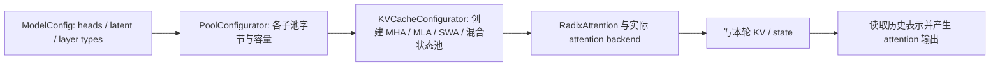
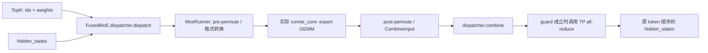
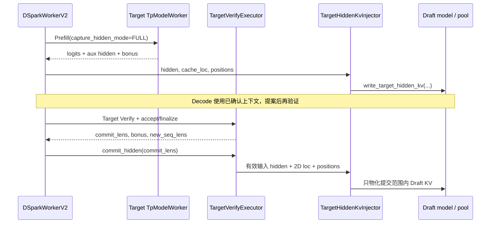

# 推理面试：模型算法、注意力、算子与投机解码

本册覆盖 Q02、Q04、Q21–Q34。先建立形状、状态和成本模型，再追本仓库的执行链；每题可以按“口述机制 → 手算例子 → 找到状态写入与下一消费者 → 设计生产验收”的顺序练习。回到 [50 题总目录](README.md)，或对照 [引擎研发](engine-development.md) 与 [平台部署](platform-deployment.md)。

源码基线为 2026-10-15 的 SGLang 工作树，HEAD 为 `f01a0c7f97`，包含当时已有的未提交修改。执行示例默认 NVIDIA CUDA；通用 `TpModelWorker` 路径与 MLX override、ROCm/NPU 后端并不等同。投机题另行说明算法边界。本册的数值都是手算示例或建议的验证标准，没有声称已运行 GPU、PD 或生产实验。论文说明算法定义，本地源码说明当前实现；两者分别举证。

<a id="q02"></a>
## Q02 Prefill 与 Decode 的瓶颈为何不同

### 问题与追问

**主问：Prefill 和 Decode 为什么经常有不同瓶颈？哪些条件会改变这个判断？**

1. 把 Decode batch 从 1 增到 128，为什么有时更接近矩阵乘性能，有时却被 KV 读取和通信拖慢？
2. 开启 GQA、长上下文、量化、投机验证或 PD 分离后，原来的瓶颈结论还成立吗？

### 参考答案

先把“每轮处理多少个新位置”说清楚。Prefill 同时计算输入中的许多 token，Linear 可以把 token 展平成矩阵的 M 轴，重复利用同一份权重；普通 Decode 每个活跃请求只增加一个位置，小 batch 时权重读取和 kernel 启动较难被大量乘加摊薄。以 `X[M,4096] × W[4096,4096]` 为例，M=1 与 M=1024 的权重相同，乘加量却相差 1024 倍。因此“小 batch Decode 常受带宽或调度开销限制、长 Prefill 常有较强计算压力”是有条件的经验，而非阶段名字带来的定律。[NVIDIA 矩阵乘性能指南](https://docs.nvidia.com/deeplearning/performance/dl-performance-matrix-multiplication/index.html)解释了这种形状与算术强度的关系。

Attention 还增加一条独立成本轴：历史长度。Decode 的 Q 只有本轮新位置，却要访问先前有效 KV；batch 大、上下文长时，KV 流量可以压过权重流量。Prefill 的 QK/AV 计算随本轮长度与可见历史共同变化，prefix cache 命中只免去已缓存位置的重算，后缀仍可能读取长前缀。GQA/MQA 减少 KV heads，量化减少字节，SWA 缩短可见窗口，都会改变谁最贵。投机 Target Verify 一轮有多个候选位置，也不能沿用普通一请求一 token 的 Decode shape。

实际回答应落到时间分解：等待队列、CPU 准备、H2D/metadata、model kernels、collective、采样和 D2H。比较同模型在 batch、输入长度、输出长度上的扫参结果，再核对实际 runner 与 attention backend。小 Prefill 可能 launch 受限，大 Decode 可能计算受限，多机 MoE 可能通信受限；Graph、overlap、量化能否获益都取决于关键路径。优化目标最后回到请求的 TTFT、ITL 与满足 SLA 的 goodput，而不能用某个 GEMM 的高利用率替代服务收益；统计口径见 [Q03](platform-deployment.md#q03)。

### 源码调用链与证据

```text
Scheduler.run_batch(batch: ScheduleBatch)
  → 当前 self.model_worker.forward_batch_generation(...)
  → 普通 TpModelWorker: ForwardBatch.init_new(batch, model_runner)
  → ModelRunner._forward_raw(fb)
      ├─ decode-family graph 可用 → DecodeCudaGraphRunner.execute → logits
      └─ padding/同步形状准备 → split / prefill graph / EagerRunner
  → PP 最后 rank 采样 → GenerationBatchResult → Scheduler 结果处理
```

当前 worker 选择及转换见 [Scheduler 的 model_worker](/Users/magician/PycharmProjects/sglang/python/sglang/srt/managers/scheduler.py:924)、[TpModelWorker 的 ForwardBatch 构造](/Users/magician/PycharmProjects/sglang/python/sglang/srt/managers/tp_worker.py:547)；实际 runner 分派见 [ModelRunner._forward_raw](/Users/magician/PycharmProjects/sglang/python/sglang/srt/model_executor/model_runner.py:1479)。Decode attention 真正传入 Q、KV buffer、索引和 split 数量的边界见 [TritonAttnBackend.forward_decode](/Users/magician/PycharmProjects/sglang/python/sglang/srt/layers/attention/triton_backend.py:1799)。硬件分派与时序详情见 [Q13](engine-development.md#q13)、[Q17](engine-development.md#q17)。

### 生产实践追问

- 输入从 2K 变 32K，ITL 翻倍：分离 attention、Linear、collective 时间，记录每轮活跃 batch 与可见 KV 长度；验收是在固定负载和输出长度下改善 ITL 分位数。
- 开 Graph 后短请求变快、长请求不变：检查 replay 命中与 GPU 空隙，区分 CPU launch 被消除和 KV 流量未变化；不把开关值当命中证据。
- PD 后 Decode 吞吐增加但 TTFT 变差：加入排队、传输与 bootstrap 时间，比较固定 GPU 总预算下的端到端 goodput，见 [Q35](platform-deployment.md#q35)。

### 学习检查点

1. 为什么把 batch 从 1 提到 64 既可能增加权重重用，也可能加重 KV 流量？
2. 为什么 prefix 命中 90% 不能推出后缀 attention 只剩原来 10% 的成本？

<a id="q04"></a>
## Q04 KV 容量和并行分片如何估算

### 问题与追问

**主问：给定模型结构、KV dtype、上下文和并发，估算显存容量。TP 翻倍是否让单卡 KV 减半？**

1. 32 层、8 个 KV heads、head_dim=128、BF16，8192 个有效 token 的 KV payload 多大？TP4 呢？
2. 为什么“空闲显存除以单 token 字节”仍然不能直接作为可接纳并发？

### 参考答案

先计算模型全部层、全部 KV heads 的有效内容，不先混入分片和池预留。普通同维 K/V 的公式是 `bytes = N_tokens × L × 2 × H_kv × d × b`：L 为缓存层数，2 代表 K 与 V，b 是每元素字节。题给 32 层、8 heads、128 维、BF16 的 b=2，每个 token 为 `32×2×8×128×2=131072 bytes=128 KiB`；8192 token 共 `2^30 bytes=1 GiB`。这可以是一条 8192-token 请求，也可以是多条请求的有效长度总和，不能再把并发重复乘一次。

在 8 个 KV heads 可按 TP4 均分、每 rank 有 2 个 KV heads、所有 32 层都在该 rank 的例子中，每 rank 有效 payload 是 256 MiB。这个“除以 TP”有前提：KV heads 实际可分片，KV dtype 和布局不变，没有按 rank 复制；MQA、head 数少于 TP、MLA 的 latent cache、PP 的层切分都要重算本地状态。KV 容量公式中的 `H_kv` 不能拿 Q heads 替换，也不能把 MLA 机械写成两块完整 K/V。对混合 SWA、Mamba/线性注意力，需按子池分别计窗口 KV、循环状态及必要的中间状态。

服务容量还要从有效 payload 走到真实峰值：页对齐、padding page、request mapping、量化 scale、prefix 引用、投机预留、Draft KV、Graph 静态输入、workspace 和临时 activation 都占空间。prefix 共享可减少唯一物理 KV，但每条请求的逻辑长度并未变短。当前配置器先把可用字节预算变成 token/request 上限，再创建或复用池，并把结果写入 ModelRunner；容量约束与一次实际 CUDA OOM 不是同一检查。面试里最好同时报“有效内容下界、每 rank 分布、池预算和峰值预留”四个量，并说明实测峰值要由启动日志与代表性最大负载验证，参见 [Q08](engine-development.md#q08)。

### 源码调用链与证据

```text
ModelRunner.alloc_memory_pool()
  → self.kv_cache_configurator.configure(pre_model_load_memory)
  → KVCacheConfigurator._resolve_memory_pool_config()
      → config_from_budget(bytes) → configurator.calculate_pool_sizes(...)
  → _derive_pool_sizes → _init_pools
  ← KVCacheConfigResult(max_total_num_tokens, max_running_requests, pools)
  → 写入 ModelRunner.max_total_num_tokens / req_to_token_pool / token_to_kv_pool
```

字节预算转配置见 [KVCacheConfigurator.config_from_budget](/Users/magician/PycharmProjects/sglang/python/sglang/srt/mem_cache/kv_cache_configurator.py:1684)；默认 cell size 的架构分支见 [DefaultPoolConfigurator._compute_cell_size](/Users/magician/PycharmProjects/sglang/python/sglang/srt/model_executor/pool_configurator.py:182)；本地 KV head 数由 [get_num_kv_heads(attn_tp_size)](/Users/magician/PycharmProjects/sglang/python/sglang/srt/mem_cache/kv_cache_configurator.py:1012)传入池。配置返回后持久化见 [ModelRunner.alloc_memory_pool](/Users/magician/PycharmProjects/sglang/python/sglang/srt/model_executor/model_runner.py:735)。物理池包含 padding/layout，见 [MHATokenToKVPool](/Users/magician/PycharmProjects/sglang/python/sglang/srt/mem_cache/memory_pool.py:1703)。

### 生产实践追问

- 估算可容纳 100 条请求，运行到 60 条 OOM：核对唯一驻留 token、投机预留、Graph/workspace 峰值和缓存锁；用同一最大长度分布重放并观察峰值与 admission 行为。
- TP4 改 TP8 后 KV 没减半：查看本地 `get_num_kv_heads`、MLA/混合池种类、复制与层范围；验收依据每 rank 实际 buffer shape、dtype 和字节数。
- FP8 KV 后容量只提高 1.5 倍：分别核算 payload、scale、其它池与固定开销，再检查是否真正使用对应量化 pool/kernel。

### 学习检查点

1. 若 8192 是“每条请求长度”，并发 4 且无共享，题给模型的总有效 payload 为多少？为什么 TP4 后仍不能称为 1 GiB 的服务总显存？
2. 为什么逻辑 token 数、已分配 token 槽位和有效 KV 内容不能互相代替？

<a id="q21"></a>
## Q21 注意力架构如何改变计算与缓存

### 问题与追问

**主问：MHA、GQA、MQA、MLA、SWA 分别怎样改变计算和缓存？混合模型还保存什么状态？**

1. Q heads=32，KV heads 从 32 变 8 再变 1，哪些投影、缓存与 attention 计算随之变化？
2. 为什么 MLA、SWA 或 Mamba 模型不能统一使用 `2×层数×heads×head_dim` 预算？

### 参考答案

MHA 给每个 Q head 配一组 K/V，GQA 让一组 Q heads 共享 K/V，MQA 则把所有 Q heads 共享到一组。以 32 个 Q heads、d=128 为例，KV heads=32/8/1 时，每位置 K/V 内容与 KV 投影输出宽度按 32:8:1 缩小；Q 输出宽度仍是 32×128。各 Q head 仍需计算自己的 score 和加权输出，因此不能把 KV 字节减少 4 倍说成整层 attention FLOPs 必然减少 4 倍。共享是否转化为实际少读，还取决于 kernel 如何重用 KV。[MQA 原论文](https://arxiv.org/abs/1911.02150)、[GQA 原论文](https://arxiv.org/abs/2305.13245)说明这一架构变化。

MLA 改变的是缓存表示：通过联合低秩 latent 与解耦的位置分量表达历史，而不只是把 `H_kv` 换一个小数字。如何吸收投影、读取压缩缓存和执行 attention，取决于模型数学变换与所选 backend，预算应读真实 `kv_cache_dim`。SWA 则约束某些层每个位置可见的最近窗口；窗口 W=4096 不等于整个服务只允许 4096 长上下文，更不等于同一模型所有层都可清除更老 KV。混合 full/SWA 层必须分别计算预算与回收范围。[DeepSeek-V2](https://arxiv.org/abs/2405.04434)、[Mistral 7B](https://arxiv.org/abs/2310.06825)给出对应架构背景。

混合线性注意力或状态空间模型还保存 convolution/temporal state，某些投机模式需要验证中间状态、接受后选择正确版本。其状态可能随请求数而非总历史长度增长，也可能额外有 prefix 可复用状态和追踪缓冲。要把“模型数学需要哪些状态”“本地池怎样存”“哪个 backend 消费”分开：物理布局和量化会改变字节数，不能只按论文参数猜。面试应先画请求状态与层类型，再核对配置器、池类、attention backend 三者一致；多种并行与投机的支持范围见 [Q20](engine-development.md#q20)。

### 源码调用链与证据



模型层传给 backend 的 Q/K/V shape 边界见 [RadixAttention.forward](/Users/magician/PycharmProjects/sglang/python/sglang/srt/layers/radix_attention.py:143)；架构计费分支见 [DefaultPoolConfigurator](/Users/magician/PycharmProjects/sglang/python/sglang/srt/model_executor/pool_configurator.py:182)、[HybridSWAPoolConfigurator](/Users/magician/PycharmProjects/sglang/python/sglang/srt/model_executor/pool_configurator.py:334)。MLA 实际分配的是 [MLATokenToKVPool.kv_buffer](/Users/magician/PycharmProjects/sglang/python/sglang/srt/mem_cache/memory_pool.py:3887)，并由 [FlashMLAAttnBackend.forward_decode](/Users/magician/PycharmProjects/sglang/python/sglang/srt/layers/attention/flashmla_backend.py:398)消费；混合状态应从 [Mamba pool state 创建](/Users/magician/PycharmProjects/sglang/python/sglang/srt/mem_cache/memory_pool.py:471)继续追模型专属分支。

### 生产实践追问

- 换 GQA 模型后显存少了、吞吐没明显变化：固定 batch/长度/精度，分解 projection、KV 读取和其它层开销，验证 kernel 是否重用共享 KV。
- SWA 模型长请求仍占大量缓存：检查 full/SWA 层组成、池配比和逻辑回收边界，验收长序列输出与缓存峰值。
- 混合模型仅投机出错：记录接受长度对应的 recurrent state 版本，逐轮比较普通解码和接受后 state，不能只比较 token 映射。

### 学习检查点

1. 为什么 MQA 的缓存节省很大，却不意味着 QK 与 AV 的工作随 KV heads 同比下降？
2. 一个 full/SWA 混合模型中，把所有层按窗口回收会破坏什么输入依赖？

<a id="q22"></a>
## Q22 FlashAttention 与 online softmax 的两块推导

### 问题与追问

**主问：FlashAttention 为什么能减少显存访问？现场推导两块数据的 online softmax。**

1. 第二块最大 score 更大时，第一块的分母和加权和为什么都要重标定？
2. online softmax 与“先各块 softmax，再平均各块输出”有何本质差别？

### 参考答案

普通 attention 先产生 `S=QKᵀ/√d`，再 softmax，再乘 V；如果把大 S 和概率矩阵来回写入 HBM，会产生昂贵中间访问。FlashAttention 将 Q/K/V 分块，保留每行的最大值 m、指数和 l、未归一化输出 a，在片上逐块更新，以避免物化整个矩阵。它改变数据搬运和计算次序，并非用近似注意力替换原公式；浮点求和顺序仍可能带来数值差异。这里推导单个 query、标量 V，向量 V 只需把 a 换成 `[d_v]` 向量。[FlashAttention 原论文](https://arxiv.org/html/2205.14135v2)是算法依据。

设两块 score 分别为 `[0, ln2]`、`[ln4,0]`，对应 V 为 `[1,3]`、`[5,7]`。第一块得到 `m₁=ln2`、权重 `[1/2,1]`、`l₁=1.5`、`a₁=3.5`。第二块使 `m₂=ln4`，旧统计需乘 `α=exp(m₁−m₂)=1/2`；新块权重是 `[1,1/4]`。因此 `l₂=0.5×1.5+1+0.25=2`，`a₂=0.5×3.5+5+0.25×7=8.5`，最终输出 `a₂/l₂=4.25`。直接对原 score softmax 的未归一化权重为 `[1,2,4,1]`，结果同为 `34/8`。

一般递推是 `m'=max(m,max(s_block))`，`l'=exp(m−m')l+Σexp(s−m')`，`a'=exp(m−m')a+Σexp(s−m')v`。这里求和轴是当前块的可见历史位置，不是 hidden 维或 batch 维；因果、滑窗和分页尾部 mask 决定哪些位置参与。每行的 m、l 是标量，a 随 value 维度变化，不能把统计量在不同 query 行之间混用。m 的变化只改变共同缩放基准，若遗漏旧 a 或旧 l 的缩放就不再对应同一个 softmax。成本是分块循环、寄存器/共享内存占用与调度约束；具体 tile 仍需结合 head_dim、dtype、mask、seq_len 调优。当前仓库可以在 Triton decode kernel 中直接观察同一递推，但这不等于本地实现就是外部 FlashAttention 全部版本；本地证据证明递推和消费链，论文证明原算法设计。

### 源码调用链与证据

```text
TritonAttnBackend.forward_decode(q, k, v, layer, fb)
  → decode_attention_fwd(q, key_buffer, value_buffer, o, kv_indptr, kv_indices, ...)
  → 每个 split 扫历史 KV，更新 e_max / e_sum / acc
  → 写入局部 acc/e_sum 与 LSE → stage2 合并 → 写最终 o
  ← attention 输出交回模型后续投影
```

以下是真实递推节选，教学注释说明被维护的状态：

```python
n_e_max = tl.maximum(tl.max(qk, 0), e_max)
re_scale = tl.exp(e_max - n_e_max)  # 旧块切换到新的指数基准
p = tl.exp(qk - n_e_max)
acc *= re_scale                   # 分子必须同步缩放
acc += tl.sum(p[:, None] * v, 0)
e_sum = e_sum * re_scale + tl.sum(p, 0)
e_max = n_e_max
```

节选与状态写回见 [decode_attention.py](/Users/magician/PycharmProjects/sglang/python/sglang/kernels/ops/attention/decode_attention.py:250)；kernel 接收索引和 cache 的边界见 [TritonAttnBackend](/Users/magician/PycharmProjects/sglang/python/sglang/srt/layers/attention/triton_backend.py:1799)。独立 split 的再合并见 [stage2](/Users/magician/PycharmProjects/sglang/python/sglang/kernels/ops/attention/decode_attention.py:778)，与 [Q23](#q23)相连。

### 生产实践追问

- 大 score 导致 NaN：用极值输入比较 float32 reference，检查 `−inf` mask、空块、指数基准和归一化，验收有限输出与误差分布。
- 普通长度正确、尾块出错：重点覆盖非 tile 整数倍 seq_len/head_dim、padding 与分页索引；记录失败的最小 shape。
- fused kernel 误差变大：在相同数学输入下比较 max/relative error、LSE 与最终输出，再跑完整生成验证，不能只看平均误差。

### 学习检查点

1. 在上例中若只缩放 l、不缩放 a，输出会错到多少？错误来自什么不变量被破坏？
2. 为什么局部 softmax 输出还必须携带 LSE 才能正确合并？

<a id="q23"></a>
## Q23 Decode attention 的 split KV 取舍

### 问题与追问

**主问：小 batch、长上下文的 Decode attention 为什么可能需要 split-KV？split 越多越好吗？**

1. 单 query/head 扫 32K 历史与 8 个 split 并行扫历史，分别改变了什么资源和中间结果？
2. 多个 split 的局部输出应如何利用 LSE 合成全局 attention？

### 参考答案

小 batch 下 query/head 数可能不足以产生足够并行工作，一个 program 顺序扫很长 KV 会让部分 GPU 资源闲置。split-KV 沿同一请求的历史长度切分，把一个 attention 任务扩展为多个可并行 program。例子中 batch=1、8 个 query heads、历史 32768，8 个 split 使历史处理工作粗略从 8 份扩展到 64 份；每份访问约 4096 个位置，实际还要对齐块大小。它增加同一 query 的并行度，没有减少必须读取的有效历史，也没有消除 QK/AV 的总数学工作。

每个 split 输出局部归一化结果 `o_j` 和 `LSE_j=logΣexp(s_j)`。全局输出是 `Σ exp(LSE_j−M)o_j / Σ exp(LSE_j−M)`，其中 `M=max_j LSE_j` 用来稳定指数。比如两段 LSE 为 ln2、ln6，局部输出 1 和 5，全局是 `(2×1+6×5)/8=4`，不能取平均 3。当前 kernel 的 stage1 写局部 output/LSE，stage2 再按这个权重合并；空 split 要跳过，sink 或额外 scale 也必须进入正确位置。

split 越多，中间 output/LSE 写读、第二次归并与调度开销越大，单 split 工作过少还会损害访存效率。它切的是一个 query 的历史范围，不是替请求生成更多新 token，也不改变请求的逻辑序列长度。batch 已大、序列短或 grouped heads 重用充分时，额外 split 可能得不偿失。选择应依赖真实请求长度、heads、head_dim、dtype、设备资源及已有并发，而非固定“8 一定好”。评估时同时测 stage1、stage2、完整 attention 和请求 ITL，并确保 metadata 中每请求 `num_kv_splits` 与实际缓存长度一致。若采用 DCP，跨 rank 分片还多了通信/LSE 合并；这与单卡 split-KV 相似却不是同一个执行边界。

### 源码调用链与证据

```text
TritonAttnBackend.forward_metadata.num_kv_splits
  → decode_attention_fwd(..., num_kv_splits, max_kv_splits)
  → stage1: split_kv_start/end → 扫 KV → Mid_O、Mid_O_1(LSE)
  → _fwd_kernel_stage2: 读取非空 split，按 LSE 合并
  → O[...] = acc/e_sum × v_scale
```

stage1 切分与对齐见 [split 的区间计算](/Users/magician/PycharmProjects/sglang/python/sglang/kernels/ops/attention/decode_attention.py:154)；局部 output 与 LSE 写入见 [stage1 末尾](/Users/magician/PycharmProjects/sglang/python/sglang/kernels/ops/attention/decode_attention.py:266)；合并的实际递推见 [stage2](/Users/magician/PycharmProjects/sglang/python/sglang/kernels/ops/attention/decode_attention.py:778)。最终调用与输出参数见 [TritonAttnBackend.forward_decode](/Users/magician/PycharmProjects/sglang/python/sglang/srt/layers/attention/triton_backend.py:1799)；DCP 的不同边界见 [跨 rank LSE 合并](/Users/magician/PycharmProjects/sglang/python/sglang/srt/layers/attention/triton_backend.py:1757)。

### 生产实践追问

- 32K 单并发受益，128 并发反而退化：扫 batch×长度×split 网格，观察两个 stage 的时间、带宽与并行度，验收服务负载加权收益。
- 某些短请求出现 NaN：检查 seq_len 小于 split 数、空 split、LSE 初始值与 mask；保留非整齐长度的回归样例。
- 仅多卡 DCP 慢：分离本地 kernel 和跨 rank gather/reduce 时间，验收不能沿用单卡 split 的 microbenchmark。

### 学习检查点

1. split-KV 为什么可能在计算量没有减少时降低延迟？
2. 两个 split 输出相等但 LSE 不等时，简单平均是否仍会得到正确输出？这能否作为合并实现正确的证明？

<a id="q24"></a>
## Q24 算子 Roofline 和延迟下界

### 问题与追问

**主问：给一个 GEMM 或 attention shape，估算 FLOPs、访存量、算术强度和延迟下界。**

1. `M=1` 与 `M=128` 的 BF16 `X[M,4096]×W[4096,4096]`，理想权重重用改变多少算术强度？
2. 为什么实测时间比 `max(F/P,Bytes/BW)` 大很多，不能直接得出 kernel 写得差？

### 参考答案

先固定计数口径：GEMM 的乘与加各计一次，则 `F=2MNK`；只算一次读 X/W、一次写 Y 的理想流量是 `Bytes=b(MK+KN+MN)`，不含 cache、临时量、量化 scale、读旧 C 和通信。取 BF16、N=K=4096，M=1 时约 33.55 MFLOPs、32.02 MiB，强度约 1 FLOP/byte；M=128 时约 4.295 GFLOPs、34 MiB，强度约 120.5 FLOP/byte。M 增大让相同权重服务更多行，这也解释 [Q02](#q02)的常见阶段差异。[NVIDIA 矩阵性能指南](https://docs.nvidia.com/deeplearning/performance/dl-performance-matrix-multiplication/index.html)给出基于算术强度的分析方法。

若教学设备假定有效峰值算力 `P=100 TFLOP/s`、HBM 带宽 `BW=1 TB/s`，M=1 的计算下界约 0.34 μs、流量下界约 33.6 μs，取较大者；M=128 则约 43.0 μs 与 35.7 μs。这些是便于手算的假设，不是本机硬件数据，更不是实测。Roofline 用 `t≥max(F/P,Bytes/BW)` 表达资源下界；真正可达 P/BW 还受 dtype、shape、Tensor Core tile、对齐、稀疏口径和 cache 命中影响。不能把训练 BF16 峰值拿来解释某个小 shape FP8/标量 kernel。

Attention 估算还需分别列 QK、AV、KV 读写和是否物化 score，不能把 FlashAttention 未写 HBM 的 score 当作必有流量。两个资源下界取最大值，而不是一律相加，因为计算与搬运可以部分重叠；但也不能反过来保证它们完全重叠，推导只给出了乐观下界。实测大于下界可能来自 launch、同步、metadata、寄存器/共享内存占用、访存不合并、wave 数不足、reduction、通信或实际多次访存。应先用 profiler 找算子与 timeline，再核对 microbenchmark 是否包含量化/permute 与完整输入布局。kernel TFLOPS 是归因证据，服务收益必须回到固定模型与负载的端到端指标；完整比较方法见 [Q05](platform-deployment.md#q05)。

### 源码调用链与证据

本题理论模型由手算产生，仓库提供可核对的 benchmark 数据消费链，并非声称本地包含外部 Roofline 工具源码：

```text
benchmark_deepgemm_fp8_gemm.py 构造 shape 与量化输入
  → 按 provider 选具体 GEMM callable
  → run_bench(callable) 返回计时统计
  → flops = 2*m*n*k → 除以秒得到 TFLOPS → 表格/结果文件
```

入口与实际计时区间见 [benchmark 函数](/Users/magician/PycharmProjects/sglang/benchmark/kernels/deepseek/benchmark_deepgemm_fp8_gemm.py:297)；FLOPs 和单位换算见 [TFLOPS 计算](/Users/magician/PycharmProjects/sglang/benchmark/kernels/deepseek/benchmark_deepgemm_fp8_gemm.py:348)。Linear 的真实量化执行器由 [Fp8LinearMethod.apply](/Users/magician/PycharmProjects/sglang/python/sglang/srt/layers/quantization/fp8.py:929)选择；attention 的历史长度、KV layout、split 参数见 [decode_attention_fwd 调用](/Users/magician/PycharmProjects/sglang/python/sglang/srt/layers/attention/triton_backend.py:1799)。CUDA 的 profiling、有效带宽和资源约束参考 [CUDA Best Practices Guide](https://docs.nvidia.com/cuda/cuda-c-best-practices-guide/index.html)。

### 生产实践追问

- kernel 显示 80% 峰值，端到端仅快 3%：核对关键路径占比、通信和排队，按 Amdahl 思路估计理论收益，再与服务实测比较。
- FP8 GEMM 很快但完整 Linear 慢：把量化、scale/layout 变换、GEMM、bias 分开计时；验收使用真实 shape 和完整 callable。
- 带宽利用率看似低：核对分母是请求有效字节还是实际 HBM 流量，并检查 cache、重复读和 launch 受限。

### 学习检查点

1. 同样 32 MiB 权重，为什么 M 增大通常提升算术强度？
2. 一个 kernel 的 FLOPs 为零或很低，是否可能值得优化？应换用什么度量？

<a id="q25"></a>
## Q25 Kernel 融合的依赖与资源成本

### 问题与追问

**主问：RMSNorm、residual、RoPE 或量化能否融合？为什么减少 kernel 数仍可能变慢？**

1. residual add 与 RMSNorm 融合后，谁会原地改变，返回的 residual 与 normalized output 分别供谁使用？
2. 某融合使寄存器增加、occupancy 下降或破坏通信重叠，你如何判断是否保留？

### 参考答案

融合的前提是数据依赖与语义允许：同一位置的 residual add、RMSNorm、量化若连续发生，可以在一次读取后完成多个步骤，少一次中间写读和 launch；RoPE 也可能与投影后处理、KV 写入相邻。但 RMSNorm 要沿 hidden 维归约，RoPE 需要正确的位置与旋转维，量化需要规定的 scale 轴，不能仅因算子相邻就任意交换。以 `x,residual:[M,4096]` 为例，先计算 `r=x+residual`，再 `y=r/√(mean(r²)+ε)⊙w`；持久 residual 应是 r，下一层输入应是 y，两个状态不能共用一个含糊的“输出”。

当前 fused add RMSNorm 就会原地更新 input 和 residual：input 保存归一化结果，residual 保存相加后的残差。融合收益因此不仅是少 kernel，也依赖调用方是否接受原地契约、是否还有消费者需要旧 x。更细的数值顺序同样重要：`(x+r)+p` 与 `x+(r+p)` 在浮点中不保证相同；先 cast 再乘权重与先乘再 cast 也可能影响与参考实现的差异。当前 layernorm 对这些语义有专门分支和 fallback，不能把所有 RMSNorm 路径都说成同一个 kernel。[CUDA Best Practices Guide](https://docs.nvidia.com/cuda/cuda-c-best-practices-guide/index.html)可用于查资源占用与性能分析方法。

融合的成本包括寄存器/共享内存更多、tile 限制更强、额外 padding、更多同步以及失去原来可重叠的阶段。假设原来两个 4 μs kernel 中有 2 μs 可被通信遮住，合成 7 μs 的 kernel 未必改善关键路径，即使 launch 数减半。验收应从理论少了多少字节/launch开始，再查看真实形状的 kernel 时间、资源限制与整层 timeline，最后比较端到端服务指标。通信融合、Graph 捕获、dtype/layout、零 token、非整齐 hidden size 都是边界；只做一组连续 tensor 的随机误差测试不足以保证可替换。

### 源码调用链与证据

```text
模型 decoder 调用 RMSNorm.forward(x, residual, post_residual_addition)
  → CUDA 语义/dtype/hidden-size guard
  → fused_add_rmsnorm(x, residual, weight, eps) 或专用 JIT / native fallback
  → x 被改为 normalized output；residual 被改为累加结果
  ← 返回 (x, residual)，后续投影消费 x，后续残差路径保留 residual
```

实际融合调用的核心节选如下：

```python
if post_residual_addition is not None:
    residual = residual + post_residual_addition
fused_add_rmsnorm(x, residual, self.weight.data, self.variance_epsilon)
return x, residual  # 两个返回值的含义不同，不能丢掉 residual
```

主分支与浮点顺序注释见 [RMSNorm CUDA 路径](/Users/magician/PycharmProjects/sglang/python/sglang/srt/layers/layernorm.py:456)；原地写入契约见 [sgl_kernel.fused_add_rmsnorm](/Users/magician/PycharmProjects/sglang/sgl-kernel/python/sgl_kernel/elementwise.py:125)；跨 collective 的不同融合边界见 [allreduce + RMSNorm 调用](/Users/magician/PycharmProjects/sglang/python/sglang/srt/layers/layernorm.py:176)。实际 model runner 选择与静态地址要求参见 [Q13](engine-development.md#q13)、[Q15](engine-development.md#q15)。

### 生产实践追问

- kernel 数下降而 TPOT 上升：比较融合前后的寄存器、shared memory、执行波次与通信遮挡，验收完整层的关键路径。
- 某个模型仅启融合后 greedy 漂移：检查 cast、残差加法顺序、ε、原地 alias 和 dtype；先比较同一层张量，再定位首个生成分歧。
- 仅 Graph 或 overlap 出错：核对输入地址稳定性、跨 stream 生命周期和共享缓冲读写，见 [Q17](engine-development.md#q17)。

### 学习检查点

1. 为什么原地 residual 融合不能只测试 normalized output 正确？
2. 如果融合节省 4 MiB 中间访存却使 occupancy 大幅下降，应如何组织证据做决定？

<a id="q26"></a>
## Q26 量化的收益成本和质量验证

### 问题与追问

**主问：W4A16、W8A8、FP8、KV 量化分别减少什么成本？量化模型为何可能更慢？**

1. per-tensor、per-token、per-block scale 对元数据、误差和 kernel 布局有什么影响？
2. 低 batch 加速、大 batch 变慢，或 perplexity 接近但生成偏离，分别应检查什么？

### 参考答案

先把量化对象与计算路径分开。W4A16 通常压缩权重，activation 仍是 16-bit，kernel 需按实现解包/反量化或使用对应混合精度路径；W8A8 同时压缩权重与 activation，可能增加动态 activation quant；FP8 是数值格式及其缩放方案，不自动保证所有算子都用同一 FP8 kernel。KV 量化则减少历史缓存内容与读取字节，影响 attention 的 scale/descale 和 pool，不能拿 Linear 的 checkpoint 标签证明 KV 已量化。对 32 MiB BF16 权重，纯 payload 的 W4 理想值为 8 MiB，还需另加 scale、zero point、padding/repack；这里是字节估算，不是固定加速倍数。

量化形式决定实现契约。per-tensor scale 元数据少但容易受 outlier 影响；per-token/block 可以贴近局部分布，却有额外 scale 生成、读取和布局约束。当前 Fp8LinearMethod 会按 Marlin、MXFP8、block FP8、普通 FP8 分派，block 分支可接收已有 `(x,input_scale)`，也可能传入 `input_scale=None` 由执行路径处理；不能一概声称每层都重新量化或都不量化。checkpoint load 后的权重处理、swizzle/repack 也是性能和正确性的组成部分。[FP8 格式论文](https://arxiv.org/abs/2209.05433)、[AWQ 原论文](https://arxiv.org/abs/2306.00978)说明两类不同的设计背景。

量化变慢可能是 shape 太小使 quant/launch 占比高、shape 不匹配优化 tile、回退到低效 backend、layout 转换抵消收益，或原系统已由 attention/通信主导。应先固定相同模型与采样语义，对完整 Linear 或完整 attention 测 quant、GEMM、反量化和搬运成本，再测服务。质量既要有算子误差，也要有代表性任务、长上下文、极值输入、sampling 统计和首分歧诊断；不同精度的 greedy 不同不自动等于软件 bug，但不应把它隐藏成“完全等价”。上线需明确允许的质量偏差、性能收益与回滚门槛，参见 [Q45](platform-deployment.md#q45)。

### 源码调用链与证据

```text
Linear.quant_method.apply(layer, x, bias)
  → Fp8LinearMethod.apply
      ├─ use_marlin → apply_fp8_marlin_linear
      ├─ use_mxfp8 → backend 专属 scale layout → w8a8_mxfp8_linear
      ├─ block_quant → (x,scale) 或 x → w8a8_block_fp8_linear
      └─ apply_fp8_linear
  ← output tensor → 后续 activation / TP reduction / layer
```

约束入口见 [Fp8Config](/Users/magician/PycharmProjects/sglang/python/sglang/srt/layers/quantization/fp8.py:220)，实际分派和 input scale 契约见 [Fp8LinearMethod.apply](/Users/magician/PycharmProjects/sglang/python/sglang/srt/layers/quantization/fp8.py:929)。Linear 调用位置见 [ColumnParallelLinear.forward](/Users/magician/PycharmProjects/sglang/python/sglang/srt/layers/linear.py:469)。KV 的不同消费链可在 [FlashInferAttnBackend.forward_decode](/Users/magician/PycharmProjects/sglang/python/sglang/srt/layers/attention/flashinfer_backend.py:1428)看到写入 scale、KV buffer 读取与 decode wrapper 参数；容量见 [Q04](#q04)。

### 生产实践追问

- 模型标 FP8、GPU trace 却没有预期 GEMM：记录 resolved quant method、实际 backend、M/N/K、权重和 scale dtype，验收执行器与配置一致。
- microbenchmark 加速 2 倍、服务只快 5%：核对测量是否排除了 dynamic quant/repack、其它算子占比和排队；比较完整 callable 与端到端 goodput。
- 长上下文质量退化：分别 A/B weight/activation/KV 精度，记录首层/首 token 差异与任务指标；上线门槛同时约束质量、延迟和显存。

### 学习检查点

1. 为什么把 weight 从 BF16 换到 4-bit 不能直接推出 attention KV 流量减少？
2. 已有 `(x,input_scale)` 的路径为什么可能改变融合与缓存重用方案？

<a id="q27"></a>
## Q27 Tensor Parallel 的张量切分与通信

### 问题与追问

**主问：ColumnParallel 与 RowParallel 怎样组合？通信究竟发生在哪里？**

1. 输入 `[M,4096]`、中间宽度 11008、TP4，两个 Linear 的局部张量是什么形状？
2. 为什么 ColumnParallel 不总 all-gather、RowParallel 不总立即 all-reduce？bias 怎样避免重复加？

### 参考答案

采用便于推导的行向量约定：第一层 `Y=XW₁`，`X:[M,4096]`、`W₁:[4096,11008]`。ColumnParallel 沿输出特征切 W₁，每个 TP rank 有 `[4096,2752]` 并得到 `Y_r:[M,2752]`；逐元素 activation 可直接作用于本地 Y_r，不必为下一层先 gather。第二层 `W₂:[11008,4096]` 沿输入特征切成 `[2752,4096]`，每个 rank 算局部 `Z_r:[M,4096]`，最终 `Z=Σ_r Z_r`。这是典型 Column→activation→Row 的组合；PyTorch 权重实际常按 `[out,in]` 存储，数学轴与内存布局不能混说。[Megatron-LM 原论文](https://arxiv.org/abs/1909.08053)给出这种模型并行设计。

通信发生在状态需要重新完整或重新分布的边界。当前 ColumnParallelLinear 只有 `gather_output=True` 才 all-gather；RowParallelLinear 如果输入尚未切分会先选本 rank 分片，乘完在相应 guard 下 all-reduce。其 `skip_all_reduce`、ForwardFlags、DP attention 约简和量化通信可改变执行位置，所以不能背诵“每个 Linear 都有 all-reduce”。bias 也有语义约束：对局部部分和各加一遍 bias 再相加，会变成 TP 倍 bias，当前普通 Row 分支只在 rank0 的局部 GEMM 加它，或交给外部处理。

TP 减少本地权重/计算，但增加 collective 和更小的 GEMM shape；低 batch 时通信延迟、跨机链路或 tile 利用率可能抵消收益。上例是两层前馈网络的切分模型，SwiGLU 还要分别对齐 gate/up 的本地分片，不能把两份投影当成一份中间激活。TP 同时不保证 KV 按比例分片，需读实际 KV heads 和 attention TP group。DP、EP、PP、CP 有不同对象和通信语义，不能把所有同步都叫 TP all-reduce。生产回答应明确每条通信的输入shape、group、dtype、触发 guard、输出的下一消费者，再解释为何可以延后/融合以及谁最终完成它，更多边界见 [Q20](engine-development.md#q20)和 [Q41](platform-deployment.md#q41)。

### 源码调用链与证据

```text
ColumnParallelLinear.forward(input)
  → quant_method.apply → output_parallel
  → gather_output? all_gather : 保留本地分片
  ← (output, output_bias) → activation → RowParallelLinear
RowParallelLinear.forward(input)
  → input_is_parallel? 使用分片 : split last dim
  → quant_method.apply → 局部部分和
  → reduce guard / ForwardFlags → all_reduce 或交回调用方延后
  ← (output, output_bias) → residual / 下一层
```

真实 Column 核心节选：

```python
output_parallel = self.quant_method.apply(self, input_, bias)
if self.gather_output:
    output = tensor_model_parallel_all_gather(output_parallel)
else:
    output = output_parallel  # 后续若消费本地分片就无需先聚合
output_bias = self.bias if self.skip_bias_add else None
return output, output_bias
```

节选见 [ColumnParallelLinear.forward](/Users/magician/PycharmProjects/sglang/python/sglang/srt/layers/linear.py:469)；Row 输入分片与 bias guard 见 [RowParallelLinear.forward](/Users/magician/PycharmProjects/sglang/python/sglang/srt/layers/linear.py:1563)；实际 reduction/ForwardFlags 见 [约简分派](/Users/magician/PycharmProjects/sglang/python/sglang/srt/layers/linear.py:1586)。attention TP 的前向形状准备另见 [ModelRunner._prepare_eager_forward_batch](/Users/magician/PycharmProjects/sglang/python/sglang/srt/model_executor/model_runner.py:1241)。

### 生产实践追问

- TP 从 4 升到 8 延迟更高：比较本地 GEMM shape、collective 次数/字节与拓扑，固定总负载，验收请求延迟与容量是否符合目标。
- 仅 TP>1 数值偏移：用零权重或已知输入隔离 bias、partial sum 与 reduction group，定位第一个分歧层。
- 跳过 all-reduce 后更快但输出不对：追调用方 ForwardFlags 与后续消费者，要求指出真正完成约简的行和输入所有权。

### 学习检查点

1. 如果 Row 的每个 rank 都加 bias 后再求和，结果会多出多少？
2. Column 输出为何可以直接接 activation，而不必立即恢复完整中间维？

<a id="q28"></a>
## Q28 MoE 从路由到 combine 的整层成本

### 问题与追问

**主问：MoE expert GEMM 更快，为什么整层甚至整机可能更慢？**

1. top-k 路由之后，每个 rank 的实际 token/expert 分布如何影响 grouped GEMM 与 all-to-all？
2. 通信 backend、GEMM runner、permute 格式和 top-k 权重规则分别由谁决定？

### 参考答案

MoE 的输入 token 先经 router 选择专家和权重，再按专家/节点派发与重排，执行本地专家的 up/gate/down GEMM，最后 combine 回原 token 顺序并加权汇总。设 1024 个 token、top2、8 个专家，路由产生 2048 次 token-expert assignment；平均每专家 256 不代表实际每个都是 256，热点专家可能成为整轮尾部。padding、top-k 重复发送、通信、permute 和 combine 都是实付成本，expert GEMM 更快只缩短其中一段。route weight 的 renormalize、correction bias、routed scale 还关系数值语义，不能为提速任意更换。

当前 FusedMoE 主链显式分成 dispatcher.dispatch、run_moe_core、dispatcher.combine；当 `reduce_results and (moe_tp_size>1 or moe_ep_size>1)` 时，尾部实际调用的是 `tensor_model_parallel_all_reduce`，不能因 guard 提到 EP 就把它说成 EP group 的 all-reduce。通信 backend 与 MoE runner 是两个选择：前者决定 token 怎样到达专家，后者决定专家计算和输入格式；格式不匹配可能需要 pre/post permute。小专家 batch 会导致碎片化工作，FP8 grouped GEMM 的最佳 shape 不一定适合真实路由；某 rank 的通信尾部也可能掩盖其他 rank 的算力提升。要记录按 rank、按 expert 的实际 token 直方图和 critical path，不能只看平均 FLOPs。

优化可从路由负载、通信模式、分组 GEMM、permute 融合和通信计算重叠分别入手，但每项都有边界：增加通信 SM 可能挤占 GEMM，固定 buffer 上界可能限制峰值 token，低延迟和吞吐模式适合的负载不同。当前 DeepEP 某低延迟实现构造中有每 rank dispatch token 上界检查，这不是所有 backend 的共同常数。验收同时看整层/整轮时间、链路流量、尾部 rank、输出误差和端到端 SLA；trace 区间相交也不能直接证明 CTA 同时驻留。多机 hang 的处理另见 [Q43](platform-deployment.md#q43)。

### 源码调用链与证据



实际分阶段主链见 [FusedMoE.forward_impl](/Users/magician/PycharmProjects/sglang/python/sglang/srt/layers/moe/fused_moe_triton/layer.py:1367)；dispatcher guard 与通信 group 参数见 [create_moe_dispatcher](/Users/magician/PycharmProjects/sglang/python/sglang/srt/layers/moe/fused_moe_triton/layer.py:108)；计算 backend 和格式转换见 [MoeRunner.run](/Users/magician/PycharmProjects/sglang/python/sglang/srt/layers/moe/moe_runner/runner.py:143)。权重归一化见 [TopK 原生实现](/Users/magician/PycharmProjects/sglang/python/sglang/srt/layers/moe/topk.py:689)；具体低延迟上界见 [DeepEP dispatcher](/Users/magician/PycharmProjects/sglang/python/sglang/srt/layers/moe/token_dispatcher/deepep.py:380)。基准入口是 [fused MoE benchmark](/Users/magician/PycharmProjects/sglang/benchmark/kernels/fused_moe_triton/benchmark_sglang_fused_moe_triton.py:1)，不要把其均匀输入结果当成实际生产路由分布。

### 生产实践追问

- grouped GEMM 快 20%、TP99 变差：同时记录各 rank 的 dispatch、compute、combine 与负载分布，检查热点和被破坏的重叠，验收完整请求尾延迟。
- 高并发才出现 LL 上界错误：核对 backend、每 rank 派发计数、padding 与容量配置，测试峰值而非只测均值。
- 换通信 backend 输出偏差：核对 top-k ids/weights 的格式、权重应用次数、token 重排与反重排；从单层相同路由输入建立等价对照。

### 学习检查点

1. 为什么总计 2048 次 assignment 相同，不代表两个路由分布的时延相同？
2. expert GEMM 的输出为何不能直接交给下一层，而需要 combine 的顺序与权重契约？

<a id="q29"></a>
## Q29 投机无损的 greedy 与 sampling 含义

### 问题与追问

**主问：投机解码的“无损”在 greedy 与 sampling 下分别意味着什么？**

1. 标准 `p/q` 接受和拒绝后 residual sampling 怎样恢复 Target 分布？给出三 token 数值例子。
2. 当前 dSpark 的 P、Q 实际从哪里来？为什么不能把 dFlash 的 target-only 分支套成同一实现？

### 参考答案

Greedy 的目标是按同一 Target、同一输入和决策规则得到相同 token 序列；逐位置比较候选与 Target argmax，遇到首个不匹配就输出 Target 的纠正 token。它不需要用接受率证明分布相同，但要单独控制 logits 数值差异、精度、批处理与并列最大值的 tie-break。Sampling 的“无损”通常指输出的联合分布与 Target 逐步采样一致，不要求同一 seed 得到逐 token 相同的轨迹：随机数消费次序可以变化。理论等价、数值误差和运行确定性是三个问题，不能互相替代。

标准算法令 `x~q`，以 `min(1,p(x)/q(x))` 接受；首拒绝处从 `r(v)=[p(v)−q(v)]₊/Σ[p−q]₊` 采样。取 `p=(0.6,0.3,0.1)`、`q=(0.2,0.5,0.3)`，A/B/C 的接受概率为 1、0.6、1/3，接受质量分别 0.2、0.3、0.1，总计 0.6；剩余拒绝质量 0.4 全流向 residual 的 A，最终恢复 p。这里 p、q 必须是实际目标与实际提案分布，包含各自真正使用的变换；不能拿原始 softmax 代替经过 temperature/top-k/top-p/约束的目标分布。[标准投机解码论文 §2.3](https://arxiv.org/html/2211.17192v2#S2.SS3)给出算法与证明。

当前 dSpark 用 Markov head 的 `corrected_logits` 和 temperature 构造提案 Q，提案 sampler 真正按该条件分布选 token；已核对的 P 路径是 Target logits 经 verify logits 调整，再按 temperature 及 top-k/top-p 分支构造概率。其它普通 Sampler 参数是否支持，需另核对应验证分支，不能推定自动全部等价。Q 不必与 P 使用相同 top-k/top-p，关键是 Q 必须匹配实际提案。当前拒绝 kernel 显式比较 `coin*q<p`，拒绝后使用正残差；dFlash 另一条 sampling verify 则调用 target-only verifier，并传入零 draft_probs 缓冲，不能从字段名推断它也实施同一 Q 修正。正确性还要求 prefix、grammar、KV 和接受后状态一致；数学证明不能替错误状态兜底。验证方法见 [Q34](#q34)。

### 源码调用链与证据

```text
DSpark DraftBlockProposer.propose
  → markov_head.sample_block(..., sampler) → draft_tokens + corrected_logits
  → accept_draft_tokens
      ├─ all_greedy → AcceptGreedy
      └─ sampling → corrected_logits/temperature 得 Q
          → Target logits/采样参数得 P → chain_speculative_sampling_triton
          → correct_len / bonus / cap_trim
  → FinalizeAcceptLens → 输出 token、new_seq_lens → Scheduler 消费
```

kernel 的关键分支节选：

```python
p = tl.load(TargetProbs + offset_prob)
q = tl.load(DraftProbs + offset_draft)
coin = tl.load(uni_ptr_base + (step - 1) * stride_uni_s)
if coin * q < p:  # 候选来自 Q；这对应 min(1, P/Q) 的接受规则
    num_accept += 1
    cur_prob_row = step
```

Q 的提案来源见 [sample_draft_block](/Users/magician/PycharmProjects/sglang/python/sglang/srt/speculative/dspark_components/dspark_draft.py:177)，接受侧重建 Q 见 [accept_draft_tokens](/Users/magician/PycharmProjects/sglang/python/sglang/srt/speculative/dspark_components/dspark_verify.py:658)；P 与 kernel 参数见 [DSpark AcceptSampling](/Users/magician/PycharmProjects/sglang/python/sglang/kernels/ops/speculative/dspark/dspark_accept.py:80)。接受/残差见 [reject_sampling.py](/Users/magician/PycharmProjects/sglang/python/sglang/kernels/ops/speculative/reject_sampling.py:66)、[残差计算](/Users/magician/PycharmProjects/sglang/python/sglang/kernels/ops/speculative/reject_sampling.py:109)；dFlash 的不同分支见 [target-only sampling 调用](/Users/magician/PycharmProjects/sglang/python/sglang/srt/speculative/dflash_utils.py:676)。

### 生产实践追问

- greedy 全部一致但 sampling 频率偏差：固定上下文构造小词表 P/Q，分别检查提案频率、接受频率和最终频率，按统计置信区间验收。
- 仅 top-p/grammar 请求分布异常：打印经过变换的 P、实际提案 Q 和候选 prefix，检查 mask/penalty 的位置与时序；参见 [Q18](engine-development.md#q18)。
- 某 GPU 只在 logits 并列或极近时分歧：先定位数值/tie-break，再检查接受状态；不能把所有 token 差异都归因于 sampling 随机性。

### 学习检查点

1. 在上例中拒绝后直接从 p 重采样，为什么一般不能恢复 p？
2. 为什么 Q 与 P 可以不同，却必须忠实描述真正生成候选的 sampler？

<a id="q30"></a>
## Q30 EAGLE 树接受后的 KV 和状态压紧

### 问题与追问

**主问：EAGLE 接受树中的一条路径后，为什么不能只增加 seq_lens？**

1. 树节点索引、接受路径长度、每请求验证节点数和 bonus 的 stride 为什么不是一个数？
2. 哪些 KV、token、hidden 与 recurrent state 要和最终接受路径同步？后续谁消费？

### 参考答案

树状提案把不同候选路径放在同一次 Target Verify 中，物理位置通常按整棵候选树组织，不等于最终序列的连续位置。接受结果包含 `accept_index`，说明真正路径取了哪些节点；若只令长度增加，后续按线性前缀读 KV 或选择 hidden 时，就可能读到兄弟分支。以一段预留槽位 `[100,101,102,103,104,105]` 为例，实际保留的树输入路径可能跨到 100、102、105；逻辑增长正确，并不能自动把 102、105 的内容移到下轮期望的连续位置。应依据路径整理数据与映射，而不是靠长度掩盖布局。

当前单层 EAGLE verify 在采样后得到 predict、accept_lens、accept_index，并计算 new_seq_lens；topk>1 时调用专门的树路径 finalize，移动接受的 Target KV，并把 predict 与非空 hidden_states 压到每请求块前部。topk=1 原本就是线性链，无需同样的压紧。bonus 从真正的接受路径取得，其 stride 为 `accept_index.shape[1]`，通常关联 steps+1，不能误用整棵树的 `num_draft_tokens`。接受长度含 bonus 的计数与已经处理的输入位置也要分开，不能假定新采样 bonus 的 KV 已被凭空计算。

后续 Draft Extend 需要与接受后的 Target 状态一致，用正确的 token/hidden 更新 Draft 的上下文；混合 recurrent 模型还可能要提交对应 accepted step 的中间状态。overlap 下结果尚未回 CPU，GPU 已可能准备下一轮，因此 verify 的临时输入与 cache loc 生命周期也必须保留。当前返回值把 verify_forward_batch 放入 `extra_keep_alive_refs`，Scheduler 再延长其寿命。面试应把“选路径、搬 KV、压 token/hidden、生成 bonus、发布长度、补 Draft 状态”串起来，并说明共享主线与 topk/multi-layer/backend 分支，参见 [Q17](engine-development.md#q17)、[Q20](engine-development.md#q20)。

### 源码调用链与证据

```text
EAGLEWorkerV2.forward_batch_generation
  → draft_worker.draft(batch) → batch.spec_info = EagleVerifyInput
  → run_eagle_verify: plan_stream 准备 → forward stream 等待/修补 metadata
  → Target verify → eagle_sample → accept_index / accept_lens
  → topk>1: _finalize_accept_tree_path
      → move_accept_tokens_to_target_kvcache
      → compact predict + hidden_states
  ← GenerationBatchResult(next_draft_input, new_seq_lens, keep_alive_refs)
  → on_publish → draft_worker._draft_extend_for_decode → Scheduler 延迟处理
```

核心整理逻辑的真实节选：

```python
move_accept_tokens_to_target_kvcache(
    batch, accept_index, accept_lens - 1, token_to_kv_pool_allocator
)
predict = _compact_accept_to_front(
    predict, accept_index, bs, num_draft_tokens=num_draft_tokens
)  # 返回值必须继续用，旧 predict 仍是树布局
```

整理与 hidden 的同步写入见 [树路径 finalize](/Users/magician/PycharmProjects/sglang/python/sglang/srt/speculative/eagle_worker_common.py:402)；bonus 的实际 stride 见 [bonus 提取](/Users/magician/PycharmProjects/sglang/python/sglang/srt/speculative/eagle_worker_common.py:608)；返回与临时引用见 [GenerationBatchResult](/Users/magician/PycharmProjects/sglang/python/sglang/srt/speculative/eagle_worker_common.py:640)。下一消费者见 [EAGLE verify 后 draft_extend](/Users/magician/PycharmProjects/sglang/python/sglang/srt/speculative/eagle_worker_v2.py:1194)。

### 生产实践追问

- topk=1 正确、topk=4 错：抓首个分歧轮的树索引、accept_index、源/目标 KV 槽、压紧后的 token/hidden，验证路径而非只看总长度。
- 仅 overlap 偶现坏 hidden：审查 plan/forward stream 等待、record_stream 与 keep-alive 接力；用同一最小输入比较同步路径。
- 混合模型接受率正常却越解越错：比对接受后 recurrent state 与 Target-only 的同前缀状态，不把 KV 正确当作全部状态正确。

### 学习检查点

1. 为什么正确的 accept_lens 不能证明下一轮读到的是正确 KV？
2. 如果 bonus 提取误用树总节点数作 stride，为什么 topk=1 测试可能发现不了？

<a id="q31"></a>
## Q31 dFlash 和 dSpark 的提案与验证计数

### 问题与追问

**主问：dFlash block_size=16 与 dSpark gamma=16，分别提出多少新 token？**

1. anchor/bonus 是否需要再次采样，Target Verify 的输入位置与新输出 token 如何对应？
2. dSpark 配置窗口为 gamma+1 时，ragged verify 是否意味着每请求每轮都执行满这个窗口？

### 参考答案

两个参数的定义不同。dFlash 的 B=block_size 包含位置 0 的已知 anchor，其输入为 `[anchor,MASK×(B−1)]`；Draft 返回 B 个位置的 hidden，但只对位置 1…B−1 采样，所以 B=16 新提案是 15 个。Target 用 anchor 和这 15 个候选形成验证输入，接受后再给 bonus，一轮最多产生 16 个新输出。位置 0 的 anchor 来自上一轮 Target bonus，首轮由 Prefill 产生；它参与条件计算，并非又猜出一个新 token。当前源码既有 graph-folded sampler，也有从 `draft_hidden[:,1:]` 采样的路径，两者计数应一致。

当前 dSpark 的 gamma 定义为新提案数，gamma=16 提 16 个，配置 `speculative_num_draft_tokens=gamma+1=17` 表示验证窗口；verify ids 是 `[anchor,draft₁,…,draft₁₆]`。全接受时可以再输出一个 bonus，因此理论最大提交为 17；首个 draft 就错时提交 1 个 Target 纠正 token。不能仅因共享 `DFlashDraftInputV2` 或某个参数名带 draft_tokens 就把两个算法都解释成“16 个新 draft”。这些是当前工作树的协议定义，配置 hook 会交叉检查，不能只沿用论文或旧笔记的命名。

窗口还不同于本轮实际验证布局。dSpark 的 planner 可根据预算/置信度构造 ragged layout，某请求实际 verify_lens 可以小于 17，图还可能把全局 token 数向 capture tier 对齐。需同时报 gamma、最大窗口 W、每请求实际 verify 长度、图 padding 和最终 commit；它们决定不同成本与统计量。比如 W=17、某请求实际只验证到 5 个输入位置，不能仍宣称其本轮总工作或最大推进等于完整 17。接口/算法兼容限制也必须读现码；当前 dSpark 已有 CUDA Graph 与 overlap 路径，不能套用旧的强制关闭结论。

### 源码调用链与证据

```text
dFlash: block_ids=[bonus,MASK×15] → Draft forward(B=16 rows)
  → 仅 hidden[:,1:] 采样15个 → candidates=[bonus,15 drafts] → Target verify
dSpark: 配置 gamma=16 → verify_window=17
  → proposer 产16个 → planner 选实际布局 → verify_ids=[anchor,16 drafts]
  → accept/finalize → next bonus + new_seq_lens
```

以下节选直接显示 dFlash 的被采样行：

```python
draft_hidden = draft_hidden.view(bs, int(self.block_size), -1)
draft_next = self._greedy_sample_from_vocab_parallel_head(
    hidden_states=draft_hidden[:, 1:, :].reshape(
        -1, draft_hidden.shape[-1]
    ),
    lm_head=lm_head,
).view(bs, int(self.block_size) - 1)
```

节选与 graph 分支见 [dFlash 新 token 采样](/Users/magician/PycharmProjects/sglang/python/sglang/srt/speculative/dflash_worker_v2.py:1638)；anchor 构造见 [dFlash block 输入](/Users/magician/PycharmProjects/sglang/python/sglang/srt/speculative/dflash_worker_v2.py:1514)。dSpark 的配置合同见 [gamma+1 检查](/Users/magician/PycharmProjects/sglang/python/sglang/srt/arg_groups/speculative_hook.py:372)，运行期布局/verify 输入见 [DSpark planner 与 verify](/Users/magician/PycharmProjects/sglang/python/sglang/srt/speculative/dspark_components/dspark_worker_v2.py:547)。提交与指标的区别见 [Q33](#q33)。

### 生产实践追问

- 两个模型都设成 16 却比较不公平：列出各自实际新候选数、Target verify token 数、有效 commit 和 Draft 成本，再比较同负载 SLA。
- 开 ragged 后“接受率”突然上升：核查分母、cap_trim 与真正输出数，记录每请求 verify_lens，不能只读一个聚合指标。
- 小改 block 参数后 Graph 退回 eager：核对 capture width 与实际 spec_info 宽度以及配置校验，见 [Q15](engine-development.md#q15)。

### 学习检查点

1. dFlash B=16 与 dSpark gamma=15 在最大验证窗口上相同，是否意味着 Draft 计算结构与成本相同？
2. 为什么 W=17 不能推出每请求本轮一定验证 17 个位置？

<a id="q32"></a>
## Q32 Target hidden 怎样建立 Draft KV

### 问题与追问

**主问：dSpark 的 Target hidden 怎样建立 Draft KV？为什么映射正确仍可能输出错误？**

1. Prefill 与 Decode Verify 分别提供哪些 hidden、位置和写入范围？新 bonus 的 KV 此时是否已经计算？
2. `req_to_token`、`out_cache_loc`、Draft pool 的 K/V 内容分别保证什么不变量？

### 参考答案

这条路径把 Target 的辅助 hidden 当作 Draft 上下文信息，再由 Draft 模型自己的投影生成其缓存内容，并非把 Target KV 原样复制给 Draft。Prefill 时 Target 以 FULL hidden capture 处理输入，worker 根据 prefix/extend 长度计算位置，调用 injector，把 hidden 按本轮 cache_loc 写入 Draft pool；随后把 Target 采样的 token 作为下一轮 bonus。这样 Draft 无须再对同一 prompt 走一个普通 Draft Prefill 来建立上下文，但不意味着省略了 Draft KV 初始化，也不意味着省去了投影/写入成本。

Decode 时要只提交有效前缀。用一个持续例子：已有已处理前缀长度 128，anchor b 位于下一输入位置 128，Draft 提 d₁、d₂、d₃；Target Verify 输入 `[b,d₁,d₂,d₃]`。若接受 d₁、d₂，并产生纠正 bonus x，commit_lens=3，写入的有效输入 hidden 是位置 128 的 b、129 的 d₁、130 的 d₂；下一轮长度变 131，x 成为位置 131 的 anchor。新输出 run 是 `[d₁,d₂,x]`，它与本轮已计算 KV 的输入 run 存在一位错移。不能拿输出 token 数直接索引 hidden，也不能说 x 的 KV 已在本轮计算完成。

`req_to_token` 证明逻辑位置有对应槽位，`out_cache_loc` 指明本次写地址，实际 KV 内容还要求 hidden 来源/层集合、batch 顺序、position/RoPE、dtype/scale、投影权重和 stream 依赖全部正确。当前非 compact commit 用二维 cache_loc 与 commit_lens 限制有效写入；ragged 有专门注入路径，MLA pool 也有不同处理。映射正确但内容过期、跨请求错行或位置错一位，仍会让下一轮读取错误上下文。需要同时验证地址、内容和生命周期，而不能以 allocator 测试通过代替 GPU 模型语义；对应基础见 [Q11](engine-development.md#q11)。

### 源码调用链与证据



关键调用节选保留了限制写入范围的实参：

```python
self.kv_injector.inject_target_hidden(
    target_hidden=hidden.reshape(-1, hidden.shape[-1]),
    cache_loc=verify_window.verify_cache_loc,
    cache_loc_2d=verify_window.verify_cache_loc_2d,
    positions=verify_window.positions_2d.reshape(-1),
    commit_lens=commit_lens,  # 限制有效输入前缀；不是把所有候选都提交
)
```

Prefill 的初始消费链见 [DSpark _forward_prefill](/Users/magician/PycharmProjects/sglang/python/sglang/srt/speculative/dspark_components/dspark_worker_v2.py:389)；节选见 [TargetVerifyExecutor.commit_hidden](/Users/magician/PycharmProjects/sglang/python/sglang/srt/speculative/dspark_components/dspark_verify.py:287)；实际转交 Draft writer 与 MLA mask 见 [TargetHiddenKvInjector](/Users/magician/PycharmProjects/sglang/python/sglang/srt/speculative/dspark_components/dspark_kv_inject.py:31)。下一轮状态返回见 [next_draft_input](/Users/magician/PycharmProjects/sglang/python/sglang/srt/speculative/dspark_components/dspark_worker_v2.py:684)。

### 生产实践追问

- 单请求正确、batch reorder 后接受率骤降：核对 hidden 行、req_pool_indices、cache loc 与位置的同序过滤/合并，逐请求对齐内容。
- 仅第二轮开始出错：检查 anchor 一位错移和 commit 写入范围，比较本例中的位置 128–131；验收连续多轮状态等价。
- 仅 Graph/overlap 错：记录注入前后事件、buffer 生命周期、static 地址与 plan/forward 依赖；source/CPU 检查只算第一层证据。

### 学习检查点

1. 在本例中，为何本轮新输出包含 x，写入 Draft KV 的 hidden 却不包含 x 的输入表示？
2. 若 cache_loc 全都正确但 positions 偏移一位，为什么仍会影响未来提案？

<a id="q33"></a>
## Q33 接受长度与投机加速收益的区别

### 问题与追问

**主问：接受长度提高，为什么吞吐反而下降？你究竟在统计哪个“接受长度”？**

1. `correct_len`、`commit_lens`、`accept_lens`、`block_accept_lens` 与 `cap_lens` 各自控制什么？
2. 增大 gamma、开启 ragged、graph-folded sampler 或 overlap 后，怎样公平衡量收益？

### 参考答案

先定义分子。当前 dSpark 的 correct_len 只计真正接受的 Draft token；commit_lens=correct_len+1，包含一个 Target bonus/纠正 token，返回结果中的 accept_lens 使用 commit_lens。new_seq_lens 按真实 commit 推进。block_accept_lens 则是 `commit_lens+cap_trim_lens`，记录 cap/ragged 截断前的扩展接受信息，仅用于指标，不能据此增加 KV 提交或用户输出。CPU 消费时还会从 padded token 数组中按每结果记录的 stride 提取有效前缀，对 grammar/结束状态作处理；不能只按数组元素总数计算输出吞吐。

成本模型应看每轮时间除以有效产出，而非只看接受长度。假设普通 Decode 每 token 5 ms，一种投机配置每轮 14 ms、平均 commit=4，则约 3.5 ms/token；更大 block 把平均 commit 提到 5，但 Draft、Target Verify、metadata 和 KV 注入使每轮变 26 ms，反而是 5.2 ms/token。示例数字仅用于说明取舍；真实 overlap 有重叠、排队与并发效应，需以完整时间线和请求指标验证。gamma 过大还增加预留、拒绝浪费和图 padding，可能降低可接纳并发，使系统吞吐下降。

当前 dSpark 支持 Graph 与 overlap，性能分析必须识别是否真正命中、哪些阶段被折叠。`proposal.folded` 只说明 Draft proposal sampler 的折叠，Target 的 folded_accept 还要满足 compact、graph、logit adjustment/grammar 等条件；不能把一个布尔值解释成整轮都在一张图内。应同时报告实际 verify token、实际 commit、Draft/Target/注入时间、graph 命中、batch/长度分布和 SLA goodput，并排除模拟接受长度配置。若比较两个部署，固定总 GPU、模型/精度、工作负载和采样；聚合接受长度也要说明是否按请求或 token 加权，方法见 [Q05](platform-deployment.md#q05)。

### 源码调用链与证据

```text
TargetVerifyExecutor.accept_and_finalize
  → correct_len + cap_trim_lens → FinalizeAcceptLens
  → commit_lens / new_seq_lens / out_tokens
  → DSparkWorkerV2: on_publish(new_seq_lens) → commit_hidden
  ← GenerationBatchResult(accept_lens, block_accept_lens, cap_lens, stride)
  → copy_to_cpu → copy_done 等待
  → _resolve_spec_v2_tokens: 取有效 token run → Req.kv_committed_len += 实际保留数
```

返回字段的真实节选：

```python
accept_lens=accept.commit_lens,
block_accept_lens=accept.commit_lens + accept.cap_trim_lens,
cap_lens=(
    layout.verify_lens.to(torch.int32) if layout is not None else None
),
can_run_cuda_graph=can_run_cuda_graph,
next_draft_input=next_draft_input,
```

计数定义与 token 构造见 [accept_and_finalize](/Users/magician/PycharmProjects/sglang/python/sglang/srt/speculative/dspark_components/dspark_verify.py:91)；节选、发布与注入见 [DSpark 结果](/Users/magician/PycharmProjects/sglang/python/sglang/srt/speculative/dspark_components/dspark_worker_v2.py:627)。CPU 下一消费者和 `Req.kv_committed_len` 写入见 [结果处理](/Users/magician/PycharmProjects/sglang/python/sglang/srt/managers/scheduler_components/batch_result_processor.py:546)。Graph 初始化与折叠 guard 分别见 [Draft graph](/Users/magician/PycharmProjects/sglang/python/sglang/srt/speculative/dspark_components/dspark_worker_v2.py:300)、[Target fold_eligible](/Users/magician/PycharmProjects/sglang/python/sglang/srt/speculative/dspark_components/dspark_worker_v2.py:581)。

### 生产实践追问

- 平均 accept 从 3 涨到 5，QPS 下降：记录每轮时间、有效输出、batch 容量、gamma/verify/padding 与拒绝浪费，验收固定 SLA 的 goodput。
- ragged 开启后 block 指标很高、输出推进很少：比对 cap_trim、cap_lens 与实际 commit，禁止用 block 指标更新 KV 或计算用户 token 数。
- 开 grammar 后性能突然变化：检查 folded_accept 和图命中变化、grammar barrier/D2H 等待，而不是先归因为接受率下降。

### 学习检查点

1. 若 correct_len=2、cap_trim=3，当前 accept_lens 与 block_accept_lens 分别是多少？哪个能直接控制 KV 提交？
2. 为什么完整模型的平均 commit 增加，不足以证明服务的 goodput 增加？

<a id="q34"></a>
## Q34 投机解码的正确性验证矩阵

### 问题与追问

**主问：如何验证投机正确性？greedy 全相同是否足以证明 sampling 正确？**

1. 如何分别验证接受算法、KV/state 提交、完整生成与 Graph/overlap 时序？
2. sampling 应用什么统计对照；“固定 seed 两次完全相同”与“分布正确”有何关系？

### 参考答案

把验证拆成不同对象，结论才不会越级。第一层是纯算法与算子：用小词表、给定 P/Q 和可控随机数检查接受/拒绝、residual、bonus、cap、mixed greedy；用 adversarial shape 比较 kernel 与 reference，覆盖首拒绝、全接受、零长度、尾块和极值。第二层是状态：逐轮对齐 req→token 映射、真实 KV/hidden、accepted path、positions、recurrent state 和 committed/allocated 长度；检查只保留有效前缀。CPU/reference 可以验证一部分契约，但不能证明 CUDA stream、graph replay 或通信时序正确。

第三层才是模型生成。Greedy 在固定模型、精度、模板与采样规则下对照 Target-only，记录首个分歧位置，并回溯 logits、argmax/tie-break、前缀与缓存；它能发现很多状态错误，却不会测试一般 p/q 残差规则。Sampling 应在固定上下文上多次独立抽样，比较频率/目标概率、置信区间及预先选定的统计检验，再加入多轮序列与任务质量。比如某 token 目标概率为 0.2，N=10000 时频率的标准误约 `√(0.2×0.8/N)=0.004`；一次差 0.002 不能凭直觉判错，也不能用宽容阈值掩盖系统偏差。标准等价的数学背景见 [投机解码论文](https://arxiv.org/html/2211.17192v2#A1)。

最后按执行配置扩展矩阵：eager/graph、overlap on/off、batch 单/多与 filter/merge、prefix 命中、chunked prefill、grammar、temperature/top-k/top-p、接近 EOS、取消/retraction，以及支持范围内的 TP/DP/PP/CP/PD。dFlash、dSpark、EAGLE 必须各自覆盖，不可从普通 decode 推断。每次结论注明代码/配置/权重/硬件与真实执行路径；source reachability、已有测试文件、CPU 通过、新鲜 GPU 组件通过、完整 Graph/overlap 通过、真实 PD 传输通过是不同证据。本册提供验证计划与入口，没有声称这些实验已经执行，生产发布门槛见 [Q45](platform-deployment.md#q45)。

### 源码调用链与证据

```text
给定测试输入/seed/config
  → 提案分布与采样 → Target verify → accept/finalize
  → KV/hidden/state 提交 → 下一轮 Draft 与 Target 读取
  → GenerationBatchResult → copy_to_cpu / copy_done
  → _resolve_spec_v2_tokens → Req 输出、长度与指标
验证在每个箭头放对照，首分歧才可归因；不能只检查最终字符串。
```

已存在的测试入口是 [DSpark kernel parity sweep](/Users/magician/PycharmProjects/sglang/test/registered/spec/dspark/test_dspark_kernel_parity.py:1)，其中 [CUDA CI 注册](/Users/magician/PycharmProjects/sglang/test/registered/spec/dspark/test_dspark_kernel_parity.py:33)说明预期硬件；文件存在不等于本次运行通过。采样的真实接受与 residual 算法见 [reject_sampling kernel](/Users/magician/PycharmProjects/sglang/python/sglang/kernels/ops/speculative/reject_sampling.py:66)。提交后 CPU 消费见 [spec-v2 token 处理](/Users/magician/PycharmProjects/sglang/python/sglang/srt/managers/scheduler_components/batch_result_processor.py:546)；D2H event 记录见 [GenerationBatchResult.copy_to_cpu](/Users/magician/PycharmProjects/sglang/python/sglang/srt/managers/utils.py:113)。时序故障的定位衔接 [Q49](engine-development.md#q49)，真实 PD 证据层级衔接 [Q42](platform-deployment.md#q42)。

### 生产实践追问

- CPU 全绿、GPU 只开 overlap 错：保留最小失败 batch 时间线，核对计划流、forward、copy、WAR 与 buffer lifetime；验收必须在该 GPU 分支连续复现/消除。
- greedy 一致、sampling 长期偏向某 token：用已知 P/Q 的小词表统计隔离接受 kernel，再逐层加入 logits transform 和完整模型，明确显著性与多重比较策略。
- 发布前问“PD 也正确吗”：要求独立 P/D 进程、实际 transfer/commit、取消和恢复的观测；单 worker readiness 或 mock transport 不能代替。

### 学习检查点

1. 一个 kernel parity sweep 通过，为什么仍不能证明完整 speculative decoding 的数学分布和跨 stream 状态都正确？
2. 若两个 sampling 实现使用相同 seed 却产生不同文本，应先比较什么才能判断是不是错误？
