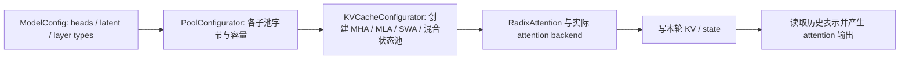
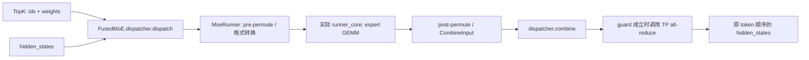
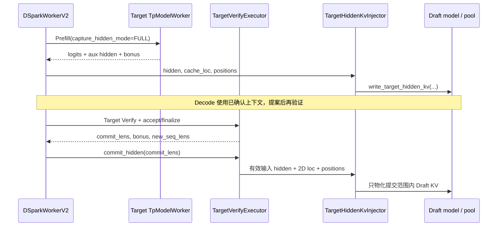
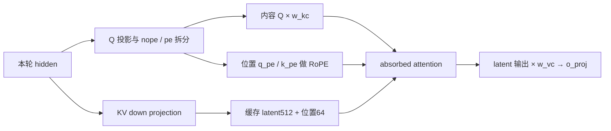

# 推理学习：模型算法、注意力、算子与投机解码

本册覆盖原题 Q02、Q04、Q21–Q34，以及 2026-10-20 新增的 Q56–Q62、Q68。新增题从社区资料线索提炼知识点和生产问题，重新组织为机制推导、源码追踪与场景验收题。先建立形状、状态和成本模型，再追本仓库的执行链；每题可以按“口述机制 → 手算例子 → 找到状态写入与下一消费者 → 设计生产验收”的顺序练习。回到 [完整题目总目录](README.md)，或对照 [引擎研发](engine-development.md) 与 [平台部署](platform-deployment.md)。

Q01–Q50 最初整理于 2026-10-15，Q51–Q68 最初整理于 2026-10-20；本轮对本册全部 24 题重写解释，并按当前 HEAD `bb669346d5` 核对所用关键源码链。执行示例默认 NVIDIA CUDA；通用 `TpModelWorker` 路径与 MLX override、ROCm/NPU 后端并不等同，投机题分别说明 EAGLE、dFlash 与 dSpark 的边界。

论文与官方文档用于说明算法、模型和硬件原理，本地源码用于说明当前执行者、状态写入与下一消费者；训练理论不表示本仓库实现了训练链。数值例子均是明确假设后的静态手算，GPU、Graph、PD 与生产测试均写成验证建议和验收条件，未声称已经实测通过。每题的“学习目标”用于选择练习目标，参考答案用于理解因果，末尾的口述示例只展示展开方式。

<a id="q02"></a>
## Q02 Prefill 与 Decode 的瓶颈为何不同

### 学习目标

- **考察重点**：能否从工作量、数据重用和关键路径解释阶段差异，而非把“Prefill 计算、Decode 带宽”当定义。
- **知识点**：GEMM 的 M/N/K、算术强度、KV 流量、排队与设备执行时间、runner 分派。
- **能力要求**：手算同一层在两种 batch 下的 FLOPs/字节，提出能区分权重、KV、launch、通信瓶颈的证据。
- **常见误区**：只按阶段名判断；把 batch 增大理解为纯收益；把 Graph 开关或单 kernel 利用率当作端到端加速。

### 问题与追问

**主问：Prefill 和 Decode 为什么经常有不同瓶颈？哪些条件会改变这个判断？**

1. 把 Decode batch 从 1 增到 128，为什么有时更接近矩阵乘性能，有时却被 KV 读取和通信拖慢？
2. 开启 GQA、长上下文、量化、投机验证或 PD 分离后，原来的瓶颈结论还成立吗？

### 参考答案

先看一层到底拿什么数据做多少工作。设 Linear 输入 `X[M,4096]`，权重 `W[4096,4096]`，BF16 每元素 2 字节；M 是本轮共同处理的位置数，可以来自一条请求的许多输入 token，也可以来自许多请求各自的一个新位置。权重约 32 MiB，乘加量为 `2×M×4096²`。M=1 时只做约 3355 万 FLOPs，却可能搬一遍权重，理想强度约 1 FLOP/byte；M=128 时权重可被 128 行共同使用，做约 42.95 亿 FLOPs，计入输入输出的理想强度约 120.5 FLOP/byte。“同时做更多行”提高了每次搬权重的收益，这是常见阶段差异的原因。[NVIDIA 矩阵乘指南](https://docs.nvidia.com/deeplearning/performance/dl-performance-matrix-multiplication/index.html)用同样的形状与重用关系解释 GEMM 性能。

Prefill 通常一次处理长输入，M 较大；普通 Decode 则每条活跃请求本轮只算一个新位置，小并发时 M 很小。前者更容易给 Tensor Core 足够工作，后者更容易暴露读权重、kernel 启动和 CPU 准备时间。但 M=128 既可能是 Prefill 的一段，也可能是 128 条 Decode 请求，所以阶段名字本身没有决定硬件瓶颈。把 batch 从 1 增至 128，单轮耗时可能增加，却因一次交付 128 个位置而改善吞吐；单请求 ITL 和总 tokens/s 必须分别解释。

Attention 又带来一条与 M 不同的长度轴。设某层有 8 个 KV heads、d=128、BF16，一条请求读取 8192 个历史位置的 K/V，有效内容约 `8192×2×8×128×2=32 MiB`；128 条互不共享的请求就是约 4 GiB/层的历史内容。kernel 实际流量还取决于分块、缓存命中和 KV 重用，不能直接当成 HBM 实测值，但它说明了为什么增大 Decode batch 一边摊薄权重，一边放大 KV 工作。长前缀命中免去了前缀位置的投影与 KV 重建，后缀 query 仍需访问可见前缀；命中率 90% 不等于 attention 时间降至 10%。

GQA、KV 量化、SWA 分别改变 heads、每元素字节和可见历史；权重量化减少读权重，却可能加入反量化；投机 Verify 一次有多个候选位置，shape 已偏离普通 Decode。Graph 主要减少重复 launch/准备成本，并没有消除有效 KV 读取。当前执行还要区分 `ModelRunner` 选中了 decode graph、prefill graph、split prefill 还是 eager，以及所选 attention backend；若把这些模式混在一个平均值里，就无法说明变化来自形状还是 runner。

判断瓶颈要给出可被推翻的预测：若权重带宽主导，增加 M 应改善每 token 成本；若长 KV 主导，固定 M 增长历史应明显增加 attention 时间；若 launch 主导，Graph 命中应主要消掉 GPU 空隙；若跨机 collective 主导，单个 GEMM 加速帮助有限。最后把队列、准备、执行、通信和输出拼成关键路径，检查 TTFT、ITL 与 goodput，不能只优化最显眼的核。

讲解可这样展开：“我先把本轮位置数 M 和历史长度 T 分开。小 M 的 Linear 缺少权重重用，大 T 的 attention 又会读大量 KV；这解释了常见现象，也给出了长上下文、大 batch、量化和投机下的反例。随后用固定 M 扫 T、固定 T 扫 M 的证据判断当前服务到底卡在哪里。”

### 源码调用链与证据

```text
Scheduler.run_batch(batch: ScheduleBatch)
  → 当前 self.model_worker.forward_batch_generation(...)
  → 普通 TpModelWorker: ForwardBatch.init_new(batch, model_runner)
  → ModelRunner._forward_raw(fb)
      ├─ decode-family graph 可用 → DecodeCudaGraphRunner.execute → logits
      └─ padding/同步形状准备 → split / prefill graph / EagerRunner
  → PP 最后 rank 采样 → GenerationBatchResult → Scheduler 结果处理
```

当前 worker 选择及转换见 [Scheduler 的 model_worker](/Users/magician/PycharmProjects/sglang/python/sglang/srt/managers/scheduler.py:924)、[TpModelWorker 的 ForwardBatch 构造](/Users/magician/PycharmProjects/sglang/python/sglang/srt/managers/tp_worker.py:547)；实际 runner 分派见 [ModelRunner._forward_raw](/Users/magician/PycharmProjects/sglang/python/sglang/srt/model_executor/model_runner.py:1479)。Decode attention 真正传入 Q、KV buffer、索引和 split 数量的边界见 [TritonAttnBackend.forward_decode](/Users/magician/PycharmProjects/sglang/python/sglang/srt/layers/attention/triton_backend.py:1799)。硬件分派与时序详情见 [Q13](engine-development.md#q13)、[Q17](engine-development.md#q17)。

### 生产实践追问

- **输入从 2K 变 32K，ITL 翻倍，先改什么？** 固定活跃请求数、输出长度与 runner，分层记录 attention/Linear/collective 时间及有效 KV 长度。若增长集中在 attention 且随 T 增长，才进入 KV 布局、窗口或 split 调优；若 GPU 时间稳定而队列增长，应先处理接纳和竞争。验收同时看固定到达率下的 ITL 分位数与完成率。
- **Graph 只改善短请求，是否失效？** 记录实际 replay 命中、eager 回退原因和 CPU 到 GPU 的空隙，按短/长历史分别统计。命中且空隙缩小、长请求 kernel 时间未变，说明收益被 KV 工作摊薄；没有命中则先修资格或 shape 覆盖，不能据开关值判断。
- **PD 后 Decode 更快，整体更慢，结论是什么？** 对同一请求拼出排队、Prefill、KV 交接、Decode 时间线，在相同 GPU 总预算下核算 goodput。传输或两侧队列吞掉收益时，需调整资源配比/路由，而非继续用 Decode tokens/s 宣称部署成功。

### 学习检查点

1. 为什么把 batch 从 1 提到 64 既可能增加权重重用，也可能加重 KV 流量？
2. 为什么 prefix 命中 90% 不能推出后缀 attention 只剩原来 10% 的成本？

<a id="q04"></a>
## Q04 KV 容量和并行分片如何估算

### 学习目标

- **考察重点**：能否从有效内容推到本地分片、物理池和服务峰值，而非背一个 KV 公式。
- **知识点**：KV 张量维度、二进制单位、TP/PP 分片与复制、分页、共享引用和峰值预留。
- **能力要求**：现场算出总 payload 与每 rank 字节，检查真实池 shape，并把字节预算转成安全 token/并发上限。
- **常见误区**：混用 Q heads 和 KV heads；把长度已求和后再乘并发；认为 TP 或 FP8 必然等比例扩大容量。

### 问题与追问

**主问：给定模型结构、KV dtype、上下文和并发，估算显存容量。TP 翻倍是否让单卡 KV 减半？**

1. 32 层、8 个 KV heads、head_dim=128、BF16，8192 个有效 token 的 KV payload 多大？TP4 呢？
2. 为什么“空闲显存除以单 token 字节”仍然不能直接作为可接纳并发？

### 参考答案

先问“8192 是一条请求的长度，还是所有请求的有效长度之和”。普通同维 K/V 的有效内容可以写为 `N×L×2×Hkv×d×b`：N 是当前需要保存的 token 位置总数，L 是缓存层数，2 代表 K/V 两份，Hkv 是 KV heads 而非 Q heads，d 是每 head 维度，b 是元素字节。题中每个位置占 `32×2×8×128×2=131072 bytes=128 KiB`；若 N=8192，总量恰是 `2³⁰ bytes=1 GiB`。若 4 条请求各长 8192 且没有共享，N 才应是 32768，总有效内容为 4 GiB。这个算式首先回答“模型数学要保留多少内容”，尚未回答哪张卡放多少。

再把内容投到实际 rank。假设 TP4 将 8 个 KV heads 均匀切成每 rank 2 个，且每 rank 都包含 32 层，则上面的 1 GiB 变成每 rank 256 MiB。TP8 若确实每 rank 1 个 head，可再减半；但当 TP 大于可切分 KV heads、实现复制 KV head，或者采用 MLA 的共享 latent 表示时，就不能机械除以 TP。PP 切层又会改变本地 L，混合窗口层和循环状态要分别计费。因此必须看本地 `get_num_kv_heads(attn_tp_size)`、层范围、pool 类型及 buffer shape；“TP4”这个名字不构成容量证明。

第三步区分有效内容、已分配槽位和物理池。若页长 16，一条长度 17 的私有请求可能需要 32 个槽位，尾部 15 个没有有效内容；前缀共享让多条逻辑请求指向同一物理页，逻辑 N 相加会高估唯一物理 KV。物理池还可能含 padding page、量化 scale 和对齐。投机的候选位置先占槽，接受后只提交其中一段；Target/Draft 若各有 KV，必须分别算，不能用一个模型的公式覆盖两套状态。由此看出“有效 1 GiB”是有明确假设的 payload，而非整个服务的显存占用。

最后做真实预算。举一个纯教学账本：某 rank 80 GiB，权重占 40 GiB，Graph、临时 activation、通信/workspace 及安全余量合计预留 8 GiB，则可给 KV 32 GiB。沿用 TP4 每 token 每 rank 32 KiB，理想可放 `32 GiB/32 KiB=1048576` 个本地 token 槽位；若每请求固定 8192 且无共享，理想是 128 条。页碎片、投机预留、最大 request 槽位或峰值临时量会进一步限制接纳，128 只能是账本上限，不能宣称安全并发。当前配置器把预算推导成 token/request 池规模，`ModelRunner` 保存配置结果；接纳还需服从调度侧可用槽位与请求预算。

这套分层估算的收益是能定位偏差：payload 错通常是维度/复制口径；池比 payload 大常是预留或碎片；池预算合理却运行 OOM，则应查池外峰值或分配时序。删掉安全余量看似增加容量，却可能在最大 Prefill 或 Graph 捕获时越界；过度预留则压低接纳并发。讲解时应明确报出“全模型有效 1 GiB、TP4 本地有效 256 MiB、物理池另算、服务峰值再验收”，随后解释每一步的假设。

### 源码调用链与证据

```text
ModelRunner.alloc_memory_pool()
  → self.kv_cache_configurator.configure(pre_model_load_memory)
  → KVCacheConfigurator._resolve_memory_pool_config()
      → config_from_budget(bytes) → configurator.calculate_pool_sizes(...)
  → _derive_pool_sizes → _init_pools
  ← KVCacheConfigResult(max_total_num_tokens, max_running_requests, pools)
  → 写入 ModelRunner.max_total_num_tokens / req_to_token_pool / token_to_kv_pool
```

字节预算转配置见 [KVCacheConfigurator.config_from_budget](/Users/magician/PycharmProjects/sglang/python/sglang/srt/mem_cache/kv_cache_configurator.py:1684)；默认 cell size 的架构分支见 [DefaultPoolConfigurator._compute_cell_size](/Users/magician/PycharmProjects/sglang/python/sglang/srt/model_executor/pool_configurator.py:182)；本地 KV head 数由 [get_num_kv_heads(attn_tp_size)](/Users/magician/PycharmProjects/sglang/python/sglang/srt/mem_cache/kv_cache_configurator.py:1012)传入池。配置返回后持久化见 [ModelRunner.alloc_memory_pool](/Users/magician/PycharmProjects/sglang/python/sglang/srt/model_executor/model_runner.py:735)。物理池包含 padding/layout，见 [MHATokenToKVPool](/Users/magician/PycharmProjects/sglang/python/sglang/srt/mem_cache/memory_pool.py:1703)。

### 生产实践追问

- **估算 100 条，60 条就 OOM，怎么定位？** 先核对每 rank 权重/池的实际字节，按时间对齐 Graph 捕获、最大 Prefill、投机窗口与运行峰值；再比较逻辑 token、唯一物理 token、已分配槽位。若 KV 尚有空槽但总显存耗尽，问题在池外预算；若槽位耗尽并触发回退，问题在长度/共享/预留估算。以同一长度分布重放，要求峰值有余量且接纳行为可解释。
- **TP4 改 TP8 没有减半，哪里找证据？** 逐 rank 检查 KV head 数、MLA/混合池类、层范围、dtype 和实际 buffer shape，分别加总有效和分配字节。若 head 复制或 latent 未按此维切分，减半预期即不成立；不能靠总显存读数倒推 KV 行为。
- **FP8 KV 只有 1.5 倍容量，是否实现错误？** 分开统计 payload、scale、固定权重、其它状态和 workspace，并核实 backend 真正按量化 dtype 读写。若固定开销解释差值且长度/质量测试通过，收益合理；若 pool 仍用 BF16 或发生额外展开，则沿实际分支修正预算。

### 学习检查点

1. 若 8192 是“每条请求长度”，并发 4 且无共享，题给模型的总有效 payload 为多少？为什么 TP4 后仍不能称为 1 GiB 的服务总显存？
2. 为什么逻辑 token 数、已分配 token 槽位和有效 KV 内容不能互相代替？

<a id="q21"></a>
## Q21 注意力架构如何改变计算与缓存

### 学习目标

- **考察重点**：区分“减少 KV 表示”“减少可见范围”“改变状态形式”，并判断计算是否同比下降。
- **知识点**：Q/K/V 形状、共享 heads、低秩投影、滑窗依赖、循环状态与缓存生命周期。
- **能力要求**：用同一模型重算各架构缓存和 QK/AV 工作，画出 full/SWA/循环层各自保留与回收的状态。
- **常见误区**：把 KV heads 缩小倍数当作整层 FLOPs 缩小倍数；把窗口长度当上下文上限；把 MLA 当作少几个 KV heads。

### 问题与追问

**主问：MHA、GQA、MQA、MLA、SWA 分别怎样改变计算和缓存？混合模型还保存什么状态？**

1. Q heads=32，KV heads 从 32 变 8 再变 1，哪些投影、缓存与 attention 计算随之变化？
2. 为什么 MLA、SWA 或 Mamba 模型不能统一使用 `2×层数×heads×head_dim` 预算？

### 参考答案

从同一层开始比较：设 hidden 宽 4096，32 个 Q heads，每 head 128 维；一条历史长 8192，BF16。MHA 的 Q/K/V 都有 32 heads，每位置 K/V 内容为 `2×32×128×2=16384 bytes=16 KiB`，历史缓存为 128 MiB/层。GQA 若让每 4 个 Q heads 共用一组 K/V，Hkv=8，缓存变 32 MiB；MQA 共用一组则变 4 MiB。变小的是 KV 投影的输出宽度和要保存的历史内容，Q 仍有 32 个不同 heads，每个 query head 仍产生自己的历史分数及输出。[MQA](https://arxiv.org/abs/1911.02150)、[GQA](https://arxiv.org/abs/2305.13245)讨论的正是这类共享。

因此 GQA 的缓存少 4 倍，并不推出 QK/AV 的数学工作少 4 倍。对一轮单 query，32 个 heads 每个都要与 8192 个 key 做 d=128 的点积，再加权 value；在相同 Q heads 下，这些工作仍存在。优化 kernel 可以让一份 K/V 被同组 Q heads 重用，减少实际搬运；若实现先展开或反复读取，字节收益也未必全部兑现。投影 FLOPs、缓存字节和 attention FLOPs 应列成三栏，才能解释“显存明显下降，整层延迟改善有限”。

MLA 更换了表示方式。以 DeepSeek 的做法为例，历史保存低维 latent 及解耦的位置 key，query 先做相应变换，再与压缩表示匹配；它不是把上一公式的 Hkv 改成分数。可吸收的线性投影把某些历史重建转移到 query 或输出一侧，位置相关旋转则有专门处理。缓存计费必须读真实 `kv_cache_dim`，计算计费必须看吸收后的维度与实际 backend，详见 [Q57](#q57)。[DeepSeek-V2 论文](https://arxiv.org/abs/2405.04434)提供数学依据，本地 pool 和 backend 才决定当前保存与读取什么。

SWA 解决另一件事：一个 query 只看最近 W 个位置。若 W=4096，上面层的窗口 KV 可在不再被未来 query 依赖时回收；但 full/SWA 混合模型的 full 层仍读完整历史。窗口也不等于模型不能处理超过 4096 的输入，因为多层局部依赖可以继续传播信息。若错误地把 full 层旧 KV 一起回收，后续 token 的 attention 输入会缺失，属于正确性错误；若完全不回收窗口层，输出可能仍正确，却失去容量收益。[Mistral 论文](https://arxiv.org/abs/2310.06825)给出滑窗的架构背景。

循环/线性注意力、Mamba 类层则可能把历史压成固定大小的 temporal/convolution state，容量更接近“请求数×每层状态”而非“历史长度×KV 内容”。然而 prefix 恢复和投机验证会要求额外快照或中间状态；接受第几个候选，必须选对应 state 版本。普通 KV、滑窗 KV 和循环 state 因此不能共用一个回收规则。正确设计先列每类层的输入依赖和状态，再追配置器分配的子池、模型实际写入和 backend 下一轮读取。

口述时可以围绕三个问题组织：“每位置存多少？未来还要看多远？保存的是逐位置内容还是压缩状态？”MHA/GQA/MQA 主要改变第一项，SWA 改第二项，MLA 与循环模型改变表示；它们可组合，但容量、计算和恢复分别验证，不能用一个缩放倍数承诺全部收益。

### 源码调用链与证据



模型层传给 backend 的 Q/K/V shape 边界见 [RadixAttention.forward](/Users/magician/PycharmProjects/sglang/python/sglang/srt/layers/radix_attention.py:143)；架构计费分支见 [DefaultPoolConfigurator](/Users/magician/PycharmProjects/sglang/python/sglang/srt/model_executor/pool_configurator.py:182)、[HybridSWAPoolConfigurator](/Users/magician/PycharmProjects/sglang/python/sglang/srt/model_executor/pool_configurator.py:334)。MLA 实际分配的是 [MLATokenToKVPool.kv_buffer](/Users/magician/PycharmProjects/sglang/python/sglang/srt/mem_cache/memory_pool.py:3887)，并由 [FlashMLAAttnBackend.forward_decode](/Users/magician/PycharmProjects/sglang/python/sglang/srt/layers/attention/flashmla_backend.py:398)消费；混合状态应从 [Mamba pool state 创建](/Users/magician/PycharmProjects/sglang/python/sglang/srt/mem_cache/memory_pool.py:471)继续追模型专属分支。

### 生产实践追问

- **GQA 换型后显存少而吞吐不变，怎么解释？** 固定 Q heads、batch、长度和精度，分别核对 KV pool 字节、KV projection、attention、其它层时间；再看 kernel 是否重复展开/读取共享 KV。若 attention 占比原本很小，容量收益仍成立；若 KV 读仍高于预期，应检查实际布局和 backend，而非否定架构。
- **SWA 长请求缓存仍很大，哪里查？** 统计 full/SWA 层数、各子池形状和回收阈值，以连续两轮 query 标出未来还依赖的页。只有窗口子池随 W 有界而 full 子池随 T 增长，才符合混合模型预期；回收后需对齐完整生成结果，防止把容量下降当正确性证明。
- **混合模型只在投机接受后错误，怎么缩小？** 固定一个只接受前两候选的例子，记录各候选的 recurrent state、最终提交索引及下一轮读取的 state。若 token/KV 索引正确但 state 取了拒绝分支版本，应修版本选择；验收覆盖零接受、部分接受、全接受及请求交错。

### 学习检查点

1. 为什么 MQA 的缓存节省很大，却不意味着 QK 与 AV 的工作随 KV heads 同比下降？
2. 一个 full/SWA 混合模型中，把所有层按窗口回收会破坏什么输入依赖？

<a id="q22"></a>
## Q22 FlashAttention 与 online softmax 的两块推导

### 学习目标

- **考察重点**：能否用不变量推导 online softmax，解释省的是哪些 HBM 中间量，而非只背“分块融合”。
- **知识点**：稳定 softmax、指数基准变换、加权和、分块归并、片上资源和浮点误差。
- **能力要求**：完整算出两块的 m/l/a，解释重标定，判断错误合并与 mask 边界。
- **常见误区**：只缩放分母；把局部输出平均；混淆求和轴；认为数学等价就要求逐位一致。

### 问题与追问

**主问：FlashAttention 为什么能减少显存访问？现场推导两块数据的 online softmax。**

1. 第二块最大 score 更大时，第一块的分母和加权和为什么都要重标定？
2. online softmax 与“先各块 softmax，再平均各块输出”有何本质差别？

### 参考答案

普通 attention 对每个 query 先算一行 `s=QKᵀ/√d`，再求概率 `p=softmax(s)`，最后输出 `o=Σp_jv_j`。若完整 score 和概率矩阵先写入再读出 HBM，长序列的二次方中间量会很大。FlashAttention 的直觉是：为了最终加权和，并不需要把所有概率永久保存；每次读一块 K/V，只保留能概括已经见过内容的少量统计，就能继续计算。每个 query 行保存标量最大值 m、标量分母 l 和 value 维向量 a，最终 `o=a/l`；m/l/a 属于这一个 query，不能跨行混用。[FlashAttention 原论文](https://arxiv.org/html/2205.14135v2)说明了分块与 I/O 优化。

用同一个单 query、标量 value 算到底。四个 score 是 `[0,ln2,ln4,0]`，values 为 `[1,3,5,7]`，分两块处理。第一块最大值 `m₁=ln2`；为了避免大指数，减去 m₁ 后的权重是 `[exp(−ln2),exp(0)]=[1/2,1]`。于是 `l₁=1/2+1=1.5`，`a₁=(1/2)×1+1×3=3.5`。此时输出若只看第一块为 `3.5/1.5=7/3`，但它还不是整行答案，不能把这次归一化当成不可再更改的概率。

第二块引入更大 score，新的公共基准是 `m₂=ln4`。旧块原来都除以 2，现在应除以 4，因此旧权重统一再乘 `α=exp(m₁−m₂)=1/2`：旧分母从 1.5 变 0.75，旧分子从 3.5 变 1.75。第二块在新基准下的权重为 `[1,1/4]`，分母贡献 1.25，分子贡献 `1×5+(1/4)×7=6.75`。合并后 `l₂=0.75+1.25=2`，`a₂=1.75+6.75=8.5`，最终 `o=8.5/2=4.25`。直接算全行原始权重 `[1,2,4,1]`，分母 8、分子 `1+6+20+7=34`，同样得到 34/8。

由此得到递推：`m'=max(m,max(s块))`，`α=exp(m−m')`，`l'=αl+Σexp(s_j−m')`，`a'=αa+Σexp(s_j−m')v_j`。求和轴是本块有效 key 位置；a 的每个 value 分量执行同样更新。核心不变量是 l 和 a 始终以同一个 m 为指数基准。若第二块只缩放 l 而保留旧 a，本例会得到 `(3.5+6.75)/2=5.125`；若把两个局部归一化输出直接平均，也丢掉了各块概率质量。分块独立计算时可保存局部输出与 LSE，再用 LSE 恢复质量，见 [Q23](#q23)。

收益是避免物化完整 score/probability，增加片上重用；代价是循环、指数和归约，以及 m/l/a 占用寄存器或共享内存，tile 太大可能反而降低并发。因果/滑窗 mask 和尾部决定哪些位置参与；整行全 mask 时 `−inf−(−inf)` 不能直接套公式，需明确输出约定。FP32 累加降低误差，但重排运算仍可能改变低位；数学等价不承诺逐位一致。本仓库 Triton decode 内能看到同一递推，用它学习状态更新，不应据此称它覆盖外部 FlashAttention 的所有实现。

技术讨论时最有说服力的是边算边说：“m 改变了计量基准，所以旧分子分母必须一起换算；我保存的是足以继续合并的统计，而不是不可恢复的块平均。省去大中间矩阵，靠的是这个不变量。”

### 源码调用链与证据

```text
TritonAttnBackend.forward_decode(q, k, v, layer, fb)
  → decode_attention_fwd(q, key_buffer, value_buffer, o, kv_indptr, kv_indices, ...)
  → 每个 split 扫历史 KV，更新 e_max / e_sum / acc
  → 写入局部 acc/e_sum 与 LSE → stage2 合并 → 写最终 o
  ← attention 输出交回模型后续投影
```

以下是真实递推节选，教学注释说明被维护的状态：

```python
n_e_max = tl.maximum(tl.max(qk, 0), e_max)
re_scale = tl.exp(e_max - n_e_max)  # 旧块切换到新的指数基准
p = tl.exp(qk - n_e_max)
acc *= re_scale                   # 分子必须同步缩放
acc += tl.sum(p[:, None] * v, 0)
e_sum = e_sum * re_scale + tl.sum(p, 0)
e_max = n_e_max
```

节选与状态写回见 [decode_attention.py](/Users/magician/PycharmProjects/sglang/python/sglang/kernels/ops/attention/decode_attention.py:250)；kernel 接收索引和 cache 的边界见 [TritonAttnBackend](/Users/magician/PycharmProjects/sglang/python/sglang/srt/layers/attention/triton_backend.py:1799)。独立 split 的再合并见 [stage2](/Users/magician/PycharmProjects/sglang/python/sglang/kernels/ops/attention/decode_attention.py:778)，与 [Q23](#q23)相连。

### 生产实践追问

- **长序列或大 score 出 NaN，先看哪里？** 先用上面的四元素 reference 确认 m/l/a，再依次注入极大有限值、部分 `−inf`、全 mask、NaN/`+inf`。记录首次变成非有限数的中间量，区分缺少重标定和未定义输入策略；验收应按约定检查有限性、LSE 与输出，不能只看平均误差。
- **只有非整齐长度失败，怎样找最小反例？** 固定一行，使有效长度恰在 tile/page 边界前后变化，核对参与归约的 mask 和读取索引；填充位置放极大值以检出泄漏。若 padding 影响 m 或 l，说明 mask 没覆盖统计路径，即使最终 store 有 mask 也不正确。
- **换 fused kernel 后生成分叉，怎么判断？** 同输入逐层比较 FP32 reference、LSE、绝对/相对误差与 top-logit margin，再查误差是否随长度放大。误差在预设阈值内仍可能使近似平票 argmax 改变，应分别报告数值容差和生成差异；两者都通过既定验收才可上线。

### 学习检查点

1. 在上例中若只缩放 l、不缩放 a，输出会错到多少？错误来自什么不变量被破坏？
2. 为什么局部 softmax 输出还必须携带 LSE 才能正确合并？

<a id="q23"></a>
## Q23 Decode attention 的 split KV 取舍

### 学习目标

- **考察重点**：理解 split-KV 以冗余归并换并行度，以及局部 softmax 输出不能无权平均。
- **知识点**：query/head 并发、历史分片、LSE、两阶段归约、工作量与延迟的区别。
- **能力要求**：手算 split 区间与全局合并，推断 batch/长度变化何时使 split 失去收益，检查空分片。
- **常见误区**：以为 split 减少总 KV 读取；把 split 当新增生成位置；只测 stage1 或把 DCP 当单卡实现。

### 问题与追问

**主问：小 batch、长上下文的 Decode attention 为什么可能需要 split-KV？split 越多越好吗？**

1. 单 query/head 扫 32K 历史与 8 个 split 并行扫历史，分别改变了什么资源和中间结果？
2. 多个 split 的局部输出应如何利用 LSE 合成全局 attention？

### 参考答案

先考虑 GPU 为什么可能没活干：batch=1、8 个 query heads，本轮每 head 只有一个 query，却各自要扫 32768 个历史位置。若实现只给每个 query/head 一组工作，只有少量 program 很忙，其它资源无法参与长循环。split-KV 沿历史切 8 份，每份约 4096 个位置，粗略把 8 份工作扩成 64 份，让更多 SM 同时扫描。它减少单份工作长度，交换的是并行度；总有效历史仍是那 32768 个位置，QK/AV 的总乘加没有凭空消失，也没有替请求多生成任何 token。

新问题是八份扫描各自做了 softmax，如何合回同一行？对分片 j 定义 `Z_j=Σexp(s)`、`LSE_j=log Z_j`，局部输出 `o_j=Σexp(s)v/Z_j`。全局分子恰是 `ΣZ_jo_j`，全局分母是 `ΣZ_j`，所以 `o=Σexp(LSE_j−M)o_j/Σexp(LSE_j−M)`，其中 `M=max LSE_j` 仅用于数值稳定。o_j 是 value 维向量，Z_j 是该分片的概率质量标量；它们承担不同职责，只有 o_j 不足以恢复全局结果。

具体取两份：第一份总未归一化质量为 2，局部输出 1；第二份质量为 6，输出 5。全局为 `(2×1+6×5)/(2+6)=4`。若担心指数溢出，以 M=ln6 重标定，权重变 `[1/3,1]`，仍得到 `(1/3+5)/(1/3+1)=4`；直接平均得到 3，错误是把两份质量强行当成相等。当前 stage1 把局部归一化输出与 LSE 写入中间 buffer，stage2 读取有效 split、按同一原则累积并写最终输出；中间 buffer 是下一阶段真实输入，不能只看第一阶段结果。

切分会增加每份 output/LSE 的写读、额外归并 kernel 和调度。假设某 shape 的长扫描能从 80 μs 降到 20 μs，归并又花 5 μs，则可能获益；若原来仅 8 μs，切分后第一阶段 5 μs、归并 5 μs，反而更慢。这些是解释取舍的假设数值，需实测判定。batch 足够大时，原有 query 已提供大量并发；再切分会增加开销、重复读取 Q，并可能破坏 KV 重用。split 数不是越大越好，而是受有效长度、heads、head_dim、dtype、tile 和设备资源共同约束。

正确性还依赖 metadata：短请求可能出现空 split，不能把未初始化的局部输出或 `−inf` LSE 当正常块合并；页索引和尾部 mask 必须与真实长度一致。在 DCP 下，历史跨 rank 分片，需要跨 rank 传递/归并统计，增加网络边界，不能用单卡两阶段耗时代表全链。技术讲解可以从“并行任务不够”开始，接着推导 LSE 合并，再指出收益应比较 `stage1+stage2` 和完整 ITL；这样能解释为何长单并发受益、大 batch 退化，而不是背固定 split 参数。

### 源码调用链与证据

```text
TritonAttnBackend.forward_metadata.num_kv_splits
  → decode_attention_fwd(..., num_kv_splits, max_kv_splits)
  → stage1: split_kv_start/end → 扫 KV → Mid_O、Mid_O_1(LSE)
  → _fwd_kernel_stage2: 读取非空 split，按 LSE 合并
  → O[...] = acc/e_sum × v_scale
```

stage1 切分与对齐见 [split 的区间计算](/Users/magician/PycharmProjects/sglang/python/sglang/kernels/ops/attention/decode_attention.py:154)；局部 output 与 LSE 写入见 [stage1 末尾](/Users/magician/PycharmProjects/sglang/python/sglang/kernels/ops/attention/decode_attention.py:266)；合并的实际递推见 [stage2](/Users/magician/PycharmProjects/sglang/python/sglang/kernels/ops/attention/decode_attention.py:778)。最终调用与输出参数见 [TritonAttnBackend.forward_decode](/Users/magician/PycharmProjects/sglang/python/sglang/srt/layers/attention/triton_backend.py:1799)；DCP 的不同边界见 [跨 rank LSE 合并](/Users/magician/PycharmProjects/sglang/python/sglang/srt/layers/attention/triton_backend.py:1757)。

### 生产实践追问

- **单并发 32K 快了，大 batch 慢了，怎么设策略？** 在相同 head/dtype/backend 下分组记录 batch、每请求长度、实际 split 数及两阶段时间，比较总 attention 时间而非 stage1。若大 batch 原已饱和、归并增长超过扫描收益，则按工作量设置阈值；验收用线上长度/batch 分布加权，且短请求分位数不得被长请求收益掩盖。
- **短请求偶发 NaN，如何构造反例？** 测长度 1、split−1、split、tile±1，检查空 split 的区间、LSE 和 stage2 有效掩码，给未使用槽填哨兵。若空槽能污染结果，应修参与条件/初始化；最终与不切分 reference 比较输出和 LSE。
- **DCP 扩卡无收益，先归因哪一段？** 同步每 rank 本地 stage 时间、等待和跨 rank LSE/output 合并时间，检查最长 rank 与网络拓扑。只有本地扫描下降超过新增通信且输出误差符合约定，才说明该 shape 值得跨卡；单卡 split 成功不构成多卡结论。

### 学习检查点

1. split-KV 为什么可能在计算量没有减少时降低延迟？
2. 两个 split 输出相等但 LSE 不等时，简单平均是否仍会得到正确输出？这能否作为合并实现正确的证明？

<a id="q24"></a>
## Q24 算子 Roofline 和延迟下界

### 学习目标

- **考察重点**：能否用尺寸和资源下界解释性能差距，明确理想流量、实测流量与可达峰值的区别。
- **知识点**：FLOP 口径、字节计数、算术强度、Roofline、重叠与 Amdahl 定律。
- **能力要求**：带单位手算 M=1/128 的 GEMM，给出延迟下界，并提出额外耗时的可验证解释。
- **常见误区**：漏掉乘加的 2；TB 与 TiB 混算；把下界当预计延迟；把两个资源时间直接相加。

### 问题与追问

**主问：给一个 GEMM 或 attention shape，估算 FLOPs、访存量、算术强度和延迟下界。**

1. `M=1` 与 `M=128` 的 BF16 `X[M,4096]×W[4096,4096]`，理想权重重用改变多少算术强度？
2. 为什么实测时间比 `max(F/P,Bytes/BW)` 大很多，不能直接得出 kernel 写得差？

### 参考答案

Roofline 的作用是给判断建立尺度：这个任务至少需要多少计算、至少搬多少数据，哪一种资源更难供给？固定 `X[M,K]×W[K,N]→Y[M,N]`，取 N=K=4096，BF16。一个输出元素对 K 个数做点积，按一次乘法和一次加法各计一 FLOP，常用近似为 `F=2MNK`。理想情况下 X/W 各读一次、Y 写一次，流量是 `2(MK+KN+MN)` 字节。这里没有算旧 C 的读取、量化 scale、临时量、通信或重复读；它是明确假设的乐观账本，而不是 profiler 的 HBM 计数。[NVIDIA GEMM 指南](https://docs.nvidia.com/deeplearning/performance/dl-performance-matrix-multiplication/index.html)据此讨论形状和性能。

M=1 时，F=`2×1×4096²=33554432`，约 33.55 MFLOPs；字节为 33570816，约 32.02 MiB，强度 `I=F/Bytes≈1 FLOP/byte`。M=128 时，F=4294967296，约 4.295 GFLOPs；流量为 35651584 bytes=34 MiB，I≈120.47。原因不是权重变小，而是同一份约 32 MiB 权重服务了 128 行：计算增大 128 倍，理想流量却只增加输入输出部分。若 kernel 无法实现这个重用，实际流量会超过账本，因此还需观察布局和缓存。

假定一台教学设备在该精度下有效算力 P=100 TFLOP/s、带宽 BW=1 TB/s，两者都是十进制单位。M=1 的计算时间下界 `F/P≈0.336 μs`，流量下界约 33.57 μs；M=128 则分别为 42.95 μs、35.65 μs。任务同时受两种必要条件约束，故 `t≥max(F/P,Bytes/BW)`；分界强度是 `P/BW=100 FLOP/byte`，前者倾向带宽限制，后者已越过分界。取最大值允许理想重叠，不保证实际完全重叠；直接相加也不是通用下界。这些数值只服务推导，不代表当前机器测量。

若 M=1 实测 80 μs，不能立即说带宽 kernel 很差：单次 launch、调度间隙、输入准备、非合并访问或不足的并行 wave 都可能占比高。若 M=128 实测 100 μs，也要检查这个 shape 的可达 Tensor Core 效率、tile 尾部、寄存器/shared memory 资源与实际读写，而不能拿数据手册最高数字强判。冷/热 cache、重复次数、是否把量化和 permute 放进计时范围也改变比较含义；不同口径的 TFLOPS 没有直接可比性。

Attention 要另列 QK、AV、softmax 和 KV 数据。普通物化 score 的实现有大矩阵写读，FlashAttention 则可避免这部分 HBM 中间量，不能把未发生的字节算入其“实际带宽”。优化还受关键路径约束：若一个 GEMM 只占端到端 10%，即使无限快，总时间最多从 100 降至 90，约 1.11 倍加速。技术讨论中先给带单位的下界，再解释实测差距从何取证，最后回到完整 Linear 或请求的收益；这种回答同时展示手算和诊断，不会把一个漂亮 TFLOPS 当成产品结论。

### 源码调用链与证据

本题理论模型由手算产生，仓库提供可核对的 benchmark 数据消费链，并非声称本地包含外部 Roofline 工具源码：

```text
benchmark_deepgemm_fp8_gemm.py 构造 shape 与量化输入
  → 按 provider 选具体 GEMM callable
  → run_bench(callable) 返回计时统计
  → flops = 2*m*n*k → 除以秒得到 TFLOPS → 表格/结果文件
```

入口与实际计时区间见 [benchmark 函数](/Users/magician/PycharmProjects/sglang/benchmark/kernels/deepseek/benchmark_deepgemm_fp8_gemm.py:297)；FLOPs 和单位换算见 [TFLOPS 计算](/Users/magician/PycharmProjects/sglang/benchmark/kernels/deepseek/benchmark_deepgemm_fp8_gemm.py:348)。Linear 的真实量化执行器由 [Fp8LinearMethod.apply](/Users/magician/PycharmProjects/sglang/python/sglang/srt/layers/quantization/fp8.py:929)选择；attention 的历史长度、KV layout、split 参数见 [decode_attention_fwd 调用](/Users/magician/PycharmProjects/sglang/python/sglang/srt/layers/attention/triton_backend.py:1799)。CUDA 的 profiling、有效带宽和资源约束参考 [CUDA Best Practices Guide](https://docs.nvidia.com/cuda/cuda-c-best-practices-guide/index.html)。

### 生产实践追问

- **kernel 达到峰值 80%，请求只快 3%，原因在哪？** 从同一请求 timeline 量出该核在关键路径的占比，计算“占比×局部耗时下降”的上限，再看其它计算/通信/排队是否重叠或转移。若理论本就只有几个百分点，结果合理；若明显低于上限，再找新增准备与同步成本。
- **FP8 GEMM 快但完整 Linear 慢，如何验算？** 以真实 M/N/K 和输入布局分别记录量化、scale/布局变换、GEMM、bias 时间，确保计时 callable 包含线上执行的所有步骤。只有完整路径降低且误差合格才算收益；单独 GEMM 的 F/P 不能覆盖被漏计步骤。
- **算出的带宽很低，是否该改访存？** 同时列有效输入输出字节与硬件 HBM 计数，区分 cache 命中、重复读和 launch 主导；再用大工作量 shape 检验瓶颈是否迁移。若实际 HBM 很小而总时间几乎固定，优先检查启动/调度，不能用“有效字节/耗时”否定硬件带宽。

### 学习检查点

1. 同样 32 MiB 权重，为什么 M 增大通常提升算术强度？
2. 一个 kernel 的 FLOPs 为零或很低，是否可能值得优化？应换用什么度量？

<a id="q25"></a>
## Q25 Kernel 融合的依赖与资源成本

### 学习目标

- **考察重点**：融合首先是依赖、原地写入和数值语义问题，其次才是少一次 launch。
- **知识点**：RMSNorm 归约、残差生命周期、RoPE 位置依赖、量化 scale、寄存器/shared memory 与关键路径。
- **能力要求**：写出融合前后各 buffer 的值与消费者，估算消除的中间流量，并解释资源退化的证据。
- **常见误区**：只数 kernel；把 residual 和 normalized output 当同一状态；任意交换算子或忽略旧输入消费者。

### 问题与追问

**主问：RMSNorm、residual、RoPE 或量化能否融合？为什么减少 kernel 数仍可能变慢？**

1. residual add 与 RMSNorm 融合后，谁会原地改变，返回的 residual 与 normalized output 分别供谁使用？
2. 某融合使寄存器增加、occupancy 下降或破坏通信重叠，你如何判断是否保留？

### 参考答案

融合为什么可能有用？假设连续两个算子先把中间结果写到 HBM，下一个立刻又读回来；如果中间量能留在寄存器/shared memory，就少一次写读和 launch。但“相邻”并不代表“可交换”或“可覆盖”：融合前先要画清谁依赖什么，谁还需要旧值。取 `x,r:[M,4096]`，r 是跨子层保留的残差，w 是长度 4096 的权重。先相加 `r'=r+x`，再归一化 `y_i=r'_i×w_i/√((Σ_j r'_j²)/4096+ε)`，求和沿一行 hidden 轴；输出同时有 y 和 r'，前者给后续投影，后者留在残差链。

用一行两维的小例子观察状态：x=[1,3]，r=[3,1]，w=[1,1]，忽略 ε。相加后 r'=[4,4]，均方为 `(16+16)/2=16`，所以 y=[1,1]。融合完成后调用方必须看到 residual=[4,4]、input=[1,1]。若只返回 y，下个残差相加会失去 [4,4]；若把 residual 也覆盖为 y，则后续结果改变。当前 fused add RMSNorm 的契约正是原地更新两块 buffer，并返回 `(x,residual)`，因此调用者能否允许覆盖、是否有其它消费者持有旧 x，属于正确性前提，而非性能细节。

以 M=128、H=4096、BF16 为例，一份中间张量大小为 1 MiB。本例必须把 r' 保存给后续残差路径，因此融合前后都要写出这 1 MiB；理想情况下省掉的是 Norm 对 r' 的一次全局重读，约 1 MiB。只有确实另有可删除的额外中间写入，才能再把那次写入计入节省，不能在这里直接声称省 2 MiB。RMSNorm 仍需完成整行统计：通常先得到均方，再缩放各分量，所以“一个 kernel”也可能有多次片上读、归约和同步。收益应按实际保存/消费的 buffer 逐项计数，不能宣称所有输入输出都只碰一次。

RoPE 需要 token position 和正确旋转维，移动它可能改变对 KV 的含义；量化需要明确 scale 的计算轴，per-token scale 要先知道这一行的统计，再编码数值。残差的加法结合顺序、累加精度及 cast 时机也可能使低位不同。当前 layernorm 有语义/dtype/size guard 和 fallback，通信融合又有不同边界。删掉 guard 可能在常规 shape 更快，却使特定精度、位置或 residual 分支错误；这不是用平均误差就能掩盖的问题。

融合还会让一个 kernel 同时负担更多活跃数据，寄存器或 shared memory 超标会减少驻留，甚至 spill 到 local memory；额外 padding、归约和同步也可能增加总时间。假设原来两个各 4 μs 的核，其中 2 μs 被通信遮住，关键路径是 6 μs；合成 7 μs 核即使 launch 少了一半仍更慢。要比较完整 timeline，而非孤立相加。资源/带宽分析方法可参照 [CUDA Best Practices](https://docs.nvidia.com/cuda/cuda-c-best-practices-guide/index.html)。

口述时可以从这个例子出发：“我先写出相加后的 r' 和归一化后的 y，因为它们有两个后续消费者。确认允许原地覆盖后，再算消除的中间写读；最后检查融合是否因归约资源、数值顺序或破坏重叠抵消收益。”

### 源码调用链与证据

```text
模型 decoder 调用 RMSNorm.forward(x, residual, post_residual_addition)
  → CUDA 语义/dtype/hidden-size guard
  → fused_add_rmsnorm(x, residual, weight, eps) 或专用 JIT / native fallback
  → x 被改为 normalized output；residual 被改为累加结果
  ← 返回 (x, residual)，后续投影消费 x，后续残差路径保留 residual
```

实际融合调用的核心节选如下：

```python
if post_residual_addition is not None:
    residual = residual + post_residual_addition
fused_add_rmsnorm(x, residual, self.weight.data, self.variance_epsilon)
return x, residual  # 两个返回值的含义不同，不能丢掉 residual
```

主分支与浮点顺序注释见 [RMSNorm CUDA 路径](/Users/magician/PycharmProjects/sglang/python/sglang/srt/layers/layernorm.py:456)；原地写入契约见 [sgl_kernel.fused_add_rmsnorm](/Users/magician/PycharmProjects/sglang/sgl-kernel/python/sgl_kernel/elementwise.py:125)；跨 collective 的不同融合边界见 [allreduce + RMSNorm 调用](/Users/magician/PycharmProjects/sglang/python/sglang/srt/layers/layernorm.py:176)。实际 model runner 选择与静态地址要求参见 [Q13](engine-development.md#q13)、[Q15](engine-development.md#q15)。

### 生产实践追问

- **融合误差只出现在 residual 分支，如何查？** 用上述两维例子和真实 dtype 同时检查返回的 x/residual，追踪是否存在旧 x 别名、post-residual 顺序及 cast 差异。验收逐个 buffer 对 reference，而非只比最终 normalized 输出；错误值首次出现的位置应能定位到写入契约。
- **kernel 数减半却慢了，取什么证据？** 对相同 shape 记录 kernel 资源、spill、驻留限制和完整通信 timeline，核实中间流量是否真的减少。若新增资源开销或丢失 overlap 大于节约，应缩小融合范围/改 tile，而非继续合并更多步骤。
- **常规 batch 正确，Graph 或尾形状错误怎么办？** 覆盖零 token、非整齐 hidden、非连续输入与静态地址重放，检查 guard、输出别名和 capture 生命周期。只有各分支语义与指针契约都成立，且代表性完整层收益为正，才可替代原路径。

### 学习检查点

1. 为什么原地 residual 融合不能只测试 normalized output 正确？
2. 如果融合节省 4 MiB 中间访存却使 occupancy 大幅下降，应如何组织证据做决定？

<a id="q26"></a>
## Q26 量化的收益成本和质量验证

### 学习目标

- **考察重点**：分清权重/activation/KV 量化分别削减什么，并把格式、scale、kernel 和质量串成完整契约。
- **知识点**：量化与反量化、per-tensor/token/block scale、误差/outlier、布局重排与混合精度 GEMM。
- **能力要求**：手算 payload 与元数据，追真实量化执行器，定位小 shape 退化和质量首分歧。
- **常见误区**：看到 FP8 标签就认定全链 FP8；把 W4 理想压缩率当加速倍数；拿 Linear 量化证明 KV 已量化。

### 问题与追问

**主问：W4A16、W8A8、FP8、KV 量化分别减少什么成本？量化模型为何可能更慢？**

1. per-tensor、per-token、per-block scale 对元数据、误差和 kernel 布局有什么影响？
2. 低 batch 加速、大 batch 变慢，或 perplexity 接近但生成偏离，分别应检查什么？

### 参考答案

先问量化的是哪份数据。仍取 BF16 的 `W[4096,4096]`，原始权重是 32 MiB；W4A16 以 4 bit 保存权重，理想 payload 8 MiB，activation 仍是 16 bit。W8A8 的原始权重约 16 MiB，activation 也被编码成 8 bit，可能利用对应的低精度矩阵路径。FP8 是浮点格式及缩放方案，并不表示所有层、累加和缓存都自动变成 FP8。KV 量化压缩的是随着请求历史增长的缓存，需要 attention 正确写入、读取并应用 scale；它与 Linear 权重格式是两条契约。去掉量化对象这一层，后面的容量和速度推断就无从成立。

用最简单的对称量化解释 scale：`q=round(x/s)`，反量化为 `x̂=sq`，还要按格式范围裁剪。s 越大，表示范围越宽而刻度越粗；s 太小则 outlier 被截断。比如整数刻度 s=0.5，x=1.1 被表示为 q=2，恢复为 1.0；若 s=0.1，可恢复为 1.1，但更容易耗尽有限范围。per-tensor 用一个 scale，元数据少却受极值影响；per-token/block 用局部 scale 贴近分布，代价是统计、存储和布局。这个数值例子用于理解缩放，不代替具体 FP8 格式规则。[FP8 论文](https://arxiv.org/abs/2209.05433)、[AWQ 论文](https://arxiv.org/abs/2306.00978)分别说明浮点缩放和低比特权重量化的设计。

因此 8 MiB 的 W4 只是 payload 下界。若每 128 个权重配一个 BF16 scale，`4096²/128×2=256 KiB` 元数据还要加入，zero point、padding 和 repack 又另算。执行时可能解包到寄存器、反量化后参与混合精度乘法，也可能走专用 kernel；不能由 checkpoint 文件体积判断计算精度。activation 动态量化还要扫输入以产生 scale，再编码，某些路径可复用前层生成的 `(x,input_scale)`，另一些由当前路径处理。当前 `Fp8LinearMethod.apply` 的 Marlin、MXFP8、block FP8、普通 FP8 分支说明了这个区别，必须追最终 callable。

为什么更小反而更慢？M=1 的 GEMM 本就短，动态 quant、scale 布局变换和新增 launch 可能超过节省的权重读取；某 shape 不适配 tile 会回退；较大 M 时原本重用良好的 BF16 GEMM 也可能缺少带宽优化空间。假设 BF16 完整 Linear 10 μs，量化后 GEMM 6 μs、quant/repack 5 μs，总计 11 μs，这已足以反驳“低精度必快”。同理，如果服务被长 KV 或跨机通信限制，Linear 变快并不保证 ITL 同比下降。

质量应沿数据流观察：算子误差是否由饱和、scale 错轴或布局错误引起；误差怎样影响 logits；任务、长上下文和 sampling 统计是否仍符合门槛。近似量化允许一定数值差异，近似平票处的 greedy 分叉未必是软件 bug；但错误 scale 或漏反量化是实现错误，两者要分开。删掉 scale 生成或读取即使更快也改变数值含义，不能用速度为它辩护。

技术讨论中可用一个账本贯穿回答：“32 MiB 权重变成 8 MiB，只说明 W4 payload；我还要加 scale/重排，再追完整 Linear 的耗时与误差。KV 则单独看池和 attention 读写。收益成立的条件是完整路径加速且质量达标，而不是文件更小。”

### 源码调用链与证据

```text
Linear.quant_method.apply(layer, x, bias)
  → Fp8LinearMethod.apply
      ├─ use_marlin → apply_fp8_marlin_linear
      ├─ use_mxfp8 → backend 专属 scale layout → w8a8_mxfp8_linear
      ├─ block_quant → (x,scale) 或 x → w8a8_block_fp8_linear
      └─ apply_fp8_linear
  ← output tensor → 后续 activation / TP reduction / layer
```

约束入口见 [Fp8Config](/Users/magician/PycharmProjects/sglang/python/sglang/srt/layers/quantization/fp8.py:220)，实际分派和 input scale 契约见 [Fp8LinearMethod.apply](/Users/magician/PycharmProjects/sglang/python/sglang/srt/layers/quantization/fp8.py:929)。Linear 调用位置见 [ColumnParallelLinear.forward](/Users/magician/PycharmProjects/sglang/python/sglang/srt/layers/linear.py:469)。KV 的不同消费链可在 [FlashInferAttnBackend.forward_decode](/Users/magician/PycharmProjects/sglang/python/sglang/srt/layers/attention/flashinfer_backend.py:1428)看到写入 scale、KV buffer 读取与 decode wrapper 参数；容量见 [Q04](#q04)。

### 生产实践追问

- **FP8 Linear 退化，第一组数据是什么？** 固定真实 M/N/K、layout 和 batch，记录实际分派，分别量 quant、scale/重排、GEMM 与输出处理；检查是否复用输入 scale。若额外步骤超过 GEMM 节约，应改复用/融合或保留 BF16 分支；验收完整 Linear 与服务 ITL，而非只报 GEMM TFLOPS。
- **只有长上下文质量下降，怎么区分权重和 KV？** 固定权重精度，单独切换 KV 路径，记录 scale、饱和比例、各长度 attention 输出/LSE 和首个 logits 分歧；再固定 KV 切权重。能把问题归到单一对象后再改 scale/格式，要求代表性长度及任务指标同时过线。
- **checkpoint 写 FP8，显存和速度却不符预期？** 核对加载后的实际权重 dtype/layout、未量化层、scale 和 workspace，以及 `apply` 最终 backend。只有真实 buffer 字节和 callable 与计划一致，才继续调性能；否则先修配置/支持分支。

### 学习检查点

1. 为什么把 weight 从 BF16 换到 4-bit 不能直接推出 attention KV 流量减少？
2. 已有 `(x,input_scale)` 的路径为什么可能改变融合与缓存重用方案？

<a id="q27"></a>
## Q27 Tensor Parallel 的张量切分与通信

### 学习目标

- **考察重点**：理解切分后哪些张量是完整结果、哪些只是部分和，从而推导通信位置与 group。
- **知识点**：矩阵分块、Column/Row Parallel、局部 activation、all-gather/all-reduce、bias 与延迟归约。
- **能力要求**：画出 TP4 每个矩阵和输出尺寸，手算局部结果为何要相加，跟踪 guard 后谁完成通信。
- **常见误区**：每层都先 gather；把“本地输出形状完整”当数值完整；重复加 bias；混用 TP 与 EP/attention group。

### 问题与追问

**主问：ColumnParallel 与 RowParallel 怎样组合？通信究竟发生在哪里？**

1. 输入 `[M,4096]`、中间宽度 11008、TP4，两个 Linear 的局部张量是什么形状？
2. 为什么 ColumnParallel 不总 all-gather、RowParallel 不总立即 all-reduce？bias 怎样避免重复加？

### 参考答案

把两层网络写成 `Z=f(XW₁)W₂+b₂`，用行向量约定：`X[M,4096]`、`W₁[4096,11008]`、`W₂[11008,4096]`，TP4。ColumnParallel 沿 W₁ 的输出轴 N 切成 4 份，每 rank 持有 `[4096,2752]`，算出 `Y_r[M,2752]`。每个 Y_r 是对应输出列的完整数值，逐元素 activation 可以本地做。因为 W₂ 恰好按输入轴切为 `[2752,4096]`，它只需要本地这一片 activation，不必先 all-gather 出完整 `[M,11008]`。这个切分组合省掉了一个没有必要的中间通信。[Megatron-LM](https://arxiv.org/abs/1909.08053)给出了这一设计。

RowParallel 则不同：各 rank 算 `Z_r=f(Y_r)W₂_r`，shape 都是 `[M,4096]`，但只是全体输入特征贡献中的四分之一，完整结果为 `Z=Σ_r Z_r`。用一维例子看得更清楚：中间向量 [1,2,3,4]，下投影权重 [10,20,30,40]，两个 rank 分别算 `1×10+2×20=50` 和 `3×30+4×40=250`，最终必须相加为 300。若漏 all-reduce，本地 shape 看起来正确，值却只有部分和。PyTorch 实际权重常按 `[out,in]` 存储，上面的数学切轴不能直接照搬为内存轴名称。

通信由下一消费者的需求触发：Column 的消费者若需要完整特征，`gather_output=True` 才 all-gather；若直接接 Row，就可保留分片。Row 的消费者若需要完整 hidden，通常要 all-reduce；若调用方准备融合/延迟归约，可以暂时返回部分和，但必须追到最终完成它的位置。当前实现有 `reduce_results`、`skip_all_reduce`、ForwardFlags、attention-DP 及量化通信分支，所以“每个 Linear 都 all-reduce”不成立；“设置 skip 就省掉通信”同样不成立，它可能只是转交责任。

bias 必须只加一次。上例若 b=5，两 rank 各在部分和中加 5，再相加会变成 310，而正确值是 305。当前普通 Row 分支只允许 rank0 在局部 GEMM 中加 bias，或通过 skip-bias 让外部处理；这是数值语义约束。SwiGLU 还要 gate/up 对应分片相乘，若分片顺序不一致，即使每份尺寸相同也会把不同特征配对，输出错误。后续 residual 同样必须知道拿到的是完整和还是待约简张量。

收益和代价随 M 变化：TP4 把本地权重与大部分乘加约分四份，但 Row 的 all-reduce 传的是 `[M,4096]`，还会产生更小的局部 GEMM。小 batch 时通信固定延迟和 tile 利用率可压过节约；跨机更明显。TP 也不自动将 KV 按比例切分，attention TP group 与专家 TP group 可能不同，详见 [Q04](#q04)、[Q68](#q68)。评估要逐条标出通信输入尺寸、dtype、group、guard 和返回值的消费者。

口述可沿一条张量走：“上投影的列分片是完整的局部特征，所以 activation 留在本地；下投影的同形输出是不同特征的部分和，所以在需要完整 hidden 之前必须求和。是否能省通信，取决于消费者和归约责任，不能只数 Linear 个数。”

### 源码调用链与证据

```text
ColumnParallelLinear.forward(input)
  → quant_method.apply → output_parallel
  → gather_output? all_gather : 保留本地分片
  ← (output, output_bias) → activation → RowParallelLinear
RowParallelLinear.forward(input)
  → input_is_parallel? 使用分片 : split last dim
  → quant_method.apply → 局部部分和
  → reduce guard / ForwardFlags → all_reduce 或交回调用方延后
  ← (output, output_bias) → residual / 下一层
```

真实 Column 核心节选：

```python
output_parallel = self.quant_method.apply(self, input_, bias)
if self.gather_output:
    output = tensor_model_parallel_all_gather(output_parallel)
else:
    output = output_parallel  # 后续若消费本地分片就无需先聚合
output_bias = self.bias if self.skip_bias_add else None
return output, output_bias
```

节选见 [ColumnParallelLinear.forward](/Users/magician/PycharmProjects/sglang/python/sglang/srt/layers/linear.py:469)；Row 输入分片与 bias guard 见 [RowParallelLinear.forward](/Users/magician/PycharmProjects/sglang/python/sglang/srt/layers/linear.py:1563)；实际 reduction/ForwardFlags 见 [约简分派](/Users/magician/PycharmProjects/sglang/python/sglang/srt/layers/linear.py:1586)。attention TP 的前向形状准备另见 [ModelRunner._prepare_eager_forward_batch](/Users/magician/PycharmProjects/sglang/python/sglang/srt/model_executor/model_runner.py:1241)。

### 生产实践追问

- **TP4 改 TP8 后低并发更慢，怎么证明原因？** 固定总请求负载，记录局部 GEMM 的 M/N/K、时间和每次 collective 的 payload/group/等待；比较节省的计算与增加的通信、tile 尾部。若通信延迟已高于节约，应考虑较小 TP 加副本；验收相同 GPU 预算下 SLA 与 goodput。
- **skip_all_reduce 后偶发错误，查谁？** 从返回的部分和追到下一消费者，确认它是否调用对应 group 的归约/融合；用上面 50+250 的可辨识输入检查完整和，再核 bias 次数。若某分支直接做 residual 或输出而未约简，属于缺失依赖，不能当数值容差处理。
- **DP attention 与 MoE 共存时 group 搞混，如何验收？** 列每 rank 的 attention TP、MoE TP/EP 成员和张量布局，给不同 rank 注入不同值验证求和范围；同时核集合调用次序。成员/shape/次序都一致并通过端到端输出后，才进入通信优化。

### 学习检查点

1. 如果 Row 的每个 rank 都加 bias 后再求和，结果会多出多少？
2. Column 输出为何可以直接接 activation，而不必立即恢复完整中间维？

<a id="q28"></a>
## Q28 MoE 从路由到 combine 的整层成本

### 学习目标

- **考察重点**：把 MoE 看成路由、搬运、计算、恢复的整条链，解释平均负载与尾部 rank 的差别。
- **知识点**：top-k 权重、token-expert assignment、dispatch/permute/grouped GEMM/combine、EP/TP 语义与资源竞争。
- **能力要求**：算出 assignment 和负载直方图，定位整层关键路径，核对后端格式与最终 reduction group。
- **常见误区**：用激活 FLOPs 代表整层成本；只报 expert GEMM；把 guard 含 EP 当作 EP all-reduce；均值掩盖热点。

### 问题与追问

**主问：MoE expert GEMM 更快，为什么整层甚至整机可能更慢？**

1. top-k 路由之后，每个 rank 的实际 token/expert 分布如何影响 grouped GEMM 与 all-to-all？
2. 通信 backend、GEMM runner、permute 格式和 top-k 权重规则分别由谁决定？

### 参考答案

Dense FFN 是每个 token 走同一组权重，MoE 则先决定去哪些专家。设输入 `H[1024,4096]`，8 个专家、top2：router 为每个 token 产生专家 id 和混合权重，共有 `1024×2=2048` 个 token-expert assignment。平均每专家 256 份，但实际可能是某个专家 900 份、其余分摊 1148 份。各 rank 要把属于自己的 assignment 收到一起，按专家整理矩阵，做 gate/up/down，再按原 token 位置加权合回 `[1024,4096]`。所以一次 token 可以产生两份专家计算与传输，不能用输入 token 数直接当专家 batch。

用一个 token 看 combine 的语义：router 选专家 A/B，权重 0.75/0.25，专家输出分别 [2,4]、[6,8]，最终是 `[3,5]`。专家计算之前需要把这个 token 发到正确位置，之后又要恢复原请求顺序和这组权重。若只把两个输出相加得到 [8,12]，或 permute 还原错位，GEMM 完全正确也会使整层错误。当前 TopK 的 correction bias 可用于选择专家，而混合权重仍按对应分数及 renormalize 规则得到，不能为了均衡负载任意把二者混为一个概率。

看时间也应按同一链分解。假设路由 3 μs、dispatch/permute 20 μs、expert GEMM 30 μs、combine/归约 17 μs，总共 70 μs；GEMM 优化到 15 μs，整层最好也只是 55 μs。若新 kernel 占用了通信所需 SM，使 dispatch 多 10 μs、combine 多 8 μs，整层甚至变成 73 μs。这是因果示例而非实测，说明局部 FLOPS 和整层时间可能反向。热点专家/链路进一步使耗时受最慢 rank 支配，平均每专家 256 对尾部没有保证。

当前 `FusedMoE.forward_impl` 明确把 dispatcher 的 dispatch/combine 与 `MoeRunner` 的计算核心分开：通信 backend 决定 token 如何到达，runner 决定所需格式与 expert kernel，pre/post permute 负责桥接。它们不是同一个选择。尾部 guard 虽是 `reduce_results and (moe_tp_size>1 or moe_ep_size>1)`，实际函数却是 `tensor_model_parallel_all_reduce`；不能把这个调用说成 EP group 归约，必须核真实成员，见 [Q27](#q27)。

优化可减少重排、提高 grouped GEMM 利用率、调整通信资源或选择合适模式，但受 token 上界、buffer、dtype 和路由分布制约。小专家 batch 会变成许多碎片任务，padding 到计算 tile 还会产生无效乘加，实际执行量可能高于有效 assignment 的账本；低延迟模式不等于所有吞吐负载都优；某 DeepEP 低延迟分支有每 rank token 上界，也不能推广为所有后端常数。删掉 combine 或权重处理会改变数学结果；过度压通信资源则可能使 GEMM 再快也等数据。

技术讨论时可以直接围绕“2048 份 assignment 怎么走完”讲解：先画真实 expert/rank 直方图，再把路由、传输、重排、计算、合并放到同一时间线；只有最慢 rank 的整层关键路径下降且输出等价，才叫 MoE 优化成功。

### 源码调用链与证据



实际分阶段主链见 [FusedMoE.forward_impl](/Users/magician/PycharmProjects/sglang/python/sglang/srt/layers/moe/fused_moe_triton/layer.py:1367)；dispatcher guard 与通信 group 参数见 [create_moe_dispatcher](/Users/magician/PycharmProjects/sglang/python/sglang/srt/layers/moe/fused_moe_triton/layer.py:108)；计算 backend 和格式转换见 [MoeRunner.run](/Users/magician/PycharmProjects/sglang/python/sglang/srt/layers/moe/moe_runner/runner.py:143)。权重归一化见 [TopK 原生实现](/Users/magician/PycharmProjects/sglang/python/sglang/srt/layers/moe/topk.py:689)；具体低延迟上界见 [DeepEP dispatcher](/Users/magician/PycharmProjects/sglang/python/sglang/srt/layers/moe/token_dispatcher/deepep.py:380)。基准入口是 [fused MoE benchmark](/Users/magician/PycharmProjects/sglang/benchmark/kernels/fused_moe_triton/benchmark_sglang_fused_moe_triton.py:1)，不要把其均匀输入结果当成实际生产路由分布。

### 生产实践追问

- **GEMM 快 30%，整轮慢 10%，第一步怎么拆？** 保留真实路由 id/权重和每 expert/rank token 直方图，分别标出 dispatch、pre/post permute、GEMM、combine、尾部 collective，并检查通信/GEMM 资源竞争。若热点尾部或新增格式转换主导，先处理该段；验收整层与整轮分位数，均匀随机 benchmark 只能作对照。
- **平均负载均衡但延迟抖动，证据是什么？** 看每轮最大 expert batch、最大 rank 接收量、padding 量和链路耗时，而非跨轮平均值。将慢轮的路由复现并定位最长 rank，判断是路由偏斜还是网络/调度；优化后要求慢轮尾部收敛且不改变 top-k 权重语义。
- **换 DeepEP 模式后崩溃或错输出，怎样验收？** 先核模式专属 token/buffer 上限、dispatch 输出格式、runner 输入格式和 combine 顺序；用单 token 双专家的可手算案例校验，再测上界附近和非均匀路由。通过边界与数值检查后再比较通信收益，不能从另一模式支持范围类推。

### 学习检查点

1. 为什么总计 2048 次 assignment 相同，不代表两个路由分布的时延相同？
2. expert GEMM 的输出为何不能直接交给下一层，而需要 combine 的顺序与权重契约？

<a id="q29"></a>
## Q29 投机无损的 greedy 与 sampling 含义

### 学习目标

- **考察重点**：区分 greedy 决策一致与 sampling 分布一致，并理解拒绝修正为何能恢复 Target 分布。
- **知识点**：条件概率、proposal 分布、接受质量、正残差分布、前缀条件与数值/随机确定性。
- **能力要求**：用三词表算接受/拒绝质量，追 P/Q 的真实构造，识别“候选不是按 Q 采样”的失效条件。
- **常见误区**：把接受率高当无损证明；拒绝后直接从 P 重采；要求同 seed 逐 token 相等；把各投机算法的 verifier 混用。

### 问题与追问

**主问：投机解码的“无损”在 greedy 与 sampling 下分别意味着什么？**

1. 标准 `p/q` 接受和拒绝后 residual sampling 怎样恢复 Target 分布？给出三 token 数值例子。
2. 当前 dSpark 的 P、Q 实际从哪里来？为什么不能把 dFlash 的 target-only 分支套成同一实现？

### 参考答案

投机的目的，是让便宜的 Draft 多猜几个位置，再让 Target 一轮验证，少付几次串行执行成本；“无损”必须先指定目标。Greedy 要保持 Target 在同一有效前缀上的 argmax 决策：从左到右比较候选，首个不匹配处输出 Target 的纠正 token，之后的候选不能直接提交。Sampling 则要求最终序列的联合分布等于 Target 逐步采样的分布，不要求同 seed 走出同一轨迹，因为随机数消费方式不同。精度、平票 tie-break、批形状造成的 logits 差异又是独立数值问题，不能拿概率证明替它们兜底。

标准 sampling 算法在当前位置、已确认前缀条件下，令候选 `x~q`，Target 目标分布是 p。候选以 `a(x)=min(1,p(x)/q(x))` 接受；接受该词的概率质量为 `q(x)a(x)=min(p(x),q(x))`。这一步保留了 p 和 q 重叠的那部分质量，但 q 比 p 多的词会被部分拒绝，所以拒绝后不能简单再抽一次 p：那会向已经通过接受得到的词重复分配质量。

必须从剩余缺口抽纠正词：`r(v)=[p(v)−q(v)]₊/Σ_u[p(u)−q(u)]₊`，正部 `[z]₊=max(z,0)`。用 A/B/C 三词例子，p=(0.6,0.3,0.1)，q=(0.2,0.5,0.3)。候选 A/B/C 的接受概率分别为 1、0.6、1/3，接受质量为 (0.2,0.3,0.1)，合计 0.6；拒绝概率 0.4。正残差是 (0.4,0,0)，归一化后纠正必为 A，最终质量变成 (0.6,0.3,0.1)，恰好恢复 p。若拒绝后直接从 p 抽，最终会是 `(0.2,0.3,0.1)+0.4p=(0.44,0.42,0.14)`，已偏离目标。

多位置时每个 p/q 都以当时确认的前缀为条件，遇到拒绝便截断后续提案；全部接受后可从 Target 的下一条件分布采一个 bonus。逐步正确的条件分布才能组成正确联合分布。[标准投机论文 §2.3](https://arxiv.org/html/2211.17192v2#S2.SS3)给出这一证明。关键前提是候选确实来自所声明的 q：若 Draft 实际做了 temperature 或其它变换，接受侧却用原始 softmax 重建 Q，即使公式写对仍会有偏；Target P 也必须对应目标采样语义和约束。

当前 dSpark 的候选来自 Markov head `corrected_logits` 加 temperature 的实际 sampler，接受侧据此重建 Q；P 的已核路径包括 verify logits 调整、temperature 及 top-k/top-p 分支。其它普通 Sampler 参数需逐项核支持分支，不能概括成自动全部等价。拒绝 kernel 用 `coin*q<p` 实现接受规则，再按正残差纠正。dFlash 当前另有 target-only sampling verifier，并传零 draft_probs 缓冲，不能把上述显式 Q 修正路径套过去；EAGLE 树验证也有自己的采样与状态整理入口。算法边界必须依实际执行者说明。

口述时可先讲重叠质量，再手算三词表：“接受给我 min(p,q)，拒绝只补 p−q 的缺口；这样才恢复 p。然后我会检查实际 proposal、P/Q 变换和接受后前缀是否一致，因为公式正确并不能修复错误的条件状态。”

### 源码调用链与证据

```text
DSpark DraftBlockProposer.propose
  → markov_head.sample_block(..., sampler) → draft_tokens + corrected_logits
  → accept_draft_tokens
      ├─ all_greedy → AcceptGreedy
      └─ sampling → corrected_logits/temperature 得 Q
          → Target logits/采样参数得 P → chain_speculative_sampling_triton
          → correct_len / bonus / cap_trim
  → FinalizeAcceptLens → 输出 token、new_seq_lens → Scheduler 消费
```

kernel 的关键分支节选：

```python
p = tl.load(TargetProbs + offset_prob)
q = tl.load(DraftProbs + offset_draft)
coin = tl.load(uni_ptr_base + (step - 1) * stride_uni_s)
if coin * q < p:  # 候选来自 Q；这对应 min(1, P/Q) 的接受规则
    num_accept += 1
    cur_prob_row = step
```

Q 的提案来源见 [sample_draft_block](/Users/magician/PycharmProjects/sglang/python/sglang/srt/speculative/dspark_components/dspark_draft.py:177)，接受侧重建 Q 见 [accept_draft_tokens](/Users/magician/PycharmProjects/sglang/python/sglang/srt/speculative/dspark_components/dspark_verify.py:658)；P 与 kernel 参数见 [DSpark AcceptSampling](/Users/magician/PycharmProjects/sglang/python/sglang/kernels/ops/speculative/dspark/dspark_accept.py:80)。接受/残差见 [reject_sampling.py](/Users/magician/PycharmProjects/sglang/python/sglang/kernels/ops/speculative/reject_sampling.py:66)、[残差计算](/Users/magician/PycharmProjects/sglang/python/sglang/kernels/ops/speculative/reject_sampling.py:109)；dFlash 的不同分支见 [target-only sampling 调用](/Users/magician/PycharmProjects/sglang/python/sglang/srt/speculative/dflash_utils.py:676)。

### 生产实践追问

- **接受率很高但采样频率偏了，怎么定位？** 先固定小词表 p/q，大量独立运行接受核，比较接受质量、拒绝频率和最终频率；再核实际 proposal 频率是否等于传入 Q。若小模型算法通过、完整模型失败，继续查 temperature/top-k/top-p、verify logits 调整及前缀/KV，不能先靠降低温度掩盖偏差。
- **Greedy 相同、sampling 不同是否 bug？** 同 seed 不逐 token 相同本身不足定性；先用已知分布统计与误差区间检验，再查首拒绝的 residual 是否按正差归一化。若恢复目标频率但轨迹不同，可接受为随机消费差异；若频率系统偏离，则不能以 greedy 通过豁免。
- **换 Draft sampler 后无损性还成立吗？** 保存候选的实际条件 logits/温度/采样方式和接受侧 Q，逐位置重建分布并检查支持集。只要候选生成与 Q 不匹配就必须修正；验收覆盖首拒绝、全接受、混合 greedy/sampling 及各已支持的参数组合。

### 学习检查点

1. 在上例中拒绝后直接从 p 重采样，为什么一般不能恢复 p？
2. 为什么 Q 与 P 可以不同，却必须忠实描述真正生成候选的 sampler？

<a id="q30"></a>
## Q30 EAGLE 树接受后的 KV 和状态压紧

### 学习目标

- **考察重点**：接受是一次状态提交，树索引、物理 KV、token/hidden 和 Draft 上下文必须一致。
- **知识点**：树状验证布局、逻辑位置与物理槽位、路径选择、bonus 错位、缓存搬移与异步生命周期。
- **能力要求**：沿一条非连续树路径画出提交前后映射，追返回值到 Draft Extend 和 Scheduler 的实际消费者。
- **常见误区**：只加 seq_lens；把树节点数当路径 stride；认为新 bonus 已有输入 KV；把线性 dFlash/dSpark 当树压紧。

### 问题与追问

**主问：EAGLE 接受树中的一条路径后，为什么不能只增加 seq_lens？**

1. 树节点索引、接受路径长度、每请求验证节点数和 bonus 的 stride 为什么不是一个数？
2. 哪些 KV、token、hidden 与 recurrent state 要和最终接受路径同步？后续谁消费？

### 参考答案

顺序 Decode 的逻辑位置和本轮计算位置容易对齐，树状投机却会同时计算互斥分支。假设已有前缀长度 100，验证暂存区域里的节点按树布局放在槽位 100–105，真正接受的输入路径落在 100、102、105。长度增加只能声明“又有若干有效位置”，不会自动把兄弟分支变成正确前缀。下一轮若按连续顺序读取 100、101、102，就会读到错误分支；如果仅改 token 数组而不改 KV，文本看似正常，后续 logits 仍会错误。树接受必须处理数据及映射，不能只改元数据。

当前 EAGLE verify 返回 `predict、accept_lens、accept_index`。`accept_index` 表示选了哪些树节点，是连接“被接受的逻辑路径”和“验证时物理位置”的关键。topk>1 时 `_finalize_accept_tree_path` 依据该索引移动接受的 Target KV，把 predict 和非空 hidden_states 压到每请求块前部；压紧函数返回的新 predict 必须继续使用，旧数组仍是树布局。topk=1 则是线性链，已具备顺序关系，不需要同样的树搬移。这一 guard 必须保留，不能把所有投机路径描述成固定搬一遍。

bonus 还带来一位错位。验证输入中的位置经过 Target 后生成“下一 token”的预测；最终多交付的 bonus 是新采样的输出，它未必作为本轮输入被计算过。当前 KV 搬移使用 `accept_lens−1`，不能从输出接受长度直接推断每个输出 token 都有同位置新 KV。bonus 提取按真正接受路径索引，stride 来自 `accept_index.shape[1]`，对应路径宽度而非整棵树节点总数；若用 `num_draft_tokens` 代替，在树比路径宽时就会从错误请求或分支取值。

提交后的 Target 状态还不是结束。后续 Draft Extend 要消费正确 token/hidden，推进 Draft 对应前缀；`new_seq_lens` 发布后，下轮 metadata 和位置也必须以新前缀为准。混合 recurrent 模型可能另外选择接受 step 对应的中间 state，否则 KV 正确仍不够。当前 EAGLE worker 的 verify→publish→Draft Extend 是真实下一消费者；Scheduler 的延迟结果处理再把有效接受区间提交到请求状态，普通解码的单 token 消费方式不能直接套用，详见 [Q33](#q33)。

overlap 增加的是时序问题：GPU 可能已进入下一轮，CPU 才处理上一轮接受结果。若 verify 临时 buffer/cache loc 提前释放或复用，下轮就会读取被覆盖内容。当前 result 通过 `extra_keep_alive_refs` 持有 verify ForwardBatch，寿命因此延伸到需要的时点；去掉它可能变成偶发错误，而非稳定首轮失败。dFlash 和 dSpark 的 block/ragged 线性验证有各自提交方式，不采用同一棵树的 `accept_index` 压紧；共享的是“只提交被接受前缀，下一轮消费状态一致”的原则。

讲解时可以拿 100、102、105 这条路径说：“接受长度回答增长多少，accept_index 回答接受了谁；我还要把这些节点的 KV、token 和 hidden 变成下一轮能消费的布局，推进 Draft，再保证异步消费者读完前对象不失效。漏掉其中一项，长度正确也不能保证后续生成正确。”

### 源码调用链与证据

```text
EAGLEWorkerV2.forward_batch_generation
  → draft_worker.draft(batch) → batch.spec_info = EagleVerifyInput
  → run_eagle_verify: plan_stream 准备 → forward stream 等待/修补 metadata
  → Target verify → eagle_sample → accept_index / accept_lens
  → topk>1: _finalize_accept_tree_path
      → move_accept_tokens_to_target_kvcache
      → compact predict + hidden_states
  ← GenerationBatchResult(next_draft_input, new_seq_lens, keep_alive_refs)
  → on_publish → draft_worker._draft_extend_for_decode → Scheduler 延迟处理
```

核心整理逻辑的真实节选：

```python
move_accept_tokens_to_target_kvcache(
    batch, accept_index, accept_lens - 1, token_to_kv_pool_allocator
)
predict = _compact_accept_to_front(
    predict, accept_index, bs, num_draft_tokens=num_draft_tokens
)  # 返回值必须继续用，旧 predict 仍是树布局
```

整理与 hidden 的同步写入见 [树路径 finalize](/Users/magician/PycharmProjects/sglang/python/sglang/srt/speculative/eagle_worker_common.py:402)；bonus 的实际 stride 见 [bonus 提取](/Users/magician/PycharmProjects/sglang/python/sglang/srt/speculative/eagle_worker_common.py:608)；返回与临时引用见 [GenerationBatchResult](/Users/magician/PycharmProjects/sglang/python/sglang/srt/speculative/eagle_worker_common.py:640)。下一消费者见 [EAGLE verify 后 draft_extend](/Users/magician/PycharmProjects/sglang/python/sglang/srt/speculative/eagle_worker_v2.py:1194)。

### 生产实践追问

- **长度正确，第二轮起分叉，如何抓首错？** 固定一条非连续接受路径，记录 accept_index、提交前后 KV 槽位内容、predict/hidden 的压紧结果与新长度；让下一轮 query 对照逐 token reference。若差异首次出现在错误兄弟槽位，修路径搬移/映射；若 Target 正确而 Draft 后续变差，继续查 Draft Extend 的输入。
- **topk=1 通过，topk>1 失败，重点查哪？** 使用树节点总数大于路径宽度的最小例子，核 bonus 的实际 stride、请求偏移、`accept_lens−1` 与 finalize guard。验收分别覆盖线性链、分叉、首拒绝、全路径接受以及多请求不同路径，不用单链结果替树路径背书。
- **只开 overlap 后偶发出错，怎样判定生命周期问题？** 标记 verify ForwardBatch、cache loc 和 hidden 的分配/复用时点，对齐 stream/event 与 CPU 结果消费；保留引用后若首错消失，还需证实原复用发生在读完成前。验收以多轮、多 batch 交错的状态一致性为准，单轮输出正确不足。

### 学习检查点

1. 为什么正确的 accept_lens 不能证明下一轮读到的是正确 KV？
2. 如果 bonus 提取误用树总节点数作 stride，为什么 topk=1 测试可能发现不了？

<a id="q31"></a>
## Q31 dFlash 和 dSpark 的提案与验证计数

### 学习目标

- **考察重点**：能否按输入位置、提案位置和输出提交分别计数，识别同名字段背后的协议差异。
- **知识点**：anchor/bonus、block/ragged 布局、验证输入与预测输出错位、Graph padding、实际提交。
- **能力要求**：画出 B=16 与 gamma=16 的位置表，再为短窗口算出有效行与最大输出，追 result stride。
- **常见误区**：两者都说 16 个新 draft；把 anchor 算成新提案；用配置窗口替代实际工作或接受长度；沿用旧 Graph 限制。

### 问题与追问

**主问：dFlash block_size=16 与 dSpark gamma=16，分别提出多少新 token？**

1. anchor/bonus 是否需要再次采样，Target Verify 的输入位置与新输出 token 如何对应？
2. dSpark 配置窗口为 gamma+1 时，ragged verify 是否意味着每请求每轮都执行满这个窗口？

### 参考答案

数清 token 的最好办法，是先画本轮输入而不是背参数名。dFlash 的 `B=block_size` 包含一个已知 anchor：B=16 时输入 `[anchor,MASK₁,…,MASK₁₅]`，共 16 个位置。anchor 是上一轮 Target 给出的 bonus，首轮来自 Prefill；它为后续位置提供条件，不是本轮又猜出来的词。Draft 产生 16 行 hidden，但当前只从第 1 至 15 行采样，得到 15 个新提案。graph-folded sampler 与显式 `draft_hidden[:,1:]` 分支都要遵守这个计数。

Target 验证输入再组织为 `[anchor,d₁,…,d₁₅]`。位置 0 的输出预测 d₁，位置 1 的输出预测 d₂，以此类推；如果 15 个新提案全部接受，最后一行还能产生一个新 bonus，所以一轮最多交付 16 个新输出。若 d₁ 即被拒绝，则只交付 Target 的一个纠正 token。anchor 已经是上一轮输出，不能再次加入“本轮新输出”统计，否则每轮都重复计算一个词。

dSpark 当前使用另一种约定：gamma 就是新提案数。gamma=16 时 Draft 提 `d₁…d₁₆`，配置验证窗口 `W=gamma+1=17`，验证输入是 `[anchor,d₁,…,d₁₆]`。完整窗口全接受最多交付 16 个接受 draft 加 1 个 bonus，共 17；首拒绝仍只交付 1。虽然复用了 `DFlashDraftInputV2` 之类容器，实际计数由 worker 与配置 hook 决定，类名不等于算法协议。EAGLE 则可能验证分叉树，树节点总数又不同于接受路径宽度，不能用 B 或 gamma 的解释覆盖它，见 [Q30](#q30)。

还要再拆一层：W 是配置上限，不保证每个请求本轮实际计算 W 行。dSpark planner 可根据预算/置信度建立 ragged layout。若 W=17，但某请求实际 `verify_lens=5`，本轮有效输入只包含 anchor 与窗口内的候选部分；它不能按完整 17 行工作量计费。Graph 又可能把全局有效行数向 capture tier 对齐，产生为重放形状服务的 padding。因而应分别列“计划新提案 16、最大窗口 17、每请求实际 verify 长度、图执行行数、最终 commit”，每一项都回答不同问题。

这一区分会直接影响正确性和性能：错误 stride 会在扁平输出数组中跨请求取 token；把 padding 当有效提交会污染 KV 和请求输出；把上限当有效工作则会高估吞吐。结果中保存本轮 `speculative_num_draft_tokens`，延迟到 CPU 后仍按这个 stride 切有效前缀，不能读取已经自适应改变的最新 worker 配置。当前 dSpark 已有 Graph 与 overlap 支持，还区分 proposal folded、Target accept folded 和 commit folded；不能借旧资料说整个功能强制关闭，也不能看到一个 folded 字段就称整轮在单图里完成。

口述可以直接给两行表意：“dFlash 16 是 1 anchor+15 新 draft，最大 16 新输出；dSpark gamma16 是 16 新 draft，完整窗口17、最大17输出。然后我会另报 ragged 实际验证和真实 commit，因为这些上限不是本轮有效计数。”

### 源码调用链与证据

```text
dFlash: block_ids=[bonus,MASK×15] → Draft forward(B=16 rows)
  → 仅 hidden[:,1:] 采样15个 → candidates=[bonus,15 drafts] → Target verify
dSpark: 配置 gamma=16 → verify_window=17
  → proposer 产16个 → planner 选实际布局 → verify_ids=[anchor,16 drafts]
  → accept/finalize → next bonus + new_seq_lens
```

以下节选直接显示 dFlash 的被采样行：

```python
draft_hidden = draft_hidden.view(bs, int(self.block_size), -1)
draft_next = self._greedy_sample_from_vocab_parallel_head(
    hidden_states=draft_hidden[:, 1:, :].reshape(
        -1, draft_hidden.shape[-1]
    ),
    lm_head=lm_head,
).view(bs, int(self.block_size) - 1)
```

节选与 graph 分支见 [dFlash 新 token 采样](/Users/magician/PycharmProjects/sglang/python/sglang/srt/speculative/dflash_worker_v2.py:1638)；anchor 构造见 [dFlash block 输入](/Users/magician/PycharmProjects/sglang/python/sglang/srt/speculative/dflash_worker_v2.py:1514)。dSpark 的配置合同见 [gamma+1 检查](/Users/magician/PycharmProjects/sglang/python/sglang/srt/arg_groups/speculative_hook.py:372)，运行期布局/verify 输入见 [DSpark planner 与 verify](/Users/magician/PycharmProjects/sglang/python/sglang/srt/speculative/dspark_components/dspark_worker_v2.py:547)。提交与指标的区别见 [Q33](#q33)。

### 生产实践追问

- **两个部署都配置 16，为何接受长度差 1？** 把各自 anchor、新 draft、verify 输入、bonus 和有效输出画成位置表，检查指标含不含 bonus。统一为 correct drafts 或真实 commit 后再比较，若差异只来自口径应修报表；不能据原始均值判断 Draft 更好。
- **ragged 后 tokens/s 异常升高，如何核实？** 每轮同时记录 W、逐请求 verify_lens、graph tier、commit_lens 和用户保留输出，检查分母按有效提交而非 padding/配置上限计算。用扁平数组的哨兵测试 stride 和请求边界；只有输出计数与请求增长对齐才认可收益。
- **开 Graph 计数不一致，查哪条分支？** 对齐显式 sampler 与 folded sampler 的输出 shape、accept/finalize buffer 和本轮 result stride，分别验证短窗口、完整窗口与动态配置切换。验收每轮有效前缀一致，Graph 命中率只是执行证据，不能替代计数正确性。

### 学习检查点

1. dFlash B=16 与 dSpark gamma=15 在最大验证窗口上相同，是否意味着 Draft 计算结构与成本相同？
2. 为什么 W=17 不能推出每请求本轮一定验证 17 个位置？

<a id="q32"></a>
## Q32 Target hidden 怎样建立 Draft KV

### 学习目标

- **考察重点**：理解 Target hidden 到 Draft KV 的内容构造与提交范围，尤其是一位错移和异步可见性。
- **知识点**：hidden 与 KV 的不同语义、模型专属投影、position/RoPE、cache loc、ragged mask、输入/输出时序。
- **能力要求**：从前缀 128 手工追到 131，指出写哪些 hidden、下轮 anchor 是谁，并核对地址/内容/事件三类证据。
- **常见误区**：说成复制 Target KV；按输出 token 直接选 hidden；认为 req_to_token 正确就足够；把未提交候选写入视作有效上下文。

### 问题与追问

**主问：dSpark 的 Target hidden 怎样建立 Draft KV？为什么映射正确仍可能输出错误？**

1. Prefill 与 Decode Verify 分别提供哪些 hidden、位置和写入范围？新 bonus 的 KV 此时是否已经计算？
2. `req_to_token`、`out_cache_loc`、Draft pool 的 K/V 内容分别保证什么不变量？

### 参考答案

Target 的 hidden 是对输入位置的表示，Draft KV 则是 Draft 注意力以后要读取的键值/压缩状态，两者不是同一种 tensor。dSpark 的做法，是把 Target 辅助 hidden 交给 Draft 模型自己的 `write_target_hidden_kv` 投影和写入接口，建立 Draft 所需上下文；不是把 Target 的 KV buffer 原样复制。Prefill 时 Target 请求 FULL hidden capture，worker 按 prefix/extend 长度组织位置和 cache loc，再注入 Draft pool；Target 采样的 token 作为下一轮 anchor。收益是省去对同一 prompt 再跑普通 Draft Prefill，但投影、写入与同步仍有真实成本。

把一轮 Decode 从头画完：已处理前缀长度为 128，上一轮输出 anchor b 尚待作为本轮输入，位置是 128。Draft 提出 d₁、d₂、d₃，Target Verify 输入 `[b,d₁,d₂,d₃]`，位置分别 128、129、130、131。若 d₁/d₂ 接受、d₃ 被拒并由 Target 给出纠正 x，本轮新输出是 `[d₁,d₂,x]`，实际 commit=3，已处理长度变为 131。有效输入 hidden 却是 b、d₁、d₂ 对应的三行，写入位置 128–130；x 成为下轮位置 131 的 anchor，本轮并没有把 x 作为输入计算过。

为什么正好这样提交？验证行 128 输入 b，输出条件分布用于决定 d₁；行 129 输入 d₁，决定 d₂；行 130 输入 d₂，决定 x。因此输出 run 与已经建立的输入 KV run 相差一个位置。若拿新输出 `[d₁,d₂,x]` 去对应这三行 hidden，token 和位置关系就错位；若把被拒绝 d₃ 的 hidden 当有效上下文写入并允许下轮读取，则污染前缀。`commit_lens` 在这里控制的是已确认输入前缀的物化范围，而不能简单理解为“所有候选都已经算过，随便留着”。

当前非 folded commit 的执行者是 `TargetVerifyExecutor.commit_hidden`，compact/ragged 与非 compact 组织方式不同，最终交给 injector。非 compact 将 hidden 按 `[bs,W,hidden]` 理解，连同二维 cache loc、positions 和 commit_lens 传入；injector 做必要 dtype 转换，再调用 Draft writer，MLA 有专门 mask。若当前 Target epilogue 已 folds_commit，worker 跳过显式 commit_hidden，因为责任已在折叠路径完成，不能因此断言漏写。之后 `make_next_draft_input` 返回 bonus 和 new_seq_lens，下一轮提案读取已推进的上下文。

映射只是地址证明，不是内容证明。`req_to_token` 说明逻辑位置指向哪个槽，`out_cache_loc` 说明本轮写哪里；正确内容还要求 hidden 的层集合/顺序、batch 行顺序、position/RoPE、投影权重、dtype/scale 和 stream 依赖都一致。跨请求错行、位置错一位或读到上一轮内容，地址都可能完全合法。删除写入会让 Draft 读旧状态；过早复用 buffer 会造成 overlap 偶发错；多写拒绝分支只有在被严格屏蔽且不当有效状态时才不影响后续，不能靠 allocator 可用性推断语义。

口述可围绕这三个集合：“这轮输出 d₁,d₂,x，真正建立上下文的是输入 b,d₁,d₂，下轮带着 x 和长度131继续。我要同时核对哪几行 hidden、写到哪些 loc，以及下一轮何时能读到它们。”dFlash 的 block cache 更新与 EAGLE Draft Extend 需沿各自路径检查，不能因为共享容器就套用本题 writer。

### 源码调用链与证据



关键调用节选保留了限制写入范围的实参：

```python
self.kv_injector.inject_target_hidden(
    target_hidden=hidden.reshape(-1, hidden.shape[-1]),
    cache_loc=verify_window.verify_cache_loc,
    cache_loc_2d=verify_window.verify_cache_loc_2d,
    positions=verify_window.positions_2d.reshape(-1),
    commit_lens=commit_lens,  # 限制有效输入前缀；不是把所有候选都提交
)
```

Prefill 的初始消费链见 [DSpark _forward_prefill](/Users/magician/PycharmProjects/sglang/python/sglang/srt/speculative/dspark_components/dspark_worker_v2.py:389)；节选见 [TargetVerifyExecutor.commit_hidden](/Users/magician/PycharmProjects/sglang/python/sglang/srt/speculative/dspark_components/dspark_verify.py:287)；实际转交 Draft writer 与 MLA mask 见 [TargetHiddenKvInjector](/Users/magician/PycharmProjects/sglang/python/sglang/srt/speculative/dspark_components/dspark_kv_inject.py:31)。下一轮状态返回见 [next_draft_input](/Users/magician/PycharmProjects/sglang/python/sglang/srt/speculative/dspark_components/dspark_worker_v2.py:684)。

### 生产实践追问

- **req_to_token 全对但输出错误，下一步查什么？** 固定上述 128→131 例子，给 hidden 行加可辨识标记，对比实际 writer 选行、cache loc、positions 和下轮读取内容。若地址正确但行/位置不匹配，应修注入组织；若内容正确但下轮读旧值，再查 stream/event，不能继续只测 allocator。
- **ragged 正确，非 compact 错或反之，怎样定位？** 以两个请求不同 commit 长度检查 `[bs,W,*]` reshape、二维 loc、valid mask 和注入数量；给 padding/拒绝行放哨兵。验收只提交各自有效输入前缀，短请求不跨到下一请求行，且下一轮 logits 与逐步 reference 一致。
- **folded 路径没有显式 commit_hidden，如何证实完成？** 核 epilogue.folds_commit 与实际 graph 分支，对齐折叠前后 Draft pool 内容及 next_draft_input。只有等价写入已发生且在下轮读前可见，才能解释为折叠；一个布尔 guard 或图捕获成功不构成内容证据。

### 学习检查点

1. 在本例中，为何本轮新输出包含 x，写入 Draft KV 的 hidden 却不包含 x 的输入表示？
2. 若 cache_loc 全都正确但 positions 偏移一位，为什么仍会影响未来提案？

<a id="q33"></a>
## Q33 接受长度与投机加速收益的区别

### 学习目标

- **考察重点**：能否区分真实提交、潜在块接受与用户产出，并用每轮成本/有效推进推导加速。
- **知识点**：correct/commit/cap 计数、padding stride、时延摊销、关键路径、内存与并发、Graph/overlap 分支。
- **能力要求**：复算一个接受更高却更慢的反例，沿 GPU result 追到 Req 写入，设计有统一口径的收益报告。
- **常见误区**：接受长度越长越快；用 block metric 推进 KV；按 padded 数组计产出；把 proposal.folded 当整轮单图。

### 问题与追问

**主问：接受长度提高，为什么吞吐反而下降？你究竟在统计哪个“接受长度”？**

1. `correct_len`、`commit_lens`、`accept_lens`、`block_accept_lens` 与 `cap_lens` 各自控制什么？
2. 增大 gamma、开启 ragged、graph-folded sampler 或 overlap 后，怎样公平衡量收益？

### 参考答案

接受长度首先是一个协议字段，不是加速公式。当前 dSpark 的 `correct_len` 只计接受的 Draft 数；`commit_lens=correct_len+1` 还含一个 Target bonus/纠正 token，`new_seq_lens=prefix_lens+commit_lens`。`block_accept_lens=commit_lens+cap_trim_lens` 则把 cap/ragged 截断前的扩展接受信息用于指标，不能控制实际写入。例如实际接受 draft=2、commit=3、cap_trim=2 时，block 指标可为5，但只能按3推进；若按5提交，会把未物化的上下文当有效 KV，属于正确性错误。

GPU 输出通常是每请求固定 stride 的 padded token 区域，并非数组中每个元素都有效。当前 result 记录了本轮 stride，CPU 在 `_resolve_spec_v2_tokens` 按 `i×stride : i×stride+accept_lens[i]` 取前缀，再处理 grammar retained tokens 和请求状态，增加 `Req.kv_committed_len`，随后仍可能受 EOS/输出限制影响。延迟处理时 worker 的自适应窗口可能已变化，所以必须用 result 自带 stride。dFlash/EAGLE 同样要按其 result 契约消费，不能把 dSpark 的 cap 字段或树布局一概推广。

真正的收益是付出一次投机周期，换来多少有效推进。以普通 Decode 5 ms/token 为基线，配置 A 每轮14 ms、平均真实 commit=4，则摊到3.5 ms/token，理想加速约 `5/3.5=1.43`；配置 B 接受提高到5，但一轮26 ms，变成5.2 ms/token，比基线还慢。多出来的12 ms 可能来自更长 Draft、更多 Target verify 行、padding、metadata 与注入；不能只解释为“接受质量变好了”。这些数字是因果示例，真实服务还存在并发、重叠与排队，不能把比值当成已经测得的吞吐。

为什么更大 gamma 常有递减收益？靠后的候选更容易被前面的拒绝作废，而它们已经消耗提案/验证和预留资源；窗口变大还可能升到更大的 graph tier，增加 padding。更多候选槽位挤占 KV 容量，使活跃 batch 下降，单请求摊销获益也可能被总吞吐损失抵消。可把效率写为“每轮实际 commit/本轮实际 verify 行”，但它只描述验证利用率，仍没有包含 Draft 与整轮时间。不同指标必须各归其位。

当前 dSpark 支持 Graph 和 overlap，需要检查实际命中和分段折叠。`proposal.folded` 指提案 sampler 的折叠；Target folded_accept 另受 epilogue、compact、graph、logits 调整/grammar 等 guard 约束，commit 也可能在 epilogue 或显式路径完成。关闭某路径的旧历史限制不能直接沿用，反过来“开了 Graph”也不代表所有步骤都被包含。重叠区间相交只说明调度时间关系，是否减少关键路径需看读写等待和竞争。

讲解可拿 A/B 数字作结：“接受率告诉我 Draft 猜得怎样，commit 告诉我状态真正推进多少，周期时间告诉我为此付出多少。我会先统一计数，再看每轮成本/有效产出和容量变化，最后在固定 GPU、负载与 SLA 下报告 goodput；这三层一致才算加速。”

### 源码调用链与证据

```text
TargetVerifyExecutor.accept_and_finalize
  → correct_len + cap_trim_lens → FinalizeAcceptLens
  → commit_lens / new_seq_lens / out_tokens
  → DSparkWorkerV2: on_publish(new_seq_lens) → commit_hidden
  ← GenerationBatchResult(accept_lens, block_accept_lens, cap_lens, stride)
  → copy_to_cpu → copy_done 等待
  → _resolve_spec_v2_tokens: 取有效 token run → Req.kv_committed_len += 实际保留数
```

返回字段的真实节选：

```python
accept_lens=accept.commit_lens,
block_accept_lens=accept.commit_lens + accept.cap_trim_lens,
cap_lens=(
    layout.verify_lens.to(torch.int32) if layout is not None else None
),
can_run_cuda_graph=can_run_cuda_graph,
next_draft_input=next_draft_input,
```

计数定义与 token 构造见 [accept_and_finalize](/Users/magician/PycharmProjects/sglang/python/sglang/srt/speculative/dspark_components/dspark_verify.py:91)；节选、发布与注入见 [DSpark 结果](/Users/magician/PycharmProjects/sglang/python/sglang/srt/speculative/dspark_components/dspark_worker_v2.py:627)。CPU 下一消费者和 `Req.kv_committed_len` 写入见 [结果处理](/Users/magician/PycharmProjects/sglang/python/sglang/srt/managers/scheduler_components/batch_result_processor.py:546)。Graph 初始化与折叠 guard 分别见 [Draft graph](/Users/magician/PycharmProjects/sglang/python/sglang/srt/speculative/dspark_components/dspark_worker_v2.py:300)、[Target fold_eligible](/Users/magician/PycharmProjects/sglang/python/sglang/srt/speculative/dspark_components/dspark_worker_v2.py:581)。

### 生产实践追问

- **接受均值涨 20%，吞吐跌 10%，怎么分账？** 同时记录 correct、commit、block/cap、实际 verify 行、graph padding、Draft/Target/注入时间和活跃 batch。先按真实 commit 重算周期成本，再查新增验证浪费或容量下降；以固定到达率的完成率/ITL 判定，不用 block 指标替用户产出。
- **自适应窗口后偶发跨请求 token，查哪里？** 比较 result 保存的 stride 与 CPU 消费时 worker 最新窗口，用不同请求的哨兵输出核切片边界。若旧结果按新窗口解释即定位协议错误；验收覆盖连续两轮窗口改变、不同接受长度、grammar/EOS，而非只做稳定窗口测试。
- **Graph 指标很好但收益小，怎样解释？** 分别记录 proposal folded、folded_accept、folded_commit 与实际 replay，并在 timeline 标注未折叠的 quant/metadata/注入和等待。若剩余关键路径未被覆盖，图命中与低收益可同时成立；还需排除模拟接受配置后才比较真实性能。

### 学习检查点

1. 若 correct_len=2、cap_trim=3，当前 accept_lens 与 block_accept_lens 分别是多少？哪个能直接控制 KV 提交？
2. 为什么完整模型的平均 commit 增加，不足以证明服务的 goodput 增加？

<a id="q34"></a>
## Q34 投机解码的正确性验证矩阵

### 学习目标

- **考察重点**：能否把算法分布、缓存状态、模型输出和并发执行分别验证，并定位首个失效层。
- **知识点**：reference 对照、统计误差、条件分布、KV/hidden 生命周期、Graph/overlap 与支持矩阵。
- **能力要求**：设计小词表验算、逐轮状态断点和统计样本量，解释每种证据能证明什么、不能证明什么。
- **常见误区**：greedy 全相同就宣布 sampling 无损；只看最终文本；把现有测试文件/CPU 通过当 GPU Graph 或真实 PD 通过。

### 问题与追问

**主问：如何验证投机正确性？greedy 全相同是否足以证明 sampling 正确？**

1. 如何分别验证接受算法、KV/state 提交、完整生成与 Graph/overlap 时序？
2. sampling 应用什么统计对照；“固定 seed 两次完全相同”与“分布正确”有何关系？

### 参考答案

验证应从最容易观察、最少不确定的层开始，而不是直接让大模型生成几段文本。第一层固定词表和 P/Q，明确候选、随机数、接受/拒绝位置与 bonus 预期，检查输出分布及边界。沿用 [Q29](#q29) 的三词表，接受质量应为(0.2,0.3,0.1)，拒绝质量0.4由正残差补到 A；再构造首拒绝、全接受、近零 Q、混合 greedy/sampling 和 cap/ragged 情况。小例子失败时可以直接定位算法或 kernel，而不必猜模型误差。[投机论文证明](https://arxiv.org/html/2211.17192v2#A1)提供理论参照，但实现仍需检验实际输入分布。

第二层观察状态提交。固定 prefix=128、verify `[b,d₁,d₂,d₃]`，接受两个 draft 后应输出 `[d₁,d₂,x]`，只把输入 b/d₁/d₂ 对应状态留作有效前缀，下轮 x 为 anchor。逐轮比 req→token、cache loc、positions、实际 KV/hidden、committed/allocated 长度；EAGLE 增加树 accept_index 和压紧，混合模型增加 recurrent state，dFlash/dSpark 检查各自 block/ragged 组织。只对文本可能晚很多轮才看到错误，状态断点能找到首次污染，避免把后续概率偏移误判成 sampler bug。

第三层做模型级 greedy 对照，固定权重、精度、模板、输入与决策规则，对比 Target-only 的首分歧。分歧处先看条件前缀是否相同，再比 logits、argmax margin/tie-break、缓存与位置；前缀已错则应往前追提交。即使 greedy 在大量用例中相同，也只覆盖最大值决策，不能验证一般残差分布。反过来，低精度导致近似平票的合理数值差异，也应单独报告，不能与状态错误混成一个“允许不一致”。

Sampling 需要分布证据。固定同一上下文，做独立抽样并预先定义比较方法：若某 token 目标概率0.2、N=10000，其频率标准误 `√(0.2×0.8/10000)=0.004`，偏差0.002不能凭直觉判失败；持续偏差0.03则远超这个尺度，值得定位。多词表、多上下文会涉及多重比较，不能事后挑最宽阈值；小概率项可能需要更大样本或分组。先验证一位置条件分布，再加入多轮与任务质量，避免只看单 token 边际而漏掉错误前缀相关性。同 seed 轨迹不同不是必要失败条件。

最后才扩展执行矩阵：eager/graph、overlap on/off、单/多 batch、filter/merge、prefix、chunk、grammar、各已支持采样参数及接近 EOS；TP/DP/PP/CP/PD 按当前支持范围选择，不能假定所有笛卡尔积都支持。Graph 需要多次 replay 和地址复用，overlap 要让上一轮 CPU 消费与下一轮 GPU 交错；CPU reference 无法证明这些时序。真实 PD 还必须看到传输、接收提交与消费，而非端点健康。每层通过应记录代码/配置/权重/硬件与实际分支，才能复现和界定结论。

讲解可用一条故障树表达：“先证明已知 P/Q 的算法，再证明接受后状态，再对模型 greedy 与 sampling 分别验证，最后扩大到 Graph/overlap/并行。某层失败就停在首分歧归因；某层通过也不会越级宣布整个生产系统正确。”本册给的是验证计划与现有入口，没有把未执行实验说成结果。

### 源码调用链与证据

```text
给定测试输入/seed/config
  → 提案分布与采样 → Target verify → accept/finalize
  → KV/hidden/state 提交 → 下一轮 Draft 与 Target 读取
  → GenerationBatchResult → copy_to_cpu / copy_done
  → _resolve_spec_v2_tokens → Req 输出、长度与指标
验证在每个箭头放对照，首分歧才可归因；不能只检查最终字符串。
```

已存在的测试入口是 [DSpark kernel parity sweep](/Users/magician/PycharmProjects/sglang/test/registered/spec/dspark/test_dspark_kernel_parity.py:1)，其中 [CUDA CI 注册](/Users/magician/PycharmProjects/sglang/test/registered/spec/dspark/test_dspark_kernel_parity.py:33)说明预期硬件；文件存在不等于本次运行通过。采样的真实接受与 residual 算法见 [reject_sampling kernel](/Users/magician/PycharmProjects/sglang/python/sglang/kernels/ops/speculative/reject_sampling.py:66)。提交后 CPU 消费见 [spec-v2 token 处理](/Users/magician/PycharmProjects/sglang/python/sglang/srt/managers/scheduler_components/batch_result_processor.py:546)；D2H event 记录见 [GenerationBatchResult.copy_to_cpu](/Users/magician/PycharmProjects/sglang/python/sglang/srt/managers/utils.py:113)。时序故障的定位衔接 [Q49](engine-development.md#q49)，真实 PD 证据层级衔接 [Q42](platform-deployment.md#q42)。

### 生产实践追问

- **最终文本错了但不知道哪层，怎样缩小？** 用固定输入保存逐轮候选、P/Q/接受结果、提交索引和下一轮状态，找到第一条与 reference 不同的边；状态一致才进入 logits/采样分析。验收修复需在原最小反例及相邻边界通过，不能只换长文本“看起来正常”。
- **sampling 统计偶尔失败，怎么判断随机波动？** 预先固定上下文集、N、检验及多重比较处理，记录效应大小和置信区间，增加样本后看偏差是否收敛；同时做已知分布核验排除计数错误。若偏差方向稳定且超过统计尺度，应继续查实际 proposal/P/Q，不可反复换 seed 直到通过。
- **eager 通过，能否上线 Graph+overlap？** 还需多轮 replay、窗口变化、batch 合并/过滤、取消/回收与流依赖证据，检查临时 buffer 在最后消费者前不复用。分别报告组件 GPU、完整生成和真实 PD 的通过范围；若某项未运行，明确作为待验收项，不能由 source reachability 推断通过。

### 学习检查点

1. 一个 kernel parity sweep 通过，为什么仍不能证明完整 speculative decoding 的数学分布和跨 stream 状态都正确？
2. 若两个 sampling 实现使用相同 seed 却产生不同文本，应先比较什么才能判断是不是错误？

<a id="q56"></a>
## Q56 MoE 总参数激活参数与常驻显存

### 学习目标

- **考察重点**：区分逻辑总参数、单 token 激活路径、每批访问集合和每 rank 实际常驻权重，并补全 Transformer 账本。
- **知识点**：SwiGLU/MLA 参数矩阵、稀疏路由、embedding/head、FLOP 口径、量化与并行复制。
- **能力要求**：从官方维度复算约 671B 主干、45.98G 的激活 FFN FLOPs，以及 BF16 常驻下界和计数边界。
- **常见误区**：拿 37B 规划显存；按 8/256 缩放全模型；把物理 shared 副本算新逻辑专家；混入 MTP 后仍称 671B。

### 问题与追问

**主问：有人用 DeepSeek V3 每 token 约 37B 激活参数估算模型能装进单卡。你怎样拆解总参数、激活参数、实际常驻权重和每 token 计算，纠正这份容量计划？**

1. 256 个 routed experts、每 token top8 与 1 个 shared expert，分别怎样进入逻辑参数量、执行量和物理副本账本？
2. 从 BF16 换 FP8 或增加 EP 后，哪些字节会下降，哪些复制、scale、workspace 和通信成本仍需保留？

### 参考答案

“每 token 激活约37B”是在描述一条 token 路径参与的参数，不是说其它参数从显存中消失。原始 [DeepSeek-V3 技术报告](https://arxiv.org/html/2412.19437v2)给出主模型约671B总参数、每 token约37B激活；[官方配置](https://huggingface.co/deepseek-ai/DeepSeek-V3/blob/main/config.json)给出 H=7168、61层、前3层dense、后58层MoE、每层256个routed专家、top8、1个shared专家、专家中间维2048。一个 token 只选8个routed专家，但下一个 token 或同批另一请求可能选另外8个；若希望任意请求无需临时搬权重就能执行，整套专家权重仍需按部署方案常驻。

先手算最贵部分。SwiGLU 有 gate/up 两个 `H×I` 矩阵和一个 `I×H` down 矩阵，所以不带 bias 的单专家参数 `P_e=3HI=3×7168×2048=44,040,192`。58层全部 routed 权重为 `58×256×P_e=653.909B`，单 token 选中的 routed 为 `58×8×P_e=20.435B`，shared 为 `58×P_e=2.554B`。为什么不能把671B乘8/256？因为 attention、dense、shared和输出头并不随 routed 专家稀疏；这一步只缩放 routed 子图。37B也不是“8个专家的参数之和”，而是官方对完整激活路径的概括。

把主干其余部分列出来，才能校验量级。V=129280、heads=128、Q rank=1536、KV rank=512，内容/位置/V维为128/64/128；矩阵按输入×输出计数，实际转置存储不改变参数个数。

| 主干组件 | 逻辑参数公式 | 代入后规模 |
| --- | --- | --- |
| 前3层 dense SwiGLU | `3×3×H×18432` | 1.189B |
| 后58层 routed+shared FFN | `58×(256+1)×3×H×2048` | 656.463B |
| 每层 Q down / Q up | `H×1536` / `1536×128×(128+64)` | 11.010M / 37.749M |
| 每层 KV down / KV up | `H×(512+64)` / `512×128×(128+128)` | 4.129M / 16.777M |
| 每层 O projection | `(128×128)×H` | 117.441M |
| 上述5个 attention 矩阵合计61层 | `61×187105280` | 11.413B |
| embedding + 未绑定 lm_head | `2×V×H` | 1.853B |
| router；Norm/路由bias | `58×H×256`；向量另计 | 0.106B；约0.001B |

主干大矩阵相加约671.025B，加小向量后约671.03B，足以复核约671B的口径，不强行等于取整宣传数。[官方仓库](https://github.com/deepseek-ai/DeepSeek-V3#3-model-downloads)说明发布权重约685B，包括主模型671B和附加MTP约14B；上表没有混入MTP。实际加载哪些模块、是否保留额外副本，仍需看张量清单。

计算再用另一账本：Linear 对 M 行前向约 `2MNK` FLOPs，SwiGLU三矩阵为 `6MHI`，因此58层8 routed+1 shared仅这些FFN就约 `2×58×9×44,040,192=45.98 GFLOPs/token`。attention投影、score/AV、router、head还要另加。embedding lookup通常是取一行，不能按整张embedding表做GEMM计费；Prefill是否给每个位置跑lm_head也取决于logits需求。若Q/K/V同维、总Q宽D=h×d，完整矩阵Prefill的score+AV约 `4BS²D`，严格计causal有效三角则 `2BD S(S+1)`，单query Decode历史T约 `4BTD`；V3维度不对称且有MLA吸收，不能直接套它得完整模型成本。

容量必须回到驻留：671B全BF16原始payload约1.342 TB十进制，FP8理想payload仍约671 GB，还未计scale、非量化层、KV和临时空间。EP/TP/PP是在rank间分摊，offload是用传输/等待换容量，都不是删除未激活专家。当前shared融合可在各EP rank安排物理shared slot，这是布局副本，不改变逻辑模型参数。缺权重时即使该步只需37B，路由一选到不在设备的专家，就会等待搬运或无法执行。

口述可以明确说：“37B帮我估激活路径，671B帮我估逻辑模型，真实tensor分片/副本帮我估每卡驻留；三者不能替代。先手算专家和attention/head账本，再按实际路由与通信算服务成本，才能判断既装得下又服务得动。”

### 源码调用链与证据

```text
DeepseekV2DecoderLayer._is_layer_sparse(layer_id)
  → first_k_dense_replace / moe_layer_freq 选择 dense 或 DeepseekV2MoE
  → DeepseekV2MoE 构造 gate、routed/shared 权重与 top-k
  → forward_normal: gate(hidden) → topk(ids,weights)
  → self.experts(hidden, topk_output) → dispatcher / expert GEMM / combine
  → 合并 shared_output 与 routed scaling → 返回 final_hidden_states
```

当前 V3 复用的实现类和首层 guard 见 [DeepseekV2DecoderLayer._is_layer_sparse](/Users/magician/PycharmProjects/sglang/python/sglang/srt/models/deepseek_v2.py:2230)；逻辑专家到 fused physical slots 的转换见 [DeepseekV2MoE 构造](/Users/magician/PycharmProjects/sglang/python/sglang/srt/models/deepseek_v2.py:563)。参数与计算真正相交的边界是 [forward_normal 的路由输入与 topk_output](/Users/magician/PycharmProjects/sglang/python/sglang/srt/models/deepseek_v2.py:1046)，以及 [experts 输出与 shared 合并](/Users/magician/PycharmProjects/sglang/python/sglang/srt/models/deepseek_v2.py:1104)。以上证明当前状态链，不是 GPU 驻留或吞吐实测。

### 生产实践追问

- **用37B宣布单卡能装，如何当场纠正？** 先列全部权重张量、dtype和分片/副本，按每rank求和，再加KV与峰值；同时画一次batch可能覆盖的专家集合。若计划依赖offload，必须加入实际传输/排队预算，不能把未命中专家视作不存在；验收要覆盖不同路由而非单一热专家。
- **算出671B却加载文件约685B，哪里不同？** 区分61层主干、MTP附加模块、共享/输出头复用和物理格式，按模块与张量去重后复算。若差额由约14B MTP及格式解释，口径成立；否则检查重复副本或漏计组件，不强行用取整解释全部差值。
- **激活FLOPs低却吞吐差，怎么追？** 记录实际每expert/rank assignment、权重访问集合、dispatch/permute/GEMM/combine和最长rank，分开计算45.98G FFN示例与实际整层耗时。若网络/小专家batch主导，应优化布局与搬运；不能只靠稀疏FLOPs承诺加速。

### 学习检查点

1. 为什么单 token 只激活 8 个 routed experts，仍可能要求部署保有 256 个专家的权重？
2. 为什么上面的 45.98 GFLOPs 只能作为特定 FFN 子图的静态数值？

<a id="q57"></a>
## Q57 MLA 压缩缓存为何不等于等比例加速

### 学习目标

- **考察重点**：理解MLA省缓存的线性代数，以及吸收投影后计算维度和位置项仍有成本。
- **知识点**：低秩latent、矩阵结合律、RoPE位置依赖、展开与压缩缓存、backend按mode分派。
- **能力要求**：复算576元素的缓存和549MiB示例，推导K/V吸收，追本轮Q准备、attention、V恢复与输出投影。
- **常见误区**：把缓存71倍压缩说成延迟71倍；把Q latent算入KV；忽略位置分量；模型叫MLA就认定每轮同一个kernel。

### 问题与追问

**主问：DeepSeek V3 的 MLA 大幅压缩了缓存，但长上下文延迟没有同比下降。如何从投影、位置分量、实际缓存表示和 kernel 路径解释？**

1. 在相同 head 配置下，MHA 展开的 K/V、GQA 的共享 heads 与 MLA 的 latent+位置缓存，各有什么维度？
2. K/V up-projection 怎样吸收到 Q 和输出侧？为什么位置相关部分不能无条件使用同样的离线吸收？

### 参考答案

MLA的直觉是“保存一份能重建多头信息的压缩历史”，而不是把每个head的完整K/V全部留下。按V3官方配置，128个heads，Q/K内容维128、位置维64，V维128，KV latent=512、Q latent=1536。若缓存展开K/V，每位置每层为 `128×(192+128)=40960` 元素；若假设同维度GQA仅8个KV heads，则为2560；经典紧凑MLA为 `512+64=576`。Q latent用于本轮query生成，不是每个历史位置要持久保存的KV，不能再加1536。

把一个具体请求算到底：BF16、61层、8192位置、不分片不量化，MLA内容为 `8192×61×576×2=575668224 bytes=549 MiB`；展开MHA对照为38.125 GiB，元素比约71.11。这只是表示的存储对照，不是三套模型质量或部署跑分，也不含页、索引、scale和workspace。位置64维为何仍在？历史内容latent可共享压缩，位置key需要与相应query位置共同形成score，所以不能只报512作为全部缓存。[V3论文MLA章节](https://arxiv.org/html/2412.19437v2#S2.SS1.SSS1)与[官方配置](https://huggingface.co/deepseek-ai/DeepSeek-V3/blob/main/config.json)分别提供数学和维度依据。

关键变换来自矩阵结合律。对历史位置j，内容key `k_j=W_UK c_j`，c_j是512维latent；原分数 `q_iᵀk_j=q_iᵀW_UKc_j=(W_UKᵀq_i)ᵀc_j`。与其每轮为每个历史j重建key，不如只把本轮query投到latent空间，再读c_j。value类似：`Σ_jα_ij(W_UV c_j)=W_UV(Σ_jα_ijc_j)`，先加权聚合latent，最后再恢复value。这把随历史重复的展开工作转成query侧和输出侧投影，同时令紧凑缓存可直接参与计算；若仍逐历史展开完整KV，就未兑现这一执行收益。

但结合律没有让运算消失。本轮仍需Q down/up、内容Q的BMM、KV down、位置旋转、latent attention、V侧BMM及o_proj。吸收后某些attention的内容点积维从128变为512，单个head相关计算可能增加；是否更快取决于少搬历史内容是否抵过新增投影与kernel成本。位置RoPE包含依赖i/j的旋转，不能当一个固定矩阵把所有位置项无条件吸收，必须保留解耦q_pe/k_pe的旋转和score贡献。忽略它不仅是估算偏差，而是改变相对位置语义。

当前CUDA路径先由实际handler按mode、prefix、CP/Graph等条件选MHA one-shot/chunked或absorbed MLA；MLA分支准备Q与位置项，`attn_mqa`消费latent+位置cache，输出再经w_vc与o_proj回hidden。Prefill、普通Decode、Target Verify可能走不同选择，speculative_attention_mode也有边界。于是“架构使用MLA”只保证模型定义，不保证本轮执行同一个kernel或同一个临时布局；需要把cache pool、所选handler和算子形状放在同一条链上。

口述可从549MiB开始：“缓存少约71倍，是省去了逐head展开的历史表示；K和V吸收通过结合律让它可直接计算，但本轮投影、512维latent工作和位置项仍在。只有确认当前mode的实际路径及关键瓶颈，才能推断延迟，不能把存储压缩率当加速率。”

### 源码调用链与证据

```text
DeepseekV2AttentionMLA.dispatch_attn_forward_method(fb)
  → 实际 backend handler 按 mode/prefix/CP/graph 选 MHA 或 MLA
  → MLA: forward_absorb_prepare
      Q split(nope,pe)；Q_nope × w_kc；q_pe/k_pe 做 RoPE
  → forward_absorb_core: attn_mqa 读写 latent+位置缓存
  → attention latent output × w_vc → o_proj → 返回模型 hidden
```



`DeepseekV2AttentionMLA.dispatch_attn_forward_method` 调用的实际 guard 见 [attention_backend_handler](/Users/magician/PycharmProjects/sglang/python/sglang/srt/models/deepseek_common/attention_backend_handler.py:82)。CUDA 准备阶段的内容投影和位置旋转见 [forward_mla.py](/Users/magician/PycharmProjects/sglang/python/sglang/srt/models/deepseek_common/attention_forward_methods/forward_mla.py:550)；持久缓存实际按 kv_cache_dim 分配，见 [MLATokenToKVPool](/Users/magician/PycharmProjects/sglang/python/sglang/srt/mem_cache/memory_pool.py:3887)；输出回到 V 维与 o_proj 的位置见 [forward_absorb_core 尾部](/Users/magician/PycharmProjects/sglang/python/sglang/srt/models/deepseek_common/attention_forward_methods/forward_mla.py:988)。ROCm/NPU/CPU 有不同方法分支，本例不展开；dSpark/EAGLE 的 Verify 也受 speculative_attention_mode 选择影响，不能按普通 decode 外推。

### 生产实践追问

- **缓存确实缩小，长上下文延迟只改善一点，怎么分解？** 固定batch/历史长度，确认真实MLA pool与handler，分别量Q侧BMM、位置处理、latent attention、V恢复/o_proj、MoE和通信；对照各项随T的斜率。若主要时间已在投影/其它层，压缩率不转成同比延迟合理；若仍展开历史KV，则先查路径选择。
- **只在prefix命中或Verify时性能异常，怎么查？** 记录mode、prefix长度、CP/Graph资格和speculative_attention_mode，对比实际handler及中间tensor维度。用同等有效query/history工作量比较，判断是MHA/MLA分支切换还是缓存错误；验收各分支输出和布局，不能按普通Decode结果外推。
- **有人建议去掉64维位置缓存，如何反驳并验证？** 写出q_pe/k_pe参与score的项，以相同内容但不同位置构造reference；核cache shape与RoPE位置。若删除后位置依赖改变，即已破坏数学定义；容量收益不能弥补正确性损失。

### 学习检查点

1. 为什么 576 个缓存元素不是“每位置总计算只需 576 次乘加”？
2. 把位置旋转错误地吸收到固定权重中，会破坏哪个随 token 位置变化的关系？

<a id="q58"></a>
## Q58 训练显存优化为何不能原样搬到推理

### 学习目标

- **考察重点**：看清训练重算和推理恢复各自保存什么、何时再消费，避免把“以计算换空间”当同一调度策略。
- **知识点**：权重/梯度/优化器/activation 与 KV/recurrent state 账本，checkpoint、ZeRO、offload、回退队列。
- **能力要求**：手算16 bytes/参数和64MiB hidden的假设账本，追推理release/reset到确切重排队与恢复消费者。
- **常见误区**：推理再次减掉不存在的optimizer；把activation当KV；认为所有回退都重算；只证明能放下而忽略恢复ITL。

### 问题与追问

**主问：训练团队通过重计算和参数状态分片解决了 OOM，推理团队想直接照搬。你会怎样分别列出两类显存账本，判断哪些技术可迁移、哪些会损害服务？**

1. activation checkpoint 重跑 forward 与推理丢弃 KV 后重新 Prefill，保存对象、触发时机和目标指标有什么区别？
2. ZeRO/FSDP 的参数/梯度/优化器分片，哪些在纯推理中没有同样的对象，哪些仍有通信或 offload 代价？

### 参考答案

训练为什么容易被显存限制？一份权重之外，还要为更新它保存状态。取明确的mixed-precision Adam例子：每参数BF16权重2 bytes、BF16梯度2、FP32 master权重4、FP32一阶/二阶矩各4，共16 bytes；1B参数仅这些就是16 GB十进制，尚未加入activation、临时buffer和通信峰值。若梯度是FP32、不保留master或优化器低精度/分片，账本会变，因此16不是所有训练的常数。[ZeRO论文](https://arxiv.org/abs/1910.02054)分片的正是参数状态等对象，不是凭空消除它们。

activation是forward中间结果，backward还要消费。一个 `B=4,S=2048,H=4096` 的BF16 hidden有 `4×2048×4096×2=64 MiB`；多层、多中间分支会留下更多。activation checkpoint只保留边界，等backward走到该段时，用边界输入重跑forward恢复中间量。比如省掉十份此类hidden，理想少保留640MiB，但付出对应重算和RNG/状态管理；若不重算却直接丢弃，backward缺少所需值。外部[PyTorch checkpoint文档](https://docs.pytorch.org/docs/2.14/checkpoint.html)规定了这类生命周期，本仓库的serving链不是它的实现。

纯生成推理通常没有梯度、master和optimizer，却为了下一token不断读取历史KV或循环state。它的账本是常驻权重、KV/前缀引用、Draft与投机预留、Graph静态buffer、workspace、临时activation和并发请求状态。于是训练用ZeRO省去优化器副本的收益不能在推理里再记一次。反过来，推理删除KV虽然也能省内存，但下一query仍依赖历史；必须从保留token重算或从host/远端恢复，代价会落到用户等待和吞吐，而不是未来backward。

当前回退可展示这个差别：普通非PD请求释放KV、reset后，经 `Scheduler._add_request_to_queue(...,is_retracted=True)` 进入 `waiting_queue`，后续重新构造Prefill批次来恢复上下文；PD Decode允许offload的路径先保留CPU副本，reset后进 `disagg_decode_prealloc_queue.retracted_queue`。`resume_retracted_reqs` 重新 `_pre_alloc`，调用 `req.load_kv_cache→allocator.load_cpu_copy`，返回resumed_reqs，再由 `process_decode_queue` 扩展 `Scheduler.waiting_queue`。这里的下一消费者是确切队列与load链，不能统称“稍后恢复”，也不能把这条CPU-copy分支说成每次都重算。权重变更后的true-retraction rebootstrap又是另一分支。

思想可以迁移，策略要重评估。参数/状态分片、低精度和峰值预算都通用；但训练每层临时all-gather可被大矩阵工作摊薄，Decode每轮少量位置却可能反复付同样通信延迟。保留KV本来就在避免跨轮重复工作：历史1K时重算或许可接受，历史32K、高并发时可能造成反复回退和排队。offload省设备空间却要算host容量、拷贝带宽和恢复次数；若释放/恢复引发更频繁回退，名义容量提高反而降低goodput。

讲解可直接拿两张账本解释：“训练activation是给backward留证据，checkpoint把取回时点推迟到backward；推理KV是给下一query留上下文，删掉就会在用户路径上付重算或拷贝。我会先确认OOM对象，再比较恢复时间、容量收益与SLO，不能把训练成功策略直接照搬。”

### 源码调用链与证据

```text
本仓库推理配置：ModelRunner.alloc_memory_pool
  → KVCacheConfigurator 返回 token/request 容量与 pools → 写入 runner
回退例子：release_req(req)
  → PD decode 且允许offload？req.offload_kv_cache
  → release_kv_cache(is_insert=False) → evict → req.reset_for_retract
  → prefix/状态清空、kv_committed_len=0
Scheduler._add_request_to_queue(req,is_retracted=True)
  ├─ NULL → Scheduler.waiting_queue，等待重新构造Prefill批次
  └─ DECODE → disagg_decode_prealloc_queue.retracted_queue
      → resume_retracted_reqs: _pre_alloc → req.load_kv_cache → load_cpu_copy
      ← resumed_reqs → Scheduler.process_decode_queue 把它们加入waiting_queue
外部训练：checkpoint boundary → forward丢activation → backward重跑；非本仓库调用链
```

当前推理释放与 reset 见 [release_req](/Users/magician/PycharmProjects/sglang/python/sglang/srt/managers/schedule_batch.py:1735)，Scheduler 的下一接收队列见 [_add_request_to_queue](/Users/magician/PycharmProjects/sglang/python/sglang/srt/managers/scheduler.py:2471)；PD offload 恢复路径由 [resume_retracted_reqs](/Users/magician/PycharmProjects/sglang/python/sglang/srt/disaggregation/decode.py:679)执行预分配和 `req.load_kv_cache → allocator.load_cpu_copy`，返回值由 [process_decode_queue](/Users/magician/PycharmProjects/sglang/python/sglang/srt/disaggregation/decode.py:2247)写入 `Scheduler.waiting_queue`。这里选的是普通回退/PD CPU-copy 恢复，权重变更后的 true-retraction rebootstrap 是另一分支，不从这条 CPU-copy 链推断。训练重算的输入、RNG 和 backward 限制应查上述 PyTorch 官方文档，不从 SGLang 的同名“重算”推导训练实现。

### 生产实践追问

- **推理OOM，团队建议上训练checkpoint，如何判断？** 先按峰值时点分权重、KV、临时activation、Graph/workspace；若占用主要是持续KV，checkpoint训练activation的机制没有对应backward消费者。用同一最大负载核算目标对象能省多少，明确新增计算落在哪个请求时段，再决定量化、分片、chunk或回退。
- **offload后容量增大却ITL恶化，怎么找证据？** 对齐每请求release/reset、进入retracted_queue、预分配、load_cpu_copy和重新进入waiting_queue的时间，记录拷贝字节、恢复次数与排队。若请求反复进出并挤占正常轮次，应收紧接纳或调整预算；验收同时要求恢复后多轮输出一致和资源无泄漏。
- **只测重入请求最终能完成够吗？** 不够；需在普通重算和PD CPU恢复分支分别检查committed/allocated长度、pool使用、等待上限和其它请求尾延迟。验收要求恢复成功且正常负载不陷入回退循环；权重变更rebootstrap另测，不从CPU-copy结果类推。

### 学习检查点

1. 为什么 training 的 activation checkpoint 省内存，不意味着每轮 Decode 应主动丢弃历史 KV？
2. 为什么参数分片方案“能加载模型”与“能低延迟服务”需要两份证据？

<a id="q59"></a>
## Q59 训练 Prefill Decode 的并行策略如何切换

### 学习目标

- **考察重点**：能否从目标指标、工作shape和状态通信对象推导并行策略，而非给八卡套固定配方。
- **知识点**：训练DP梯度同步、TP/PP/CP代价、推理副本与attention DP、Prefill/Decode形状及PD兼容。
- **能力要求**：列可运行候选、手算局部shape和通信尺度，说明哪些测量会淘汰某配置，区分训练与serving源码边界。
- **常见误区**：混用三种DP；认为更多TP总更快；只比总tokens/s；把两端卡数不同当作KV可直接传输。

### 问题与追问

**主问：给定相同的八张卡，分别承载训练、长输入 Prefill 和低延迟 Decode，为什么最优并行划分可能不同？请结合计算、显存、通信与目标指标给出方案。**

1. 训练的 DP、推理独立副本和 SGLang DP attention 是否在同一个维度上复制全部状态？
2. 同为八卡，为什么 TP8、两个 TP4 副本和 attention DP8+EP8 都只是待测候选，而非必然优劣？

### 参考答案

相同八张卡没有唯一最优划分，因为“完成什么工作”不同。训练要完成有效optimizer step，包含forward、backward和状态更新，指标是固定全局batch/收敛条件下的step时间；Prefill要尽快处理输入、给出首token，同时控制长输入对其它请求的干扰；Decode每轮新增位置少，要控制串行ITL并保留长期KV。先把目标和状态写清，再谈TP/DP/PP/CP，否则一个配置可能提高总吞吐却违反低延迟目标。

用同一Linear `X[M,4096]×W[4096,4096]`说明形状。长Prefill中一条2048-token输入可贡献很大的M，矩阵有较好权重重用；Decode若只有8条活跃请求，M≈8，TP8再把输出切小，本地GEMM可能很碎，通信固定延迟却仍需支付。训练的M还受microbatch、sequence和梯度累积影响，backward又增加计算与梯度通信。因此“训练TP8快”不能推出“Decode TP8也快”，而训练较大的计算量也可能更容易摊薄某些通信成本。

假设八卡同机、模型在TP4的推理内存预算内能装下，并且训练通过状态分片后也满足各自内存约束，可把训练TP4×DP2、Prefill两个TP4 worker或TP8/CP方案、Decode两个TP4副本列为候选。它们不是推荐结论：训练DP2要在副本间同步梯度，optimizer状态怎样分片还要另定；推理两个独立副本没有梯度同步，却复制权重并各自接请求；attention DP是在同一设备域内对请求/attention重新分组，MoE可使用另一套EP组。三个DP的对象和通信都不同。

为什么还考虑PP/CP？PP按层切可减本地权重，但层间传输和pipeline bubble需要足够microbatch摊薄；低并发Decode可能难以填满。CP让长序列相关工作分布到多卡，能减本地长度/activation压力，却增加K/V或统计量的通信；是否适用于某模型/模式要看实现。Prefill长S的attention与activation压力可能使CP有价值，短Decode则要比较省掉的本地工作与新增细粒度通信。训练方法应查[Megatron-LM](https://arxiv.org/abs/1909.08053)、[ZeRO](https://arxiv.org/abs/1910.02054)，不能虚构SGLang的backward入口。

MoE和MLA进一步改变账本：expert dispatch取决于真实路由而非平均激活FLOPs，MLA减少KV但仍有投影成本；不同阶段可能选不同attention kernel和Graph档位。PD若Prefill用TP8、Decode用两个TP4，需要确认KV head/层分片、layout、dtype和接收映射能正确转换，不能只把8除以4认为天然兼容。当前SGLang实际按group构造与mode选择runner/backend，候选配置只有通过支持和形状检查才值得测。

口述可以形成三个有判定条件的方案：“训练先保证状态放得下，再最小化有效step；Prefill围绕长M/S与TTFT比较TP/CP；Decode围绕小M的通信、KV容量和ITL比较较小TP加副本。八卡预算相同，每个候选都需报实际shape、通信和达标容量；没有这些约束，我不会宣布唯一最优。”

### 源码调用链与证据

```text
SGLang initialize_model_parallel(W, attention_DP, attention_CP, EP, MoE_DP)
  → 构造实际 rank groups → model层按各group切权重/同步
ModelRunner._forward_raw(fb)
  → decode graph 或 padding后split/prefill graph/eager
DeepseekV2AttentionMLA.dispatch_attn_forward_method(fb)
  → 本轮mode/backend/prefix选择具体计算路径 → 输出交回模型
外部训练的 forward/backward/optimizer-step 不在以上serving链中
```

设备 group 的实际定义见 [initialize_model_parallel](/Users/magician/PycharmProjects/sglang/python/sglang/srt/distributed/parallel_state.py:2175)，DP attention 的 rank/size 计算见 [compute_dp_attention_world_info](/Users/magician/PycharmProjects/sglang/python/sglang/srt/layers/dp_attention.py:293)。阶段 runner 的选择见 [ModelRunner._forward_raw](/Users/magician/PycharmProjects/sglang/python/sglang/srt/model_executor/model_runner.py:1479)；模型 attention 的下一层分派见 [DeepseekV2AttentionMLA.dispatch_attn_forward_method](/Users/magician/PycharmProjects/sglang/python/sglang/srt/models/deepseek_v2.py:1832)。这些是当前推理源码，不是训练吞吐实测。

### 生产实践追问

- **八卡TP8总吞吐高但ITL不达标，如何选替代？** 固定模型/采样、到达率与长度分布，比较TP8和两个TP4的单请求ITL、排队、KV上限及collective时间。若副本方案降低通信却因每副本batch/容量不足而排队，需要继续调负载分配；以满足SLO的goodput而非裸吞吐定胜负。
- **长Prefill加CP是否有利，先算什么？** 记录S、本地query/history分布、activation/KV峰值与新增通信payload，预测减少的本地工作，再核实际backend支持和每rank时间。只有长输入TTFT/容量改善超过网络与同步成本，且Decode干扰可控，才采纳；短shape不应被平均收益掩盖。
- **P8接D4×2上线前需什么证据？** 逐项核KV分片、接收映射、dtype/scale和实际transfer→commit→consume，先用已知长度/heads检查布局，再做多轮输出与故障恢复。若转换链未验证，即使两端单独跑得快，也不能认定PD方案可用。

### 学习检查点

1. 为什么训练 DP2 需要梯度一致性，而两个推理副本通常只需要请求路由与版本一致性？
2. 为什么最优 Prefill 并行度不能只由 Decode 的最小延迟结果决定？

<a id="q60"></a>
## Q60 Softmax 数值稳定性与三遍两遍扫描

### 学习目标

- **考察重点**：先定义扫描口径，再用稳定统计合并推导两遍；区分global读写次数与片上归约次数。
- **知识点**：softmax平移不变性、指数溢出、online max/normalizer、寄存器驻留与缓存、异常输入契约。
- **能力要求**：算出两块m/l及概率，核三遍fallback实际读写，给出减少扫描仍变慢的原因与证据。
- **常见误区**：只说两次reduction所以两遍；混淆Triton教程naive名称；认为减max自动处理NaN/全mask；用epsilon改变语义。

### 问题与追问

**主问：提问者要求把 safe softmax 的三遍实现改成两遍。请先定义遍历和访存口径，再推导稳定算法，说明减少一遍为何不保证更快。**

1. “naive”“两遍”和“一次 load”可能分别指算法、归约阶段、global-memory 扫描或 eager 算子分解，如何区分？
2. online normalizer 怎样合并两块的 max/sum？遇到全 mask、NaN 或 `+inf` 时哪些推导前提失效？

### 参考答案

先定义“一遍”：本题指完整扫描一行global-memory输入，不是一次max/sum归约，也不保证每次global load都实际穿透cache访问HBM。设输出每元素都要写出，且不保留整行、不落大中间数组。数学naive先扫描求 `z=Σexp(x)`，再扫描写 `exp(x_i)/z`，是2读1写，但大正数会溢出。safe先求m=max(x)，第二遍求 `l=Σexp(x−m)`，第三遍输出 `exp(x_i−m)/l`，是3读1写。online将max和l在第一遍合并维护，第二遍输出，变为2读1写。相应理想访问数是每元素3、4、3次，不是三个算法都同样稳定。

为什么减max不改变概率？分子分母同时除以exp(m)，所以比例不变，且有限输入下所有指数的自变量不大于0。难点是流式读取时m还没最终确定。保存 `m=max(已见输入)`、`l=Σexp(已见输入−m)`；新块先得到自己的m_b/l_b，再设 `m'=max(m,m_b)`，`l'=l×exp(m−m')+l_b×exp(m_b−m')`。两个统计都转换到新公共基准，就能合并，不需要回扫旧块。与attention的online softmax相同，这里只维护分母，没有value加权和。

算例仍用 `[0,ln2]` 和 `[ln4,0]`。第一块m=ln2，l=0.5+1=1.5；第二块m_b=ln4，l_b=1+0.25=1.25。合并时旧块乘0.5，得最终m=ln4、l=0.75+1.25=2。第二遍四个输出为 `[0.25,0.5,1,0.25]/2=[1/8,2/8,4/8,1/8]`，行和1。若更新m却不重标定旧l，会得到错误分母2.75；这说明少扫一遍依赖正确不变量，而不是把两个for循环简单拼在一起。[Online normalizer论文](https://arxiv.org/html/1805.02867v2#S2)给出这种推导。

再区别片上融合：若整行能驻留寄存器/shared memory，safe算法可global-load一次，在片上做max和sum两次归约，再store一次，即1读1写。这比流式online的2读1写还少，但资源占用更大，长词表未必容得下。[Triton官方教程](https://triton-lang.org/main/getting-started/tutorials/02-fused-softmax.html)就是这类行驻留融合；其名为naive_softmax的PyTorch baseline本身已带减max，并由多个tensor算子物化中间量，不能把教程名称等同本题未减max的数学naive，也不能拿它的访存总量套所有三遍实现。

假设N=131072、输入输出FP32，一行512KiB；流式safe理想3读1写共2MiB，online为1.5MiB，行驻留为1MiB。实际时间仍受cache、指数吞吐、online依赖、pair归约和寄存器/spill影响，省0.5MiB不必然比新增计算便宜。当前dSpark temperature softmax有FlashInfer可用分支，Triton fallback则明确三次扫描并输出float32给接受侧Q；只有实际走到该fallback，讨论替换才有对象。

FP16/BF16通常提升FP32做中间统计；前提仍是至少一个有限有效值。全mask的−inf会出现`−inf−(−inf)`，NaN、+inf、空行或无效temperature也需专门策略。任意加epsilon不修复未定义减法，还可能改变行和/分布。口述时可先报“我按global输入扫描计三遍/两遍”，再推m/l合并，最后说明行驻留和异常契约是另一维选择；这比单说“online更省访存”更完整。

### 源码调用链与证据

```text
DSpark accept_draft_tokens: corrected_logits + temperatures
  → SoftmaxTemp.execute
      CUDA且FlashInfer softmax可用 → FlashInfer
      CUDA fallback → softmax_temp_triton
  → out:[num_rows,vocab] float32
  → reshape为每请求提案Q → AcceptSampling → chain rejection sampling
```

分派 guard 见 [SoftmaxTemp.execute](/Users/magician/PycharmProjects/sglang/python/sglang/kernels/ops/speculative/dspark/dspark_accept.py:249)；三次 `for v0` 与输入重读见 [_softmax_temp_kernel](/Users/magician/PycharmProjects/sglang/python/sglang/kernels/ops/speculative/dspark/dspark_accept.py:320)；输出分配、BLOCK_V 和 return 见 [softmax_temp_triton](/Users/magician/PycharmProjects/sglang/python/sglang/kernels/ops/speculative/dspark/dspark_accept.py:361)；Q 的下一消费者见 [accept_draft_tokens](/Users/magician/PycharmProjects/sglang/python/sglang/srt/speculative/dspark_components/dspark_verify.py:679)。这条已核路径不代表每次 softmax 都选 Triton，也不声称现有代码已覆盖本题列出的全部异常输入契约。

### 生产实践追问

- **三遍改两遍反而慢，如何归因？** 固定真实词表/行数与实际fallback，记录global与HBM流量、指数/归约时间、寄存器和spill，核旧实现是否已从cache受益。若少的输入流量未处关键瓶颈而新增依赖占优，应保留三遍或按shape分派；验收完整Q构造/接受路径，不只测单循环。
- **全mask出现NaN，应该加epsilon吗？** 先明确调用方对全mask/NaN/+inf的契约，检查首次无效运算是否为−inf减−inf；按约定选择专门输出或报错。验证正常行和、非负性及异常分支，不能以epsilon把错误悄悄转为另一分布。
- **教程说一次读写，你说两遍，谁对？** 查整行是否驻留片上、输入扫描还是归约计数、是否物化中间tensor；逐项列输入/输出/临时量字节。把口径统一后再计时，若片上方案spill或越过资源阈值，就不能沿用理想1读1写预算。

### 学习检查点

1. 为什么“有两次归约”不等于“有两次 global-memory 输入读取”？
2. 为什么数学 naive 与 online 都可有两次输入扫描，数值稳定性却不同？

<a id="q61"></a>
## Q61 Warp 与 Block Softmax 如何覆盖不规则形状

### 学习目标

- **考察重点**：把softmax数学转成可执行线程协作，正确处理参与lane、无效列、尾行和CTA同步。
- **知识点**：warp shuffle/CUB归约、中性值、active mask、shared临时存储、FP32累加及shape分派。
- **能力要求**：写出lane+32k循环和block两级归约，手算33/1025/8193分工，构造能暴露越界/同步错误的测试。
- **常见误区**：列越界线程提前return；把列mask当shuffle参与mask；所有二次幂都宣称走专用kernel；只测整齐行。

### 问题与追问

**主问：要为长度为 33、1025、8193 的多行张量实现 CUDA Softmax。如何选择 warp 或 block 归约，并处理尾部、同步、全 mask 和数值误差？**

1. 单 warp 多元素、单 block 多 warp 与更大行分块，分别需要什么归约和同步？
2. full mask、部分 active lanes、无效列、无效尾行和 NaN，为什么不能靠同一个 `if` 解决？

### 参考答案

先选最容易证明正确的基线：一个warp处理一行，32个lane按 `j=lane+32k` 读取。N=33时多数lane读1个、lane0读2个；N=1025每lane最多33个；N=8193最多257个。每线程先求所读元素的局部max，再warp合成整行m；随后重扫自己列求 `Σexp(x−m)`，warp合成l；最后写 `exp(x−m)/l`。三个阶段的m/l属于同一行，所有lane都需拿到相同统计。若每个lane只用局部和归一化，行和不会等于1。

N大、行数少时，一个warp的长循环可能并行度不足，或试图缓存整行造成寄存器压力。可以让256线程协作一行，N=8193每线程最多33个值；每线程局部统计，warp内归约，再用shared或CUB汇合多个warp。m完成后thread0写shared m，全CTA barrier保证其它线程可读；l同理。更多线程减少每线程循环，却增加跨warp归约/同步，未必更快；用多CTA协作同一行又需要合法全局合并，普通block barrier不能同步其它CTA。

最容易错的是“无效列”和“无效参与者”被混淆。N=33时lane31虽然只读一个值，甚至某阶段某lane没有有效列，也应带max中性值−inf、sum中性值0参与归约。shuffle的mask声明哪些lane执行并参与通信，不是列是否有效的bitmap。全32lane均执行同一shuffle序列时可用full mask；若部分lane不参与，读取的源lane也必须符合规则，不能在分支里随手取activemask就认为安全。[CUDA 12.6 shuffle规则](https://docs.nvidia.com/cuda/archive/12.6.0/cuda-c-programming-guide/index.html#warp-shuffle-functions)是同步依据。

尾行和尾列也不同：warp映射的一整行超M时，可让整个warp一致退出；block处理一行时，列越界线程仍可能是barrier参与者，不能提前return。无效load应进入正确中性值、无效store应mask；CUB临时shared storage复用需满足同步契约。少一个barrier可能只在某些调度顺序出错，因此单卡单轮偶然通过不是证明。FP32中间值、稳定减max和明确的NaN/+inf/全mask策略则处理数值边界；减max本身不定义全mask输出。

本仓库可对照MoE topk softmax，但它不是所有采样器的实现。launcher只为已枚举的1–512二次幂选专用warp模板，1024虽是二次幂仍fallback；33/1025/8193也走其它长度路径。fallback用 `moeSoftmax` 的CUB/block统计及workspace，再做top-k；专用路径还可融合top-k而不保存完整概率。需求不同就不能拿它只输出k个结果的性能冒充完整softmax。当前源码帮助学习执行边界，不是声称题内手写基线就是现用kernel。

实现完成后，应说明验证方法：“我先让所有参与线程以中性值协作，不让列mask破坏同步；再按行数和N比较warp/block。测试要覆盖尾列、尾行、非连续stride、极值与异常策略，并查guarded memory和行和。正确后才找shape阈值，不会因N大或线程多就预设更快。”

### 源码调用链与证据

现场可先写以下 CUDA 核心示意：每 warp 一行、block 大小为 32 的倍数，`row>=M` 为整 warp 一致返回；`warp_max_full/warp_sum_full` 均由 16、8、4、2、1 的 `__shfl_xor_sync(0xffffffff, value, delta)` 实现，所有 32 lanes 必须参与。它是三扫描正确性基线，不是本仓库补丁或声称最优实现：

```cpp
int lane = threadIdx.x & 31;
int row = (blockIdx.x * blockDim.x + threadIdx.x) / 32;
if (row >= M) return;  // 仅整warp一致的尾行可这样返回
const float* xr = x + row * stride;
float m = -CUDART_INF_F;
for (int j=lane; j<N; j+=32) m = fmaxf(m, xr[j]);
m = warp_max_full(m);
float z = 0.f;
for (int j=lane; j<N; j+=32) z += expf(xr[j]-m);
z = warp_sum_full(z);
for (int j=lane; j<N; j+=32) y[row*N+j] = expf(xr[j]-m)/z;
```

block 版本把步长改为 blockDim.x，采用 CUB BlockReduce 求 max，thread0 写 shared max 后全 CTA barrier；再局部求和、BlockReduce Sum、thread0 写 shared 分母、全 CTA barrier，最后所有线程按列边界写出。中性值和异常契约不变。当前可对照的真实链是 `sgl_kernel.moe.topk_softmax → C++ launcher → 已枚举的1–512二次幂专用warp kernel / 其余长度的moeSoftmax+topk → topk_weights/ids`；例如1024虽为二次幂，仍走fallback并分配workspace。这些结果由专家派发消费，不应概括成所有 sampler 的实现。

Python/算子交界见 [topk_softmax wrapper](/Users/magician/PycharmProjects/sglang/sgl-kernel/python/sgl_kernel/moe.py:30)；真实 CUB max/sum 与两处 barrier 见 [moeSoftmax](/Users/magician/PycharmProjects/sglang/sgl-kernel/csrc/moe/moe_topk_softmax_kernels.cu:79)；warp 行分组与尾行 guard 见 [topkGatingSoftmax](/Users/magician/PycharmProjects/sglang/sgl-kernel/csrc/moe/moe_topk_softmax_kernels.cu:385)；不同长度的实际 launcher 选择见 [topkGatingSoftmaxKernelLauncher](/Users/magician/PycharmProjects/sglang/sgl-kernel/csrc/moe/moe_topk_softmax_kernels.cu:657)。Triton 的另一种片上行归约示例见 [官方教程](https://triton-lang.org/main/getting-started/tutorials/02-fused-softmax.html)。

### 生产实践追问

- **N=32正确、N=33错，先看哪里？** 给第33列极大值，检查lane0第二次load、局部统计、全warp归约和最后store；给padding放哨兵检mask泄漏。若max包含尾列但sum漏掉，能直接定位阶段；验收33及tile±1、非连续stride的概率/行和和越界检查。
- **block版偶发hang或NaN，怎样缩小？** 检查是否有列越界线程在barrier前return、thread0统计是否发布并同步、CUB临时存储是否过早复用；用少量尾行/尾列复现并运行同步/内存检查。所有CTA参与者路径一致后再谈误差，不把时序错误当浮点容差。
- **8193该用warp还是block，怎么做决定？** 扫行数1到数千，记录每线程工作量、寄存器/spill、驻留和总时间，对比完整概率需求下的等价实现。若block在少行受益但多行退化，可按shape分派；专用top-k与完整softmax必须分开验收。

### 学习检查点

1. 为什么 N=33 的后 31 个 lane 没有第二个有效元素，也不能因此退出同一轮 full-mask shuffle？
2. 为什么 block softmax 不能把 `__syncthreads()` 放进 `if (col<N)` 分支？

<a id="q62"></a>
## Q62 CUDA 优化建议何时收益何时适得其反

### 学习目标

- **考察重点**：从具体访问与资源约束解释优化反例，避免shared/向量化/无分支成为口号。
- **知识点**：SM驻留、warp执行、global合并、L1/L2与shared、bank映射、对齐、spill与分歧。
- **能力要求**：算出stride32冲突和1025行的对齐变化，用单因素证据区分带宽、同步、资源和冗余计算。
- **常见误区**：occupancy越高越好；shared就是cache；padding33万能；基址对齐就可任意float4；删除if等于消除成本。

### 问题与追问

**主问：一个 kernel 搬到 shared memory、增加向量化并减少分支后反而变慢。你怎样结合 SM、warp、bank conflict、对齐和资源占用逐项定位？**

1. shared memory、L1/L2 和寄存器承担什么角色？为什么更高 occupancy、float4 或更少 branch 都不是独立优化目标？
2. `float tile[32][32]` 按列访问和长度 1025 的连续行做 16-byte 向量 load，各有什么具体陷阱？

### 参考答案

优化要回答“原来的哪个瓶颈被减少、增加了什么”。一个SM可同时驻留多少block/warp，受线程、寄存器、shared memory等限制；warp共享指令执行进度，但访存和分支效率取决于各lane做什么。L1/L2是硬件管理缓存，shared是程序显式读写的存储，具体容量/划分还依GPU。把一次性流式global数据先写shared再读一次，若既没有重用又没有重排成更合并的访问，就只是新增搬运和barrier；更多shared还可能减少驻留，更多寄存器可能造成spill。资源变化必须和关键stall关联，而不是只追更高occupancy。[CUDA Best Practices](https://docs.nvidia.com/cuda/cuda-c-best-practices-guide/index.html)强调这种测量方法。

用一个可计算的bank反例：按常见32banks、连续32-bit字映射，bank近似为word_index mod32。`float tile[32][32]`若lane r读取 `tile[r][c]`，word_index=`32r+c`，bank恒为c，32个lane读同bank的不同地址，形成冲突。改成 `[32][33]` 后bank=`(33r+c)mod32=(r+c)mod32`，这一标量列访问被打散。它解释了padding为什么有效，但若所有lane读同一地址，可能是广播而非这种冲突；宽向量/矩阵指令又有不同transaction，不能见shared慢就统一加一列。[官方bank示例](https://docs.nvidia.com/cuda/cuda-c-best-practices-guide/index.html#shared-memory-and-memory-banks)提供边界。

global coalescing是另一层。连续lane的地址若能覆盖少量对齐事务，通常更高效；shared只是提供了重排机会，不保证输入load已合并。向量化可减少指令，但float4需要16-byte对齐和合法范围。N=1025的float行跨度4100bytes，行基址相对16-byte偏移依次为0、4、8、12再循环；即使整块base对齐，后续行也不都能直接reinterpret成float4。最后一列还需尾部处理，越界或错对齐不属于可接受误差。

资源反例也可手算：若某设计把每block shared从16KiB增到48KiB，在假定某SM可用64KiB shared且其它资源允许时，shared这一项的驻留上限从4个block降为1个；实际GPU容量不同，要代入真实值。若算法因重用省很多global流量，降驻留仍可能更快；若没有重用，就可能连隐藏内存延迟的warp也减少。寄存器增长同理，spill会把“寄存器缓存整行”变成local-memory访问，抵消本意。因此occupancy既非越高越好，也不是越低必错。

去分支也要看原分支的lane一致性。若整warp都选同一条路，本来没有lane divergence；改成两条重计算都做再select，可能增加算术、load与寄存器。若原来是真分歧，predication有时改善短分支，但昂贵路径未必值得同时执行。当前top-k模板按shape选BYTES_PER_LDG/VPT/ROWS_PER_WARP，AlignedArray有特定对齐前提；只对已枚举1–512二次幂走专用分支，其余fallback成本不同，不能把模板策略复制到任意shape。

技术讨论中可逐项验证：“先用地址公式检查合并、bank和对齐，再看shared/寄存器带来的驻留及spill，最后区分真实分歧和多算工作。每次只改一项，用完整调用时间和误差决定保留；cache hit、向量宽度或代码行数变好都不是最终目标。”

### 源码调用链与证据

```text
topk_softmax Python wrapper → CUDA launcher按expert shape选模板
  → 选BYTES_PER_LDG / VPT / ROWS_PER_WARP → 决定block数量
  → 专用warp kernel: AlignedArray向量load → 线程局部值 → shuffle归约
  → top-k输出weights/ids → MoE dispatcher重排/派发
另一block fallback使用shared/CUB并显式barrier，成本不能混算
```

当前向量宽度与 launch shape 的计算见 [topkGatingSoftmaxLauncherHelper](/Users/magician/PycharmProjects/sglang/sgl-kernel/csrc/moe/moe_topk_softmax_kernels.cu:618)；对齐向量 reinterpret/load 见 [AlignedArray 输入路径](/Users/magician/PycharmProjects/sglang/sgl-kernel/csrc/moe/moe_topk_softmax_kernels.cu:399)；线程组 max/sum 的下一消费者见 [shuffle 与归一化](/Users/magician/PycharmProjects/sglang/sgl-kernel/csrc/moe/moe_topk_softmax_kernels.cu:473)。这些是已有特定模板的约束示例，不是让任意 shape 都按该宽度重解释；block fallback 的 shared 同步见 [moeSoftmax](/Users/magician/PycharmProjects/sglang/sgl-kernel/csrc/moe/moe_topk_softmax_kernels.cu:87)。硬件实现/同步语义另查 [CUDA Programming Guide 12.6](https://docs.nvidia.com/cuda/archive/12.6.0/cuda-c-programming-guide/index.html)。

### 生产实践追问

- **搬shared后慢了，先要哪三组证据？** 核输入是否有实际重用/转置收益，量global事务是否下降，再看bank冲突、barrier和每block资源/驻留。若global没省而同步增加，应去掉无效stage；若bank冲突主导，按具体地址映射修布局，不盲目加padding。
- **float4只在第二行崩溃，怎样定位？** 用N=1025核row stride和各行16-byte余数，检查尾部长度、实际指针及reinterpret前提；回到标量安全路径比值。只有对齐/边界证明成立才允许向量load，验收涵盖奇数行宽、切片offset和非连续输入。
- **无分支版指令更少却更慢，怎么判？** 检查原分支是否warp一致、新版是否多load/多算重路径，记录寄存器/spill和有效执行时间。若关键路径没有减少就回退或按shape选择；最后需在真实算子/整层中复验，避免microbenchmark资源隔离造成假收益。

### 学习检查点

1. 为什么同一 shared 地址的广播不能与 32 个不同地址落同一 bank 混为一谈？
2. 为什么更高 occupancy 仍可能伴随更慢 kernel？

<a id="q68"></a>
## Q68 DP 乘 TP 等于 EP 的适用前提与通信成本

### 学习目标

- **考察重点**：能否按作用域区分attention划分和MoE划分，用真实rank映射解释等式而非背公式。
- **知识点**：设备域分解、DP/CP/TP/EP、专家复制与切分、布局转换、padding和负载偏斜。
- **能力要求**：画出八卡两套group、构造DP×TP≠EP反例，计算64/244槽位并追模型实际读取的group。
- **常见误区**：把训练DP/独立副本/attention DP混用；以为增DP增加物理卡或自动增EP；group大小正确就忽略成员/拓扑。

### 问题与追问

**主问：有人说 MoE 中 DP×TP=EP，因此增大 DP 一定扩大专家并行并提升吞吐。这个等式在什么映射下成立，怎样用通信与负载反例检验？**

1. SGLang 的全局 TP 域、attention DP/TP/CP 与 MoE DP/TP/EP 分别是什么维度，哪些只是复用同一组 ranks？
2. 固定八卡时把 attention DP2 改 DP4，为何 EP 可以完全不变，负载和通信却仍变化？

### 参考答案

先给符号加作用域。设W是当前模型TP设备域的rank数，不含外层独立副本或PP扩张；当前实现分别用 `attention_DP×attention_CP×attention_TP=W` 和 `MoE_DP×EP×MoE_TP=W` 组织同一设备集合。前一式说明attention怎样分请求/上下文/张量，后一式说明专家怎样分副本/专家/张量。两式相等的是设备域规模，不是说任意名叫DP和TP的参数相乘必等于EP。工程中常见的特例是CP=1、MoE_DP=1、MoE_TP=1，EP覆盖整个W，此时 `attention_DP×attention_TP=EP=W`。

把两条分解式消去W，可得到更一般的条件：`attention_DP×attention_TP=W/attention_CP`，而 `EP=W/(MoE_DP×MoE_TP)`；所以在配置维度满足整除时，二者相等的代数条件是 `attention_CP=MoE_DP×MoE_TP`。CP大于1时，也可能有DP×TP=EP，但它们不再等于W。这个推导只说明维度关系；具体模型、后端与group构造仍需支持该组合，不能把代数可行直接当成部署可运行。

画八卡例子一：W=8，attention_DP=2、attention_TP=4、CP=1，可让attention组为[0,1,2,3]与[4,5,6,7]，各处理对应请求；MoE_EP=8、MoE_TP=1、MoE_DP=1时，专家使用全八卡组。此时2×4=8成立。若保持W/EP不变，把attention_DP增至4，则attention_TP降至2，乘积仍是8，EP并没变16。增DP只是重新划分已有设备，并未凭空增加卡；每份attention更小的TP可能降低某些通信，却改变权重/KV复制与本地batch。

反例二仍是W8、attention DP2/TP4，但MoE_EP=4、MoE_TP=2、MoE_DP=1。实际EP组可为[0,2,4,6]和[1,3,5,7]，MoE TP组为[0,1]、[2,3]等；每个expert的计算还在对应TP pair间切分。此时2×4≠4，配置并不因此自相矛盾，因为两种划分承担不同职责。当前初始化在EP==W且非NPU时可复用 `_TP` 作为 `_MOE_EP`，否则按stride建组；模型层读取的是这些真实rank/size。只看group大小，可能漏掉跨机成员与网络代价。

数据要在两种布局间转换：attention局部请求得到hidden后，router决定token去哪几个专家，dispatcher发送、重排，expert算完再combine回原请求。DP attention减少的局部TP工作，可能被专家派发、聚合、padding或较小expert batch抵消；共享专家也可能有物理副本，而逻辑专家数不变，见[Q56](#q56)。删除dispatch/归约不是“省通信”，会把本应远端或求和的贡献丢掉；错误成员还可能导致错值或collective次序不一致。

负载分布也要计入。若四个DP分片token数是[1,1,1,61]，按SUM长度拼接总64槽，若全部按最大61填充则是244槽，后者有180槽padding。但当前 `DpPaddingMode` 会按阶段/分布选SUM或MAX，这个例子不能宣称现码每轮固定付244。Graph tier、idle/hybrid模式及后端可能改变选择；应记录实际padding模式和执行行数。更多DP在均衡负载下也许更好，在此类偏斜下却可能让资源利用、等待和网络尾部恶化。

口述可直接展示两张rank图：“DP×TP=EP是某个attention与MoE复用设备域的特例，普遍关系是两套分解都等于W。性能取决于group成员、token分布和布局转换，不由等式保证。我会固定总八卡，核本地shape与真实通信，再用SLO goodput检验增DP是否值得。”

### 源码调用链与证据

```text
initialize_model_parallel(W, attention_DP, attention_CP, EP, MoE_DP)
  → attn_tp_size=W//attention_CP//attention_DP → 建 attention groups
  → moe_tp_size=W//EP//MoE_DP → 建 MoE groups
  → EP==W且非NPU？_MOE_EP=_TP；否则按stride建实际ranks
  → 模型层get_parallel读取moe_ep_rank/size与moe_tp_rank/size
  → dispatcher / expert GEMM / combine在对应布局执行 → 回到请求输出
```

两个划分的真实源码分别是 [attention sizes](/Users/magician/PycharmProjects/sglang/python/sglang/srt/distributed/parallel_state.py:2341)与 [MoE sizes](/Users/magician/PycharmProjects/sglang/python/sglang/srt/distributed/parallel_state.py:2416)；复用 `_TP` 的 guard 和非连续 EP rank 列表见 [MoE EP group 构造](/Users/magician/PycharmProjects/sglang/python/sglang/srt/distributed/parallel_state.py:2452)。模型层实际接收 group 大小与 rank 见 [FusedMoE.__init__](/Users/magician/PycharmProjects/sglang/python/sglang/srt/layers/moe/fused_moe_triton/layer.py:246)；padding 的计算消费者见 [DpPaddingMode.get_dp_padding_mode](/Users/magician/PycharmProjects/sglang/python/sglang/srt/layers/dp_attention.py:83)。这些公式描述当前实现映射，不把不整除或不支持的配置视为可运行方案。

### 生产实践追问

- **改DP后EP没变，算配置错吗？** 先列W、attention DP/CP/TP及MoE DP/EP/TP，再打印实际rank成员和模型层读取值，检查两套乘积各自等于W。若只是attention TP反向缩小，EP不变符合映射；若不整除或进入不支持分支，则在运行前纠正，不能硬套等式。
- **DP更多却吞吐下降，怎么拆因果？** 固定总卡与请求分布，记录各DP token数、padding模式/执行行、expert assignment、dispatch/combine及最长rank。将均衡和[1,1,1,61]偏斜分别重放，判断是小batch、padding还是链路尾部；验收达标goodput及各rank负载，而非平均利用率。
- **group大小正确但跨机慢或hang，查什么？** 核真实成员/顺序与物理拓扑，逐次对齐collective的shape、dtype、调用次序，区分EP发送与TP约简。修正后先验证数值/进展，再比较跨节点字节和延迟；大小相同不代表同一group或相同通信成本。

### 学习检查点

1. 固定 W=8、EP=8 时，为什么 attention DP 从 2 到 4 只会改变 attention TP，而不是自动增加 EP？
2. 如果 MoE TP=2，为什么仅知道 attention DP×TP=8 仍不能推出 EP=8？
