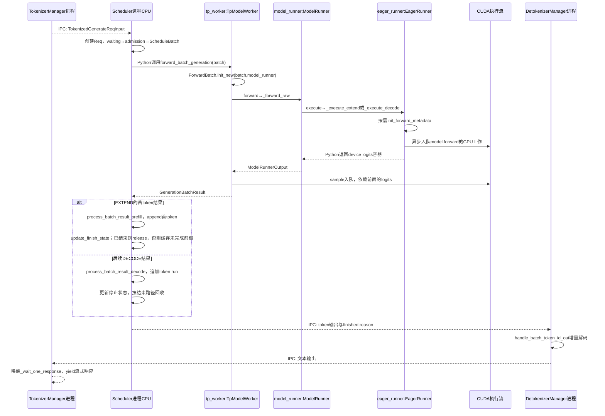
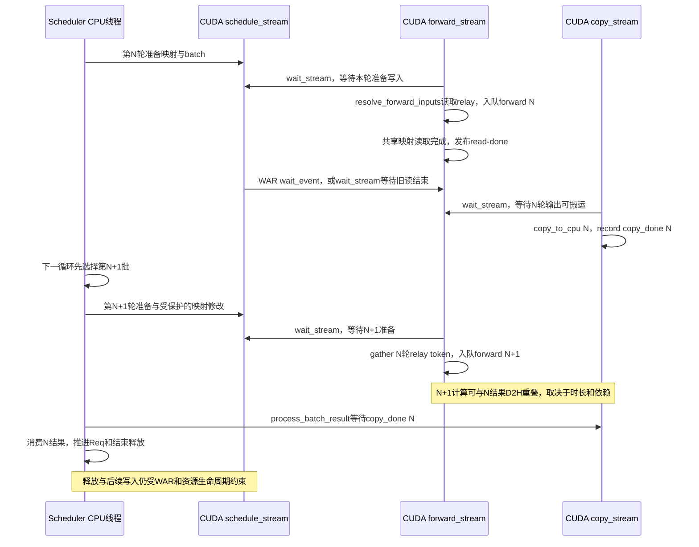
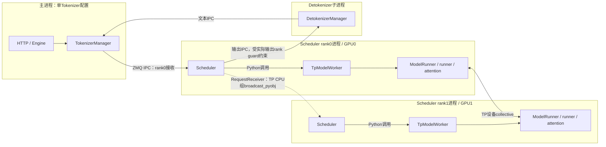
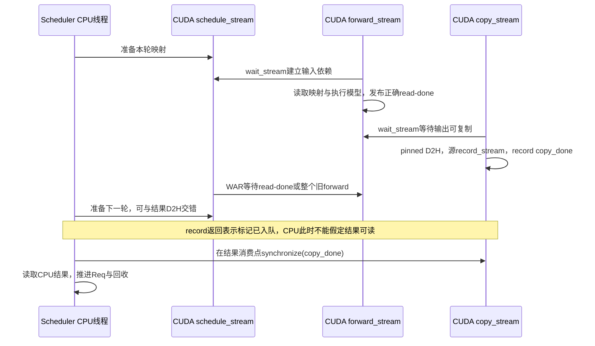

# 推理引擎研发与性能优化学习题

本册保留原50题中的引擎题编号，覆盖请求生命周期、调度、KV、执行器、Graph、Overlap、采样与模型接入，并用Q47–Q49练习故障定位；另追加Q52–Q55、Q63，训练Graph复用、分段执行和CPU／GPU并发判断。23题均先说明考察重点、知识点与要证明的能力，再从原始成本、具体状态例子讲到源码；生产追问要求给出分析思路、采集证据和判定标准。

[回总索引](README.md) · [平台部署与大规模服务](platform-deployment.md) · [模型算法与算子](algorithms-kernels.md) · [资料来源](references.md)

题目来源与本轮源码基线：

- **原题Q01、Q07–Q20、Q47–Q49：**最初编写于2026-10-15，基于`f01a0c7f97`及当时工作树；**Q52–Q55、Q63：**最初追加于2026-10-20，基于`bb669346d5`。
- **本轮整册解释重写：**以当前`HEAD=441c855fef`核对问答对应的关键分支、状态写入和下一消费者（推理源码与`bb669346d5`一致）；23题逐项直接解答主问、追问、生产场景及检查点，并保留学习目标。原编号、主问与既有学习状态保持对应，学习进度仍以[总索引](README.md)为准。

默认CUDA上的通用`TpModelWorker`；ROCm共用部分主线但后端可用性不同，MLX由`use_mlx()`改派专属worker。生产情景和数字例子用于训练与验证设计，不是本轮GPU测量或线上事故记录。DP/PP/CP、Mixed、EAGLE、dFlash、dSpark的分支在相关题中单独标明。

学习时先独立回答，再对照每题的机制、算例及检查点解答复盘；给出的条件判断可以按所列状态和证据复现，不把文档中的答案当作已经完成的运行验证。

<a id="q01"></a>

## Q01 一条流式请求如何完成生成和资源回收

### 学习目标

- **【考察重点】** 区分请求逻辑结束、最后一次设备访问和资源真正可复用；追清流式输出与取消的完整闭环。
- **【知识点】** 请求状态机、Prefill/Decode的token与KV错位、共享前缀所有权、异步执行完成条件。
- **【能力要求】** 给一个请求标出每次队列迁移、token写入、停止判断与资源所有者；按取消时机推导清理路径。
- **【常见误区】** 把HTTP断开当成GPU已经停止；把返回最后一个token当成可以free全部KV。

### 问题与追问

一条流式生成请求，从进入 SGLang 到返回、结束和释放资源，经历什么？取消发生在不同阶段又怎样？

- 等待队列、grammar 编译队列、正在执行的 batch 收到取消时，为什么不能使用同一个立即释放动作？
- 结束输出已返回，GPU 显存没有归零，怎样证明是缓存驻留还是资源泄漏？

### 参考答案

#### 主问回答

一条请求要经过接入、准备、接纳、执行、结果提交、增量文本返回与资源结算。逻辑结束、设备完成和缓存可回收是三个时点，不能合并。普通CUDA、PP=1、无投机且关闭Overlap时，TokenizerManager先规范化与分词，经IPC发送TokenizedGenerateReqInput；Scheduler创建Req，保存输入、output_ids与停止条件。规则准备完成后，Req进入waiting_queue；admission选出获准列表，再构造ScheduleBatch。TpModelWorker把该批转换成ForwardBatch，ModelRunner按模式和资格选择实际runner；本例关闭Graph且非split，走EagerRunner的Extend/Decode分支，按需规划attention metadata后调用模型。采样产生token，结果处理器追加Req.output_ids、检查EOS/输出上限/to_finish，输出经Detokenizer转换为文本，再由TokenizerManager唤醒对应流式等待者。

输入8个token、最多输出3个时，Prefill建立8个输入的KV并输出x；下一轮输入x、建立x的KV并输出y；再下一轮输入y、建立y的KV并输出z。最后有效输入KV为“8个prompt+x+y”，并不包含尚未作为输入执行的z。finished后按实际有效/分配边界结算：Radix接管可复用的完整前缀，请求独占的重复页、不完整尾部与投机超额预留按各自规则释放，再归还request slot及锁。批次过滤移除执行视图，不替代资源释放。

#### 追问1的回答：取消必须匹配所在阶段

| 阶段 | 当前动作 | 不能统一立即free的原因 |
| --- | --- | --- |
| 普通waiting_queue | 移出队列，向TokenizerManager发送AbortReq；清理相关prefetch/Mamba状态 | 尚未执行的普通请求通常无运行KV，但可能有预取/辅助状态；仍须通知上游释放RID状态 |
| grammar_queue | 尝试取消Future，调用set_finish_with_abort，将grammar清空、输入改为单token、写to_finish | 当前实现让它经过一次便宜Prefill进入统一结束路径，并非直接pop或强行停止编译线程 |
| running/last_batch | 写Req.to_finish=FINISH_ABORT，复用后续结果处理和release | 已提交GPU工作仍可能读取映射；直接删行或free会使旧工作访问被复用页面 |
| PD waiting/transfer | 已有KV的waiting请求须release；bootstrap/prealloc/transfer使用sender/receiver.abort及各队列的失败收尾 | 等待不代表未分配；传输与异步操作也有自己的持有者 |

chunked_req另记pending abort，不能在中间块仍在途时拆掉历史。Overlap开启后，CPU可能延后一轮消费结果；取消仍走这些责任边界，不能把HTTP断开当作CUDA工作已撤销。

#### 追问2的回答：驻留与泄漏按所有权判定

GPU进程显存不归零本身不能证明泄漏：KV物理池可能启动时已预分配，空闲页面仍在池内，Radix还会保留evictable前缀。应对同一结束RID核对request slot归还、请求独占尾部释放、inc/dec锁配对、活动/在途owner和free/evictable/protected统计。若剩余页面都有缓存owner、在压力下可evict，且重复请求完成后slot与protected不单调增长，是正常驻留。若已无请求、传输或异步owner却持续丢失slot，或protected引用只增不减，则是泄漏。处理时修漏掉的release、引用解除或取消收尾，并以重复完成/取消后的账本稳定和压力回收验证；强制清空全部缓存只能遮蔽问题。

### 源码调用链与证据

```text
TokenizerManager.generate_request → _tokenize_one_request → _send_one_request
  → Scheduler.handle_generate_request → Req → GrammarManager.process_req_with_grammar
  → Scheduler._add_request_to_queue → waiting_queue / PD 专用队列
  → admission → ScheduleBatch → TpModelWorker.forward_batch_generation
  → ForwardBatch.init_new → ModelRunner.forward → _forward_raw
     [本例CUDA、无spec、PP=1、关闭Graph/Overlap/Mixed，非split]
     → EagerRunner.execute → _execute_extend / _execute_decode
     → needs_forward_metadata_init → attn_backend.init_forward_metadata
     → model_runner.model.forward → LogitsProcessorOutput
     → ModelRunner.sample → sampler → GenerationBatchResult
  → Scheduler.process_batch_result 按 forward_mode 分派
     EXTEND → SchedulerBatchResultProcessor.process_batch_result_prefill
       Req.output_ids.append(首token) → update_finish_state
       finished → release_kv_cache；否则 → maybe_cache_unfinished_req
     DECODE → SchedulerBatchResultProcessor.process_batch_result_decode
       Req.output_ids.extend → update_finish_state → _handle_finish_state_updated_req
       finished → release_kv_cache
     释放路径 → cache_finished_req + 预留尾部释放 + request slot 释放
  → SchedulerOutputStreamer.stream_output → Detokenizer → TokenizerManager 等待者
取消：Scheduler.abort_request → 队列移除 / receiver.abort / Req.to_finish
```

下面固定为**普通 CUDA、PP=1、无投机、关闭 Graph/Overlap/Mixed、非 split prefill**，让进程交接与同进程 Python 调用分开可见；GPU 工作是异步入队，Python 返回 device tensor 不表示 CPU 已取得数值。Graph/Overlap 的时序见[Q13](#q13)与[Q17](#q17)。



[managers/tokenizer_manager.py:708](/Users/magician/PycharmProjects/sglang/python/sglang/srt/managers/tokenizer_manager.py:708)；[managers/scheduler.py:2177](/Users/magician/PycharmProjects/sglang/python/sglang/srt/managers/scheduler.py:2177)；[结果模式分派:3653](/Users/magician/PycharmProjects/sglang/python/sglang/srt/managers/scheduler.py:3653)；[Prefill 首 token 与结束处理:234](/Users/magician/PycharmProjects/sglang/python/sglang/srt/managers/scheduler_components/batch_result_processor.py:234)；[managers/scheduler.py:4152](/Users/magician/PycharmProjects/sglang/python/sglang/srt/managers/scheduler.py:4152)；[managers/scheduler_components/batch_result_processor.py:776](/Users/magician/PycharmProjects/sglang/python/sglang/srt/managers/scheduler_components/batch_result_processor.py:776)；[mem_cache/common.py:132](/Users/magician/PycharmProjects/sglang/python/sglang/srt/mem_cache/common.py:132)；[EagerRunner.execute:194](/Users/magician/PycharmProjects/sglang/python/sglang/srt/model_executor/runner/eager_runner.py:194)；[DetokenizerManager.event_loop:166](/Users/magician/PycharmProjects/sglang/python/sglang/srt/managers/detokenizer_manager.py:166)。

核心节选（[managers/scheduler.py:4274](/Users/magician/PycharmProjects/sglang/python/sglang/srt/managers/scheduler.py:4274)；首行教学注为补充，其余保留当前逻辑）：

```python
# 教学注：运行中的请求标记终止，后续统一结果路径承担释放。
for req in inflight_reqs:
    if not req.finished() and (
        recv_req.abort_all or req.rid.startswith(recv_req.rid)
    ):
        # Abort method 3: set `to_finish`
        # The request will still run one decode forward pass.
        # Then we reuse all existing code to clean up the KV cache allocation.
        logger.debug(f"Abort running request. {req.rid=}")
        req.to_finish = FINISH_ABORT()
```

取消细分见[GrammarManager.abort_requests:109](/Users/magician/PycharmProjects/sglang/python/sglang/srt/constrained/grammar_manager.py:109)与[Req.set_finish_with_abort:1645](/Users/magician/PycharmProjects/sglang/python/sglang/srt/managers/schedule_batch.py:1645)。

### 生产实践追问

- **追问：客户端断开后GPU仍忙，是否泄漏？** 按RID对齐取消接收、队列归属、to_finish、最后设备使用、copy_done与release。若运行批按统一结束路径完成且slot/锁最终归还，是延迟终止；若waiting已移除但Tokenizer仍保留RID，补AbortReq通知；若无在途引用仍占slot或锁，修对应取消收尾。验收反复在waiting、grammar与运行阶段取消，所有账本回到允许的缓存驻留基线。
- **追问：响应结束但显存高，怎样判断？** 同时记录物理池大小、allocator free、Radix evictable/protected与活动owner。若物理池保持但free增加或evictable可在压力下回收，保留缓存；若相同负载循环后protected或已占slot持续累积，追最后一次inc_lock_ref/alloc与缺失的dec/free。修复后检查停止、取消和超额预留尾部均能结算，而非要求进程显存清零。

### 学习检查点

- 为什么等待中的 PD Decode 请求也可能必须释放 KV？

  **解答：**PD Decode在进入waiting前可能已完成接收侧预分配，request slot和接收KV已经属于该请求。取消时只移队会遗留它们，所以该分支还调用release_kv_cache；若仍处于传输队列，则先通过receiver.abort进入相应收尾。

- 运行请求的取消为什么优先写终止状态，而不是立刻从所有容器删除？

  **解答：**旧forward或copy仍可能持有该Req的映射与存储。先写to_finish让已有结果路径在安全边界执行停止和release，可以保持对齐张量及所有权一致；立即删除/释放会引入重复free或use-after-free。

<a id="q07"></a>

## Q07 Scheduler 请求与批次的连续两轮状态

### 学习目标

- **【考察重点】** 识别同一Req被不同批次容器引用时的身份与跨轮归属，避免把执行选择与持久状态混为一谈。
- **【知识点】** 请求对象与batch视图、列表筛选/合并、NextBatchPlan双返回值、Overlap延迟消费。
- **【能力要求】** 逐轮画出waiting、can_run_list、running_batch、last_batch和batch_to_run的成员，注明共享引用而非深拷贝。
- **【常见误区】** 认为running_batch就是本轮执行批；认为filter_batch释放KV；把last_batch成员都当成需要Decode。

### 问题与追问

区分 Req、获准请求列表、ScheduleBatch、batch_to_run、running_batch、last_batch。画连续两轮变化。

- 第 N 轮 Prefill 后，第 N+1 轮谁把它加入 running_batch？未完成 chunk 为什么被排除？
- overlap 为什么先选择下一批，再处理上一批结果？共享 Req 与 batch.copy 的生命周期如何区分？

### 参考答案

#### 主问回答

Req是请求身份及进度；获准列表can_run_list只装本轮接纳通过的Req；ScheduleBatch把一组Req和对齐的长度、索引、采样张量组织成可执行视图。batch_to_run指本轮选中的批，running_batch是跨轮保留的Decode集合，last_batch是上一轮已提交的批，三者不是三个互不重叠的请求副本。

普通CUDA、PP=1、非Overlap/非mixed，初始waiting=[A]、running=[B]。第N轮admission形成can_run_list=[A]，A移出waiting，准备Extend后返回NextBatchPlan(batch_to_run=[A],running_batch=[B])；B虽在running，本轮并未执行。A的Prefill结果追加首token，循环记录last_batch=[A]。第N+1轮先处理last_batch与持久集合的交接，A完成Prefill且未结束时合入running，得到[B,A]，再选择新Prefill或该Decode批。容器可以共享同一个Req，因此finished写入会被多个旧视图看到。

#### 追问1的回答：上一轮Extend由下一轮选批入口交接

Scheduler.get_next_batch_to_run检查last_batch是否为Extend，对其filter_batch后，在running为空时直接接收last_batch，否则merge_batch。若A还有未处理输入，它由chunked_req持有，必须加入过滤排除集；否则A会在上下文未齐时被错误当成普通Decode。若A已finished，结果路径已经释放资源，下一轮过滤只移除batch中的行。filter/merge还必须同步seq_lens、request indices和sampling行，不能只改Req列表。

例如A只完成300输入中的前128个，第N+1轮排除A后仍只有[B]进入普通running；A通过续块路径继续Extend。若A输入只有128且没有结束，才会进入[B,A]。同样的last_batch=[A]，下一轮含义由chunk/finished状态决定。

#### 追问2的回答：Overlap分离提交时钟与CPU结算时钟

默认允许重叠的批次先选择并提交N+1，再消费N结果，是为了把CPU选批和上轮结果处理放到设备执行窗口内，减少GPU空等。触发disable_overlap_for_batch时顺序不同：仍先选好N+1，但先pop并处理N结果，再提交N+1；开启SGLANG_DISABLE_CONSECUTIVE_PREFILL_OVERLAP且前后都是Prefill时，以及需要host-draft grammar同步的Decode批次，会进入这条边界。自回归token依赖由设备relay维持，N+1并未跳过对N输出的依赖；共享映射修改还受WAR保护。batch.copy快照保留该轮批次字段和tensor引用，但Req对象仍可共享；快照应活到对应结果消费完成，Req的逻辑状态则由统一结果路径推进。两种消费顺序与触发条件见[提前消费上一批结果](/Users/magician/PycharmProjects/sglang/python/sglang/srt/managers/scheduler.py:1648)、[is_disable_overlap_for_batch](/Users/magician/PycharmProjects/sglang/python/sglang/srt/managers/scheduler.py:1688)。

NextBatchPlan还回传新的running_batch。mixed会把旧running的请求转入新批，并返回空的持久容器；只保存plan.batch_to_run却不写回plan.running_batch，会留下旧[B]，下一轮再合入last_batch中的[B]就出现[B,B]。这丢的是容器替换所表达的所有权转移，而不是丢了B的KV。

### 源码调用链与证据

```text
Scheduler.event_loop_normal / event_loop_overlap
  plan = get_next_batch_to_run(running_batch, last_batch)
  self.running_batch = plan.running_batch; batch = plan.batch_to_run
get_next_batch_to_run:
  last Extend → filter_batch(排除 chunk/finished) → merge into running_batch
  get_new_batch_prefill → adder.can_run_list → 从 waiting_queue 移除
    → ScheduleBatch.init_new → prepare_for_extend → NextBatchPlan
  无新 Prefill → update_running_batch → Decode
执行结果处理后或 overlap 延后一轮处理 → self.last_batch = batch
```

[managers/scheduler.py:1592](/Users/magician/PycharmProjects/sglang/python/sglang/srt/managers/scheduler.py:1592)；[managers/scheduler.py:1635](/Users/magician/PycharmProjects/sglang/python/sglang/srt/managers/scheduler.py:1635)；[managers/scheduler.py:2820](/Users/magician/PycharmProjects/sglang/python/sglang/srt/managers/scheduler.py:2820)；[managers/scheduler.py:3106](/Users/magician/PycharmProjects/sglang/python/sglang/srt/managers/scheduler.py:3106)。

核心节选（[managers/scheduler.py:1592](/Users/magician/PycharmProjects/sglang/python/sglang/srt/managers/scheduler.py:1592)；首行教学注为补充，其余保留当前逻辑）：

```python
# 教学注：两个返回值分别决定持久状态和本轮执行，不要混用。
# Get the next batch to run
plan = self.get_next_batch_to_run(
    running_batch=self.running_batch, last_batch=self.last_batch
)
self.running_batch = plan.running_batch
batch = plan.batch_to_run
```

### 生产实践追问

- **追问：空载时running计数不归零怎么查？** 连续记录同RID的finished、running/last/result_queue与mode。若延迟结果消费后下一次过滤清空，是正常Overlap时序；若已finished仍在后续实际执行批中，修过滤条件；若没有执行却持久停留在prefill-only或特殊handoff容器，修该分支的交接，核资源已release后再移除视图，避免重复释放。
- **追问：新增batch字段后只在部分请求上错？** 给A/B字段赋不同哨兵值，逐步检查init、filter、merge、copy与下一消费者的RID对应。若filter只裁Req未裁字段，补同一keep_indices；若merge顺序相反，按self.reqs+other.reqs同步拼接；若copy误共享会被原地改写的字段，保存本轮快照或建立消费前不覆盖的边界。验收两轮过滤/合批后每行语义一致。

### 学习检查点

- 为什么 last_batch 含一个 Req，不能证明它还需要执行 Decode？

  **解答：**last_batch只证明上一轮提交曾含该Req。它可能已finished、只完成中间chunk、或属于无需普通Decode的模式；下一轮须按finished/chunk/mode过滤后才确定是否继续执行。

- 若只使用 plan.batch_to_run 而不写回 plan.running_batch，mixed 路径会丢失什么状态？

  **解答：**mixed返回的空running容器表示旧成员已转交新批并由last_batch恢复。不写回会保留旧集合，再次merge同Req形成重复行；KV仍在，但调度集合的唯一性被破坏。

<a id="q08"></a>

## Q08 显存空闲时 Prefill 为何仍被拒绝

### 学习目标

- **【考察重点】** 把admission拆成请求槽、当轮工作量、未来KV保留和可驱逐容量，解释锁前锁后预算变化。
- **【知识点】** 分页对齐、共享前缀保护、未来输出估算、独立SWA/Mamba资源。
- **【能力要求】** 为一个被拒请求逐项算预算，解释具体gate和锁导致的可回收容量变化，再推导调参后果。
- **【常见误区】** 看到GPU空闲就提高max_running_requests；把max_prefill_tokens当显存容量；认为prefix命中只会增加可用空间。

### 问题与追问

显存还有空闲，请求为什么仍进不了 Prefill？prefix 加锁后为什么还要重查预算？

- max_prefill_tokens、chunk budget、request slots、可驱逐 KV 与未来输出预算分别约束什么？
- 首个超长请求会不会越过 max_prefill_tokens？SWA/Mamba 为何还需要独立检查？

### 参考答案

#### 主问回答

显存有空闲不意味着请求满足接纳条件。调度器接纳的是持续生成的工作，必须同时装下request mapping槽、本轮新增输入KV、未来输出保留以及模型专属状态；输入工作预算还可独立限制每轮执行量。GPU监控的空闲字节既不等于某个子池的可分配槽位，也不表示全部缓存可被驱逐。

锁后重查是防止同一段prefix被算两次。设page_size=16、allocator free=16个token容量、evictable=112，初看128。A输入112、命中80、未命中32，输出保留24，加分页余量16，需求72，锁前72<128。A要用命中的80个位置，加锁后这些页从evictable转protected，可用预算降成16+(112−80)=48，72已装不下，必须拒绝并撤销临时保护。虽然没创建新GPU tensor，资源的可回收资格已经改变；跳过复查会把A历史既当使用中的内容又当可回收空间。

#### 追问1的回答：各gate约束不同单位和时域

max_prefill_tokens约束本轮接纳的新增输入工作；chunk budget约束可选输入区间；request slots约束可同时维护的请求映射；free+evictable约束当前物理KV容量；future output按剩余输出和new_token_ratio保留后续增长。full KV、SWA和Mamba又各有池/状态槽，不能把full池余量拿来兑现Mamba状态或SWA窗口。锁前估算、锁后复查通过后，才持久更新can_run_list、锁与预算，随后ScheduleBatch分配真实位置。

例如输入预算还剩128、KV能装1000，但request slot为0，扩大输入预算无效；有slot但锁后只余48、需求72，减少CPU开销也不会让接纳成功。future保留过多会压低并发，过少则在Decode增长后触发retraction；应以完成吞吐和回退量选择工作点。

#### 追问2的回答：首候选例外不豁免容量与独立状态

未启用chunk时，can_run_list仍为空的首个大请求可越过max_prefill_tokens输入上限，防止它永远无法启动；已有其他候选时则不享有相同例外。这个gate只针对输入工作预算，total KV的锁前/锁后检查、request slot和模型状态池仍必须满足，不能靠首请求例外越过物理容量。

SWA需要保证本轮新增内容与未来窗口头部的容量，混合模型还可能有full/SWA两种余量；Mamba新请求需要状态槽，共享内存模型还把状态成本折成联合预算。拒绝时若已临时持锁或提前获取辅助状态，要回滚这些动作。只改返回值让请求进入获准列表，会把等待转成分配失败或状态泄漏。

### 源码调用链与证据

```text
Scheduler._get_new_batch_prefill_raw
  → get_num_allocatable_reqs = min(PP microbatch余量, request pool余量)
  → PrefillAdder(running_batch, new_token_ratio, input/chunk budgets)
  → Req.init_next_round_input(tree_cache) 写 prefix_indices/last_node
  → PrefillAdder.add_one_req
       total_tokens / real_input_tokens 检查
       _lock_node(last_node) → inc_lock_ref → 再检查 rem_total_tokens
       [host hit] init_load_back → 更新 prefix_indices
       can_run_list.append → 持久锁 + _update_prefill_budget
  → Scheduler 消费 can_run_list 建批
```

[managers/scheduler.py:2904](/Users/magician/PycharmProjects/sglang/python/sglang/srt/managers/scheduler.py:2904)；[managers/scheduler.py:2995](/Users/magician/PycharmProjects/sglang/python/sglang/srt/managers/scheduler.py:2995)；[managers/schedule_policy.py:559](/Users/magician/PycharmProjects/sglang/python/sglang/srt/managers/schedule_policy.py:559)；[managers/schedule_policy.py:1081](/Users/magician/PycharmProjects/sglang/python/sglang/srt/managers/schedule_policy.py:1081)；[managers/schedule_policy.py:1122](/Users/magician/PycharmProjects/sglang/python/sglang/srt/managers/schedule_policy.py:1122)。

核心节选（[managers/schedule_policy.py:1122](/Users/magician/PycharmProjects/sglang/python/sglang/srt/managers/schedule_policy.py:1122)；首行教学注为补充，其余保留当前逻辑）：

```python
# 教学注：锁会改变可驱逐容量，必须在锁后再次判断。
with self._lock_node(req.last_node):
    # self.rem_total_tokens may decrease after the lock acquisition
    if total_tokens >= self.rem_total_tokens:
        return AddReqResult.NO_TOKEN
```

### 生产实践追问

- **追问：低利用率且队列很长，怎样找到第一原因？** 选最老RID，重算输入/命中/输出上限、request槽及各子池锁前锁后余量，记录首次返回NO_TOKEN/OTHER的gate。槽为0则处理并发/槽预算；锁后不足则减少保留工作、提高真实可回收容量或校准new_token_ratio；仅输入预算耗尽则调整chunk/单轮工作量。以预算计算能解释实际拒绝且请求最终完成作为判定。
- **追问：降低预留比例后吞吐短时提高，是否成功？** 覆盖长输出增长期，比较完成吞吐、重复Prefill、每RID回退次数与失败。若完成吞吐提升、回退稳定且SLO满足，可保留；若running增多但反复retract或中止，回调比例/减少接纳，不能把瞬时并发当容量增加。

### 学习检查点

- 为什么保护 prefix 后 rem_total_tokens 可能下降，尽管没有新分配 GPU tensor？

  **解答：**rem_total_tokens含可驱逐缓存。prefix加锁把其中一部分转成protected，降低可回收容量；变化的是可用性统计，不是物理tensor字节。

- 首候选的输入预算例外为什么不能推出 KV 总预算也可越过？

  **解答：**首候选例外只绕过输入工作量gate以避免永远排队。KV总预算承担实际alloc安全，不满足时继续接纳会使分配失败，因此它及request/状态槽检查不被豁免。

<a id="q09"></a>

## Q09 Chunked Prefill Mixed 与 Decode 公平性

### 学习目标

- **【考察重点】** 辨别“Prefill优先于普通Decode”与“续块优先于等待候选”两层选择；解释mixed的容器交接和结果身份。
- **【知识点】** token分块、连续批处理、共享Req引用、batch合并与结果缓存边界；单轮工作量界与公平/时间界不同。
- **【能力要求】** 用至少两轮具体成员与token数说明B何时进步；推导不换空产生[B,B]，追到decoding_reqs的下一消费者。
- **【常见误区】** 说分块天然公平；把token上限说成毫秒或总等待上限；把换空running_batch说成释放B的KV。

### 问题与追问

Chunked Prefill 是否保证 Decode 公平？长请求 A 与 Decode 请求 B 连续两轮怎样执行？

- 给出两轮普通 chunk 与 mixed chunk 的 A/B 时间线；chunk size 限制的到底是哪一个量？
- return_logprob、input_embeds 与 EAGLE/dFlash/dSpark 会怎样改变 mixed 的可达性？

### 参考答案

#### 主问回答

Chunked Prefill不保证Decode公平。它把长输入拆成多个新增token区间，降低一次提交的工作量，却没有自动改变选批优先级。当前有两层优先级：外层只要能构建新Prefill批，就先选它，普通running Decode要等没有新Prefill批时才更新执行；内层先续已有chunked_req，再扫描waiting候选。因而有调度边界，不等于B在该边界有普通Decode机会。

#### 追问1的回答：两轮时间线与token上限

固定普通CUDA、PP=1、非Overlap、无投机、page_size=1、return_logprob=False、input_embeds=None，A初始无prefix命中，后续只复用已完成块，A有300输入、B正在Decode且不提前结束，chunk预算128，其它接纳预算充足。以下耗时是算例假设，不能由token数线性推出。

| 轮次 | 普通chunk | mixed chunk |
| --- | --- | --- |
| N | A128，B留在running；耗6ms | A127+B输入1个Decode token；6ms末B前进 |
| N+1 | A再128，累计256；B继续等，耗6ms | A再127，累计254；12ms末B再前进 |
| N+2 | A最后44；B仍等，耗3ms | A最后46+B一步；15ms末B再前进 |
| N+3 | A/B普通Decode另耗1ms；B约16ms得token | A/B进入后续普通Decode |

128只约束相应预算下本轮新增输入量，不约束历史attention、collective或kernel时间，更不约束持续流量下累计等待。mixed让B同批前进，B的ITL仍至少承担整批窗口，不能据此给出固定毫秒上界。

mixed时new_batch=[A,B]，旧running=[B]。合批后将持久running替换为空，因为下一轮last_batch过滤未完成的A后会将[B]恢复进去；若旧running未换空，merge会得到[B,B]，同Req出现两行。换空不free KV。new_batch.decoding_reqs=[B]保留B原本是Decode的身份：MIXED走Extend结果处理，B仍追加token并检查结束，但跳过新Prefill的cache/HiSparse staging，避免重复收尾。

#### 追问2的回答：普通mixed的可达条件与投机分流

当前mixed合批guard要求已启用mixed、存在running、这批不return_logprob且input_embeds为None；return_logprob或embedding输入使它回到非mixed选择，不能仍使用127+1时间线。EAGLE family、dFlash和dSpark各自配置hook会把enable_mixed_chunk置False，因此这三类不能沿普通mixed合批推断公平性；投机每轮通过自己的draft/verify/commit推进。chunk本身与mixed是两个设置，关闭mixed不等于关闭chunked Prefill。

Overlap还会把CPU结果消费延后一轮，所以对真实日志应按设备提交/完成和CPU消费分别记时；本例刻意关闭它，避免把容器交接与消费延迟混为一谈。无论是否Overlap，都必须保持每个Req在恢复后的running集合中唯一。

### 源码调用链与证据

```text
Scheduler.get_next_batch_to_run
  → stash上一块KV；chunked_req加入last_batch排除集
  → get_new_batch_prefill → _get_new_batch_prefill_raw
       add_chunked_req先续块 → 扫waiting候选 → can_run_list
       → ScheduleBatch.init_new → prepare_for_extend
       → [mixed可达且running非空] running.filter_batch → prepare_for_decode
           new_batch.mix_with_running(running)
             → forward_mode=MIXED → merge_batch → self.reqs + other.reqs
           new_batch.decoding_reqs=running.reqs；running换为空ScheduleBatch
       ← 返回new_batch与新的running → 包装NextBatchPlan
  ← get_next_batch拿到可能已mixed的new_batch
  → [new_batch != None] ret=new_batch；否则update_running_batch做普通Decode
结果：MIXED走Extend结果处理 → batch_result_processor:244
  → B仍追加token/检查结束，但跳过新Prefill的cache/staging
下一轮：last_batch.filter排除未完A → 剩[B] → 合入空running，仅保留一份B
```

[managers/scheduler.py:2793](/Users/magician/PycharmProjects/sglang/python/sglang/srt/managers/scheduler.py:2793)；[managers/scheduler.py:2876](/Users/magician/PycharmProjects/sglang/python/sglang/srt/managers/scheduler.py:2876)；[managers/scheduler.py:3014](/Users/magician/PycharmProjects/sglang/python/sglang/srt/managers/scheduler.py:3014)；[managers/scheduler.py:3170](/Users/magician/PycharmProjects/sglang/python/sglang/srt/managers/scheduler.py:3170)；[arg_groups/speculative_hook.py:402](/Users/magician/PycharmProjects/sglang/python/sglang/srt/arg_groups/speculative_hook.py:402)；[mix_with_running合并:2578](/Users/magician/PycharmProjects/sglang/python/sglang/srt/managers/schedule_batch.py:2578)；[merge列表拼接:3043](/Users/magician/PycharmProjects/sglang/python/sglang/srt/managers/schedule_batch.py:3043)；[下一轮过滤:2834](/Users/magician/PycharmProjects/sglang/python/sglang/srt/managers/scheduler.py:2834)；[空running接收last_batch:2840](/Users/magician/PycharmProjects/sglang/python/sglang/srt/managers/scheduler.py:2840)；[decoding_reqs结果消费者:244](/Users/magician/PycharmProjects/sglang/python/sglang/srt/managers/scheduler_components/batch_result_processor.py:244)。

核心节选（[managers/scheduler.py:2876](/Users/magician/PycharmProjects/sglang/python/sglang/srt/managers/scheduler.py:2876)；首行教学注为补充，其余保留当前逻辑）：

```python
# 教学注：普通主线在新 Prefill 存在时优先执行，公平性不能由 chunk 上限直接推出。
if new_batch is not None:
    # Run prefill first if possible
    ret = new_batch
else:
    # Run decode (skip for prefill-only batches)
    if not running_batch.is_empty() and not running_batch.is_prefill_only:
        running_batch = self.update_running_batch(running_batch)
        ret = running_batch if not running_batch.is_empty() else None
```

三算法关闭mixed分别见[dFlash hook:263](/Users/magician/PycharmProjects/sglang/python/sglang/srt/arg_groups/speculative_hook.py:263)、[dSpark hook:402](/Users/magician/PycharmProjects/sglang/python/sglang/srt/arg_groups/speculative_hook.py:402)和[EAGLE hook:554](/Users/magician/PycharmProjects/sglang/python/sglang/srt/arg_groups/speculative_hook.py:554)。

### 生产实践追问

- **追问：长输入来时B卡顿，怎样证明是选择机会不足？** 连续保存至少两轮batch_to_run的RID/mode、新增输入量及B输出序号。若B未进实际批，减小chunk只能缩窗口，应考虑可达的mixed、限制连续Prefill或资源隔离；若B已入mixed，拆整批attention/通信/输出时间，优化批成本。以B等待项还是执行项下降判定，不能统一归因调度。
- **追问：有人删掉换空，觉得多了一次对象构造？** 用[A,B]与旧[B]走到下一轮，比较Req对象身份和张量行；出现[B,B]就恢复容器替换，并检查filter/merge同步元数据。验收B每轮仅执行一次、KV owner不变且没有错误free。
- **追问：decoding_reqs是否只是统计字段？** 它直接决定Extend结果是否执行新Prefill cache/staging。若名单丢失使B被重复执行该动作，保留[B]到结果消费并修batch copy/merge传递；若token未追加，则另查结果模式分派，因为名单不应阻止正常token与结束处理。

### 学习检查点

- 为什么每块最多处理固定 token 数，仍不能证明 B 最多等一块？

  **解答：**块上限只约束一次工作量，外层仍可能连续选择新的/续块Prefill；B可能等多块甚至持续更久。并且一块的耗时本身不由token数固定，所以既无单块等待次数保证，也无时间上界。

- mixed 后为什么需要清空原 running_batch 容器？

  **解答：**旧running的成员已进入mixed新批，下一轮由last_batch恢复。保留旧容器会把同Req再次merge成[B,B]；清空的是调度视图，不是Req、request slot或KV。

<a id="q10"></a>

## Q10 Eviction 与 retraction 的回收和恢复

### 学习目标

- **【考察重点】** 区分缓存淘汰与运行请求退让，追到立即回收、逻辑保留及恢复的不同成本。
- **【知识点】** 分页增量需求、prefix引用锁、回退排序、重算与host offload、接纳反馈。
- **【能力要求】** 按页边界算下一步需求，说明先evict再retract的原因，用一个回退请求走到重新入队及恢复。
- **【常见误区】** 把retraction当CUDA OOM；说filter_batch归还页面；用普通一token预算解释所有spec。

### 问题与追问

内存不足时，eviction 和 retraction 分别回收什么？请求如何恢复？

- page_size=16，committed length 为15和16的两个普通请求，下一步新增页需求分别是多少？
- 最后一个请求仍装不下怎么办？PD retraction 为什么可能选择 host offload 而非全部重算？

### 参考答案

#### 主问回答

Eviction回收没有活动引用保护的prefix缓存，代价是未来请求失去命中；retraction让活动请求退出执行集合，释放其资源后排队恢复，代价是该请求的重算/传输与等待。Decode增长使初次接纳时可放下的工作后来也可能短缺，正确顺序是按下一步页需求尝试evict，再在仍不足时回退部分活动请求，不能等一次CUDA分配失败才处理。

retract_decode按策略选择最不希望保留的请求，release后filter_batch只保留幸存者，并返回重入队列的Req、新token估计和需中止列表。length策略优先保留输出较多者，同进度再考虑输入长度；priority策略把请求优先级纳入。对token-ID输入，Req保留已输出的逻辑历史，普通恢复用原输入加已输出历史重新准备Prefill；采样/grammar进度仍属于原请求，回退不是新建无历史用户请求。当前有显式例外：`input_embeds is not None`时reset_for_retract会清空output_ids并重新Prefill/generation，因为原embedding与后续token ID不能按普通重算路径直接混合。不能把“所有回退都保留输出重算”当作无条件结论。

#### 追问1的回答：15与16分别需要0与16个新槽容量

page_size=16，普通一token Decode中，committed=15的A下一位置仍在当前页，新增页需求0；committed=16的B下一位置跨页，需求1页=16个token容量。两请求合计需求16，不是2。若free=16，无需evict；若free=0，先请求回收短缺16，eviction按页/节点实际回收量可超过目标。不能因A有可用页尾就把它的空间转给B。

投机准备另比较committed+reserve与allocated的页对齐缺口，因为下一轮可能先计算多候选，再决定接受。接受长度是计算之后的结果；用上轮低接受长度替代本轮reserve，会低估verify/draft已经需要的物理位置。

#### 追问2的回答：无可执行请求有中止出口，PD可从CPU恢复

最后一条请求也可能因为上下文加下一步reserve超过总池而装不下。当前回退循环对这种无进展情形返回需abort请求，不能承诺“始终留一个就能执行”，否则会无限回退/重试。中止仍应通知上游并结算资源。

PD Decode的普通回退会先把有效KV及可用的Mamba状态拷到host，再release/reset，进入disagg_decode_prealloc_queue.retracted_queue。resume_retracted_reqs先检查预算、_pre_alloc重新建立设备位置，再req.load_kv_cache调用allocator.load_cpu_copy，返回resumed_reqs并进入Scheduler.waiting_queue。它用CPU容量和拷贝代替从头Prefill，长历史时可减少重算，但增加host占用、D2H/H2D和恢复排队。用于pause(mode=retract)及跨权重更新恢复的true-retraction rebootstrap是另一条路径：release时offload_kv=False，暂存held_rebootstrap_reqs；continue_generation时重新建接收/握手，预分配并send_metadata后submit_prefill_recompute到P侧，不能从旧CPU KV恢复跨版本内容。

### 源码调用链与证据

```text
Scheduler.update_running_batch → filter_batch
  → ScheduleBatch.check_decode_mem
       new_tokens_required_next_decode [普通页边界 / spec reserve缺口]
       → evict_from_tree_cache(只补短缺)
  → [仍不足] retract_decode → _get_decode_retraction_order → release_req
       [PD decode] offload_kv_cache
       → release_kv_cache(is_insert=False) → reset_for_retract
       → filter_batch(保留者) → 返回 retracted_reqs
  → Scheduler._add_request_to_queue(is_retracted=True)
  ├─ token-ID普通请求 → waiting_queue → 下一次Prefill重建上下文
  └─ PD retracted_queue → resume_retracted_reqs
       → _pre_alloc → req.load_kv_cache → allocator.load_cpu_copy
       ← resumed_reqs → process_decode_queue → waiting_queue
另一路径：pause(mode=retract) → retract_all(offload_kv=False)
  → hold_rebootstrap → continue_generation → enqueue_held_rebootstrap
  → 接收握手/预分配/send_metadata → submit_prefill_recompute
  → transfer完成并接收提交 → waiting_queue
reset例外：input_embeds!=None → 清空output_ids，重新Prefill/generation
```

[managers/schedule_batch.py:2597](/Users/magician/PycharmProjects/sglang/python/sglang/srt/managers/schedule_batch.py:2597)；[managers/schedule_batch.py:2631](/Users/magician/PycharmProjects/sglang/python/sglang/srt/managers/schedule_batch.py:2631)；[managers/schedule_batch.py:2682](/Users/magician/PycharmProjects/sglang/python/sglang/srt/managers/schedule_batch.py:2682)；[managers/schedule_batch.py:1735](/Users/magician/PycharmProjects/sglang/python/sglang/srt/managers/schedule_batch.py:1735)；[managers/scheduler.py:3295](/Users/magician/PycharmProjects/sglang/python/sglang/srt/managers/scheduler.py:3295)。

核心节选（[managers/schedule_batch.py:2624](/Users/magician/PycharmProjects/sglang/python/sglang/srt/managers/schedule_batch.py:2624)；首行教学注为补充，其余保留当前逻辑）：

```python
# 教学注：先驱逐可回收缓存，再判断下一步是否装得下。
def check_decode_mem(self, selected_indices: Optional[List[int]] = None):
    """Reclaim evictable tree-cache entries (shortfall only), then report
    whether the next decode step fits in the KV pool."""
    num_tokens = self.new_tokens_required_next_decode(selected_indices)
    evict_from_tree_cache(self.tree_cache, num_tokens)
    return self.token_to_kv_pool_allocator.available_size() >= num_tokens
```

恢复分支见[Req.reset_for_retract及embedding例外:1512](/Users/magician/PycharmProjects/sglang/python/sglang/srt/managers/schedule_batch.py:1512)、[embedding清空输出例外:1548](/Users/magician/PycharmProjects/sglang/python/sglang/srt/managers/schedule_batch.py:1548)、[offload:1556](/Users/magician/PycharmProjects/sglang/python/sglang/srt/managers/schedule_batch.py:1556)、[load_kv_cache:1565](/Users/magician/PycharmProjects/sglang/python/sglang/srt/managers/schedule_batch.py:1565)、[resume_retracted_reqs:679](/Users/magician/PycharmProjects/sglang/python/sglang/srt/disaggregation/decode.py:679)、[_pre_alloc:1437](/Users/magician/PycharmProjects/sglang/python/sglang/srt/disaggregation/decode.py:1437)和[resumed_reqs写入waiting_queue:2247](/Users/magician/PycharmProjects/sglang/python/sglang/srt/disaggregation/decode.py:2247)。true-retraction另见[pause释放且不offload:4330](/Users/magician/PycharmProjects/sglang/python/sglang/srt/managers/scheduler.py:4330)、[hold/重新入队:599](/Users/magician/PycharmProjects/sglang/python/sglang/srt/disaggregation/decode.py:599)、[continue_generation重新入队:4395](/Users/magician/PycharmProjects/sglang/python/sglang/srt/managers/scheduler.py:4395)、[send_metadata后提交重算:1229](/Users/magician/PycharmProjects/sglang/python/sglang/srt/disaggregation/decode.py:1229)和[接收交接保留既有边界输出:1797](/Users/magician/PycharmProjects/sglang/python/sglang/srt/disaggregation/decode.py:1797)。

### 生产实践追问

- **追问：没报OOM但retraction不断增加？** 按RID记录接纳→输出增长→回退→恢复的次数、重算量与free页。若反复刚恢复又回退且完成吞吐下降，收紧接纳/校准未来输出保留；若只是短时容量尖峰且恢复后稳定完成，可保留策略但评估尾延迟。验收是重复工作和SLO受控，不是没有CUDA异常。
- **追问：改了回退优先级如何验收？** 用不同priority、输入长度与输出进度构造可预测顺序，核被回退RID与策略排序一致，再核slot/KV释放、队列重入和token-ID请求的输出连续性；input_embeds按显式重启例外验收。若高优先级被错误牺牲，修排序方向；若低优先级长期无进展，增加年龄/接纳控制等明确策略，而非只用平均吞吐证明公平。

### 学习检查点

- 为什么“还有一个请求”不代表下一步一定能执行？

  **解答：**“剩一个”只描述请求数，不证明该请求下一步所需页或spec reserve小于物理容量。仍不足时必须走明确中止路径，不能让无进展循环永久重试。

- spec reserve 的页缺口为何不能用接受长度直接替代？

  **解答：**reserve是提交draft/verify之前的容量承诺，接受长度是之后才知道的有效推进；未接受候选也在执行期间占槽，故须按committed/allocated/reserve的页缺口预算。

<a id="q11"></a>

## Q11 KV 分配映射和有效内容的区别

### 学习目标

- **【考察重点】** 拆开物理容量、逻辑映射、内容有效性与设备完成，解释allocated/committed/output三套长度。
- **【知识点】** 分页KV、request-to-token映射、输入输出错位、投机预留和异步完成。
- **【能力要求】** 画出一条请求每个逻辑token的物理索引与有效区间，指出哪一步只是预留、哪一步才写入内容。
- **【常见误区】** allocator返回非空就宣称KV正确；把output_ids长度当已执行输入长度；把字段名committed当设备fence。

### 问题与追问

“分配了 KV”究竟是拿到物理页、建立映射，还是已经生成了有效内容？

- req_pool_idx、req_to_token、prefix_indices、out_cache_loc各自表示什么，谁的单位是请求、token或物理索引？
- 为什么 output_ids、kv_committed_len、kv_allocated_len 在投机和PD交接时不能混用？

### 参考答案

#### 主问回答

“分配了KV”这句话混了三个动作：拿到页面、告诉attention逻辑位置对应哪里、在这些位置写入正确K/V。页管理只解决地址和容量，不懂token语义；映射正确也不代表生产者已经执行。还要另问GPU工作是否完成，因为CPU可以提前安排下一步。把这些层分开，才能理解为何PD预分配成功仍在等传输，投机有很多槽却只接受一部分，以及异步释放为何需要保护。

以request slot=7为例，req_to_token[7,0:3]=[40,41,42]表示A的前3个逻辑位置在这些物理槽。prefix_indices可能告诉下一轮前2个位置可复用；out_cache_loc=[42]告诉本轮把新增KV写到42。它们是索引，不是K/V内容。Extend准备会把旧prefix和新位置一起写进映射；普通Decode根据当前末位置分配下一逻辑位置，并更新相应行。只修改prefix_indices而不改实际映射，下一消费者仍可能读取旧物理页。

再给token加上名字：输入[p0,p1,p2]的Prefill建立三个输入的KV并输出x。此时output_ids=[x]，但x还没有作为输入执行；下一轮准备为x安排物理槽43，forward输入x后才写入它的KV并输出y。若y触发停止，逻辑输出已前进两格，实际执行输入只新增x。投机会再提前保留若干位置，假设allocated可到8，但有效历史只到4，尾部不能被缓存接管或供下一轮当合法历史。

当前普通prepare_for_decode在GPU计算前就推进请求/批次的长度账本，这是“为本轮执行准备好的位置”，不是设备已经完成写入的证明。判断内容能否被另一个stream或CPU消费还要依赖正确顺序和完成事件。对应地，结束释放先处理有效内容及缓存接管，再处理overallocated尾部和request slot，不能按一个长度从头free到尾。跳过这层区分会出现未写入KV被复用、共享前缀被误free或预留尾部泄漏。

这种地址抽象让连续token不用物理连续，便于分页、共享和提前预留；代价是映射、长度与实际内容必须一致。普通一token分配、EAGLE/dFlash/dSpark的reserve、HiSparse与PD目标地址各有专属准备逻辑，不能把一个普通索引例子当所有分配公式。

#### 追问1的回答：索引的单位与作用不同

req_pool_idx是“第几个请求槽”的一个整数，例如7；req_to_token的第7行把该请求的逻辑token offset映到物理KV index，表格单位是一格一个逻辑位置。prefix_indices是一串可复用历史的物理索引，例如[40,41]，长度是可用prefix的token数；out_cache_loc是一串本轮新写入的物理索引，例如[42]，kernel据它store K/V。物理index并不是token id，42也不表示词表第42个词；一页包含多个index时还要按allocator页面规则释放。

#### 追问2的回答：输出、承诺长度与分配上界分别记账

output_ids记录已经形成的生成token；kv_committed_len是引擎用于本轮/跨轮有效前缀的长度账本；kv_allocated_len记录请求已取得的分配范围。投机可先allocated=8，最终只确认到4，余下4个不能作为有效历史或可缓存内容。普通Decode准备又可能在GPU完成前推进committed，所以该字段不是设备完成事件。PD预分配会建立slot/映射并设置长度，但内容尚待传输；必须再看接收完成、提交和attention实际读取。混用三者会分别造成输出重复、把未确认位置当历史、或尾部漏释放；正确做法是按消费者需要使用对应范围，并单独建立内容可见性的事件/传输状态。

### 源码调用链与证据

```text
ScheduleBatch.prepare_for_extend → alloc_for_extend
  → alloc_req_slots / alloc_token_slots或paged_extend
  → write_cache_indices(prefix + 新槽位) → out_cache_loc
普通 prepare_for_decode → alloc_for_decode(token_per_req=1)
  → req_to_token_pool.write((req_pool_indices, 旧seq_lens), out_cache_loc)
  → req.kv_committed_len += 1 / batch.seq_lens += 1
  → worker/runner执行，模型按out_cache_loc写KV
spec: prepare_for_decode → spec_prepare_for_decode → family专属准备
release_kv_cache → effective committed区处理 → overallocated尾部释放
```

[mem_cache/allocation.py:303](/Users/magician/PycharmProjects/sglang/python/sglang/srt/mem_cache/allocation.py:303)；[mem_cache/allocation.py:372](/Users/magician/PycharmProjects/sglang/python/sglang/srt/mem_cache/allocation.py:372)；[mem_cache/allocation.py:539](/Users/magician/PycharmProjects/sglang/python/sglang/srt/mem_cache/allocation.py:539)；[managers/schedule_batch.py:2846](/Users/magician/PycharmProjects/sglang/python/sglang/srt/managers/schedule_batch.py:2846)；[mem_cache/common.py:148](/Users/magician/PycharmProjects/sglang/python/sglang/srt/mem_cache/common.py:148)。

核心节选（[mem_cache/allocation.py:572](/Users/magician/PycharmProjects/sglang/python/sglang/srt/mem_cache/allocation.py:572)；首行教学注为补充，其余保留当前逻辑）：

```python
# 教学注：这里只写逻辑位置到物理槽位的映射，KV内容由后续执行产生。
# Write to req_to_token_pool
if batch.model_config.is_encoder_decoder:
    locs = batch.encoder_lens + seq_lens_gpu
else:
    locs = seq_lens_gpu.clone()

batch.req_to_token_pool.write(
    (batch.req_pool_indices, locs), out_cache_loc.to(torch.int32)
)
```

### 生产实践追问

- **追问：偶发读到其他请求内容？** 保存slot/页面的RID与世代、逻辑offset→物理index以及写入完成点。若映射指向已归其他RID的页，修释放/重用与旧batch过滤；若地址owner正确但内容旧，补生产者到消费者的stream依赖或修hidden/position写入。用交错请求、取消和页复用压力验证同世代只读正确内容，不能只核索引不越界。
- **追问：投机显存比输出长度估算大？** 按轮列output、committed、allocated、reserve和实际释放范围。能由合法候选预留解释且结束后归还的部分保留；拒绝尾部或结束后的独占页仍无owner占用则修尾部release。若池本身预分配而free已增加，是池驻留，并非同一类泄漏。

### 学习检查点

- 为什么已经采样出的token可能还没有自己的KV？

  **解答：**采样token是当前输入经过模型后得到的下一位置输出，尚未作为模型输入执行。例如prompt得到x后，只有下一轮输入x才写x的KV；输出出现与其KV建立错开一轮。

- PD preallocation成功为什么不能作为传输成功的证据？

  **解答：**preallocation只证明取得目标地址并建好映射/长度，不证明远端字节已经到达或接收已提交。传输完成及接收侧commit/consume提供内容证据，不能用地址分配成功代替。

<a id="q12"></a>

## Q12 共享前缀的引用锁与资源所有权

### 学习目标

- **【考察重点】** 共享缓存页面由谁持有、何时从protected转evictable，及重复计算内容怎样替换成canonical映射。
- **【知识点】** 引用计数的边界转换、树节点祖先链、完整页与部分页、请求槽和KV的分离生命周期。
- **【能力要求】** 对A/B共享前缀计算lock_ref变化，追清insert去重、映射重写和释放顺序；判断缓存驻留是否有owner。
- **【常见误区】** A结束就free全部KV；引用数从2减到1就计为可evict；将filter_batch与资源释放混淆。

### 问题与追问

A、B 共享前缀，A 结束时为什么不能 free 全部 KV？如何区分缓存驻留与泄漏？

- lock_ref的0→1、1→0各改变哪个容量统计？同一祖先被多个请求使用时如何变化？
- cache_unfinished_req为什么会释放重复KV、重写映射并更换last_node锁？

### 参考答案

#### 主问回答

Prefix Cache节省的是“相同前缀重复计算”，但代价是页面不再由单个请求独占。A结束时，如果B仍沿用同一段KV，释放A看到的全部物理索引会破坏B的历史。因此需要区分树持有的缓存页、活动请求的引用和请求独占新增页；缓存节点lock_ref保护的是当前还会被使用的内容，allocator最终回收的是没有有效owner的页面，而不是谁先结束谁就能全部free。

设节点P含8个共享token，最初无请求使用，lock_ref=0，8个token计入evictable。A接纳后引用变1，统计只转换一次：evictable减8、protected加8；B也命中，引用变2，容量统计不再加8。A结束后2→1，B仍需要它，不能回收；B也结束后1→0，P才重新可evict。锁沿last_node的祖先链更新，因为长前缀叶节点被用到，也意味着其所有祖先历史被用到。

再看去重为何要改请求映射。A和B同时算过相同后缀，可能分别占物理页50和70；树已经接管50，B插入时发现相同内容。保留两份浪费容量，直接free70却不更新B映射会让它继续指向已释放页。cache_unfinished_req先识别重复区，释放B独占的重复页，再match树的canonical索引并写回req_to_token，更新cache_protected_len、迁移旧/新last_node锁。下一块Prefill或Decode才能安全读取统一的那份KV。

分页还让prefix_indices和cache_protected_len不能总相等。比如已算18个token，树只接管两个完整8-token页，最后2个可能暂留请求内；prefix_indices可包含这些可继续用的位置，protected长度却只表示树管理的完整部分。结束时既不能漏free请求尾部，也不能把树页面当独占再次free。公共release还处理投机超额预留和request slot；batch过滤只是消除执行视图中的行，不替代这些动作。

这样设计同时提升复用率和容量效率，但锁、去重与映射更新必须成套，遗漏任一步都可能导致泄漏、重复free或读取已重用页面。空载显存不下降而evictable能在压力下回收，是缓存驻留；无活动引用仍有持续protected增长才是另一类问题。HiCache、SWA、Mamba还要按相应实现扩展所有权。

#### 追问1的回答：容量只在零与非零边界转换

lock_ref从0到1时，节点所含页面从evictable转protected；从1到0时逆向转换。2到1仍有B引用，不能增加evictable，否则eviction可删掉B仍需的页。祖先链的各节点分别增加/减少引用，一个叶子在使用就依赖其祖先，但容量统计只在各节点跨零边界时改变，不按引用数复制计算字节。8-token节点被A/B共同使用仍只占8个物理token内容。

#### 追问2的回答：去重必须同时替换索引与锁

cache_unfinished_req可能把本次新算的prefix插入树，发现某些内容已由另一请求插入。若树保留50、当前请求仍用重复页70，就应释放70并让请求改指canonical的50；只改树而不改req_to_token会让下一轮访问已free的70。重新match得到canonical prefix_indices后，写回请求行，更新cache_protected_len，并迁移旧last_node到新last_node的锁，保证树实际管理的完整页得到保护。页长8而当前算到18时，树可只接管16，最后2仍属请求；结束释放必须分开处理树持有区与请求尾部，不能把18全部当同一owner。

### 源码调用链与证据

```text
Req prefix match → last_node / cache_protected_len
PrefillAdder接纳 → RadixCache.inc_lock_ref(last_node)
  [0→1] evictable_size减、protected_size增；祖先链引用+1
cache_unfinished_req → insert → 释放重复独占页 → match canonical索引
  → req_to_token_pool.write → protected_len更新 → old dec / new inc
请求结束 → release_kv_cache → cache_finished_req
  → 插入/重复页/未对齐尾处理 → dec_lock_ref(last_node)
  → 释放spec预留尾及request slot；无锁叶节点可被evict
```

[mem_cache/radix_cache.py:437](/Users/magician/PycharmProjects/sglang/python/sglang/srt/mem_cache/radix_cache.py:437)；[mem_cache/radix_cache.py:490](/Users/magician/PycharmProjects/sglang/python/sglang/srt/mem_cache/radix_cache.py:490)；[mem_cache/radix_cache.py:594](/Users/magician/PycharmProjects/sglang/python/sglang/srt/mem_cache/radix_cache.py:594)；[mem_cache/common.py:132](/Users/magician/PycharmProjects/sglang/python/sglang/srt/mem_cache/common.py:132)。

核心节选（[mem_cache/radix_cache.py:599](/Users/magician/PycharmProjects/sglang/python/sglang/srt/mem_cache/radix_cache.py:599)；首行教学注为补充，其余保留当前逻辑）：

```python
# 教学注：只有从无活动引用变成被保护时，容量统计才转换一次。
while node != self.root_node:
    if node.lock_ref == 0:
        self.evictable_size_ -= len(node.key)
        self.protected_size_ += len(node.key)
        delta -= len(node.key)
    node.lock_ref += 1
    self._update_leaf_status(node)
```

### 生产实践追问

- **追问：取消A后B偶尔错？** 固定共享prefix、仅取消A，持续申请新页制造复用，保存P.lock_ref、B的req_to_token和物理页世代。若A结束后2→1却增加evictable，修容量边界；若B仍指向已free重复页，修canonical写回；若引用正确而内容被覆盖，查最后设备读/下一写依赖。验收B多轮输出、内容和引用账本一致。
- **追问：空载protected越来越大？** 为每个protected节点列Req、session或异步传输owner，并配对inc/dec。owner已结束而引用未减则补相应结束/失败/取消路径；owner仍在途则先完成/终止它，不能直接减锁。全部owner结束后protected应回落、evictable能承压回收；清空缓存不能替代引用闭环修复。

### 学习检查点

- 为什么lock_ref从2减到1不应增加evictable容量？

  **解答：**2→1仍存在一个活动owner，页面仍protected；增加evictable会允许驱逐B还要读的历史。只有最后一个引用1→0才转换容量。

- 为什么新canonical索引必须写回请求映射，而不能只更新树？

  **解答：**树更新仅改变canonical存储，attention读取的仍是请求映射。释放重复页后若不写回，新请求会继续读旧地址，地址可能已分配给别的RID，因此映射和锁迁移必须一起完成。

<a id="q13"></a>

## Q13 Worker 和 ModelRunner 的实际执行分派

### 学习目标

- **【考察重点】** 先确定真实worker与ModelRunner接收者，再按mode和资格解释所选执行器及attention计划位置。
- **【知识点】** 对象组合与设备override、ForwardBatch契约、eager/Decode Graph/Prefill Graph/split分派。
- **【能力要求】** 给定设备、spec与forward mode，沿guard选择唯一可达路径，跟踪返回logits或PP代理张量的下一消费者。
- **【常见误区】** 把名字带worker的对象当进程；把全部执行压成一个forward；因为多token就说verify走Prefill Graph。

### 问题与追问

Scheduler 最终调用哪个 worker？输入进入 ModelRunner 后，怎样选择实际执行器？

- CUDA/ROCm的TpModelWorker、MLX override与spec draft worker分别在哪选定？
- 为什么TARGET_VERIFY可能由名为DecodeCudaGraphRunner的执行器处理，却不能据此称为普通Decode？

### 参考答案

#### 主问回答

Scheduler负责“本轮运行谁”，模型执行层还要回答“用哪套实现完成这批工作”。本题先限定普通CUDA、无spec、PP=1；在这一条件下，Scheduler中的tp_worker是通用TpModelWorker，model_worker指向它；启用投机后model_worker可以变成算法worker，target worker则由其持有。MLX另有明确override，不能由IDE跳转结果判断运行时。

在普通路径，ScheduleBatch含请求及调度准备的对齐数据，TpModelWorker建立ForwardBatch，把模型需要的mode、input_ids、positions、长度与KV位置组织成这次执行输入。当前代码直接从ScheduleBatch构造，不应强行插入旧版本的ModelWorkerBatch。worker调用自己持有的ModelRunner，后者拥有已加载模型、池、attention backend和runner；这些是同一rank进程内的组合关系，具体OS拓扑见Q54。

用三个请求A/B/C各走一次Decode来选分支。_forward_raw先判断mode是否允许graph、decode runner是否存在且接纳该形状；若可执行，就由DecodeCudaGraphRunner填静态buffer、规划所需metadata并replay，立即返回ModelRunnerOutput，不再经过后面的普通padding逻辑。若未命中，先做最终DP/MLP输入准备，再检查split prefill；之后才检查Extend能否走Prefill graph；都不满足才交EagerRunner。eager并不等于没有框架工作，它按Decode/Idle/Extend分发，并在需要时为选定attention backend初始化metadata，再调用model.forward。

换成A有200个输入token，若是普通Extend且满足prefill图条件，输入走PrefillCudaGraphRunner；若模式是TARGET_VERIFY，虽然也处理多token，当前prefill图资格却拒绝它，应由decode graph或eager处理。split prefill又按层推进而非普通一次完整forward。最终worker取得logits/graph标志，普通生成还要采样，verify则将logits交给专门接受逻辑；PP非最后rank还可返回代理张量，不能照抄最后rank采样。

这种分层复用模型定义，同时把捕获、padding和后端计划放到不同边界。代价是同一用户参数不保证每轮执行同一路径；缺失或重复metadata会错，fallback也可能仅影响性能。因此诊断要同时保存实际worker class、mode、runner、backend与资格失败原因。

#### 追问1的回答：设备worker与算法worker分两层选定

Scheduler先在use_mlx()为真时构造MlxTpModelWorker，否则构造通用TpModelWorker；CUDA/ROCm的本题主线属于后者，具体attention和kernel再按后端选择。spec_algorithm为NONE时model_worker就是target tp_worker；启用投机时SpeculativeAlgorithm.create_worker返回EAGLEWorkerV2、DFlashWorkerV2或DSparkWorkerV2等类，实例持有target worker并构造/加载draft worker，Scheduler将model_worker指向该算法worker。普通target/draft模型执行仍可落到TpModelWorker持有的ModelRunner，所以“选择算法worker”并非换掉所有底层对象。

进入ModelRunner的实际顺序是：①mode允许且decode graph.can_run_graph成功，DecodeCudaGraphRunner.execute后立即return；②未命中先做最终DP/padding准备；③is_split_prefill走ModelRunner.forward_split_prefill；④否则Extend满足prefill图资格且无CP strategy时走PrefillCudaGraphRunner.execute；⑤其余走EagerRunner.execute的Decode/Idle/Extend子分支。eager按needs_forward_metadata_init规划，decode图在load/replay view准备图外metadata，prefill图按其backend接口准备，split在首段或显式reinit时规划；不能把所有计划都归到同一个forward前钩子。

#### 追问2的回答：runner名称不改变ForwardMode语义

TARGET_VERIFY一次输入的是候选链/树，输出交接受算法决定有效token/KV，不是普通每请求一token Decode。ForwardMode允许这类模式走decode-family图，图资格同时核verify宽度、hidden等布局，故名称为DecodeCudaGraphRunner也可处理它。当前PrefillCudaGraphRunner.can_run_graph明确拒绝TARGET_VERIFY；decode图不适用时会沿最终准备落到eager verify，而不能因“多个token”改称Prefill图。PP中间rank返回代理张量供下一stage，只有最后rank取得完整logits并采样；把中间返回当最后logits会破坏stage依赖。

### 源码调用链与证据

```text
Scheduler.init_tp_model_worker → [use_mlx] MlxTpModelWorker / [else] TpModelWorker
Scheduler model_worker → [无spec] tp_worker / [有spec] create_worker选出的算法worker
run_batch → model_worker.forward_batch_generation
  普通TpModelWorker: ForwardBatch.init_new(ScheduleBatch, model_runner)
  → ModelRunner.forward → _forward_raw
      [decode graph可用] decode_cuda_graph_runner.execute → return
      [其余] _prepare_eager_forward_batch → split / prefill graph / eager
      eager: needs_forward_metadata_init → selected_backend.init_forward_metadata
             → model_runner.model.forward → logits / PPProxyTensors
  → GenerationBatchResult → Scheduler结果处理
```

[managers/scheduler.py:815](/Users/magician/PycharmProjects/sglang/python/sglang/srt/managers/scheduler.py:815)；[managers/scheduler.py:924](/Users/magician/PycharmProjects/sglang/python/sglang/srt/managers/scheduler.py:924)；[managers/tp_worker.py:543](/Users/magician/PycharmProjects/sglang/python/sglang/srt/managers/tp_worker.py:543)；[model_executor/model_runner.py:1479](/Users/magician/PycharmProjects/sglang/python/sglang/srt/model_executor/model_runner.py:1479)；[model_executor/runner/prefill_cuda_graph_runner.py:1021](/Users/magician/PycharmProjects/sglang/python/sglang/srt/model_executor/runner/prefill_cuda_graph_runner.py:1021)。

核心节选（[model_executor/model_runner.py:1510](/Users/magician/PycharmProjects/sglang/python/sglang/srt/model_executor/model_runner.py:1510)；首行教学注为补充，其余保留当前逻辑）：

```python
# 教学注：decode graph分支提前返回，后面的eager padding与prefill选择并非每轮都执行。
# Replay cuda graph if applicable
if can_run_graph: # 到这里为止，只是判断是否能执行 decode的 cuda graph；
    ret = self.decode_cuda_graph_runner.execute(
        forward_batch,
        pp_proxy_tensors=pp_proxy_tensors,
    )
    return ModelRunnerOutput(logits_output=ret, can_run_graph=can_run_graph)
```

算法worker返回类见[SpeculativeAlgorithm.create_worker:248](/Users/magician/PycharmProjects/sglang/python/sglang/srt/speculative/spec_info.py:248)；split metadata及层进度见[ModelRunner.forward_split_prefill:1308](/Users/magician/PycharmProjects/sglang/python/sglang/srt/model_executor/model_runner.py:1308)。

### 生产实践追问

- **追问：开了Graph却没有速度提升？** 按每批记录mode、真实runner、graph key/资格失败原因和padding。热点一直eager时，若由不支持hidden/embedding/CP或超桶导致，选择合法配置/覆盖档位；热点已replay时，比较复制、metadata、padding计算与eager总关键路径，命中本身更贵则缩桶或保留eager。不能用参数开关推断设备路径。
- **追问：换硬件后metadata行为不符？** 记录Scheduler实际worker class、ModelRunner设备、attention backend及计划接口。receiver错误则修配置/dispatch；receiver正确但计划shape或返回布局不同，修该后端适配并用相同输入逐层对照。MLX override与通用CUDA路径不能互作运行证据。

### 学习检查点

- 为什么“使用CUDA Graph”不能说明具体走了哪个runner？

  **解答：**可能是decode graph、prefill graph或其backend内部图化，split/eager也可与其它阶段的图共存。只有mode、can_run guard和实际execute接收者能确定本轮runner；总开关不提供这些信息。

- 若PP非末rank返回代理张量，为什么不能直接沿最后rank采样链讲解？

  **解答：**代理张量只是该PP stage的中间输出，需要继续传入下一stage；它没有最终lm_head/logits语义。采样必须发生在最后rank完成模型之后，否则等同从不完整模型状态生成token。

<a id="q14"></a>

## Q14 Attention metadata 的预规划与重规划

### 学习目标

- **【考察重点】** 判断metadata何时有效、由谁预规划、何种变化允许重建，避免重复计划和错误跳过。
- **【知识点】** attention页表/mask/长度计划、最终padding形状、计划所有权与replan等价性。
- **【能力要求】** 用预计划形状和最终形状的具体变化推导needs_forward_metadata_init，解释False也可能是保护特殊计划。
- **【常见误区】** 把ready理解成永久正确；认为shape变了就总能重建；用一个skip布尔值代替计划契约。

### 问题与追问

Attention metadata 为什么既不能无条件重建，也不能预规划后永久跳过？

- 预规划的metadata在DP padding后shape改变，什么时候允许重新规划？
- multi-step wrapper或view-context计划为什么不能仅凭shape变化就重建？

### 参考答案

#### 主问回答

Attention不是拿到Q/K/V张量就能自行知道该读哪些历史。分页KV需要请求到页的映射，变长batch需要长度和边界，投机还带树mask或专属布局；backend把这些整理成metadata。它像本轮访问计划：太早用旧形状规划会少行或错offset，太晚又会把计划工作压到计算关键路径。普通forward可以现场建立，投机与Graph则可能提前规划，所以需要描述“这份计划什么时候仍有效”。

例如预规划时有3个请求、12个token，记录batch_size=3与num_tokens=12；DP准备后把最终token数补到16。若这份预计划与正常forward用同一个backend、同一语义上下文建立，重做只是替换成适配16个token的版本，可标replan_equivalent=True。needs_forward_metadata_init看到形状变化便返回True。若没有变化，则省掉重复工作；没有任何ready标记时，也应按正常路径初始化。这一判断必须发生在最终padding之后，否则重做的仍是旧计划。

但有些计划是multi-step wrapper或特殊view上下文的整体安排，不等价于当前forward的一次普通init。即使形状看起来变了，盲目重建也可能覆盖后续步骤依赖的metadata。这里replan_equivalent=False让marked batch保持跳过，由专属路径保证一致性；它不是说计划必然永远正确，而是说默认forward没有资格擅自替换。把所有预规划点都改成True，可能消除一个shape断言，却制造更隐蔽的跨步骤错误。

当前标记同时保存ready、planned_bs、planned_num_tokens与等价声明，并应紧贴真实planning动作。eager在模型前检查是否要计划；decode graph的load_batch会填静态buffer、构造replay view并建立图外metadata，某些metadata工作又被capture在图内；prefill graph按backend分不同接口。EAGLE/dFlash/dSpark能共享判断入口，却不能因此共用所有计划规则。shape检查仅覆盖部分失效条件，backend身份、页内容和特殊上下文仍需各自契约。

收益是把可重叠的准备移出关键路径并避免重复构造，代价是计划所有权复杂。漏标会多做甚至覆盖特殊计划；错标会读旧页表、错mask或触发尺寸不一致。调试应对照规划点、最终shape与真正消费者，而不是只打印ready=True就停止。

#### 追问1的回答：只有声明等价且最终形状改变才重规划

当前判断可以完整列为：未标ready返回True；已ready但replan_equivalent=False返回False；已ready且equivalent=True，只有batch_size或input_ids.shape[0]与记录不同才返回True。以预规划3请求/12token、DP最终补到16为例，普通同backend同语义计划标equivalent=True后，forward看到12→16会重做；若仍3/12就跳过。判断在最终padding之后才有意义，放在之前会重建另一份同样过期的计划。

#### 追问2的回答：wrapper计划的所有者不一定是普通forward

multi-step wrapper或view-context可能一次规划多步/特殊视图，再让子forward复用。普通init只知道当前fb，不掌握整个wrapper的映射和buffer约束；即使shape变了，重建也可能覆盖其它步骤的计划。因此这些marked且不等价的点保持跳过，防御性shape检查仍可报错，但默认forward不能擅自替换它。正确修复是让专属planner在自己的边界准备正确状态，或证明当前init等价后再改变标记，而非一律打开重规划。

形状相同也只说明这两个尺寸未变，不证明页索引、mask、后端实例或特殊上下文相同。例如A/B互换页但bs/token数不变，旧metadata若仍指A原页就会错；相应planner/图buffer填充仍须更新地址内容。ready标记减少重复准备，不是对metadata全部语义的校验器。

### 源码调用链与证据

```text
spec预规划点: backend.init_forward_metadata / graph_runner.load_batch
  → ForwardBatch.mark_forward_metadata_ready(replan_equivalent=明确契约)
  → 记录batch_size与input_ids长度
ModelRunner._forward_raw
  [非decode graph] _prepare_eager_forward_batch → DP最终padding
  → EagerRunner._execute_decode/_execute_extend
       needs_forward_metadata_init()
       [True] selected backend.init_forward_metadata → model.forward
  [decode graph] DecodeCudaGraphRunner.load_batch
       needs... → 复用预计划 或 填buffer/build_replay_fb_view/图外规划
```

[model_executor/forward_batch_info.py:610](/Users/magician/PycharmProjects/sglang/python/sglang/srt/model_executor/forward_batch_info.py:610)；[model_executor/model_runner.py:1518](/Users/magician/PycharmProjects/sglang/python/sglang/srt/model_executor/model_runner.py:1518)；[model_executor/runner/eager_runner.py:229](/Users/magician/PycharmProjects/sglang/python/sglang/srt/model_executor/runner/eager_runner.py:229)；[model_executor/runner/decode_cuda_graph_runner.py:1058](/Users/magician/PycharmProjects/sglang/python/sglang/srt/model_executor/runner/decode_cuda_graph_runner.py:1058)。

核心节选（[model_executor/forward_batch_info.py:646](/Users/magician/PycharmProjects/sglang/python/sglang/srt/model_executor/forward_batch_info.py:646)；首行教学注为补充，其余保留当前逻辑）：

```python
# 教学注：只有显式声明重规划等价，才用记录的shape决定是否重新规划。
if not self.forward_metadata_ready:
    return True
if not self.forward_metadata_replan_equivalent:
    return False
num_tokens = self.input_ids.shape[0] if self.input_ids is not None else 0
return (
    self.batch_size != self.forward_metadata_planned_bs
    or num_tokens != self.forward_metadata_planned_num_tokens
)
```

### 生产实践追问

- **追问：只有DP padding后错shape？** 同轮记录真实规划对象/上下文、planned与最终bs/token及equivalent。普通同语义计划未在12→16后重建，修标记/最终shape判断；特殊wrapper计划被普通init覆盖，则恢复其所有权并在wrapper边界准备正确尺寸。以消费者看到的metadata和最终输入匹配为验收，不把统一关闭预规划当机制修复。
- **追问：metadata时间突然翻倍？** 按每轮规划点、backend和buffer标记调用，若plan stream已完成同语义最终计划、forward又重做，修ready/记录时点；若最终padding确实改变shape，该次重做有理由，应把预规划移到更合适边界或减少无效计划。若调用次数不变则拆单次计划内部成本，不能靠总时延猜重复。

### 学习检查点

- 为什么shape变了仍可能必须保持needs_forward_metadata_init=False？

  **解答：**False还表达普通forward无权等价替换特殊wrapper/view计划。shape改变应由该专属planner处理，而不是让默认init覆盖可能供多步使用的状态。

- 为什么形状一致不能单独证明metadata里的页索引也一定正确？

  **解答：**shape记录只含bs和token数，A/B页映射、mask或backend上下文改变仍可能使内容过期。地址内容须由相应planner/静态buffer更新，不能凭两个整数相等证明全语义一致。

<a id="q15"></a>

## Q15 Decode CUDA Graph 的静态地址与动态输入

### 学习目标

- **【考察重点】** 区分Graph固定地址与每轮动态值，理解补桶、padding安全和共享输出的生命周期。
- **【知识点】** capture/instantiate/replay、静态输入缓冲、按字段padding、Graph key与有效输出边界。
- **【能力要求】** 让batch按4→3→4变化，逐行说明哪些内容覆盖、哪些尾部重置，以及输出何时可被下一轮覆盖。
- **【常见误区】** 认为图冻结序列长度；只copy真实行不处理padding；把CUDA能力与框架固定buffer契约混为一谈。

### 问题与追问

batch=3 使用 batch=4 的 CUDA Graph 时，哪些地址稳定，哪些值每轮更新？

- 第4个padding请求的长度、request index和KV写位置如何处理，为什么不能全部保留上轮值？
- 图输出是共享静态buffer时，下一次replay之前哪些消费者必须复制或完成读取？

### 参考答案

#### 主问回答

普通eager每轮逐个提交许多GPU操作，短Decode中launch和Python准备可能占显著比例。CUDA Graph把稳定工作流提前记录，运行时一次提交，但代价是已捕获工作引用了特定地址与布局。解决动态请求的常见办法不是每请求重capture，而是预留静态输入、metadata和输出空间，每轮把新值复制到相同地址。固定的是地址契约，不是token、请求身份或上下文长度。

假设已捕获batch=4，当前只有A/B/C三个普通Decode请求。runner选4的档位，将真实三行的input_ids、positions、seq_lens、request indices与out_cache_loc写入静态buffer；attention依据本轮真实长度和页映射读取各自历史。第四行只是padding，必须保证不会碰到活动请求的真实资源。registry不是把所有字段无脑清零：长度可用sentinel，request/out_cache位置等用安全值，某些证明不会被消费的token尾部可保留旧内容。每种处理是为相应kernel的读取契约服务。

连续两轮更能看出风险：上一轮真实batch=4，第四行D使用页面90；下一轮只有A/B/C。如果仅copy前三行而不重置第四行的索引，dummy计算可能继续读取或写入D的资源。即使最后只裁剪前三行logits，已经发生的错误写入也不会被裁剪撤销。反过来，正确padding后D的旧值不再是有效请求状态。下一轮又有E成为第四行时，再用E的真实数据覆盖，不能把静态buffer尾部当作永久固定请求。

执行通常先填buffer、根据最终档位准备metadata和graph key，再replay，返回捕获输出对象的有效视图。这个输出也可能是共享静态存储：下一次replay会覆盖它，所以后续采样、verify或异步copy必须在正确依赖和生命周期内消费，必要时保留或复制需要的数据。仅保持Python容器还活着，不阻止同一地址被新的replay写入；这是访问顺序问题，不能只靠引用计数解决。

补桶的代价是多算dummy行、静态显存和capture档位管理。DP对齐、hidden mode、LoRA及verify宽度会改变key与资格；dSpark compact ragged还可按总token档位，不能把普通raw_bs=3的输出裁剪套到所有投机布局。CUDA本身有受限graph更新能力，但本题SGLang路径主要靠静态buffer内容更新，跨进程复用另见Q52。

#### 追问1的回答：dummy行按字段契约复位

当前registry对req_pool_indices和out_cache_loc等使用ZERO策略，使padding行指向约定的安全slot0；seq_lens/seq_lens_cpu用FILL_SENTINEL填后端要求的seq_len_fill_value，而不是统一设成真实D的长度。KEEP_PAD仅用于调用方证明尾部不会读的槽，FILL_ONCE则只在分配时初始化。因而不能说第4行所有值都必须每轮清零，也不能说只裁输出就能任意留旧值。旧D的out_cache_loc若留成90，dummy kernel在结果裁剪前就可能写D的真实KV，后续丢掉第4行logits无法撤销该写入。

#### 追问2的回答：共享输出先消费，再允许覆盖

捕获输出通常仍是同一静态存储的有效视图。下一次replay前，普通sampler必须完成对该logits的读取，verify的接受/压紧消费者须拿到本轮数据，异步D2H必须完成相应源读取；若某消费者跨下一次覆盖继续使用，应复制所需区域到独立存储或建立跨stream读完成→下次写的依赖。同stream有序可提供先读后写，不同stream要显式event/wait。保留Python引用/record_stream只延长分配器寿命，不能阻止应用复写这个仍活着的静态buffer。

### 源码调用链与证据

```text
ModelRunner._forward_raw → DecodeCudaGraphRunner.can_run_graph → execute
  load_batch:
    raw_bs=3 → _pad_to_bucket(...capture_bs)=4
    → CudaGraphBufferRegistry.fill_from(raw_bs=3,padded_bs=4,...)
       reset_padding → D2D/CPU slots复制 → post_fill
    → build_replay_fb_view → attn_backend.init_forward_metadata_out_graph
    → _replay_graph_key
  backend.replay(key, forward_batch)
  → LogitsProcessorOutput有效输出视图 → worker采样/verify后续消费者
```

[model_executor/runner/decode_cuda_graph_runner.py:1104](/Users/magician/PycharmProjects/sglang/python/sglang/srt/model_executor/runner/decode_cuda_graph_runner.py:1104)；[model_executor/cuda_graph_buffer_registry.py:379](/Users/magician/PycharmProjects/sglang/python/sglang/srt/model_executor/cuda_graph_buffer_registry.py:379)；[model_executor/cuda_graph_buffer_registry.py:68](/Users/magician/PycharmProjects/sglang/python/sglang/srt/model_executor/cuda_graph_buffer_registry.py:68)；[model_executor/runner/decode_cuda_graph_runner.py:1178](/Users/magician/PycharmProjects/sglang/python/sglang/srt/model_executor/runner/decode_cuda_graph_runner.py:1178)；[model_executor/runner/decode_cuda_graph_runner.py:1252](/Users/magician/PycharmProjects/sglang/python/sglang/srt/model_executor/runner/decode_cuda_graph_runner.py:1252)。

核心节选（[model_executor/runner/decode_cuda_graph_runner.py:1142](/Users/magician/PycharmProjects/sglang/python/sglang/srt/model_executor/runner/decode_cuda_graph_runner.py:1142)；首行教学注为补充，其余保留当前逻辑）：

```python
# 教学注：真实输入写入capture稳定buffer，padding策略由registry逐字段处理。
self.buffer_registry.fill_from(
    forward_batch,
    raw_bs=raw_bs,
    padded_bs=bs,
    raw_num_tokens=raw_num_token,
    padded_num_tokens=padded_num_tokens,
    pp_proxy_tensors=pp_proxy_tensors,
)
```

### 生产实践追问

- **追问：batch从4降3后偶发错？** 保存两轮RID、真实/补齐bs、padding长度、request/KV index与物理owner。若dummy仍指旧D页，修registry padding策略或该slot注册；若padding正确而真实行错误，查fill_from复制范围和metadata。验收dummy不影响活动KV，并覆盖4→3→4交替，而非仅比前三行logits。
- **追问：下游保存的logits突然变了？** 比较data_ptr、视图关系及第二次replay时点。若共享静态视图被合法覆盖，复制需跨轮保存的值或加最后读→下一写依赖；若已经独立clone仍变，则查其它原地写/越界。验收每轮读取与该轮RID对应，关闭Graph只用于隔离原因。

### 学习检查点

- 为什么只copy真实3行而不处理旧第4行可能不安全？

  **解答：**补齐第4行仍可参与被捕获的kernel；旧request index/out_cache_loc可能造成对旧D真实页的读取或写入。必须按字段设安全索引、长度sentinel等，裁掉返回行不能撤销已发生的副作用。

- 为什么静态地址与动态序列长度并不矛盾？

  **解答：**图记录的是buffer地址与工作流，执行前可把新seq_lens等值copy到相同地址，metadata/kernel再按本轮值工作。固定地址不要求长度值固定，但shape/key与padding必须满足已捕获契约。

<a id="q16"></a>

## Q16 Prefill Graph 和两种 prefill 切分

### 学习目标

- **【考察重点】** 从token轴、请求轴和模型层轴解释Prefill形状与两种切分，判断同token数为何成本不同。
- **【知识点】** 变长attention、prefix历史、请求metadata容量、token chunk与layer split、图资格。
- **【能力要求】** 构造同token数不同请求分布，分别推导图命中、历史访问量和split_index/extend_range如何推进。
- **【常见误区】** 总token相同就说工作量相同；把split prefill当chunked的另一名称；用Prefill图解释TARGET_VERIFY。

### 问题与追问

为什么总 token 相同的两批 Prefill，图命中和性能可能不同？split prefill 与 chunked prefill 切的是什么？

- 总token数相同，request数、prefix命中和hidden输出模式如何改变图资格？
- chunked prefill与split prefill分别在哪个状态变量上推进，哪一种会复用前一块token的KV？

### 参考答案

#### 主问回答

Prefill常把本轮各请求新增输入展平成一维token张量，容易让人以为总长度就是全部形状。实际上attention还要知道哪些token属于同一请求、每个请求已有多少历史、是否需要特殊输出；图也要预留每请求metadata行数。因此同为512个新token，可能既不是同一份设备工作，也不是同一份可capture输入。总token是必要描述，不能替代请求数与prefix结构。

例如A是一条512-token、无历史的请求；另一批B有8条各64-token请求，每条前面命中4096-token历史。新增token数都是512，但B需要8行请求描述，还要访问各自的历史KV，metadata与attention读量都不同。如果Full prefill图只捕获4个请求槽，A可用，B即使落在相同token桶也会fallback。输入embedding、hidden-state模式、LoRA、logprob、CP/DP活跃状态还可独立阻止命中，所以先解释哪条guard不满足，再谈算力利用率。

再把“切分”拆成两根轴。Chunked Prefill切的是同一请求的输入位置：长输入1024、每块256，四轮extend_range依次覆盖0–256、256–512等，前块KV成为后块prefix；每一块通常仍经过该阶段需要的模型层。Split prefill切的是模型深度：32层、每段8层，同一份输入先跑0–8层，再从保留的中间状态跑8–16层，直到最后层，ForwardBatch.split_index由0推进8、16、24、32。它不是每次新增256个输入token。

两者对调度机会和状态的要求不同。token chunk需要缓存前块KV及继续构造输入，层split需要正确保留中间激活和层进度；跳过前者会重复重算前缀，跳过后者的状态交接会让后半层拿错输入。当前ModelRunner在split_index=0或强制重建时初始化attention metadata，再调用model.forward_split_prefill并写回下一层边界；该分支先于Prefill graph/eager普通选择。

切分可以缩短一次占用窗口，代价是更多调度、计划和中间状态；同token图桶也会有padding和捕获容量成本。当前Llama提供按层split实现，模型必须履行forward_split_prefill的中间状态契约才能使用该分支；TARGET_VERIFY由自己的decode图/eager路径处理。普通Prefill图可用不授予所有模型layer split能力。

#### 追问1的回答：相同token桶仍有不同资格和有效工作

总新增token只确定一个维度。request数决定请求metadata行数与捕获槽位；prefix决定可见历史、backend布局与可用图路径；hidden输出模式改变捕获输出及key。若图只捕获4个request槽，1×512可用，8×64即使同为512也不能装入4行metadata，必须fallback。8条请求各带4096历史时，还要处理各自prefix；这部分工作不会因为新增总量相同而消失。当前Prefill图另有input_embeds、logprob/tail策略、TARGET_VERIFY、DP和padding倍率等guard，故命中结论须以这些具体条件的合取为准。

#### 追问2的回答：chunk推进输入区间，split推进层区间

chunked prefill通过Req.extend_range及Scheduler.chunked_req推进输入位置，1024输入按256分成[0,256)、[256,512)等；已完成块的KV成为后一块prefix，下一块只新增对应输入。split prefill则在同一ForwardBatch上推进split_index，32层按8层前进0→8→16→24→32；Llama示例把跨段hidden_states/residual保存在ForwardBatch，后段继续消费这些中间值。split每段只跑指定层范围，不表示输入位置多了一块；它仍会在实际经过的attention层写该层的KV，但其进度量是层而非token。漏存hidden/residual会使后半层拿错输入；漏保chunk前缀KV则会重算或缺历史。

### 源码调用链与证据

```text
Scheduler chunk: add_chunked_req → req.set_extend_range → 执行token区间
  → cache_unfinished_req → prefix_indices增长 → 下一token块
ModelRunner._forward_raw:
  [is_split_prefill] forward_split_prefill
      [split_index==0 / reinit] attn_backend.init_forward_metadata
      next_split_index=min(split_index+forward_count,num_hidden_layers)
      model.forward_split_prefill(...,(split_index,next_split_index))
      → forward_batch.split_index=next_split_index
  [Extend且prefill graph可用] PrefillCudaGraphRunner.can_run_graph
      request slots / embeds / verify / hidden / DP / token bucket等检查
```

[managers/schedule_policy.py:894](/Users/magician/PycharmProjects/sglang/python/sglang/srt/managers/schedule_policy.py:894)；[model_executor/model_runner.py:1308](/Users/magician/PycharmProjects/sglang/python/sglang/srt/model_executor/model_runner.py:1308)；[model_executor/model_runner.py:1534](/Users/magician/PycharmProjects/sglang/python/sglang/srt/model_executor/model_runner.py:1534)；[model_executor/runner/prefill_cuda_graph_runner.py:1004](/Users/magician/PycharmProjects/sglang/python/sglang/srt/model_executor/runner/prefill_cuda_graph_runner.py:1004)。

核心节选（[model_executor/model_runner.py:1314](/Users/magician/PycharmProjects/sglang/python/sglang/srt/model_executor/model_runner.py:1314)；首行教学注为补充，其余保留当前逻辑）：

```python
# 教学注：split prefill推进的是模型层边界。
if forward_batch.split_index == 0 or reinit_attn_backend:
    self.attn_backend.init_forward_metadata(forward_batch)
next_split_index = min(
    forward_batch.split_index + forward_count,
    self.model_config.num_hidden_layers,
)
```

Llama跨层段的具体状态写入见[hidden_states/residual:605](/Users/magician/PycharmProjects/sglang/python/sglang/srt/models/llama.py:605)。

### 生产实践追问

- **追问：同token基准一批快一批慢？** 固定新增总量，分别改变请求数、prefix和hidden/logprob选项，记录真实runner、失败guard、历史KV与计划/执行时间。越过request槽导致fallback时调整捕获容量或保留eager；仍命中却长prefix慢时处理attention工作/布局。只有同等有效query/history与输出需求下变慢，才归入算子或图路径回归。
- **追问：split执行到第二段出错？** 保存split_index、传入层范围及ForwardBatch.hidden_states/residual。若层范围重复/遗漏，修边界写回；若边界正确但中间值丢失，修模型跨段状态保存；若首段计划不适配当前输入，修首段/reinit规划。验收所有层恰执行一次、最终logits与非split对照符合目标。

### 学习检查点

- 为什么8×64与1×512在同一token档位仍可能只有一批能用图？

  **解答：**token桶相同不代表request metadata行数相同。若捕获槽只有4，8×64超过请求槽而1×512不超过；prefix拓扑和hidden输出也可分别阻止资格，不能只比较512这个整数。

- split_index增长为什么不能证明请求输入KV已增加一个token chunk？

  **解答：**split_index计已推进的模型层，32层跑到16只证明前16层完成。token chunk由extend_range推进输入位置；二者单位不同，不能据层索引增长断言新输入chunk已全部建立KV。

<a id="q17"></a>

## Q17 Overlap 的跨轮依赖和读写保护

### 学习目标

- **【考察重点】** 证明跨轮提交可先于CPU结果消费，同时维护schedule→forward与forward读完→schedule写的双向顺序。
- **【知识点】** 设备relay、CPU/GPU两种时钟、WAR依赖、结果D2H与batch/tensor生命周期。
- **【能力要求】** 连续两轮标出每个token生产、relay写读、映射修改与CPU消费时点，区分event顺序和引用存活。
- **【常见误区】** 说下一轮不依赖上一token；只让forward等schedule；认为batch.copy或record_stream能替代访问依赖。

### 问题与追问

上一轮 token 没回 CPU，下一轮为何能提交？只有 forward stream 等 schedule stream 是否足够？

- FutureMap存的是请求身份、token值还是future handle？下一轮在哪真正读取上一轮结果？
- 为何还需要schedule stream等待forward的读完成？张量存活和访问顺序各由什么保护？

### 参考答案

#### 主问回答

无Overlap时，CPU准备、GPU执行、CPU处理结果依次串行；CPU做过滤、停止判断和下一批准备时，GPU可能空等。Overlap想隐藏的是这段主机开销，不是取消自回归依赖。下一轮依然必须使用上一轮产生的token，只是数据可先留在GPU的relay里，CPU暂不读数值也能准备部分结构。于是需要同时管理“计算依赖已经建立”和“CPU已经看见结果”这两个不同时间线。

以A第N轮输出x为例，FutureMap按req_pool_idx保存bonus token等跨轮值；forward侧stash写入output_tokens_buf，第N+1轮resolve_forward_inputs按batch请求索引gather，形成真正input_ids。CPU可以先选择N+1批，设备在合适stream顺序下取得x，再执行后续模型工作。某些spec长度或confidence确实需要CPU值，则有专门发布、D2H与等待路径；不能从token relay推导所有分支都完全不回CPU。

第一方向是生产准备到计算：schedule stream写映射和输入，forward stream必须等这些写完成再读取。第二方向更容易漏：CPU处理N结果、回收页面或准备N+1时，也可能改写N轮GPU还要读取的req_to_token/SWA结构。因此schedule后续修改要等旧forward完成共享读取，这就是WAR保护。当前有安全快路径时等runner发布的read-done事件，否则保守等整个forward；breakable verify若在replay期间仍读映射，就不能把事件放在replay前的快照点。

连续两轮可这样看：N的forward启动后，copy stream等待其输出并搬CPU结果；下一循环CPU先选N+1批，受WAR约束完成准备，再提交N+1 forward，然后消费N的结果。结果处理器读CPU tensor前等copy_done；这不要求N+1也做完。它使N结果D2H、CPU收尾与后续设备工作存在可重叠窗口，但实际是否重叠还取决于时长和资源竞争。若把全设备synchronize提前到每轮开头，正确性可能恢复，却把窗口全部关闭。

访问顺序之外还要保证对象存活。batch字段快照、extra_keep_alive_refs和record_stream防止跨stream使用期间存储提前回收；它们不会阻止应用自己原地覆盖同一buffer，所以不能替代wait。grammar需先推进上一轮FSM再采样，投机可在verify结束先publish、后继续draft_extend，又有更细的依赖边界。正确性来自每个读写资源的最后消费者，不是“开了三个stream”。

#### 追问1的回答：FutureMap保存设备值而非future handle

当前FutureMap是按req_pool_idx索引的GPU relay存储，不是Python Future对象表，也不是仅保存RID。普通路径将N轮产生的token写入output_tokens_buf；N+1的resolve_forward_inputs在batch.input_ids为空时用req_pool_indices gather，才得到真实输入token。mixed输入先把pinned CPU Prefill staging传设备，再用mix_running_indices取得Decode token后拼接。投机通过_resolve_spec_extras接回bonus、hidden/topk及需要的长度/置信度信息，各算法不都只读一个token表。

因此CPU可以持有“这个请求下一轮要继续”的结构而暂时不知道token的主机数值，设备工作仍依赖本轮正确relay值。若slot在N写后、N+1读前被另一个RID复用，会跨请求串值；slot生命周期和batch快照必须覆盖这一交接。

#### 追问2的回答：还要保护旧读到下一写的反方向

forward.wait(schedule)只保证本轮准备在本轮读之前；N+1的schedule若复写req_to_token/SWA映射或复用页面，还必须等N的最后相关读取。当前安全快路径等待runner发布的read_done，否则等待整个forward stream；breakable verify在replay期间仍读映射时，read_done不能放到replay前。漏这条WAR边会让旧kernel读到下一轮映射，即使本轮forward的单向wait完全正确。

对象存活由batch记录、extra_keep_alive_refs、引用和record_stream保护，访问顺序由同stream有序或event/wait保护。record_stream让allocator别把仍在用的存储分配给别人，却不会阻止应用原地写它。copy stream也要等forward输出，CPU在读pinned结果前等copy_done；把host synchronize放到每次enqueue后虽会掩盖竞态，却破坏先提交N+1再结算N的流水线。

### 源码调用链与证据

```text
CPU调度线程          schedule stream             forward stream
选N+1批/准备映射  →     排队准备写入
                      └──────────────────wait_stream(schedule)
                                              resolve_forward_inputs(FutureMap)
                                              模型/verify → stash/publish
                      wait_event(read_done) ←  完成共享映射读取后record事件
处理N结果/释放映射 →    后续安全修改             后续GPU计算可能继续

FutureMap.stash: output_tokens_buf[req_pool_idx] = bonus_tokens
下一轮resolve: input_ids = output_tokens_buf[batch.req_pool_indices]
张量生命周期另由batch_record/extra_keep_alive_refs/record_stream维持
```

下面用**CUDA、PP=1、无 spec、无 grammar 延迟采样**展示两轮关系。所有“消费结果”都仍由 Scheduler 的同一个 CPU 调度线程执行，copy CUDA 流只搬数据；箭头里的 wait 是设备依赖或明确的主机等待，不代表多个 CPU 调度线程。图中 read-done 可以来自快照事件；无安全快路径时改等整个旧 forward。



对应的 D2H 分支在[Scheduler.run_batch:3463](/Users/magician/PycharmProjects/sglang/python/sglang/srt/managers/scheduler.py:3463)，是 CUDA 的 `copy_stream.wait_stream(forward_stream)`；ROCm 当前走另一条较小拷贝策略。[GenerationBatchResult.copy_to_cpu:113](/Users/magician/PycharmProjects/sglang/python/sglang/srt/managers/utils.py:113)记录 `copy_done`，[结果处理器:729](/Users/magician/PycharmProjects/sglang/python/sglang/srt/managers/scheduler_components/batch_result_processor.py:729)在读 CPU 输出前等待它。普通 grammar 还会延迟采样，投机则可能提前发布下一状态，不能直接套用本图的发布时点。

[managers/overlap_utils.py:84](/Users/magician/PycharmProjects/sglang/python/sglang/srt/managers/overlap_utils.py:84)；[managers/overlap_utils.py:501](/Users/magician/PycharmProjects/sglang/python/sglang/srt/managers/overlap_utils.py:501)；[managers/scheduler.py:3400](/Users/magician/PycharmProjects/sglang/python/sglang/srt/managers/scheduler.py:3400)；[managers/scheduler.py:1562](/Users/magician/PycharmProjects/sglang/python/sglang/srt/managers/scheduler.py:1562)；[model_executor/runner/decode_cuda_graph_runner.py:1222](/Users/magician/PycharmProjects/sglang/python/sglang/srt/model_executor/runner/decode_cuda_graph_runner.py:1222)。

核心节选（[managers/scheduler.py:1572](/Users/magician/PycharmProjects/sglang/python/sglang/srt/managers/scheduler.py:1572)；首行教学注为补充，其余保留当前逻辑）：

```python
# 教学注：反向WAR保护：后续schedule修改必须等forward不再读取共享映射。
ev = runner.war_fastpath_read_done_event
runner.war_fastpath_read_done_event = None
if ev is not None and not envs.SGLANG_FORCE_COARSE_WAR_BARRIER.get():
    self.schedule_stream.wait_event(ev)
else:
    self.schedule_stream.wait_stream(self.forward_stream)
```

### 生产实践追问

- **追问：加全局同步就不再错？** 围绕首错buffer标生产、最后读、下一写和allocator复用。若copy早于生产完成，补forward→copy依赖；若schedule改映射早于旧读完，补WAR；若地址被allocator重用，补keepalive/record_stream。逐项移除粗同步后原回放仍正确，且局部事件恰覆盖相关访问，才是修复；不要把顺序敏感直接等同某个wait缺失。
- **追问：开Overlap吞吐不增？** 若CPU因length/item读取或grammar采样先等待，减少非必要主机读取或保留合法延迟采样；若stream实际别名/粗wait使提交串行，修对应边界；若CPU工作已被隐藏但GPU/通信饱和，Overlap没有更多可隐藏空间。用N/N+1时间线确认等待落点及关键路径变化，再决定保留配置，不能只看利用率。

### 学习检查点

- 为什么forward等待schedule，并不能防止CPU之后释放旧forward仍要读的页面？

  **解答：**单向wait约束的是旧schedule写→forward读，没有约束之后的schedule写。CPU/设备后续回收或改映射仍可越过旧forward最后读，必须再建立read_done→下一写的WAR依赖。

- 为什么保留tensor引用不能代替event建立GPU读写顺序？

  **解答：**引用只保持分配仍存在，不能限制哪个stream何时读写，同一块活存储仍会被应用覆盖。event/wait建立执行先后，引用/record_stream防提前回收，二者职责不同。

<a id="q18"></a>

## Q18 Grammar 约束和采样状态如何推进

### 学习目标

- **【考察重点】** 把grammar编译、每请求FSM进度与采样mask三层分开，解释合法logits为何仍会输出非法序列。
- **【知识点】** Future与rank共识、受限采样、batch行对齐、接受序列驱动FSM及Overlap延迟采样。
- **【能力要求】** 从一个JSON前缀列出合法token，追到mask应用与下一轮FSM；处理spec多token截断且不重复推进。
- **【常见误区】** 把grammar当最终字符串校验；用旧FSM采样；把未接受draft也推进；多rank各自决定编译ready。

### 问题与追问

JSON/grammar 约束在哪里进入调度与采样？为什么正确 logits 仍可能产生错误输出？

- grammar未编译完成时请求放在哪里？不同TP/PP rank编译完成顺序不同怎么办？
- overlap与投机一次接受多个token时，FSM为什么既不能落后一轮也不能重复推进？

### 参考答案

#### 主问回答

模型logits只给出词表上各token的分数，不保证输出满足JSON或指定语法。Grammar约束要在每一步把不合法后继排除，状态必须随着实际提交的token前进。它不是最后检查字符串再修补，而是改变采样可选集合。因此有三层东西：规则编译结果可以缓存；每条Req的FSM记录已走过的前缀；本轮mask把这个状态翻译成对应词表行的限制。共享规则不等于共享请求进度。

假设简化tokenizer把数字“1”和“}”各作为候选，当前前缀是{"n":，语法此时允许数值开头而不允许直接闭合。模型即使给“}”最高logit，mask也应排除它，采样“1”后FSM才进入新的状态，下一轮允许的集合重新计算。若A/B在不同前缀却mask行互换，模型原始logits全正确仍会输出错误JSON；若上轮“1”没有进入FSM，本轮又按旧前缀约束，同样会错。排查要看采样前后与FSM，不能只比模型输出张量。

规则首次出现时需要编译。GrammarManager查cache，miss得到Future并把Req放grammar_queue，不急着当普通请求接纳。ready请求要在TP/DP和PP相关rank间形成一致决定，再把Future替换成实际grammar并重新入队；失败和超时也返回统一终止路径。若每rank只按自己Future先后推进，一个rank已构batch、另一个仍等编译，就可能对齐不同请求甚至破坏collective顺序。

进入采样后，ForwardBatch按Req顺序携带grammars，SamplingBatchInfo生成每行vocab mask并应用到logits，再调用sampler。普通Overlap中，本轮模型计算可先做，但有grammar时采样可被延迟到上一轮CPU结果推进FSM之后；这保留计算重叠同时避免旧状态mask。若把所有采样都强行提前，不只是性能选择，而是约束正确性改变。

投机一轮可能接受多个token，FSM只应沿实际接受/保留的序列依次推进，在语法终止处截断；不能把拒绝候选记进去，也不能在verify barrier和结果处理处推进两次。当前各算法用能力声明与已推进状态协调，具体边界须看实际worker。缓存降低编译成本，逐步mask增加准备开销和内存生命周期；优化要同时保留合法性、结束语义与多rank一致性。

#### 追问1的回答：编译Future不能让各rank独立接纳

首次规则miss时，Req.grammar暂存Future，Req进入GrammarManager.grammar_queue；ready后才把Future替成实际grammar并返回Scheduler重新入队。PP0的DP/TP组对ready集合取交集、failed集合取并集，再向后续PP rank传播统一决定。一个rank本地已编译完而另一rank未完成，前者也不能独自送入执行批，否则请求顺序/张量行甚至collective次序会分歧。失败或超时通过set_finish_with_abort进入单token便宜Prefill及统一结束；取消会尝试Future.cancel并设置同样的终止状态，不等于能强制停掉已运行的编译线程。

#### 追问2的回答：采样使用提交前缀，FSM对提交序列只推进一次

普通Overlap允许本轮模型计算先行，但grammar采样可保存在delay_sample_func，等上一轮结果推进Req FSM后再生成mask采样；否则会按旧前缀屏蔽/允许错误后继。投机则先验证候选树/链，在语法终止处保留合法接受前缀，再按实际保留token依次推进FSM；拒绝候选不能进入实际状态。若EAGLE overlap的grammar barrier已推进，CPU结果通过grammar_retained_tokens复用保留序列，不再二次advance。

例如前缀为{"n":，本轮接受数字1后，下一mask应对应已含1的状态；漏推进仍当在等数字开头，重复推进则相当于把1读了两次，二者都会改变合法集合。规则编译cache可以共享结构，每条Req的FSM前缀仍独立，A/B同schema并不意味着同mask。

### 源码调用链与证据

```text
Scheduler.handle_generate_request → GrammarManager.process_req_with_grammar
  cache hit → Req.grammar / miss → Future + grammar_queue
get_ready_grammar_requests → PP0轮询 + rank ready交集/failed并集 + PP传播
  → req.grammar = future.result → return_reqs → Scheduler._add_request_to_queue
ForwardBatch.init_new → sampling_info.grammars按Req顺序填充
ModelRunner.sample → update_regex_vocab_mask → apply_logits_bias → sampler
结果: Req.output_ids/grammar.accept_token(s) → 下一轮FSM
普通overlap: worker.delay_sample_func → 上一轮结果处理 → launch_batch_sample_if_needed
spec: grammar_barrier/advance_grammar_fsm → 仅提交序列推进一次
```

[constrained/grammar_manager.py:131](/Users/magician/PycharmProjects/sglang/python/sglang/srt/constrained/grammar_manager.py:131)；[constrained/grammar_manager.py:184](/Users/magician/PycharmProjects/sglang/python/sglang/srt/constrained/grammar_manager.py:184)；[sampling/sampling_batch_info.py:240](/Users/magician/PycharmProjects/sglang/python/sglang/srt/sampling/sampling_batch_info.py:240)；[model_executor/model_runner.py:1582](/Users/magician/PycharmProjects/sglang/python/sglang/srt/model_executor/model_runner.py:1582)；[managers/tp_worker.py:584](/Users/magician/PycharmProjects/sglang/python/sglang/srt/managers/tp_worker.py:584)；[managers/scheduler_components/batch_result_processor.py:633](/Users/magician/PycharmProjects/sglang/python/sglang/srt/managers/scheduler_components/batch_result_processor.py:633)。

核心节选（[model_executor/model_runner.py:1613](/Users/magician/PycharmProjects/sglang/python/sglang/srt/model_executor/model_runner.py:1613)；首行教学注为补充，其余保留当前逻辑）：

```python
# 教学注：采样先应用当前grammar等logits处理，再进入sampler。
self._preprocess_logits(logits_output, forward_batch.sampling_info)

# Sample the next tokens
next_token_ids = self.sampler(
    logits_output,
    forward_batch.sampling_info,
    forward_batch.return_logprob,
```

### 生产实践追问

- **追问：JSON偶发不合法但logits对齐？** 保存采样前FSM、允许集合、行RID及实际保留序列。若非法token本就未屏蔽，修mask构造/行对齐；若mask对应旧前缀，修延迟采样时点；若回放发现同token推进两次，修barrier与CPU幂等消费。按实际提交token逐步回放，要求每步合法及停止前缀一致，不能只比最终字符串。
- **追问：同schema首次请求极慢或TP挂住？** 若Future完成前耗时集中，处理编译缓存、编译复杂度或超时，不改GPU kernel；若各rank本地ready不同但统一集合正常，等待合理；若已形成不同执行批，修ready交集/failed并集与PP传播，保证同RID同顺序。验收冷/热schema、编译失败和取消均能结束且rank继续进展。

### 学习检查点

- 为什么grammar规则cache命中后，仍需要每个Req独立的FSM进度？

  **解答：**cache保存规则/可复用编译结构，FSM记录某条请求已经输出的前缀。A刚输出数字、B已闭合对象时，同schema允许后继不同，因此进度与本轮mask必须逐Req独立。

- 为什么候选token没有被接受就不能推进实际请求grammar？

  **解答：**实际grammar状态描述已确认输出；被拒候选是未发生的分支。提前推进会让下一轮从错误前缀生成mask，且Target纠正token可能在那个错误状态下变成非法。

<a id="q19"></a>

## Q19 新模型的接入与权重加载契约

### 学习目标

- **【考察重点】** 把新模型接入看成配置、参数布局、状态与输出的契约，而不是仅实现数学forward。
- **【知识点】** 架构注册、权重流式加载、融合/TP切片、量化后处理、位置/KV/logits接口。
- **【能力要求】** 用QKV形状手算checkpoint到运行时参数的映射，追到weight_loader和postprocess，再设计数值/功能验证。
- **【常见误区】** 服务ready就说模型支持；权重shape能装下就算正确；把量化repack或EOS/template当无关细节。

### 问题与追问

接入一个新模型，除了写 forward 还需要完成什么？

- checkpoint参数名与融合QKV/MLP、TP分片的运行时参数不一致时，在哪完成映射？
- loader返回model.eval后，量化postprocess、KV dtype与graph验证还缺哪些检查？

### 参考答案

#### 主问回答

新模型forward描述“给定正确输入与权重怎样计算”，服务还必须把配置、checkpoint和请求状态正确送到它手里。接入首先识别真实架构：HF architectures经过配置处理和ModelRegistry解析成运行时类；模型层数、hidden size、Q/KV头、position/rope、滑窗或循环状态决定参数与池布局。若这里错了，可能模型也能构造，却以另一种结构解释权重或历史，问题要到生成数步后才暴露。

用GQA形状走权重契约：hidden=4096，Q heads=32、KV heads=8、head_dim=128，则Q输出4096，K/V各1024；checkpoint可能分别保存三个投影，运行时融合QKV的输出宽度是6144。若可按TP4均分，每rank应有Q=1024、K=256、V=256，共1536，而不是把三个源矩阵任意拼接后切一刀。当前Llama例子将q_proj/k_proj/v_proj映射到qkv_proj，并带q/k/v shard_id调用参数自己的weight_loader，使融合分区与rank切片同时符合实现。

加载过程也有先后：ModelRunner建LoadConfig并选loader，普通DefaultModelLoader先初始化模型，再迭代读取checkpoint权重调用model.load_weights，最后执行各quant_method的加载后处理，如pack、转换或量化。返回model.eval只说明得到推理对象，不证明所有参数都从正确revision加载。scale、额外bias、共享embedding/lm_head及NextN专属名称都要按模型契约处理；漏做repack可能首个kernel就报错，也可能不报错但数值错误。

执行契约再把模型接进引擎：输入token、positions、ForwardBatch中的KV地址与metadata必须匹配；输出应按接口给logits、hidden或embedding，PP中间stage还可能给代理张量。Tokenizer/chat template与EOS若不一致，内部数值可正确但用户看到的对话语义或停止行为仍不对。dense、MoE、混合attention和多模态还分别有状态池、通信或processor约束，不能由类继承推断所有feature都支持。

所以验证应从小到大建立因果：先审参数覆盖和关键切片，用同token输入比较单请求logits；再做batch、prefix复用和多步输出，最后扩到TP、Graph、Overlap及所需spec/PD组合。每步失败都能缩到最近新增契约，远比最后只比较一段文本容易定位。复用loader和backend降低接入量，代价是这些层之间的隐式假设必须显式对齐。

#### 追问1的回答：模型映射与参数loader共同完成融合和分片

名称映射主要在模型类load_weights处理，不能由通用文件迭代器猜测。Llama示例把q_proj/k_proj/v_proj分别映到qkv_proj，并将q/k/v shard_id交给目标参数的weight_loader；融合MLP同理区分gate/up。shard_id描述融合参数内哪一段，TP rank描述这一段在设备间哪份，二者是嵌套坐标。4096 hidden、32Q/8KV、head_dim128时，全局Q/K/V宽为4096/1024/1024；TP4可均分时本地1024/256/256，共1536，不能把三个原矩阵任意拼接后统一切片。

#### 追问2的回答：eval返回前已postprocess，返回后还要验证执行契约

当前DefaultModelLoader的顺序是初始化模型→model.load_weights→遍历quant_method.process_weights_after_loading做pack/转换→return model.eval；所以“eval后再做量化postprocess”不是这条loader的实际次序。还未由eval保证的是：权重覆盖与revision正确、融合/分片和scale语义正确、实际kernel支持加载后的dtype/layout，以及KV池与attention写读使用的dtype/scale一致。

Graph验证也不是简单调用eval：用同token/position先确认eager logits，再覆盖真实batch/prefix和多步KV；capture后交替shape及replay，核静态地址、padding、metadata和输出生命周期。若eager首token错，修加载/基础forward；若eager对而replay错，修图buffer或资格边界；若仅长历史错，查KV dtype/scale与位置。这样分别给出错误落在哪条契约的结论，而不以“加载成功”替代正确性。

### 源码调用链与证据

```text
ModelRunner.load_model → build_load_config → load_model_with_memory_saver
  → get_model_loader(load_format, quantization等guard)
  → DefaultModelLoader.load_model [本题普通格式主线]
       _get_quantization_config → _initialize_model
       → get_model_architecture → ModelRegistry.resolve_model_cls → model_class(...)
       _get_all_weights迭代器 → model.load_weights
         [Llama例] name映射q/k/v → qkv_proj + shard_id → param.weight_loader
       quant_method.process_weights_after_loading → model.eval → return
  → LoadedModel → ModelRunner.self.loader/self.model
  → load_kv_cache_scales / backend与runner初始化 → 首次执行验证
```

[model_executor/model_runner.py:990](/Users/magician/PycharmProjects/sglang/python/sglang/srt/model_executor/model_runner.py:990)；[model_executor/model_runner_components/load_model_utils.py:275](/Users/magician/PycharmProjects/sglang/python/sglang/srt/model_executor/model_runner_components/load_model_utils.py:275)；[model_loader/loader.py:775](/Users/magician/PycharmProjects/sglang/python/sglang/srt/model_loader/loader.py:775)；[model_loader/utils.py:195](/Users/magician/PycharmProjects/sglang/python/sglang/srt/model_loader/utils.py:195)；[models/llama.py:708](/Users/magician/PycharmProjects/sglang/python/sglang/srt/models/llama.py:708)；[model_loader/loader.py:843](/Users/magician/PycharmProjects/sglang/python/sglang/srt/model_loader/loader.py:843)。

核心节选（[models/llama.py:708](/Users/magician/PycharmProjects/sglang/python/sglang/srt/models/llama.py:708)；首行教学注为补充，其余保留当前逻辑）：

```python
# 教学注：真实模型加载会将checkpoint名称映射到融合参数，随后调用参数weight_loader。
for param_name, weight_name, shard_id in stacked_params_mapping:
    if weight_name not in name:
        continue
    name = name.replace(weight_name, param_name)
    # Skip loading extra bias for GPTQ models.
    if name.endswith(".bias") and name not in params_dict:
        continue
    if name not in params_dict:
        continue
```

### 生产实践追问

- **追问：加载成功首token就错？** 先固定相同tokenizer/template及token/position，对照resolved架构、checkpoint revision、参数覆盖/scale并找首个中间激活分歧。输入不同则修模板/分词；输入相同且初层即错则修权重/布局；eager正确仅图错则转图路径。首token在draft与cache复用前已错时，不归因后续接受算法。
- **追问：单卡对、TP4错？** 核每个q/k/v shard_id与rank切片，用非对称权重/输入得到可辨识的局部输出。局部投影就错则修weight_loader；局部正确而Row完整和错则修group/归约与bias；多步后才错则查KV映射。验收同输入多轮与多请求，误差阈值与支持精度一致。

### 学习检查点

- 为什么新模型能正常forward，并不能证明所有权重都正确加载？

  **解答：**forward能运行只说明维度与调用基本可执行，随机初始化或错切片也可满足shape。参数覆盖、revision、融合分片/scale及同输入logits对照才能证明加载语义。

- 融合QKV的shard_id与TP rank各自描述哪一个切分维度？

  **解答：**shard_id区分融合QKV内部的Q/K/V段，TP rank区分同段在不同设备的本地切片。必须先保留段语义，再按该段的head/维度规则分片；两者不能互换。

<a id="q20"></a>

## Q20 投机与多种并行策略的兼容边界

### 学习目标

- **【考察重点】** 证明并行与投机组合是分阶段的通信/状态契约，识别配置拒绝、源码可达和实际运行三层证据。
- **【知识点】** TP/DP attention/EP/PP/CP的切分对象、Idle参与、draft/verify的长度与布局、算法专属guard。
- **【能力要求】** 给定拓扑计算attention TP等局部角色，指出每阶段参与组，解释空rank为何仍执行必要同步。
- **【常见误区】** 普通Decode可跑就说spec也可跑；空rank直接跳过；把所有算法与设备支持矩阵混成一张表。

### 问题与追问

普通 Decode 支持的 TP/DP/EP/PP/CP 组合，为什么不能直接推导投机也支持？空 rank 能否跳过？

- dp-attention、DP LM head、MoE all-to-all、PP与CP会怎样改变spec的collective及状态归属？
- dSpark当前哪些组合在启动时拒绝，哪些只是不同verify/graph配置受限？

### 参考答案

#### 主问回答

普通Decode一次每请求推进一个输入位置；投机要运行draft、target verify、接受/压紧、补draft上下文及提交，涉及的张量宽度、KV预留、hidden和collective次序都不同。TP/DP/EP/PP/CP决定每阶段哪些rank拥有权重、请求、专家、层和历史，因此普通单步Decode可用只能证明那条路径，不能证明新增阶段使用同一布局和组。

空rank能否跳过取决于这个阶段有没有它必须加入的group同步。四卡DP attention=2、CP=1时attention TP=2；一组无请求仍可能需要参加跨DP的MLP/token同步。当前dSpark在Idle且启用DP attention时调用target verify idle participation，MoE draft还会加入自己的idle参与；否则有请求组可能在collective等待缺席者。无此依赖的本地空计算可以省去，不能把“零用户token”当作跳过一切的依据。

#### 追问1的回答：三种算法使用不同的配置与执行边界

以下是当前已声明的具体边界；涉及EAGLE示例固定CUDA、PP=1、CP=1，不把同一名称的target/draft group当成一套布局。

| 算法 | DP及通信/状态边界 | 图、Overlap与Mixed |
| --- | --- | --- |
| EAGLE/EAGLE3 | 有DP专属draft_tp_context；EAGLE3加载draft使用attention TP组，draft还进入speculative MoE backend/a2a context。draft构造固定pp_rank=0，不能据此宣称普通PP流水线自动可复用 | V2 worker同时服务同步与Overlap；draft、verify、draft_extend各自选图。topk>1且page_size>1仅允许实现树分页的flashinfer/fa3/triton；hook关闭mixed |
| dFlash | 配置hook仅接纳CUDA/NPU；明确拒绝dp-attention和PP!=1，要求draft路径。线性block与Target hidden更新不使用EAGLE树压紧协议 | V2有图及Overlap路径；hook关闭mixed；不能从其拒绝DP推成所有投机拒绝DP |
| dSpark | CUDA、PP=1；DP时要求DP LM head、moe_a2a_backend=none、CP=1，显式draft a2a须与target匹配；有效hidden通过Draft writer注入 | draft/verify/accept/commit可分段图化且可Overlap；hook关闭mixed；另有下述具体组合限制 |

DP attention改变请求分组，DP LM head决定logits所在组，EP/a2a改变专家派发与combine，PP改变中间hidden/代理张量接收者，CP改变上下文片段及attention归并。verify必须对最终接受路径维护相应KV/hidden/recurrent state，所有参与rank还须以兼容shape按同序号调用collective。缺少这一阶段的布局/状态转换，就不能靠普通Decode的一次all-reduce结果推出正确。

#### 追问2的回答：dSpark启动拒绝与图局部限制不同

dSpark启动hook直接拒绝非CUDA、PP!=1；在DP条件下拒绝缺DP LM head、target非none MoE a2a、CP>1及不匹配的显式draft a2a。worker还有两条独立约束：DeepSeek-V4 MoE draft启用DP时要求attention TP=1，即dp_size==tp；dense draft在DP+compact verify+Graph组合下拒绝，因为Idle组不能加入该token-keyed compact图。后者可设置`--disable-cuda-graph`走eager，或设置`SGLANG_RAGGED_VERIFY_MODE=static`避开compact模式，并不要求关闭整个dSpark。

例如TP4/DP2时attention TP=2：dense draft可在合法eager/static配置下工作，但V4 MoE draft会被attnTP guard拒绝；改TP4/DP4才满足它。提高DP还会改变batch与通信，合法不等于必然更快。图/Overlap有效性的状态条件是提案→verify→commit→下一轮输入一致，收益条件是整轮耗时按实际输出摊销下降且容量/SLO没有被额外buffer抵消；这两种结论不能被服务ready或删除guard替代。

### 源码调用链与证据

```text
ServerArgs → SpeculativeAlgorithm.handle_server_args
  [DSPARK] _handle_dspark:
     CUDA; PP=1; [DP-attn] DP-LM-head + TP-MoE + CP约束
     gamma → verify_window=gamma+1; mixed=False
  → create_worker → DSparkWorkerV2
     [MoE draft+DP] attn_tp=1
     [dense+DP+compact+graph] 拒绝该组合
Scheduler.get_next_batch_to_run → dp_attn_adapter准备sync/Idle batch
DSparkWorkerV2._forward_decode [Idle+DP]
  → draft MoE idle参与 / target verify idle参与 → collective顺序保持一致
  [有效请求] family专属draft/verify/commit → 返回next_draft_input
```

[speculative/spec_info.py:192](/Users/magician/PycharmProjects/sglang/python/sglang/srt/speculative/spec_info.py:192)；[arg_groups/speculative_hook.py:278](/Users/magician/PycharmProjects/sglang/python/sglang/srt/arg_groups/speculative_hook.py:278)；[speculative/dspark_components/dspark_worker_v2.py:85](/Users/magician/PycharmProjects/sglang/python/sglang/srt/speculative/dspark_components/dspark_worker_v2.py:85)；[speculative/dspark_components/dspark_worker_v2.py:166](/Users/magician/PycharmProjects/sglang/python/sglang/srt/speculative/dspark_components/dspark_worker_v2.py:166)；[speculative/dspark_components/dspark_worker_v2.py:493](/Users/magician/PycharmProjects/sglang/python/sglang/srt/speculative/dspark_components/dspark_worker_v2.py:493)；[managers/scheduler.py:2863](/Users/magician/PycharmProjects/sglang/python/sglang/srt/managers/scheduler.py:2863)。

核心节选（[arg_groups/speculative_hook.py:278](/Users/magician/PycharmProjects/sglang/python/sglang/srt/arg_groups/speculative_hook.py:278)；首行教学注为补充，其余保留当前逻辑）：

```python
# 教学注：兼容性判断必须保留guard条件，不能由普通Decode支持矩阵外推。
def _handle_dspark(server_args: ServerArgs) -> None:
    if not server_args.device.startswith("cuda"):
        raise ValueError("DSpark speculative decoding only supports CUDA device.")

    if server_args.enable_dp_attention:
        if not server_args.enable_dp_lm_head:
            raise ValueError("DSpark with dp attention requires --enable-dp-lm-head.")
```

对照表的补充证据见[dFlash设备/DP/PP guards:148](/Users/magician/PycharmProjects/sglang/python/sglang/srt/arg_groups/speculative_hook.py:148)、[EAGLE3 DP draft上下文与pp_rank:153](/Users/magician/PycharmProjects/sglang/python/sglang/srt/speculative/eagle_worker_v2.py:153)、[EAGLE分页树backend gate:666](/Users/magician/PycharmProjects/sglang/python/sglang/srt/arg_groups/speculative_hook.py:666)及[V2 worker类分派:248](/Users/magician/PycharmProjects/sglang/python/sglang/srt/speculative/spec_info.py:248)。

### 生产实践追问

- **追问：低QPS多卡才hang？** 用一组有请求、另一组Idle复现，逐rank记录collective序号、mode、shape/dtype和真实group。若Idle提前return使某序号缺席，恢复该阶段dummy参与/统一布局；若所有参与序列一致但某rank内核未完成，定位该rank计算/流依赖；序列及设备执行均正常后才查链路。验收不同空闲组与接受长度下都能持续进展。
- **追问：换draft后启动拒绝或graph失败？** 按上述guard定位：DSpark DP缺LM head则补合法配置；V4 MoE draft attnTP>1则改dp_size==tp；dense+DP+compact图则加`--disable-cuda-graph`或设`SGLANG_RAGGED_VERIFY_MODE=static`；dFlash DP直接拒绝就不能套DSpark方案。合法配置下若资格意外失败，再比前后相同shape的实际runner与buffer。跳过assert不算增加支持。

### 学习检查点

- 为什么空rank跳过forward可能使另一个有请求rank永久等待？

  **解答：**collective由group内所有成员共同完成，另一个有请求rank可能已进入同一序号的同步。空rank跳过会造成成员缺席，永久等待；当前dSpark DP idle仍让target verify及必要MoE draft参与，就是维护该条件。

- 为什么“dSpark支持Graph”与“dense draft+DP+compact graph受限”可以同时成立？

  **解答：**支持描述的是一组配置：dSpark可在满足guard时使用Graph/Overlap；dense draft且DP且compact verify且未禁Graph的具体组合被worker拒绝。切eager或static可走合法分支，不构成整算法“无Graph”。

<a id="q47"></a>

## Q47 TTFT 翻倍而 ITL 稳定的定位

### 学习目标

- **【考察重点】** 用TTFT与ITL的阶段差异建立可证伪定位树，把负载和统计口径变化与执行回归分开。
- **【知识点】** 排队论中的到达/服务工作量、首token关键路径、缓存/grammar/PD前置等待、端到端与内部时间。
- **【能力要求】** 按RID分解延迟并用数值对账；设计能否定某个假设的观测，而非根据相关指标直接定根因。
- **【常见误区】** QPS相同就说负载相同；ITL稳就排除GPU；只抓一个最慢请求代表整个分布。

### 问题与追问

模型与 QPS 没变，TTFT 翻倍，ITL 基本稳定。你先查什么？

- QPS没变，输入长度、输出上限、burst、cache冷热与grammar编译为何仍可改变排队？
- 怎样把客户端TTFT拆成接入、等待、Prefill、PD交接和返回链路，而非用一张GPU图解释？

### 参考答案

#### 主问回答

TTFT是到首个可见输出的整条等待，ITL是生成期间相邻输出的间隔。模型和QPS没变，只能固定部分条件，不能说明首token之前的工作没变：输入更长、输出上限更大导致admission保留更多KV、请求更突发、prefix变冷或schema首次编译，都可能让新请求排队，而已进入Decode的请求仍以原速度前进。因此“TTFT翻倍、ITL稳定”是缩小搜索范围的线索，不是根因答案。

先做能对账的拆分。假设旧TTFT=200ms，其中接入/准备10、waiting40、Prefill140、结果返回10；新值400ms，若对应为10、240、140、10，新增200ms来自等待，优先查接纳与工作量。若新值是10、40、340、10，则重点移到Prefill有效工作、图fallback、backend或设备。两种情况的Decode ITL都可以保持20ms，所以只看ITL无法区分。这里数字用于分解方法，真实阶段必须以同一RID的时点测量，不能把互相重叠的段重复相加。

接着让每个假设对应下一条证据：waiting增长时看排队年龄、输入/输出预算、free与protected KV、request槽和首次拒绝gate；forward增长时对齐输入token、prefix历史、runner与kernel；首token已在服务端形成却晚到客户端，则查copy、detokenize、输出聚合及网络。grammar Future和PD bootstrap/prealloc/transfer是前置门槛，GPU可以健康却被它们拖住。D侧L3同步hit query变慢，也可能在P端表现成bootstrap等待，不能只抓P的GPU。

统计要保持同一群体。相同平均QPS可以从均匀到达变成大burst，相同平均长度也可有更重尾；P99对尾部特别敏感。应按长度、缓存冷热、schema、PD目的端等分桶，比较成功/失败/取消与实际输出；客户端流式chunk时间也不总是逐token时间。若新版本更早拒绝长请求，TTFT看起来改善也不代表原工作负载服务更好。

定位后再做单因素回放：保留同语料、到达轨迹和缓存状态，只改变已被证据指向的一项，检查阶段差值是否解释总差值。优化Prefill调度可能影响已有Decode，增加并发可能增加retraction，所以验收同时看TTFT、ITL、完成吞吐及失败，不能只追回一个百分比。

#### 追问1的回答：QPS只固定到达数量，没固定服务工作量

同样平均100 QPS，均匀每10ms来一条与每秒首毫秒突发100条的排队峰值不同；平均输入相同也可能从多数2K变成少数32K拖长队尾。输出上限增大使admission保留更多未来KV，已有Decode占用增长使新Prefill更晚获准；prefix变冷使未命中输入增加；同schema由热cache变成首次Future编译会增加准备等待。这些都能在QPS不变、已有Decode ITL稳定时提高TTFT。

因此若服务时间分布与可用容量确实不变、只是到达更突发，先治理burst/队列与接纳；若到达轨迹也相同而锁后预算下降，处理protected/保留量变化；若等待没变而Prefill从140增到340ms，则处理更大有效输入、runner/backend或GPU工作。问题不是“QPS相同所以调度坏了”，而是QPS没有规定这些因变量。

#### 追问2的回答：客户端首token以同RID事件分段

用客户端发出→服务接收/解析→分词/grammar就绪→获准Prefill→Prefill提交/完成→首token采样与CPU可读→输出发送/反分词→客户端首个可见chunk组成事件时间线。PD再插入bootstrap、D侧prealloc、P计算、transfer、D侧commit/可运行等因果节点；并行重叠的区间按关键路径切分，不把P计算与同时发生的bootstrap重复相加。跨进程/机器时钟要校准或使用各段本地duration和请求关联，内部prefill_finished不能直接当客户端TTFT。

模型结果已快、客户端晚时，新增量在D2H、detokenizer、输出合并/反压或网络；Prefill设备完成也晚时才归到执行/之前等待。旧10+40+140+10=200与新10+240+140+10=400，清楚把多出的200ms落到等待；新10+40+340+10则指向执行。这给出具体处理分支，不用一张GPU图替代完整链路。

### 源码调用链与证据

```text
客户端首token时间
  ← TokenizerManager._wait_one_response / 输出链路
  ← Prefill或PD handoff结束 + admission等待
Scheduler._get_new_batch_prefill_raw:
  GrammarManager ready请求 → _add_request_to_queue
  HiCache.check_hicache_events → prefetch进度 → add_one_req预算
  can_run_list → set_forward_entry_time → prepare_for_extend → runner
ReqTimeStats:
  set_wait_queue_entry_time → set_forward_entry_time(queue latency)
  → set_prefill_finished_time(forward latency)
对照PD: bootstrap/prealloc/transfer各自时点；不要把同一时间段重复相加
```

[observability/req_time_stats.py:718](/Users/magician/PycharmProjects/sglang/python/sglang/srt/observability/req_time_stats.py:718)；[observability/req_time_stats.py:739](/Users/magician/PycharmProjects/sglang/python/sglang/srt/observability/req_time_stats.py:739)；[observability/req_time_stats.py:785](/Users/magician/PycharmProjects/sglang/python/sglang/srt/observability/req_time_stats.py:785)；[managers/scheduler.py:2935](/Users/magician/PycharmProjects/sglang/python/sglang/srt/managers/scheduler.py:2935)；[managers/scheduler.py:3055](/Users/magician/PycharmProjects/sglang/python/sglang/srt/managers/scheduler.py:3055)；[managers/tokenizer_manager.py:1547](/Users/magician/PycharmProjects/sglang/python/sglang/srt/managers/tokenizer_manager.py:1547)。

核心节选（[managers/scheduler.py:2935](/Users/magician/PycharmProjects/sglang/python/sglang/srt/managers/scheduler.py:2935)；首行教学注为补充，其余保留当前逻辑）：

```python
# 教学注：Prefill接纳前还会处理grammar和层级缓存事件，首token延迟不只来自模型计算。
# Check if the grammar is ready in the grammar queue
if self.grammar_manager.has_waiting_grammars():
    ready_grammar_requests = self.grammar_manager.get_ready_grammar_requests()
    for req in ready_grammar_requests:
        self._add_request_to_queue(req)

if self.enable_hierarchical_cache or self.server_args.enable_flexkv:
    self.tree_cache.check_hicache_events()
```

### 生产实践追问

- **追问：QPS没变为什么waiting翻倍？** 对照到达间隔/长度尾部/输出上限/cache冷热，再重算最老RID的接纳余量。若突发或有效输入变大，限突发/调整chunk与资源工作点；若锁后余量因protected或保留策略下降，修引用泄漏或校准预留；这些都不变而处理速度下降，再定位首个变慢gate/执行段。要求新增等待量能解释TTFT差值。
- **追问：服务端报告首token快，客户端仍慢？** 对齐GPU结果、copy_done、发送token、detokenize、flush与客户端chunk。copy等待增长则处理依赖/输出copy；反分词/缓冲增长则处理CPU与flush策略；最后链路增长则查网络/反压。修复后客户端TTFT应下降对应差值，同时内部计算时间无需人为改变。

### 学习检查点

- 为什么ITL稳定会缩小搜索范围，却不能排除所有GPU执行原因？

  **解答：**它使持续Decode路径整体变慢的假设变弱，但Prefill独立kernel、图fallback、输入准备与GPU竞争仍可只拖新请求首token。按等待和Prefill设备时间拆分才能排除具体GPU原因。

- 为什么按平均输入长度匹配仍可能遗漏TTFT尾延迟来源？

  **解答：**平均值不保留长尾、burst、命中与schema分布。少量超长输入或同一时刻集中到达能显著抬高P99，即使平均长度和平均QPS相同；须对相同群体/到达轨迹比较。

<a id="q48"></a>

## Q48 长输入造成 Decode 卡顿的定位

### 学习目标

- **【考察重点】** 区分Decode执行变慢与没有得到执行机会，用同一长短请求时间线选择chunk、mixed或PD方案。
- **【知识点】** 服务干扰、排队与batch构成、单轮token预算、mixed条件及分离服务成本。
- **【能力要求】** 连续追踪B两次token之间到底执行了谁，给出各方案影响的等待项和需要保护的另一项SLO。
- **【常见误区】** GPU利用率高就认定算力不足；降低chunk等于严格公平；上PD不计传输和D端容量。

### 问题与追问

长输入一来，正在生成的请求频繁卡顿；GPU 利用率看起来很高。怎么办？

- 怎样证明是Prefill占住执行窗口，而非网络输出阻塞或Decode算子本身变慢？
- 减小chunk、mixed和PD各解决哪一层问题，如何选择对照而避免一次修改多个变量？

### 参考答案

#### 主问回答

GPU忙不代表正在做最有利于用户延迟的工作。长输入A的Prefill可占住设备，B虽然被叫running request，却可能多轮没有Decode；B的单次Decode kernel完全没变慢，token间隔仍会变长。首先把一次ITL拆成“等到执行的时间＋该步执行和输出时间”，再问忙的是A、B、通信还是额外缓存工作。否则容易在调度机会问题上反复优化Decode kernel。

沿用一个具体例子：B上一token在t=0返回，A还有300个输入，普通chunk每轮128，三个Prefill窗口假设6、6、3ms。若每轮都有新Prefill批，外层选择连续执行A，B直到随后1ms的Decode才在约16ms得到token。这里B的计算仍只需1ms，15ms是被别的批占用。对照mixed且page_size=1、预算足够时，每轮为B留一个token，A分别处理127、127、46，B可在三个窗口末前进。mixed改善执行机会，却不让6ms窗口变成1ms，也不保证任意负载的时延上界。

减小chunk直接缩短单次新增输入工作，但更小chunk增加轮数、计划与launch，prefix历史attention成本也会变，不能按token数线性换算毫秒。mixed把Decode并入Extend，涉及输入、输出身份与下一轮容器归属，当前logprob/input_embeds或投机会改变可达性；先检查实际mode和decoding_reqs，再评估收益。若B已在每轮混批中仍慢，需看同批计算、backend和通信，不应继续指责“没有调度B”。

PD则把主要Prefill计算与Decode实例分开，针对持续干扰提供更强资源隔离，但新增bootstrap、传输、D侧prealloc与排队，负载不均时还会空转。八卡P4+D4至少应对照相同总卡数、精度和负载下的合部副本方案，而非拿单个四卡实例当唯一基准。长输入传输量、命中缓存位置、P/D配比和D容量都可能抵消隔离收益。

实际决策应先取保留到达轨迹的回放，标注B每个token前的batch组成；选择只改变chunk或mixed的第一步，看等待项是否缩短，再评估分离部署。验收不能只看B：A的TTFT、整体goodput和资源成本同样是约束。若改变后吞吐明显下降，要说明这是有意购买尾延迟，还是多了不必要工作。

#### 追问1的回答：用同一ITL的执行与输出两条间隔区分

取B相邻输出t0/t1，将其拆为“B未进入设备执行批的等待＋B该步计算＋结果返回”。若两次B执行之间连续插入A的Prefill，B单步kernel仍1ms却等了6+6+3ms，就是执行机会被占；若B已连续参与mixed但每批都6ms，则是同批窗口成本；若GPU已生成B的token、客户端晚收到，则是D2H/反分词/输出反压，不能靠调chunk修网络。若无A插批而B自己的attention随历史变长，则回到Decode算子/通信分析。

在普通CUDA、PP1、非Overlap、无投机、page_size=1且mixed的logprob/embedding guard满足时，A300输入按chunk128依次128/128/44，B可连续等三块；mixed为B扣一个位置后A127/127/46，每块B前进。这个对照解释机会，不宣称token数能保证每块耗时或总等待上限。

#### 追问2的回答：chunk、mixed、PD依次作用于窗口、合批与资源隔离

减小chunk只限制单次新增输入量，使单块窗口可能更短，但外层仍可连续选Prefill，轮数/metadata/launch增加还可降低吞吐；mixed在可达条件下把B并入A的Extend，改善推进机会但B仍等整批；PD把主要Prefill与Decode放到不同实例，减少计算竞争，却新增传输、接收预分配和两侧排队。

对照顺序是同到达轨迹、总卡数与质量下：先只改变chunk并分解B等待/计算，再恢复基线仅改变mixed，最后比较同总预算的合部与分离方案。例如八卡P4+D4应至少对照两个TP4合部副本，而不只对照一个四卡合部。若主要是偶发长窗口且mixed合法，优先合批/窗口策略；持续Prefill挤压且传输与P/D配比可承受时采用PD；若瓶颈实际在输出，三种都不针对根因。选型依据是对应干扰项减少且TTFT/ITL及goodput一起满足目标。

### 源码调用链与证据

```text
Scheduler.get_new_batch_prefill(running_batch)
  → _get_new_batch_prefill_raw：尝试接纳A续块/新块，组成new_batch
      [mixed可达且B仍活跃] running_batch.filter_batch → prepare_for_decode
        → new_batch.mix_with_running(running_batch)：批次含A+B
        → decoding_reqs记录B；running_batch换成空ScheduleBatch
      [非mixed] 新批仅含Prefill；B保留在running_batch
  ← (new_batch, running_batch) → 包装为NextBatchPlan返回
get_next_batch_to_run：在收到上述计划后选择
  [new_batch有值] ret=new_batch，执行已准备的Prefill或Mixed批
  [无新批] update_running_batch(running_batch) → 普通Decode
下一轮：last_batch过滤未完成chunk/结束请求，再接回running_batch
观测: 每轮mode/RID/新增token数 ↔ B逐token时间戳 ↔ GPU执行区间
方案边界: 减token chunk / mixed / 独立PD，逐项对照
```

[managers/scheduler.py:2876](/Users/magician/PycharmProjects/sglang/python/sglang/srt/managers/scheduler.py:2876)；[managers/scheduler.py:2987](/Users/magician/PycharmProjects/sglang/python/sglang/srt/managers/scheduler.py:2987)；[managers/scheduler.py:3170](/Users/magician/PycharmProjects/sglang/python/sglang/srt/managers/scheduler.py:3170)；[managers/schedule_policy.py:865](/Users/magician/PycharmProjects/sglang/python/sglang/srt/managers/schedule_policy.py:865)；[arg_groups/speculative_hook.py:402](/Users/magician/PycharmProjects/sglang/python/sglang/srt/arg_groups/speculative_hook.py:402)。

核心节选（[managers/scheduler.py:3179](/Users/magician/PycharmProjects/sglang/python/sglang/srt/managers/scheduler.py:3179)；首行教学注为补充，其余保留当前逻辑）：

```python
# 教学注：mixed把本轮Decode并入新Extend，持久running_batch随后由下一轮合并恢复。
running_batch.filter_batch()
if not running_batch.is_empty():
    running_batch.prepare_for_decode()
    new_batch.mix_with_running(running_batch)
    new_batch.decoding_reqs = running_batch.reqs
running_batch = ScheduleBatch(
    reqs=[], batch_is_full=running_batch.batch_is_full
)
```

### 生产实践追问

- **追问：长输入一来B的ITL就尖峰？** 取尖峰两端B token的设备与客户端时点，列中间batch序列。B未出现则调整机会/隔离；B在mixed中则拆A/B同批成本；设备token准时而客户端晚则处理输出队列/网络。修复必须让原来增长的那一段收敛，不能仅报告总GPU利用率下降。
- **追问：决定上PD还是继续调合批？** 同预算回放先量合批可消除的等待，再计算P执行、transfer、D预分配/排队与D计算。PD仅把GPU等待换成D排队时调配比/背压，而非继续加P；若D隔离后ITL达标且传输未吞掉TTFT与goodput收益，才采用。输出正确、完成率和单位成本共同验收。

### 学习检查点

- 为什么单次Decode时长没变仍可能出现严重ITL退化？

  **解答：**ITL还包含两次Decode之间等别的批和结果返回的时间。B的单步始终1ms，但中间插入15ms Prefill就会约16ms才出下一token，算子本身没有变慢。

- 减小chunk为什么可能改善尾延迟同时降低吞吐？

  **解答：**更小块可缩短一次占用并增加调度边界，却增加轮数、launch/metadata与重复准备，并可能使矩阵更小、利用率下降。故延迟与吞吐可能反向，且非mixed连续优先Prefill仍无公平保证。

<a id="q49"></a>

## Q49 批处理 Graph Overlap 投机下的偶发错 token

### 学习目标

- **【考察重点】** 用首次分歧和受控矩阵定位组合正确性，分开数值波动、状态污染、采样与异步访问。
- **【知识点】** 确定性/分布等价、token-logits边界、Graph padding、relay/KV/metadata及spec提交。
- **【能力要求】** 建立可重放最小输入和两轮状态dump，按首个偏离层选择下一检查，而非一次关掉所有优化。
- **【常见误区】** 关闭某开关就声称找到根因；greedy有微小浮点差异就判内存错；只比较最终文本或接受率。

### 问题与追问

单请求 eager 正确，批处理加 graph、overlap 或投机后偶发错 token。如何缩小范围？

- 为什么要先做跨重启A/A重复性，再分别开batch、Graph、Overlap和spec，而不是一起关闭后就宣布根因？
- 首次分歧应该同时记录哪些token、logits、positions、页映射和长度，才能区分数值差异与状态损坏？

### 参考答案

#### 主问回答

组合优化把原来串行、动态、单请求的执行变成共享buffer、多请求和异步状态，所以“eager单请求正确”只是起点。先定义要保持什么：greedy在给定数值与tie-break条件下的token一致性、近似数值误差，或随机采样的分布等价。若目标没说清，既可能把正常的临界logit波动当状态损坏，也可能以“浮点误差”掩盖跨请求污染。第一步是固定可回放输入与配置，并检查基准A/A本身是否可重现。

例如故障只在batch=4→3且Overlap开启时出现。保留这一请求顺序、长度、seed、cache状态和模型/backend版本，分别测试仅batch、batch+Graph、batch+Overlap及组合；spec再单独加入。组合失败说明多个条件共同构成故障窗口，不能因关闭Graph恢复就直接认定某kernel错。先记录实际runner、graph key和padding，否则“Graph开着”可能那轮根本没用图。

在首个分歧迭代，比三组数据：模型前input_ids/positions/seq_lens与KV映射；模型原始logits及采样前处理后的分数；实际提交token及下轮状态。若原始logits相同而token不同，优先查mask、penalty、seed、行对齐或接受逻辑；若logits先错，再向输入、metadata和KV内容追。4→3场景尤其检查旧第四行是否仍指向活动页、静态输出是否被下一次replay覆盖，以及同一request slot是否已换了世代。

对异步问题，“加同步就好”只说明顺序敏感。还要分清生产者未写完就被读、旧读未结束就被下一轮覆盖、tensor被allocator提前复用这三类；分别对应设备依赖、应用写入边界和生命周期。保留引用不会阻止原地覆盖，record_stream不替代生产依赖，统一synchronize虽然掩盖故障却可能取消全部重叠。定位应找到某个buffer的具体生产和最后消费者，再建立最小正确顺序。

spec还要保存proposal、target verify logits、接受路径、bonus和实际commit/allocated长度。首次分歧若在Prefill首token、draft尚未执行，就不能用draft接受率解释；如果target verify正确而下轮错，重点移到KV压紧、拒绝尾部和relay。最终修复要回放原失败与相邻shape、提前结束/取消等压力，CPU测试只能验证部分账本，不能当作GPU stream、Graph或真实PD已通过。

#### 追问1的回答：跨重启A/A先确认基准自身的可重复性

A/A是在相同代码、权重、token输入、精度、采样参数和seed下，重启两次运行同一个未增加优化的基准；它暴露初始化、autotune/kernel选择、路由/归约顺序、缓存冷热和随机数消费差异。若A/A本就分叉，A/B中的差异不能直接归因新Graph/Overlap；应先定位首分歧，固定能够固定的状态，并把合理数值/采样变化与不应发生的状态污染区分。A/A稳定后再分别加batch、Graph、Overlap、spec及关键组合，才能找到最小触发条件。

一起关闭所有优化只能证明它们的某个组合参与触发，不能指出是哪一写/读发生错误。比如Graph改变buffer寿命、Overlap改变读写时序，两者单开都对、组合才错；只关闭Overlap恢复既可能是缺wait，也可能是共享输出被下一次replay覆盖或slot世代过早复用。修复必须落到具体依赖或生命周期，而非以总开关命名根因。

#### 追问2的回答：首分歧按输入、原始logits、后处理、提交四层判定

同一轮同时保存RID/slot世代、batch顺序、mode/runner/key、输入token、positions、seq_lens/committed/allocated、req_to_token与out_cache_loc、prefix命中；模型侧保存原始logits、top候选与margin、hidden/KV关键位置；采样侧保存grammar mask、penalty/bias、温度/seed与P/Q；投机再保存proposal、accept_index/accept_lens、bonus、压紧后状态及下轮输入。

| 首次出现的差异 | 直接结论与处理 |
| --- | --- |
| 输入、position或映射已不同 | 先修batch filter/merge、relay或KV所有权，不能归因模型浮点 |
| 相同输入下原始logits不同 | 比较中间层、KV内容、metadata及runner数值误差；错行/旧页是状态损坏，合法小误差须按既定容差和margin解释 |
| 原始logits相同，后处理/采样不同 | 修mask、penalty、随机消费或行对齐；sampling轨迹差异本身再按分布契约判断 |
| verify logits/接受正确，下轮才错 | 修KV压紧、拒绝尾部、hidden注入、长度发布或relay |

例如top2分数间隔1e−6而合法kernel误差1e−5，greedy分叉可能是数值临界；若A/B的positions互换、旧第4行写进D页或已free页被读取，则不是可用浮点容差掩盖的错误。首token在draft前已分歧时，draft接受率也不在因果路径上。

### 源码调用链与证据

```text
固定输入与配置 → A/A重复性 → 单因素矩阵 → 首次分歧迭代
Scheduler.run_batch → resolve_forward_inputs / _forward_isolation
  → worker → ForwardBatch(plan marker/shape) → 实际runner/backend
  → logits → grammar/logits processor → sampler / spec verify
  → result.commit tokens → Req.output_ids / committed lengths
核对三条状态链:
  请求行对齐与relay；逻辑token→物理KV映射；metadata/graph静态buffer
Overlap另核: schedule→forward读依赖 + forward读完→schedule写保护
spec另核: proposal → target verify → accept/bonus → next_draft_input
```

[managers/scheduler.py:3407](/Users/magician/PycharmProjects/sglang/python/sglang/srt/managers/scheduler.py:3407)；[managers/overlap_utils.py:84](/Users/magician/PycharmProjects/sglang/python/sglang/srt/managers/overlap_utils.py:84)；[model_executor/forward_batch_info.py:618](/Users/magician/PycharmProjects/sglang/python/sglang/srt/model_executor/forward_batch_info.py:618)；[model_executor/runner/decode_cuda_graph_runner.py:1222](/Users/magician/PycharmProjects/sglang/python/sglang/srt/model_executor/runner/decode_cuda_graph_runner.py:1222)；[managers/scheduler_components/batch_result_processor.py:776](/Users/magician/PycharmProjects/sglang/python/sglang/srt/managers/scheduler_components/batch_result_processor.py:776)；[speculative/dspark_components/dspark_worker_v2.py:361](/Users/magician/PycharmProjects/sglang/python/sglang/srt/speculative/dspark_components/dspark_worker_v2.py:361)。

核心节选（[model_executor/forward_batch_info.py:628](/Users/magician/PycharmProjects/sglang/python/sglang/srt/model_executor/forward_batch_info.py:628)；首行教学注为补充，其余保留当前逻辑）：

```python
# 教学注：保存预规划shape和重规划契约，调查时对照最终batch而非只打印ready布尔值。
self.forward_metadata_ready = True
self.forward_metadata_planned_bs = self.batch_size
self.forward_metadata_planned_num_tokens = (
    self.input_ids.shape[0] if self.input_ids is not None else 0
)
self.forward_metadata_replan_equivalent = replan_equivalent
```

### 生产实践追问

- **追问：偶发错误难以最小化？** 保存失败前至少两轮RID/slot世代、请求到达与batch顺序、cache冷热和实际runner；缩请求数/长度时保留触发的4→3、取消或复用边界。缩成单请求不再错就恢复共享条件，按首错buffer的owner/读写定位；最小化成功标准是同一因果窗口重复触发，不是文本更短。
- **追问：同步后正确能否直接上线？** 粗同步只说明时序敏感。生产者未写完就读时补producer→reader；旧读未完就覆写时补read_done→next writer；allocator早复用时补keepalive/record_stream。保留最小依赖后重放原失败及相邻shape/取消，输出与状态正确且新增等待符合预算才采用；不必永久把整设备串行化。
- **追问：随机采样逐字不相同怎么办？** 先确认同前缀logits/目标参数与实际proposal分布，使用已知小词表验证p/q接受和residual频率，再做预先定义样本量与区间的模型条件分布比较。频率符合目标而轨迹不同是随机消费差异；系统偏移则修P/Q、前缀或计数，不能反复换seed直到文本相同。

### 学习检查点

- 为什么“关闭Overlap就好了”还不足以认定某个stream wait缺失？

  **解答：**关闭Overlap同时改变时序、buffer并存时间与复用机会，可能掩盖缺wait、提前free或应用覆盖等多类问题。须找具体生产/最后读/下一写及owner，才能确定是否真缺某条stream依赖。

- 为什么首token在draft运行前已分歧，不能用接受率解释？

  **解答：**接受率是draft提案经过verify后才产生的结果。draft尚未运行时首token已错，原因位于输入、加载、target执行/采样或输出处理，后发生的接受率不可能解释此前分歧。

以下五题是2026-10-20追加的专题，本轮与前18题一起完成解释重写；题号延续总题库。

<a id="q52"></a>

## Q52 CUDA Graph 复用地址契约与进程重启

### 学习目标

- **【考察重点】** 区分同进程图实例复用、受限graph exec更新和代码缓存，理解重启后的上下文/地址重建。
- **【知识点】** capture与instantiate、静态buffer地址、PTX/cubin/JIT缓存、IPC资源及恢复所有权。
- **【能力要求】** 列出可持久化的产物与进程内资源，设计分段冷启动测量，解释什么改动需recapture或受限更新。
- **【常见误区】** 把句柄写磁盘就说能跨进程replay；JIT命中等于图已加载；shape相同就忽略权重/workspace地址。

### 问题与追问

服务为每个请求重新 capture CUDA Graph，有人建议把图保存下来，重启进程后直接加载。哪些东西能够复用，哪些必须重建，为什么？

- 同一个进程内请求长度变化、模型权重原地更新、buffer重新分配，分别会破坏什么契约？
- JIT缓存命中、CUDA IPC映射成功与cudaGraphExecUpdate成功，各能证明什么，不能证明什么？

### 参考答案

#### 主问回答

每请求重新capture的问题是把本可摊销的warmup、建图和静态空间准备反复支付。图复用先发生在同一个服务进程里：捕获一套兼容形状的工作流，保留其引用的地址和输出，后续请求只更新这些地址中的值再replay。它不是把A的token永远录进图，也不是要求每条新请求都重新建立节点。当前Full backend就按ShapeKey保存CUDAGraph和对应输出对象。

例如A和B都补到batch=4，B到达后覆盖真实输入、长度、KV索引并清理必要padding，可以重用同一实例。若A的权重原地copy成新值，地址仍可能满足契约；若更换成另一个分配出来的weight tensor，即使shape相同，旧图也不会因Python变量重绑定自动改读新地址。workspace、metadata和共享输出同理，需要检查实际节点参数与库状态。CUDA提供受拓扑、上下文与节点类型约束的graph exec更新，但应用必须检查结果，不是所有更换都能更新成功。[CUDA Graph更新](https://docs.nvidia.com/cuda/cuda-programming-guide/04-special-topics/cuda-graphs.html#updating-instantiated-graphs)

这与当前SGLang的replay机制又是一层区别：load_batch主要填静态buffer内容，Full backend查key并replay；它不是每轮调用cudaGraphExecUpdate。进程重启以后，旧对象、CUDA上下文、函数装载与buffer关系需要重新建立，该backend的_graphs表从空开始，没有把旧句柄反序列化后直接replay的入口。CUDA IPC可共享指定内存或event资源，但共享一块KV不等于恢复所有graph节点及依赖。[CUDA IPC](https://docs.nvidia.com/cuda/cuda-programming-guide/04-special-topics/inter-process-communication.html) 专门模板重建或checkpoint/restore是额外系统能力，应说明重定位和支持限制，不能把这里的默认行为扩成所有技术永远无法恢复图。

再看重启为什么仍可能明显变快。假设串行分段测得加载250ms、JIT/autotune70ms、图准备20ms，总340ms；保留编译缓存若省60ms，总变280ms，也没有省掉图实例构建。PTX→cubin的compute cache、框架编译产物、权重文件缓存分别减少不同阶段，必须用分段计时识别。[CUDA JIT缓存](https://docs.nvidia.com/cuda/cuda-programming-guide/05-appendices/environment-variables.html) 这些数值只是说明对账方法，不是当前系统测量。

可行优化是预热实际常用档位、避免重复capture、缓存可持久化代码产物，并控制静态内存和冷启动时间。Full backend与torch.compile分段backend还不由同一个_graphs表管理；“磁盘有cache文件”不足以说明其中装的是哪种产物。改进后既要确认省掉哪段成本，也要验证新地址、版本与在途请求安全。

#### 追问1的回答：长度、原地更新与换存储破坏不同契约

同进程请求长度变化首先影响shape/key与padding资格：仍能填进兼容静态buffer和捕获桶就复用；越过桶或改变所需hidden/拓扑则选另一图或fallback。权重原地copy保持地址，可让读取该存储的图用新内容，但须等在途旧版本replay读完，并遵守框架对常量折叠/pack后权重的约定；换成新分配的weight/buffer即使shape相同，旧节点仍引用原地址，单纯重绑Python变量不更新图。当前Full backend按ShapeKey持有本进程图与输出，新进程的表从空开始；旧句柄不能当普通文件反序列化后直接replay。

#### 追问2的回答：三种成功证明的是三个不同层次

JIT缓存命中证明某些编译代码产物被重用，不证明已恢复GPU地址、图实例或库workspace；CUDA IPC映射证明被支持的内存/event资源可在另一进程使用，不证明它已经拥有完整graph exec及所有节点依赖；cudaGraphExecUpdate成功证明当前上下文下该实例接受了符合限制的更新，不证明任意拓扑都可更新，也不是跨进程持久化接口。失败时应读取更新结果并重建/回退，不能继续重放假定更新成功的实例。

因此重启后可复用权重文件缓存、PTX/cubin/JIT或框架编译产物，通常仍要建立新上下文、分配/映射buffer、装载函数和重新实例化/捕获所需图。若使用专门checkpoint/restore或图模板重建系统，必须满足其地址重定位、上下文与版本约束；它是额外能力，不是由IPC或JIT成功自动推出。

### 源码调用链与证据

```text
本题限定CUDA + FullCudaGraphBackend；不是所有backend都持有相同缓存表。
ModelRunner.init_cuda_graphs → capture_cuda_graphs → capture_decode_graph
  → DecodeCudaGraphRunner.capture → capture_one_shape → backend.capture_one
  → FullCudaGraphBackend.capture_one:
       两次warmup → 创建torch.cuda.CUDAGraph → graph上下文执行forward_fn
       → _graphs[shape_key]=graph; _outputs[shape_key]=out
后续请求：ModelRunner._forward_raw [can_run_graph]
  → DecodeCudaGraphRunner.execute → load_batch
       → buffer_registry.fill_from → replay view / metadata → graph key
  → FullCudaGraphBackend.replay → _graphs[key].replay()
       → 返回_outputs[key] → runner裁剪输出 → TpModelWorker采样/verify消费者
重启：新backend对象的_graphs为空，重新执行初始化/capture；没有旧句柄加载分支。
```

[model_executor/model_runner.py:909](/Users/magician/PycharmProjects/sglang/python/sglang/srt/model_executor/model_runner.py:909)；[model_executor/model_runner_components/cuda_graph_setup.py:285](/Users/magician/PycharmProjects/sglang/python/sglang/srt/model_executor/model_runner_components/cuda_graph_setup.py:285)；[model_executor/runner/decode_cuda_graph_runner.py:1018](/Users/magician/PycharmProjects/sglang/python/sglang/srt/model_executor/runner/decode_cuda_graph_runner.py:1018)；[model_executor/runner_backend/full_cuda_graph_backend.py:80](/Users/magician/PycharmProjects/sglang/python/sglang/srt/model_executor/runner_backend/full_cuda_graph_backend.py:80)；[model_executor/runner_backend/full_cuda_graph_backend.py:123](/Users/magician/PycharmProjects/sglang/python/sglang/srt/model_executor/runner_backend/full_cuda_graph_backend.py:123)；[model_executor/runner/decode_cuda_graph_runner.py:1142](/Users/magician/PycharmProjects/sglang/python/sglang/srt/model_executor/runner/decode_cuda_graph_runner.py:1142)。

核心节选（[model_executor/runner_backend/full_cuda_graph_backend.py:110](/Users/magician/PycharmProjects/sglang/python/sglang/srt/model_executor/runner_backend/full_cuda_graph_backend.py:110)；首行教学注为补充，其余取自当前源码）：

```python
# 教学注：图和输出对象按shape保存在当前backend实例中；运行请求通过key复用。
    with graph_ctx(cuda_graph=graph, pool=self._pool, stream=self._capture_stream):
        out = forward_fn()

    self._graphs[shape_key] = graph
    self._outputs[shape_key] = out

def can_run(self, forward_batch: ForwardBatch, shape_key: ShapeKey) -> bool:
    return shape_key in self._graphs
```

### 生产实践追问

- **追问：每个RID都出现capture日志？** 按PID、ShapeKey、hidden模式和buffer指针分组。相同PID/契约重复建图则修runner/图缓存生命周期或误recapture；每次其实新增形状/输出模式则调整桶与预热策略，不能直接合并不兼容图。验收兼容请求capture次数稳定、不同内容重放正确。
- **追问：有人交付一个“图缓存文件”？** 若内容是编译代码，归入JIT冷启动收益；若是模板，检查新进程如何建节点和重定位；若声称上下文恢复，核实际capture/实例恢复及库/设备限制。只有恢复后地址、版本和依赖完整且输出正确，才接受该层能力；单看ready变快不能命名为图实例持久化。
- **追问：在线更新模型后Graph仍用旧值？** 原地更新时先drain/按版本隔离在途replay并确认pack后存储也更新；换存储时重建/合法更新图节点，而非重绑变量。用可辨识新权重对照eager：eager也旧则修加载，只有图旧则修节点/静态buffer/recapture。确认同一请求不混用版本后恢复流量。

### 学习检查点

- 为什么batch与shape相同，仍不足以证明重启后旧graph可直接执行？

  **解答：**graph节点还依赖CUDA上下文、函数与库状态、具体设备地址和输出/workspace生命周期。重启新分配不能由shape相同自动重建这些关系，旧句柄无直接可用性。

- 为什么CUDA IPC共享一块KV内存，不等于共享了完整graph exec？

  **解答：**IPC共享的是指定资源；graph exec还包括kernel/节点参数、拓扑、函数/上下文及其它buffer。共享一块KV只完成其中一项数据资源映射，不能恢复整图。

<a id="q53"></a>

## Q53 Graph 命中率很高却变慢的成本分析

### 学习目标

- **【考察重点】** 用关键路径成本账本评价命中，而非把命中率当速度；同时解释padding、miss与capture摊销。
- **【知识点】** 有效提交开销、形状条件分组、命中/不命中加权、冷/热启动与服务排队。
- **【能力要求】** 定义各项时间和分母，计算一个高命中却变慢的例子，选择合理桶并解释容量副作用。
- **【常见误区】** 直接用GPU峰值或命中率推加速；把重叠CPU/GPU时间重复相加；忽略miss和样本寿命。

### 问题与追问

Decode 和 Prefill 都有较高 Graph 命中率，后者却更慢。如何用形状、padding、capture 成本和关键路径解释，而不是只按阶段名称判断？

- 同样95%的命中率，怎样计算平均执行收益与capture摊销？命中统计按batch、token还是请求加权？
- 为什么更细shape桶可能降低padding，却增加冷启动和显存成本？不命中分支需测哪些额外开销？

### 参考答案

#### 主问回答

Graph省的是稳定工作流中可提前准备、可批量提交的开销，不保证每个kernel更快。短工作若暴露很多launch开销，省掉它很有价值；长工作若主要耗在设备计算，节省同样开销占比就小。再加上补桶可能多算、复制与metadata仍在图外，高命中完全可能只是更频繁地走一条更贵的路径。因此先比较同一原始batch在eager与graph的完整关键路径，再谈Decode或Prefill名字。

定义eager时间 $T_E=O_E+C_E$，其中 $O_E$ 是真正暴露在关键路径上的准备/提交开销，$C_E$ 是有效设备工作；命中时 $T_H=O_G+P+C_B$，分别表示图提交、额外准备和补桶后的设备工作。不命中记 $T_M=T_E+M$，$M$是资格检查及fallback额外成本，不仅一个布尔判断。Graph特有构建/预热成本为 $T_{cap}$，在 $N$ 轮摊销，命中比例为 $h$：

$$\mathbb E[T_{graph}]=T_{cap}/N+h\,\mathbb E[T_H\mid hit]+(1-h)\,\mathbb E[T_M\mid miss].$$

对照eager也必须按相同hit/miss子群的原始形状加权。$h$若按batch统计，就不能直接当请求或token占比；CPU准备若已被GPU覆盖，也不能再把整段相加。公式描述固定分布下的执行均值，不直接给P99或服务goodput，后者还受排队和容量改变影响。

给两组示意数：Decode eager70μs，hit40、miss72，capture/N=2，h=0.95，结果是2+38+3.6=43.6μs。Prefill eager1000μs，hit因padding变1120、miss1002，摊销20，同样95%命中却是20+1064+50.1=1134.1μs。高命中没有挽回更贵的hit成本。应继续拆C_B−C_E究竟是dummy token、更多attention历史、不同kernel还是metadata准备，而不是只追求把95%改成99%。

当前decode按batch/宽度或ragged布局选桶；prefill还受请求槽、prefix拓扑、hidden模式、embedding和padding倍率限制。更细桶减少无效计算，却增加capture与静态内存，压缩KV预算后可能降低接纳并发。miss会走所选eager路径并重做必要metadata，TARGET_VERIFY又不属于当前prefill图可用范围。split prefill在普通图分派前有按层路径；本题数字对照限定非split，不能漏掉这条分支后误判fallback。

#### 追问1的回答：95%需先明确分母，再按成本加权

以执行轮为分母时，h=0.95表示95%批走hit路径，均值按本题公式由hit/miss条件成本和Tcap/N组成；请求命中率则把一批中的多请求分别计数，token命中率又按有效位置加权。若95条短请求命中、5条很长请求miss，请求命中95%仍可能大部分token/时间在miss；反过来一轮100请求hit也不能当100轮hit。应使用同一工作分布的条件成本，不能把这三种95%直接代入同一计时公式。

在同质简化下，设eager=E、hit=H、miss=E+M，则Graph获益条件是h(E−H)>Tcap/N+(1−h)M。在M≥0且capture摊销非负时，H>E说明即使h=1，Graph均值仍不会优于eager；但它不能说明提高h一定让Graph自身更慢。固定其它项时，均值对h的变化率是H−(E+M)：H<E+M时提高h会改善，H>E+M时才会恶化。例如E=100、H=110、M=50 μs且忽略摊销，h从0.5升到1，均值从130降到110 μs，虽有改善却仍劣于eager的100 μs。原例Decode均值43.6μs优于70；Prefill均值1134.1μs劣于1000，差异由各项成本而非阶段名决定。

#### 追问2的回答：桶粒度在padding、建图与容量间交换

更细桶把真实shape补到更近档位，减少dummy行与attention/投影工作；但每档增加warmup/capture、图/输出/workspace及调度维护，实例寿命短时Tcap/N大，静态显存还挤压KV池与接纳并发。因此设备步快一点却排队变长是可能的，应把容量变化纳入同一服务账本。

不命中并不必然只多一个布尔判断。decode图guard失败后进入最终DP/MLP形状准备，再按split、prefill图或eager选择；可能已有资格检查/布局工作，又在eager做必要metadata/准备。应把实际执行的资格、padding/拷贝、metadata、kernel选择与同步成本纳入M，不能重复计入本已被GPU覆盖的CPU时间。本题数值比较固定非split；split在普通Prefill图前分流，不能把它的按层状态成本混成eager miss。

### 源码调用链与证据

```text
ModelRunner._forward_raw:
  [模式允许 && decode runner.can_run_graph] DecodeCudaGraphRunner.execute → return
  [其余] _prepare_eager_forward_batch → DP/padding最终shape
  [is_split_prefill] ModelRunner.forward_split_prefill → 按层推进split_index
     （先于下方PrefillGraph/Eager选择；不包含在本题数值对照中）
  [否则，Extend && prefill runner.can_run_graph && 无CP strategy]
     PrefillCudaGraphRunner.execute
       → load_batch → static_num_tokens / ShapeKey
       → body capture或tc_piecewise backend replay → finalize logits
  [不满足] EagerRunner.execute → mode-specific metadata → model.forward
资格与成本：
  Decode load_batch → 真实bs/width → 桶bs → fill_from
  Prefill can_run_graph → request slots/功能gate → token桶/padding倍率gate
  → 分别记录hit、miss、准备、有效/补齐计算、capture摊销 → 下游服务SLO
```

[model_executor/model_runner.py:1496](/Users/magician/PycharmProjects/sglang/python/sglang/srt/model_executor/model_runner.py:1496)；[model_executor/model_runner.py:1534](/Users/magician/PycharmProjects/sglang/python/sglang/srt/model_executor/model_runner.py:1534)；[model_executor/runner/decode_cuda_graph_runner.py:1123](/Users/magician/PycharmProjects/sglang/python/sglang/srt/model_executor/runner/decode_cuda_graph_runner.py:1123)；[model_executor/runner/prefill_cuda_graph_runner.py:1004](/Users/magician/PycharmProjects/sglang/python/sglang/srt/model_executor/runner/prefill_cuda_graph_runner.py:1004)；[model_executor/runner/prefill_cuda_graph_runner.py:1599](/Users/magician/PycharmProjects/sglang/python/sglang/srt/model_executor/runner/prefill_cuda_graph_runner.py:1599)；[model_executor/runner/eager_runner.py:194](/Users/magician/PycharmProjects/sglang/python/sglang/srt/model_executor/runner/eager_runner.py:194)。

核心节选（[model_executor/runner/prefill_cuda_graph_runner.py:1037](/Users/magician/PycharmProjects/sglang/python/sglang/srt/model_executor/runner/prefill_cuda_graph_runner.py:1037)；首行教学注为补充，其余取自当前源码）：

```python
# 教学注：资格检查限制过度padding，但允许命中仍不等于该批收益一定为正。
num_tokens = len(forward_batch.input_ids) # SGLang 的普通 prefill 会把各请求本轮需要处理的 token 展平拼接, 所以这是一维 tensor
if forward_batch.return_logprob and not self._uses_eager_prefill_tail():
    return False
if num_tokens > self.max_num_tokens:
    return False
padded_num_tokens = self._pad_to_bucket(num_tokens, self.capture_num_tokens)
if padded_num_tokens > num_tokens * _MAX_PREFILL_CUDA_GRAPH_PADDING_FACTOR:
    return False
```

### 生产实践追问

- **追问：命中率升了性能反降？** 按真实shape/history与输出模式，对齐hit的复制、metadata、补齐计算与同组eager。若H本身>E，先修padding/准备或让该类直接走eager以避开图额外成本；若只调整命中率，必须比较H与E+M，不能默认降低覆盖会更快。若H<E但capture/N或miss成本大，按真实实例寿命和分布调整预热/桶。验收加权均值、尾延迟及goodput，不以更高命中为目标。
- **追问：短压测显示Graph劣化？** 分列capture与稳态N，按真实实例寿命计算摊销；能在寿命内回本则区分冷启动SLO与稳态收益，无法回本则减少capture档位/延迟建图或选择eager。不能删除冷启动样本后声称短生命周期部署也获益。
- **追问：新增更多capture桶有什么代价？** 将每档静态内存/capture时间与减少的padding逐项对账。若步时间下降但可用KV降低、admission/retraction与排队恶化，按端到端SLO裁决并减少不划算档位；只有计算与容量联合收益为正才增加。

### 学习检查点

- 为什么95%的请求命中与95%的执行轮命中可能得出不同性能结论？

  **解答：**请求分母、执行轮分母和token/时间权重不同。一轮可含许多请求，短请求占比高不代表时间占比高；相同95%在真实成本分布下可对应完全不同均值与尾延迟。

- 命中分支已经比eager慢，单纯提高命中率为什么可能继续恶化？

  **解答：**仅H>E还不足以判断提高h的方向。若H>E+M，增加h会把较便宜的miss替成更贵的hit，例如E=100、M=2、H=110 μs，每提高0.1命中比例，均值增加0.8 μs；capture摊销固定时仍要另加。若H<E+M，提高h反而改善Graph自身均值，但在M≥0、H>E时仍不能优于纯eager。应比较完整hit/miss成本，再修padding/准备或直接选eager，不能把“命中贵于eager”与“命中贵于miss”混为一谈。

<a id="q54"></a>

## Q54 CPU 饱和时怎样划分进程线程和设备流

### 学习目标

- **【考察重点】** 把OS部署、对象职责、CPU执行单元与设备队列放在同一张图，定位哪个环节没有喂满GPU。
- **【知识点】** 进程地址空间/IPC、线程与GIL/原生线程池、CUDA异步流、rank本地状态和流水线瓶颈。
- **【能力要求】** 固定拓扑列出真实进程与对象，再用PID/TID和设备空隙解释瓶颈，选择不会破坏rank状态的并发方式。
- **【常见误区】** Scheduler/Worker/ModelRunner各叫一个进程；stream数等于CPU线程数；GIL解释所有CPU慢。

### 问题与追问

推理服务的 CPU 已饱和，GPU 却有空隙。怎样区分进程、线程与 CUDA stream，并确定 Scheduler、Worker、ModelRunner 应如何协作？

- 固定单机TP=2、DP=1、PP=1、单Tokenizer/Detokenizer时，画出实际OS进程与各进程内对象；谁通过ZMQ通信？
- 如果热点是Python调度、tokenizer原生线程、D2H等待或TP慢rank，为什么不能统一用“增加worker线程”解决？

### 参考答案

#### 主问回答

CPU饱和、GPU有空隙，首先要知道“哪个CPU执行单元在忙”。把Scheduler、Worker、ModelRunner当成三台机器会误导调优：在当前普通rank内它们通常是同进程对象，Python直接调用；CUDA stream也只是设备工作队列，不会给Python凭空增加核。本题固定下面的TP2部署，按接入、选批和enqueue分别判断CPU热点。

进程拥有独立的虚拟地址空间和资源边界，另一个进程不能把本进程的Python对象当成同一份对象直接访问；交换请求需要IPC、显式共享内存或分布式通信。线程属于同一进程，共享地址空间、模型和Req等对象，各有执行栈与执行进度，因此并发修改同一队列、请求或buffer仍要有锁或明确的单owner协议。CUDA stream则组织该设备上的异步工作顺序，既不是独立地址空间，也不替Python对象提供互斥。

例如单机CUDA、TP=2、DP=1、PP=1、CP=1、关闭DP attention、单Tokenizer/Detokenizer且无额外daemon。业务拓扑中主进程承载HTTP/Engine与TokenizerManager；Engine创建两个scheduler子进程，各绑定rank/GPU，并创建一个detokenizer子进程。每个scheduler内部构造Scheduler→TpModelWorker→ModelRunner，后者再拥有模型、backend和runner。rank0的RequestReceiver收ZMQ请求，再经TP CPU组广播给rank1，两个rank执行一致的逻辑请求，但持有各自tensor分片。辅助库线程或资源追踪进程另计，不把业务图当绝对进程总数。

职责决定瓶颈位置：Tokenizer负责规范化/编码与请求响应状态；Scheduler负责队列、接纳、批次和结束回收；worker衔接target/draft执行输入输出；ModelRunner管理模型、内存和实际执行器。ZMQ用于进程间handoff，TP collective用于rank间设备协作，CUDA stream用于同设备异步顺序，三者不是同一种通信。新增算法worker对象也不自动新增OS进程，见当前spec构造与target引用。

假设主进程每请求有1ms纯Python解析工作，而GPU每批执行很短，到达超过这个串行环节可承受速率时，GPU会等请求，增加copy stream无济于事。若热点其实是原生tokenizer线程池，可能已释放GIL并占满多个核；继续加Python线程可能过订阅。GIL开启的CPython纯Python代码不能靠同进程线程任意并行，free-threaded构建和释放GIL的库则不同，必须核运行环境。[Python线程与GIL](https://docs.python.org/3/library/threading.html#gil-and-performance-considerations)

因此先按PID/TID采样CPU栈，对齐IPC、enqueue、D2H等待和GPU空隙：编码热点考虑批处理及合适的原生线程/进程，调度热点减少扫描或重复对象构造，host等待则检查依赖与消费时点，单个TP慢rank还要查绑定/NUMA与通信。额外进程带来状态同步、IPC和缓存分裂；不能为了用满CPU把一个Req的可变调度状态随意分给多个独立worker。

#### 追问1的回答：TP2有rank进程，worker与runner通常是rank内对象

在本题单机CUDA、TP2/DP1/PP1/CP1、关闭DP attention、单Tokenizer/Detokenizer部署中，主进程承载HTTP/Engine与TokenizerManager；创建两个scheduler子进程，各绑定rank/GPU，另创建detokenizer子进程。每个rank内Scheduler持有TpModelWorker，worker再持有ModelRunner、模型、backend和runner，这些对象之间是Python调用，不是各一条ZMQ链路。rank0 RequestReceiver收来自Tokenizer的ZMQ请求，再通过TP CPU组广播到rank1；输出经Detokenizer返回Tokenizer。图里的GPU stream属于对应进程创建的设备执行队列，不是一条新增CPU工作线程。

这是业务进程拓扑，不把库线程、资源追踪进程或多Tokenizer/DP控制器算成固定总数。算法worker在rank内持有target/draft对象也不自动创建新的OS进程；增加外层独立副本才会改变权重驻留、队列与路由域。

#### 追问2的回答：四种热点对应四类处理

纯Python调度热点受单线程执行与GIL约束时，增加同进程Python线程不能让同一Req状态安全地并行修改；减少重复扫描/对象工作、批处理不可变输入，或按独立请求域扩展进程才针对原因。原生tokenizer可能释放GIL并已用线程池，多加线程会过订阅，应限制线程/绑核、批量编码或多Tokenizer分流。D2H等待是CPU等待设备完成，不是缺CPU核，应把等待推到消费点、减少同步取标量并保留生产/消费依赖。TP慢rank会让其它rank同步等待，应处理其绑核/NUMA、CPU供给或设备/链路，而非给所有rank增加线程。

例如主进程每请求1ms纯Python解析，单串行段极限约1000请求/s，GPU再快也会被它供给不足；新增CUDA stream不会改变这1ms。若实测热点是原生编码8线程已占满8核，则继续开到32线程可能增加争抢；限制线程并分配CPU预算更合理。这些判断分别由PID/TID栈、enqueue空隙和rank等待的因果关系支持，不由“CPU高”三个字直接决定。

### 源码调用链与证据

```text
Engine._launch_scheduler_processes [dp_size=1且非EP scale]
  for pp_rank(1) × tp_rank(2): mp.Process(target=run_scheduler_process).start
  子进程: run_scheduler_process → Scheduler(...) → scheduler.run_event_loop()
    Scheduler构造tp_worker [use_mlx?] MlxTpModelWorker / TpModelWorker
    TpModelWorker.__init__ → _init_model_runner → self._model_runner=ModelRunner(...)
    Scheduler.run_batch → tp_worker.forward_batch_generation
       → ForwardBatch.init_new → model_runner.forward → runner → result
    → SchedulerBatchResultProcessor → SchedulerOutputStreamer → ZMQ
  RequestReceiver：rank0 _pull_raw_reqs → TP CPU组broadcast_pyobj → 两rank recv_requests返回
Engine._launch_detokenizer_subprocesses [worker_num<=1] → 独立detokenizer进程
  → DetokenizerManager.event_loop → 文本IPC返回TokenizerManager
[有spec] create_worker → rank内算法worker持有target和draft，不自动创建新进程
```



本场景由rank0的RequestReceiver从ZMQ收取请求，再经TP CPU组广播给rank1；两个rank处理同一请求序列，各自保有rank本地对象与GPU状态。启用DP attention后work/control广播组另有分支，不能把本图当作所有拓扑的完整通信图。参见[RequestReceiver._pull_raw_reqs:101](/Users/magician/PycharmProjects/sglang/python/sglang/srt/managers/scheduler_components/request_receiver.py:101)及[_broadcast_reqs_across_ranks:197](/Users/magician/PycharmProjects/sglang/python/sglang/srt/managers/scheduler_components/request_receiver.py:197)。

[entrypoints/engine.py:190](/Users/magician/PycharmProjects/sglang/python/sglang/srt/entrypoints/engine.py:190)；[entrypoints/engine.py:806](/Users/magician/PycharmProjects/sglang/python/sglang/srt/entrypoints/engine.py:806)；[entrypoints/engine.py:922](/Users/magician/PycharmProjects/sglang/python/sglang/srt/entrypoints/engine.py:922)；[managers/scheduler.py:4742](/Users/magician/PycharmProjects/sglang/python/sglang/srt/managers/scheduler.py:4742)；[managers/scheduler.py:815](/Users/magician/PycharmProjects/sglang/python/sglang/srt/managers/scheduler.py:815)；[managers/tp_worker.py:424](/Users/magician/PycharmProjects/sglang/python/sglang/srt/managers/tp_worker.py:424)；[managers/tp_worker.py:532](/Users/magician/PycharmProjects/sglang/python/sglang/srt/managers/tp_worker.py:532)。

核心节选（[managers/tp_worker.py:424](/Users/magician/PycharmProjects/sglang/python/sglang/srt/managers/tp_worker.py:424)；首行教学注为补充，其余取自当前源码）：

```python
# 教学注：同一rank的worker直接创建并持有ModelRunner对象，并未在这里启动子进程。
def _init_model_runner(self):
    from sglang.srt.model_executor.model_runner import ModelRunner

    self._model_runner = ModelRunner(
        model_config=self.model_config,
        mem_fraction_static=self.server_args.mem_fraction_static,
        gpu_id=self.gpu_id,
        ps=self.ps,
        nccl_port=self.nccl_port,
```

### 生产实践追问

- **追问：所有CPU核都高而GPU仍间歇空闲？** 按主进程、rank、detokenizer拆栈并对齐enqueue。原生池过订阅则限线程/绑核；纯Python扫描主导则减少重复工作或按独立域分进程；若CPU主要在host wait而非计算，改依赖/消费时点。只有对应阶段缩短且GPU供给空隙随之收敛，才认定根因。
- **追问：把worker改多进程能否提升？** 对不可变预处理可用独立进程，但要计IPC/复制和输出重排；同一Req的队列、req_to_token、KV池与静态图buffer不能未经协议复制后同时修改。若方案会重复加载权重或形成两个调度owner，先设计所有权与版本handoff，否则拒绝该方案；以不丢不重、内存预算和关键路径收益验收。
- **追问：TP2改DP或多Tokenizer后拓扑是否相同？** 不相同：独立副本复制模型与队列，多Tokenizer改变接入进程与路由，DP attention又会改变rank收发/广播域。按实际mp.Process/receiver guard列新PID/rank/路由表；同RID应只被一个合法owner接纳且各collective成员一致，再确认CPU热点是否被分散。

### 学习检查点

- 为什么TpModelWorker这个类名不能证明存在独立worker进程？

  **解答：**类名只表达职责。当前构造链是在scheduler进程内new TpModelWorker再new ModelRunner，直接调用；只有实际mp.Process/actor启动证据才能证明独立OS进程。

- 把CUDA stream从1个改成3个，为什么不会自动缓解纯Python调度热点？

  **解答：**stream是GPU工作队列，不提供额外Python解释器或CPU核。纯Python串行调度耗时不随设备队列数减少，还可能因更多准备工作增加；应优化该CPU段或安全划分独立进程域。

<a id="q55"></a>

## Q55 原生 MTP 与 Eager Graph 的分段执行

### 学习目标

- **【考察重点】** 把MTP训练监督、NextN架构映射、服务提案/验证/提交及分段Graph资格连接起来。
- **【知识点】** 未来token训练目标、自回归验证、EAGLE状态机、各阶段eager/graph、实际输出与KV提交。
- **【能力要求】** 用一轮实际3-token提交计算总成本，分别找draft/verify/draft_extend的receiver、guard与下轮消费者。
- **【常见误区】** checkpoint含MTP就说服务已启用；部分eager当作配置失效；用训练深度或proposal宽度当实际提交数。

### 问题与追问

给 DeepSeek 的 MTP 服务开启 CUDA Graph 后，部分阶段仍走 eager。你怎样从训练目标追到提案、验证和提交，判断这是合理分段还是性能退化？

- DeepSeek原生MTP的训练监督与NEXTN/EAGLE的服务算法分别是什么关系？为什么checkpoint含MTP不代表运行已启用？
- target Prefill、draft、TARGET_VERIFY、draft_extend和接受提交，各自何时用图、何时fallback，怎样测整轮收益？

### 参考答案

#### 主问回答

MTP首先解决模型训练怎样学习未来多个位置，不等于服务可以一次无条件提交多个token。DeepSeek-V3有额外预测模块，可在推理中提出候选；是否加载、提几步、如何验证与维护KV仍由引擎实现决定。[DeepSeek-V3报告](https://arxiv.org/abs/2412.19437) 把“训练学到了什么”和“服务怎样执行”分开，才能解释为什么含MTP权重的模型仍可能普通Decode，以及开启Graph后某些阶段仍是eager。

当前DeepSeek NextN常经NEXTN别名解析成EAGLE算法；draft配置在is_draft_model条件下把V3/V32架构转成DeepseekV3ForCausalLMNextN，再由模型注册加载NextN模块。EAGLEWorkerV2持有target_worker和EagleDraftWorker，二者不是同一份普通forward。Prefill先跑target取得hidden/logits，再draft_extend建立后续状态；Decode轮先draft构建EagleVerifyInput，再target verify，接受逻辑决定输出与有效路径，最后补draft状态供下轮使用。

例如某轮提出候选a/b/c，target验证后实际新增输出3个token。这3个不应仅因“提了3个”就提前加入Req：设备要先得到接受结果和bonus，必要时按接受路径压紧KV；GenerationBatchResult携带accept信息、new_seq_lens和next_draft_input回到Scheduler，CPU结果处理再追加Req.output_ids并检查结束。拒绝尾部、已生成输出和下一轮anchor的KV位置不是同一范围。若跳过验证或把拒绝位置当历史，下轮可能读到不属于目标分布的状态。

各段可独立图化。draft先prepare并检查自己的graph，失败用draft_forward；target verify把mode设成TARGET_VERIFY，单独检查target decode graph，命中先load_batch并标metadata ready，未命中则让实际eager路径在最终padding后计划。draft_extend再看自己的runner资格。当前Prefill graph拒绝TARGET_VERIFY，因而verify不走它不算错误；特定backend还可图化body、eager执行tail。某段因超过捕获桶或不支持的hidden模式fallback，是合法边界；同shape与功能条件下原本可用的图突然失效，则是资格或执行路径回归。

若draft30μs、verify100、接受/压紧与补状态20，一轮实际输出3个，则约150/3=50μs/token，是否优于target-only要在同负载下比较；把draft图化省5μs未必抵得上更大静态显存导致batch下降。接受长度高也不能单独证明收益。Gemma4的NEXTN可能转Frozen-KV MTP，多层EAGLE、dFlash和dSpark另有worker与计数契约，不应把本例算法流通用化。

#### 追问1的回答：训练目标提供提案能力，服务算法决定提交

普通next-token训练在位置i的hidden上监督t_(i+1)；DeepSeek的第k个MTP模块递进结合上一深度hidden与移位token embedding，用独立Transformer模块监督更远的t_(i+k+1)，训练采用已知真实移位token提供条件。以A/B/C/D为例，主干从A预测B，首个MTP模块结合对应hidden和B的embedding学习预测C；继续深度可学习更远位置。监督使模块具有便宜预测后续token的能力，但不保证推理中每个候选等于Target决策或目标采样分布。

当前DeepSeek NextN draft架构经is_draft_model解析成DeepseekV3ForCausalLMNextN，NEXTN别名通常选择EAGLE服务worker；checkpoint里有NextN/MTP张量，只说明权重可供加载。未配置投机算法时Scheduler仍令model_worker=tp_worker，走普通生成，不会因为发现这些张量自动运行draft/verify。Gemma4助手的NEXTN别名会转Frozen-KV MTP，dFlash/dSpark又有独立worker，所以训练术语与服务实现不是一一同名映射。

#### 追问2的回答：各段独立决定图资格，接受提交不随target图自动捕获

| 阶段 | 当前EAGLE/NextN执行与fallback |
| --- | --- |
| target Prefill | target TpModelWorker→ModelRunner；按实际mode/hidden/shape走prefill图、split或eager。需要捕获的hidden模式也属于资格条件 |
| draft | EagleDraftWorker准备输入后检查自己的draft图；命中replay，否则规划metadata并draft_forward |
| TARGET_VERIFY | prepare_for_verify后独立检查target decode图；命中load_batch并标metadata ready，否则让最终padding后的合法eager路径规划。当前prefill图拒绝TARGET_VERIFY |
| draft_extend | 接受后用已选token/hidden补draft上下文，自己的图can_run通过才replay，否则普通forward |
| 接受/提交 | EAGLE在target返回后eagle_sample、树路径KV/token/hidden压紧，再发布new_seq_lens和next_draft_input；target图开关不自动把这些都收入一张图。dSpark另有专属epilogue可折叠accept/commit，不能反推EAGLE |

因此draft图命中、verify eager完全可以正确：两个阶段shape与后端资格不同，顺序仍是提案→Target验证→仅提交接受前缀→补draft状态→下一轮。合理分段的条件是fallback由真实guard解释、必要状态/metadata完整且整体成本获益；同条件升级后原本可达图突然失效或准备成本增加才属于回归线索。例中draft30+verify100+接受/补状态20=150μs，实际输出3个则50μs/token；即使verify eager，只要同负载target-only高于50且容量/SLO不受损，组合就有价值。统计必须用实际保留输出，不用提案上限或潜在接受指标。

### 源码调用链与证据

```text
_resolve_speculative_algorithm_alias [NEXTN且非Gemma4 assistant] → "EAGLE"
  → _handle_eagle_family [DeepSeek且draft path未指定] 使用target checkpoint路径
  → draft ModelConfig [is_draft_model,V3/V32] architectures="DeepseekV3ForCausalLMNextN"
  → 模型注册解析 → DeepseekV3ForCausalLMNextN（NextN权重/forward）
SpeculativeAlgorithm.create_worker → EAGLEWorkerV2
  [Extend] target_worker.forward_batch_generation → target logits/hidden
           → draft_worker._draft_extend_for_prefill → next_draft_input → return
  [Decode] EagleDraftWorker.draft
       → prepare_for_draft → [can_cuda_graph] draft graph.execute / [else] draft_forward
       → build_eagle_verify_input → batch.spec_info
     → EAGLEWorkerV2.verify → run_eagle_verify
       → eagle_prepare_for_verify → TARGET_VERIFY + ForwardBatch
       → [target decode graph可用] load_batch + metadata ready
       → target_worker.forward_batch_generation(is_verify=True)
       → ModelRunner._forward_raw → Decode graph或EagerRunner._execute_extend
       → eagle_sample / accepted-path finalize → GenerationBatchResult
     → _draft_extend_for_decode [独立graph资格或draft_runner.forward]
     → result返回Scheduler → CPU结果处理写Req.output_ids/finish
```

[arg_groups/speculative_hook.py:24](/Users/magician/PycharmProjects/sglang/python/sglang/srt/arg_groups/speculative_hook.py:24)；[arg_groups/speculative_hook.py:561](/Users/magician/PycharmProjects/sglang/python/sglang/srt/arg_groups/speculative_hook.py:561)；[configs/model_config.py:557](/Users/magician/PycharmProjects/sglang/python/sglang/srt/configs/model_config.py:557)；[models/deepseek_nextn.py:412](/Users/magician/PycharmProjects/sglang/python/sglang/srt/models/deepseek_nextn.py:412)；[speculative/spec_info.py:278](/Users/magician/PycharmProjects/sglang/python/sglang/srt/speculative/spec_info.py:278)；[speculative/eagle_worker_v2.py:1122](/Users/magician/PycharmProjects/sglang/python/sglang/srt/speculative/eagle_worker_v2.py:1122)；[speculative/eagle_worker_v2.py:500](/Users/magician/PycharmProjects/sglang/python/sglang/srt/speculative/eagle_worker_v2.py:500)；[speculative/eagle_worker_common.py:491](/Users/magician/PycharmProjects/sglang/python/sglang/srt/speculative/eagle_worker_common.py:491)；[speculative/eagle_worker_common.py:626](/Users/magician/PycharmProjects/sglang/python/sglang/srt/speculative/eagle_worker_common.py:626)；[speculative/eagle_worker_v2.py:915](/Users/magician/PycharmProjects/sglang/python/sglang/srt/speculative/eagle_worker_v2.py:915)；[ModelRegistry解析返回:228](/Users/magician/PycharmProjects/sglang/python/sglang/srt/model_loader/utils.py:228)；[CPU提交Req输出:781](/Users/magician/PycharmProjects/sglang/python/sglang/srt/managers/scheduler_components/batch_result_processor.py:781)。

核心节选（[speculative/eagle_worker_v2.py:1194](/Users/magician/PycharmProjects/sglang/python/sglang/srt/speculative/eagle_worker_v2.py:1194)；首行教学注为补充，其余取自当前源码）：

```python
# 教学注：提案、target验证与发布是分开的阶段；后续draft_extend还另有执行分支。
        verify_input: EagleVerifyInput = self.draft_worker.draft(batch)
assert verify_input.is_verify_input()
batch.spec_info = verify_input
batch_output = self.verify(batch, grammar_barrier=grammar_barrier)
# Publish before draft_extend so the fence is at verify-end.
if on_publish is not None:
    on_publish(batch_output.new_seq_lens)
```

MTP移位监督和可独立舍弃MTP模块的边界见[DeepSeek-V3报告§2.2](https://arxiv.org/html/2412.19437v2#S2.SS2)；它是训练/架构依据，不是本仓库的训练调用链。

### 生产实践追问

- **追问：开Graph后verify仍eager，是不是回归？** 保存TARGET_VERIFY、真实bs/宽度、hidden、CP及实际can_run失败项。当前形状超桶/后端不支持而其它段有图，是合法分段；同shape/配置旧版命中而新版无必要失去资格，则定位改变的guard/metadata/key；两版都命中却慢则拆load与padding成本。先保证提交状态正确，再用整轮实际输出摊销判断收益。
- **追问：MTP接受率好但吞吐差？** 同时列draft、verify、accept/压紧、draft_extend和实际commit、并发/静态内存。新增候选使verify/补状态变贵或占KV降batch时，缩窗口/调整分段；若每token设备成本降低却排队升高，处理容量/接纳。完成goodput与SLO不改善就不能以接受率代替收益。
- **追问：换到dFlash/dSpark能否沿用同一计数？** 不能：dFlash block B含anchor，最多B−1新draft；dSpark gamma是新draft数、最大verify窗口gamma+1；EAGLE树节点数与接受路径宽度又不同。分别按本轮result stride、bonus/commit及allocated边界消费，再验证输出与KV；统一accept_len名字不提供这些协议。

### 学习检查点

- 为什么MTP训练监督了多个未来token，却不能直接绕过target验证提交？

  **解答：**训练提高的是候选质量，不是逐位置Target等价保证；真实推理没有训练时所有正确未来token作为条件。绕过验证会提交错误候选或改变sampling分布，还可能把拒绝分支KV作为历史。

- 为什么draft graph命中而target verify eager，仍可能是正确且有效的组合？

  **解答：**draft和target verify有不同输入形状、hidden与backend图资格，后者fallback不影响前者合法replay。只要接受/状态交接正确，整轮150μs换3个有效输出仍可优于target-only；是否获益由完整成本而非全图化决定。

<a id="q63"></a>

## Q63 多 Stream 为何没有重叠又偶发读旧 Buffer

### 学习目标

- **【考察重点】** 分别证明设备生产依赖、旧读结束后的写保护、存储生命周期和物理并发，不把异步API当完成。
- **【知识点】** stream有序/跨stream依赖、event记录与完成、host等待、pinned D2H、allocator与应用原地改写。
- **【能力要求】** 给一个buffer画生产—copy—CPU读—下一轮覆盖时间线，说明每个wait/event/record_stream消除哪种危险。
- **【常见误区】** record返回就读CPU tensor；record_stream能同步数据；多stream必并行；每轮全局同步后仍声称Overlap。

### 问题与追问

推理流水线用了多个 CUDA stream 和 event，仍然串行，偶尔还读到旧 buffer。怎样区分异步提交、设备依赖、生命周期与真实并发？

- event.record返回、event.query为真、stream.wait_event排队及event.synchronize返回，分别证明哪个时点？
- pinned memory、non_blocking=True和record_stream各解决什么；为何都不能替代生产者到消费者的依赖？

### 参考答案

#### 主问回答

多stream只让工作拥有不同队列，不让依赖自动消失。单stream内有序，跨stream若没有约束可读到旧值；约束加得过早或过粗又会把流水线串回去。即使依赖允许并行，SM、带宽、copy engine、通信或CPU供给也可能让设备没有重叠。因此要分别回答工作是否已入队、消费者是否等生产者、buffer是否仍活着，以及硬件是否真的同时执行。

event.record是把一个标记放进指定stream，CPU返回不表示前面GPU工作结束；query检查该标记是否已经完成，wait_event让消费者后续设备工作等待，synchronize才阻塞当前CPU线程直到完成。[PyTorch Event](https://docs.pytorch.org/docs/stable/generated/torch.cuda.Event.html) 标记也必须放对stream：若producer在F写x，离开F上下文后在默认stream记录一个无关event，消费者等它不一定等到了x。事件名叫ready不会改变这条因果关系。

用两轮具体说明：第N轮schedule准备映射，F等待准备后读取并执行；copy stream C必须等F输出可复制，才把logits/token搬到pinned CPU buffer，再record copy_done。CPU在真正消费结果时等copy_done；此时第N+1轮设备工作可已提交。反方向，N+1调度若要修改旧映射或复用页面，schedule还要等N的最后相关读取结束。当前WAR快路径等正确read-done，否则等整个F；某些Graph在replay中继续读映射，不能把事件提前到replay前。

pinned与record_stream各管另一件事。_async_d2h分配pinned目标并non_blocking copy，所以CPU tensor可先返回，但其内容仍需等完成才读；源tensor的record_stream告诉缓存allocator，C还在用这块存储，暂不要回收给别的分配。[PyTorch record_stream](https://docs.pytorch.org/docs/stable/generated/torch.Tensor.record_stream.html) 它不会替C等待F，也不阻止应用直接把x原地写成下一轮值。保留引用、分配器寿命、应用覆盖顺序是三个独立问题，任何一个漏掉都可能表现成旧buffer或串轮。

常见失败恰是两个极端：开发者每提交F就host synchronize，正确却失去提前提交机会；删除同步后又没建立C等F，copy拿到旧logits。正确顺序是在必要边界加依赖，活到最后使用，再把CPU等待推到消费点。最后用时间线区分“等待本来必要”与“等待过粗”，并检查资源是否有并行余量。copy_done只覆盖相应输出拷贝；grammar采样、spec发布与HiCache逐层访问各有独立的最后消费者，不能用这个事件替代它们的依赖。

#### 追问1的回答：record、query、wait与host完成是四种证据

event.record返回只说明标记已提交到指定stream，不说明该标记之前的设备工作完成；event.query为真说明该event对应记录已完成，但不覆盖记录在其它stream的无依赖工作；stream.wait_event排队使该stream后续工作等event，不阻塞CPU到完成；event.synchronize返回则证明主机已等到event完成。若F生产x却在无依赖的默认stream记录ready，C等ready仍可能没等到x；必须在F正确位置record或建立能覆盖F的依赖。

多stream有了合法依赖仍未必实际并发：host可能尚未提交另一段工作，wait可能放得过粗，或SM/带宽/copy engine/通信资源已饱和。减少不必要等待只在工作独立且已就绪、有资源余量时才有并行机会。event名称或入队时间相交不证明kernel/copy物理重叠。

#### 追问2的回答：拷贝策略、allocator寿命与读写先后互不替代

pinned CPU内存给异步DMA提供适合的主机存储；non_blocking=True允许相应copy不等待主机完成，但返回CPU tensor仍可能尚未填好，必须等copy_done再读。record_stream把另一stream的存储使用告知allocator，避免提前回收给新分配；它不让copy自动等producer，也不能阻止应用原地覆盖仍活着的buffer。

例如N轮F写x，C先wait F的生产完成，再D2H到pinned y并record copy_done，CPU到真正消费y时才同步；与此同时可提交N+1独立设备工作。若N+1要覆写x或旧映射，还要等N最后相关读取；缺生产依赖会拷旧x，缺读完→下一写会串轮，缺寿命保护会读已重新分配的地址。这三种失效有不同修法，不能靠多加pinned或统一record_stream修复。

### 源码调用链与证据

```text
Scheduler.run_batch [CUDA overlap,无grammar延迟采样]
  schedule准备 → forward_stream.wait_stream(schedule_stream)
  → resolve_forward_inputs → worker/runner GPU入队
  → copy_stream.wait_stream(forward_stream)
    with copy_stream: GenerationBatchResult.copy_to_cpu
       → _async_d2h: pinned目标.copy_(source,non_blocking=True)
                       source.record_stream(copy_stream)
       → copy_done.record()
  → result_queue保留batch/result；下一轮可先提交forward
SchedulerBatchResultProcessor.process_batch_result_decode
  → copy_done.synchronize() → 读取CPU tokens → Req.output_ids/finish
独立反向依赖：_apply_war_barrier
  schedule_stream.wait_event(runner.read_done) / wait_stream(forward_stream)
  → 此后共享映射修改；read_done位置由实际runner读取边界决定
```



图中stream等待是设备顺序；最后的synchronize才是CPU等待。图展示依赖而非保证各框实际同时执行；是否重叠必须由trace验证。

[managers/scheduler.py:3407](/Users/magician/PycharmProjects/sglang/python/sglang/srt/managers/scheduler.py:3407)；[managers/scheduler.py:3463](/Users/magician/PycharmProjects/sglang/python/sglang/srt/managers/scheduler.py:3463)；[managers/utils.py:25](/Users/magician/PycharmProjects/sglang/python/sglang/srt/managers/utils.py:25)；[managers/utils.py:168](/Users/magician/PycharmProjects/sglang/python/sglang/srt/managers/utils.py:168)；[managers/scheduler_components/batch_result_processor.py:724](/Users/magician/PycharmProjects/sglang/python/sglang/srt/managers/scheduler_components/batch_result_processor.py:724)；[managers/scheduler.py:1562](/Users/magician/PycharmProjects/sglang/python/sglang/srt/managers/scheduler.py:1562)；[model_executor/runner/decode_cuda_graph_runner.py:1222](/Users/magician/PycharmProjects/sglang/python/sglang/srt/model_executor/runner/decode_cuda_graph_runner.py:1222)。

核心节选（[managers/utils.py:30](/Users/magician/PycharmProjects/sglang/python/sglang/srt/managers/utils.py:30)；首行教学注为补充，其余取自当前源码）：

```python
# 教学注：返回CPU tensor时异步copy可能尚未结束；record_stream保护源存储的分配器生命周期。
if not t.is_cuda:
    return t.to("cpu", non_blocking=True)
cpu_t = torch.empty(t.shape, dtype=t.dtype, pin_memory=True)
cpu_t.copy_(t, non_blocking=True)
t.record_stream(torch.cuda.current_stream(t.device))
return cpu_t
```

### 生产实践追问

- **追问：有多个stream却全部串行？** 先区分host未提交、粗host sync、合法数据依赖与硬件饱和。host供给不足则改CPU准备；同步过早则推到实际消费点；真依赖则保留，仅重排独立工作；资源满则调整kernel/通信资源或接受无重叠。对照真实kernel/copy区间和关键路径，不能为画出多条lane删除必要wait。
- **追问：偶发旧payload或串请求？** 给buffer标RID/世代及生产stream、event、copy、最后读和下一写。C先于F写完则补producer→copy；同地址被下一轮应用覆盖则补最后读→下一写或独立copy；allocator早复用则补引用/record_stream。交替shape、提前结束/取消下，每个消费者只读正确世代，才算闭环。
- **追问：pinned内存或device内存增长？** 统计结果队列深度、每项持有字节及copy_done后释放点。增长与有界在途队列相符、停流后回落，是正常峰值；完成项仍被closure/keepalive无限持有则解除引用；消费者速度不足导致队列无界则限制队列并实施背压。不要用每轮全局同步压低队列来掩盖所有权泄漏。

### 学习检查点

- 为什么record_stream既不能替代wait_event，也不能阻止应用自己改写buffer？

  **解答：**record_stream只防allocator在该stream尚用存储时回收，不建立producer→consumer执行先后；应用对同一活地址的原地写也不受allocator管。wait_event管顺序，读完成→下一写管覆盖，引用/record_stream管寿命。

- 为什么CPU只在最终读取时等待，通常比一入队就synchronize更有利于流水线？

  **解答：**入队后立即host同步会阻止CPU继续准备/提交独立N+1工作；把等待放到真正读取CPU结果处，可先建立设备依赖并继续提交其它工作，最后仅等必需结果。数据依赖仍保留，但无关主机工作可被隐藏。

