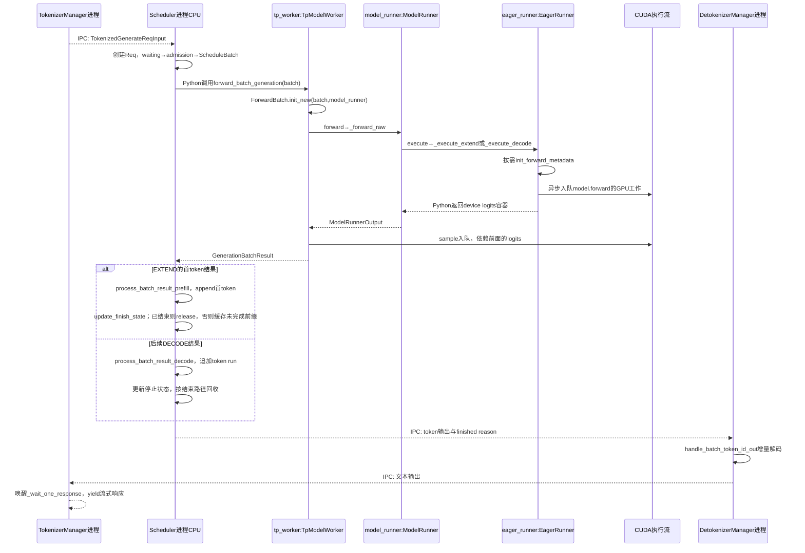
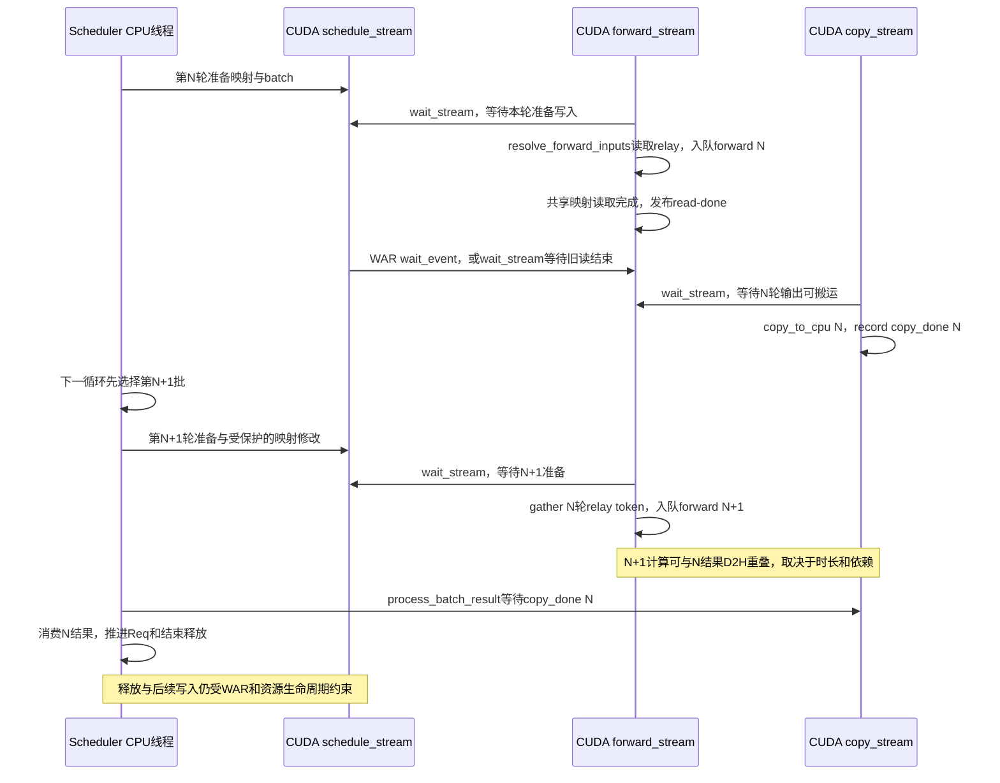
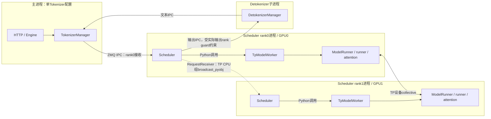
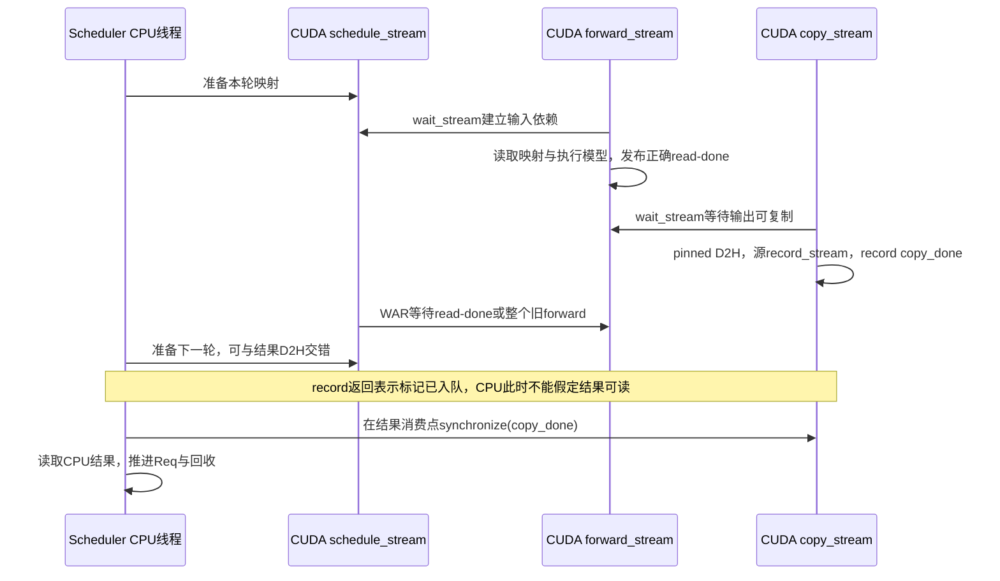

# 推理引擎研发与性能优化学习题

本册保留原50题中的引擎题编号，覆盖请求生命周期、调度、KV、执行器、Graph、Overlap、采样与模型接入，并用Q47–Q49练习故障定位；另追加Q52–Q55、Q63，训练Graph复用、分段执行和CPU／GPU并发判断。23题均先说明考察重点、知识点与要证明的能力，再从原始成本、具体状态例子讲到源码；生产追问要求给出分析思路、采集证据和判定标准。

[回总索引](README.md) · [平台部署与大规模服务](platform-deployment.md) · [模型算法与算子](algorithms-kernels.md) · [资料来源](references.md)

题目来源与本轮源码基线：

- **原题Q01、Q07–Q20、Q47–Q49：**最初编写于2026-10-15，基于`f01a0c7f97`及当时工作树；**Q52–Q55、Q63：**最初追加于2026-10-20，基于`bb669346d5`。
- **本轮整册解释重写：**以当前`HEAD=bb669346d5`核对解释所依赖的关键分支、状态写入和下一消费者；23题均已重写参考答案与生产追问，并补充学习目标。原编号、主问与既有学习状态保持对应，学习进度仍以[总索引](README.md)为准。

默认CUDA上的通用`TpModelWorker`；ROCm共用部分主线但后端可用性不同，MLX由`use_mlx()`改派专属worker。生产情景和数字例子用于训练与验证设计，不是本轮GPU测量或线上事故记录。DP/PP/CP、Mixed、EAGLE、dFlash、dSpark的分支在相关题中单独标明。

学习时按题回答并复盘；检查点表示待验证的理解，不代表已掌握。

<a id="q01"></a>

## Q01 一条流式请求如何完成生成和资源回收

### 学习目标

- **【考察重点】** 区分请求逻辑结束、最后一次设备访问和资源真正可复用；追清流式输出与取消的完整闭环。
- **【知识点】** 请求状态机、Prefill/Decode的token与KV错位、共享前缀所有权、异步执行完成条件。
- **【能力要求】** 给一个请求标出每次队列迁移、token写入、停止判断与资源所有者；按取消时机推导清理路径。
- **【常见误区】** 把HTTP断开当成GPU已经停止；把返回最后一个token当成可以free全部KV。

### 问题与追问

一条流式生成请求，从进入 SGLang 到返回、结束和释放资源，经历什么？取消发生在不同阶段又怎样？

- 等待队列、grammar 编译队列、正在执行的 batch 收到取消时，为什么不能使用同一个立即释放动作？
- 结束输出已返回，GPU 显存没有归零，怎样证明是缓存驻留还是资源泄漏？

### 参考答案

一次生成不是“调用模型，拿到字符串”这么短。模型每轮只推进有限token，而服务同时接入、排队、复用历史、执行、返回增量输出，最后还要回收状态。因此先分开四件事：请求是否还需要输出、当前batch是否仍引用它、GPU是否完成相关读写、KV由请求还是缓存持有。它们经常在不同时刻改变；只观察连接或finished标志，会漏掉实际还在途的工作。

先用普通CUDA、PP=1、关闭Overlap与投机的情景建立时间线。输入被分词后通过IPC送到Scheduler，形成保存输入、output_ids和停止条件的Req；它先等grammar等准备，再进入waiting_queue。admission挑出的Req组成ScheduleBatch，准备逻辑长度和物理KV映射。TpModelWorker把它转换成ForwardBatch，ModelRunner选择eager/Graph等runner；设备返回logits，采样产生候选输出，结果处理器才把token追加到Req并检查EOS、长度或取消。文本经Detokenizer增量返回，不能把张量生成、CPU记账与客户端收到文本当成同一时刻。

例如A输入8个token，最多输出3个。Prefill处理这8个输入，建立其KV并采样x；此时output_ids=[x]，x本身的KV尚需下一次把x输入模型。下一轮输入x，新增它的KV并输出y；再下一轮输入y输出z，达到长度上限。若无额外预留，有效KV对应“8个prompt+x+y”，而不是把已输出的z也算成已执行输入。投机还会有更长的预分配区，所以结束释放必须使用实际提交/分配边界。这个例子同时解释为什么不能用字符串长度或输出token数直接决定free范围。

A结束后，release路径允许Radix接管可复用的完整前缀，释放重复内容、未对齐尾部和额外预留，再归还request slot、解除相关引用。缓存接管意味着设备显存可仍然驻留，稍后才被eviction回收；这是有所有者的资源复用。取消也遵循所有权：普通等待请求尚未执行，移队并通知上游即可；运行请求通常先写to_finish，借已有结果处理完成终止，避免GPU还在读取时拆掉映射。chunk续块和PD传输还有各自的延后清理点，PD waiting请求甚至已经分配了接收KV。

实际CUDA默认可启用Overlap，CPU消费会落后一轮，但上述责任仍成立，区别是多了结果队列、relay与跨stream保护。复用结束路径减少重复清理代码，代价是取消不是所有阶段都瞬间完成；若为了“立即停止”跳过这些边界，具体风险是旧工作访问已复用页面、重复释放或Tokenizer残留请求状态。

**讲解时可以这样展开：**“我会用同一个RID把接入、waiting、Prefill、Decode、输出和释放串起来，再分别标注逻辑结束与设备完成。以8入3出为例，最后输出token未必已有KV，所以按资源账本释放；取消则按所在阶段进入统一终止路径，而不是直接free。”

### 源码调用链与证据

```text
TokenizerManager.generate_request → _tokenize_one_request → _send_one_request
  → Scheduler.handle_generate_request → Req → GrammarManager.process_req_with_grammar
  → Scheduler._add_request_to_queue → waiting_queue / PD 专用队列
  → admission → ScheduleBatch → TpModelWorker.forward_batch_generation
  → ForwardBatch.init_new → ModelRunner.forward → _forward_raw
     [本例CUDA、无spec、PP=1、关闭Graph/Overlap/Mixed，非split]
     → EagerRunner.execute → _execute_extend / _execute_decode
     → needs_forward_metadata_init → attn_backend.init_forward_metadata
     → model_runner.model.forward → LogitsProcessorOutput
     → ModelRunner.sample → sampler → GenerationBatchResult
  → Scheduler.process_batch_result 按 forward_mode 分派
     EXTEND → SchedulerBatchResultProcessor.process_batch_result_prefill
       Req.output_ids.append(首token) → update_finish_state
       finished → release_kv_cache；否则 → maybe_cache_unfinished_req
     DECODE → SchedulerBatchResultProcessor.process_batch_result_decode
       Req.output_ids.extend → update_finish_state → _handle_finish_state_updated_req
       finished → release_kv_cache
     释放路径 → cache_finished_req + 预留尾部释放 + request slot 释放
  → SchedulerOutputStreamer.stream_output → Detokenizer → TokenizerManager 等待者
取消：Scheduler.abort_request → 队列移除 / receiver.abort / Req.to_finish
```

下面固定为**普通 CUDA、PP=1、无投机、关闭 Graph/Overlap/Mixed、非 split prefill**，让进程交接与同进程 Python 调用分开可见；GPU 工作是异步入队，Python 返回 device tensor 不表示 CPU 已取得数值。Graph/Overlap 的时序见[Q13](#q13)与[Q17](#q17)。



[managers/tokenizer_manager.py:708](/Users/magician/PycharmProjects/sglang/python/sglang/srt/managers/tokenizer_manager.py:708)；[managers/scheduler.py:2177](/Users/magician/PycharmProjects/sglang/python/sglang/srt/managers/scheduler.py:2177)；[结果模式分派:3653](/Users/magician/PycharmProjects/sglang/python/sglang/srt/managers/scheduler.py:3653)；[Prefill 首 token 与结束处理:234](/Users/magician/PycharmProjects/sglang/python/sglang/srt/managers/scheduler_components/batch_result_processor.py:234)；[managers/scheduler.py:4152](/Users/magician/PycharmProjects/sglang/python/sglang/srt/managers/scheduler.py:4152)；[managers/scheduler_components/batch_result_processor.py:776](/Users/magician/PycharmProjects/sglang/python/sglang/srt/managers/scheduler_components/batch_result_processor.py:776)；[mem_cache/common.py:132](/Users/magician/PycharmProjects/sglang/python/sglang/srt/mem_cache/common.py:132)；[EagerRunner.execute:194](/Users/magician/PycharmProjects/sglang/python/sglang/srt/model_executor/runner/eager_runner.py:194)；[DetokenizerManager.event_loop:166](/Users/magician/PycharmProjects/sglang/python/sglang/srt/managers/detokenizer_manager.py:166)。

核心节选（[managers/scheduler.py:4274](/Users/magician/PycharmProjects/sglang/python/sglang/srt/managers/scheduler.py:4274)；首行教学注为补充，其余保留当前逻辑）：

```python
# 教学注：运行中的请求标记终止，后续统一结果路径承担释放。
for req in inflight_reqs:
    if not req.finished() and (
        recv_req.abort_all or req.rid.startswith(recv_req.rid)
    ):
        # Abort method 3: set `to_finish`
        # The request will still run one decode forward pass.
        # Then we reuse all existing code to clean up the KV cache allocation.
        logger.debug(f"Abort running request. {req.rid=}")
        req.to_finish = FINISH_ABORT()
```

### 生产实践追问

- **追问：客户端断开后GPU仍忙，是否泄漏？** 先确认RID在waiting、运行、chunk还是PD队列，保存取消、to_finish、copy完成与release时点。若仅剩允许结束的在途工作且slot最终归还，是延迟终止；无在途引用仍持续占用request slot或锁，才沿遗漏的消费者追查。
- **追问：响应结束但显存高，怎样判断？** 同时记录活动请求、allocator free、radix evictable/protected和额外预留。让缓存承压后验证可回收量；能正常evict的驻留与无owner的protected增长必须分开，不能只用进程显存曲线判泄漏。

### 学习检查点

- 为什么等待中的 PD Decode 请求也可能必须释放 KV？
- 运行请求的取消为什么优先写终止状态，而不是立刻从所有容器删除？

<a id="q07"></a>

## Q07 Scheduler 请求与批次的连续两轮状态

### 学习目标

- **【考察重点】** 识别同一Req被不同批次容器引用时的身份与跨轮归属，避免把执行选择与持久状态混为一谈。
- **【知识点】** 请求对象与batch视图、列表筛选/合并、NextBatchPlan双返回值、Overlap延迟消费。
- **【能力要求】** 逐轮画出waiting、can_run_list、running_batch、last_batch和batch_to_run的成员，注明共享引用而非深拷贝。
- **【常见误区】** 认为running_batch就是本轮执行批；认为filter_batch释放KV；把last_batch成员都当成需要Decode。

### 问题与追问

区分 Req、获准请求列表、ScheduleBatch、batch_to_run、running_batch、last_batch。画连续两轮变化。

- 第 N 轮 Prefill 后，第 N+1 轮谁把它加入 running_batch？未完成 chunk 为什么被排除？
- overlap 为什么先选择下一批，再处理上一批结果？共享 Req 与 batch.copy 的生命周期如何区分？

### 参考答案

调度器需要同时回答两个问题：“这一轮GPU执行谁”和“哪些请求还要保留到以后”。新Prefill可能插到已有Decode前面，所以一个变量装不下这两种职责。Req是身份和进度，ScheduleBatch是把一组Req与对齐张量组织成执行视图；获准列表can_run_list仅说明admission接受了哪些Req，尚不等于已完成张量准备。batch_to_run是本轮选择，running_batch是跨轮保留集合，last_batch是上一轮提交的批次，角色不同却可能共享对象。

设开始时waiting=[A]、running=[B]，B已经输出4个token。第N轮A获准：adder.can_run_list=[A]，Scheduler将A移出waiting，构建新ScheduleBatch并准备Extend，返回plan(batch_to_run=[A], running_batch=[B])。因此本轮执行A时，B仍叫running，却没有执行。普通循环处理A的Prefill输出后写last_batch=[A]；第N+1轮先检查last_batch的Extend结果，把已完成Prefill、尚未finished的A合入running，得到[B,A]，再决定新一轮运行谁。连续两轮才能看见请求进入后续Decode集合的交接点。

如果A只做完第一块输入，它仍由chunked_req管理，必须从上一批合并候选中排除，否则一个未完成上下文的请求会提前进入普通Decode。反过来，已finished的请求要从视图中移走，但过滤本身不负责free页面；结束处理已经按所有权走release。filter_batch同时裁剪Req与seq_lens、request indices、sampling等对齐信息，只删Req列表却保留旧张量行，会让B读到A的长度或采样参数。

Overlap让时间线再多一层：第N+1轮可以先选批和提交设备工作，再消费N轮结果；batch副本仍可共享Req，CPU刚标finished不意味着所有旧batch引用立即消失。于是last_batch说明上一轮提交历史，而不是“当前一定未结束”；running_batch也可能暂留需要下一次过滤的成员。当前NextBatchPlan把持久集合显式回传，调用者必须写回它，尤其mixed路径会替换为空容器，忽略这个返回值会把旧集合错误保留下来。

这种分工让连续批处理和Overlap能推进，不必每轮重建所有请求状态，代价是需要严格维护容器与tensor的对应关系。普通单rank主线理解后，再定位HiSparse独立handoff、DP同步/Idle、PP microbatch及投机输入，不能把任何一张[B,A]表推广到全部模式。

**讲解时可以这样展开：**“我先给Req和batch分层，再用两轮证明running不等于执行。N轮A做Prefill、B只被保留；N+1轮A经last_batch过滤合入running。finished释放与batch过滤又是两步，Overlap只是把结果消费时间后移，并没有改变这些对象的职责。”

### 源码调用链与证据

```text
Scheduler.event_loop_normal / event_loop_overlap
  plan = get_next_batch_to_run(running_batch, last_batch)
  self.running_batch = plan.running_batch; batch = plan.batch_to_run
get_next_batch_to_run:
  last Extend → filter_batch(排除 chunk/finished) → merge into running_batch
  get_new_batch_prefill → adder.can_run_list → 从 waiting_queue 移除
    → ScheduleBatch.init_new → prepare_for_extend → NextBatchPlan
  无新 Prefill → update_running_batch → Decode
执行结果处理后或 overlap 延后一轮处理 → self.last_batch = batch
```

[managers/scheduler.py:1592](/Users/magician/PycharmProjects/sglang/python/sglang/srt/managers/scheduler.py:1592)；[managers/scheduler.py:1635](/Users/magician/PycharmProjects/sglang/python/sglang/srt/managers/scheduler.py:1635)；[managers/scheduler.py:2820](/Users/magician/PycharmProjects/sglang/python/sglang/srt/managers/scheduler.py:2820)；[managers/scheduler.py:3106](/Users/magician/PycharmProjects/sglang/python/sglang/srt/managers/scheduler.py:3106)。

核心节选（[managers/scheduler.py:1592](/Users/magician/PycharmProjects/sglang/python/sglang/srt/managers/scheduler.py:1592)；首行教学注为补充，其余保留当前逻辑）：

```python
# 教学注：两个返回值分别决定持久状态和本轮执行，不要混用。
# Get the next batch to run
plan = self.get_next_batch_to_run(
    running_batch=self.running_batch, last_batch=self.last_batch
)
self.running_batch = plan.running_batch
batch = plan.batch_to_run
```

### 生产实践追问

- **追问：空载时running计数不归零怎么查？** 对同一RID连续抓取Req.finished、running/last/result_queue成员及forward mode。若只有延后一轮的视图残留且随后清空，属于时序；若无新批后始终残留，则检查独立过滤条件，特别是prefill-only。
- **追问：新增batch字段后只在部分请求上错？** 沿init、filter、merge和copy逐步核对该字段的行顺序，给A/B不同哨兵值并在下一消费者验证。判定标准是所有行始终对应同一RID，不是字段长度碰巧等于batch size。

### 学习检查点

- 为什么 last_batch 含一个 Req，不能证明它还需要执行 Decode？
- 若只使用 plan.batch_to_run 而不写回 plan.running_batch，mixed 路径会丢失什么状态？

<a id="q08"></a>

## Q08 显存空闲时 Prefill 为何仍被拒绝

### 学习目标

- **【考察重点】** 把admission拆成请求槽、当轮工作量、未来KV保留和可驱逐容量，解释锁前锁后预算变化。
- **【知识点】** 分页对齐、共享前缀保护、未来输出估算、独立SWA/Mamba资源。
- **【能力要求】** 为一个被拒请求逐项算预算，解释具体gate和锁导致的可回收容量变化，再推导调参后果。
- **【常见误区】** 看到GPU空闲就提高max_running_requests；把max_prefill_tokens当显存容量；认为prefix命中只会增加可用空间。

### 问题与追问

显存还有空闲，请求为什么仍进不了 Prefill？prefix 加锁后为什么还要重查预算？

- max_prefill_tokens、chunk budget、request slots、可驱逐 KV 与未来输出预算分别约束什么？
- 首个超长请求会不会越过 max_prefill_tokens？SWA/Mamba 为何还需要独立检查？

### 参考答案

GPU监控显示有空闲GB，调度器仍可能拒绝请求，因为它接纳的是一段持续生成的工作，而不只是当前一次forward。一个请求需要request mapping槽、当前输入的KV、未来生成增长空间，也可能需要SWA窗口或Mamba状态。max_prefill_tokens限制本轮新增输入工作量，chunk预算限制分段长度，request槽限制可并存对象；这些单位与可用设备字节不同，不能用一条显存指标替代。

普通KV预算可先理解为“free页＋确实可evict的缓存－已经承诺的占用”。运行请求未来输出尚未全部分配，但adder按剩余输出与new_token_ratio估算保留；新候选则还要考虑未命中输入、输出长度上界和page开销。这是在吞吐和回退风险之间取工作点：预留过多会低估并发，过少则先接进来、后因Decode增长反复retract。SWA/Mamba可恢复容量不完全来自普通full KV，不能把一种池的空闲拿来填另一种账。

看一个锁后重查例子：page_size=16，free=16个token容量、可evict缓存=112，所以初看有128。A输入112个token，命中80，还需32个输入，最多再生成24；加16个分页余量，候选需求72，锁前可以通过。但A要使用命中的80个token，必须把那段缓存从“可被驱逐”变成“被A保护”，预算降为16+32=48。现在72放不下，必须拒绝。加锁没有新造tensor，却改变了同一批页能否拿来分给别人；不重查会把它同时当作A的历史与可回收空间。

接纳成功以后，can_run_list、持久prefix锁和预算扣减再一起更新，随后ScheduleBatch进行真实分配。若拒绝发生在临时锁内，要释放临时保护和未使用的辅助状态；“只是计算预算”也可能已改变引用或提前获取Mamba状态，错误回滚会留下锁或状态槽泄漏。诊断时因此既要看返回的NO_TOKEN/OTHER，也要看这个返回前已经做了哪些资源动作。

有些限制还特意给进展留例外：无chunk时列表为空，首个大请求可越过max_prefill_tokens的输入限制，避免永远入不了批，但不代表能越过KV总预算。因而预算不是一条统一硬上限，应逐gate说明目的。修改限制后要检查新接纳是否真的完成，还是仅把等待转成retraction。

**讲解时可以这样展开：**“我先按单位列出槽、输入、chunk和未来KV预算，再检查prefix保护是否改变evictable。128变48这个例子说明free GB没变也会拒绝；最后结合回退率验证保留比例，而不是只把并发调大。”

### 源码调用链与证据

```text
Scheduler._get_new_batch_prefill_raw
  → get_num_allocatable_reqs = min(PP microbatch余量, request pool余量)
  → PrefillAdder(running_batch, new_token_ratio, input/chunk budgets)
  → Req.init_next_round_input(tree_cache) 写 prefix_indices/last_node
  → PrefillAdder.add_one_req
       total_tokens / real_input_tokens 检查
       _lock_node(last_node) → inc_lock_ref → 再检查 rem_total_tokens
       [host hit] init_load_back → 更新 prefix_indices
       can_run_list.append → 持久锁 + _update_prefill_budget
  → Scheduler 消费 can_run_list 建批
```

[managers/scheduler.py:2904](/Users/magician/PycharmProjects/sglang/python/sglang/srt/managers/scheduler.py:2904)；[managers/scheduler.py:2995](/Users/magician/PycharmProjects/sglang/python/sglang/srt/managers/scheduler.py:2995)；[managers/schedule_policy.py:559](/Users/magician/PycharmProjects/sglang/python/sglang/srt/managers/schedule_policy.py:559)；[managers/schedule_policy.py:1081](/Users/magician/PycharmProjects/sglang/python/sglang/srt/managers/schedule_policy.py:1081)；[managers/schedule_policy.py:1122](/Users/magician/PycharmProjects/sglang/python/sglang/srt/managers/schedule_policy.py:1122)。

核心节选（[managers/schedule_policy.py:1122](/Users/magician/PycharmProjects/sglang/python/sglang/srt/managers/schedule_policy.py:1122)；首行教学注为补充，其余保留当前逻辑）：

```python
# 教学注：锁会改变可驱逐容量，必须在锁后再次判断。
with self._lock_node(req.last_node):
    # self.rem_total_tokens may decrease after the lock acquisition
    if total_tokens >= self.rem_total_tokens:
        return AddReqResult.NO_TOKEN
```

### 生产实践追问

- **追问：低利用率且队列很长，怎样找到第一原因？** 抽一个长等RID，保存输入/命中/输出上限、request槽、各池free/evictable及锁前后预算，标出首次拒绝gate。只有算出的余量与分支一致，才决定是容量、保守估算还是工作量限制。
- **追问：降低预留比例后吞吐短时提高，是否成功？** 固定长度与到达分布，跟踪完成吞吐、重复Prefill量、retraction和失败，观察足够长的Decode增长期。若收益依赖持续回退或更多中止，说明过度接纳，不能把瞬时running数当容量提升。

### 学习检查点

- 为什么保护 prefix 后 rem_total_tokens 可能下降，尽管没有新分配 GPU tensor？
- 首候选的输入预算例外为什么不能推出 KV 总预算也可越过？

<a id="q09"></a>

## Q09 Chunked Prefill Mixed 与 Decode 公平性

### 学习目标

- **【考察重点】** 辨别“Prefill优先于普通Decode”与“续块优先于等待候选”两层选择；解释mixed的容器交接和结果身份。
- **【知识点】** token分块、连续批处理、共享Req引用、batch合并与结果缓存边界；单轮工作量界与公平/时间界不同。
- **【能力要求】** 用至少两轮具体成员与token数说明B何时进步；推导不换空产生[B,B]，追到decoding_reqs的下一消费者。
- **【常见误区】** 说分块天然公平；把token上限说成毫秒或总等待上限；把换空running_batch说成释放B的KV。

### 问题与追问

Chunked Prefill 是否保证 Decode 公平？长请求 A 与 Decode 请求 B 连续两轮怎样执行？

- 给出两轮普通 chunk 与 mixed chunk 的 A/B 时间线；chunk size 限制的到底是哪一个量？
- return_logprob、input_embeds 与 EAGLE/dFlash/dSpark 会怎样改变 mixed 的可达性？

### 参考答案

长Prefill的问题是一次处理很多输入token会占用执行窗口，已经在生成的B可能长时间没有下一次Decode。Chunked Prefill把A的输入切成多个token区间，每块完成后保留KV、重新选批，先降低一次提交的输入量。这里有两层优先级：外层只要能构建新Prefill批，就先选它，普通running Decode在没有新批时才更新执行；内层构建Prefill时，已有chunked_req先续块，再扫描waiting_queue的新候选。前者决定B是否轮到，后者决定新请求C是否能挤进A续块留下的预算。

固定普通CUDA、PP=1、关闭Overlap与投机，page_size=1，return_logprob=False且input_embeds=None，使mixed分支可达。A初始无prefix命中（后续只复用自己已完成的块），还有300个输入token，B已在Decode且不会提前结束；chunk预算128、其他接纳预算充足，无其他请求，以下均为示意。非mixed每轮A可取128、128、44；mixed先为B的一个Decode token扣预算，A取127、127、46。假设三个执行窗口各耗时6、6、3ms，普通下一次Decode另需1ms，时间线如下；这些耗时用于算例，不是token数推出来的性能保证。

| 轮次 | 非mixed的执行与B进度 | mixed的执行与B进度 |
| --- | --- | --- |
| N | A处理128，B只留在running | A处理127+B解码1步，B在6ms得token |
| N+1 | A再128，累计256，B仍未执行 | A再127，累计254；B在12ms再得token |
| N+2 | A最后44，累计300；B继续等 | A最后46+B一步；B在15ms再得token |
| N+3 | A/B普通Decode；B约16ms才得下一token | A/B继续普通Decode |

这解释了“有调度边界”不等于“有公平机会”：非mixed连续三轮仍选Prefill。128只约束一轮相应预算的token量，不约束每token的历史attention成本、collective、kernel与排队时间，更不约束持续流量下的累计等待。即使B每轮进入mixed，它的ITL也受整批时长影响，不能承诺固定毫秒上界。

mixed还改变了请求容器的归属。第N轮新批new_batch=[A,B]，原running=[B]；合批后要把持久running换成空ScheduleBatch，因为下一轮会从last_batch恢复它。若A未完成chunk，last_batch过滤掉A后剩[B]，空running接收一次B即可。不换空则原running仍[B]，再merge上一批的[B]会拼成[B,B]，同一个Req被当两行执行。换空不调用allocator.free，B的Req、request slot和KV仍被混批持有；它消除的是重复的运行集合，不是终止B。

new_batch.decoding_reqs保存哪些成员原本是Decode，例如[B]。混批按Extend结果路径处理，A和B都可能产生结果，但B不该再次走“新Prefill完成后的缓存/HiSparse staging”动作；结果处理器用这张名单跳过该动作，普通token追加和停止检查仍会进行。非mixed把它置None。Overlap会让结果消费延后一轮，不能改变上述唯一成员责任；return_logprob或input_embeds会阻止当前mixed分支，EAGLE/dFlash/dSpark还需核实配置，投机不能沿普通mixed外推。

**讲解时可以这样展开：**“分块先约束单轮工作量，公平性要看外层选批。mixed让B跟A同批推进，但必须把旧running换空，否则下一轮合并成[B,B]；decoding_reqs则保留B的身份，让统一Extend结果处理跳过错误的Prefill收尾。”

### 源码调用链与证据

```text
Scheduler.get_next_batch_to_run
  → stash上一块KV；chunked_req加入last_batch排除集
  → get_new_batch_prefill → _get_new_batch_prefill_raw
       add_chunked_req先续块 → 扫waiting候选 → can_run_list
       → ScheduleBatch.init_new → prepare_for_extend
       → [mixed可达且running非空] running.filter_batch → prepare_for_decode
           new_batch.mix_with_running(running)
             → forward_mode=MIXED → merge_batch → self.reqs + other.reqs
           new_batch.decoding_reqs=running.reqs；running换为空ScheduleBatch
       ← 返回new_batch与新的running → 包装NextBatchPlan
  ← get_next_batch拿到可能已mixed的new_batch
  → [new_batch != None] ret=new_batch；否则update_running_batch做普通Decode
结果：MIXED走Extend结果处理 → batch_result_processor:244
  → B仍追加token/检查结束，但跳过新Prefill的cache/staging
下一轮：last_batch.filter排除未完A → 剩[B] → 合入空running，仅保留一份B
```

[managers/scheduler.py:2793](/Users/magician/PycharmProjects/sglang/python/sglang/srt/managers/scheduler.py:2793)；[managers/scheduler.py:2876](/Users/magician/PycharmProjects/sglang/python/sglang/srt/managers/scheduler.py:2876)；[managers/scheduler.py:3014](/Users/magician/PycharmProjects/sglang/python/sglang/srt/managers/scheduler.py:3014)；[managers/scheduler.py:3170](/Users/magician/PycharmProjects/sglang/python/sglang/srt/managers/scheduler.py:3170)；[arg_groups/speculative_hook.py:402](/Users/magician/PycharmProjects/sglang/python/sglang/srt/arg_groups/speculative_hook.py:402)；[mix_with_running合并:2578](/Users/magician/PycharmProjects/sglang/python/sglang/srt/managers/schedule_batch.py:2578)；[merge列表拼接:3043](/Users/magician/PycharmProjects/sglang/python/sglang/srt/managers/schedule_batch.py:3043)；[下一轮过滤:2834](/Users/magician/PycharmProjects/sglang/python/sglang/srt/managers/scheduler.py:2834)；[空running接收last_batch:2840](/Users/magician/PycharmProjects/sglang/python/sglang/srt/managers/scheduler.py:2840)；[decoding_reqs结果消费者:244](/Users/magician/PycharmProjects/sglang/python/sglang/srt/managers/scheduler_components/batch_result_processor.py:244)。

核心节选（[managers/scheduler.py:2876](/Users/magician/PycharmProjects/sglang/python/sglang/srt/managers/scheduler.py:2876)；首行教学注为补充，其余保留当前逻辑）：

```python
# 教学注：普通主线在新 Prefill 存在时优先执行，公平性不能由 chunk 上限直接推出。
if new_batch is not None:
    # Run prefill first if possible
    ret = new_batch
else:
    # Run decode (skip for prefill-only batches)
    if not running_batch.is_empty() and not running_batch.is_prefill_only:
        running_batch = self.update_running_batch(running_batch)
        ret = running_batch if not running_batch.is_empty() else None
```

### 生产实践追问

- **追问：长输入来时B卡顿，怎样证明是选择机会不足？** 按轮记录batch_to_run的mode/RID、chunk长度和B的输出序号，对齐至少两轮时间。若B未进执行批，先分析外层优先级；若B已进mixed仍慢，则查整批关键路径，不再把原因笼统叫调度不公平。
- **追问：有人删掉换空，觉得多了一次对象构造？** 用A两块+B的最小例子列出合并前后对象身份，检查下一轮running是否出现同一RID/Req两次，并核对对齐张量行。判定依据是请求只被调度一次和KV仍有合法owner，不是对象数量减少。
- **追问：decoding_reqs是否只是统计字段？** 让B继续生成、A结束或续块，在Extend结果处理处核对B是否被重复cache/staging。保存名单、token追加和结束路径；看到它改变后续分支即可否定“只影响指标”。

### 学习检查点

- 为什么每块最多处理固定 token 数，仍不能证明 B 最多等一块？
- mixed 后为什么需要清空原 running_batch 容器？

<a id="q10"></a>

## Q10 Eviction 与 retraction 的回收和恢复

### 学习目标

- **【考察重点】** 区分缓存淘汰与运行请求退让，追到立即回收、逻辑保留及恢复的不同成本。
- **【知识点】** 分页增量需求、prefix引用锁、回退排序、重算与host offload、接纳反馈。
- **【能力要求】** 按页边界算下一步需求，说明先evict再retract的原因，用一个回退请求走到重新入队及恢复。
- **【常见误区】** 把retraction当CUDA OOM；说filter_batch归还页面；用普通一token预算解释所有spec。

### 问题与追问

内存不足时，eviction 和 retraction 分别回收什么？请求如何恢复？

- page_size=16，committed length 为15和16的两个普通请求，下一步新增页需求分别是多少？
- 最后一个请求仍装不下怎么办？PD retraction 为什么可能选择 host offload 而非全部重算？

### 参考答案

一批请求持续Decode时，KV会随着输出增长。开始能接纳，不代表后面每一步都还有空间；服务应先回收不用的缓存，再决定是否让部分活动请求暂退，而不是等CUDA分配失败。Eviction删除无活动引用保护的prefix缓存，损失的是未来复用机会；retraction把当前正在生成的请求退出执行集合，释放它占用的资源，稍后重算或恢复，损失的是这条请求已经投入的工作和等待时间。两者都增大free pool，但牺牲对象不同。

先看page_size=16。普通A的已处理长度15，下一token可用同页剩余位置，不需新页；B长度16，下一token开始新页，需要16个token容量。若free已经为0，check_decode_mem应先尝试evict短缺的16，而非额外淘汰整批历史；free若已有16，本轮无需淘汰。这个需求是页预算，不是“batch两个请求所以新分配两个token”。投机还会预留未来verify/draft空间，需比较committed+reserve与allocated的缺口并按页对齐，接受长度只是之后的结果，不能拿它替代准备阶段需求。

若无锁缓存也回收不够，retract_decode按策略排列候选、从最不希望保留者开始释放，直到剩余请求的下一步装得下。当前length策略优先保留输出较多者，同输出进度时还考虑输入长度；priority策略先维护优先级语义。释放不把新回退数据插入树，是为了立刻取得空间；随后过滤batch只保留幸存者，并重新估计未来生成预算。最后一个请求仍无法执行时有明确abort出口，不能以“一直保留至少一个”掩盖实际无进展。

被回退的Req不是一个全新用户请求：已输出token、采样和语法进度要继续有效。普通模式重入waiting，使用输入加已输出历史重算必要KV；PD Decode可先offload到host，再进入retracted queue，优先恢复它们。恢复涉及本地重新分配、映射和内容恢复，不能把CPU副本当成可直接被attention读取的设备KV。若漏掉队列迁移，请求会丢失；若逻辑输出被重置或重复追加，客户端会看到断续或重复token。

回退让系统在有限容量下继续推进，代价是recompute/传输、尾延迟以及可能的反复接纳抖动。持续回退说明预算或负载工作点不合适，不能仅提高并发压过去；也不能说new_token_ratio在每次回退后必然上升，它由剩余请求状态估计。

**讲解时可以这样展开：**“我先按页算下一步缺口，evict的是闲置缓存，retract才牺牲活动请求。解释时会把一个被回退RID的页面释放、Req保留、重新入队和恢复都追完，再看重复计算量判断容量策略是否健康。”

### 源码调用链与证据

```text
Scheduler.update_running_batch → filter_batch
  → ScheduleBatch.check_decode_mem
       new_tokens_required_next_decode [普通页边界 / spec reserve缺口]
       → evict_from_tree_cache(只补短缺)
  → [仍不足] retract_decode → _get_decode_retraction_order → release_req
       [PD decode] offload_kv_cache
       → release_kv_cache(is_insert=False) → reset_for_retract
       → filter_batch(保留者) → 返回 retracted_reqs
  → Scheduler._add_request_to_queue(is_retracted=True)
  → 普通waiting / PD retracted queue → 后续重算或resume
```

[managers/schedule_batch.py:2597](/Users/magician/PycharmProjects/sglang/python/sglang/srt/managers/schedule_batch.py:2597)；[managers/schedule_batch.py:2631](/Users/magician/PycharmProjects/sglang/python/sglang/srt/managers/schedule_batch.py:2631)；[managers/schedule_batch.py:2682](/Users/magician/PycharmProjects/sglang/python/sglang/srt/managers/schedule_batch.py:2682)；[managers/schedule_batch.py:1735](/Users/magician/PycharmProjects/sglang/python/sglang/srt/managers/schedule_batch.py:1735)；[managers/scheduler.py:3295](/Users/magician/PycharmProjects/sglang/python/sglang/srt/managers/scheduler.py:3295)。

核心节选（[managers/schedule_batch.py:2624](/Users/magician/PycharmProjects/sglang/python/sglang/srt/managers/schedule_batch.py:2624)；首行教学注为补充，其余保留当前逻辑）：

```python
# 教学注：先驱逐可回收缓存，再判断下一步是否装得下。
def check_decode_mem(self, selected_indices: Optional[List[int]] = None):
    """Reclaim evictable tree-cache entries (shortfall only), then report
    whether the next decode step fits in the KV pool."""
    num_tokens = self.new_tokens_required_next_decode(selected_indices)
    evict_from_tree_cache(self.tree_cache, num_tokens)
    return self.token_to_kv_pool_allocator.available_size() >= num_tokens
```

### 生产实践追问

- **追问：没报OOM但retraction不断增加？** 关联同RID的回退次数、重算输入量、空闲页与输出增长，检查是否刚接纳又回退。若完成吞吐下降且重复工作增加，应收紧或校准保留预算，不把未出现CUDA异常当成容量充足。
- **追问：改了回退优先级如何验收？** 构造输入长短、输出进度和priority不同的请求，预测被牺牲顺序，再检查slot/KV回收与最终输出连续性。仅比较平均吞吐会漏掉低优先级长期无进展，应同时记录等待年龄。

### 学习检查点

- 为什么“还有一个请求”不代表下一步一定能执行？
- spec reserve 的页缺口为何不能用接受长度直接替代？

<a id="q11"></a>

## Q11 KV 分配映射和有效内容的区别

### 学习目标

- **【考察重点】** 拆开物理容量、逻辑映射、内容有效性与设备完成，解释allocated/committed/output三套长度。
- **【知识点】** 分页KV、request-to-token映射、输入输出错位、投机预留和异步完成。
- **【能力要求】** 画出一条请求每个逻辑token的物理索引与有效区间，指出哪一步只是预留、哪一步才写入内容。
- **【常见误区】** allocator返回非空就宣称KV正确；把output_ids长度当已执行输入长度；把字段名committed当设备fence。

### 问题与追问

“分配了 KV”究竟是拿到物理页、建立映射，还是已经生成了有效内容？

- req_pool_idx、req_to_token、prefix_indices、out_cache_loc各自表示什么，谁的单位是请求、token或物理索引？
- 为什么 output_ids、kv_committed_len、kv_allocated_len 在投机和PD交接时不能混用？

### 参考答案

“分配了KV”这句话混了三个动作：拿到页面、告诉attention逻辑位置对应哪里、在这些位置写入正确K/V。页管理只解决地址和容量，不懂token语义；映射正确也不代表生产者已经执行。还要另问GPU工作是否完成，因为CPU可以提前安排下一步。把这些层分开，才能理解为何PD预分配成功仍在等传输，投机有很多槽却只接受一部分，以及异步释放为何需要保护。

以request slot=7为例，req_to_token[7,0:3]=[40,41,42]表示A的前3个逻辑位置在这些物理槽。prefix_indices可能告诉下一轮前2个位置可复用；out_cache_loc=[42]告诉本轮把新增KV写到42。它们是索引，不是K/V内容。Extend准备会把旧prefix和新位置一起写进映射；普通Decode根据当前末位置分配下一逻辑位置，并更新相应行。只修改prefix_indices而不改实际映射，下一消费者仍可能读取旧物理页。

再给token加上名字：输入[p0,p1,p2]的Prefill建立三个输入的KV并输出x。此时output_ids=[x]，但x还没有作为输入执行；下一轮准备为x安排物理槽43，forward输入x后才写入它的KV并输出y。若y触发停止，逻辑输出已前进两格，实际执行输入只新增x。投机会再提前保留若干位置，假设allocated可到8，但有效历史只到4，尾部不能被缓存接管或供下一轮当合法历史。

当前普通prepare_for_decode在GPU计算前就推进请求/批次的长度账本，这是“为本轮执行准备好的位置”，不是设备已经完成写入的证明。判断内容能否被另一个stream或CPU消费还要依赖正确顺序和完成事件。对应地，结束释放先处理有效内容及缓存接管，再处理overallocated尾部和request slot，不能按一个长度从头free到尾。跳过这层区分会出现未写入KV被复用、共享前缀被误free或预留尾部泄漏。

这种地址抽象让连续token不用物理连续，便于分页、共享和提前预留；代价是映射、长度与实际内容必须一致。普通一token分配、EAGLE/dFlash/dSpark的reserve、HiSparse与PD目标地址各有专属准备逻辑，不能把一个普通索引例子当所有分配公式。

**讲解时可以这样展开：**“我会把A的逻辑位置、物理index和有效区间画成表，再用输入3个、输出x/y的例子说明最后输出不一定已有KV。allocator、映射写入和设备完成分别提供不同证据，排错与释放也应分层。”

### 源码调用链与证据

```text
ScheduleBatch.prepare_for_extend → alloc_for_extend
  → alloc_req_slots / alloc_token_slots或paged_extend
  → write_cache_indices(prefix + 新槽位) → out_cache_loc
普通 prepare_for_decode → alloc_for_decode(token_per_req=1)
  → req_to_token_pool.write((req_pool_indices, 旧seq_lens), out_cache_loc)
  → req.kv_committed_len += 1 / batch.seq_lens += 1
  → worker/runner执行，模型按out_cache_loc写KV
spec: prepare_for_decode → spec_prepare_for_decode → family专属准备
release_kv_cache → effective committed区处理 → overallocated尾部释放
```

[mem_cache/allocation.py:303](/Users/magician/PycharmProjects/sglang/python/sglang/srt/mem_cache/allocation.py:303)；[mem_cache/allocation.py:372](/Users/magician/PycharmProjects/sglang/python/sglang/srt/mem_cache/allocation.py:372)；[mem_cache/allocation.py:539](/Users/magician/PycharmProjects/sglang/python/sglang/srt/mem_cache/allocation.py:539)；[managers/schedule_batch.py:2846](/Users/magician/PycharmProjects/sglang/python/sglang/srt/managers/schedule_batch.py:2846)；[mem_cache/common.py:148](/Users/magician/PycharmProjects/sglang/python/sglang/srt/mem_cache/common.py:148)。

核心节选（[mem_cache/allocation.py:572](/Users/magician/PycharmProjects/sglang/python/sglang/srt/mem_cache/allocation.py:572)；首行教学注为补充，其余保留当前逻辑）：

```python
# 教学注：这里只写逻辑位置到物理槽位的映射，KV内容由后续执行产生。
# Write to req_to_token_pool
if batch.model_config.is_encoder_decoder:
    locs = batch.encoder_lens + seq_lens_gpu
else:
    locs = seq_lens_gpu.clone()

batch.req_to_token_pool.write(
    (batch.req_pool_indices, locs), out_cache_loc.to(torch.int32)
)
```

### 生产实践追问

- **追问：偶发读到其他请求内容？** 为slot和页面附上RID/世代，保存逻辑offset→物理index及写入完成点，检查旧映射是否在复用后仍被访问。若地址对但内容旧，继续查跨stream顺序；若地址已归别的请求，先查所有权和释放。
- **追问：投机显存比输出长度估算大？** 逐轮列出output、committed和allocated及reserve，跟踪拒绝尾部在哪归还。只有解释不了归属或结束后不回收的部分才算泄漏，正常预留不能按有效KV重复计费。

### 学习检查点

- 为什么已经采样出的token可能还没有自己的KV？
- PD preallocation成功为什么不能作为传输成功的证据？

<a id="q12"></a>

## Q12 共享前缀的引用锁与资源所有权

### 学习目标

- **【考察重点】** 共享缓存页面由谁持有、何时从protected转evictable，及重复计算内容怎样替换成canonical映射。
- **【知识点】** 引用计数的边界转换、树节点祖先链、完整页与部分页、请求槽和KV的分离生命周期。
- **【能力要求】** 对A/B共享前缀计算lock_ref变化，追清insert去重、映射重写和释放顺序；判断缓存驻留是否有owner。
- **【常见误区】** A结束就free全部KV；引用数从2减到1就计为可evict；将filter_batch与资源释放混淆。

### 问题与追问

A、B 共享前缀，A 结束时为什么不能 free 全部 KV？如何区分缓存驻留与泄漏？

- lock_ref的0→1、1→0各改变哪个容量统计？同一祖先被多个请求使用时如何变化？
- cache_unfinished_req为什么会释放重复KV、重写映射并更换last_node锁？

### 参考答案

Prefix Cache节省的是“相同前缀重复计算”，但代价是页面不再由单个请求独占。A结束时，如果B仍沿用同一段KV，释放A看到的全部物理索引会破坏B的历史。因此需要区分树持有的缓存页、活动请求的引用和请求独占新增页；缓存节点lock_ref保护的是当前还会被使用的内容，allocator最终回收的是没有有效owner的页面，而不是谁先结束谁就能全部free。

设节点P含8个共享token，最初无请求使用，lock_ref=0，8个token计入evictable。A接纳后引用变1，统计只转换一次：evictable减8、protected加8；B也命中，引用变2，容量统计不再加8。A结束后2→1，B仍需要它，不能回收；B也结束后1→0，P才重新可evict。锁沿last_node的祖先链更新，因为长前缀叶节点被用到，也意味着其所有祖先历史被用到。

再看去重为何要改请求映射。A和B同时算过相同后缀，可能分别占物理页50和70；树已经接管50，B插入时发现相同内容。保留两份浪费容量，直接free70却不更新B映射会让它继续指向已释放页。cache_unfinished_req先识别重复区，释放B独占的重复页，再match树的canonical索引并写回req_to_token，更新cache_protected_len、迁移旧/新last_node锁。下一块Prefill或Decode才能安全读取统一的那份KV。

分页还让prefix_indices和cache_protected_len不能总相等。比如已算18个token，树只接管两个完整8-token页，最后2个可能暂留请求内；prefix_indices可包含这些可继续用的位置，protected长度却只表示树管理的完整部分。结束时既不能漏free请求尾部，也不能把树页面当独占再次free。公共release还处理投机超额预留和request slot；batch过滤只是消除执行视图中的行，不替代这些动作。

这样设计同时提升复用率和容量效率，但锁、去重与映射更新必须成套，遗漏任一步都可能导致泄漏、重复free或读取已重用页面。空载显存不下降可能只是evictable缓存，需看它是否能在压力下回收；无活动引用仍有持续protected增长才是另一类问题。HiCache、SWA、Mamba还要按相应实现扩展所有权。

**讲解时可以这样展开：**“我先用8-token共享节点走0→1→2→1→0，只在边界转换容量；再用50/70两份重复页说明为什么去重后必须重写B映射。这样能同时解释A为什么不能全free、以及缓存驻留为什么不等于泄漏。”

### 源码调用链与证据

```text
Req prefix match → last_node / cache_protected_len
PrefillAdder接纳 → RadixCache.inc_lock_ref(last_node)
  [0→1] evictable_size减、protected_size增；祖先链引用+1
cache_unfinished_req → insert → 释放重复独占页 → match canonical索引
  → req_to_token_pool.write → protected_len更新 → old dec / new inc
请求结束 → release_kv_cache → cache_finished_req
  → 插入/重复页/未对齐尾处理 → dec_lock_ref(last_node)
  → 释放spec预留尾及request slot；无锁叶节点可被evict
```

[mem_cache/radix_cache.py:437](/Users/magician/PycharmProjects/sglang/python/sglang/srt/mem_cache/radix_cache.py:437)；[mem_cache/radix_cache.py:490](/Users/magician/PycharmProjects/sglang/python/sglang/srt/mem_cache/radix_cache.py:490)；[mem_cache/radix_cache.py:594](/Users/magician/PycharmProjects/sglang/python/sglang/srt/mem_cache/radix_cache.py:594)；[mem_cache/common.py:132](/Users/magician/PycharmProjects/sglang/python/sglang/srt/mem_cache/common.py:132)。

核心节选（[mem_cache/radix_cache.py:599](/Users/magician/PycharmProjects/sglang/python/sglang/srt/mem_cache/radix_cache.py:599)；首行教学注为补充，其余保留当前逻辑）：

```python
# 教学注：只有从无活动引用变成被保护时，容量统计才转换一次。
while node != self.root_node:
    if node.lock_ref == 0:
        self.evictable_size_ -= len(node.key)
        self.protected_size_ += len(node.key)
        delta -= len(node.key)
    node.lock_ref += 1
    self._update_leaf_status(node)
```

### 生产实践追问

- **追问：取消A后B偶尔错？** 让A/B共享固定前缀，只取消A，继续制造新页分配复用压力；保存节点引用、B映射和物理页世代。若B仍指向已free页，就沿释放边界修正，不能仅用文本偶然一致判通过。
- **追问：空载protected越来越大？** 按节点或请求追inc/dec配对、ongoing异步操作与session owner，区分本应仍保护的传输/缓存任务。验收要让所有owner结束后protected回落、evictable可回收，而不是强制清缓存掩盖丢失的引用。

### 学习检查点

- 为什么lock_ref从2减到1不应增加evictable容量？
- 为什么新canonical索引必须写回请求映射，而不能只更新树？

<a id="q13"></a>

## Q13 Worker 和 ModelRunner 的实际执行分派

### 学习目标

- **【考察重点】** 先确定真实worker与ModelRunner接收者，再按mode和资格解释所选执行器及attention计划位置。
- **【知识点】** 对象组合与设备override、ForwardBatch契约、eager/Decode Graph/Prefill Graph/split分派。
- **【能力要求】** 给定设备、spec与forward mode，沿guard选择唯一可达路径，跟踪返回logits或PP代理张量的下一消费者。
- **【常见误区】** 把名字带worker的对象当进程；把全部执行压成一个forward；因为多token就说verify走Prefill Graph。

### 问题与追问

Scheduler 最终调用哪个 worker？输入进入 ModelRunner 后，怎样选择实际执行器？

- CUDA/ROCm的TpModelWorker、MLX override与spec draft worker分别在哪选定？
- 为什么TARGET_VERIFY可能由名为DecodeCudaGraphRunner的执行器处理，却不能据此称为普通Decode？

### 参考答案

Scheduler负责“本轮运行谁”，模型执行层还要回答“用哪套实现完成这批工作”。同一份请求可因设备、投机算法或图资格落到不同接收者；若这一层没选对，后面列再多函数也可能在解释另一条程序。应先固定普通CUDA、无spec、PP=1，再逐层增加条件：Scheduler中的tp_worker是通用TpModelWorker，model_worker指向它；启用投机后model_worker可以变成算法worker，target worker则由其持有。MLX另有明确override，不能由IDE跳转结果判断运行时。

在普通路径，ScheduleBatch含请求及调度准备的对齐数据，TpModelWorker建立ForwardBatch，把模型需要的mode、input_ids、positions、长度与KV位置组织成这次执行输入。当前代码直接从ScheduleBatch构造，不应强行插入旧版本的ModelWorkerBatch。worker调用自己持有的ModelRunner，后者拥有已加载模型、池、attention backend和runner；这些是同一rank进程内的组合关系，具体OS拓扑见Q54。

用三个请求A/B/C各走一次Decode来选分支。_forward_raw先判断mode是否允许graph、decode runner是否存在且接纳该形状；若可执行，就由DecodeCudaGraphRunner填静态buffer、规划所需metadata并replay，立即返回ModelRunnerOutput，不再经过后面的普通padding逻辑。若未命中，先做最终DP/MLP输入准备，再检查split prefill；之后才检查Extend能否走Prefill graph；都不满足才交EagerRunner。eager并不等于没有框架工作，它按Decode/Idle/Extend分发，并在需要时为选定attention backend初始化metadata，再调用model.forward。

换成A有200个输入token，若是普通Extend且满足prefill图条件，输入走PrefillCudaGraphRunner；若模式是TARGET_VERIFY，虽然也处理多token，当前prefill图资格却拒绝它，应由decode graph或eager处理。split prefill又按层推进而非普通一次完整forward。最终worker取得logits/graph标志，普通生成还要采样，verify则将logits交给专门接受逻辑；PP非最后rank还可返回代理张量，不能照抄最后rank采样。

这种分层复用模型定义，同时把捕获、padding和后端计划放到不同边界。代价是同一用户参数不保证每轮执行同一路径；缺失或重复metadata会错，fallback也可能仅影响性能。因此诊断要同时保存实际worker class、mode、runner、backend与资格失败原因。

**讲解时可以这样展开：**“我先固定运行条件，确认Scheduler的model_worker是谁，再从ForwardBatch进入ModelRunner逐个看guard。Decode graph提前返回；未命中才经过最终准备和split/Prefill/eager选择，最后追logits由采样还是verify消费。”

### 源码调用链与证据

```text
Scheduler.init_tp_model_worker → [use_mlx] MlxTpModelWorker / [else] TpModelWorker
Scheduler model_worker → [无spec] tp_worker / [有spec] create_worker选出的算法worker
run_batch → model_worker.forward_batch_generation
  普通TpModelWorker: ForwardBatch.init_new(ScheduleBatch, model_runner)
  → ModelRunner.forward → _forward_raw
      [decode graph可用] decode_cuda_graph_runner.execute → return
      [其余] _prepare_eager_forward_batch → split / prefill graph / eager
      eager: needs_forward_metadata_init → selected_backend.init_forward_metadata
             → model_runner.model.forward → logits / PPProxyTensors
  → GenerationBatchResult → Scheduler结果处理
```

[managers/scheduler.py:815](/Users/magician/PycharmProjects/sglang/python/sglang/srt/managers/scheduler.py:815)；[managers/scheduler.py:924](/Users/magician/PycharmProjects/sglang/python/sglang/srt/managers/scheduler.py:924)；[managers/tp_worker.py:543](/Users/magician/PycharmProjects/sglang/python/sglang/srt/managers/tp_worker.py:543)；[model_executor/model_runner.py:1479](/Users/magician/PycharmProjects/sglang/python/sglang/srt/model_executor/model_runner.py:1479)；[model_executor/runner/prefill_cuda_graph_runner.py:1021](/Users/magician/PycharmProjects/sglang/python/sglang/srt/model_executor/runner/prefill_cuda_graph_runner.py:1021)。

核心节选（[model_executor/model_runner.py:1510](/Users/magician/PycharmProjects/sglang/python/sglang/srt/model_executor/model_runner.py:1510)；首行教学注为补充，其余保留当前逻辑）：

```python
# 教学注：decode graph分支提前返回，后面的eager padding与prefill选择并非每轮都执行。
# Replay cuda graph if applicable
if can_run_graph: # 到这里为止，只是判断是否能执行 decode的 cuda graph；
    ret = self.decode_cuda_graph_runner.execute(
        forward_batch,
        pp_proxy_tensors=pp_proxy_tensors,
    )
    return ModelRunnerOutput(logits_output=ret, can_run_graph=can_run_graph)
```

### 生产实践追问

- **追问：开了Graph却没有速度提升？** 按真实batch记录can_run_graph、实际runner、mode和fallback原因，按hidden mode、CP、输入embedding等分组。若热点批次始终eager，先解决可达性；若已命中仍慢，再分解准备和padding，不能继续盲调capture档位。
- **追问：换硬件后metadata行为不符？** 核构造worker的设备guard、所选attention backend实例及其计划接口，保存ForwardBatch输入与返回类型。只有运行时receiver和预期一致，才讨论具体kernel差异，避免用一个override的源码解释另一个设备。

### 学习检查点

- 为什么“使用CUDA Graph”不能说明具体走了哪个runner？
- 若PP非末rank返回代理张量，为什么不能直接沿最后rank采样链讲解？

<a id="q14"></a>

## Q14 Attention metadata 的预规划与重规划

### 学习目标

- **【考察重点】** 判断metadata何时有效、由谁预规划、何种变化允许重建，避免重复计划和错误跳过。
- **【知识点】** attention页表/mask/长度计划、最终padding形状、计划所有权与replan等价性。
- **【能力要求】** 用预计划形状和最终形状的具体变化推导needs_forward_metadata_init，解释False也可能是保护特殊计划。
- **【常见误区】** 把ready理解成永久正确；认为shape变了就总能重建；用一个skip布尔值代替计划契约。

### 问题与追问

Attention metadata 为什么既不能无条件重建，也不能预规划后永久跳过？

- 预规划的metadata在DP padding后shape改变，什么时候允许重新规划？
- multi-step wrapper或view-context计划为什么不能仅凭shape变化就重建？

### 参考答案

Attention不是拿到Q/K/V张量就能自行知道该读哪些历史。分页KV需要请求到页的映射，变长batch需要长度和边界，投机还带树mask或专属布局；backend把这些整理成metadata。它像本轮访问计划：太早用旧形状规划会少行或错offset，太晚又会把计划工作压到计算关键路径。普通forward可以现场建立，投机与Graph则可能提前规划，所以需要描述“这份计划什么时候仍有效”。

例如预规划时有3个请求、12个token，记录batch_size=3与num_tokens=12；DP准备后把最终token数补到16。若这份预计划与正常forward用同一个backend、同一语义上下文建立，重做只是替换成适配16个token的版本，可标replan_equivalent=True。needs_forward_metadata_init看到形状变化便返回True。若没有变化，则省掉重复工作；没有任何ready标记时，也应按正常路径初始化。这一判断必须发生在最终padding之后，否则重做的仍是旧计划。

但有些计划是multi-step wrapper或特殊view上下文的整体安排，不等价于当前forward的一次普通init。即使形状看起来变了，盲目重建也可能覆盖后续步骤依赖的metadata。这里replan_equivalent=False让marked batch保持跳过，由专属路径保证一致性；它不是说计划必然永远正确，而是说默认forward没有资格擅自替换。把所有预规划点都改成True，可能消除一个shape断言，却制造更隐蔽的跨步骤错误。

当前标记同时保存ready、planned_bs、planned_num_tokens与等价声明，并应紧贴真实planning动作。eager在模型前检查是否要计划；decode graph的load_batch会填静态buffer、构造replay view并建立图外metadata，某些metadata工作又被capture在图内；prefill graph按backend分不同接口。EAGLE/dFlash/dSpark能共享判断入口，却不能因此共用所有计划规则。shape检查仅覆盖部分失效条件，backend身份、页内容和特殊上下文仍需各自契约。

收益是把可重叠的准备移出关键路径并避免重复构造，代价是计划所有权复杂。漏标会多做甚至覆盖特殊计划；错标会读旧页表、错mask或触发尺寸不一致。调试应对照规划点、最终shape与真正消费者，而不是只打印ready=True就停止。

**讲解时可以这样展开：**“我用3请求12变16token说明为什么要检测过期，再区分能等价重做与特殊wrapper计划。是否需要init不只是有没有预规划，还包括谁有权替换它，以及判断是在最终padding前还是后。”

### 源码调用链与证据

```text
spec预规划点: backend.init_forward_metadata / graph_runner.load_batch
  → ForwardBatch.mark_forward_metadata_ready(replan_equivalent=明确契约)
  → 记录batch_size与input_ids长度
ModelRunner._forward_raw
  [非decode graph] _prepare_eager_forward_batch → DP最终padding
  → EagerRunner._execute_decode/_execute_extend
       needs_forward_metadata_init()
       [True] selected backend.init_forward_metadata → model.forward
  [decode graph] DecodeCudaGraphRunner.load_batch
       needs... → 复用预计划 或 填buffer/build_replay_fb_view/图外规划
```

[model_executor/forward_batch_info.py:610](/Users/magician/PycharmProjects/sglang/python/sglang/srt/model_executor/forward_batch_info.py:610)；[model_executor/model_runner.py:1518](/Users/magician/PycharmProjects/sglang/python/sglang/srt/model_executor/model_runner.py:1518)；[model_executor/runner/eager_runner.py:229](/Users/magician/PycharmProjects/sglang/python/sglang/srt/model_executor/runner/eager_runner.py:229)；[model_executor/runner/decode_cuda_graph_runner.py:1058](/Users/magician/PycharmProjects/sglang/python/sglang/srt/model_executor/runner/decode_cuda_graph_runner.py:1058)。

核心节选（[model_executor/forward_batch_info.py:646](/Users/magician/PycharmProjects/sglang/python/sglang/srt/model_executor/forward_batch_info.py:646)；首行教学注为补充，其余保留当前逻辑）：

```python
# 教学注：只有显式声明重规划等价，才用记录的shape决定是否重新规划。
if not self.forward_metadata_ready:
    return True
if not self.forward_metadata_replan_equivalent:
    return False
num_tokens = self.input_ids.shape[0] if self.input_ids is not None else 0
return (
    self.batch_size != self.forward_metadata_planned_bs
    or num_tokens != self.forward_metadata_planned_num_tokens
)
```

### 生产实践追问

- **追问：只有DP padding后错shape？** 在真实planning点和执行入口记录backend对象、上下文、planned/current形状及replan标记。若普通等价计划仍跳过，修失效判定；若特殊计划被默认init覆盖，修所有权，而不是统一关预规划。
- **追问：metadata时间突然翻倍？** 把每轮各planning调用与对应work buffer串起来，确认是否既在plan stream做又在forward重做。以“必要次数、对应形状、下游使用同一份计划”为判定，不只看一次总时延下降。

### 学习检查点

- 为什么shape变了仍可能必须保持needs_forward_metadata_init=False？
- 为什么形状一致不能单独证明metadata里的页索引也一定正确？

<a id="q15"></a>

## Q15 Decode CUDA Graph 的静态地址与动态输入

### 学习目标

- **【考察重点】** 区分Graph固定地址与每轮动态值，理解补桶、padding安全和共享输出的生命周期。
- **【知识点】** capture/instantiate/replay、静态输入缓冲、按字段padding、Graph key与有效输出边界。
- **【能力要求】** 让batch按4→3→4变化，逐行说明哪些内容覆盖、哪些尾部重置，以及输出何时可被下一轮覆盖。
- **【常见误区】** 认为图冻结序列长度；只copy真实行不处理padding；把CUDA能力与框架固定buffer契约混为一谈。

### 问题与追问

batch=3 使用 batch=4 的 CUDA Graph 时，哪些地址稳定，哪些值每轮更新？

- 第4个padding请求的长度、request index和KV写位置如何处理，为什么不能全部保留上轮值？
- 图输出是共享静态buffer时，下一次replay之前哪些消费者必须复制或完成读取？

### 参考答案

普通eager每轮逐个提交许多GPU操作，短Decode中launch和Python准备可能占显著比例。CUDA Graph把稳定工作流提前记录，运行时一次提交，但代价是已捕获工作引用了特定地址与布局。解决动态请求的常见办法不是每请求重capture，而是预留静态输入、metadata和输出空间，每轮把新值复制到相同地址。固定的是地址契约，不是token、请求身份或上下文长度。

假设已捕获batch=4，当前只有A/B/C三个普通Decode请求。runner选4的档位，将真实三行的input_ids、positions、seq_lens、request indices与out_cache_loc写入静态buffer；attention依据本轮真实长度和页映射读取各自历史。第四行只是padding，必须保证不会碰到活动请求的真实资源。registry不是把所有字段无脑清零：长度可用sentinel，request/out_cache位置等用安全值，某些证明不会被消费的token尾部可保留旧内容。每种处理是为相应kernel的读取契约服务。

连续两轮更能看出风险：上一轮真实batch=4，第四行D使用页面90；下一轮只有A/B/C。如果仅copy前三行而不重置第四行的索引，dummy计算可能继续读取或写入D的资源。即使最后只裁剪前三行logits，已经发生的错误写入也不会被裁剪撤销。反过来，正确padding后D的旧值不再是有效请求状态。下一轮又有E成为第四行时，再用E的真实数据覆盖，不能把静态buffer尾部当作永久固定请求。

执行通常先填buffer、根据最终档位准备metadata和graph key，再replay，返回捕获输出对象的有效视图。这个输出也可能是共享静态存储：下一次replay会覆盖它，所以后续采样、verify或异步copy必须在正确依赖和生命周期内消费，必要时保留或复制需要的数据。仅保持Python容器还活着，不阻止同一地址被新的replay写入；这是访问顺序问题，不能只靠引用计数解决。

补桶的代价是多算dummy行、静态显存和capture档位管理。DP对齐、hidden mode、LoRA及verify宽度会改变key与资格；dSpark compact ragged还可按总token档位，不能把普通raw_bs=3的输出裁剪套到所有投机布局。CUDA本身有受限graph更新能力，但本题SGLang路径主要靠静态buffer内容更新，跨进程复用另见Q52。

**讲解时可以这样展开：**“我会用4→3→4走一遍：地址保持，真实行更新，padding按字段清理，输出按有效范围消费。图复用的正确性取决于输入、metadata和共享输出三个地址契约，不只是shape能否补到4。”

### 源码调用链与证据

```text
ModelRunner._forward_raw → DecodeCudaGraphRunner.can_run_graph → execute
  load_batch:
    raw_bs=3 → _pad_to_bucket(...capture_bs)=4
    → CudaGraphBufferRegistry.fill_from(raw_bs=3,padded_bs=4,...)
       reset_padding → D2D/CPU slots复制 → post_fill
    → build_replay_fb_view → attn_backend.init_forward_metadata_out_graph
    → _replay_graph_key
  backend.replay(key, forward_batch)
  → LogitsProcessorOutput有效输出视图 → worker采样/verify后续消费者
```

[model_executor/runner/decode_cuda_graph_runner.py:1104](/Users/magician/PycharmProjects/sglang/python/sglang/srt/model_executor/runner/decode_cuda_graph_runner.py:1104)；[model_executor/cuda_graph_buffer_registry.py:379](/Users/magician/PycharmProjects/sglang/python/sglang/srt/model_executor/cuda_graph_buffer_registry.py:379)；[model_executor/cuda_graph_buffer_registry.py:68](/Users/magician/PycharmProjects/sglang/python/sglang/srt/model_executor/cuda_graph_buffer_registry.py:68)；[model_executor/runner/decode_cuda_graph_runner.py:1178](/Users/magician/PycharmProjects/sglang/python/sglang/srt/model_executor/runner/decode_cuda_graph_runner.py:1178)；[model_executor/runner/decode_cuda_graph_runner.py:1252](/Users/magician/PycharmProjects/sglang/python/sglang/srt/model_executor/runner/decode_cuda_graph_runner.py:1252)。

核心节选（[model_executor/runner/decode_cuda_graph_runner.py:1142](/Users/magician/PycharmProjects/sglang/python/sglang/srt/model_executor/runner/decode_cuda_graph_runner.py:1142)；首行教学注为补充，其余保留当前逻辑）：

```python
# 教学注：真实输入写入capture稳定buffer，padding策略由registry逐字段处理。
self.buffer_registry.fill_from(
    forward_batch,
    raw_bs=raw_bs,
    padded_bs=bs,
    raw_num_tokens=raw_num_token,
    padded_num_tokens=padded_num_tokens,
    pp_proxy_tensors=pp_proxy_tensors,
)
```

### 生产实践追问

- **追问：batch从4降3后偶发错？** 保存前后两轮每行RID、padding索引、长度与物理页owner，核对被裁掉那行是否仍有副作用。判定要检查真实KV不被dummy写入，不能仅看返回logits前3行合理。
- **追问：下游保存的logits突然变了？** 记录输出data_ptr及下一次replay时点，确认保存的是静态视图还是独立copy。若地址共享且消费者跨轮，先建立消费/覆盖依赖或复制所需区；关闭Graph只能定位路径，不能算完整修复。

### 学习检查点

- 为什么只copy真实3行而不处理旧第4行可能不安全？
- 为什么静态地址与动态序列长度并不矛盾？

<a id="q16"></a>

## Q16 Prefill Graph 和两种 prefill 切分

### 学习目标

- **【考察重点】** 从token轴、请求轴和模型层轴解释Prefill形状与两种切分，判断同token数为何成本不同。
- **【知识点】** 变长attention、prefix历史、请求metadata容量、token chunk与layer split、图资格。
- **【能力要求】** 构造同token数不同请求分布，分别推导图命中、历史访问量和split_index/extend_range如何推进。
- **【常见误区】** 总token相同就说工作量相同；把split prefill当chunked的另一名称；用Prefill图解释TARGET_VERIFY。

### 问题与追问

为什么总 token 相同的两批 Prefill，图命中和性能可能不同？split prefill 与 chunked prefill 切的是什么？

- 总token数相同，request数、prefix命中和hidden输出模式如何改变图资格？
- chunked prefill与split prefill分别在哪个状态变量上推进，哪一种会复用前一块token的KV？

### 参考答案

Prefill常把本轮各请求新增输入展平成一维token张量，容易让人以为总长度就是全部形状。实际上attention还要知道哪些token属于同一请求、每个请求已有多少历史、是否需要特殊输出；图也要预留每请求metadata行数。因此同为512个新token，可能既不是同一份设备工作，也不是同一份可capture输入。总token是必要描述，不能替代请求数与prefix结构。

例如A是一条512-token、无历史的请求；另一批B有8条各64-token请求，每条前面命中4096-token历史。新增token数都是512，但B需要8行请求描述，还要访问各自的历史KV，metadata与attention读量都不同。如果Full prefill图只捕获4个请求槽，A可用，B即使落在相同token桶也会fallback。输入embedding、hidden-state模式、LoRA、logprob、CP/DP活跃状态还可独立阻止命中，所以先解释哪条guard不满足，再谈算力利用率。

再把“切分”拆成两根轴。Chunked Prefill切的是同一请求的输入位置：长输入1024、每块256，四轮extend_range依次覆盖0–256、256–512等，前块KV成为后块prefix；每一块通常仍经过该阶段需要的模型层。Split prefill切的是模型深度：32层、每段8层，同一份输入先跑0–8层，再从保留的中间状态跑8–16层，直到最后层，ForwardBatch.split_index由0推进8、16、24、32。它不是每次新增256个输入token。

两者对调度机会和状态的要求不同。token chunk需要缓存前块KV及继续构造输入，层split需要正确保留中间激活和层进度；跳过前者会重复重算前缀，跳过后者的状态交接会让后半层拿错输入。当前ModelRunner在split_index=0或强制重建时初始化attention metadata，再调用model.forward_split_prefill并写回下一层边界；该分支先于Prefill graph/eager普通选择。

切分可以缩短一次占用窗口，代价是更多调度、计划和中间状态；同token图桶也会有padding和捕获容量成本。具体模型是否提供layer split与backend是否可用需核实际实现，TARGET_VERIFY则由自己的decode图/eager路径处理。不能把“有一个分支”说成所有模型和硬件都能组合使用。

**讲解时可以这样展开：**“我先比较1×512和8×64加长prefix，说明总token不是完整shape；再用1024输入四块与32层四段区分token轴和层轴。之后追各自的进度字段、保留状态和下一段消费者。”

### 源码调用链与证据

```text
Scheduler chunk: add_chunked_req → req.set_extend_range → 执行token区间
  → cache_unfinished_req → prefix_indices增长 → 下一token块
ModelRunner._forward_raw:
  [is_split_prefill] forward_split_prefill
      [split_index==0 / reinit] attn_backend.init_forward_metadata
      next_split_index=min(split_index+forward_count,num_hidden_layers)
      model.forward_split_prefill(...,(split_index,next_split_index))
      → forward_batch.split_index=next_split_index
  [Extend且prefill graph可用] PrefillCudaGraphRunner.can_run_graph
      request slots / embeds / verify / hidden / DP / token bucket等检查
```

[managers/schedule_policy.py:894](/Users/magician/PycharmProjects/sglang/python/sglang/srt/managers/schedule_policy.py:894)；[model_executor/model_runner.py:1308](/Users/magician/PycharmProjects/sglang/python/sglang/srt/model_executor/model_runner.py:1308)；[model_executor/model_runner.py:1534](/Users/magician/PycharmProjects/sglang/python/sglang/srt/model_executor/model_runner.py:1534)；[model_executor/runner/prefill_cuda_graph_runner.py:1004](/Users/magician/PycharmProjects/sglang/python/sglang/srt/model_executor/runner/prefill_cuda_graph_runner.py:1004)。

核心节选（[model_executor/model_runner.py:1314](/Users/magician/PycharmProjects/sglang/python/sglang/srt/model_executor/model_runner.py:1314)；首行教学注为补充，其余保留当前逻辑）：

```python
# 教学注：split prefill推进的是模型层边界。
if forward_batch.split_index == 0 or reinit_attn_backend:
    self.attn_backend.init_forward_metadata(forward_batch)
next_split_index = min(
    forward_batch.split_index + forward_count,
    self.model_config.num_hidden_layers,
)
```

### 生产实践追问

- **追问：同token基准一批快一批慢？** 固定总新增token后扫请求数、prefix长度与输出选项，记录图资格、历史KV量和metadata时间。若请求数越过capture槽或长历史读量增长，应归因到该项，不能按token吞吐直接说算子回归。
- **追问：split执行到第二段出错？** 保存split_index、实际层范围与中间输入形状，检查首段metadata及模型forward_split_prefill返回后谁保留激活。判定每段承接正确状态、层区间无遗漏重复，并与不split输出对齐。

### 学习检查点

- 为什么8×64与1×512在同一token档位仍可能只有一批能用图？
- split_index增长为什么不能证明请求输入KV已增加一个token chunk？

<a id="q17"></a>

## Q17 Overlap 的跨轮依赖和读写保护

### 学习目标

- **【考察重点】** 证明跨轮提交可先于CPU结果消费，同时维护schedule→forward与forward读完→schedule写的双向顺序。
- **【知识点】** 设备relay、CPU/GPU两种时钟、WAR依赖、结果D2H与batch/tensor生命周期。
- **【能力要求】** 连续两轮标出每个token生产、relay写读、映射修改与CPU消费时点，区分event顺序和引用存活。
- **【常见误区】** 说下一轮不依赖上一token；只让forward等schedule；认为batch.copy或record_stream能替代访问依赖。

### 问题与追问

上一轮 token 没回 CPU，下一轮为何能提交？只有 forward stream 等 schedule stream 是否足够？

- FutureMap存的是请求身份、token值还是future handle？下一轮在哪真正读取上一轮结果？
- 为何还需要schedule stream等待forward的读完成？张量存活和访问顺序各由什么保护？

### 参考答案

无Overlap时，CPU准备、GPU执行、CPU处理结果依次串行；CPU做过滤、停止判断和下一批准备时，GPU可能空等。Overlap想隐藏的是这段主机开销，不是取消自回归依赖。下一轮依然必须使用上一轮产生的token，只是数据可先留在GPU的relay里，CPU暂不读数值也能准备部分结构。于是需要同时管理“计算依赖已经建立”和“CPU已经看见结果”这两个不同时间线。

以A第N轮输出x为例，FutureMap按req_pool_idx保存bonus token等跨轮值；forward侧stash写入output_tokens_buf，第N+1轮resolve_forward_inputs按batch请求索引gather，形成真正input_ids。CPU可以先选择N+1批，设备在合适stream顺序下取得x，再执行后续模型工作。某些spec长度或confidence确实需要CPU值，则有专门发布、D2H与等待路径；不能从token relay推导所有分支都完全不回CPU。

第一方向是生产准备到计算：schedule stream写映射和输入，forward stream必须等这些写完成再读取。第二方向更容易漏：CPU处理N结果、回收页面或准备N+1时，也可能改写N轮GPU还要读取的req_to_token/SWA结构。因此schedule后续修改要等旧forward完成共享读取，这就是WAR保护。当前有安全快路径时等runner发布的read-done事件，否则保守等整个forward；breakable verify若在replay期间仍读映射，就不能把事件放在replay前的快照点。

连续两轮可这样看：N的forward启动后，copy stream等待其输出并搬CPU结果；下一循环CPU先选N+1批，受WAR约束完成准备，再提交N+1 forward，然后消费N的结果。结果处理器读CPU tensor前等copy_done；这不要求N+1也做完。它使N结果D2H、CPU收尾与后续设备工作存在可重叠窗口，但实际是否重叠还取决于时长和资源竞争。若把全设备synchronize提前到每轮开头，正确性可能恢复，却把窗口全部关闭。

访问顺序之外还要保证对象存活。batch字段快照、extra_keep_alive_refs和record_stream防止跨stream使用期间存储提前回收；它们不会阻止应用自己原地覆盖同一buffer，所以不能替代wait。grammar需先推进上一轮FSM再采样，投机可在verify结束先publish、后继续draft_extend，又有更细的依赖边界。正确性来自每个读写资源的最后消费者，不是“开了三个stream”。

**讲解时可以这样展开：**“Overlap让CPU晚消费结果，设备relay仍保留token依赖。我会画两轮，先证明forward等准备，再证明schedule改映射前等旧读结束；结果copy完成和对象存活分别有自己的保护，不能只补单向wait。”

### 源码调用链与证据

```text
CPU调度线程          schedule stream             forward stream
选N+1批/准备映射  →     排队准备写入
                      └──────────────────wait_stream(schedule)
                                              resolve_forward_inputs(FutureMap)
                                              模型/verify → stash/publish
                      wait_event(read_done) ←  完成共享映射读取后record事件
处理N结果/释放映射 →    后续安全修改             后续GPU计算可能继续

FutureMap.stash: output_tokens_buf[req_pool_idx] = bonus_tokens
下一轮resolve: input_ids = output_tokens_buf[batch.req_pool_indices]
张量生命周期另由batch_record/extra_keep_alive_refs/record_stream维持
```

下面用**CUDA、PP=1、无 spec、无 grammar 延迟采样**展示两轮关系。所有“消费结果”都仍由 Scheduler 的同一个 CPU 调度线程执行，copy CUDA 流只搬数据；箭头里的 wait 是设备依赖或明确的主机等待，不代表多个 CPU 调度线程。图中 read-done 可以来自快照事件；无安全快路径时改等整个旧 forward。



对应的 D2H 分支在[Scheduler.run_batch:3463](/Users/magician/PycharmProjects/sglang/python/sglang/srt/managers/scheduler.py:3463)，是 CUDA 的 `copy_stream.wait_stream(forward_stream)`；ROCm 当前走另一条较小拷贝策略。[GenerationBatchResult.copy_to_cpu:113](/Users/magician/PycharmProjects/sglang/python/sglang/srt/managers/utils.py:113)记录 `copy_done`，[结果处理器:729](/Users/magician/PycharmProjects/sglang/python/sglang/srt/managers/scheduler_components/batch_result_processor.py:729)在读 CPU 输出前等待它。普通 grammar 还会延迟采样，投机则可能提前发布下一状态，不能直接套用本图的发布时点。

[managers/overlap_utils.py:84](/Users/magician/PycharmProjects/sglang/python/sglang/srt/managers/overlap_utils.py:84)；[managers/overlap_utils.py:501](/Users/magician/PycharmProjects/sglang/python/sglang/srt/managers/overlap_utils.py:501)；[managers/scheduler.py:3400](/Users/magician/PycharmProjects/sglang/python/sglang/srt/managers/scheduler.py:3400)；[managers/scheduler.py:1562](/Users/magician/PycharmProjects/sglang/python/sglang/srt/managers/scheduler.py:1562)；[model_executor/runner/decode_cuda_graph_runner.py:1222](/Users/magician/PycharmProjects/sglang/python/sglang/srt/model_executor/runner/decode_cuda_graph_runner.py:1222)。

核心节选（[managers/scheduler.py:1572](/Users/magician/PycharmProjects/sglang/python/sglang/srt/managers/scheduler.py:1572)；首行教学注为补充，其余保留当前逻辑）：

```python
# 教学注：反向WAR保护：后续schedule修改必须等forward不再读取共享映射。
ev = runner.war_fastpath_read_done_event
runner.war_fastpath_read_done_event = None
if ev is not None and not envs.SGLANG_FORCE_COARSE_WAR_BARRIER.get():
    self.schedule_stream.wait_event(ev)
else:
    self.schedule_stream.wait_stream(self.forward_stream)
```

### 生产实践追问

- **追问：加全局同步就不再错？** 逐项标记relay数据、共享映射和静态输出的生产/最后读取者，分别用局部依赖替换粗同步。若某一边界移除便稳定复现，才缩到具体资源竞态；同时校验tensor存活，避免把两类故障混成一个。
- **追问：开Overlap吞吐不增？** 对齐CPU选批、device enqueue、copy与CPU消费时间，检查CPU长度读取、grammar延迟采样或stream别名是否串行化。验收应展示空隙被哪段工作覆盖及代价，不以开关值或平均利用率当重叠证据。

### 学习检查点

- 为什么forward等待schedule，并不能防止CPU之后释放旧forward仍要读的页面？
- 为什么保留tensor引用不能代替event建立GPU读写顺序？

<a id="q18"></a>

## Q18 Grammar 约束和采样状态如何推进

### 学习目标

- **【考察重点】** 把grammar编译、每请求FSM进度与采样mask三层分开，解释合法logits为何仍会输出非法序列。
- **【知识点】** Future与rank共识、受限采样、batch行对齐、接受序列驱动FSM及Overlap延迟采样。
- **【能力要求】** 从一个JSON前缀列出合法token，追到mask应用与下一轮FSM；处理spec多token截断且不重复推进。
- **【常见误区】** 把grammar当最终字符串校验；用旧FSM采样；把未接受draft也推进；多rank各自决定编译ready。

### 问题与追问

JSON/grammar 约束在哪里进入调度与采样？为什么正确 logits 仍可能产生错误输出？

- grammar未编译完成时请求放在哪里？不同TP/PP rank编译完成顺序不同怎么办？
- overlap与投机一次接受多个token时，FSM为什么既不能落后一轮也不能重复推进？

### 参考答案

模型logits只给出词表上各token的分数，不保证输出满足JSON或指定语法。Grammar约束要在每一步把不合法后继排除，状态必须随着实际提交的token前进。它不是最后检查字符串再修补，而是改变采样可选集合。因此有三层东西：规则编译结果可以缓存；每条Req的FSM记录已走过的前缀；本轮mask把这个状态翻译成对应词表行的限制。共享规则不等于共享请求进度。

假设简化tokenizer把数字“1”和“}”各作为候选，当前前缀是{"n":，语法此时允许数值开头而不允许直接闭合。模型即使给“}”最高logit，mask也应排除它，采样“1”后FSM才进入新的状态，下一轮允许的集合重新计算。若A/B在不同前缀却mask行互换，模型原始logits全正确仍会输出错误JSON；若上轮“1”没有进入FSM，本轮又按旧前缀约束，同样会错。排查要看采样前后与FSM，不能只比模型输出张量。

规则首次出现时需要编译。GrammarManager查cache，miss得到Future并把Req放grammar_queue，不急着当普通请求接纳。ready请求要在TP/DP和PP相关rank间形成一致决定，再把Future替换成实际grammar并重新入队；失败和超时也返回统一终止路径。若每rank只按自己Future先后推进，一个rank已构batch、另一个仍等编译，就可能对齐不同请求甚至破坏collective顺序。

进入采样后，ForwardBatch按Req顺序携带grammars，SamplingBatchInfo生成每行vocab mask并应用到logits，再调用sampler。普通Overlap中，本轮模型计算可先做，但有grammar时采样可被延迟到上一轮CPU结果推进FSM之后；这保留计算重叠同时避免旧状态mask。若把所有采样都强行提前，不只是性能选择，而是约束正确性改变。

投机一轮可能接受多个token，FSM只应沿实际接受/保留的序列依次推进，在语法终止处截断；不能把拒绝候选记进去，也不能在verify barrier和结果处理处推进两次。当前各算法用能力声明与已推进状态协调，具体边界须看实际worker。缓存降低编译成本，逐步mask增加准备开销和内存生命周期；优化要同时保留合法性、结束语义与多rank一致性。

**讲解时可以这样展开：**“我会用JSON前缀列合法后继，再追规则Future、Req FSM和本轮mask。logits对而输出错，可能是行对齐或FSM时点错；Overlap和spec分别要解决晚采样和多token只推进一次的问题。”

### 源码调用链与证据

```text
Scheduler.handle_generate_request → GrammarManager.process_req_with_grammar
  cache hit → Req.grammar / miss → Future + grammar_queue
get_ready_grammar_requests → PP0轮询 + rank ready交集/failed并集 + PP传播
  → req.grammar = future.result → return_reqs → Scheduler._add_request_to_queue
ForwardBatch.init_new → sampling_info.grammars按Req顺序填充
ModelRunner.sample → update_regex_vocab_mask → apply_logits_bias → sampler
结果: Req.output_ids/grammar.accept_token(s) → 下一轮FSM
普通overlap: worker.delay_sample_func → 上一轮结果处理 → launch_batch_sample_if_needed
spec: grammar_barrier/advance_grammar_fsm → 仅提交序列推进一次
```

[constrained/grammar_manager.py:131](/Users/magician/PycharmProjects/sglang/python/sglang/srt/constrained/grammar_manager.py:131)；[constrained/grammar_manager.py:184](/Users/magician/PycharmProjects/sglang/python/sglang/srt/constrained/grammar_manager.py:184)；[sampling/sampling_batch_info.py:240](/Users/magician/PycharmProjects/sglang/python/sglang/srt/sampling/sampling_batch_info.py:240)；[model_executor/model_runner.py:1582](/Users/magician/PycharmProjects/sglang/python/sglang/srt/model_executor/model_runner.py:1582)；[managers/tp_worker.py:584](/Users/magician/PycharmProjects/sglang/python/sglang/srt/managers/tp_worker.py:584)；[managers/scheduler_components/batch_result_processor.py:633](/Users/magician/PycharmProjects/sglang/python/sglang/srt/managers/scheduler_components/batch_result_processor.py:633)。

核心节选（[model_executor/model_runner.py:1613](/Users/magician/PycharmProjects/sglang/python/sglang/srt/model_executor/model_runner.py:1613)；首行教学注为补充，其余保留当前逻辑）：

```python
# 教学注：采样先应用当前grammar等logits处理，再进入sampler。
self._preprocess_logits(logits_output, forward_batch.sampling_info)

# Sample the next tokens
next_token_ids = self.sampler(
    logits_output,
    forward_batch.sampling_info,
    forward_batch.return_logprob,
```

### 生产实践追问

- **追问：JSON偶发不合法但logits对齐？** 保存每行RID、FSM前缀、mask允许集、采样token和实际接受序列，先判断非法token是否被mask放行，再判断状态是否过期或重复推进。用提交序列逐token回放FSM，能复现第一个非法转移才算定位。
- **追问：同schema首次请求极慢或TP挂住？** 分别记录编译Future完成、rank ready/failed共识、重新入队和forward entry；若时间耗在编译，不调整Prefill kernel。若rank决定不同，追共识与请求顺序，验收冷/热schema及失败路径均一致。

### 学习检查点

- 为什么grammar规则cache命中后，仍需要每个Req独立的FSM进度？
- 为什么候选token没有被接受就不能推进实际请求grammar？

<a id="q19"></a>

## Q19 新模型的接入与权重加载契约

### 学习目标

- **【考察重点】** 把新模型接入看成配置、参数布局、状态与输出的契约，而不是仅实现数学forward。
- **【知识点】** 架构注册、权重流式加载、融合/TP切片、量化后处理、位置/KV/logits接口。
- **【能力要求】** 用QKV形状手算checkpoint到运行时参数的映射，追到weight_loader和postprocess，再设计数值/功能验证。
- **【常见误区】** 服务ready就说模型支持；权重shape能装下就算正确；把量化repack或EOS/template当无关细节。

### 问题与追问

接入一个新模型，除了写 forward 还需要完成什么？

- checkpoint参数名与融合QKV/MLP、TP分片的运行时参数不一致时，在哪完成映射？
- loader返回model.eval后，量化postprocess、KV dtype与graph验证还缺哪些检查？

### 参考答案

新模型forward描述“给定正确输入与权重怎样计算”，服务还必须把配置、checkpoint和请求状态正确送到它手里。接入首先识别真实架构：HF architectures经过配置处理和ModelRegistry解析成运行时类；模型层数、hidden size、Q/KV头、position/rope、滑窗或循环状态决定参数与池布局。若这里错了，可能模型也能构造，却以另一种结构解释权重或历史，问题要到生成数步后才暴露。

用GQA形状走权重契约：hidden=4096，Q heads=32、KV heads=8、head_dim=128，则Q输出4096，K/V各1024；checkpoint可能分别保存三个投影，运行时融合QKV的输出宽度是6144。若可按TP4均分，每rank应有Q=1024、K=256、V=256，共1536，而不是把三个源矩阵任意拼接后切一刀。当前Llama例子将q_proj/k_proj/v_proj映射到qkv_proj，并带q/k/v shard_id调用参数自己的weight_loader，使融合分区与rank切片同时符合实现。

加载过程也有先后：ModelRunner建LoadConfig并选loader，普通DefaultModelLoader先初始化模型，再迭代读取checkpoint权重调用model.load_weights，最后执行各quant_method的加载后处理，如pack、转换或量化。返回model.eval只说明得到推理对象，不证明所有参数都从正确revision加载。scale、额外bias、共享embedding/lm_head及NextN专属名称都要按模型契约处理；漏做repack可能首个kernel就报错，也可能不报错但数值错误。

执行契约再把模型接进引擎：输入token、positions、ForwardBatch中的KV地址与metadata必须匹配；输出应按接口给logits、hidden或embedding，PP中间stage还可能给代理张量。Tokenizer/chat template与EOS若不一致，内部数值可正确但用户看到的对话语义或停止行为仍不对。dense、MoE、混合attention和多模态还分别有状态池、通信或processor约束，不能由类继承推断所有feature都支持。

所以验证应从小到大建立因果：先审参数覆盖和关键切片，用同token输入比较单请求logits；再做batch、prefix复用和多步输出，最后扩到TP、Graph、Overlap及所需spec/PD组合。每步失败都能缩到最近新增契约，远比最后只比较一段文本容易定位。复用loader和backend降低接入量，代价是这些层之间的隐式假设必须显式对齐。

**讲解时可以这样展开：**“我会先画配置到模型类、checkpoint到融合参数、请求到KV状态三条链。拿6144维QKV说明名字和TP切分为何要交给weight_loader，再用分层数值验证证明接入，而不是以启动成功收尾。”

### 源码调用链与证据

```text
ModelRunner.load_model → build_load_config → load_model_with_memory_saver
  → get_model_loader(load_format, quantization等guard)
  → DefaultModelLoader.load_model [本题普通格式主线]
       _get_quantization_config → _initialize_model
       → get_model_architecture → ModelRegistry.resolve_model_cls → model_class(...)
       _get_all_weights迭代器 → model.load_weights
         [Llama例] name映射q/k/v → qkv_proj + shard_id → param.weight_loader
       quant_method.process_weights_after_loading → model.eval → return
  → LoadedModel → ModelRunner.self.loader/self.model
  → load_kv_cache_scales / backend与runner初始化 → 首次执行验证
```

[model_executor/model_runner.py:990](/Users/magician/PycharmProjects/sglang/python/sglang/srt/model_executor/model_runner.py:990)；[model_executor/model_runner_components/load_model_utils.py:275](/Users/magician/PycharmProjects/sglang/python/sglang/srt/model_executor/model_runner_components/load_model_utils.py:275)；[model_loader/loader.py:775](/Users/magician/PycharmProjects/sglang/python/sglang/srt/model_loader/loader.py:775)；[model_loader/utils.py:195](/Users/magician/PycharmProjects/sglang/python/sglang/srt/model_loader/utils.py:195)；[models/llama.py:708](/Users/magician/PycharmProjects/sglang/python/sglang/srt/models/llama.py:708)；[model_loader/loader.py:843](/Users/magician/PycharmProjects/sglang/python/sglang/srt/model_loader/loader.py:843)。

核心节选（[models/llama.py:708](/Users/magician/PycharmProjects/sglang/python/sglang/srt/models/llama.py:708)；首行教学注为补充，其余保留当前逻辑）：

```python
# 教学注：真实模型加载会将checkpoint名称映射到融合参数，随后调用参数weight_loader。
for param_name, weight_name, shard_id in stacked_params_mapping:
    if weight_name not in name:
        continue
    name = name.replace(weight_name, param_name)
    # Skip loading extra bias for GPTQ models.
    if name.endswith(".bias") and name not in params_dict:
        continue
    if name not in params_dict:
        continue
```

### 生产实践追问

- **追问：加载成功首token就错？** 核resolved architecture、checkpoint/tokenizer revision、参数覆盖与scale，比较相同token/position下的中间激活和logits。若在任何draft或cache复用前已错，先处理加载/基础执行，不把原因归到后续投机。
- **追问：单卡对、TP4错？** 对Q/K/V等关键参数核每rank切片范围、布局和weight_loader shard_id，构造非对称输入避免错误被相同值掩盖。找到第一处分层差异后再查collective，验收多步和多请求都与基准符合误差目标。

### 学习检查点

- 为什么新模型能正常forward，并不能证明所有权重都正确加载？
- 融合QKV的shard_id与TP rank各自描述哪一个切分维度？

<a id="q20"></a>

## Q20 投机与多种并行策略的兼容边界

### 学习目标

- **【考察重点】** 证明并行与投机组合是分阶段的通信/状态契约，识别配置拒绝、源码可达和实际运行三层证据。
- **【知识点】** TP/DP attention/EP/PP/CP的切分对象、Idle参与、draft/verify的长度与布局、算法专属guard。
- **【能力要求】** 给定拓扑计算attention TP等局部角色，指出每阶段参与组，解释空rank为何仍执行必要同步。
- **【常见误区】** 普通Decode可跑就说spec也可跑；空rank直接跳过；把所有算法与设备支持矩阵混成一张表。

### 问题与追问

普通 Decode 支持的 TP/DP/EP/PP/CP 组合，为什么不能直接推导投机也支持？空 rank 能否跳过？

- dp-attention、DP LM head、MoE all-to-all、PP与CP会怎样改变spec的collective及状态归属？
- dSpark当前哪些组合在启动时拒绝，哪些只是不同verify/graph配置受限？

### 参考答案

普通Decode通常每请求处理一个输入token，投机则新增draft、verify、接受/压紧和补状态多个阶段，且各rank的请求数、候选布局或接受长度可能不同。并行配置不仅决定权重在哪，还决定哪个组做collective、哪份KV和hidden归谁。TP切张量，DP attention分请求/attention工作，EP分专家，PP分层，CP分上下文；同样四张卡可以有不同组和状态归属，普通主线可用不能证明新增阶段也满足这些约束。

例如四卡、DP attention=2、CP=1时，attention TP大小为2。若某DP组本轮没有请求，它没有用户token可算，却不一定能return：另一个组可能正等待MLP相关同步或target verify collective。当前dSpark Idle路径在DP条件下仍让target verify参与，MoE draft还可有专门idle参与。必须检查实际调用与group，不是给空tensor就自动安全；漏一个rank会让其他rank一直等，错误表现可能像网络挂住。

当前dSpark启动guard提供具体例子：CUDA、PP=1；启用DP attention又要求DP LM head、target MoE backend为none、CP不能大于1，显式draft MoE backend还要匹配。若用DeepSeek-V4 MoE draft，attention TP>1会在worker初始化拒绝，因此上例不能直接使用该组合。dense draft的DP+compact verify+Graph另有限制，可选eager或static布局；这是某种布局不能安全加入图，不是“dSpark不支持Graph”。这些guard各自保护不同前提，不能删掉错误提示就算增加支持。

状态链也要逐阶段检查：draft在对应上下文产生提案，target按verify布局计算，再由接受逻辑决定有效KV和下一轮输入，Scheduler接收new_seq_lens并推进Req。PP/CP会改变层或上下文所有权，MoE dispatch改变通信，Graph还要求所有参与者使用兼容shape/key。一次基础all-reduce或服务ready不能证明这条完整链正确；单rank空载、不同长度及接受率变化更容易暴露问题。

EAGLE、dFlash、dSpark和Frozen-KV MTP通过各自hook/worker选择实现，MLX、ROCm、NPU/XPU亦有独立适配。正确回答应把“启动明确拒绝”“当前源码有可达分支”“在指定硬件验证通过”分开，但不需要把不相关平台展开成全量矩阵。并行+投机的收益来自更高有效工作，成本是同步、padding、额外KV和状态复杂度；只有同负载下正确且goodput提升才值得启用。

**讲解时可以这样展开：**“我会先算每个阶段的rank角色，再检查空rank是否还要参与。用dSpark的DP/CP、draft类型和verify图限制说明支持是有条件的，之后沿提案到commit验证状态，而不会从普通Decode的TP成功直接外推。”

### 源码调用链与证据

```text
ServerArgs → SpeculativeAlgorithm.handle_server_args
  [DSPARK] _handle_dspark:
     CUDA; PP=1; [DP-attn] DP-LM-head + TP-MoE + CP约束
     gamma → verify_window=gamma+1; mixed=False
  → create_worker → DSparkWorkerV2
     [MoE draft+DP] attn_tp=1
     [dense+DP+compact+graph] 拒绝该组合
Scheduler.get_next_batch_to_run → dp_attn_adapter准备sync/Idle batch
DSparkWorkerV2._forward_decode [Idle+DP]
  → draft MoE idle参与 / target verify idle参与 → collective顺序保持一致
  [有效请求] family专属draft/verify/commit → 返回next_draft_input
```

[speculative/spec_info.py:192](/Users/magician/PycharmProjects/sglang/python/sglang/srt/speculative/spec_info.py:192)；[arg_groups/speculative_hook.py:278](/Users/magician/PycharmProjects/sglang/python/sglang/srt/arg_groups/speculative_hook.py:278)；[speculative/dspark_components/dspark_worker_v2.py:85](/Users/magician/PycharmProjects/sglang/python/sglang/srt/speculative/dspark_components/dspark_worker_v2.py:85)；[speculative/dspark_components/dspark_worker_v2.py:166](/Users/magician/PycharmProjects/sglang/python/sglang/srt/speculative/dspark_components/dspark_worker_v2.py:166)；[speculative/dspark_components/dspark_worker_v2.py:493](/Users/magician/PycharmProjects/sglang/python/sglang/srt/speculative/dspark_components/dspark_worker_v2.py:493)；[managers/scheduler.py:2863](/Users/magician/PycharmProjects/sglang/python/sglang/srt/managers/scheduler.py:2863)。

核心节选（[arg_groups/speculative_hook.py:278](/Users/magician/PycharmProjects/sglang/python/sglang/srt/arg_groups/speculative_hook.py:278)；首行教学注为补充，其余保留当前逻辑）：

```python
# 教学注：兼容性判断必须保留guard条件，不能由普通Decode支持矩阵外推。
def _handle_dspark(server_args: ServerArgs) -> None:
    if not server_args.device.startswith("cuda"):
        raise ValueError("DSpark speculative decoding only supports CUDA device.")

    if server_args.enable_dp_attention:
        if not server_args.enable_dp_lm_head:
            raise ValueError("DSpark with dp attention requires --enable-dp-lm-head.")
```

### 生产实践追问

- **追问：低QPS多卡才hang？** 逐rank记录mode、local/global token数、collective序号和所在group，用一组有请求另一组Idle复现。若有rank提前return，先修参与/布局一致性；只有序列一致后才把重点移到链路或驱动。
- **追问：换draft后启动拒绝或graph失败？** 列出target/draft类型、attention TP、DP LM head、CP/PP及compact/static模式，对照具体guard。验收先证明所选配置可达，再做多步正确性和实际收益，不能以强行跳过assert作为支持证明。

### 学习检查点

- 为什么空rank跳过forward可能使另一个有请求rank永久等待？
- 为什么“dSpark支持Graph”与“dense draft+DP+compact graph受限”可以同时成立？

<a id="q47"></a>

## Q47 TTFT 翻倍而 ITL 稳定的定位

### 学习目标

- **【考察重点】** 用TTFT与ITL的阶段差异建立可证伪定位树，把负载和统计口径变化与执行回归分开。
- **【知识点】** 排队论中的到达/服务工作量、首token关键路径、缓存/grammar/PD前置等待、端到端与内部时间。
- **【能力要求】** 按RID分解延迟并用数值对账；设计能否定某个假设的观测，而非根据相关指标直接定根因。
- **【常见误区】** QPS相同就说负载相同；ITL稳就排除GPU；只抓一个最慢请求代表整个分布。

### 问题与追问

模型与 QPS 没变，TTFT 翻倍，ITL 基本稳定。你先查什么？

- QPS没变，输入长度、输出上限、burst、cache冷热与grammar编译为何仍可改变排队？
- 怎样把客户端TTFT拆成接入、等待、Prefill、PD交接和返回链路，而非用一张GPU图解释？

### 参考答案

TTFT是到首个可见输出的整条等待，ITL是生成期间相邻输出的间隔。模型和QPS没变，只能固定部分条件，不能说明首token之前的工作没变：输入更长、输出上限更大导致admission保留更多KV、请求更突发、prefix变冷或schema首次编译，都可能让新请求排队，而已进入Decode的请求仍以原速度前进。因此“TTFT翻倍、ITL稳定”是缩小搜索范围的线索，不是根因答案。

先做能对账的拆分。假设旧TTFT=200ms，其中接入/准备10、waiting40、Prefill140、结果返回10；新值400ms，若对应为10、240、140、10，新增200ms来自等待，优先查接纳与工作量。若新值是10、40、340、10，则重点移到Prefill有效工作、图fallback、backend或设备。两种情况的Decode ITL都可以保持20ms，所以只看ITL无法区分。这里数字用于分解方法，真实阶段必须以同一RID的时点测量，不能把互相重叠的段重复相加。

接着让每个假设对应下一条证据：waiting增长时看排队年龄、输入/输出预算、free与protected KV、request槽和首次拒绝gate；forward增长时对齐输入token、prefix历史、runner与kernel；首token已在服务端形成却晚到客户端，则查copy、detokenize、输出聚合及网络。grammar Future和PD bootstrap/prealloc/transfer是前置门槛，GPU可以健康却被它们拖住。D侧L3同步hit query变慢，也可能在P端表现成bootstrap等待，不能只抓P的GPU。

统计要保持同一群体。相同平均QPS可以从均匀到达变成大burst，相同平均长度也可有更重尾；P99对尾部特别敏感。应按长度、缓存冷热、schema、PD目的端等分桶，比较成功/失败/取消与实际输出；客户端流式chunk时间也不总是逐token时间。若新版本更早拒绝长请求，TTFT看起来改善也不代表原工作负载服务更好。

定位后再做单因素回放：保留同语料、到达轨迹和缓存状态，只改变已被证据指向的一项，检查阶段差值是否解释总差值。优化Prefill调度可能影响已有Decode，增加并发可能增加retraction，所以验收同时看TTFT、ITL、完成吞吐及失败，不能只追回一个百分比。

**讲解时可以这样展开：**“我先把400比200多出的200ms落到具体阶段，再按负载分桶验证。ITL稳提示首token前路径更可疑，但Prefill GPU、grammar和PD都还在候选里；只有同RID阶段账本闭合后，才选择改调度、算子还是输出链路。”

### 源码调用链与证据

```text
客户端首token时间
  ← TokenizerManager._wait_one_response / 输出链路
  ← Prefill或PD handoff结束 + admission等待
Scheduler._get_new_batch_prefill_raw:
  GrammarManager ready请求 → _add_request_to_queue
  HiCache.check_hicache_events → prefetch进度 → add_one_req预算
  can_run_list → set_forward_entry_time → prepare_for_extend → runner
ReqTimeStats:
  set_wait_queue_entry_time → set_forward_entry_time(queue latency)
  → set_prefill_finished_time(forward latency)
对照PD: bootstrap/prealloc/transfer各自时点；不要把同一时间段重复相加
```

[observability/req_time_stats.py:718](/Users/magician/PycharmProjects/sglang/python/sglang/srt/observability/req_time_stats.py:718)；[observability/req_time_stats.py:739](/Users/magician/PycharmProjects/sglang/python/sglang/srt/observability/req_time_stats.py:739)；[observability/req_time_stats.py:785](/Users/magician/PycharmProjects/sglang/python/sglang/srt/observability/req_time_stats.py:785)；[managers/scheduler.py:2935](/Users/magician/PycharmProjects/sglang/python/sglang/srt/managers/scheduler.py:2935)；[managers/scheduler.py:3055](/Users/magician/PycharmProjects/sglang/python/sglang/srt/managers/scheduler.py:3055)；[managers/tokenizer_manager.py:1547](/Users/magician/PycharmProjects/sglang/python/sglang/srt/managers/tokenizer_manager.py:1547)。

核心节选（[managers/scheduler.py:2935](/Users/magician/PycharmProjects/sglang/python/sglang/srt/managers/scheduler.py:2935)；首行教学注为补充，其余保留当前逻辑）：

```python
# 教学注：Prefill接纳前还会处理grammar和层级缓存事件，首token延迟不只来自模型计算。
# Check if the grammar is ready in the grammar queue
if self.grammar_manager.has_waiting_grammars():
    ready_grammar_requests = self.grammar_manager.get_ready_grammar_requests()
    for req in ready_grammar_requests:
        self._add_request_to_queue(req)

if self.enable_hierarchical_cache or self.server_args.enable_flexkv:
    self.tree_cache.check_hicache_events()
```

### 生产实践追问

- **追问：QPS没变为什么waiting翻倍？** 比较原始到达间隔、长度尾部、输出预算和cache冷热，再对一个被拒RID重算admission。若queue增长能由工作量或保护容量变化解释，先调整工作点；若这些一致，则继续找处理速度或gate变更。
- **追问：服务端报告首token快，客户端仍慢？** 保存模型结果完成、CPU copy、发送token、detokenize和首个stream chunk时点，逐段用同一时钟口径或校准偏移。判定是哪段新增等待，不把内部prefill_finished直接当端到端TTFT。

### 学习检查点

- 为什么ITL稳定会缩小搜索范围，却不能排除所有GPU执行原因？
- 为什么按平均输入长度匹配仍可能遗漏TTFT尾延迟来源？

<a id="q48"></a>

## Q48 长输入造成 Decode 卡顿的定位

### 学习目标

- **【考察重点】** 区分Decode执行变慢与没有得到执行机会，用同一长短请求时间线选择chunk、mixed或PD方案。
- **【知识点】** 服务干扰、排队与batch构成、单轮token预算、mixed条件及分离服务成本。
- **【能力要求】** 连续追踪B两次token之间到底执行了谁，给出各方案影响的等待项和需要保护的另一项SLO。
- **【常见误区】** GPU利用率高就认定算力不足；降低chunk等于严格公平；上PD不计传输和D端容量。

### 问题与追问

长输入一来，正在生成的请求频繁卡顿；GPU 利用率看起来很高。怎么办？

- 怎样证明是Prefill占住执行窗口，而非网络输出阻塞或Decode算子本身变慢？
- 减小chunk、mixed和PD各解决哪一层问题，如何选择对照而避免一次修改多个变量？

### 参考答案

GPU忙不代表正在做最有利于用户延迟的工作。长输入A的Prefill可占住设备，B虽然被叫running request，却可能多轮没有Decode；B的单次Decode kernel完全没变慢，token间隔仍会变长。首先把一次ITL拆成“等到执行的时间＋该步执行和输出时间”，再问忙的是A、B、通信还是额外缓存工作。否则容易在调度机会问题上反复优化Decode kernel。

沿用一个具体例子：B上一token在t=0返回，A还有300个输入，普通chunk每轮128，三个Prefill窗口假设6、6、3ms。若每轮都有新Prefill批，外层选择连续执行A，B直到随后1ms的Decode才在约16ms得到token。这里B的计算仍只需1ms，15ms是被别的批占用。对照mixed且page_size=1、预算足够时，每轮为B留一个token，A分别处理127、127、46，B可在三个窗口末前进。mixed改善执行机会，却不让6ms窗口变成1ms，也不保证任意负载的时延上界。

减小chunk直接缩短单次新增输入工作，但更小chunk增加轮数、计划与launch，prefix历史attention成本也会变，不能按token数线性换算毫秒。mixed把Decode并入Extend，涉及输入、输出身份与下一轮容器归属，当前logprob/input_embeds或投机会改变可达性；先检查实际mode和decoding_reqs，再评估收益。若B已在每轮混批中仍慢，需看同批计算、backend和通信，不应继续指责“没有调度B”。

PD则把主要Prefill计算与Decode实例分开，针对持续干扰提供更强资源隔离，但新增bootstrap、传输、D侧prealloc与排队，负载不均时还会空转。八卡P4+D4至少应对照相同总卡数、精度和负载下的合部副本方案，而非拿单个四卡实例当唯一基准。长输入传输量、命中缓存位置、P/D配比和D容量都可能抵消隔离收益。

实际决策应先取保留到达轨迹的回放，标注B每个token前的batch组成；选择只改变chunk或mixed的第一步，看等待项是否缩短，再评估分离部署。验收不能只看B：A的TTFT、整体goodput和资源成本同样是约束。若改变后吞吐明显下降，要说明这是有意购买尾延迟，还是多了不必要工作。

**讲解时可以这样展开：**“我会先证明B是在等还是算得慢，用6+6+3ms与1ms拆开卡顿。然后依次评估chunk、mixed和PD，分别解释它们减少哪段干扰、增加哪种成本，并在同预算下保护TTFT和完成吞吐。”

### 源码调用链与证据

```text
Scheduler.get_new_batch_prefill(running_batch)
  → _get_new_batch_prefill_raw：尝试接纳A续块/新块，组成new_batch
      [mixed可达且B仍活跃] running_batch.filter_batch → prepare_for_decode
        → new_batch.mix_with_running(running_batch)：批次含A+B
        → decoding_reqs记录B；running_batch换成空ScheduleBatch
      [非mixed] 新批仅含Prefill；B保留在running_batch
  ← (new_batch, running_batch) → 包装为NextBatchPlan返回
get_next_batch_to_run：在收到上述计划后选择
  [new_batch有值] ret=new_batch，执行已准备的Prefill或Mixed批
  [无新批] update_running_batch(running_batch) → 普通Decode
下一轮：last_batch过滤未完成chunk/结束请求，再接回running_batch
观测: 每轮mode/RID/新增token数 ↔ B逐token时间戳 ↔ GPU执行区间
方案边界: 减token chunk / mixed / 独立PD，逐项对照
```

[managers/scheduler.py:2876](/Users/magician/PycharmProjects/sglang/python/sglang/srt/managers/scheduler.py:2876)；[managers/scheduler.py:2987](/Users/magician/PycharmProjects/sglang/python/sglang/srt/managers/scheduler.py:2987)；[managers/scheduler.py:3170](/Users/magician/PycharmProjects/sglang/python/sglang/srt/managers/scheduler.py:3170)；[managers/schedule_policy.py:865](/Users/magician/PycharmProjects/sglang/python/sglang/srt/managers/schedule_policy.py:865)；[arg_groups/speculative_hook.py:402](/Users/magician/PycharmProjects/sglang/python/sglang/srt/arg_groups/speculative_hook.py:402)。

核心节选（[managers/scheduler.py:3179](/Users/magician/PycharmProjects/sglang/python/sglang/srt/managers/scheduler.py:3179)；首行教学注为补充，其余保留当前逻辑）：

```python
# 教学注：mixed把本轮Decode并入新Extend，持久running_batch随后由下一轮合并恢复。
running_batch.filter_batch()
if not running_batch.is_empty():
    running_batch.prepare_for_decode()
    new_batch.mix_with_running(running_batch)
    new_batch.decoding_reqs = running_batch.reqs
running_batch = ScheduleBatch(
    reqs=[], batch_is_full=running_batch.batch_is_full
)
```

### 生产实践追问

- **追问：长输入一来B的ITL就尖峰？** 把每个尖峰夹住的两次B Decode定位到具体batch序列，记录中间A的新增token、历史长度和mode。B未出现时查机会，已出现时查窗口成本；这一判别先于任何调参。
- **追问：决定上PD还是继续调合批？** 用相同到达/长度轨迹、总GPU和质量门槛比较，单列P执行、传输与D接纳。若PD只是把GPU干扰换成D排队，应先解决配比与背压；验收以同时满足TTFT/ITL的goodput和成本为准。

### 学习检查点

- 为什么单次Decode时长没变仍可能出现严重ITL退化？
- 减小chunk为什么可能改善尾延迟同时降低吞吐？

<a id="q49"></a>

## Q49 批处理 Graph Overlap 投机下的偶发错 token

### 学习目标

- **【考察重点】** 用首次分歧和受控矩阵定位组合正确性，分开数值波动、状态污染、采样与异步访问。
- **【知识点】** 确定性/分布等价、token-logits边界、Graph padding、relay/KV/metadata及spec提交。
- **【能力要求】** 建立可重放最小输入和两轮状态dump，按首个偏离层选择下一检查，而非一次关掉所有优化。
- **【常见误区】** 关闭某开关就声称找到根因；greedy有微小浮点差异就判内存错；只比较最终文本或接受率。

### 问题与追问

单请求 eager 正确，批处理加 graph、overlap 或投机后偶发错 token。如何缩小范围？

- 为什么要先做跨重启A/A重复性，再分别开batch、Graph、Overlap和spec，而不是一起关闭后就宣布根因？
- 首次分歧应该同时记录哪些token、logits、positions、页映射和长度，才能区分数值差异与状态损坏？

### 参考答案

组合优化把原来串行、动态、单请求的执行变成共享buffer、多请求和异步状态，所以“eager单请求正确”只是起点。先定义要保持什么：greedy在给定数值与tie-break条件下的token一致性、近似数值误差，或随机采样的分布等价。若目标没说清，既可能把正常的临界logit波动当状态损坏，也可能以“浮点误差”掩盖跨请求污染。第一步是固定可回放输入与配置，并检查基准A/A本身是否可重现。

例如故障只在batch=4→3且Overlap开启时出现。保留这一请求顺序、长度、seed、cache状态和模型/backend版本，分别测试仅batch、batch+Graph、batch+Overlap及组合；spec再单独加入。组合失败说明多个条件共同构成故障窗口，不能因关闭Graph恢复就直接认定某kernel错。先记录实际runner、graph key和padding，否则“Graph开着”可能那轮根本没用图。

在首个分歧迭代，比三组数据：模型前input_ids/positions/seq_lens与KV映射；模型原始logits及采样前处理后的分数；实际提交token及下轮状态。若原始logits相同而token不同，优先查mask、penalty、seed、行对齐或接受逻辑；若logits先错，再向输入、metadata和KV内容追。4→3场景尤其检查旧第四行是否仍指向活动页、静态输出是否被下一次replay覆盖，以及同一request slot是否已换了世代。

对异步问题，“加同步就好”只说明顺序敏感。还要分清生产者未写完就被读、旧读未结束就被下一轮覆盖、tensor被allocator提前复用这三类；分别对应设备依赖、应用写入边界和生命周期。保留引用不会阻止原地覆盖，record_stream不替代生产依赖，统一synchronize虽然掩盖故障却可能取消全部重叠。定位应找到某个buffer的具体生产和最后消费者，再建立最小正确顺序。

spec还要保存proposal、target verify logits、接受路径、bonus和实际commit/allocated长度。首次分歧若在Prefill首token、draft尚未执行，就不能用draft接受率解释；如果target verify正确而下轮错，重点移到KV压紧、拒绝尾部和relay。最终修复要回放原失败与相邻shape、提前结束/取消等压力，CPU测试只能验证部分账本，不能当作GPU stream、Graph或真实PD已通过。

**讲解时可以这样展开：**“我先固定一致性目标做A/A，再保留能复现的组合矩阵。首处分歧落在输入、原始logits、采样还是commit，会决定下一步；最后必须把一个具体buffer或状态转移的因果链闭合，而不是以关闭优化收尾。”

### 源码调用链与证据

```text
固定输入与配置 → A/A重复性 → 单因素矩阵 → 首次分歧迭代
Scheduler.run_batch → resolve_forward_inputs / _forward_isolation
  → worker → ForwardBatch(plan marker/shape) → 实际runner/backend
  → logits → grammar/logits processor → sampler / spec verify
  → result.commit tokens → Req.output_ids / committed lengths
核对三条状态链:
  请求行对齐与relay；逻辑token→物理KV映射；metadata/graph静态buffer
Overlap另核: schedule→forward读依赖 + forward读完→schedule写保护
spec另核: proposal → target verify → accept/bonus → next_draft_input
```

[managers/scheduler.py:3407](/Users/magician/PycharmProjects/sglang/python/sglang/srt/managers/scheduler.py:3407)；[managers/overlap_utils.py:84](/Users/magician/PycharmProjects/sglang/python/sglang/srt/managers/overlap_utils.py:84)；[model_executor/forward_batch_info.py:618](/Users/magician/PycharmProjects/sglang/python/sglang/srt/model_executor/forward_batch_info.py:618)；[model_executor/runner/decode_cuda_graph_runner.py:1222](/Users/magician/PycharmProjects/sglang/python/sglang/srt/model_executor/runner/decode_cuda_graph_runner.py:1222)；[managers/scheduler_components/batch_result_processor.py:776](/Users/magician/PycharmProjects/sglang/python/sglang/srt/managers/scheduler_components/batch_result_processor.py:776)；[speculative/dspark_components/dspark_worker_v2.py:361](/Users/magician/PycharmProjects/sglang/python/sglang/srt/speculative/dspark_components/dspark_worker_v2.py:361)。

核心节选（[model_executor/forward_batch_info.py:628](/Users/magician/PycharmProjects/sglang/python/sglang/srt/model_executor/forward_batch_info.py:628)；首行教学注为补充，其余保留当前逻辑）：

```python
# 教学注：保存预规划shape和重规划契约，调查时对照最终batch而非只打印ready布尔值。
self.forward_metadata_ready = True
self.forward_metadata_planned_bs = self.batch_size
self.forward_metadata_planned_num_tokens = (
    self.input_ids.shape[0] if self.input_ids is not None else 0
)
self.forward_metadata_replan_equivalent = replan_equivalent
```

### 生产实践追问

- **追问：偶发错误难以最小化？** 保存失败前至少两轮RID/slot世代、输入与batch顺序，用二分缩短请求数和长度但保留触发窗口。若缩成单请求后不再失败，应保留共享/复用条件，不继续只调单请求kernel。
- **追问：同步后正确能否直接上线？** 先用粗同步确认相关窗口，再分别验证producer→reader、reader→next writer和存储寿命，逐步替换成所需event。验收原回放稳定通过、相邻组合无错，并量化新依赖暴露的时间。
- **追问：随机采样逐字不相同怎么办？** 先检查同输入的logits及采样算法契约，再用小分布reference和多样本统计验证指定目标。不能把固定seed逐字相同当分布证明，也不能在分布偏差明显时仅以随机性解释。

### 学习检查点

- 为什么“关闭Overlap就好了”还不足以认定某个stream wait缺失？
- 为什么首token在draft运行前已分歧，不能用接受率解释？

以下五题是2026-10-20追加的专题，本轮与前18题一起完成解释重写；题号延续总题库。

<a id="q52"></a>

## Q52 CUDA Graph 复用地址契约与进程重启

### 学习目标

- **【考察重点】** 区分同进程图实例复用、受限graph exec更新和代码缓存，理解重启后的上下文/地址重建。
- **【知识点】** capture与instantiate、静态buffer地址、PTX/cubin/JIT缓存、IPC资源及恢复所有权。
- **【能力要求】** 列出可持久化的产物与进程内资源，设计分段冷启动测量，解释什么改动需recapture或受限更新。
- **【常见误区】** 把句柄写磁盘就说能跨进程replay；JIT命中等于图已加载；shape相同就忽略权重/workspace地址。

### 问题与追问

服务为每个请求重新 capture CUDA Graph，有人建议把图保存下来，重启进程后直接加载。哪些东西能够复用，哪些必须重建，为什么？

- 同一个进程内请求长度变化、模型权重原地更新、buffer重新分配，分别会破坏什么契约？
- JIT缓存命中、CUDA IPC映射成功与cudaGraphExecUpdate成功，各能证明什么，不能证明什么？

### 参考答案

每请求重新capture的问题是把本可摊销的warmup、建图和静态空间准备反复支付。图复用先发生在同一个服务进程里：捕获一套兼容形状的工作流，保留其引用的地址和输出，后续请求只更新这些地址中的值再replay。它不是把A的token永远录进图，也不是要求每条新请求都重新建立节点。当前Full backend就按ShapeKey保存CUDAGraph和对应输出对象。

例如A和B都补到batch=4，B到达后覆盖真实输入、长度、KV索引并清理必要padding，可以重用同一实例。若A的权重原地copy成新值，地址仍可能满足契约；若更换成另一个分配出来的weight tensor，即使shape相同，旧图也不会因Python变量重绑定自动改读新地址。workspace、metadata和共享输出同理，需要检查实际节点参数与库状态。CUDA提供受拓扑、上下文与节点类型约束的graph exec更新，但应用必须检查结果，不是所有更换都能更新成功。[CUDA Graph更新](https://docs.nvidia.com/cuda/cuda-programming-guide/04-special-topics/cuda-graphs.html#updating-instantiated-graphs)

这与当前SGLang的replay机制又是一层区别：load_batch主要填静态buffer内容，Full backend查key并replay；它不是每轮调用cudaGraphExecUpdate。进程重启以后，旧对象、CUDA上下文、函数装载与buffer关系需要重新建立，该backend的_graphs表从空开始，没有把旧句柄反序列化后直接replay的入口。CUDA IPC可共享指定内存或event资源，但共享一块KV不等于恢复所有graph节点及依赖。[CUDA IPC](https://docs.nvidia.com/cuda/cuda-programming-guide/04-special-topics/inter-process-communication.html) 专门模板重建或checkpoint/restore是额外系统能力，应说明重定位和支持限制，不能把这里的默认行为扩成所有技术永远无法恢复图。

再看重启为什么仍可能明显变快。假设串行分段测得加载250ms、JIT/autotune70ms、图准备20ms，总340ms；保留编译缓存若省60ms，总变280ms，也没有省掉图实例构建。PTX→cubin的compute cache、框架编译产物、权重文件缓存分别减少不同阶段，必须用分段计时识别。[CUDA JIT缓存](https://docs.nvidia.com/cuda/cuda-programming-guide/05-appendices/environment-variables.html) 这些数值只是说明对账方法，不是当前系统测量。

可行优化是预热实际常用档位、避免重复capture、缓存可持久化代码产物，并控制静态内存和冷启动时间。Full backend与torch.compile分段backend还不由同一个_graphs表管理；“磁盘有cache文件”不足以说明其中装的是哪种产物。改进后既要确认省掉哪段成本，也要验证新地址、版本与在途请求安全。

**讲解时可以这样展开：**“我会先问复用的是代码、图实例还是请求buffer。进程内可按key填值replay，换地址要更新或重建；重启默认重建运行上下文。冷启动变快要逐段证明，不能拿JIT缓存命中冒充图实例持久化。”

### 源码调用链与证据

```text
本题限定CUDA + FullCudaGraphBackend；不是所有backend都持有相同缓存表。
ModelRunner.init_cuda_graphs → capture_cuda_graphs → capture_decode_graph
  → DecodeCudaGraphRunner.capture → capture_one_shape → backend.capture_one
  → FullCudaGraphBackend.capture_one:
       两次warmup → 创建torch.cuda.CUDAGraph → graph上下文执行forward_fn
       → _graphs[shape_key]=graph; _outputs[shape_key]=out
后续请求：ModelRunner._forward_raw [can_run_graph]
  → DecodeCudaGraphRunner.execute → load_batch
       → buffer_registry.fill_from → replay view / metadata → graph key
  → FullCudaGraphBackend.replay → _graphs[key].replay()
       → 返回_outputs[key] → runner裁剪输出 → TpModelWorker采样/verify消费者
重启：新backend对象的_graphs为空，重新执行初始化/capture；没有旧句柄加载分支。
```

[model_executor/model_runner.py:909](/Users/magician/PycharmProjects/sglang/python/sglang/srt/model_executor/model_runner.py:909)；[model_executor/model_runner_components/cuda_graph_setup.py:285](/Users/magician/PycharmProjects/sglang/python/sglang/srt/model_executor/model_runner_components/cuda_graph_setup.py:285)；[model_executor/runner/decode_cuda_graph_runner.py:1018](/Users/magician/PycharmProjects/sglang/python/sglang/srt/model_executor/runner/decode_cuda_graph_runner.py:1018)；[model_executor/runner_backend/full_cuda_graph_backend.py:80](/Users/magician/PycharmProjects/sglang/python/sglang/srt/model_executor/runner_backend/full_cuda_graph_backend.py:80)；[model_executor/runner_backend/full_cuda_graph_backend.py:123](/Users/magician/PycharmProjects/sglang/python/sglang/srt/model_executor/runner_backend/full_cuda_graph_backend.py:123)；[model_executor/runner/decode_cuda_graph_runner.py:1142](/Users/magician/PycharmProjects/sglang/python/sglang/srt/model_executor/runner/decode_cuda_graph_runner.py:1142)。

核心节选（[model_executor/runner_backend/full_cuda_graph_backend.py:110](/Users/magician/PycharmProjects/sglang/python/sglang/srt/model_executor/runner_backend/full_cuda_graph_backend.py:110)；首行教学注为补充，其余取自当前源码）：

```python
# 教学注：图和输出对象按shape保存在当前backend实例中；运行请求通过key复用。
    with graph_ctx(cuda_graph=graph, pool=self._pool, stream=self._capture_stream):
        out = forward_fn()

    self._graphs[shape_key] = graph
    self._outputs[shape_key] = out

def can_run(self, forward_batch: ForwardBatch, shape_key: ShapeKey) -> bool:
    return shape_key in self._graphs
```

### 生产实践追问

- **追问：每个RID都出现capture日志？** 按PID和ShapeKey关联capture次数、触发hidden模式与buffer指针，连续回放兼容请求。若相同契约反复重建，找生命周期或误触发recapture；若新增档位确实需要建图，则先控制形状策略。
- **追问：有人交付一个“图缓存文件”？** 要求说明文件中是编译代码、图拓扑、上下文快照还是句柄，重启后检查实际capture和地址重定位。只有能解释恢复依赖并通过对应版本/硬件验证，才称支持恢复，不能只比较ready时间。
- **追问：在线更新模型后Graph仍用旧值？** 分别核权重是原地写入还是换存储、更新时是否有在途replay、framework是否recapture。用可识别的新权重数值对照eager，判定图确实读取新内容后再恢复流量。

### 学习检查点

- 为什么batch与shape相同，仍不足以证明重启后旧graph可直接执行？
- 为什么CUDA IPC共享一块KV内存，不等于共享了完整graph exec？

<a id="q53"></a>

## Q53 Graph 命中率很高却变慢的成本分析

### 学习目标

- **【考察重点】** 用关键路径成本账本评价命中，而非把命中率当速度；同时解释padding、miss与capture摊销。
- **【知识点】** 有效提交开销、形状条件分组、命中/不命中加权、冷/热启动与服务排队。
- **【能力要求】** 定义各项时间和分母，计算一个高命中却变慢的例子，选择合理桶并解释容量副作用。
- **【常见误区】** 直接用GPU峰值或命中率推加速；把重叠CPU/GPU时间重复相加；忽略miss和样本寿命。

### 问题与追问

Decode 和 Prefill 都有较高 Graph 命中率，后者却更慢。如何用形状、padding、capture 成本和关键路径解释，而不是只按阶段名称判断？

- 同样95%的命中率，怎样计算平均执行收益与capture摊销？命中统计按batch、token还是请求加权？
- 为什么更细shape桶可能降低padding，却增加冷启动和显存成本？不命中分支需测哪些额外开销？

### 参考答案

Graph省的是稳定工作流中可提前准备、可批量提交的开销，不保证每个kernel更快。短工作若暴露很多launch开销，省掉它很有价值；长工作若主要耗在设备计算，节省同样开销占比就小。再加上补桶可能多算、复制与metadata仍在图外，高命中完全可能只是更频繁地走一条更贵的路径。因此先比较同一原始batch在eager与graph的完整关键路径，再谈Decode或Prefill名字。

定义eager时间 $T_E=O_E+C_E$，其中 $O_E$ 是真正暴露在关键路径上的准备/提交开销，$C_E$ 是有效设备工作；命中时 $T_H=O_G+P+C_B$，分别表示图提交、额外准备和补桶后的设备工作。不命中记 $T_M=T_E+M$，$M$是资格检查及fallback额外成本，不仅一个布尔判断。Graph特有构建/预热成本为 $T_{cap}$，在 $N$ 轮摊销，命中比例为 $h$：

$$\mathbb E[T_{graph}]=T_{cap}/N+h\,\mathbb E[T_H\mid hit]+(1-h)\,\mathbb E[T_M\mid miss].$$

对照eager也必须按相同hit/miss子群的原始形状加权。$h$若按batch统计，就不能直接当请求或token占比；CPU准备若已被GPU覆盖，也不能再把整段相加。公式描述固定分布下的执行均值，不直接给P99或服务goodput，后者还受排队和容量改变影响。

给两组示意数：Decode eager70μs，hit40、miss72，capture/N=2，h=0.95，结果是2+38+3.6=43.6μs。Prefill eager1000μs，hit因padding变1120、miss1002，摊销20，同样95%命中却是20+1064+50.1=1134.1μs。高命中没有挽回更贵的hit成本。应继续拆C_B−C_E究竟是dummy token、更多attention历史、不同kernel还是metadata准备，而不是只追求把95%改成99%。

当前decode按batch/宽度或ragged布局选桶；prefill还受请求槽、prefix拓扑、hidden模式、embedding和padding倍率限制。更细桶减少无效计算，却增加capture与静态内存，压缩KV预算后可能降低接纳并发。miss会走所选eager路径并重做必要metadata，TARGET_VERIFY又不属于当前prefill图可用范围。split prefill在普通图分派前有按层路径；本题数字对照限定非split，不能漏掉这条分支后误判fallback。

**讲解时可以这样展开：**“我先把hit、miss和构建成本按同一批次分布算清，再看padding是否吃掉提交收益。95%命中也能从1000变1134μs，所以我会按shape核真实净收益，并检查更细桶对冷启动、KV容量与SLO的连带影响。”

### 源码调用链与证据

```text
ModelRunner._forward_raw:
  [模式允许 && decode runner.can_run_graph] DecodeCudaGraphRunner.execute → return
  [其余] _prepare_eager_forward_batch → DP/padding最终shape
  [is_split_prefill] ModelRunner.forward_split_prefill → 按层推进split_index
     （先于下方PrefillGraph/Eager选择；不包含在本题数值对照中）
  [否则，Extend && prefill runner.can_run_graph && 无CP strategy]
     PrefillCudaGraphRunner.execute
       → load_batch → static_num_tokens / ShapeKey
       → body capture或tc_piecewise backend replay → finalize logits
  [不满足] EagerRunner.execute → mode-specific metadata → model.forward
资格与成本：
  Decode load_batch → 真实bs/width → 桶bs → fill_from
  Prefill can_run_graph → request slots/功能gate → token桶/padding倍率gate
  → 分别记录hit、miss、准备、有效/补齐计算、capture摊销 → 下游服务SLO
```

[model_executor/model_runner.py:1496](/Users/magician/PycharmProjects/sglang/python/sglang/srt/model_executor/model_runner.py:1496)；[model_executor/model_runner.py:1534](/Users/magician/PycharmProjects/sglang/python/sglang/srt/model_executor/model_runner.py:1534)；[model_executor/runner/decode_cuda_graph_runner.py:1123](/Users/magician/PycharmProjects/sglang/python/sglang/srt/model_executor/runner/decode_cuda_graph_runner.py:1123)；[model_executor/runner/prefill_cuda_graph_runner.py:1004](/Users/magician/PycharmProjects/sglang/python/sglang/srt/model_executor/runner/prefill_cuda_graph_runner.py:1004)；[model_executor/runner/prefill_cuda_graph_runner.py:1599](/Users/magician/PycharmProjects/sglang/python/sglang/srt/model_executor/runner/prefill_cuda_graph_runner.py:1599)；[model_executor/runner/eager_runner.py:194](/Users/magician/PycharmProjects/sglang/python/sglang/srt/model_executor/runner/eager_runner.py:194)。

核心节选（[model_executor/runner/prefill_cuda_graph_runner.py:1037](/Users/magician/PycharmProjects/sglang/python/sglang/srt/model_executor/runner/prefill_cuda_graph_runner.py:1037)；首行教学注为补充，其余取自当前源码）：

```python
# 教学注：资格检查限制过度padding，但允许命中仍不等于该批收益一定为正。
num_tokens = len(forward_batch.input_ids) # SGLang 的普通 prefill 会把各请求本轮需要处理的 token 展平拼接, 所以这是一维 tensor
if forward_batch.return_logprob and not self._uses_eager_prefill_tail():
    return False
if num_tokens > self.max_num_tokens:
    return False
padded_num_tokens = self._pad_to_bucket(num_tokens, self.capture_num_tokens)
if padded_num_tokens > num_tokens * _MAX_PREFILL_CUDA_GRAPH_PADDING_FACTOR:
    return False
```

### 生产实践追问

- **追问：命中率升了性能反降？** 按原始请求数、新增token、历史长度分组测hit路径的复制、metadata和设备时间，再与同组eager比较。先判断hit本身是否更贵，再决定改桶或降低图覆盖，不把更高命中当目标本身。
- **追问：短压测显示Graph劣化？** 单列Tcap与实际重放N，区分冷启动、稳态和实例寿命；重新按生产shape分布加权。若只能在远超过真实实例寿命后摊平，应把冷启动成本纳入选型，而不是删掉它。
- **追问：新增更多capture桶有什么代价？** 除padding节省外记录静态显存、可用KV、admission/retraction和端到端尾延迟。若设备步变快却因容量下降排队变长，按服务SLO裁决而非只报kernel均值。

### 学习检查点

- 为什么95%的请求命中与95%的执行轮命中可能得出不同性能结论？
- 命中分支已经比eager慢，单纯提高命中率为什么可能继续恶化？

<a id="q54"></a>

## Q54 CPU 饱和时怎样划分进程线程和设备流

### 学习目标

- **【考察重点】** 把OS部署、对象职责、CPU执行单元与设备队列放在同一张图，定位哪个环节没有喂满GPU。
- **【知识点】** 进程地址空间/IPC、线程与GIL/原生线程池、CUDA异步流、rank本地状态和流水线瓶颈。
- **【能力要求】** 固定拓扑列出真实进程与对象，再用PID/TID和设备空隙解释瓶颈，选择不会破坏rank状态的并发方式。
- **【常见误区】** Scheduler/Worker/ModelRunner各叫一个进程；stream数等于CPU线程数；GIL解释所有CPU慢。

### 问题与追问

推理服务的 CPU 已饱和，GPU 却有空隙。怎样区分进程、线程与 CUDA stream，并确定 Scheduler、Worker、ModelRunner 应如何协作？

- 固定单机TP=2、DP=1、PP=1、单Tokenizer/Detokenizer时，画出实际OS进程与各进程内对象；谁通过ZMQ通信？
- 如果热点是Python调度、tokenizer原生线程、D2H等待或TP慢rank，为什么不能统一用“增加worker线程”解决？

### 参考答案

CPU饱和、GPU有空隙，首先要知道“哪个CPU执行单元在忙”。把Scheduler、Worker、ModelRunner当成三台机器会误导调优：在当前普通rank内它们通常是同进程对象，Python直接调用；CUDA stream也只是设备工作队列，不会给Python凭空增加核。应先固定部署，再沿请求从接入到enqueue的路径找最慢环节，而不是统一增加worker线程。

例如单机CUDA、TP=2、DP=1、PP=1、CP=1、关闭DP attention、单Tokenizer/Detokenizer且无额外daemon。业务拓扑中主进程承载HTTP/Engine与TokenizerManager；Engine创建两个scheduler子进程，各绑定rank/GPU，并创建一个detokenizer子进程。每个scheduler内部构造Scheduler→TpModelWorker→ModelRunner，后者再拥有模型、backend和runner。rank0的RequestReceiver收ZMQ请求，再经TP CPU组广播给rank1，两个rank执行一致的逻辑请求，但持有各自tensor分片。辅助库线程或资源追踪进程另计，不把业务图当绝对进程总数。

职责决定瓶颈位置：Tokenizer负责规范化/编码与请求响应状态；Scheduler负责队列、接纳、批次和结束回收；worker衔接target/draft执行输入输出；ModelRunner管理模型、内存和实际执行器。ZMQ用于进程间handoff，TP collective用于rank间设备协作，CUDA stream用于同设备异步顺序，三者不是同一种通信。新增算法worker对象也不自动新增OS进程，见当前spec构造与target引用。

假设主进程每请求有1ms纯Python解析工作，而GPU每批执行很短，到达超过这个串行环节可承受速率时，GPU会等请求，增加copy stream无济于事。若热点其实是原生tokenizer线程池，可能已释放GIL并占满多个核；继续加Python线程可能过订阅。GIL开启的CPython纯Python代码不能靠同进程线程任意并行，free-threaded构建和释放GIL的库则不同，必须核运行环境。[Python线程与GIL](https://docs.python.org/3/library/threading.html#gil-and-performance-considerations)

因此先按PID/TID采样CPU栈，对齐IPC、enqueue、D2H等待和GPU空隙：编码热点考虑批处理及合适的原生线程/进程，调度热点减少扫描或重复对象构造，host等待则检查依赖与消费时点，单个TP慢rank还要查绑定/NUMA与通信。额外进程带来状态同步、IPC和缓存分裂；不能为了用满CPU把一个Req的可变调度状态随意分给多个独立worker。

**讲解时可以这样展开：**“我会先画TP2的真实进程和rank内对象，再把CPU热点放回这张图。stream只改变设备顺序，GIL也只解释部分主机代码；选择batch化、线程或进程之前，要证明是哪段在饿GPU以及状态由谁持有。”

### 源码调用链与证据

```text
Engine._launch_scheduler_processes [dp_size=1且非EP scale]
  for pp_rank(1) × tp_rank(2): mp.Process(target=run_scheduler_process).start
  子进程: run_scheduler_process → Scheduler(...) → scheduler.run_event_loop()
    Scheduler构造tp_worker [use_mlx?] MlxTpModelWorker / TpModelWorker
    TpModelWorker.__init__ → _init_model_runner → self._model_runner=ModelRunner(...)
    Scheduler.run_batch → tp_worker.forward_batch_generation
       → ForwardBatch.init_new → model_runner.forward → runner → result
    → SchedulerBatchResultProcessor → SchedulerOutputStreamer → ZMQ
  RequestReceiver：rank0 _pull_raw_reqs → TP CPU组broadcast_pyobj → 两rank recv_requests返回
Engine._launch_detokenizer_subprocesses [worker_num<=1] → 独立detokenizer进程
  → DetokenizerManager.event_loop → 文本IPC返回TokenizerManager
[有spec] create_worker → rank内算法worker持有target和draft，不自动创建新进程
```



本场景由rank0的RequestReceiver从ZMQ收取请求，再经TP CPU组广播给rank1；两个rank处理同一请求序列，各自保有rank本地对象与GPU状态。启用DP attention后work/control广播组另有分支，不能把本图当作所有拓扑的完整通信图。参见[RequestReceiver._pull_raw_reqs:101](/Users/magician/PycharmProjects/sglang/python/sglang/srt/managers/scheduler_components/request_receiver.py:101)及[_broadcast_reqs_across_ranks:197](/Users/magician/PycharmProjects/sglang/python/sglang/srt/managers/scheduler_components/request_receiver.py:197)。

[entrypoints/engine.py:190](/Users/magician/PycharmProjects/sglang/python/sglang/srt/entrypoints/engine.py:190)；[entrypoints/engine.py:806](/Users/magician/PycharmProjects/sglang/python/sglang/srt/entrypoints/engine.py:806)；[entrypoints/engine.py:922](/Users/magician/PycharmProjects/sglang/python/sglang/srt/entrypoints/engine.py:922)；[managers/scheduler.py:4742](/Users/magician/PycharmProjects/sglang/python/sglang/srt/managers/scheduler.py:4742)；[managers/scheduler.py:815](/Users/magician/PycharmProjects/sglang/python/sglang/srt/managers/scheduler.py:815)；[managers/tp_worker.py:424](/Users/magician/PycharmProjects/sglang/python/sglang/srt/managers/tp_worker.py:424)；[managers/tp_worker.py:532](/Users/magician/PycharmProjects/sglang/python/sglang/srt/managers/tp_worker.py:532)。

核心节选（[managers/tp_worker.py:424](/Users/magician/PycharmProjects/sglang/python/sglang/srt/managers/tp_worker.py:424)；首行教学注为补充，其余取自当前源码）：

```python
# 教学注：同一rank的worker直接创建并持有ModelRunner对象，并未在这里启动子进程。
def _init_model_runner(self):
    from sglang.srt.model_executor.model_runner import ModelRunner

    self._model_runner = ModelRunner(
        model_config=self.model_config,
        mem_fraction_static=self.server_args.mem_fraction_static,
        gpu_id=self.gpu_id,
        ps=self.ps,
        nccl_port=self.nccl_port,
```

### 生产实践追问

- **追问：所有CPU核都高而GPU仍间歇空闲？** 按主进程/各rank/detokenizer拆PID与线程栈，量化纯Python、原生线程池、IPC和host wait占比，再对齐设备空隙。只有瓶颈调用段与空隙因果一致，才决定限线程、绑核或改批处理。
- **追问：把worker改多进程能否提升？** 先列出需要共享的Req、池映射、模型权重和输出顺序，估算IPC/复制与缓存分裂，再设计任务不可变handoff。若仅复制同一rank可变状态或重复加载模型，CPU并行数字再好也不能算可用方案。
- **追问：TP2改DP或多Tokenizer后拓扑是否相同？** 重追mp.Process/actor创建、接收和广播guard，记录PID/rank映射。验收请求不丢不重、rank通信一致且瓶颈确实分散，不沿用本题示例进程数。

### 学习检查点

- 为什么TpModelWorker这个类名不能证明存在独立worker进程？
- 把CUDA stream从1个改成3个，为什么不会自动缓解纯Python调度热点？

<a id="q55"></a>

## Q55 原生 MTP 与 Eager Graph 的分段执行

### 学习目标

- **【考察重点】** 把MTP训练监督、NextN架构映射、服务提案/验证/提交及分段Graph资格连接起来。
- **【知识点】** 未来token训练目标、自回归验证、EAGLE状态机、各阶段eager/graph、实际输出与KV提交。
- **【能力要求】** 用一轮实际3-token提交计算总成本，分别找draft/verify/draft_extend的receiver、guard与下轮消费者。
- **【常见误区】** checkpoint含MTP就说服务已启用；部分eager当作配置失效；用训练深度或proposal宽度当实际提交数。

### 问题与追问

给 DeepSeek 的 MTP 服务开启 CUDA Graph 后，部分阶段仍走 eager。你怎样从训练目标追到提案、验证和提交，判断这是合理分段还是性能退化？

- DeepSeek原生MTP的训练监督与NEXTN/EAGLE的服务算法分别是什么关系？为什么checkpoint含MTP不代表运行已启用？
- target Prefill、draft、TARGET_VERIFY、draft_extend和接受提交，各自何时用图、何时fallback，怎样测整轮收益？

### 参考答案

MTP首先解决模型训练怎样学习未来多个位置，不等于服务可以一次无条件提交多个token。DeepSeek-V3有额外预测模块，可在推理中提出候选；是否加载、提几步、如何验证与维护KV仍由引擎实现决定。[DeepSeek-V3报告](https://arxiv.org/abs/2412.19437) 把“训练学到了什么”和“服务怎样执行”分开，才能解释为什么含MTP权重的模型仍可能普通Decode，以及开启Graph后某些阶段仍是eager。

当前DeepSeek NextN常经NEXTN别名解析成EAGLE算法；draft配置在is_draft_model条件下把V3/V32架构转成DeepseekV3ForCausalLMNextN，再由模型注册加载NextN模块。EAGLEWorkerV2持有target_worker和EagleDraftWorker，二者不是同一份普通forward。Prefill先跑target取得hidden/logits，再draft_extend建立后续状态；Decode轮先draft构建EagleVerifyInput，再target verify，接受逻辑决定输出与有效路径，最后补draft状态供下轮使用。

例如某轮提出候选a/b/c，target验证后实际新增输出3个token。这3个不应仅因“提了3个”就提前加入Req：设备要先得到接受结果和bonus，必要时按接受路径压紧KV；GenerationBatchResult携带accept信息、new_seq_lens和next_draft_input回到Scheduler，CPU结果处理再追加Req.output_ids并检查结束。拒绝尾部、已生成输出和下一轮anchor的KV位置不是同一范围。若跳过验证或把拒绝位置当历史，下轮可能读到不属于目标分布的状态。

各段可独立图化。draft先prepare并检查自己的graph，失败用draft_forward；target verify把mode设成TARGET_VERIFY，单独检查target decode graph，命中先load_batch并标metadata ready，未命中则让实际eager路径在最终padding后计划。draft_extend再看自己的runner资格。当前Prefill graph拒绝TARGET_VERIFY，因而verify不走它不算错误；特定backend还可图化body、eager执行tail。只有一段fallback，既可能是合理shape边界，也可能是功能或版本回归，必须看具体guard。

若draft30μs、verify100、接受/压紧与补状态20，一轮实际输出3个，则约150/3=50μs/token，是否优于target-only要在同负载下比较；把draft图化省5μs未必抵得上更大静态显存导致batch下降。接受长度高也不能单独证明收益。Gemma4的NEXTN可能转Frozen-KV MTP，多层EAGLE、dFlash和dSpark另有worker与计数契约，不应把本例算法流通用化。

**讲解时可以这样展开：**“我从MTP训练模块追到NextN配置和EAGLE worker，再把Prefill、draft、verify、commit、draft_extend分段。每段有自己的图资格，判断性能应按整轮实际输出摊成本；不能用一个总开关或候选宽度代表服务真正做了什么。”

### 源码调用链与证据

```text
_resolve_speculative_algorithm_alias [NEXTN且非Gemma4 assistant] → "EAGLE"
  → _handle_eagle_family [DeepSeek且draft path未指定] 使用target checkpoint路径
  → draft ModelConfig [is_draft_model,V3/V32] architectures="DeepseekV3ForCausalLMNextN"
  → 模型注册解析 → DeepseekV3ForCausalLMNextN（NextN权重/forward）
SpeculativeAlgorithm.create_worker → EAGLEWorkerV2
  [Extend] target_worker.forward_batch_generation → target logits/hidden
           → draft_worker._draft_extend_for_prefill → next_draft_input → return
  [Decode] EagleDraftWorker.draft
       → prepare_for_draft → [can_cuda_graph] draft graph.execute / [else] draft_forward
       → build_eagle_verify_input → batch.spec_info
     → EAGLEWorkerV2.verify → run_eagle_verify
       → eagle_prepare_for_verify → TARGET_VERIFY + ForwardBatch
       → [target decode graph可用] load_batch + metadata ready
       → target_worker.forward_batch_generation(is_verify=True)
       → ModelRunner._forward_raw → Decode graph或EagerRunner._execute_extend
       → eagle_sample / accepted-path finalize → GenerationBatchResult
     → _draft_extend_for_decode [独立graph资格或draft_runner.forward]
     → result返回Scheduler → CPU结果处理写Req.output_ids/finish
```

[arg_groups/speculative_hook.py:24](/Users/magician/PycharmProjects/sglang/python/sglang/srt/arg_groups/speculative_hook.py:24)；[arg_groups/speculative_hook.py:561](/Users/magician/PycharmProjects/sglang/python/sglang/srt/arg_groups/speculative_hook.py:561)；[configs/model_config.py:557](/Users/magician/PycharmProjects/sglang/python/sglang/srt/configs/model_config.py:557)；[models/deepseek_nextn.py:412](/Users/magician/PycharmProjects/sglang/python/sglang/srt/models/deepseek_nextn.py:412)；[speculative/spec_info.py:278](/Users/magician/PycharmProjects/sglang/python/sglang/srt/speculative/spec_info.py:278)；[speculative/eagle_worker_v2.py:1122](/Users/magician/PycharmProjects/sglang/python/sglang/srt/speculative/eagle_worker_v2.py:1122)；[speculative/eagle_worker_v2.py:500](/Users/magician/PycharmProjects/sglang/python/sglang/srt/speculative/eagle_worker_v2.py:500)；[speculative/eagle_worker_common.py:491](/Users/magician/PycharmProjects/sglang/python/sglang/srt/speculative/eagle_worker_common.py:491)；[speculative/eagle_worker_common.py:626](/Users/magician/PycharmProjects/sglang/python/sglang/srt/speculative/eagle_worker_common.py:626)；[speculative/eagle_worker_v2.py:915](/Users/magician/PycharmProjects/sglang/python/sglang/srt/speculative/eagle_worker_v2.py:915)；[ModelRegistry解析返回:228](/Users/magician/PycharmProjects/sglang/python/sglang/srt/model_loader/utils.py:228)；[CPU提交Req输出:781](/Users/magician/PycharmProjects/sglang/python/sglang/srt/managers/scheduler_components/batch_result_processor.py:781)。

核心节选（[speculative/eagle_worker_v2.py:1194](/Users/magician/PycharmProjects/sglang/python/sglang/srt/speculative/eagle_worker_v2.py:1194)；首行教学注为补充，其余取自当前源码）：

```python
# 教学注：提案、target验证与发布是分开的阶段；后续draft_extend还另有执行分支。
        verify_input: EagleVerifyInput = self.draft_worker.draft(batch)
assert verify_input.is_verify_input()
batch.spec_info = verify_input
batch_output = self.verify(batch, grammar_barrier=grammar_barrier)
# Publish before draft_extend so the fence is at verify-end.
if on_publish is not None:
    on_publish(batch_output.new_seq_lens)
```

### 生产实践追问

- **追问：开Graph后verify仍eager，是不是回归？** 记录该阶段ForwardMode、真实宽度、hidden mode、选中runner和资格失败分支，和上版同shape比较。当前guard解释得通且整轮收益合理是分段设计；资格本应满足却丢图或新增成本才继续定位回归。
- **追问：MTP接受率好但吞吐差？** 按轮保存draft、verify、accept/finalize、draft_extend时间和实际新增输出、静态显存/并发。用总耗时除实际输出并看goodput，若提案宽度增大只增加验证/补状态成本，就不能用潜在接受指标宣传加速。
- **追问：换到dFlash/dSpark能否沿用同一计数？** 重新核worker class、提案宽度、verify窗口、bonus/commit及allocated边界，并按配置gate选择路径。验收目标是输出和KV状态正确后再比较收益，而不是统一用一个accept_len字段解释。

### 学习检查点

- 为什么MTP训练监督了多个未来token，却不能直接绕过target验证提交？
- 为什么draft graph命中而target verify eager，仍可能是正确且有效的组合？

<a id="q63"></a>

## Q63 多 Stream 为何没有重叠又偶发读旧 Buffer

### 学习目标

- **【考察重点】** 分别证明设备生产依赖、旧读结束后的写保护、存储生命周期和物理并发，不把异步API当完成。
- **【知识点】** stream有序/跨stream依赖、event记录与完成、host等待、pinned D2H、allocator与应用原地改写。
- **【能力要求】** 给一个buffer画生产—copy—CPU读—下一轮覆盖时间线，说明每个wait/event/record_stream消除哪种危险。
- **【常见误区】** record返回就读CPU tensor；record_stream能同步数据；多stream必并行；每轮全局同步后仍声称Overlap。

### 问题与追问

推理流水线用了多个 CUDA stream 和 event，仍然串行，偶尔还读到旧 buffer。怎样区分异步提交、设备依赖、生命周期与真实并发？

- event.record返回、event.query为真、stream.wait_event排队及event.synchronize返回，分别证明哪个时点？
- pinned memory、non_blocking=True和record_stream各解决什么；为何都不能替代生产者到消费者的依赖？

### 参考答案

多stream只让工作拥有不同队列，不让依赖自动消失。单stream内有序，跨stream若没有约束可读到旧值；约束加得过早或过粗又会把流水线串回去。即使依赖允许并行，SM、带宽、copy engine、通信或CPU供给也可能让设备没有重叠。因此要分别回答工作是否已入队、消费者是否等生产者、buffer是否仍活着，以及硬件是否真的同时执行。

event.record是把一个标记放进指定stream，CPU返回不表示前面GPU工作结束；query检查该标记是否已经完成，wait_event让消费者后续设备工作等待，synchronize才阻塞当前CPU线程直到完成。[PyTorch Event](https://docs.pytorch.org/docs/stable/generated/torch.cuda.Event.html) 标记也必须放对stream：若producer在F写x，离开F上下文后在默认stream记录一个无关event，消费者等它不一定等到了x。事件名叫ready不会改变这条因果关系。

用两轮具体说明：第N轮schedule准备映射，F等待准备后读取并执行；copy stream C必须等F输出可复制，才把logits/token搬到pinned CPU buffer，再record copy_done。CPU在真正消费结果时等copy_done；此时第N+1轮设备工作可已提交。反方向，N+1调度若要修改旧映射或复用页面，schedule还要等N的最后相关读取结束。当前WAR快路径等正确read-done，否则等整个F；某些Graph在replay中继续读映射，不能把事件提前到replay前。

pinned与record_stream各管另一件事。_async_d2h分配pinned目标并non_blocking copy，所以CPU tensor可先返回，但其内容仍需等完成才读；源tensor的record_stream告诉缓存allocator，C还在用这块存储，暂不要回收给别的分配。[PyTorch record_stream](https://docs.pytorch.org/docs/stable/generated/torch.Tensor.record_stream.html) 它不会替C等待F，也不阻止应用直接把x原地写成下一轮值。保留引用、分配器寿命、应用覆盖顺序是三个独立问题，任何一个漏掉都可能表现成旧buffer或串轮。

常见失败恰是两个极端：开发者每提交F就host synchronize，正确却失去提前提交机会；删除同步后又没建立C等F，copy拿到旧logits。正确顺序是在必要边界加依赖，活到最后使用，再把CPU等待推到消费点。最后用时间线区分“等待本来必要”与“等待过粗”，并检查资源是否有并行余量。grammar延迟采样、spec提前publish、HiCache逐层event和ROCm拷贝路径还需按各自消费者分析，不能一个copy_done概括全部资源。

**讲解时可以这样展开：**“我会围绕同一个buffer画四个时点：生产、消费、最后读、下轮写。event建立谁等谁，record_stream防allocator早回收，pinned允许拷贝策略；它们都不等于完成或物理并行，收益最终要由正确依赖下的设备时间线证明。”

### 源码调用链与证据

```text
Scheduler.run_batch [CUDA overlap,无grammar延迟采样]
  schedule准备 → forward_stream.wait_stream(schedule_stream)
  → resolve_forward_inputs → worker/runner GPU入队
  → copy_stream.wait_stream(forward_stream)
    with copy_stream: GenerationBatchResult.copy_to_cpu
       → _async_d2h: pinned目标.copy_(source,non_blocking=True)
                       source.record_stream(copy_stream)
       → copy_done.record()
  → result_queue保留batch/result；下一轮可先提交forward
SchedulerBatchResultProcessor.process_batch_result_decode
  → copy_done.synchronize() → 读取CPU tokens → Req.output_ids/finish
独立反向依赖：_apply_war_barrier
  schedule_stream.wait_event(runner.read_done) / wait_stream(forward_stream)
  → 此后共享映射修改；read_done位置由实际runner读取边界决定
```



图中stream等待是设备顺序；最后的synchronize才是CPU等待。图展示依赖而非保证各框实际同时执行；是否重叠必须由trace验证。

[managers/scheduler.py:3407](/Users/magician/PycharmProjects/sglang/python/sglang/srt/managers/scheduler.py:3407)；[managers/scheduler.py:3463](/Users/magician/PycharmProjects/sglang/python/sglang/srt/managers/scheduler.py:3463)；[managers/utils.py:25](/Users/magician/PycharmProjects/sglang/python/sglang/srt/managers/utils.py:25)；[managers/utils.py:168](/Users/magician/PycharmProjects/sglang/python/sglang/srt/managers/utils.py:168)；[managers/scheduler_components/batch_result_processor.py:724](/Users/magician/PycharmProjects/sglang/python/sglang/srt/managers/scheduler_components/batch_result_processor.py:724)；[managers/scheduler.py:1562](/Users/magician/PycharmProjects/sglang/python/sglang/srt/managers/scheduler.py:1562)；[model_executor/runner/decode_cuda_graph_runner.py:1222](/Users/magician/PycharmProjects/sglang/python/sglang/srt/model_executor/runner/decode_cuda_graph_runner.py:1222)。

核心节选（[managers/utils.py:30](/Users/magician/PycharmProjects/sglang/python/sglang/srt/managers/utils.py:30)；首行教学注为补充，其余取自当前源码）：

```python
# 教学注：返回CPU tensor时异步copy可能尚未结束；record_stream保护源存储的分配器生命周期。
if not t.is_cuda:
    return t.to("cpu", non_blocking=True)
cpu_t = torch.empty(t.shape, dtype=t.dtype, pin_memory=True)
cpu_t.copy_(t, non_blocking=True)
t.record_stream(torch.cuda.current_stream(t.device))
return cpu_t
```

### 生产实践追问

- **追问：有多个stream却全部串行？** 标出host同步、stream wait及真实kernel/copy区间，判断是CPU尚未提交、依赖过粗还是硬件资源占满。只有可独立工作已经就绪且有资源余量，调整依赖才可能改善；不以stream数量判并行。
- **追问：偶发旧payload或串请求？** 为buffer记录RID/世代、producer stream、event记录点、copy及原地覆盖时点，区分先读后写和早复用。用shape切换/提前结束制造压力，验收同世代消费者只读取正确生产完成后的内容。
- **追问：pinned内存或device内存增长？** 检查结果队列、closure、跨stream引用和最后消费者是否有界，核copy_done后何时解除持有。判定是否正常在途驻留或引用未释放，不用每轮全局同步强行压低峰值掩盖泄漏。

### 学习检查点

- 为什么record_stream既不能替代wait_event，也不能阻止应用自己改写buffer？
- 为什么CPU只在最终读取时等待，通常比一入队就synchronize更有利于流水线？

