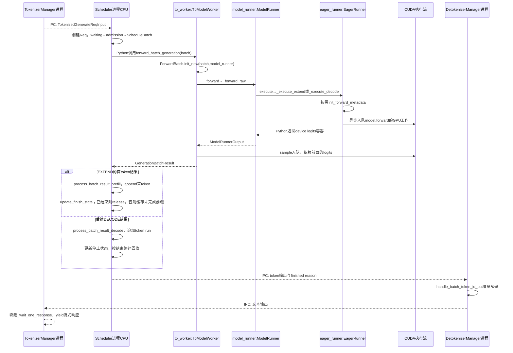
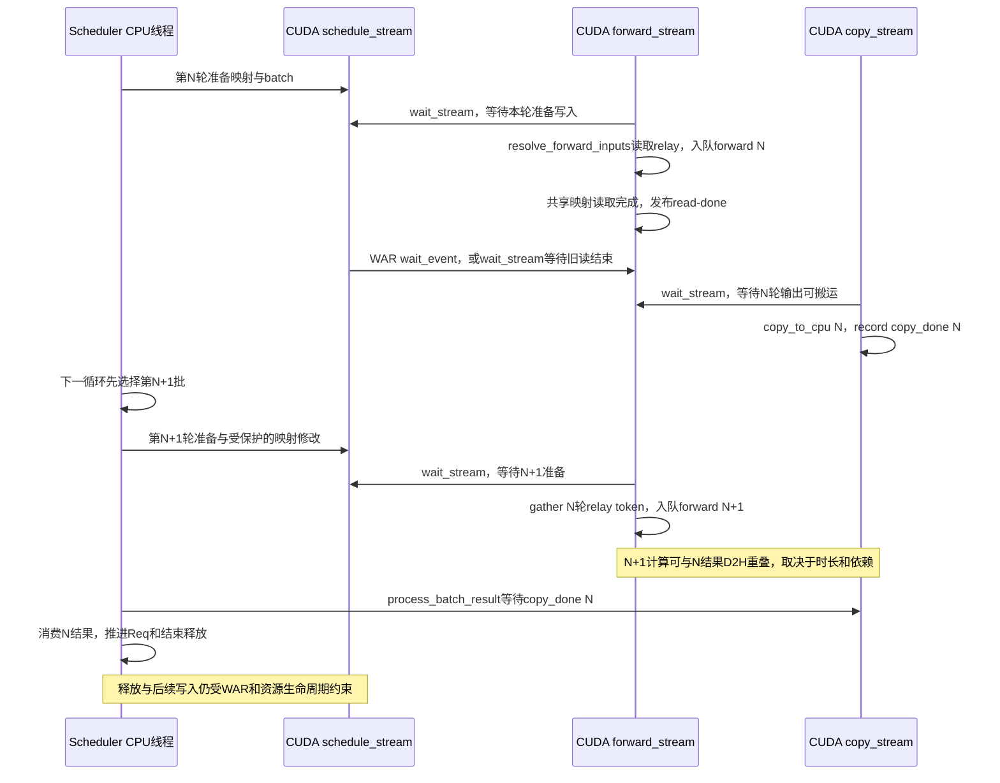

# 推理引擎研发与性能优化面试题

本册保留原50题编号，覆盖请求生命周期、调度、KV、执行器、Graph、Overlap、采样与模型接入，并用Q47–Q49练习故障定位。每题先讲机制，再通过具体状态例子连接当前源码，生产追问要求给出排查抓手与验收证据。

[回总索引](README.md) · [平台部署与大规模服务](platform-deployment.md) · [模型算法与算子](algorithms-kernels.md) · [资料来源](references.md)

当前条件：2026-10-15，工作树HEAD为`f01a0c7f97`，包含用户已有未提交修改。默认CUDA上的通用`TpModelWorker`；ROCm共用部分主线但后端可用性不同，MLX由`use_mlx()`改派专属worker。源码结论以本工作树为准；下面的生产案例是训练用情景与验证方案，并非声称已进行GPU实验或经历过对应线上事故。DP/PP/CP、EAGLE、dFlash、dSpark的分支在相关题中单独标明。

学习时按题回答并复盘；检查点表示待验证的理解，不代表已掌握。

<a id="q01"></a>

## Q01 一条流式请求如何完成生成和资源回收

### 问题与追问

一条流式生成请求，从进入 SGLang 到返回、结束和释放资源，经历什么？取消发生在不同阶段又怎样？

- 等待队列、grammar 编译队列、正在执行的 batch 收到取消时，为什么不能使用同一个立即释放动作？
- 结束输出已返回，GPU 显存没有归零，怎样证明是缓存驻留还是资源泄漏？

### 参考答案

把一条请求看成“身份和生成进度”贯穿多个容器，比把它看成一次模型调用更准确。TokenizerManager 规范化并分词，通过 IPC 发送 TokenizedGenerateReqInput；Scheduler 建立 Req，先经过 grammar 准备，再进入普通等待队列或 PD 专用队列。获准后形成 ScheduleBatch，worker 将它变成 ForwardBatch，ModelRunner 选择实际执行器，返回 logits 和采样结果。结果处理器把 token 写入 Req.output_ids、推进停止条件，输出流经 Detokenizer 回到请求等待者。

例如 A 输入 8 个 token、最多生成 3 个：Prefill 建立输入 KV 并产生首 token，随后 Decode 以已有输出作为下一轮输入。首 token 由 Prefill 结果处理器 append；如果此时已经 EOS 或 max_new_tokens=1，请求直接在 Prefill 结果路径完成和释放，不会再进入 Decode。后续 Decode 结果有自己的追加与结束处理。缓存可接管完整前缀，重复区、尾部预留和 request slot 按各自所有权回收。最后一个输出 token 与已提交 KV 不一定同长，尤其投机存在额外预留，不能按 output_ids 长度直接释放所有位置。

取消是阶段相关的状态转移。普通等待请求可移出队列并通知 TokenizerManager 清理；已执行请求通常写 to_finish，借后续结果处理完成终止与释放，不能在 GPU 仍读映射时拆掉资源。chunk 有延后处理点，PD 等待请求可能已经预分配 KV，传输还涉及异步后端。收益是复用统一结束路径，代价是取消并非所有阶段都瞬时完成；跨实例取消与迟到 DMA 的完整协议还需对照后端验证，见[Q44传输中取消](platform-deployment.md#q44)；执行器分派详见[Q13](#q13)。

### 源码调用链与证据

```text
TokenizerManager.generate_request → _tokenize_one_request → _send_one_request
  → Scheduler.handle_generate_request → Req → GrammarManager.process_req_with_grammar
  → Scheduler._add_request_to_queue → waiting_queue / PD 专用队列
  → admission → ScheduleBatch → TpModelWorker.forward_batch_generation
  → ForwardBatch.init_new → ModelRunner.forward → _forward_raw
     [本例CUDA、无spec、PP=1、关闭Graph/Overlap/Mixed，非split]
     → EagerRunner.execute → _execute_extend / _execute_decode
     → needs_forward_metadata_init → attn_backend.init_forward_metadata
     → model_runner.model.forward → LogitsProcessorOutput
     → ModelRunner.sample → sampler → GenerationBatchResult
  → Scheduler.process_batch_result 按 forward_mode 分派
     EXTEND → SchedulerBatchResultProcessor.process_batch_result_prefill
       Req.output_ids.append(首token) → update_finish_state
       finished → release_kv_cache；否则 → maybe_cache_unfinished_req
     DECODE → SchedulerBatchResultProcessor.process_batch_result_decode
       Req.output_ids.extend → update_finish_state → _handle_finish_state_updated_req
       finished → release_kv_cache
     释放路径 → cache_finished_req + 预留尾部释放 + request slot 释放
  → SchedulerOutputStreamer.stream_output → Detokenizer → TokenizerManager 等待者
取消：Scheduler.abort_request → 队列移除 / receiver.abort / Req.to_finish
```

下面固定为**普通 CUDA、PP=1、无投机、关闭 Graph/Overlap/Mixed、非 split prefill**，让进程交接与同进程 Python 调用分开可见；GPU 工作是异步入队，Python 返回 device tensor 不表示 CPU 已取得数值。Graph/Overlap 的时序见[Q13](#q13)与[Q17](#q17)。



[managers/tokenizer_manager.py:708](/Users/magician/PycharmProjects/sglang/python/sglang/srt/managers/tokenizer_manager.py:708)；[managers/scheduler.py:2177](/Users/magician/PycharmProjects/sglang/python/sglang/srt/managers/scheduler.py:2177)；[结果模式分派:3653](/Users/magician/PycharmProjects/sglang/python/sglang/srt/managers/scheduler.py:3653)；[Prefill 首 token 与结束处理:234](/Users/magician/PycharmProjects/sglang/python/sglang/srt/managers/scheduler_components/batch_result_processor.py:234)；[managers/scheduler.py:4152](/Users/magician/PycharmProjects/sglang/python/sglang/srt/managers/scheduler.py:4152)；[managers/scheduler_components/batch_result_processor.py:776](/Users/magician/PycharmProjects/sglang/python/sglang/srt/managers/scheduler_components/batch_result_processor.py:776)；[mem_cache/common.py:132](/Users/magician/PycharmProjects/sglang/python/sglang/srt/mem_cache/common.py:132)；[EagerRunner.execute:194](/Users/magician/PycharmProjects/sglang/python/sglang/srt/model_executor/runner/eager_runner.py:194)；[DetokenizerManager.event_loop:166](/Users/magician/PycharmProjects/sglang/python/sglang/srt/managers/detokenizer_manager.py:166)。

核心节选（[managers/scheduler.py:4274](/Users/magician/PycharmProjects/sglang/python/sglang/srt/managers/scheduler.py:4274)；首行教学注为补充，其余保留当前逻辑）：

```python
# 教学注：运行中的请求标记终止，后续统一结果路径承担释放。
for req in inflight_reqs:
    if not req.finished() and (
        recv_req.abort_all or req.rid.startswith(recv_req.rid)
    ):
        # Abort method 3: set `to_finish`
        # The request will still run one decode forward pass.
        # Then we reuse all existing code to clean up the KV cache allocation.
        logger.debug(f"Abort running request. {req.rid=}")
        req.to_finish = FINISH_ABORT()
```

### 生产实践追问

- **随机时点取消：**分别在等待、分块、运行和 PD transfer 注入取消，按 RID 记录终态、request slot、KV 预留和 metadata slot；验收无重复终态、资源回到允许的缓存基线。
- **响应已结束但显存高：**对比 allocator free、radix evictable/protected 与活动请求数，主动 eviction 后复核；缓存能正常回收与锁无归属增长是不同结论。

### 学习检查点

- 为什么等待中的 PD Decode 请求也可能必须释放 KV？
- 运行请求的取消为什么优先写终止状态，而不是立刻从所有容器删除？

<a id="q07"></a>

## Q07 Scheduler 请求与批次的连续两轮状态

### 问题与追问

区分 Req、获准请求列表、ScheduleBatch、batch_to_run、running_batch、last_batch。画连续两轮变化。

- 第 N 轮 Prefill 后，第 N+1 轮谁把它加入 running_batch？未完成 chunk 为什么被排除？
- overlap 为什么先选择下一批，再处理上一批结果？共享 Req 与 batch.copy 的生命周期如何区分？

### 参考答案

Req 保存一个请求的 token、停止原因和 KV 生命周期；获准请求列表 can_run_list 只是本轮 admission 的 List[Req]，还没有组成完整执行张量。ScheduleBatch 则组织一组请求及对齐后的长度、索引、采样和投机信息。batch_to_run 是 NextBatchPlan 选出的本轮执行对象；running_batch 是跨轮保留的运行集合；last_batch 是上一轮交给执行器的批次。这些变量有时引用同一个批次或共享同一 Req，角色不同不等于内存彼此独立。

设第 N 轮 running_batch 有 Decode 请求 B，新请求 A 获准 Prefill：can_run_list=[A] 变成新的 ScheduleBatch，plan.batch_to_run 指向它，plan.running_batch 仍保留 B。第 N+1 轮，上一轮 Extend 的 last_batch 经过过滤后把已完成 Prefill 的 A 合入 running_batch，再进行新一轮选择。若 A 尚在分块，只加入排除集，继续由 chunked_req 管理，不能提前作为普通 Decode 请求混入。

普通循环先执行再处理结果，最后写 last_batch；在允许重叠的默认分支中，overlap 循环先提交当前批，再处理结果队列中的上一批，所以容器可能暂时还保留已经由共享 Req 标记结束的项。若 `is_disable_overlap_for_batch` 返回真，则先消费上一批再发起当前批，不能把默认时序当成每轮保证。filter_batch 负责同步筛选请求和对齐张量，不负责释放 KV。当前代码使用 NextBatchPlan 显式回传 running_batch，讲解时应跟踪这次赋值；HiSparse、DP 同步、PP microbatch 和投机输入还会改变主路径边界，不能用普通单卡时间线替代。

### 源码调用链与证据

```text
Scheduler.event_loop_normal / event_loop_overlap
  plan = get_next_batch_to_run(running_batch, last_batch)
  self.running_batch = plan.running_batch; batch = plan.batch_to_run
get_next_batch_to_run:
  last Extend → filter_batch(排除 chunk/finished) → merge into running_batch
  get_new_batch_prefill → adder.can_run_list → 从 waiting_queue 移除
    → ScheduleBatch.init_new → prepare_for_extend → NextBatchPlan
  无新 Prefill → update_running_batch → Decode
执行结果处理后或 overlap 延后一轮处理 → self.last_batch = batch
```

[managers/scheduler.py:1592](/Users/magician/PycharmProjects/sglang/python/sglang/srt/managers/scheduler.py:1592)；[managers/scheduler.py:1635](/Users/magician/PycharmProjects/sglang/python/sglang/srt/managers/scheduler.py:1635)；[managers/scheduler.py:2820](/Users/magician/PycharmProjects/sglang/python/sglang/srt/managers/scheduler.py:2820)；[managers/scheduler.py:3106](/Users/magician/PycharmProjects/sglang/python/sglang/srt/managers/scheduler.py:3106)。

核心节选（[managers/scheduler.py:1592](/Users/magician/PycharmProjects/sglang/python/sglang/srt/managers/scheduler.py:1592)；首行教学注为补充，其余保留当前逻辑）：

```python
# 教学注：两个返回值分别决定持久状态和本轮执行，不要混用。
# Get the next batch to run
plan = self.get_next_batch_to_run(
    running_batch=self.running_batch, last_batch=self.last_batch
)
self.running_batch = plan.running_batch
batch = plan.batch_to_run
```

### 生产实践追问

- **空载 running 数不归零：**对齐 Req.finished、running_batch.reqs、last_batch 与 result_queue 两轮快照，特别检查 prefill-only 的独立过滤；验收无新流量后容器最终清空。
- **新增 tracing：**同时打印 RID、批次对象标识、forward mode 和 plan 两个返回值，验证新增 Prefill 与保留 Decode 没被混称一个状态。

### 学习检查点

- 为什么 last_batch 含一个 Req，不能证明它还需要执行 Decode？
- 若只使用 plan.batch_to_run 而不写回 plan.running_batch，mixed 路径会丢失什么状态？

<a id="q08"></a>

## Q08 显存空闲时 Prefill 为何仍被拒绝

### 问题与追问

显存还有空闲，请求为什么仍进不了 Prefill？prefix 加锁后为什么还要重查预算？

- max_prefill_tokens、chunk budget、request slots、可驱逐 KV 与未来输出预算分别约束什么？
- 首个超长请求会不会越过 max_prefill_tokens？SWA/Mamba 为何还需要独立检查？

### 参考答案

Prefill admission 是多种资源的联合约束，GPU 还有空闲字节并不足以说明可接纳。Scheduler 先检查 request slot、PP microbatch 限额和 batch_is_full；PrefillAdder 再分别约束当前新增输入、chunk、可分配及可驱逐 KV，以及运行请求未来输出的保留预算。已有请求的剩余生成长度乘 new_token_ratio 进入估算；新候选还包含未缓存输入、输出长度上界和分页开销。allocator 的 token 容量也不能简单等同于显存监控中的空闲 GB。

例如缓存有 100 个可驱逐 token、free pool 有 20 个，新请求命中其中 80 个。匹配命中不等于这些空间仍可供别的分配使用：加锁后 80 个由 evictable 转 protected，rem_total_tokens 会下降，因此锁内必须重查预算。请求最终被接纳时再增加持久引用锁，并扣除本轮和未来预算；若遗漏锁后检查，估算会同时把同一批页面当作被请求保护和可被回收。

预算也有进展性和保守性的折中。非 chunk 路径在列表为空时允许第一个候选越过 max_prefill_tokens 的输入约束，避免大请求永远无法入批，但 KV 总预算仍要满足。分页额外预留、Mamba state slot、SWA window 各有不同容量来源，full KV 可驱逐量不能替代它们。拒绝调查应记录实际 gate、锁前锁后余量与输入输出分布，再调整参数；只提高并发可能把排队问题变成回退或分配失败。

### 源码调用链与证据

```text
Scheduler._get_new_batch_prefill_raw
  → get_num_allocatable_reqs = min(PP microbatch余量, request pool余量)
  → PrefillAdder(running_batch, new_token_ratio, input/chunk budgets)
  → Req.init_next_round_input(tree_cache) 写 prefix_indices/last_node
  → PrefillAdder.add_one_req
       total_tokens / real_input_tokens 检查
       _lock_node(last_node) → inc_lock_ref → 再检查 rem_total_tokens
       [host hit] init_load_back → 更新 prefix_indices
       can_run_list.append → 持久锁 + _update_prefill_budget
  → Scheduler 消费 can_run_list 建批
```

[managers/scheduler.py:2904](/Users/magician/PycharmProjects/sglang/python/sglang/srt/managers/scheduler.py:2904)；[managers/scheduler.py:2995](/Users/magician/PycharmProjects/sglang/python/sglang/srt/managers/scheduler.py:2995)；[managers/schedule_policy.py:559](/Users/magician/PycharmProjects/sglang/python/sglang/srt/managers/schedule_policy.py:559)；[managers/schedule_policy.py:1081](/Users/magician/PycharmProjects/sglang/python/sglang/srt/managers/schedule_policy.py:1081)；[managers/schedule_policy.py:1122](/Users/magician/PycharmProjects/sglang/python/sglang/srt/managers/schedule_policy.py:1122)。

核心节选（[managers/schedule_policy.py:1122](/Users/magician/PycharmProjects/sglang/python/sglang/srt/managers/schedule_policy.py:1122)；首行教学注为补充，其余保留当前逻辑）：

```python
# 教学注：锁会改变可驱逐容量，必须在锁后再次判断。
with self._lock_node(req.last_node):
    # self.rem_total_tokens may decrease after the lock acquisition
    if total_tokens >= self.rem_total_tokens:
        return AddReqResult.NO_TOKEN
```

### 生产实践追问

- **低利用率但大量等待：**把拒绝原因分为 request slot、输入、chunk、full/SWA/Mamba 预算；验收能用一个被拒 RID 的账本解释每个数，而不是只看显存图。
- **修改保留比例：**固定 workload 做对照，观察 TTFT、retraction、分配失败和吞吐；验收容量改善没有靠持续回退换来。

### 学习检查点

- 为什么保护 prefix 后 rem_total_tokens 可能下降，尽管没有新分配 GPU tensor？
- 首候选的输入预算例外为什么不能推出 KV 总预算也可越过？

<a id="q09"></a>

## Q09 Chunked Prefill Mixed 与 Decode 公平性

### 问题与追问

Chunked Prefill 是否保证 Decode 公平？长请求 A 与 Decode 请求 B 连续两轮怎样执行？

- 给出两轮普通 chunk 与 mixed chunk 的 A/B 时间线；chunk size 限制的到底是哪一个量？
- return_logprob、input_embeds 与 EAGLE/dFlash/dSpark 会怎样改变 mixed 的可达性？

### 参考答案

Chunked Prefill 把同一请求的输入 token 分段计算，降低一次 Prefill 的新增 token 工作量，同时保存前一块的 KV 供下一块使用。它创造重新选批的边界，但边界本身不保证 Decode 获得机会：当前 Scheduler 能生成新 Prefill 批时优先执行该批，无新批才进入普通 running Decode 更新。chunked_req 的续块还先于等待队列普通候选加入，因此不能从单轮 chunk 上限推出 Decode 总等待有界。

设 A 还剩两块输入，B 已在 Decode。普通 chunk 第 N 轮执行 A 的一块，B 保留在 running_batch；第 N+1 轮 A 仍可续块，则又可选 A，B 继续等待。mixed 配置可达时，两轮都先准备 B 的一次 Decode，把它与 A 的 Extend 合成同一批，同时把持久 running_batch 置空；下一轮再通过 last_batch 过滤、合并恢复。这种方式共享一次执行窗口，使 B 不必等整块 Prefill 结束后另行调度，但单步仍受本批计算时长影响。

mixed 会引入模式、张量布局和采样处理复杂度。当前分支要求两批不返回 logprob、新批没有 input_embeds；投机配置会禁用 mixed，dSpark hook 明确将其设为 False。CP 有独立 Prefill admission 约束，PP 还可能让 chunk 跨 microbatch。实际优化应在 TTFT、ITL 和吞吐之间选工作点；把“分块后可插入调度”说成严格公平或硬实时保证，会掩盖持续 Prefill 流量下的尾延迟。

### 源码调用链与证据

```text
Scheduler.get_next_batch_to_run
  → stash 上一块 KV；chunked_req 加入 last_batch 排除集
  → _get_new_batch_prefill_raw → add_chunked_req 优先续块
  → [new_batch != None] 本轮优先 Prefill
  → [is_mixed_chunk && 无logprob && input_embeds=None]
       running_batch.filter_batch → prepare_for_decode
       new_batch.mix_with_running → decoding_reqs = running_batch.reqs
       running_batch = 空 ScheduleBatch
下一轮：last Extend过滤 → merge回running_batch；未完chunk继续排除
```

[managers/scheduler.py:2793](/Users/magician/PycharmProjects/sglang/python/sglang/srt/managers/scheduler.py:2793)；[managers/scheduler.py:2876](/Users/magician/PycharmProjects/sglang/python/sglang/srt/managers/scheduler.py:2876)；[managers/scheduler.py:3014](/Users/magician/PycharmProjects/sglang/python/sglang/srt/managers/scheduler.py:3014)；[managers/scheduler.py:3170](/Users/magician/PycharmProjects/sglang/python/sglang/srt/managers/scheduler.py:3170)；[arg_groups/speculative_hook.py:402](/Users/magician/PycharmProjects/sglang/python/sglang/srt/arg_groups/speculative_hook.py:402)。

核心节选（[managers/scheduler.py:2876](/Users/magician/PycharmProjects/sglang/python/sglang/srt/managers/scheduler.py:2876)；首行教学注为补充，其余保留当前逻辑）：

```python
# 教学注：普通主线在新 Prefill 存在时优先执行，公平性不能由 chunk 上限直接推出。
if new_batch is not None:
    # Run prefill first if possible
    ret = new_batch
else:
    # Run decode (skip for prefill-only batches)
    if not running_batch.is_empty() and not running_batch.is_prefill_only:
        running_batch = self.update_running_batch(running_batch)
        ret = running_batch if not running_batch.is_empty() else None
```

### 生产实践追问

- **长输入冲击流式生成：**采集至少两轮 A/B batch composition 和 B 的逐token间隔，分别测普通chunk、mixed及PD；验收关注 P99 ITL，同时限制 TTFT 与吞吐退化。
- **开启 mixed 未生效：**检查解析后的实际参数、logprob/input_embeds、spec 配置及 forward mode，验收真实批次确有 decoding_reqs。

### 学习检查点

- 为什么每块最多处理固定 token 数，仍不能证明 B 最多等一块？
- mixed 后为什么需要清空原 running_batch 容器？

<a id="q10"></a>

## Q10 Eviction 与 retraction 的回收和恢复

### 问题与追问

内存不足时，eviction 和 retraction 分别回收什么？请求如何恢复？

- page_size=16，committed length 为15和16的两个普通请求，下一步新增页需求分别是多少？
- 最后一个请求仍装不下怎么办？PD retraction 为什么可能选择 host offload 而非全部重算？

### 参考答案

Eviction 回收树中无活动引用保护的缓存页，请求可继续运行，只是后续复用率可能下降。Retraction 则让运行请求暂时退出执行集合，释放其资源后稍后重算或恢复；它牺牲已经投入的工作与延迟换取其他请求推进。当前 check_decode_mem 先估算下一步所需 token 容量，再只驱逐 free pool 的短缺量，仍不足才 retract，不能把正常缓存淘汰和运行请求回退计成同一种事件。

以 page_size=16 为例，普通请求 committed length=15 时，下一 token 仍在已占页内，新页需求为0；length=16 时要开始新页，容量需求为16。投机不按一请求一token计算，而以 committed+reserve 超过 allocated 的缺口按页对齐。retract_decode 按 length 或 priority 顺序选牺牲者，释放时禁止插入新缓存以尽快取得空间，再过滤请求及张量；当前代码连最后一个请求也放不下时会有明确 abort，而非无限重试。

被回退请求保留输出等可恢复逻辑状态，普通模式重新入 waiting_queue；PD Decode 可先把 KV offload 到 host，进入 retracted queue，恢复优先于新接纳。new_token_ratio 会重新估计，但不能声称一定增加。回退是容量保护机制，持续出现则常形成释放、重算、再接纳的抖动，应结合 workload、锁住的缓存、预留和恢复开销定位；单纯把并发限额调高通常增加这种压力。

### 源码调用链与证据

```text
Scheduler.update_running_batch → filter_batch
  → ScheduleBatch.check_decode_mem
       new_tokens_required_next_decode [普通页边界 / spec reserve缺口]
       → evict_from_tree_cache(只补短缺)
  → [仍不足] retract_decode → _get_decode_retraction_order → release_req
       [PD decode] offload_kv_cache
       → release_kv_cache(is_insert=False) → reset_for_retract
       → filter_batch(保留者) → 返回 retracted_reqs
  → Scheduler._add_request_to_queue(is_retracted=True)
  → 普通waiting / PD retracted queue → 后续重算或resume
```

[managers/schedule_batch.py:2597](/Users/magician/PycharmProjects/sglang/python/sglang/srt/managers/schedule_batch.py:2597)；[managers/schedule_batch.py:2631](/Users/magician/PycharmProjects/sglang/python/sglang/srt/managers/schedule_batch.py:2631)；[managers/schedule_batch.py:2682](/Users/magician/PycharmProjects/sglang/python/sglang/srt/managers/schedule_batch.py:2682)；[managers/schedule_batch.py:1735](/Users/magician/PycharmProjects/sglang/python/sglang/srt/managers/schedule_batch.py:1735)；[managers/scheduler.py:3295](/Users/magician/PycharmProjects/sglang/python/sglang/srt/managers/scheduler.py:3295)。

核心节选（[managers/schedule_batch.py:2624](/Users/magician/PycharmProjects/sglang/python/sglang/srt/managers/schedule_batch.py:2624)；首行教学注为补充，其余保留当前逻辑）：

```python
# 教学注：先驱逐可回收缓存，再判断下一步是否装得下。
def check_decode_mem(self, selected_indices: Optional[List[int]] = None):
    """Reclaim evictable tree-cache entries (shortfall only), then report
    whether the next decode step fits in the KV pool."""
    num_tokens = self.new_tokens_required_next_decode(selected_indices)
    evict_from_tree_cache(self.tree_cache, num_tokens)
    return self.token_to_kv_pool_allocator.available_size() >= num_tokens
```

### 生产实践追问

- **没有CUDA OOM但吞吐下降：**按请求跟踪 retraction_count、重复Prefill token量与剩余KV预算，验收能证明损失来自回退循环还是模型执行变慢。
- **回退策略变更：**构造长短输入、不同输出进度和priority混合负载，检查被牺牲RID及最终进展，验收资源回收和优先级语义同时成立。

### 学习检查点

- 为什么“还有一个请求”不代表下一步一定能执行？
- spec reserve 的页缺口为何不能用接受长度直接替代？

<a id="q11"></a>

## Q11 KV 分配映射和有效内容的区别

### 问题与追问

“分配了 KV”究竟是拿到物理页、建立映射，还是已经生成了有效内容？

- req_pool_idx、req_to_token、prefix_indices、out_cache_loc各自表示什么，谁的单位是请求、token或物理索引？
- 为什么 output_ids、kv_committed_len、kv_allocated_len 在投机和PD交接时不能混用？

### 参考答案

“有 KV”至少包含三个阶段：allocator 把页面保留给请求；request-to-token 表把逻辑位置映射到物理槽位；模型执行把对应 token 的有效 K/V 写入这些位置。页索引是地址描述，既不含 token 语义，也不证明内容已经产生。req_pool_idx 选请求映射行，prefix_indices 描述可复用的位置，out_cache_loc 告诉本次执行把新 KV 写到哪里；读写正确性还依赖长度、position 和 attention metadata。

例如 prompt 有16个 token，模型采样出首个输出 x。prompt KV 已存在，但 x 的 KV 要等把 x 作为下一步输入才形成。普通 prepare_for_decode 先分配其物理位置、写 req_to_token，再推进长度；这仍是执行准备，而非GPU已完成。PD D侧可先有整段目标地址等待P写入；spec则可能预留超过最终接受范围的槽位，后续只提交验证通过的部分。三种状态都说明 allocated 不能直接当成有效内容长度。

分开这三层使分页、prefix复用和投机预留成为可能，也带来账本一致性的要求。Extend 要同时写入旧prefix与新增位置；Decode 普通与spec的分配和长度维护分别处理；释放时先处理有效KV及缓存接管，再释放overallocated尾部和request slot。调试时应按RID建立逻辑位置到物理页及有效区间的表，不能仅对比 tensor shape 或 allocator 返回非空。

### 源码调用链与证据

```text
ScheduleBatch.prepare_for_extend → alloc_for_extend
  → alloc_req_slots / alloc_token_slots或paged_extend
  → write_cache_indices(prefix + 新槽位) → out_cache_loc
普通 prepare_for_decode → alloc_for_decode(token_per_req=1)
  → req_to_token_pool.write((req_pool_indices, 旧seq_lens), out_cache_loc)
  → req.kv_committed_len += 1 / batch.seq_lens += 1
  → worker/runner执行，模型按out_cache_loc写KV
spec: prepare_for_decode → spec_prepare_for_decode → family专属准备
release_kv_cache → effective committed区处理 → overallocated尾部释放
```

[mem_cache/allocation.py:303](/Users/magician/PycharmProjects/sglang/python/sglang/srt/mem_cache/allocation.py:303)；[mem_cache/allocation.py:372](/Users/magician/PycharmProjects/sglang/python/sglang/srt/mem_cache/allocation.py:372)；[mem_cache/allocation.py:539](/Users/magician/PycharmProjects/sglang/python/sglang/srt/mem_cache/allocation.py:539)；[managers/schedule_batch.py:2846](/Users/magician/PycharmProjects/sglang/python/sglang/srt/managers/schedule_batch.py:2846)；[mem_cache/common.py:148](/Users/magician/PycharmProjects/sglang/python/sglang/srt/mem_cache/common.py:148)。

核心节选（[mem_cache/allocation.py:572](/Users/magician/PycharmProjects/sglang/python/sglang/srt/mem_cache/allocation.py:572)；首行教学注为补充，其余保留当前逻辑）：

```python
# 教学注：这里只写逻辑位置到物理槽位的映射，KV内容由后续执行产生。
# Write to req_to_token_pool
if batch.model_config.is_encoder_decoder:
    locs = batch.encoder_lens + seq_lens_gpu
else:
    locs = seq_lens_gpu.clone()

batch.req_to_token_pool.write(
    (batch.req_pool_indices, locs), out_cache_loc.to(torch.int32)
)
```

### 生产实践追问

- **跨请求内容污染：**记录RID、req_pool_idx、逻辑offset、物理index及页世代，复核旧映射是否被复用；验收不同请求不会观察到对方未提交位置。
- **投机内存使用异常：**把allocated、committed、输出长度及reserve分别画时间线，验收拒绝尾部的释放时点有源码与运行证据。

### 学习检查点

- 为什么已经采样出的token可能还没有自己的KV？
- PD preallocation成功为什么不能作为传输成功的证据？

<a id="q12"></a>

## Q12 共享前缀的引用锁与资源所有权

### 问题与追问

A、B 共享前缀，A 结束时为什么不能 free 全部 KV？如何区分缓存驻留与泄漏？

- lock_ref的0→1、1→0各改变哪个容量统计？同一祖先被多个请求使用时如何变化？
- cache_unfinished_req为什么会释放重复KV、重写映射并更换last_node锁？

### 参考答案

共享前缀的物理KV可以由缓存节点持有，并由多个活动请求引用。请求结束应释放自己独占、重复或多余的部分，而不能把沿用的共享prefix全部free，否则B下次attention会读到已返还allocator的页面。Radix锁沿last_node到根的祖先链维护；0→1把节点容量从evictable转protected，1→0才反向转换，其余引用数变化不会重复增减容量。

设A和B共享前8个token，B另有4个独占token。A结束后，共享节点仍被B锁住，不能evict；A的新内容可插入树变为缓存驻留。若两个请求各自计算过相同后缀，unfinished insert先发现树已有canonical页，释放本请求独占区里的重复页，再match树并重写req_to_token，随后把锁迁移到新last_node。cache_protected_len只覆盖树真正接管的完整页，不一定等于包含部分页的prefix_indices长度。

这套所有权让跨请求复用避免重复计算，却要求锁、树结构和allocator账本同步。filter_batch只裁剪batch视图，最终release_kv_cache才调用cache_finished_req、释放overallocated尾部及request slot。空载显存高可能是evictable缓存，不能据此诊断泄漏；真正值得怀疑的是无活动请求仍有不可解释protected增长、重复free或request slot不归还。SWA、Mamba及HiCache还存在不同层级所有权，应沿所选缓存实现核对。

### 源码调用链与证据

```text
Req prefix match → last_node / cache_protected_len
PrefillAdder接纳 → RadixCache.inc_lock_ref(last_node)
  [0→1] evictable_size减、protected_size增；祖先链引用+1
cache_unfinished_req → insert → 释放重复独占页 → match canonical索引
  → req_to_token_pool.write → protected_len更新 → old dec / new inc
请求结束 → release_kv_cache → cache_finished_req
  → 插入/重复页/未对齐尾处理 → dec_lock_ref(last_node)
  → 释放spec预留尾及request slot；无锁叶节点可被evict
```

[mem_cache/radix_cache.py:437](/Users/magician/PycharmProjects/sglang/python/sglang/srt/mem_cache/radix_cache.py:437)；[mem_cache/radix_cache.py:490](/Users/magician/PycharmProjects/sglang/python/sglang/srt/mem_cache/radix_cache.py:490)；[mem_cache/radix_cache.py:594](/Users/magician/PycharmProjects/sglang/python/sglang/srt/mem_cache/radix_cache.py:594)；[mem_cache/common.py:132](/Users/magician/PycharmProjects/sglang/python/sglang/srt/mem_cache/common.py:132)。

核心节选（[mem_cache/radix_cache.py:599](/Users/magician/PycharmProjects/sglang/python/sglang/srt/mem_cache/radix_cache.py:599)；首行教学注为补充，其余保留当前逻辑）：

```python
# 教学注：只有从无活动引用变成被保护时，容量统计才转换一次。
while node != self.root_node:
    if node.lock_ref == 0:
        self.evictable_size_ -= len(node.key)
        self.protected_size_ += len(node.key)
        delta -= len(node.key)
    node.lock_ref += 1
    self._update_leaf_status(node)
```

### 生产实践追问

- **空载显存不下降：**区分allocator free、evictable、protected，触发缓存回收后复核；验收有明确所有者的缓存驻留，而非以进程显存值判泄漏。
- **共享prefix取消：**让A/B共享前缀，仅取消A后继续B并反复分配新请求，校验B输出与锁计数；验收没有use-after-free和残留引用。

### 学习检查点

- 为什么lock_ref从2减到1不应增加evictable容量？
- 为什么新canonical索引必须写回请求映射，而不能只更新树？

<a id="q13"></a>

## Q13 Worker 和 ModelRunner 的实际执行分派

### 问题与追问

Scheduler 最终调用哪个 worker？输入进入 ModelRunner 后，怎样选择实际执行器？

- CUDA/ROCm的TpModelWorker、MLX override与spec draft worker分别在哪选定？
- 为什么TARGET_VERIFY可能由名为DecodeCudaGraphRunner的执行器处理，却不能据此称为普通Decode？

### 参考答案

先确定实际receiver，再讨论forward。Scheduler初始化target时，use_mlx为真选择MlxTpModelWorker，否则选择通用TpModelWorker；有投机算法时，model_worker还可能指向算法create_worker所选的draft worker，target仍由其内部持有。当前ForwardBatch.init_new直接接收ScheduleBatch，旧资料中的ModelWorkerBatch中间对象不能不经核对照搬。worker负责整理执行输入和结果契约，ModelRunner负责模型及执行器选择，attention backend提供所选路径的metadata与注意力实现。

例如CUDA普通Decode的一批3个请求，Scheduler.run_batch将输入relay解析后交给TpModelWorker；worker建立ForwardBatch并调用model_runner.forward。_forward_raw先判断模式和decode graph资格，能重放则直接执行并返回。未走该分支才先做DP/MLP padding，随后选择layer split prefill、prefill graph或eager runner。eager内部再按Decode、Idle、Extend分发，并在所选backend上按需初始化metadata后调用model.forward，不能把这些边界简写成一个没有条件的forward箭头。

Graph的名字并不等于请求语义：DecodeCudaGraphRunner还承载TARGET_VERIFY等固定形状工作；PrefillCudaGraphRunner当前资格检查明确拒绝TARGET_VERIFY，所以不能按“verify处理多个token”推断它走prefill graph。DP padding、CP、PP返回代理张量、PDmux每stream backend及设备override还会影响实际receiver。这样分层便于复用模型逻辑，但性能与正确性调查必须记录实际runner、backend、mode和graph key，而非仅记录用户打开了哪些选项。

### 源码调用链与证据

```text
Scheduler.init_tp_worker → [use_mlx] MlxTpModelWorker / [else] TpModelWorker
Scheduler model_worker → [无spec] tp_worker / [有spec] create_worker选出的算法worker
run_batch → model_worker.forward_batch_generation
  普通TpModelWorker: ForwardBatch.init_new(ScheduleBatch, model_runner)
  → ModelRunner.forward → _forward_raw
      [decode graph可用] decode_cuda_graph_runner.execute → return
      [其余] _prepare_eager_forward_batch → split / prefill graph / eager
      eager: needs_forward_metadata_init → selected_backend.init_forward_metadata
             → model_runner.model.forward → logits / PPProxyTensors
  → GenerationBatchResult → Scheduler结果处理
```

[managers/scheduler.py:815](/Users/magician/PycharmProjects/sglang/python/sglang/srt/managers/scheduler.py:815)；[managers/scheduler.py:924](/Users/magician/PycharmProjects/sglang/python/sglang/srt/managers/scheduler.py:924)；[managers/tp_worker.py:543](/Users/magician/PycharmProjects/sglang/python/sglang/srt/managers/tp_worker.py:543)；[model_executor/model_runner.py:1479](/Users/magician/PycharmProjects/sglang/python/sglang/srt/model_executor/model_runner.py:1479)；[model_executor/runner/prefill_cuda_graph_runner.py:1021](/Users/magician/PycharmProjects/sglang/python/sglang/srt/model_executor/runner/prefill_cuda_graph_runner.py:1021)。

核心节选（[model_executor/model_runner.py:1510](/Users/magician/PycharmProjects/sglang/python/sglang/srt/model_executor/model_runner.py:1510)；首行教学注为补充，其余保留当前逻辑）：

```python
# 教学注：decode graph分支提前返回，后面的eager padding与prefill选择并非每轮都执行。
# Replay cuda graph if applicable
if can_run_graph: # 到这里为止，只是判断是否能执行 decode的 cuda graph；
    ret = self.decode_cuda_graph_runner.execute(
        forward_batch,
        pp_proxy_tensors=pp_proxy_tensors,
    )
    return ModelRunnerOutput(logits_output=ret, can_run_graph=can_run_graph)
```

### 生产实践追问

- **打开Graph但性能没变：**记录每轮实际runner与资格失败原因，确认是否由hidden mode、CP或输入embedding导致fallback；验收Graph执行次数与预期批次一致。
- **IDE跳到MLX实现：**回到use_mlx和worker构造条件核实硬件，验收调用链receiver与真实部署一致，避免把可见override当运行证据。

### 学习检查点

- 为什么“使用CUDA Graph”不能说明具体走了哪个runner？
- 若PP非末rank返回代理张量，为什么不能直接沿最后rank采样链讲解？

<a id="q14"></a>

## Q14 Attention metadata 的预规划与重规划

### 问题与追问

Attention metadata 为什么既不能无条件重建，也不能预规划后永久跳过？

- 预规划的metadata在DP padding后shape改变，什么时候允许重新规划？
- multi-step wrapper或view-context计划为什么不能仅凭shape变化就重建？

### 参考答案

Attention metadata是本次attention读取KV的执行计划，例如页表、长度、mask和工作区布局；它必须对应最终输入，而不是只对应请求文本。普通eager在进入模型前按需规划；decode graph在load_batch把输入复制到静态buffer并构造replay view后规划图外metadata；prefill graph又依不同backend采用不同capture/replay接口。投机还可能在plan stream预先规划，因此既不能每次forward无条件再做一遍，也不能只设置一次布尔值便永久跳过。

例如预计划记录batch size=3、token数=12，DP对齐后token数变为16。mark_forward_metadata_ready同时记录ready、planned_bs、planned_num_tokens和replan_equivalent；needs_forward_metadata_init在未标ready时返回True，在标记且等价重规划获准时比较当前shape，否则保持跳过。这样，允许重规划的普通计划可在最终padding后更新；带特殊wrapper或view上下文的计划不会被一份语义不同的默认metadata覆盖。shape记录是过期检测的一部分，不是对所有tensor值与backend状态的完整校验。

预规划减少forward关键路径工作并可与计算重叠，成本是计划所有权和失效条件更复杂。调用mark必须紧贴真实planning动作，声明等价性还要核实同一个backend对象、同一上下文和布局；不能把“需要replan”理解成所有预计划都可安全替换。EAGLE、dFlash和dSpark共享判断接口但计划方式不同；Graph replay、eager及split prefill仍各自拥有metadata入口，具体错误要沿实际runner定位。

### 源码调用链与证据

```text
spec预规划点: backend.init_forward_metadata / graph_runner.load_batch
  → ForwardBatch.mark_forward_metadata_ready(replan_equivalent=明确契约)
  → 记录batch_size与input_ids长度
ModelRunner._forward_raw
  [非decode graph] _prepare_eager_forward_batch → DP最终padding
  → EagerRunner._execute_decode/_execute_extend
       needs_forward_metadata_init()
       [True] selected backend.init_forward_metadata → model.forward
  [decode graph] DecodeCudaGraphRunner.load_batch
       needs... → 复用预计划 或 填buffer/build_replay_fb_view/图外规划
```

[model_executor/forward_batch_info.py:610](/Users/magician/PycharmProjects/sglang/python/sglang/srt/model_executor/forward_batch_info.py:610)；[model_executor/model_runner.py:1518](/Users/magician/PycharmProjects/sglang/python/sglang/srt/model_executor/model_runner.py:1518)；[model_executor/runner/eager_runner.py:229](/Users/magician/PycharmProjects/sglang/python/sglang/srt/model_executor/runner/eager_runner.py:229)；[model_executor/runner/decode_cuda_graph_runner.py:1058](/Users/magician/PycharmProjects/sglang/python/sglang/srt/model_executor/runner/decode_cuda_graph_runner.py:1058)。

核心节选（[model_executor/forward_batch_info.py:646](/Users/magician/PycharmProjects/sglang/python/sglang/srt/model_executor/forward_batch_info.py:646)；首行教学注为补充，其余保留当前逻辑）：

```python
# 教学注：只有显式声明重规划等价，才用记录的shape决定是否重新规划。
if not self.forward_metadata_ready:
    return True
if not self.forward_metadata_replan_equivalent:
    return False
num_tokens = self.input_ids.shape[0] if self.input_ids is not None else 0
return (
    self.batch_size != self.forward_metadata_planned_bs
    or num_tokens != self.forward_metadata_planned_num_tokens
)
```

### 生产实践追问

- **DP下偶发长度错误：**在mark点与forward入口记录backend身份、上下文、planned/current shape及padding信息，验收所有重规划均声明语义等价，特殊计划不被覆盖。
- **重复planning导致性能退化：**按计划阶段计数并对照runner，检查ready标记是否紧随planning动作，验收每轮必要计划次数与对应工作区使用一致。

### 学习检查点

- 为什么shape变了仍可能必须保持needs_forward_metadata_init=False？
- 为什么形状一致不能单独证明metadata里的页索引也一定正确？

<a id="q15"></a>

## Q15 Decode CUDA Graph 的静态地址与动态输入

### 问题与追问

batch=3 使用 batch=4 的 CUDA Graph 时，哪些地址稳定，哪些值每轮更新？

- 第4个padding请求的长度、request index和KV写位置如何处理，为什么不能全部保留上轮值？
- 图输出是共享静态buffer时，下一次replay之前哪些消费者必须复制或完成读取？

### 参考答案

CUDA Graph把一组GPU工作及其地址关系记录下来，重放时通常复用capture阶段的静态输入、输出与工作区地址；动态的是这些地址中的内容。batch=3可映射到已捕获batch=4的档位，真实token IDs、positions、request indices、seq lengths、out_cache_loc等每轮复制到静态buffer，然后按对应attention计划重放。稳定地址不意味着请求和KV长度被冻结，也不意味着每次上下文变长都重新capture。

设上一轮真实batch=4，下一轮只有A/B/C。registry.fill_from先按字段策略处理尾部，再复制真实区域：seq_lens使用适当sentinel，req_pool_indices/out_cache_loc等padding位置归安全值；并非所有字段都清零，input_ids等在证明padding不被读取时可保留尾部。runner随后基于静态buffer view规划metadata并选graph key，重放后普通输出只把有效部分交下游。若第4行仍指向旧请求页，即使前3行输入正确，也可能让dummy计算读写真实资源。

补档减少GPU launch开销，代价是padding计算、静态显存和更多形状档位；档位过密增加capture及驻留成本，过疏浪费算力。投机的固定verify宽度、hidden-state模式及DP全局对齐会改变key；dSpark compact ragged可按总token档位选图，raw_num_token的语义也不同，不能套用普通batch=3的裁剪公式。图共享输出还要求调用者控制消费时机和生命周期，见Overlap与错token题。

### 源码调用链与证据

```text
ModelRunner._forward_raw → DecodeCudaGraphRunner.can_run_graph → execute
  load_batch:
    raw_bs=3 → _pad_to_bucket(...capture_bs)=4
    → CudaGraphBufferRegistry.fill_from(raw_bs=3,padded_bs=4,...)
       reset_padding → D2D/CPU slots复制 → post_fill
    → build_replay_fb_view → attn_backend.init_forward_metadata_out_graph
    → _replay_graph_key
  backend.replay(key, forward_batch)
  → LogitsProcessorOutput有效输出视图 → worker采样/verify后续消费者
```

[model_executor/runner/decode_cuda_graph_runner.py:1104](/Users/magician/PycharmProjects/sglang/python/sglang/srt/model_executor/runner/decode_cuda_graph_runner.py:1104)；[model_executor/cuda_graph_buffer_registry.py:379](/Users/magician/PycharmProjects/sglang/python/sglang/srt/model_executor/cuda_graph_buffer_registry.py:379)；[model_executor/cuda_graph_buffer_registry.py:68](/Users/magician/PycharmProjects/sglang/python/sglang/srt/model_executor/cuda_graph_buffer_registry.py:68)；[model_executor/runner/decode_cuda_graph_runner.py:1178](/Users/magician/PycharmProjects/sglang/python/sglang/srt/model_executor/runner/decode_cuda_graph_runner.py:1178)；[model_executor/runner/decode_cuda_graph_runner.py:1252](/Users/magician/PycharmProjects/sglang/python/sglang/srt/model_executor/runner/decode_cuda_graph_runner.py:1252)。

核心节选（[model_executor/runner/decode_cuda_graph_runner.py:1142](/Users/magician/PycharmProjects/sglang/python/sglang/srt/model_executor/runner/decode_cuda_graph_runner.py:1142)；首行教学注为补充，其余保留当前逻辑）：

```python
# 教学注：真实输入写入capture稳定buffer，padding策略由registry逐字段处理。
self.buffer_registry.fill_from(
    forward_batch,
    raw_bs=raw_bs,
    padded_bs=bs,
    raw_num_tokens=raw_num_token,
    padded_num_tokens=padded_num_tokens,
    pp_proxy_tensors=pp_proxy_tensors,
)
```

### 生产实践追问

- **3/4请求交替时错token：**交替batch=4→3→1→4，记录padding行、graph key和静态指针，验收真实请求页不被dummy行引用。
- **Graph启动很慢：**统计capture档位、静态buffer与warmup耗时，针对实际batch分布调整档位，验收首启成本和稳态吞吐同时报告。

### 学习检查点

- 为什么只copy真实3行而不处理旧第4行可能不安全？
- 为什么静态地址与动态序列长度并不矛盾？

<a id="q16"></a>

## Q16 Prefill Graph 和两种 prefill 切分

### 问题与追问

为什么总 token 相同的两批 Prefill，图命中和性能可能不同？split prefill 与 chunked prefill 切的是什么？

- 总token数相同，request数、prefix命中和hidden输出模式如何改变图资格？
- chunked prefill与split prefill分别在哪个状态变量上推进，哪一种会复用前一块token的KV？

### 参考答案

Prefill总token数只描述展平输入的一维长度，不能完整描述批次形状及执行路径。request数决定每请求metadata的行数；prefix长度改变KV读取与attention工作量；input_embeds、LoRA、logprobs、hidden-state模式、CP和DP活跃rank又影响graph资格。当前Full backend有capture request slot上限，prefill graph还检查token档位、padding比例和prefix拓扑。因此两批同为512个新增token，并不保证命中同一图或花相同时间。

例如A是一个512-token新请求，B是8个各64-token请求且各命中长prefix。它们新增token相同，B却要8行请求描述并读取不同历史KV；若capture仅容纳4个request，B会fallback。再比较两种切分：chunked prefill按输入token区间推进extend_range/prefix_indices，多轮逐步补齐上下文；split prefill按模型层区间推进ForwardBatch.split_index，保留中间执行状态，从第0层逐段做到最后层。二者切的轴不同，不能把层切分叫作另一种token chunk大小。

分块能减少单次工作量并提供调度机会，层切分便于与其他任务或PDmux安排执行，但都引入额外状态与调度成本。split路径由ModelRunner单独处理，首段或强制重建时初始化attention metadata；普通eager与prefill graph另有入口。TARGET_VERIFY虽然处理多token，当前prefill graph资格明确拒绝它，应该检查decode graph或eager；支持情况还受具体模型是否提供forward_split_prefill及后端限制影响。

### 源码调用链与证据

```text
Scheduler chunk: add_chunked_req → req.set_extend_range → 执行token区间
  → cache_unfinished_req → prefix_indices增长 → 下一token块
ModelRunner._forward_raw:
  [is_split_prefill] forward_split_prefill
      [split_index==0 / reinit] attn_backend.init_forward_metadata
      next_split_index=min(split_index+forward_count,num_hidden_layers)
      model.forward_split_prefill(...,(split_index,next_split_index))
      → forward_batch.split_index=next_split_index
  [Extend且prefill graph可用] PrefillCudaGraphRunner.can_run_graph
      request slots / embeds / verify / hidden / DP / token bucket等检查
```

[managers/schedule_policy.py:894](/Users/magician/PycharmProjects/sglang/python/sglang/srt/managers/schedule_policy.py:894)；[model_executor/model_runner.py:1308](/Users/magician/PycharmProjects/sglang/python/sglang/srt/model_executor/model_runner.py:1308)；[model_executor/model_runner.py:1534](/Users/magician/PycharmProjects/sglang/python/sglang/srt/model_executor/model_runner.py:1534)；[model_executor/runner/prefill_cuda_graph_runner.py:1004](/Users/magician/PycharmProjects/sglang/python/sglang/srt/model_executor/runner/prefill_cuda_graph_runner.py:1004)。

核心节选（[model_executor/model_runner.py:1314](/Users/magician/PycharmProjects/sglang/python/sglang/srt/model_executor/model_runner.py:1314)；首行教学注为补充，其余保留当前逻辑）：

```python
# 教学注：split prefill推进的是模型层边界。
if forward_batch.split_index == 0 or reinit_attn_backend:
    self.attn_backend.init_forward_metadata(forward_batch)
next_split_index = min(
    forward_batch.split_index + forward_count,
    self.model_config.num_hidden_layers,
)
```

### 生产实践追问

- **同token基准结果不同：**固定新增token数并分别扫request数、prefix长度与cache命中，标注runner与metadata成本；验收比较中不隐藏工作量差异。
- **层切分后卡住：**记录split_index前后、层区间与batch生命周期，检查首段metadata与最后段返回消费者；验收每请求层进度单调且最终完成。

### 学习检查点

- 为什么8×64与1×512在同一token档位仍可能只有一批能用图？
- split_index增长为什么不能证明请求输入KV已增加一个token chunk？

<a id="q17"></a>

## Q17 Overlap 的跨轮依赖和读写保护

### 问题与追问

上一轮 token 没回 CPU，下一轮为何能提交？只有 forward stream 等 schedule stream 是否足够？

- FutureMap存的是请求身份、token值还是future handle？下一轮在哪真正读取上一轮结果？
- 为何还需要schedule stream等待forward的读完成？张量存活和访问顺序各由什么保护？

### 参考答案

Overlap让CPU调度与GPU执行错开，关键是延迟消费结果，并将跨轮依赖保留在device relay中，而不是让尚未产生的token失去依赖。FutureMap按req_pool_idx保存输出token和投机所需附加状态；上一轮stash写入，下一轮resolve_forward_inputs在forward stream上按请求索引gather。CPU可以先准备不依赖结果的部分；需要CPU长度或confidence的分支仍有明确等待及copy，不能宣称整个过程无需同步。

设第N轮GPU还在算A，CPU开始构造第N+1轮batch。新forward先等待schedule stream准备完成，然后解析relay输入，执行模型并发布下一轮状态。反方向也有依赖：结果处理、下一轮分配或释放可能改共享req_to_token/SWA映射，必须等旧forward已经读取这些内容。当前_apply_war_barrier优先等runner发布的read-done event，否则等整个forward stream；graph的普通快照与breakable verify在replay期间继续读映射的时点不同，事件不能随便提前。

这形成双向顺序约束：schedule写完再forward读，forward读完再允许schedule后续写，二者缺一不可。batch字段快照、keep-alive引用和record_stream解决对象或tensor提前销毁，event/wait解决GPU访问先后，不能互相替代。收益是隐藏CPU开销，代价是更多跨轮状态与更高正确性门槛；grammar还需上一轮FSM推进后再采样，spec的publish可发生在verify与draft后续工作之间，实际边界必须按算法核实。

### 源码调用链与证据

```text
CPU调度线程          schedule stream             forward stream
选N+1批/准备映射  →     排队准备写入
                      └──────────────────wait_stream(schedule)
                                              resolve_forward_inputs(FutureMap)
                                              模型/verify → stash/publish
                      wait_event(read_done) ←  完成共享映射读取后record事件
处理N结果/释放映射 →    后续安全修改             后续GPU计算可能继续

FutureMap.stash: output_tokens_buf[req_pool_idx] = bonus_tokens
下一轮resolve: input_ids = output_tokens_buf[batch.req_pool_indices]
张量生命周期另由batch_record/extra_keep_alive_refs/record_stream维持
```

下面用**CUDA、PP=1、无 spec、无 grammar 延迟采样**展示两轮关系。所有“消费结果”都仍由 Scheduler 的同一个 CPU 调度线程执行，copy CUDA 流只搬数据；箭头里的 wait 是设备依赖或明确的主机等待，不代表多个 CPU 调度线程。图中 read-done 可以来自快照事件；无安全快路径时改等整个旧 forward。



对应的 D2H 分支在[Scheduler.run_batch:3463](/Users/magician/PycharmProjects/sglang/python/sglang/srt/managers/scheduler.py:3463)，是 CUDA 的 `copy_stream.wait_stream(forward_stream)`；ROCm 当前走另一条较小拷贝策略。[GenerationBatchResult.copy_to_cpu:113](/Users/magician/PycharmProjects/sglang/python/sglang/srt/managers/utils.py:113)记录 `copy_done`，[结果处理器:729](/Users/magician/PycharmProjects/sglang/python/sglang/srt/managers/scheduler_components/batch_result_processor.py:729)在读 CPU 输出前等待它。普通 grammar 还会延迟采样，投机则可能提前发布下一状态，不能直接套用本图的发布时点。

[managers/overlap_utils.py:84](/Users/magician/PycharmProjects/sglang/python/sglang/srt/managers/overlap_utils.py:84)；[managers/overlap_utils.py:501](/Users/magician/PycharmProjects/sglang/python/sglang/srt/managers/overlap_utils.py:501)；[managers/scheduler.py:3400](/Users/magician/PycharmProjects/sglang/python/sglang/srt/managers/scheduler.py:3400)；[managers/scheduler.py:1562](/Users/magician/PycharmProjects/sglang/python/sglang/srt/managers/scheduler.py:1562)；[model_executor/runner/decode_cuda_graph_runner.py:1222](/Users/magician/PycharmProjects/sglang/python/sglang/srt/model_executor/runner/decode_cuda_graph_runner.py:1222)。

核心节选（[managers/scheduler.py:1572](/Users/magician/PycharmProjects/sglang/python/sglang/srt/managers/scheduler.py:1572)；首行教学注为补充，其余保留当前逻辑）：

```python
# 教学注：反向WAR保护：后续schedule修改必须等forward不再读取共享映射。
ev = runner.war_fastpath_read_done_event
runner.war_fastpath_read_done_event = None
if ev is not None and not envs.SGLANG_FORCE_COARSE_WAR_BARRIER.get():
    self.schedule_stream.wait_event(ev)
else:
    self.schedule_stream.wait_stream(self.forward_stream)
```

### 生产实践追问

- **偶发而加同步后消失：**先分别验证relay读写、映射WAR和对象生命周期；用粗粒度wait作诊断对照后恢复最小正确依赖，验收重复压力下无错且性能退化可解释。
- **CPU处理很快但吞吐不增：**检查是否所有stream别名相同、CPU长度同步或grammar barrier暴露，读取trace确认重叠窗口；验收用时间线证明，而非只看开关。

### 学习检查点

- 为什么forward等待schedule，并不能防止CPU之后释放旧forward仍要读的页面？
- 为什么保留tensor引用不能代替event建立GPU读写顺序？

<a id="q18"></a>

## Q18 Grammar 约束和采样状态如何推进

### 问题与追问

JSON/grammar 约束在哪里进入调度与采样？为什么正确 logits 仍可能产生错误输出？

- grammar未编译完成时请求放在哪里？不同TP/PP rank编译完成顺序不同怎么办？
- overlap与投机一次接受多个token时，FSM为什么既不能落后一轮也不能重复推进？

### 参考答案

Grammar约束有两类状态：编译出来的规则对象，以及每个请求走到哪个合法前缀的FSM进度。Scheduler接收请求后由GrammarManager查cache或Future；未命中的编译任务进grammar_queue，ready/failed在rank间达成一致后，把Future换成实际grammar对象并返回Scheduler重新入队。这样编译延迟与模型执行分离，但会直接影响TTFT，错误或超时也必须按统一结果处理。

以JSON字段值为例，当前前缀允许数字而不允许右大括号。SamplingBatchInfo从本轮grammar状态生成各行vocab mask，在ModelRunner采样前对logits应用约束；即使原始logits正确，若mask行和Req错位、FSM漏接收上一token或已终止状态未同步，最终token仍可能非法。普通overlap中有grammar时worker可返回delay_sample_func，Scheduler处理上一轮结果、更新FSM后才启动本轮采样，避免用旧前缀生成mask。

投机一次提交多个token，需要按接受序列依次推进FSM，并在语法终止处截断，不能把所有候选都推进，也不能在verify barrier与结果处理两处重复接受。当前算法用supports_grammar_overlap等能力选择barrier，结果处理保留已推进标记与截断序列。缓存grammar减少编译开销，mask和FSM同步则增加CPU/GPU工作及生命周期管理；不同算法支持边界应查实际worker，不能以普通采样正确推导EAGLE、dFlash或dSpark组合正确。

### 源码调用链与证据

```text
Scheduler.handle_generate_request → GrammarManager.process_req_with_grammar
  cache hit → Req.grammar / miss → Future + grammar_queue
get_ready_grammar_requests → PP0轮询 + rank ready交集/failed并集 + PP传播
  → req.grammar = future.result → return_reqs → Scheduler._add_request_to_queue
ForwardBatch.init_new → sampling_info.grammars按Req顺序填充
ModelRunner.sample → update_regex_vocab_mask → apply_logits_bias → sampler
结果: Req.output_ids/grammar.accept_token(s) → 下一轮FSM
普通overlap: worker.delay_sample_func → 上一轮结果处理 → launch_batch_sample_if_needed
spec: grammar_barrier/advance_grammar_fsm → 仅提交序列推进一次
```

[constrained/grammar_manager.py:131](/Users/magician/PycharmProjects/sglang/python/sglang/srt/constrained/grammar_manager.py:131)；[constrained/grammar_manager.py:184](/Users/magician/PycharmProjects/sglang/python/sglang/srt/constrained/grammar_manager.py:184)；[sampling/sampling_batch_info.py:240](/Users/magician/PycharmProjects/sglang/python/sglang/srt/sampling/sampling_batch_info.py:240)；[model_executor/model_runner.py:1582](/Users/magician/PycharmProjects/sglang/python/sglang/srt/model_executor/model_runner.py:1582)；[managers/tp_worker.py:584](/Users/magician/PycharmProjects/sglang/python/sglang/srt/managers/tp_worker.py:584)；[managers/scheduler_components/batch_result_processor.py:633](/Users/magician/PycharmProjects/sglang/python/sglang/srt/managers/scheduler_components/batch_result_processor.py:633)。

核心节选（[model_executor/model_runner.py:1613](/Users/magician/PycharmProjects/sglang/python/sglang/srt/model_executor/model_runner.py:1613)；首行教学注为补充，其余保留当前逻辑）：

```python
# 教学注：采样先应用当前grammar等logits处理，再进入sampler。
self._preprocess_logits(logits_output, forward_batch.sampling_info)

# Sample the next tokens
next_token_ids = self.sampler(
    logits_output,
    forward_batch.sampling_info,
    forward_batch.return_logprob,
```

### 生产实践追问

- **合法logits却非法JSON：**保存采样前后mask、每行RID、FSM前缀及接受token序列，分别比较普通、overlap、spec；验收每次FSM推进与提交序列一一对应。
- **首次schema请求慢：**拆分grammar编译等待、queue与forward，测试同schema热缓存和不同schema冷请求；验收不能将编译时间误算为Prefill算力退化。

### 学习检查点

- 为什么grammar规则cache命中后，仍需要每个Req独立的FSM进度？
- 为什么候选token没有被接受就不能推进实际请求grammar？

<a id="q19"></a>

## Q19 新模型的接入与权重加载契约

### 问题与追问

接入一个新模型，除了写 forward 还需要完成什么？

- checkpoint参数名与融合QKV/MLP、TP分片的运行时参数不一致时，在哪完成映射？
- loader返回model.eval后，量化postprocess、KV dtype与graph验证还缺哪些检查？

### 参考答案

新模型接入的契约跨越配置、架构注册、权重布局与运行时输入输出，forward只是其中一段。ModelRunner根据ServerArgs建立LoadConfig并选loader；初始化时通过HF architectures与ModelRegistry解析实际模型类。模型要正确声明结构、层数、position/KV行为和输出模式，配置解析也要选对native或Transformers实现。能实例化不代表checkpoint里每个参数都加载到了正确位置。

例如checkpoint分开存q_proj/k_proj/v_proj，Llama运行时用融合qkv_proj；模型load_weights逐项改名并把q/k/v shard_id交给参数自己的weight_loader，TP切片和融合布局在这层契约完成。DefaultModelLoader先初始化模型，再用权重迭代器调用model.load_weights，之后遍历quant_method执行process_weights_after_loading。量化pack、scale和设备上下文若遗漏，可能shape看似匹配却数值错误，或加载成功但首轮kernel无法执行。

完整交付还要验证tokenizer/chat template、EOS、logits/hidden state、attention backend、分页与cache、TP及可达的DP/PP/CP路径，并对Graph/Overlap/spec分别建立证据。dense、MoE、混合attention及多模态的状态和通信契约不同，不能由同名模型继承推定全部可用。加载器抽象利于复用safetensors、sharded或远程格式，成本是多处边界都需测试；至少包含权重覆盖/映射检查、单请求数值对齐、批处理与缓存复用，再逐步扩到并行性能。

### 源码调用链与证据

```text
ModelRunner.load_model → build_load_config → load_model_with_memory_saver
  → get_model_loader(load_format, quantization等guard)
  → DefaultModelLoader.load_model [本题普通格式主线]
       _get_quantization_config → _initialize_model
       → get_model_architecture → ModelRegistry.resolve_model_cls → model_class(...)
       _get_all_weights迭代器 → model.load_weights
         [Llama例] name映射q/k/v → qkv_proj + shard_id → param.weight_loader
       quant_method.process_weights_after_loading → model.eval → return
  → LoadedModel → ModelRunner.self.loader/self.model
  → load_kv_cache_scales / backend与runner初始化 → 首次执行验证
```

[model_executor/model_runner.py:990](/Users/magician/PycharmProjects/sglang/python/sglang/srt/model_executor/model_runner.py:990)；[model_executor/model_runner_components/load_model_utils.py:275](/Users/magician/PycharmProjects/sglang/python/sglang/srt/model_executor/model_runner_components/load_model_utils.py:275)；[model_loader/loader.py:775](/Users/magician/PycharmProjects/sglang/python/sglang/srt/model_loader/loader.py:775)；[model_loader/utils.py:195](/Users/magician/PycharmProjects/sglang/python/sglang/srt/model_loader/utils.py:195)；[models/llama.py:708](/Users/magician/PycharmProjects/sglang/python/sglang/srt/models/llama.py:708)；[model_loader/loader.py:843](/Users/magician/PycharmProjects/sglang/python/sglang/srt/model_loader/loader.py:843)。

核心节选（[models/llama.py:708](/Users/magician/PycharmProjects/sglang/python/sglang/srt/models/llama.py:708)；首行教学注为补充，其余保留当前逻辑）：

```python
# 教学注：真实模型加载会将checkpoint名称映射到融合参数，随后调用参数weight_loader。
for param_name, weight_name, shard_id in stacked_params_mapping:
    if weight_name not in name:
        continue
    name = name.replace(weight_name, param_name)
    # Skip loading extra bias for GPTQ models.
    if name.endswith(".bias") and name not in params_dict:
        continue
    if name not in params_dict:
        continue
```

### 生产实践追问

- **加载成功但首token错：**先核实际resolved architecture、参数映射覆盖、权重revision和scale，再对相同输入logits；验收不能仅依靠服务ready或文本看起来合理。
- **单卡正确TP错误：**逐参数检查weight_loader切分轴与rank对应，分层比对中间输出后再查collective；验收覆盖至少一个非对称输入和多请求批次。
- **量化模型上线：**对齐量化格式、pack/postprocess、硬件kernel和误差预算，记录加载峰值与稳态；验收同时报告精度、可达功能与性能。

### 学习检查点

- 为什么新模型能正常forward，并不能证明所有权重都正确加载？
- 融合QKV的shard_id与TP rank各自描述哪一个切分维度？

<a id="q20"></a>

## Q20 投机与多种并行策略的兼容边界

### 问题与追问

普通 Decode 支持的 TP/DP/EP/PP/CP 组合，为什么不能直接推导投机也支持？空 rank 能否跳过？

- dp-attention、DP LM head、MoE all-to-all、PP与CP会怎样改变spec的collective及状态归属？
- dSpark当前哪些组合在启动时拒绝，哪些只是不同verify/graph配置受限？

### 参考答案

普通Decode每轮大多给每请求处理一个输入token，投机却包含draft、verify、接受/拒绝和下一轮状态构造；不同rank可能有不同请求数、候选长度或接受长度。TP、DP attention、EP、PP、CP分别切分权重、请求/attention、专家、模型层及上下文，组合后必须核对每阶段collective参与者、tensor布局和metadata。空rank可以没有有效用户token，但仍可能必须用Idle批次参与同步，不能因为本地无请求直接跳过整段forward。

以当前dSpark为例，启动hook要求CUDA与pp_size=1。启用DP attention时要求DP LM head、target moe_a2a_backend为none、attn_cp_size不能大于1，显式draft MoE backend若设置也必须匹配。DeepSeek-V4 MoE draft还要求attn_tp=1；dense draft的compact verify加DP attention当前不支持CUDA Graph，需eager或static verify，MoE draft边界又不同。这里CP限制是DP-attention条件内的当前guard，不能脱离条件扩写成全部场景统一禁用。

当前dSpark并非一律不支持Graph或Overlap：DSparkWorkerV2同样可由Scheduler同步或overlap调用，并有graph初始化及verify路径；限制来自具体布局、draft类型、backend和功能组合。mixed chunk被禁用，return_logprob会报错，gamma与verify window也有契约。EAGLE和dFlash使用自己的参数hook与worker，NPU、ROCm等边界不同。收益是并行与投机可叠加加速，成本是更多同步、padding与状态一致性；应以明确配置矩阵和运行证明回答兼容性。

### 源码调用链与证据

```text
ServerArgs → SpeculativeAlgorithm.handle_server_args
  [DSPARK] _handle_dspark:
     CUDA; PP=1; [DP-attn] DP-LM-head + TP-MoE + CP约束
     gamma → verify_window=gamma+1; mixed=False
  → create_worker → DSparkWorkerV2
     [MoE draft+DP] attn_tp=1
     [dense+DP+compact+graph] 拒绝该组合
Scheduler.get_next_batch_to_run → dp_attn_adapter准备sync/Idle batch
DSparkWorkerV2._forward_decode [Idle+DP]
  → draft MoE idle参与 / target verify idle参与 → collective顺序保持一致
  [有效请求] family专属draft/verify/commit → 返回next_draft_input
```

[speculative/spec_info.py:192](/Users/magician/PycharmProjects/sglang/python/sglang/srt/speculative/spec_info.py:192)；[arg_groups/speculative_hook.py:278](/Users/magician/PycharmProjects/sglang/python/sglang/srt/arg_groups/speculative_hook.py:278)；[speculative/dspark_components/dspark_worker_v2.py:85](/Users/magician/PycharmProjects/sglang/python/sglang/srt/speculative/dspark_components/dspark_worker_v2.py:85)；[speculative/dspark_components/dspark_worker_v2.py:166](/Users/magician/PycharmProjects/sglang/python/sglang/srt/speculative/dspark_components/dspark_worker_v2.py:166)；[speculative/dspark_components/dspark_worker_v2.py:493](/Users/magician/PycharmProjects/sglang/python/sglang/srt/speculative/dspark_components/dspark_worker_v2.py:493)；[managers/scheduler.py:2863](/Users/magician/PycharmProjects/sglang/python/sglang/srt/managers/scheduler.py:2863)。

核心节选（[arg_groups/speculative_hook.py:278](/Users/magician/PycharmProjects/sglang/python/sglang/srt/arg_groups/speculative_hook.py:278)；首行教学注为补充，其余保留当前逻辑）：

```python
# 教学注：兼容性判断必须保留guard条件，不能由普通Decode支持矩阵外推。
def _handle_dspark(server_args: ServerArgs) -> None:
    if not server_args.device.startswith("cuda"):
        raise ValueError("DSpark speculative decoding only supports CUDA device.")

    if server_args.enable_dp_attention:
        if not server_args.enable_dp_lm_head:
            raise ValueError("DSpark with dp attention requires --enable-dp-lm-head.")
```

### 生产实践追问

- **DP低流量卡死：**记录所有rank的mode、local/global token数和collective序号，保留空rank的Idle参与；验收单rank有流量、其他rank空载时仍持续推进。
- **换draft后Graph启动失败：**核dense/MoE、attn_tp、compact/static模式和实际backend，依据当前guard调整配置；验收先证明配置可达，再验证正确性与收益。

### 学习检查点

- 为什么空rank跳过forward可能使另一个有请求rank永久等待？
- 为什么“dSpark支持Graph”与“dense draft+DP+compact graph受限”可以同时成立？

<a id="q47"></a>

## Q47 TTFT 翻倍而 ITL 稳定的定位

### 问题与追问

模型与 QPS 没变，TTFT 翻倍，ITL 基本稳定。你先查什么？

- QPS没变，输入长度、输出上限、burst、cache冷热与grammar编译为何仍可改变排队？
- 怎样把客户端TTFT拆成接入、等待、Prefill、PD交接和返回链路，而非用一张GPU图解释？

### 参考答案

TTFT包含到首个可见输出前的整条路径，ITL主要描述首token之后的生成间隔；前者翻倍而后者稳定，首先提示新增时间集中在接入、排队、Prefill或交接，而不能直接下结论是模型算得慢。QPS相同并不代表工作量或到达过程相同：长输入占比、max_new_tokens预算、突发性、prefix冷热、schema首次编译和PD目的端容量都能改变首token前等待。先固定指标口径及分位数、观察窗口，再按同类请求分组。

例如旧流量每秒10个短prompt，新流量仍是10个但有更多长prompt，admission受输入与未来KV预算限制，队列等待增长，而已进入Decode的请求每步时间基本未变。另一个例子是decode端HiCache的L3同步hit query变慢，P侧可能一直bootstrap等待，GPU模型执行却正常。应以RID关联Tokenizer dispatch、Scheduler收取、grammar ready、wait/forward entry、Prefill结束、PD transfer和首个输出，逐段计算增量，再选占主要变化的阶段验证。

当前ReqTimeStats区分waiting与forward阶段，Scheduler在grammar ready和HiCache事件后才接纳；生产定位要结合这些源码时点与客户端流式chunk时间，不能把服务内部Prefill结束等同于客户端收到首token。缓存命中变化、queue gate、Graph fallback等假设应做单因素对照，验收TTFT改善同时观察ITL、吞吐、retraction和失败率，防止仅通过拒绝更多请求美化延迟。静态源码只能提供可观测位置，原因仍需运行数据证明。

### 源码调用链与证据

```text
客户端首token时间
  ← TokenizerManager._wait_one_response / 输出链路
  ← Prefill或PD handoff结束 + admission等待
Scheduler._get_new_batch_prefill_raw:
  GrammarManager ready请求 → _add_request_to_queue
  HiCache.check_hicache_events → prefetch进度 → add_one_req预算
  can_run_list → set_forward_entry_time → prepare_for_extend → runner
ReqTimeStats:
  set_wait_queue_entry_time → set_forward_entry_time(queue latency)
  → set_prefill_finished_time(forward latency)
对照PD: bootstrap/prealloc/transfer各自时点；不要把同一时间段重复相加
```

[observability/req_time_stats.py:718](/Users/magician/PycharmProjects/sglang/python/sglang/srt/observability/req_time_stats.py:718)；[observability/req_time_stats.py:739](/Users/magician/PycharmProjects/sglang/python/sglang/srt/observability/req_time_stats.py:739)；[observability/req_time_stats.py:785](/Users/magician/PycharmProjects/sglang/python/sglang/srt/observability/req_time_stats.py:785)；[managers/scheduler.py:2935](/Users/magician/PycharmProjects/sglang/python/sglang/srt/managers/scheduler.py:2935)；[managers/scheduler.py:3055](/Users/magician/PycharmProjects/sglang/python/sglang/srt/managers/scheduler.py:3055)；[managers/tokenizer_manager.py:1547](/Users/magician/PycharmProjects/sglang/python/sglang/srt/managers/tokenizer_manager.py:1547)。

核心节选（[managers/scheduler.py:2935](/Users/magician/PycharmProjects/sglang/python/sglang/srt/managers/scheduler.py:2935)；首行教学注为补充，其余保留当前逻辑）：

```python
# 教学注：Prefill接纳前还会处理grammar和层级缓存事件，首token延迟不只来自模型计算。
# Check if the grammar is ready in the grammar queue
if self.grammar_manager.has_waiting_grammars():
    ready_grammar_requests = self.grammar_manager.get_ready_grammar_requests()
    for req in ready_grammar_requests:
        self._add_request_to_queue(req)

if self.enable_hierarchical_cache or self.server_args.enable_flexkv:
    self.tree_cache.check_hicache_events()
```

### 生产实践追问

- **cache冷启动或存储变慢：**分cold/warm与L1/L2/L3路径比较命中、query/prefetch及TTFT阶段，验收能指明新增耗时所在，而非只报告命中率。
- **同QPS不同排队：**按输入长度、输出预算、到达burst分桶，回放同一语料与时间分布；验收每阶段差值能解释端到端差值且无隐藏拒绝。

### 学习检查点

- 为什么ITL稳定会缩小搜索范围，却不能排除所有GPU执行原因？
- 为什么按平均输入长度匹配仍可能遗漏TTFT尾延迟来源？

<a id="q48"></a>

## Q48 长输入造成 Decode 卡顿的定位

### 问题与追问

长输入一来，正在生成的请求频繁卡顿；GPU 利用率看起来很高。怎么办？

- 怎样证明是Prefill占住执行窗口，而非网络输出阻塞或Decode算子本身变慢？
- 减小chunk、mixed和PD各解决哪一层问题，如何选择对照而避免一次修改多个变量？

### 参考答案

GPU利用率高只说明设备繁忙，不说明正在按延迟目标服务哪些请求。长输入Prefill可持续占用执行窗口，使已经生成的请求在两次Decode之间等待；这时单次Decode kernel可能没变慢，ITL却显著增大。应把每个生成请求的token时间线与Scheduler所选batch、forward mode和Prefill长度对齐，先区分“轮到Decode后算得慢”与“长时间没有轮到Decode”，再决定优化计算还是调度。

例如B连续输出中，A突然带来两块长输入。普通chunk两轮都有可运行Prefill时，两轮都优先A，B被保留而未执行；其下一token间隔含两块Prefill与调度等待。mixed允许时可将B的一次Decode放入每个Extend批，缩短无进展间隙，但B的单步仍承受混批计算时长；减小chunk降低一轮暴露时长，却增加轮数、计划与launch开销。不能只看到新增调度边界就宣称严格公平，详见Q09。

若长输入是持续业务而非偶发冲击，PD把主要Prefill计算与Decode实例分开，但增加bootstrap、传输、目的端容量和负载均衡成本；投机下mixed当前不可用，还应检查verify宽度和graph key。生产验收需要输入长度与到达分布固定，对照chunk大小、mixed可达配置或P/D比例，报告P99 ITL、TTFT、吞吐和成本。只有GPU trace与逐轮调度证据共同显示Decode获得更合适机会，才能把收益归因于干扰缓解。

### 源码调用链与证据

```text
长输入A到达 → Scheduler._get_new_batch_prefill_raw → A续块/新块
get_next_batch_to_run:
  [new_batch有值] 执行Prefill；B仍在running_batch
  [无新Prefill] update_running_batch(B) → Decode
[mixed可达] B.filter → prepare_for_decode → new_batch.mix_with_running
  → 本轮Extend含A+B → decoding_reqs记录B → 下一轮merge恢复
观测: 每轮mode/RID/新增token数 ↔ B逐token时间戳 ↔ GPU执行区间
方案边界: 减token chunk / mixed / 独立PD，逐项对照
```

[managers/scheduler.py:2876](/Users/magician/PycharmProjects/sglang/python/sglang/srt/managers/scheduler.py:2876)；[managers/scheduler.py:2987](/Users/magician/PycharmProjects/sglang/python/sglang/srt/managers/scheduler.py:2987)；[managers/scheduler.py:3170](/Users/magician/PycharmProjects/sglang/python/sglang/srt/managers/scheduler.py:3170)；[managers/schedule_policy.py:865](/Users/magician/PycharmProjects/sglang/python/sglang/srt/managers/schedule_policy.py:865)；[arg_groups/speculative_hook.py:402](/Users/magician/PycharmProjects/sglang/python/sglang/srt/arg_groups/speculative_hook.py:402)。

核心节选（[managers/scheduler.py:3179](/Users/magician/PycharmProjects/sglang/python/sglang/srt/managers/scheduler.py:3179)；首行教学注为补充，其余保留当前逻辑）：

```python
# 教学注：mixed把本轮Decode并入新Extend，持久running_batch随后由下一轮合并恢复。
running_batch.filter_batch()
if not running_batch.is_empty():
    running_batch.prepare_for_decode()
    new_batch.mix_with_running(running_batch)
    new_batch.decoding_reqs = running_batch.reqs
running_batch = ScheduleBatch(
    reqs=[], batch_is_full=running_batch.batch_is_full
)
```

### 生产实践追问

- **线上长输入冲击：**保留相同长短请求到达轨迹，标记B两次Decode之间实际执行了哪些批；验收最大空窗和P99 ITL下降并明确额外开销。
- **决定是否上PD：**在同GPU预算、同TP与副本基准下比较P/D拆分，包含传输和排队；验收不能拿更多GPU或不同并发当调度收益。

### 学习检查点

- 为什么单次Decode时长没变仍可能出现严重ITL退化？
- 减小chunk为什么可能改善尾延迟同时降低吞吐？

<a id="q49"></a>

## Q49 批处理 Graph Overlap 投机下的偶发错 token

### 问题与追问

单请求 eager 正确，批处理加 graph、overlap 或投机后偶发错 token。如何缩小范围？

- 为什么要先做跨重启A/A重复性，再分别开batch、Graph、Overlap和spec，而不是一起关闭后就宣布根因？
- 首次分歧应该同时记录哪些token、logits、positions、页映射和长度，才能区分数值差异与状态损坏？

### 参考答案

先把问题变成可重复、可定位的首次分歧，再谈修复。固定模型与draft revision、tokenizer和模板、精度、backend、seed、采样参数、输入token及请求到达顺序；先验证基准A/A跨进程是否本来就存在波动。然后分别比较单/多请求、eager/Graph、无/有Overlap、无/有spec及组合，保留实际runner与模式。某开关关闭后正确只能说明相关路径必要，不能证明就是该开关内部某个kernel有错。

例如两请求只在batch=4→3档位切换且Overlap开启时错token，先找首次分歧轮：比较模型原始logits、采样前后处理及最终token，同时保存RID行顺序、positions、seq_lens、req_to_token、out_cache_loc、metadata计划shape和graph key。若logits相同而token不同，优先查采样/FSM/行对齐；logits先分歧则继续查输入及KV。增加同步后消失提示时序相关，但仍需区分relay、映射WAR、对象生命周期与输出静态buffer覆盖。

投机要把draft提案、target verify、接受序列、bonus token和commit/allocated长度分别记录。首次分歧在Prefill首token、尚未进入draft时，不能归因于draft质量；验证尾部与有效KV边界也不能用输出token数替代。metadata预规划只能按replan_equivalent契约失效，TARGET_VERIFY要核实际graph/eager路径。验收应包含原始失败回放、相邻batch/shape/取消压力及正确性指标；CPU harness或源码检查不能取代GPU、Graph/Overlap和真实PD数据面证明。

### 源码调用链与证据

```text
固定输入与配置 → A/A重复性 → 单因素矩阵 → 首次分歧迭代
Scheduler.run_batch → resolve_forward_inputs / _forward_isolation
  → worker → ForwardBatch(plan marker/shape) → 实际runner/backend
  → logits → grammar/logits processor → sampler / spec verify
  → result.commit tokens → Req.output_ids / committed lengths
核对三条状态链:
  请求行对齐与relay；逻辑token→物理KV映射；metadata/graph静态buffer
Overlap另核: schedule→forward读依赖 + forward读完→schedule写保护
spec另核: proposal → target verify → accept/bonus → next_draft_input
```

[managers/scheduler.py:3407](/Users/magician/PycharmProjects/sglang/python/sglang/srt/managers/scheduler.py:3407)；[managers/overlap_utils.py:84](/Users/magician/PycharmProjects/sglang/python/sglang/srt/managers/overlap_utils.py:84)；[model_executor/forward_batch_info.py:618](/Users/magician/PycharmProjects/sglang/python/sglang/srt/model_executor/forward_batch_info.py:618)；[model_executor/runner/decode_cuda_graph_runner.py:1222](/Users/magician/PycharmProjects/sglang/python/sglang/srt/model_executor/runner/decode_cuda_graph_runner.py:1222)；[managers/scheduler_components/batch_result_processor.py:776](/Users/magician/PycharmProjects/sglang/python/sglang/srt/managers/scheduler_components/batch_result_processor.py:776)；[speculative/dspark_components/dspark_worker_v2.py:361](/Users/magician/PycharmProjects/sglang/python/sglang/srt/speculative/dspark_components/dspark_worker_v2.py:361)。

核心节选（[model_executor/forward_batch_info.py:628](/Users/magician/PycharmProjects/sglang/python/sglang/srt/model_executor/forward_batch_info.py:628)；首行教学注为补充，其余保留当前逻辑）：

```python
# 教学注：保存预规划shape和重规划契约，调查时对照最终batch而非只打印ready布尔值。
self.forward_metadata_ready = True
self.forward_metadata_planned_bs = self.batch_size
self.forward_metadata_planned_num_tokens = (
    self.input_ids.shape[0] if self.input_ids is not None else 0
)
self.forward_metadata_replan_equivalent = replan_equivalent
```

### 生产实践追问

- **Graph或Overlap组合错：**保留最小输入、失败batch顺序与首处分歧dump，逐项恢复开关并加入shape交替；验收修复前稳定失败、修复后同回放及邻域压力通过。
- **随机采样不逐token一致：**先确认目标是分布等价、固定seed重现还是greedy一致，按目标选择统计/数值证据；验收不能把普通浮点波动和跨请求KV污染混为一谈。
- **PD只读检查通过：**另外启动真实P/D并观察传输完成、D commit及下一轮消费；验收静态配置可达与数据面正确分开记录。

### 学习检查点

- 为什么“关闭Overlap就好了”还不足以认定某个stream wait缺失？
- 为什么首token在draft运行前已分歧，不能用接受率解释？

