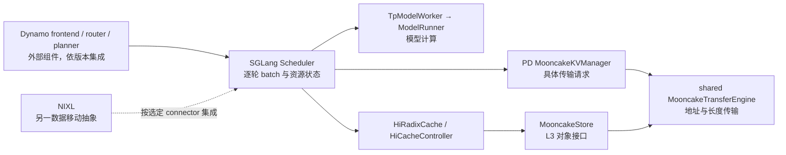
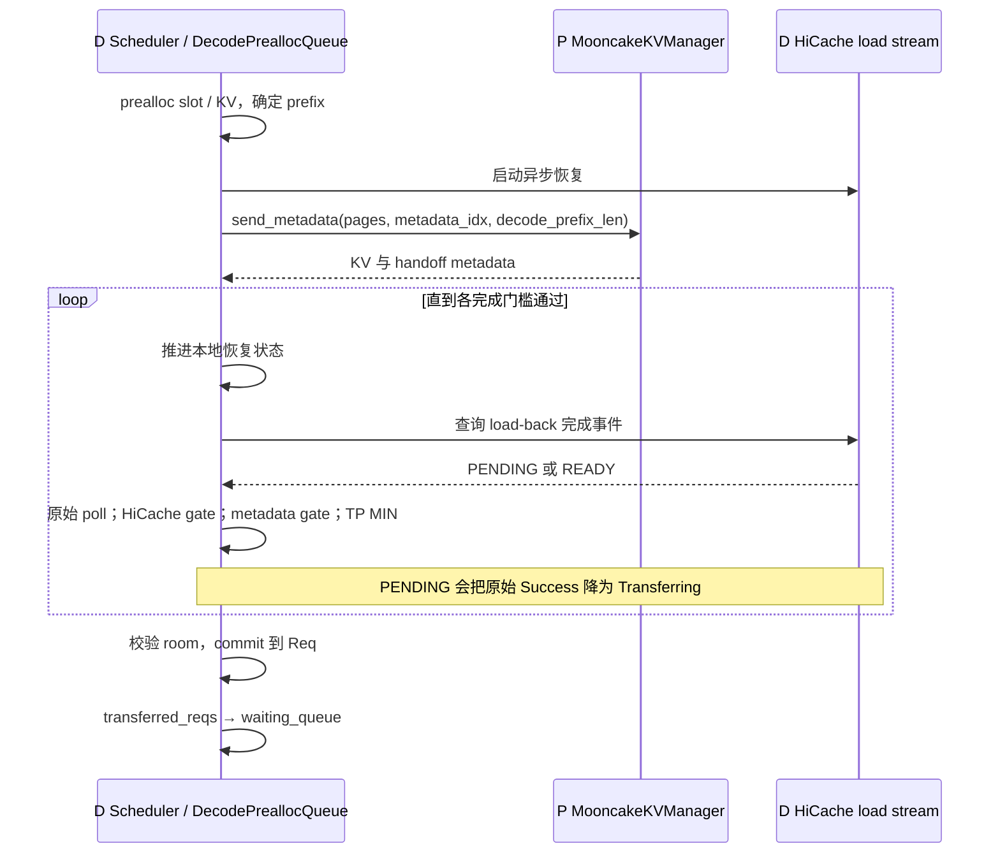
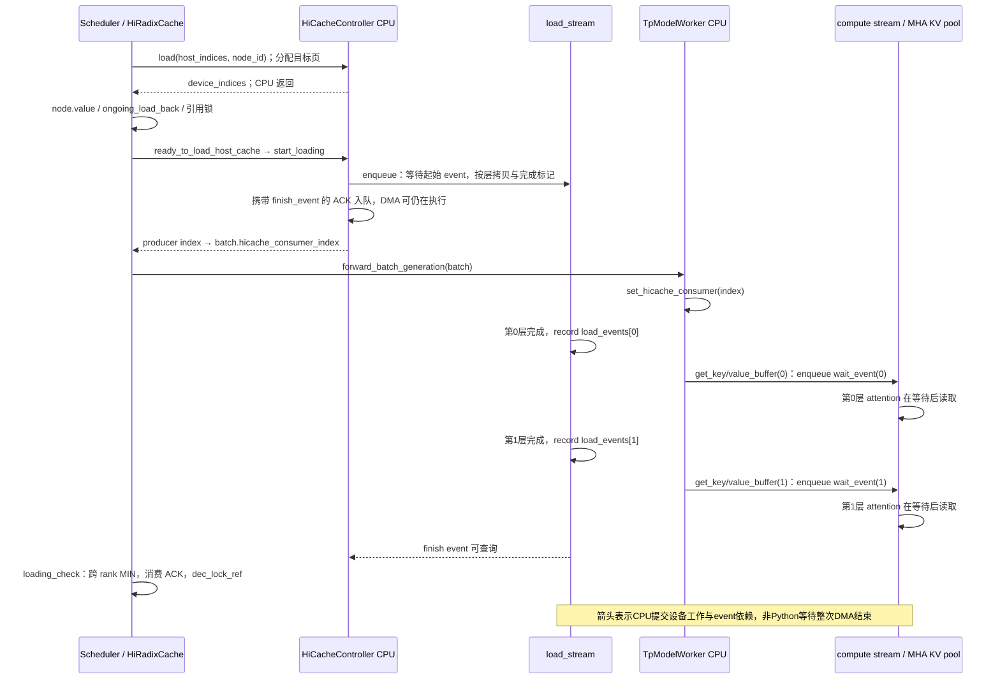

# 推理平台与大规模部署：指标、分离、缓存与运维

本册面向推理平台研发、大规模部署与生产性能岗位，共 16 题；编号与[完整题单](README.md)一致。先掌握 Q03、Q05 的测量口径，再沿 Q35–Q38 的数据交接理解路由、扩缩容和故障回收。引擎内部执行见[引擎研发册](engine-development.md)，计算与投机细节见[算法算子册](algorithms-kernels.md)。

源码核查基线为 SGLang `f01a0c7f97`，日期为 2026-10-15；本地可能含教学注释。默认讨论 CUDA、生成请求、普通稠密/GQA 模型；PD 的具体例子采用 Mooncake backend。MLA、SWA、混合状态模型、DP/PP/CP、投机和其他硬件的边界在有关题目说明。文中测量数字均为说明性例子，不是本次实验结果。源码链证明实现行为，官方文档证明外部组件的公开契约，“建议方案”表示面试中的设计选择，不表示当前仓库已经实现。

<a id="q03"></a>
## Q03 TTFT TPOT ITL 吞吐和 goodput 的统计口径

### 问题与追问

TTFT、TPOT、ITL、吞吐、goodput 分别衡量什么？一次响应带多个 token 时如何统计？

- 两组请求输出长度差异很大，平均 TPOT 和全局平均每 token 时间为什么不同？
- 开启投机解码或增大 stream interval 后，客户端 ITL 曲线应如何解释？

### 参考答案

TTFT 是从选定起点到第一个有效输出到达的时间；从客户端发请求开始，就包含网络、网关、排队、分词、prefill 和首段返回。TPOT 则把首段之后的请求耗时摊到剩余输出 token：当前 benchmark 对成功请求且实际输出数 n>1 计算 `(latency−ttft)/(n−1)`，再统计请求间分布。ITL 是相邻输出的间隔，必须声明观测位置。吞吐需区分成功请求数每秒、输入 token 每秒和输出 token 每秒；goodput 是满足预先约定 SLO 的有效工作量每秒，不能把失败或超时请求从分母中悄悄删掉。

例如请求输出 5 个 token，首个有效 chunk 在 100 ms 到达，其后两个 chunk 在 140、180 ms 到达且各含 2 个 token。若末个输出后立即结束，则请求 TPOT 为 20 ms，而可直接观测到的是两次 40 ms 的 chunk 间隔。把每段 40 ms 平均分给两个 token 可以得到一个摊分口径，却不能还原两个 token 的真实到达时刻；首个 chunk 也可能已有多个 token。投机一次提交多个 token、SSE 合并、代理缓冲都会产生这种现象，因此不能把客户端 chunk 间隔直接称为单步 GPU decode 延迟。

生产上我会保存每个请求的起止时间、首个有效 chunk 时间、实际 token 数、chunk 时间戳、错误和长度分桶；同时报告 p50/p95/p99 与 SLO 达标比例。假设 100 个完成请求中 80 个同时满足 TTFT 和 TPOT 门槛，窗口为 10 秒，则请求 goodput 为 8 req/s，门槛与分母窗口要写明。请求平均 TPOT与按 token 加权的整体平均不是同一统计量；重分词也未必逐 chunk 可加，所以使用服务器 usage 还是客户端重分词必须固定。GPU device timing、服务端逐步时间与客户端体验应并排分析，不能互相替代。

### 源码调用链与证据

```text
async_request_openai_completions(response stream)
  ├─ 非空 choices[0].text：首次写 output.ttft
  └─ 后续 chunk：写 output.text_chunks / output.itl
calculate_metrics(outputs)
  ├─ success 且 output_len > 1：追加请求级 TPOT
  └─ 特定 retokenized ITL 分支：按 chunk 重分词数摊分
      → BenchmarkMetrics 的均值及分位数 → 打印/结果文件
```

当前公式节选，教学注释说明筛选边界：

```python
# 每条成功请求分别计算；并非把所有请求耗时相加后除总 token。
if output_len > 1:
    tpots.append((outputs[i].latency - outputs[i].ttft) / (output_len - 1))
# 下面的 chunk 摊分是另一条统计分支，不能反推逐 token 到达时刻。
if use_retokenized_itl:
    for k, itl in enumerate(outputs[i].itl):
```

锚点：[客户端记录 chunk，serving.py:334](/Users/magician/PycharmProjects/sglang/python/sglang/benchmark/serving.py:334)、[serving.py:1087](/Users/magician/PycharmProjects/sglang/python/sglang/benchmark/serving.py:1087)、[serving.py:1100](/Users/magician/PycharmProjects/sglang/python/sglang/benchmark/serving.py:1100)、[serving.py:1215](/Users/magician/PycharmProjects/sglang/python/sglang/benchmark/serving.py:1215)。

### 生产实践追问

- stream interval 从 1 调成 8 后，ITL p99 变高：保留原始 chunk 时间和 token 数，核对 TTFT/TPOT、代理 buffering 与服务端 forward timing；验收是解释口径变化，不能直接认定算力退化。
- 新配置峰值输出吞吐增加 20%，但长请求超时翻倍：按原始到达数统计成功、拒绝、超时与 goodput，再按 ISL/OSL 分桶，决定是否具备上线收益。

### 学习检查点

- 为什么输出 n=1 的请求仍有 TTFT，却不能按当前公式产生 TPOT？
- 若一个 chunk 有 4 个 token，仅靠到达时间能否得到 4 个真实 ITL？缺少什么信息？

<a id="q05"></a>
## Q05 如何公平比较配置与推理引擎

### 问题与追问

如何公平比较两个配置或两个推理引擎？峰值 tokens/s 更高能否直接上线？

- 相同并发数是否意味着相同到达压力？缓存命中率如何控制？
- 候选方案的速度来自量化或少输出 token，怎样避免误判成调度优化？

### 参考答案

公平比较先固定业务契约：相同模型权重及 tokenizer/template、相同精度和采样、相同输入与输出长度分布、相同 GPU 预算及拓扑、相同成功与 SLO 标准，再分别寻找各方案在该约束下的配置。只固定 batch 或并发数不够，因为不同延迟会使闭环客户端产生不同到达率；只固定 QPS 也不够，1 个 32K prompt 与 1 个 128-token prompt 工作量不同。缓存冷启动和热命中必须分别测试，预热阶段应与计时窗口分离，同时记录引擎 commit、依赖版本、启动参数和实际生效配置。

当前入口是 `python -m sglang.benchmark.serving`。请求生成器可按有限 request rate 采样指数到达间隔，也有 trace timestamp 重放；并发上限可能使实际发出速率低于计划值，因此必须同时看计划到达、实际发送和完成速率。举例说 A 在并发 32 时 50 req/s，B 变慢后只产生 35 req/s，二者看似都稳定并不证明 B 扛得住 50 req/s。我会先用一致开放到达或相同 trace 扫描负载，再观察排队是否持续增长，并注明压测机、网络和连接池是否成为瓶颈。

上线判断应采用同 GPU 成本下的达标容量，而非单点峰值。比如 A 达到 10K output tok/s 但 TTFT p99 超限，B 只有 9K 却满足交互门槛，B 可能具有更高 goodput。性能测试还应配套输出正确性、超时/取消回收、长短请求混合以及重启后的恢复验证。若候选版本修改量化、speculation 或输出截断，需独立验证质量与实际生成长度，避免靠更少工作获得表面提速。对可疑差异做一次控制变量 A/B，并保留原始逐请求记录和 profiler 证据，直到收益能归因，才进入灰度。

### 源码调用链与证据

```text
serving.main：固定 random / numpy seed，构造输入请求
  → benchmark：先 warmup，再选择 get_request 或 trace scheduler
  → get_request：yield 请求，按到达模型等待
  → backend request function：执行并记录真实输出/错误
  → calculate_metrics：成功请求统计与完成数 → 结果文件
```

[serving.py:1023](/Users/magician/PycharmProjects/sglang/python/sglang/benchmark/serving.py:1023)、[serving.py:1400](/Users/magician/PycharmProjects/sglang/python/sglang/benchmark/serving.py:1400)、[serving.py:1458](/Users/magician/PycharmProjects/sglang/python/sglang/benchmark/serving.py:1458)、[serving.py:1934](/Users/magician/PycharmProjects/sglang/python/sglang/benchmark/serving.py:1934)。指标定义见 [Q03](#q03)，资源准入见[引擎 Q08](engine-development.md#q08)。

### 生产实践追问

- 热缓存下提升 40%、冷缓存下降 10%：用真实 prefix 重复比例和 worker churn 重放；验收是业务权重后的 goodput/成本收益，报告冷热两份结果。
- 两个引擎输出长度不同：固定长度测试检验纯系统成本，再用真实 EOS 和质量评估验证业务效果，报告两种目的，避免仅比较完成时间。
- 压测机 CPU 满：增加客户端能力或拆分负载产生端，核对实际到达率；不能把客户端限速当服务器容量。

### 学习检查点

- 为什么持续增长的 waiting queue 比短窗口平均吞吐更能暴露过载？
- 为什么重复发送完全相同的 prompt 不能代表普遍的在线服务负载？

<a id="q06"></a>
## Q06 SGLang Dynamo Mooncake NIXL 的职责与组合

### 问题与追问

SGLang、Dynamo、Mooncake、NIXL 分别解决哪层问题？哪些可以组合？

- 已用 SGLang gateway，为什么还可能引入 Dynamo？代价是什么？
- Mooncake Store 命中是否意味着 GPU 已能执行 attention？

### 参考答案

先按“谁决定算、谁安排实例、谁管理对象、谁搬字节”建立边界。SGLang runtime 接收 tokenized 请求，管理调度、KV 内存、模型执行和结果；本仓库也有独立 gateway，因此不能把 SGLang 缩成单个 CUDA kernel。Dynamo 则可把 SGLang 作为 backend，提供分布式 frontend、路由、部署协调和 Planner 等能力，也会涉及请求预后处理、取消及 KV 信息；它不替代引擎的逐轮 batch 与 attention 执行。组合前要选清 tokenization、入口和故障状态的责任，避免两个前端重复处理。

Mooncake 这个名字既指公开的系统架构，也指可单独使用的组件。在本仓库，两条直接相关接入是 PD 点对点数据面使用 Transfer Engine，以及 HiCache L3 backend 使用 Store。前者根据地址和长度搬数据，后者提供对象读写及位置等存储语义。NIXL 也是可独立集成的数据移动抽象，通过插件统一异构内存与存储；它不是一个自动管理 SGLang radix 语义的替代缓存。某个部署选择 NIXL 或 Mooncake 的具体路径，必须看该版本 connector 和 backend 能力，不能仅凭系统图宣称任意组合都可运行。

例如长 prompt 服务可让 Dynamo 把请求分派给 SGLang P/D worker，让当前 PD backend 执行传输，并让 SGLang HiCache 在需要时读 Store；但该组合必须实测版本、布局、metadata、取消和错误传播。Store 对象存在，只回答“某份缓存可取”，SGLang 仍要分配落点、恢复 GPU、等待事件并维护引用。建议先画一条实际部署链，标明每个组件输入、输出和失败回收方，再增加额外层。没有跨实例路由或扩缩容需求时引入更多协调层未必有收益，运维、可观测和版本适配成本也要纳入选型。

### 源码调用链与证据



当前 SGLang 交界：[scheduler.py:1593](/Users/magician/PycharmProjects/sglang/python/sglang/srt/managers/scheduler.py:1593)、[conn.py:257](/Users/magician/PycharmProjects/sglang/python/sglang/srt/disaggregation/mooncake/conn.py:257)、[parallel_state.py:1941](/Users/magician/PycharmProjects/sglang/python/sglang/srt/distributed/parallel_state.py:1941)、[mooncake_store.py:316](/Users/magician/PycharmProjects/sglang/python/sglang/srt/mem_cache/storage/mooncake_store/mooncake_store.py:316)。

外部概念流以官方材料为准，本仓库没有 Dynamo/NIXL 完整源码调用链：[Dynamo SGLang reference](https://docs.nvidia.com/dynamo/backends/sg-lang/reference-guide)、[Mooncake architecture overview](https://kvcache-ai.github.io/Mooncake/)、[NIXL overview](https://docs.nvidia.com/nixl/getting-started/overview/)。以上于 2026-10-15 访问，具体支持矩阵需匹配部署版本。

### 生产实践追问

- 引入新 router 后首 token 变慢：分别标记 frontend、路由排队、engine admission、prefill 和传输，验收是定位新增耗时与收益，不用总耗时猜责任方。
- 同时启用 Store 与 PD：证明两条路径的命中/传输分别发生，分别注入 Store miss 和 P/D 故障，检查是否错误地共享了请求状态或回收责任。

### 学习检查点

- 为何“使用了 Mooncake”不足以说明部署使用了分布式 KV 对象池？
- 为什么外部路由知道缓存位置，也不能代替 Scheduler 的 token 预算检查？

<a id="q35"></a>
## Q35 PD 分离的成本和适用负载

### 问题与追问

什么负载适合 PD 分离？为什么拆开后 TTFT 可能变差，整体仍可能有收益？

- 什么时候搬 KV 比重新执行 prefill 更贵？已有 prefix 命中如何改变判断？
- 分开后的 P 和 D 各自空闲，是否说明部署已经足够高效？

### 参考答案

PD 分离把输入处理和持续生成放进不同资源池，主要价值是减少两种执行阶段之间的干扰，并允许分别配置并行度、batch 与容量。长输入的 prefill 常有较大的并行计算，decode 则每轮推进少量 token、持续读取历史状态，具体瓶颈仍取决于模型与 batch。若长 prefill 频繁打断交互 decode，或者 P/D 需要不同硬件与扩缩容节奏，拆开可能提高满足 SLO 的容量。若输入短、并发低或单机混合调度已足够，分离增加控制和传输成本可能不划算。

以某请求为例，聚合模式 TTFT 可以分成入口与排队、prefill、首 token 返回；PD 模式还会增加 D 端预分配等待、P/D 握手、KV 移动和 D 端就绪门槛。假设原本 prefill 40 ms，新增控制和传输共 15 ms，即使 D 的连续生成更稳定，TTFT 也可能变差；这是示意数字，不能拿来给任何模型估速。判断是否值得应把命中后的剩余 KV 字节与有效带宽、固定控制开销、D 队列成本，与 D 重算 suffix 的成本比较。已有 L1/L2/L3 prefix 可减少传输范围，无法直接拿整段 prompt 的理论 KV 量当实际流量。

设计方案应先在固定总 GPU 和真实 ISL/OSL 分布下做聚合与分离对照，比较 TTFT/TPOT 分位数、goodput、P/D 队列、网络和 GPU 时间。P 空闲可能是 D 无空间接收，D 空闲可能是在等 P 或本地恢复；两边平均利用率并不能解释阻塞方向。容量配比也不能只按每请求单次耗时，需要计入 batch 服务率、缓存命中、网络争用和故障冗余。生产验收应包括高低峰、长短混合和单端故障，证明成本下降或 SLO 容量提高，而非仅证明能跨机器启动。

### 源码调用链与证据

```text
D Scheduler.process_decode_queue
  → DecodePreallocQueue.pop_preallocated：分配请求槽/KV，匹配本地前缀
  → kv_receiver.send_metadata：发送目标 page indices 与 decode_prefix_len
P MooncakeKVManager bootstrap thread：收到预分配通知
  → transfer worker：根据目标地址发送剩余 KV
D DecodeTransferQueue.pop_transferred：通过传输/metadata/恢复门槛
  → waiting_queue → prebuilt batch → 持续 decode
```

[decode.py:866](/Users/magician/PycharmProjects/sglang/python/sglang/srt/disaggregation/decode.py:866)、[decode.py:1099](/Users/magician/PycharmProjects/sglang/python/sglang/srt/disaggregation/decode.py:1099)、[conn.py:1603](/Users/magician/PycharmProjects/sglang/python/sglang/srt/disaggregation/mooncake/conn.py:1603)、[decode.py:2247](/Users/magician/PycharmProjects/sglang/python/sglang/srt/disaggregation/decode.py:2247)。交接正确性见 [Q36](#q36)，配比见 [Q41](#q41)。

### 生产实践追问

- 短输入业务拆分后 TTFT 涨、TPOT 不变：测握手固定开销和传输大小，尝试聚合池或条件分离；验收以达标成本比较，不能强推所有请求走 PD。
- 大量相同前缀时网络仍接近满载：核对实际 `decode_prefix_len`、发送 pages、模型/布局一致性与各层命中，验证是否真在发送增量。

### 学习检查点

- 为什么传输成本下降，不一定能改善 D 端无空闲 KV 导致的等待？
- 为什么一个长输入、短输出 workload 的最优 P:D 比例不能直接复用给短输入、长输出业务？

<a id="q36"></a>
## Q36 PD 交接的状态与完成门槛

### 问题与追问

P 到 D 究竟交接什么？为什么 transport 返回 Success 后还要检查其他条件？

- D 端何时发送目标 page 信息？HiCache 是否必须先恢复完成？
- 不同 TP rank 观察到传输完成的时刻不同，会发生什么？

### 参考答案

交接的不只是一个 KV 指针。D 需要知道当前请求、bootstrap room、目标页面和布局，以及 P 端完成 prefill 后的边界输出 token 和相关 metadata；启用 logprob、hidden 或其他状态时还存在相应负载。D 先预分配请求槽和 KV，告知 P 目的 pages 与本地可复用前缀，P 才能把需要的部分写进正确落点。对于当前 decode HiCache 路径，预分配后启动本地恢复，再发送 metadata，允许恢复和远端传输并行；不能说“先等 load 完才允许通知 P”。

例如 D 已有前 4K token 的可恢复 prefix，P 只传后续 2K。即使传输 backend 报告这 2K 已完成，D 若尚未把前 4K 搬回 GPU，仍不能执行完整 attention。另一个独立门槛是 handoff metadata 可见：当前 gate 检查 metadata buffer 的 room 字段非零，把尚未可见的原始 Success 降为 Transferring，并在 TP ranks 上做 MIN 归约。聚合后的 Success 已经过这些门槛；之后提交函数仍校验实际 room 是否等于预期，防止旧 buffer 或碰撞被当成本请求成功。

这些检查保护的是“数据齐全、身份一致、所有相关 rank 可以一致提交”的不变量。提交前若提前把请求放入 decode batch，会读到未恢复或不属于当前请求的数据；若只有一个 rank 继续，还可能造成 collective 次序分歧。当前成功路径将 metadata 和本地恢复状态提交到 Req，返回 transferred_reqs，Scheduler 才把它们加入 `waiting_queue`，再构造 prebuilt batch。失败路径须输出错误并回收预分配资源，因此排查时应分别记录 transport、metadata、HiCache 和 scheduler admission 的阶段，避免一个 Success 日志覆盖所有语义。

### 源码调用链与证据



节选自 metadata gate，教学注释强调这是非零门槛而非全部身份验证：

```python
# raw Success 还不能直接进入计算批。
actual_room = metadata_buffers.bootstrap_room[
    decode_req.metadata_buffer_index, 0
].item()
if actual_room == 0:
    polls[i] = int(KVPoll.Transferring)
```

[decode.py:1223](/Users/magician/PycharmProjects/sglang/python/sglang/srt/disaggregation/decode.py:1223)、[utils.py:116](/Users/magician/PycharmProjects/sglang/python/sglang/srt/disaggregation/utils.py:116)、[decode.py:1727](/Users/magician/PycharmProjects/sglang/python/sglang/srt/disaggregation/decode.py:1727)、[decode.py:1980](/Users/magician/PycharmProjects/sglang/python/sglang/srt/disaggregation/decode.py:1980)。HiCache gate 的具体封装见 [decode_hicache_mixin.py:155](/Users/magician/PycharmProjects/sglang/python/sglang/srt/disaggregation/decode_hicache_mixin.py:155)。

### 生产实践追问

- raw Success 后请求一直不进 decode：分别检查 metadata room、恢复状态与 consumer event、各 TP rank poll；验收是定位哪个门槛未过，而非简单增大 timeout。
- 重复 room 或旧 metadata 触发错误：保存 rid/room/buffer index 对应关系及分配释放时间，注入重复与取消竞态，确认错误请求不会进入成功队列。

### 学习检查点

- 为什么 `actual_room != 0` 与 `actual_room == expected_room` 是两种不同检查？
- 为什么 local HiCache restore 与网络传输可以并行，却必须在执行 attention 前汇合？

<a id="q37"></a>
## Q37 Mooncake Transfer Engine 和 Store 的区别

### 问题与追问

Mooncake Transfer Engine 与 Mooncake Store 的职责有何不同？

- 直接传输 KV 的部署，是否已经具备跨实例的对象查询和复用？
- Store GET 成功后，SGLang 还需要维护哪些状态？

### 参考答案

Transfer Engine 的核心任务是数据移动：注册内存、发现或连接对端，把源地址的一段字节送到目标地址，并报告操作状态。它不天然知道这段字节属于哪串 token、哪些 prefix 可复用、何时允许驱逐。Store 则在此之上提供对象管理语义，包括按 key 查找、分配和读取对象等能力。官方 Store 文档中的写入发布过程区分空间已分配、写入中和副本可读，说明对象存在与内容就绪也不是一个状态。不能把“有高速搬运能力”直接等同“已经有全局正确的 KV 缓存目录”。

在当前 SGLang，PD 的 MooncakeKVManager 获取共享 TE，把 pages 转成源/目标地址及长度，然后调用批量传输；请求握手和成功提交由 PD 层维护。另一条路径是 HiCache 的 MooncakeStore，它作为 L3 backend 被 cache controller 调用，数据需进入 host/GPU 层后才供模型读取。两条接入可以共存，并可能共享进程内 TE，但生命周期不同：一次 PD handoff 绑定在途请求，Store 对象可以跨多个请求继续存在。比如请求结束允许释放请求槽，却不意味着必须删除供其他请求复用的 L3 对象。

面试中我会以“只做 P→D 传输”与“跨实例长前缀复用”两个需求分别选型。前者重点验证注册、布局、目标页生命周期和完成通知；后者还要验证 key 的模型/版本/adapter 语义、对象状态、miss、淘汰及存储容量。Store 失败时能否重算属于上层策略，TE 失败是否污染落点必须按具体操作契约处理。引入对象池会增加 metadata 和缓存一致性的管理成本，只有重复前缀足够、取回成本优于重算时才可能有收益。上述收益判断是设计分析，需要真实命中与恢复时间证明。

### 源码调用链与证据

```text
PD：MooncakeKVManager.__init__ → get_mooncake_transfer_engine()
    → _transfer_data(session, [(src,dst,len)])
    → engine.batch_transfer_sync → PD poll/commit
L3：HiCacheController.attach_storage_backend
    → StorageBackendFactory.create_backend("mooncake")
    → MooncakeStore → MooncakeDistributedStore
    → 上层恢复及事件门槛 → GPU attention 可读
```

[conn.py:257](/Users/magician/PycharmProjects/sglang/python/sglang/srt/disaggregation/mooncake/conn.py:257)、[conn.py:590](/Users/magician/PycharmProjects/sglang/python/sglang/srt/disaggregation/mooncake/conn.py:590)、[cache_controller.py:475](/Users/magician/PycharmProjects/sglang/python/sglang/srt/managers/cache_controller.py:475)、[mooncake_store.py:368](/Users/magician/PycharmProjects/sglang/python/sglang/srt/mem_cache/storage/mooncake_store/mooncake_store.py:368)。

外部接口和概念分别核对官方 [Transfer Engine](https://kvcache-ai.github.io/Mooncake/design/transfer-engine/index.html)、[Mooncake Store](https://kvcache-ai.github.io/Mooncake/design/store/mooncake-store.html)、[SGLang HiCache integration design](https://kvcache-ai.github.io/Mooncake/design/hicache-design.html)。这些外部实现不伪装成本仓库调用链。

### 生产实践追问

- TE 微基准很快，但 Store 恢复很慢：拆分 key 查询、排队、L3→host、host→GPU 与事件等待，并统计命中长度，验收是明确瓶颈属于对象控制面还是搬运。
- 模型升级后复用旧对象：建议用不可混淆的模型/布局版本命名空间，故意查询旧对象，确认拒绝或 miss 后重算，不能用同 key 假定语义一致。

### 学习检查点

- 为什么共享同一个 TE，不意味着 PD 与 Store 可以共享同一套请求状态机？
- 为什么注册了 GPU buffer，仍不足以证明 prefix 复用正确？

<a id="q38"></a>
## Q38 HiCache 搬运事件引用锁和 ACK

### 问题与追问

HiCache 返回 GPU indices，为什么不代表内容已可读？写回为何需要锁和 ACK？

- `load_back` 先写 node.value，再完成 DMA，会不会马上读到未初始化内容？
- 某 rank 没有待写节点，是否可以跳过 ACK 的 collective？

### 参考答案

GPU indices 先回答“数据将住在哪里”，事件才回答“什么时候可以读”。HiCache 的恢复首先给目标页分配 device indices，并把它们写进 radix 节点、登记 ongoing load；真正搬运由 cache controller 的 load stream 分层执行。CPU 函数返回不等于异步 DMA 完成，所以执行侧必须根据 consumer index、layer done 或完成事件建立依赖。否则即使索引有效，attention 也可能读到旧请求残留或尚未写完的内容。这里要同时理解地址所有权与时间依赖，不能只看 tensor 已经创建。

例如某前缀在 host 上有 1024 token 的 KV。`load_back` 得到一组新 device 页，`start_loading` 合并操作、更新 producer index，向 load stream 入队起始等待、逐层拷贝和 finish event 标记；CPU 随即把携带事件的 ACK 放入队列，DMA 此时可能尚未完成。后续 `loading_check` 查询事件、做跨 rank 完成数量共识，并在消费 ACK 时确认完成，再解除 load-back 保护。树上的引用锁防止正在使用或搬运的节点被驱逐；写回同理，host indices 已分配不代表 GPU→host 已落稳。write-through 节点也要等 finish event 确认后才发布完成状态并释放锁，后续才能安全淘汰或进入存储备份。过早消费 ACK 会造成早释放，永不处理 ACK 又会使资源长期锁住。

多 rank 下还存在一致进度问题。当前 `writing_check`、`loading_check` 对可完成数量做 MIN 归约，再顺序处理 ACK；某 rank 暂时无本地操作也不能自行跳过必要的 collective，否则其余 rank 可能永久等待。正常模型执行、PD decode 本地恢复和其他缓存实现可能使用不同的事件接入，不能从一个 cache 类概括所有 backend。生产排查应同时观察 ongoing 表、ACK 队列、producer/consumer index、event 状态及锁计数，并区分“传输仍在跑”“事件已完成但未清理”“一处 rank 未参与同步”三种情况。

### 源码调用链与证据

本题选 `HiRadixCache + MHATokenToKVPool` 的 CUDA 恢复分支说明。cache registry 在 unified 开关、混合 SWA/SSM 或 DSA 等条件下会选其他 cache；逐层等待示例不应被当成所有 backend 的同一实现。



真实节选，教学注释强调完成后才释放恢复锁：

```python
ack = self.cache_controller.ack_load_queue.pop(0)
ack.finish_event.synchronize()
for ack_id in ack.node_ids:
    end_node = self.ongoing_load_back.pop(ack_id)
    self.dec_lock_ref(end_node)
# indices 返回与 finish_event 完成是两个不同时间点。
```

[hiradix_cache.py:1297](/Users/magician/PycharmProjects/sglang/python/sglang/srt/mem_cache/hiradix_cache.py:1297)、[cache_controller.py:782](/Users/magician/PycharmProjects/sglang/python/sglang/srt/managers/cache_controller.py:782)、[hiradix_cache.py:984](/Users/magician/PycharmProjects/sglang/python/sglang/srt/mem_cache/hiradix_cache.py:984)、[hiradix_cache.py:1019](/Users/magician/PycharmProjects/sglang/python/sglang/srt/mem_cache/hiradix_cache.py:1019)。正常计算的 runner 边界见[引擎 Q13](engine-development.md#q13)，PD 汇合门槛见 [Q36](#q36)。

实际消费端与选择 guard：[registry.py:104](/Users/magician/PycharmProjects/sglang/python/sglang/srt/mem_cache/registry.py:104)、[tp_worker.py:545](/Users/magician/PycharmProjects/sglang/python/sglang/srt/managers/tp_worker.py:545)、[memory_pool.py:2232](/Users/magician/PycharmProjects/sglang/python/sglang/srt/mem_cache/memory_pool.py:2232)、[cache_controller.py:80](/Users/magician/PycharmProjects/sglang/python/sglang/srt/managers/cache_controller.py:80)。`LayerLoadingEvent.wait` 调用当前设备 stream 的 `wait_event`；这是设备依赖，不是让 Python 同步等待整次恢复。

### 生产实践追问

- GPU 空闲但命中请求排队：观察 load queue、consumer event 和 host/device 配额，确定是提交、搬运还是完成通知阻塞；验收用同一请求的全阶段时间线。
- 运行几小时后可分配页持续下降：追踪 ongoing/ACK 长度与锁计数的增减，加入完成、取消和传输失败场景；不能仅用强制 flush 掩盖泄漏。
- TP2 偶发卡死而 TP1 正常：比对各 rank 进入 `writing_check` 的次数与 collective 序号，检验是否有条件分支跳过同步。

### 学习检查点

- 一个地址有效但内容未就绪，属于内存分配问题还是同步问题？应分别怎样证明？
- 为什么 ACK 完成后还要处理引用锁，而不能只删除 ACK 队列元素？

<a id="q39"></a>
## Q39 KV aware routing 的缓存与负载权衡

### 问题与追问

KV-aware routing 应总选 prefix 命中最多的 worker 吗？路由信息过期会怎样？

- 命中较长但排队严重的实例与无命中空闲实例，如何选择？
- 本仓库 gateway 的 cache-aware policy 是否等价于 Dynamo 的 KV 事件索引？

### 参考答案

路由目标应该是满足 SLO 的总成本，而不只是最长 prefix。命中减少的是待计算工作，无法抵消任意长的排队；某实例还可能没有足够 KV 空间或正在进行恢复。建议比较估计的队列时间、未命中 prefill 时间、缓存恢复/传输和当前 decode 负载，并对极端负载设置硬约束。举例说 A 命中 8K 但排队 300 ms，B 无命中却可在 100 ms 内完成 prefill，选 A 可能损害 TTFT；数字只为解释取舍，真实决策要用该模型的服务曲线。

必须区分信息来自哪里。当前本地 Rust `CacheAwarePolicy` 在 workers 已按 pool/model 过滤的前提下先检查负载失衡；失衡就选低负载，否则通过请求文本字符前缀树找历史关联 worker，并按 match ratio 选择。这个启发式不证明该 worker 的实际 KV 尚在：淘汰、重启或模型变更都可能使历史信息失效。Dynamo 的 KV-aware routing 则有公开的 KV 信息机制与自己的路由语义，不能把其外部目录直接套给本地 policy。无论目录多精确，引擎仍要执行实际 prefix match 和准入检查。

信息陈旧通常首先降低命中率与性能，但如果跨版本缓存身份校验缺失，也可能变成正确性问题。建议把模型版本、adapter 与布局纳入路由和缓存隔离边界，处理 worker 删除、事件丢失和目录重建，保留无命中重算或重新路由策略。扩容初期新 worker 冷缓存会使命中路由继续拥挤老实例，需观察热点与温度，而不是认为增加 Pod 自动均衡。验收应比较同一 trace 下的命中长度、排队、总计算、迁移开销、长尾和 goodput，并验证 worker 重启后不会把过期关联当成硬保证。

### 源码调用链与证据

```text
本地 CacheAwarePolicy::select_worker(workers, info)
  → healthy worker 集合；确定 pool/model tree_key
  → max/min load 失衡？是：select_worker_min_load
  → 否：文本 prefix_match_with_counts → 匹配比例门槛
  → 返回 worker index，并更新文本关联树
worker 实际 Scheduler / tree_cache 再做 prefix 与资源判断
```

```rust
// 本地规则先看负载失衡，缓存亲和不是绝对优先级。
let is_imbalanced = max_load.saturating_sub(min_load) > self.config.balance_abs_threshold
    && (max_load as f32) > (min_load as f32 * self.config.balance_rel_threshold);
if is_imbalanced {
    return self.select_worker_min_load(
        workers,
```

[cache_aware.rs:376](/Users/magician/PycharmProjects/sglang/sgl-model-gateway/src/policies/cache_aware.rs:376)、[cache_aware.rs:401](/Users/magician/PycharmProjects/sglang/sgl-model-gateway/src/policies/cache_aware.rs:401)、[cache_aware.rs:424](/Users/magician/PycharmProjects/sglang/sgl-model-gateway/src/policies/cache_aware.rs:424)、[scheduler.py:2995](/Users/magician/PycharmProjects/sglang/python/sglang/srt/managers/scheduler.py:2995)。Dynamo 外部概念单独参考官方 [Routing Concepts，v1.1.1](https://docs.dynamo.nvidia.com/dynamo/v1.1.1/components/router/routing-concepts)；该旧版本页面用于职责说明，不冒充本地当前实现。

### 生产实践追问

- 扩容后老实例仍满、新实例空闲：对比亲和命中与队列时间，建议先设负载保护及温和预热；验收是长尾下降，同时列出新增重算成本。
- worker 重启后路由仍说命中：用实例代次和事件/关联失效日志核对缓存真实长度，验证 miss 后可继续服务，不应依赖历史文本记录维持正确性。

### 学习检查点

- 为什么“总命中 token 最多”与“整个集群的 goodput 最大”并不等价？
- 文本前缀相同为什么还不足以证明 KV 可以跨模型版本复用？

<a id="q40"></a>
## Q40 Dynamo Planner 的扩缩容信号与反馈

### 问题与追问

Dynamo Planner 为什么需要推理特定信号？扩容后容量为何未必立刻增加？

- GPU 利用率很高但队列稳定，是否应该扩容？队列很长但引擎 GPU 很闲呢？
- 新 worker 启动、缓存预热和缩容在途请求应怎样进入控制回路？

### 参考答案

推理负载不是“每个请求成本相同”的普通请求计数。输入长度、输出长度、缓存命中、并发序列、已占 KV 和每轮接受 token 数都会改变服务能力；仅看 QPS 或 GPU utilization 无法判断新增请求多久完成。建议把入口到达与排队、P 的待处理 token、D 的并发与 KV、TTFT/ITL、worker 就绪状态和 GPU 预算一起纳入模型。比如 10 req/s 在短 prompt 时稳定，切成 32K prompt 后 P 队列可能持续增加，QPS 阈值却完全不变。

官方 Dynamo dev 文档把优化目标和扩缩容方法分开：默认 throughput 目标采用负载阈值，sla 目标才按具体 TTFT/ITL 目标使用性能模型和可选方法，不能笼统说“Planner 总是按 SLA 预测”。当前 SGLang 提供每轮 ForwardPassMetrics，经独立发布线程发送；其中含 scheduled 与 queued work，计时可能来自 device timer，也可能回退到主机时钟。引擎侧信号看不到所有路由器前置排队，因此入口积压还需单独观测。这些是公开接口与当前源码事实，具体字段和支持性必须匹配部署版本。

扩容建议执行后还要经历调度 GPU、镜像和权重加载、通信初始化、graph capture、健康验证与缓存变热，所以 desired replicas 不等于有效容量。建议先用 advisory 观察推荐值，再限制变化幅度、设置冷却和恢复预算，并在新实例可用后才计入服务率。缩容的排空是建议设计，不能冒充官方当前保证：本次访问的 dev 文档明确提醒 Planner 缩容可能终止在途请求。设计时应验证部署控制器的 drain 能力，否则保留最小副本、降低缩容激进程度，并把中断率计入成本。控制回路验收看 SLO、GPU-hours、振荡与失败恢复，不能只看副本数追随曲线。

### 源码调用链与证据

```text
当前 SGLang：SchedulerMetricsReporter._emit_forward_pass_metrics(batch)
  → 构造 ForwardPassMetrics(worker_id, dp_rank, wall_time,
                           scheduled_requests, queued_requests)
  → _FpmPublisherThread.publish → ZMQ PUB → 外部消费者
外部概念流：Dynamo 接收 FPM / traffic → Planner 给出副本建议
  → 部署 connector 执行动作 → worker readiness / 流量与SLO反馈
```

[metrics_reporter.py:959](/Users/magician/PycharmProjects/sglang/python/sglang/srt/managers/scheduler_components/metrics_reporter.py:959)、[metrics_reporter.py:986](/Users/magician/PycharmProjects/sglang/python/sglang/srt/managers/scheduler_components/metrics_reporter.py:986)、[forward_pass_metrics.py:73](/Users/magician/PycharmProjects/sglang/python/sglang/srt/observability/forward_pass_metrics.py:73)、[forward_pass_metrics.py:171](/Users/magician/PycharmProjects/sglang/python/sglang/srt/observability/forward_pass_metrics.py:171)。仓库没有 Dynamo Planner 的完整执行源码；目标/方法、advisory 与缩容限制见官方 [Planner dev overview](https://docs.nvidia.com/dynamo/dev/knowledge-base/modular-components/planner/overview)，按 2026-10-15 访问内容理解，不推广为所有版本保证。

### 生产实践追问

- 扩容后 TTFT 先变差：对齐 desired、scheduled、loaded、graph-ready、serving 五个时间点，检查冷缓存路由和启动争用；验收统计有效容量爬升时间。
- 扩缩反复振荡：用同一 traffic trace 重放 advisory，观察输入分桶、滞后和样本时效；调整滞回与最小驻留时间，同时核算 GPU-hours 与 SLO。
- router 排队但 FPM 很低：检查请求是否尚未分派到引擎、路由配额是否阻塞，避免让引擎负载信号掩盖入口需求。

### 学习检查点

- 为什么应该同时记录“请求开始数”和“请求完成数”，而不能只用完成速率估需求？
- 为什么预测出正确副本数，仍不足以保证突发流量期间不超时？

<a id="q41"></a>
## Q41 并行策略与 P D 配比如何选择

### 问题与追问

给定 GPU 数量、拓扑、输入输出分布与 SLO，怎样选择 TP/DP/PP/EP/CP 和 P:D 比例？

- 单模型放得下时，增加 TP 还是 DP 更可能改善吞吐？需要哪些测量？
- P 和 D 是否应使用相同并行度？投机解码会怎样改变配置空间？

### 参考答案

先用模型权重、KV 与临时空间确定可行布局，再在拓扑和 SLO 约束下优化。TP 切层内张量，可能减少每卡工作与内存，却增加每层通信；DP 复制服务副本，可扩大请求容量，但每个副本仍需放下模型及状态。PP 切层可容纳更大模型，需处理 stage 不均衡、流水空泡及跨 stage 的请求生命周期；EP 切专家，额外考虑 routing skew 和 all-to-all；CP 分散长上下文相关工作，也引入专门 attention 通信与布局。这里是职责模型，实际组合必须确认目标模型、backend 和 runtime guard 支持。

例如有 16 张 GPU、每机 8 张高速互联，模型在 TP4 时满足内存且单请求延迟合格，我会把“多个 TP4 副本”作为一个候选，与 TP8 等预算方案比较，而不是默认 16 卡都做 TP。P/D 可以分别选择并行度，但需验证 KV layout、head 分片和传输兼容，并测两端服务曲线。建议用在目标 SLO 下测得的 P 服务率 cP 与 D 服务率 cD 估算初始副本：到达率 λ 要分别小于 NP×cP 与 ND×cD；实际 batch、输出分布和缓存命中改变 cP/cD，不能用一次 forward 耗时直接算固定比例。

扩展配置时要先削减不可达组合。当前 dSpark 配置明确要求 CUDA、PP=1，DP attention 还要求特定 LM head、MoE backend 与 CP 限制；不能把普通 decode 能跑的并行组合视为投机也可用。上线方案还要预留故障和升级容量，记录每个 rank 的 KV 峰值、通信、P/D 队列和 tail latency。若 P 侧有余而 D 达到容量，就增加 D 或降低每请求状态压力；若网络已经饱和，再加 P 可能只制造更多待传 KV。最佳比例是 workload 与拓扑上的实测结果，而不是框架名称决定的常数。

### 源码调用链与证据

```text
ServerArgs / 模型配置 → initialize_model_parallel(各并行规模)
  → TP / PP / attention-CP / MoE 等 group 与 rank
  → worker 与模型层采用相应 group
  → PD 预分配与传输按当前布局/本地prefix组织数据
  → 用两端队列与SLO校正部署方案（此优化流程为建议）
```

[parallel_state.py:2175](/Users/magician/PycharmProjects/sglang/python/sglang/srt/distributed/parallel_state.py:2175)、[model_config.py:1079](/Users/magician/PycharmProjects/sglang/python/sglang/srt/configs/model_config.py:1079)、[decode.py:1090](/Users/magician/PycharmProjects/sglang/python/sglang/srt/disaggregation/decode.py:1090)、[speculative_hook.py:278](/Users/magician/PycharmProjects/sglang/python/sglang/srt/arg_groups/speculative_hook.py:278)。张量与通信的推导见[算法 Q27](algorithms-kernels.md#q27)，兼容边界见[引擎 Q20](engine-development.md#q20)。外部独立 P/D 扩容职责见官方 [Choose a Planner Mode](https://docs.dynamo.nvidia.com/dynamo/dev/knowledge-base/modular-components/planner/choose-a-planner-mode)。

### 生产实践追问

- TP8 单请求更快但总吞吐更低：固定总卡数比较副本数量、batch 区间、通信占比与 goodput，给出 SLA 约束下的选择。
- 长输出占比从 10% 升到 50%：重测 D 的 KV 及服务率，观察 P/D 队列是否失衡；验收是新分布下稳定队列与冗余预算。
- 希望 dSpark+PP 或 CP：先检查当前 guard 和相应测试，明确不可达配置，不能以普通推理结果外推。

### 学习检查点

- 为什么每卡显存下降不代表每请求延迟或集群成本一定下降？
- 为什么需要比较同 GPU 总预算的两组布局，而不是只比单个 worker？

<a id="q42"></a>
## Q42 TCP RDMA 与真实 PD 的验证层级

### 问题与追问

TCP 正常、RDMA 失败说明什么？传输微基准通过又能证明什么？

- 相同主机 CPU buffer 传输成功，是否足以证明 GPU KV 可传？
- 什么证据才可以称为“真实 PD 端到端通过”？

### 参考答案

TCP 正常、RDMA 失败首先提供一个可缩小范围的对照，不直接给根因。若应用请求、版本、数据大小和内存类型保持一致，差异更值得在 RDMA 注册、HCA 选择、GPU/NIC 拓扑、权限、网络配置和 transport 实现中检查；但换 transport 时如果同时换了负载或 fallback 路径，这个结论也会变弱。端口能连只说明某条控制连接通，不说明目标 GPU buffer 注册成功，更不说明 engine 中的 pages、metadata 与提交顺序正确。

建议按五层验收：环境和构建配置；目标内存类型上的 transport 组件测试；真实通信 group/跨机并发条件；应用 P/D 交接；完整生成正确性与稳定性。例如 DRAM→DRAM 微基准成功后，再用同 GPU、NIC、消息尺寸测 VRAM→VRAM，记录注册、路径、字节数与完成状态；即便如此也只证明该组件形状，尚未覆盖 SGLang 的 page 映射、TP rank 一致性、首 token metadata、HiCache 和取消竞态。单机 TCP、单机 RDMA、跨机 RDMA 是不同证据，不应混成一个“PD 已通过”。

真实 PD 验收至少需要观察请求进入 P/D、D 分配目标页、P 实际发送非零 KV、D 通过 metadata/恢复门槛并提交，最后连续生成与基线相符。用同请求关闭或开启 prefix/HiCache/投机进行控制变量比较，定位新增路径；长时间混合负载还要看传输错误、超时、资源平衡和取消回收。当前 wrapper 支持 `MC_FORCE_TCP=1` 的控制，但环境变量或启动日志只证明配置意图，实际数据路径需用 transport 记录、计数和 trace 确认。答题时应先声明已经证明哪层，再列出尚未覆盖的形状。

### 源码调用链与证据

```text
MooncakeTransferEngine.__init__
  → MC_FORCE_TCP 分支 / GPU→IB device 选择 → initialize
  → register / batch_register：注册实际 buffer
MooncakeKVManager._transfer_data → batch_transfer_sync
DecodeTransferQueue.pop_transferred → metadata/restore gate → commit
```

[mooncake_transfer_engine.py:105](/Users/magician/PycharmProjects/sglang/python/sglang/srt/distributed/device_communicators/mooncake_transfer_engine.py:105)、[mooncake_transfer_engine.py:143](/Users/magician/PycharmProjects/sglang/python/sglang/srt/distributed/device_communicators/mooncake_transfer_engine.py:143)、[conn.py:590](/Users/magician/PycharmProjects/sglang/python/sglang/srt/disaggregation/mooncake/conn.py:590)、[decode.py:1929](/Users/magician/PycharmProjects/sglang/python/sglang/srt/disaggregation/decode.py:1929)。外部 transport 和 GPU 注册条件见官方 [Mooncake Transfer Engine](https://kvcache-ai.github.io/Mooncake/design/transfer-engine/index.html)，这不替代运行环境的实际观测。

### 生产实践追问

- RDMA 微基准通过而服务失败：对齐 GPU buffer 类型、大小、HCA、进程权限、并发和库版本，逐步重现；验收是同形状组件与应用 trace 能连续对应。
- 请求得到正常文本却没有 KV 传输：检查是否聚合、fake backend、全命中或重算 fallback，必须观察真实发送字节和 D commit，不能只凭接口成功。
- TCP 成功而 RDMA 超时：保留相同请求做一次 A/B，区分 bootstrap 控制阶段与传输阶段；若尚未发送 pages，先按 [Q50](#q50) 排查。

### 学习检查点

- 为什么一次网络带宽测试不能证明流式生成正确性？
- 为什么应该报告“跨机 VRAM 组件通过”，而不是把它直接写成“生产 PD 验证通过”？

<a id="q43"></a>
## Q43 多机 hang 的 rank 和通信排查

### 问题与追问

多机推理 hang，如何区分通信慢、慢 rank 和 collective 次序不一致？

- Python 栈都停在 all-reduce，是否证明网络坏了？
- TP1 正常而 TP2 卡死，如何缩小到首个状态分歧？

### 参考答案

首先保存所有相关 rank 的同步时间窗口、进程/设备栈和请求状态，区分“仍有进度但很慢”与“进度停止”。同一个 collective 的完成取决于最慢参与者；某 rank 可能尚在预处理、I/O、异常或不同 batch 分支，其他 rank 的 all-reduce 等待只是结果，不是网络根因。建议记录每次通信的 group、序号、操作、shape、dtype，以及进入/退出时间，再对照 scheduler forward 计数、batch mode 和请求集合，找最早不一致的地方，而非只看最后一条 NCCL 日志。

若各 rank 到达同一 collective 且参数一致，通信时间随消息尺寸/链路变化、系统仍有缓慢进度，才更支持带宽、链路或拓扑问题。若一个 rank 迟迟没进入，应追踪其 CPU/GPU 执行、page restore、事件或资源等待；若不同 rank 出现不同序号或某侧跳过调用，首先修复控制流。当前 HiRadixCache 的 ACK 检查就是具体例子：本地 ongoing 写回数量可以不同，但所有 rank 仍需进入完成数量的 MIN 归约；基于本地“没有操作”直接跳过会破坏 collective 序列。

生产操作建议先保留证据，再做最小重放：固定一组请求与随机性，必要时分别关闭 graph、overlap、投机或 HiCache，一次只改变一个因素。关闭某功能后不挂仅证明触发条件，需要继续定位到哪次写入使后续 rank 分歧。watchdog 可以暴露 forward 计数未推进并转储栈及 pool 信息，但 timeout 本身不是故障分类。修复验收应包含原始负载、原并行规模、重复运行与资源状态检查，既确认不挂，也确认没有通过跳过正确性步骤或降低工作量换取完成。

### 源码调用链与证据

```text
Scheduler.init_watch_dog... → create_scheduler_watchdog
  → WatchdogRaw 读取 scheduler.forward_ct / 当前 batch 活跃状态
  → 超时：dump pool/batch + pyspy_dump_schedulers
例：HiRadixCache.writing_check
  → 每 rank 统计本地完成数 → MIN all_reduce → 一致数量消费ACK
```

[scheduler.py:1148](/Users/magician/PycharmProjects/sglang/python/sglang/srt/managers/scheduler.py:1148)、[invariant_checker.py:467](/Users/magician/PycharmProjects/sglang/python/sglang/srt/managers/scheduler_components/invariant_checker.py:467)、[watchdog.py:134](/Users/magician/PycharmProjects/sglang/python/sglang/srt/utils/watchdog.py:134)、[hiradix_cache.py:996](/Users/magician/PycharmProjects/sglang/python/sglang/srt/mem_cache/hiradix_cache.py:996)。并行 group 创建见[算法 Q27](algorithms-kernels.md#q27)，overlap 状态边界见[引擎 Q17](engine-development.md#q17)。

### 生产实践追问

- 一个 rank 在 load event、其余在 collective：先还原这个 event 的 producer 与 consumer，核对首个缺失记录；验收是所有 rank 以同样顺序推进，而不是全局加同步掩盖竞态。
- 多节点带宽波动引发慢请求：比较同消息大小通信微基准、拓扑和慢 rank 时间线，说明应用 stall 与链路退化是否同一时间发生。
- 扩大 timeout 后跑通：测量稳态服务时间是否已违约，判断是合法长任务还是无界等待，不能把更长 timeout 当根治。

### 学习检查点

- 为什么多个 rank 都停在通信 API 不能独立证明故障发生在通信库？
- 如何证明一个“跳过空队列”的优化在所有 rank 上仍保持 collective 次序？

<a id="q44"></a>
## Q44 传输中取消请求的安全回收

### 问题与追问

用户在 KV 传输中取消请求，目标页可以立刻归还 allocator 吗？

- 标记请求 Failed 与保证远端写入停止，是不是同一件事？
- waiting、running、prealloc、transfer 和本地恢复中的请求应怎样分别处理？

### 参考答案

不能仅凭用户已取消或本地状态变 Failed 就立即复用目标页。只要远端 DMA、拷贝流或回调仍可能访问这些页，allocator 把地址分给新请求就可能让旧传输覆盖新数据。需要先终止后续调度，再让相关操作确认完成、取消或隔离，最后释放引用和页面；具体哪种完成契约可用取决于 backend。取消是跨组件协议：客户端连接消失、Tokenizer 状态清理、Scheduler 请求终止、P/D 通知及设备工作结束是不同事件，必须分别找到拥有资源的组件。

例如 D 正在接收旧请求 A 的 KV，取消后把 page 7 立即分给 B，即便 B 的 metadata 身份正确，A 的晚到写入仍可能损坏其内容。建议方案是让页面进入不可再调度但仍受保护的 draining 状态，携带 request/room/代次，等 backend 确认不再访问后归还；若 backend 无法细粒度撤销，宁可等相关传输结束或隔离故障 session，也不能只发一个 best-effort 通知便声称安全。这个生命周期建议不是对当前实现的额外保证，更不是仅凭静态代码认定存在运行时缺陷。

当前源码体现了不同状态的处理：waiting 请求直接移出并通知 tokenizer；running 请求设置 `to_finish`，复用结果处理路径收尾；D 的 prealloc/transfer 队列调用 receiver.abort，随后由失败处理回收预分配 KV、清理 receiver 和 metadata。Common receiver 的 abort 会写 Failed 并尽力通知 P，但这个控制面片段本身不能证明所有在途 DMA 已被排空。完整审计还须读具体传输任务和内存注册生命周期。生产验收应在不同阶段高频取消，随后强制地址复用并检查新请求输出、pool 平衡与旧任务残留，才足以说明回收安全。

### 源码调用链与证据

```text
TokenizerManager.abort_request(rid) → _dispatch_to_scheduler(AbortReq)
Scheduler.abort_request
  ├─ waiting：移除 / 释放关联资源 / 通知 tokenizer
  ├─ running：req.to_finish = FINISH_ABORT → 结果处理 release_kv_cache
  └─ D prealloc/transfer：kv_receiver.abort → 状态 Failed，尽力通知P
DecodeTransferQueue.pop_transferred 失败分支
  → release_kv_cache(is_insert=False) → receiver.clear → metadata槽回收
注意：还需另证具体backend在途访问已结束，以上控制链不能单独证明。
```

真实控制面节选：

```python
# 设置失败状态不等于这个片段展示了 transport 的排空屏障。
self.kv_mgr.update_status(self.bootstrap_room, KVPoll.Failed)
self.conclude_state = KVPoll.Failed
if (
    not self.abort_notified
    and hasattr(self, "bootstrap_infos")
    and self.bootstrap_infos is not None
):
    self._send_abort_notification()
```

[tokenizer_manager.py:1776](/Users/magician/PycharmProjects/sglang/python/sglang/srt/managers/tokenizer_manager.py:1776)、[scheduler.py:4152](/Users/magician/PycharmProjects/sglang/python/sglang/srt/managers/scheduler.py:4152)、[common/conn.py:1428](/Users/magician/PycharmProjects/sglang/python/sglang/srt/disaggregation/common/conn.py:1428)、[decode.py:1968](/Users/magician/PycharmProjects/sglang/python/sglang/srt/disaggregation/decode.py:1968)。已结束请求如何保留共享前缀见[引擎 Q12](engine-development.md#q12)。

### 生产实践追问

- 一万个随机阶段取消后显存增长：分别统计 request slots、KV、metadata、radix refs、prefetch 与注册 buffer，验收长期达到平衡而非只看进程存活。
- 取消后偶发错 token：记录目标 page 地址/代次、旧传输完成时间与新请求复用时间；验收证明最后一次旧访问早于复用，或存在有效隔离。
- 客户端重试导致两份计算：建议业务幂等标识与受控重试预算，并区分已开始流式输出后的重放语义，防止自动拼接两次结果。

### 学习检查点

- 为什么停止 Python 请求生成器不足以证明 GPU/网络已不再访问其 buffer？
- 为什么取消一个请求不能直接释放其他请求也引用的 prefix 页？

<a id="q45"></a>
## Q45 模型与引擎的滚动升级和回滚

### 问题与追问

如何滚动升级模型或引擎版本？readiness 应检查到哪一步？

- 权重加载成功而 graph capture 或 PD 传输未验证，可以接生产流量吗？
- tokenizer、adapter、cache layout 或 target/draft 变化时，哪些缓存必须隔离？

### 参考答案

建议先定义一次可回滚的发布单元：模型权重和配置、tokenizer/template、量化、target/draft 配对、引擎与 kernel/通信依赖以及启动参数，全部有不可变版本。蓝绿或分批新增实例时，新版本先独立初始化、验证，再少量引流；旧版本保留直到新版本达标且在途请求处理完。只替换镜像标签、不知道实际加载哪套权重与依赖，会让性能和正确性回归难以归因。模型参数变化还会改变 KV 语义，不能因服务名字相同而沿用旧对象。

readiness 应与准备接收的流量契约一致。假设实例要承接 graph+投机+PD 请求，应至少完成对应模型和 draft 加载、通信初始化、图档位准备、真实小请求及必要传输/提交检查；HTTP 健康端点返回成功只是其中一项。重流量预热会影响老服务，因此建议限速预热并记录加载、capture、首请求和稳定服务时间。升级必须控制缓存命名空间与路由 pool，确保旧 metadata、共享 Store 对象、adapter 与新版本不被错误混用，兼容时也需给出明确版本证明。

当前 SGLang 有在线权重更新锁与 cache flush 接口，但它们不等于整个集群已经具备滚动升级事务。TokenizerManager 用 writer lock 协调更新，Scheduler 侧更新 target、必要的 draft，并在要求时 flush cache；某一组件成功不自动证明其余副本和外部存储一致。建议灰度同时观测输出正确性、SLO、错误、取消和资源平衡，设置停止与回滚条件；回滚要恢复对应缓存隔离与路由，而不是只切回镜像。若中途取消/重算引发外部重试，还需定义已输出 token 的请求能否重放，避免重复计费或拼接错误。

### 源码调用链与证据

```text
TokenizerManager.update_weights_from_disk
  → 可选 abort_all_requests
  → model_update_lock.writer_lock（已暂停时按分支处理）
  → 等待 scheduler 更新结果 → 成功后更新 weight_version
Scheduler WeightUpdater.update_weights_from_disk
  → tp_worker.update_weights_from_disk → 可选 draft_worker更新
  → flush_cache_after_weight_update（请求要求时） → 返回更新结果
集群灰度、排空与回滚为部署建议，不能从上述单实例接口推导。
```

[tokenizer_manager.py:1816](/Users/magician/PycharmProjects/sglang/python/sglang/srt/managers/tokenizer_manager.py:1816)、[weight_updater.py:103](/Users/magician/PycharmProjects/sglang/python/sglang/srt/managers/scheduler_components/weight_updater.py:103)、[weight_updater.py:110](/Users/magician/PycharmProjects/sglang/python/sglang/srt/managers/scheduler_components/weight_updater.py:110)、[scheduler.py:3966](/Users/magician/PycharmProjects/sglang/python/sglang/srt/managers/scheduler.py:3966)。外部 worker 健康和生命周期能力应核对所部署版本的 [Dynamo SGLang reference](https://docs.nvidia.com/dynamo/backends/sg-lang/reference-guide)。模型加载契约见[引擎 Q19](engine-development.md#q19)。

### 生产实践追问

- 新版本短请求正确、长请求错：将长上下文、量化、graph 档位和投机组合纳入 readiness 后的灰度矩阵；达到错误阈值即停止引流，保留失败样本。
- 更新 target 成功而 draft 失败：确认接口返回与运行中实际版本，停止新请求进入不一致实例；验收恢复成一套可核验的配对版本。
- 回滚后 cache 命中率下降：区分正常冷缓存与错误 namespace，观测恢复时间、goodput 和额外网络；不能为命中率绕过版本隔离。

### 学习检查点

- 为什么“能加载权重”与“具备承接生产流量的 readiness”是两个门槛？
- 为什么服务名相同不能作为跨版本 KV 复用的充分条件？

<a id="q46"></a>
## Q46 多租户长请求的预算和背压

### 问题与追问

一个租户的长请求拖慢全站，限 QPS 为什么可能没用？如何做背压？

- 只限制活跃请求数，如何被长上下文或长输出绕过？
- 平台公平调度与引擎 token/KV admission 应如何衔接？

### 参考答案

QPS 只限制到达次数，不限制每次计算与驻留成本。一个租户每秒 1 个 128K 输入、8K 输出请求，可能比另一个每秒 10 个短请求消耗更多 prefill 工作、KV 和持续 decode 时间；单请求还可能占住资源很久。所以需要按输入 token、允许输出、活跃 KV、在途请求、队列等待和估计 GPU 时间建立预算，并把模型、缓存命中与精度影响纳入成本估计。预算要保护全局容量，也要限制单租户占用；“GPU 还没 OOM”不是继续接收所有请求的充分条件。

建议采用分层背压：入口验证最大输入/输出并按租户发放 token 或成本配额，有限队列保留 deadline；router 只把预算允许的工作分配给可接收实例，引擎仍做真实 slot/token/KV 准入。排队过久或预算不满足时明确拒绝，而非无限积压；重试带退避与上限，避免失败流量放大。例子中可给交互租户保留最低份额，让低优长请求分块或进入独立池，但这属于平台设计。chunked prefill 限制一次工作块不自动保证跨租户公平，总耗时与多轮调度仍须验证。

当前 Scheduler 已有请求队列上限、等待超时和可配置优先级：队列满默认拒绝新请求，优先级开启时可比较并替换低优等待项；这不等于当前实现已经提供完备的租户 token 配额。平台应把这些引擎信号反馈到入口预算，防止 router 队列与 engine 队列双重膨胀。公平策略还会牺牲部分缓存亲和或整体吞吐，需声明目标是最低份额、等待上限还是特定 SLO。验收应混合至少两个租户，展示吞吐、等待和错误分布，并在取消与超时后证明预算返还，不能只报告全站平均延迟。

### 源码调用链与证据

```text
建议入口：tenant admission / deadline / 成本预算
  → router有限队列 → SGLang请求准入
Scheduler._abort_on_queued_limit
  ├─ 未超上限：return False → 可继续进入waiting queue
  └─ 超上限：默认拒绝新请求；优先级分支可替换等待请求
      → AbortReq + 503 → tokenizer / client
Scheduler._abort_on_waiting_timeout → 清理过期等待项及prefetch关联
```

节选说明当前上限统计的是请求数量：

```python
# 队列长度检查不是 tenant token/KV 配额。
if (
    self.max_queued_requests is None
    or len(self.waiting_queue) + 1 <= self.max_queued_requests
):
    return False
```

[scheduler.py:2520](/Users/magician/PycharmProjects/sglang/python/sglang/srt/managers/scheduler.py:2520)、[scheduler.py:2531](/Users/magician/PycharmProjects/sglang/python/sglang/srt/managers/scheduler.py:2531)、[scheduler.py:2567](/Users/magician/PycharmProjects/sglang/python/sglang/srt/managers/scheduler.py:2567)、[scheduler.py:3107](/Users/magician/PycharmProjects/sglang/python/sglang/srt/managers/scheduler.py:3107)。单轮 token admission 与 chunk 边界分别见[引擎 Q08](engine-development.md#q08)、[引擎 Q09](engine-development.md#q09)。

### 生产实践追问

- 低 QPS 租户占满 KV：统计每租户活跃序列、KV token-seconds 与输出上限，建议限制驻留预算；验收交互租户的最低服务份额。
- 拒绝后客户端立即重试：跟踪原始业务请求与尝试次数，施加重试预算和退避，验证服务器 goodput 不被重试风暴吞没。
- 长请求已取消但租户额度不返还：把额度释放与终止确认关联，分别核对入口、router、engine 资源，确保重复完成通知不会双重返还。

### 学习检查点

- 为什么相同 QPS 可以产生完全不同的 KV 驻留压力？
- 为什么只让每次 prefill 更短，仍不能自动证明租户公平性？

<a id="q50"></a>
## Q50 Prefill 已完成但 bootstrap 超时的定位

### 问题与追问

P 侧 Bootstrapping 超时，但日志显示 Prefill 已算完。是否证明 RDMA 有问题？

- P 已经生成首 token，为什么仍可能没有 D 的目标 pages？
- 先看 D 端哪些队列和预算，才决定检查传输设备？

### 参考答案

不能这样证明。Bootstrapping 阶段重点是 P 是否收到 D 的 KV 目标信息，当前 timeout 提示也明确指向未收到 decode 侧 KV indices。prefill 算完只说明 P 完成了模型计算，不说明 D 已预分配目标页、发送通知，更不说明数据传输已开始。当前还有 optimistic prefill 分支，允许在仍处于 Bootstrapping 时先推进计算；因此日志里“模型完成”与“握手未完成”可以同时成立。先依据同一 rid 和 bootstrap room 的状态时间线确认阶段，不能拿两个不同请求的日志拼成因果。

例如 D 的请求槽已满、metadata buffer 无空位，或 KV/本地恢复预留预算不足，`pop_preallocated` 会暂不推进到 `send_metadata`。P 即使已经算好，仍不知道向哪里写；此时调整 RDMA 参数未必相关。decode HiCache 的 prefix 匹配与恢复预留会影响准入，但 load 完成不是发送通知的前置条件：当前是 prealloc 后启动异步 prefetch，再发送 metadata；本地恢复在 D 提交前汇合。还要检查控制地址、端口、room、rank 映射及 scheduler polling 是否推进，不能把所有等待都归为网络数据面。

建议先在 P 记录 prefill 起止、收到目标索引、开始/完成发送，在 D 记录排队、预分配、metadata 发出、raw poll、metadata/restore gate 和最终 commit。若 D 尚未发送目标信息，重点查容量、回收和控制面；若已发送但 P 未收到，查握手地址及进程状态；只有实际传输已提交后失败，才进一步沿注册、HCA 和 RDMA 数据面验证。增大 timeout 可以容纳合法慢排队，但会改变 TTFT 与资源占用，必须结合 SLO；它既不能证明根因已修，也不能把一个无界等待变成正确服务。

### 源码调用链与证据

```text
P PrefillBootstrapQueue.pop_bootstrapped：仍Bootstrapping且允许optimistic？
  → 先运行prefill；等待目标通知仍可能继续
D DecodePreallocQueue.pop_preallocated：slot / metadata / KV预算门槛
  → _pre_alloc → _start_hicache_prefetch → send_metadata
P bootstrap thread 收通知：Bootstrapping → WaitingForInput
  → 传输开始 → D raw/gated poll → commit
P CommonKVSender._check_bootstrap_timeout：超时写Failed（阶段证据）
```

当前乐观执行节选，教学注释说明不能由 prefill 完成反推握手成功：

```python
elif poll == KVPoll.Bootstrapping:
    if (
        req.prefill_attempt_count
        < self.scheduler.server_args.optimistic_prefill_attempts
        and not req.is_retracted  # engine paused
    ):
        # 后续会检查metadata buffer，再允许该请求先做prefill。
```

[prefill.py:408](/Users/magician/PycharmProjects/sglang/python/sglang/srt/disaggregation/prefill.py:408)、[decode.py:961](/Users/magician/PycharmProjects/sglang/python/sglang/srt/disaggregation/decode.py:961)、[decode.py:1223](/Users/magician/PycharmProjects/sglang/python/sglang/srt/disaggregation/decode.py:1223)、[common/conn.py:1143](/Users/magician/PycharmProjects/sglang/python/sglang/srt/disaggregation/common/conn.py:1143)。P 端具体接收线程见 [conn.py:1603](/Users/magician/PycharmProjects/sglang/python/sglang/srt/disaggregation/mooncake/conn.py:1603)。

### 生产实践追问

- D 一直有 prealloc queue 但零发送：记录 req slots、metadata slots、可分配 KV 与 reserved restore tokens，核对队头阻塞及回收，验收能解释是哪条 guard 拦住。
- P 收到目标页后才超时：明确当前是 bootstrap timeout、transfer timeout 还是 engine watchdog；沿实际阶段查注册与字节传输，禁止混用三种 timeout 名称。
- 冷缓存时更易失败：区分 D 准入/恢复与 Store/网络耗时，做关闭 HiCache 的同负载 A/B；仅将其作为触发条件证据，再追到具体等待。

### 学习检查点

- 为什么“Prefill 已完成”不证明“KV 已开始传输”？
- 在 D 尚未分配 metadata slot 的情况下，应优先排查 RDMA 数据面还是 D 队列与回收？为什么？
