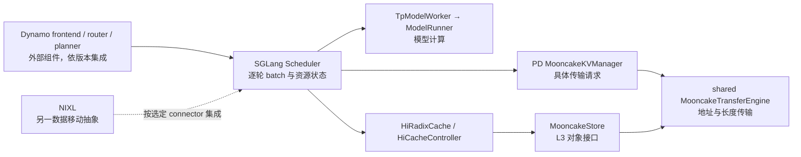
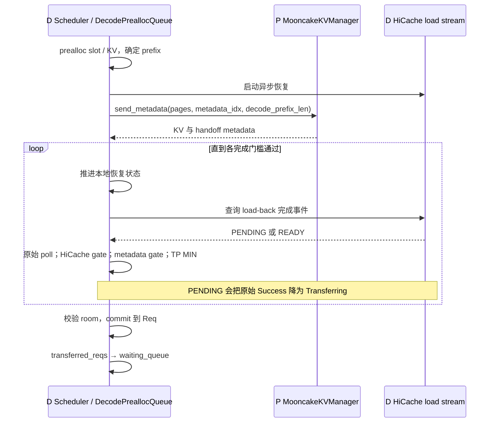
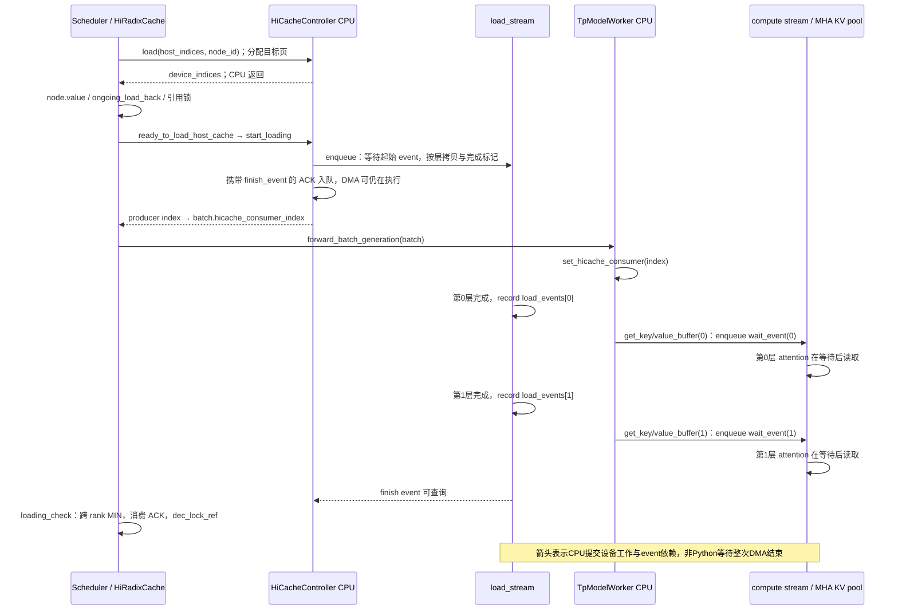

# 推理平台与大规模部署：指标、分离、缓存与运维

本册面向推理平台研发、大规模部署与生产性能方向：原有 Q01–Q50 题库中本册保留 16 题，2026-10-20 新增 Q51、Q64–Q67 共 5 题，合计 21 题；编号与[完整题单](README.md)一致。先掌握 Q03、Q05 的测量口径，再沿 Q35–Q38 的数据交接理解路由、扩缩容和故障回收。新增题把硬件迁移、缓存关键路径、性能建模、PD 仿真与路由决策连起来。引擎内部执行见[引擎研发册](engine-development.md)，计算与投机细节见[算法算子册](algorithms-kernels.md)。

本册原Q01–Q50题最初整理于2026-10-15，Q51–Q68新增题最初整理于2026-10-20；本轮对所含21题全面补写学习目标、解释、定量案例和证据化追问，本轮问答逐点闭合基线为SGLang `441c855fef`（runtime源码与`bb669346d5`相同），所用关键源码链据此核对。默认讨论CUDA、生成请求；PD例子采用Mooncake backend，具体cache、模型或并行分支在题内标明。外部Dynamo、Mooncake资料按所链官方页面与访问日期理解，AIC按固定commit区分当前实现与历史设计。

数字用于可复算的教学与决策示例；真实服务率、带宽及SLO须用目标部署校准。建议方案和现有实现分开，源码证明状态与调用边界，生产追问直接给出证据判据和处理动作，学习检查点逐条给出解答。每题可先读“学习目标”明确要展示的能力，再沿例子理解机制，最后用源码与附逐条解答的检查点复盘；不必把参考答案逐字背诵。

<a id="q03"></a>
## Q03 TTFT TPOT ITL 吞吐和 goodput 的统计口径

### 学习目标

【考察重点】能否把用户体验、引擎步耗时和业务有效容量分开，识别多 token chunk 对指标的影响。

【知识点】请求时钟边界、请求平均与 token 加权、分位数、开放到达和 SLO goodput。

【能力要求】从逐请求记录复算指标，解释长度分布变化，给出可比较的分母与失败处理。

【常见误区】把 TPOT 当每次 Decode 耗时，把 chunk 间隔当逐 token 到达，只展示成功请求的平均延迟。

### 问题与追问

TTFT、TPOT、ITL、吞吐、goodput 分别衡量什么？一次响应带多个 token 时如何统计？

- 两组请求输出长度差异很大，平均 TPOT 和全局平均每 token 时间为什么不同？
- 开启投机解码或增大 stream interval 后，客户端 ITL 曲线应如何解释？

### 参考答案

我把五类指标分开计算：TTFT衡量首次内容响应，TPOT衡量首段后的平均生成成本，ITL衡量指定观测层相邻输出间隔，吞吐衡量单位窗口完成的工作，goodput只计满足既定SLO的有效工作。多token chunk不能还原逐token时刻；当前SGLang benchmark的TPOT公式仍是成功请求的`(latency−ttft)/(n−1)`，仅纳入n>1，不能把它解释成每次GPU Decode的真实耗时。

业务需要回答三个不同问题：用户多久看到第一段、后续生成是否顺畅、固定资源每秒能服务多少合格请求。不拆开这三个问题，只报总 token/s，会把“吞吐高但所有人先等两秒”和“快速响应但容量低”混为一谈。因此首先固定时钟：客户端发出请求为起点，首个有效内容到达为首响应，结束事件为终点；空 SSE、角色字段或代理心跳不应算成内容。服务端另记排队、prefill、模型步与传输时间，用它解释客户端现象，不能替代用户侧统计。

TTFT 包含入口网络、网关、分词、排队、prefill 和首段返回。TPOT 是把首段后的总耗时摊到剩余输出：当前 benchmark 对 n>1 的请求计算 `(latency−ttft)/(n−1)`；n≤1 没有这个分母，应单独统计。ITL 则依赖观测层：GPU 两步间隔、服务端发布间隔和客户端 chunk 间隔可能不同。吞吐也要声明是完成请求、输入 token 还是输出 token 每秒，测量窗口和 warmup 是否一致，否则指标名称相同也未必可比。

走一个完整例子：请求输出 5 个 token，首个 chunk 在 100 ms 到达，其后 140、180 ms 各到达含两个 token 的 chunk，立即结束。TTFT=100 ms，TPOT=(180−100)/4=20 ms；客户端确实观测到的只有两个 40 ms 间隔。把 40 ms 除以两个 token 得到的是摊分口径，不是两个 token 分别在何时产生的真实记录。投机提交、stream interval、代理缓冲都会改变 chunk，所以“ITL 突然翻倍”先检查发布粒度，而非直接归因 attention 变慢。

长度分布会改变聚合结果。再有一个输出 101 token、TTFT=100 ms、总耗时 1100 ms 的请求，其 TPOT=10 ms；两请求的平均 TPOT 是15 ms，token 加权的首段后耗时却是 `(80+1000)/(4+100)=10.38 ms/token`。前者让每个用户等权，后者让长输出贡献更多权重。两者都能用，必须说明它回答哪个问题。只展示总平均还会掩盖少量长请求和排队尾部，应按输入/输出长度及命中情况分桶再看 p50/p95/p99。

最后把指标变成容量决策：10 秒窗口接收 100 个请求，80 个同时满足 TTFT≤300 ms、TPOT≤30 ms，其他超时、失败或违约，则请求 goodput=8 req/s。不能删掉失败者再声称成功率百分之百；输出 goodput 若按达标请求的 token 数计，也要另写定义。保留请求起止、内容 chunk 时间、实际输出 token、错误与 usage 来源，才能追溯改变来自排队、计算还是返回。

#### 追问1的回答

请求平均TPOT是`mean_i[(L_i−F_i)/(n_i−1)]`，每个请求等权；token加权值是`Σ(L_i−F_i)/Σ(n_i−1)`，长请求权重大。上述两个请求分别20与10 ms，请求平均15 ms，token加权10.38 ms，两者回答不同问题。另固定10秒完整窗口，若100个成功请求合计输入200K、输出5K token，则请求吞吐10 req/s、输入吞吐20K tok/s、输出吞吐500 tok/s。若其中80个同时满足TTFT≤300 ms与TPOT≤30 ms，请求goodput为8 req/s；若按达标输出tok/s计，应只加这80个请求的实际输出再除10秒。失败／超时另报，不加入成功延迟分布，但必须进入总到达、错误率与违约统计；窗口边界采用完整cohort或足够长稳态并明确在途处理。

#### 追问2的回答

先报每chunk实际token数、相邻有效chunk时间和计数口径。40 ms到达2 token，直接观测为40 ms/chunk；分给两token可报20 ms/token摊分，但不是两个真实生成间隔。当前特定backend与accept_length条件下的retokenized ITL分支会重分词chunk、以ITL除token数并重复扩展，普通分支直接使用记录的ITL；两组不能不说明就混比。首chunk若已有多个token，TPOT的n−1分母也是既定统计约定，不能据此恢复首chunk内的生产时间。要判断GPU变慢，应同时比较服务端提交／采样时点和设备步时间。

### 源码调用链与证据

```text
async_request_openai_completions(response stream)
  ├─ 非空 choices[0].text：首次写 output.ttft
  └─ 后续 chunk：写 output.text_chunks / output.itl
calculate_metrics(outputs)
  ├─ success 且 output_len > 1：追加请求级 TPOT
  └─ 特定 retokenized ITL 分支：按 chunk 重分词数摊分
      → BenchmarkMetrics 的均值及分位数 → 打印/结果文件
```

当前公式节选，教学注释说明筛选边界：

```python
# 每条成功请求分别计算；并非把所有请求耗时相加后除总 token。
if output_len > 1:
    tpots.append((outputs[i].latency - outputs[i].ttft) / (output_len - 1))
# 下面的 chunk 摊分是另一条统计分支，不能反推逐 token 到达时刻。
if use_retokenized_itl:
    for k, itl in enumerate(outputs[i].itl):
```

锚点：[客户端记录 chunk，serving.py:334](/Users/magician/PycharmProjects/sglang/python/sglang/benchmark/serving.py:334)、[serving.py:1087](/Users/magician/PycharmProjects/sglang/python/sglang/benchmark/serving.py:1087)、[serving.py:1100](/Users/magician/PycharmProjects/sglang/python/sglang/benchmark/serving.py:1100)、[serving.py:1215](/Users/magician/PycharmProjects/sglang/python/sglang/benchmark/serving.py:1215)。

### 生产实践追问

- **stream interval 调大后 ITL 翻倍：**我先对齐逐请求chunk数、每chunk token数和时间戳，再比较相同shape的服务端步耗时。设备仍20 ms/步、客户端每40 ms到2 token，判为交付粒度变化，恢复逐token发布或改报chunk＋摊分两套指标；若设备也变40 ms，则继续分解batch、metadata、kernel与copy，不能靠改图表单位隐藏回归。
- **平均 TPOT 改善而投诉增多：**我按ISL/OSL、租户和缓存桶复算请求等权p99、失败率与token加权值。若短输出样本增多解释均值，撤销普遍加速结论，用相同cohort重测；若同桶p99仍恶化，按等待／设备／交付阶段定位并收紧违约负载。

### 学习检查点

- 为什么输出 n=1 的请求仍有 TTFT，却不能按当前公式产生 TPOT？

  **解答：**n=1仍有请求发出到首内容到达的时间，因此TTFT有定义；首token后没有剩余token，n−1=0，TPOT不能计算，不能填0混入均值。该请求仍计入成功数、请求吞吐与适用的TTFT SLO，TPOT有效样本数另列。

- 若一个 chunk 有 4 个 token，仅靠到达时间能否得到 4 个真实 ITL？缺少什么信息？

  **解答：**不能。只知道四个token一同被客户端看见，缺少各token在服务端生成／提交／发出的独立时间戳及代理缓冲信息。可以报告chunk到达或按明确规则摊分，不能伪造四个真实ITL。

<a id="q05"></a>
## Q05 如何公平比较配置与推理引擎

### 学习目标

【考察重点】比较是否保持相同业务工作量与总资源，能否识别闭环压测自限流和缓存偏置。

【知识点】开放／闭环到达、Little 定律、负载扫描、冷／热缓存、正确性与达标吞吐。

【能力要求】制定可复现矩阵，保留逐请求数据，定位压测端瓶颈并给出上线判据。

【常见误区】只比峰值 token/s、不同卡数比单 worker、改变输出长度或精度却归功于引擎。

### 问题与追问

如何公平比较两个配置或两个推理引擎？峰值 tokens/s 更高能否直接上线？

- 相同并发数是否意味着相同到达压力？缓存命中率如何控制？
- 候选方案的速度来自量化或少输出 token，怎样避免误判成调度优化？

### 参考答案

峰值tokens/s更高不能直接上线。我先固定同一业务任务、质量、总GPU预算、拓扑和SLO，再用相同开放到达trace扫描到达率，选择队列不持续增长且正确性／错误率达标的最大goodput；冷启动与稳态分别比较。每个引擎可以采用自己的最佳可达配置，但不能通过少生成、改变精度或额外卡数掩盖任务差异。

公平比较要先把业务任务固定，再允许候选方案在约束内调优。最低契约包括权重与 tokenizer/template、精度和采样、输入/输出长度分布、重复前缀比例、GPU 总数及拓扑、质量与延迟门槛。若这些不同，测到的是“少做了多少工作”与引擎效率的混合。只固定 batch 不公平，因为某引擎可能以更多等待换大批；只固定 QPS 也不够，因为每秒一个 32K 输入和一个 128-token 输入的成本完全不同。

第二步决定负载怎样产生。闭环客户端每完成一个请求才补下一个，实际到达受服务速度限制。用 Little 定律的稳态关系 `N≈λW` 看：并发32、平均请求耗时0.64秒，对应约50 req/s；另一方案耗时变成约0.914秒，自动降到35 req/s。它可能显示“队列稳定”，却从未承受50 req/s。当前入口是 `python -m sglang.benchmark.serving`，可以用有限 request rate 的指数间隔或 trace 时间戳；仍须检查并发上限、压测机和连接池是否改变实际发出时间。

我会先选一个固定长度和缓存分布，扫开放到达率，例如20、30、40、50 req/s，每档持续到足以看清队列走势，记录计划到达、实际发送、完成和失败。若计划50但只发35，应先解决客户端限流；若确实发50、完成45、队列每秒增长5，就不能把这档宣称稳定容量。冷缓存重启与稳定热缓存分别跑，预热不混入稳态窗口，并保存 commit、依赖、启动参数和实际生效配置，让结果能由另一个人复现。

选择依据是相同预算下的达标容量。假设A达到10K输出 tok/s，但TTFT p99=800 ms超过300 ms门槛；B为9K且p99=250 ms，B在交互业务里可能更有价值。再检查二者生成长度、取消和错误是否相当；量化、投机和截断都会改变输出质量或完成工作量，不能只看快了多少。即便峰值相同，也要比较临界负载附近的延迟斜率，因为线上突发往往首先击穿尾部，而不是平均吞吐。

最后才做归因和发布：差异显著时固定其他条件，针对一个因素做A/B，利用时间线区分CPU提交、设备计算、通信、缓存和队列，避免一口气改十个参数。真实流量灰度还要覆盖长短混合、超时取消和重启恢复；验收看SLO、质量、失败率与资源平衡一起通过。

#### 追问1的回答

不是。零think-time闭环下N=λW，N=32、W=0.64秒约50 req/s，W变0.914秒只约35 req/s；慢方案被客户端自动降压。开放测试要固定计划发送时刻，另记实际发送及客户端等待，避免semaphore把开放到达重新变成闭环。缓存分别做全冷、相同前缀分布热缓存、真实trace；预热按固定流程且不进窗口，记录实际连续命中token与层级。完全相同prompt反复发送只覆盖极热上界，随机打乱又会抹掉真实亲和；二者都不能替代相同业务分布。

#### 追问2的回答

我做两类结论：同精度、同采样／停止条件与同目标长度对照隔离调度或执行效率；量化／投机的系统方案另在质量门槛下比较。固定max_new_tokens不足以固定实际工作，因为EOS、stop、tokenizer/template会改变生成长度；我同时保存实际ISL/OSL、停止原因、usage与质量集。若A输出100、B只输出60，先用固定输出任务或按相同OSL桶重测，再判断调度收益。只有同桶执行时间或同预算达标容量改善，且错误／取消未被删除，才接受优化归因。

### 源码调用链与证据

```text
serving.main：固定 random / numpy seed，构造输入请求
  → benchmark：先 warmup，再选择 get_request 或 trace scheduler
  → get_request：yield 请求，按到达模型等待
  → backend request function：执行并记录真实输出/错误
  → calculate_metrics：成功请求统计与完成数 → 结果文件
```

[serving.py:1023](/Users/magician/PycharmProjects/sglang/python/sglang/benchmark/serving.py:1023)、[serving.py:1400](/Users/magician/PycharmProjects/sglang/python/sglang/benchmark/serving.py:1400)、[serving.py:1458](/Users/magician/PycharmProjects/sglang/python/sglang/benchmark/serving.py:1458)、[serving.py:1934](/Users/magician/PycharmProjects/sglang/python/sglang/benchmark/serving.py:1934)。指标定义见 [Q03](#q03)，资源准入见[引擎 Q08](engine-development.md#q08)。

### 生产实践追问

- **B 看似更稳但完成速率低：**我核计划／实际发送、连接池、semaphore和压测端CPU；若B只收到35而A收到50，就修客户端或用独立开放trace重放，不比较“稳定性”。若两者均收50而B队列增长，降低负载找到稳定SLO容量。
- **热缓存方案领先一倍：**我固定trace，分别清空、按固定流程预热与按真实重复率回放，关联实际命中与省算token。若优势只在100%同prefix，结论限定该热集；部署容量按真实命中及冷重启预算计算。
- **新版本吞吐提高但输出变短：**我核停止原因、实际长度、采样、量化与质量；用同精度、同OSL桶或固定输出任务重测。若差异随工作量对齐消失，撤销调度加速结论；质量或停止回归先修复再灰度。

### 学习检查点

- 为什么持续增长的 waiting queue 比短窗口平均吞吐更能暴露过载？

  **解答：**稳定负载若实际到达50、完成45 req/s，queue每秒增5，说明系统长期服务率不足；短窗口吞吐可能正在消耗旧队列，不能证明可持续容量。处理是降低承诺负载、扩正确瓶颈资源或背压，并观察队列趋稳及尾延迟。

- 为什么重复发送完全相同的 prompt 不能代表普遍的在线服务负载？

  **解答：**重复prompt会高估prefix命中、降低有效prefill工作，长度与到达尾部也不代表线上。它只证明该热集条件；通用结论必须覆盖同业务长度、前缀流行度与突发trace，并分别报告冷／热结果。

<a id="q06"></a>
## Q06 SGLang Dynamo Mooncake NIXL 的职责与组合

### 学习目标

【考察重点】能否从一次请求的控制、计算、对象管理与数据移动划分系统边界。

【知识点】引擎、分布式编排、KV对象语义、注册内存与传输完成、插件／connector契约。

【能力要求】画出部署责任图，给每个交接指定输入输出、失败负责人和验收证据。

【常见误区】把 Dynamo 说成 SGLang 替代品，把 TE 当全局缓存，把组件都装上等同组合可用。

### 问题与追问

SGLang、Dynamo、Mooncake、NIXL 分别解决哪层问题？哪些可以组合？

- 已用 SGLang gateway，为什么还可能引入 Dynamo？代价是什么？
- Mooncake Store 命中是否意味着 GPU 已能执行 attention？

### 参考答案

四者不等价：SGLang runtime负责请求状态、逐轮batch、KV和模型执行；SGLang gateway负责本仓库的入口与worker选择；Dynamo提供跨实例frontend、路由、资源池与Planner等协调能力；Mooncake的TE搬字节、Store管理对象；NIXL提供经插件选择的数据移动能力。可以按具体connector组合，但每层必须明确谁分词、谁排队、谁持有请求终态和谁回收资源。

可明确组合的是Dynamo协调层＋SGLang执行层、SGLang PD＋Mooncake TE、SGLang HiCache L3＋Mooncake Store；NIXL官方也列有Mooncake backend，因此传输抽象与底层TE并非必然互斥。选择某一组合仍要按connector、内存类型和版本落实路径，不能把插件存在外推成所有PD/HiCache组合已验证。

从最小基线出发：一个SGLang实例就能接收请求、做连续批处理、管理KV并调用模型，再返回生成结果。只有跨实例的路由、P/D资源池或集群扩缩需求出现时，才需要更外层的协调。这样分层的收益是保留引擎专长又能独立调度资源；代价是多一套故障状态、遥测与版本契约。选型前先问入口在哪里、谁分词、谁决定目标worker、谁拥有请求终态，否则两个前端可能重复排队或在取消时互相等待。

SGLang runtime承担逐轮执行：输入是tokenized请求及执行配置，输出是token、状态和执行指标；内部决定Req何时组成ScheduleBatch、页如何分配、attention与采样怎样运行。本仓库还有独立gateway，不能把SGLang缩成kernel。Dynamo可把SGLang作为backend，提供分布式frontend、路由、部署协调、Planner及相关请求生命周期能力。它掌握实例之间的选择和容量调整，但不会替代SGLang内部的逐轮KV预算与模型执行。外层说“发给D1”，D1仍可因容量和状态而排队或拒绝。

再把“缓存”拆开。Mooncake Transfer Engine输入源/目标地址、长度和会话，负责注册与搬字节；它不知道这些字节代表哪段token。Mooncake Store提供按key管理对象的语义，SGLang可把它接为HiCache L3，但对象可取后还需本地落点与事件依赖。NIXL也是数据移动抽象，通过相应插件对接内存和存储；它不会自动接管radix树、模型版本key或驱逐规则。到底选择哪个transport或connector，要按该版本支持的内存、布局与故障契约决定。

例如一条6K prompt由Dynamo选择P和D，D先预分配位置，P执行后经所选backend移动缺失KV；若D已有4K可恢复prefix，则远端suffix和本地恢复各自推进，直到D完成身份与就绪检查再decode。假设远端传输8 ms、本地恢复20 ms，二者可重叠时等的是较晚的20 ms，还要叠加实际控制与排队；“TE已经成功”只覆盖其中一项。请求结束后D的请求槽可释放，但Store里供其他请求复用的对象不必随之删除，两者所有者和寿命不同。

部署图因此要标明控制箭头与数据箭头，并为入口超时、worker退出、传输失败、对象miss逐项指定负责方。建议先做最小组合的真实请求，再增加共享缓存和自动扩缩；每加一层都测额外排队、失败传播与运维收益。若只有单机短请求，引入完整协调和存储层可能增加固定成本而无收益。

#### 追问1的回答

gateway已满足的简单路由无需再叠一层。需要跨P/D池协调、KV信息路由、推理特定扩缩及统一部署生命周期时，可以把SGLang作为Dynamo backend；新增价值来自这些跨实例决策，而非替代本地Scheduler。代价是额外控制面／event plane、版本适配、启动／故障状态和潜在重复排队。我会指定唯一公共入口与请求ID，选清tokenization和取消负责人，避免两层都无限重试；若只需要本地最小负载分发，保留较小组合减少固定开销。

#### 追问2的回答

命中或GET完成只覆盖相应对象查询／内容读取契约。D还需核模型/adapter/量化/布局身份，分配host及GPU落点，建立逻辑token到物理页映射，等待L3→L2→L1必要完成event，持有引用防驱逐，并通过PD metadata／跨rank提交门槛。只有计算stream的相关依赖已满足，attention才能消费；对象在L3存在、在host读完、GPU地址分好、GPU内容可读是四种不同状态。

### 源码调用链与证据



当前 SGLang 交界：[scheduler.py:1593](/Users/magician/PycharmProjects/sglang/python/sglang/srt/managers/scheduler.py:1593)、[conn.py:257](/Users/magician/PycharmProjects/sglang/python/sglang/srt/disaggregation/mooncake/conn.py:257)、[parallel_state.py:1941](/Users/magician/PycharmProjects/sglang/python/sglang/srt/distributed/parallel_state.py:1941)、[mooncake_store.py:316](/Users/magician/PycharmProjects/sglang/python/sglang/srt/mem_cache/storage/mooncake_store/mooncake_store.py:316)。

外部概念流以官方材料为准，本仓库没有 Dynamo/NIXL 完整源码调用链：[Dynamo SGLang reference](https://docs.nvidia.com/dynamo/backends/sg-lang/reference-guide)、[Mooncake architecture overview](https://kvcache-ai.github.io/Mooncake/)、[NIXL overview](https://docs.nvidia.com/nixl/getting-started/overview/)。以上于 2026-10-15 访问，具体支持矩阵需匹配部署版本。

### 生产实践追问

- **所有组件健康但请求超时：**我用同RID/room串起入口、router、D准入、P执行、数据移动和Dcommit，定位最后成功交接。若D未分配目的页，就处理D容量／回收；若字节已完而restore未READY，就处理本地恢复，不轮流重启全部组件。
- **集成TE后声称已有全局KV复用：**我要求实际对象key、模型版本、查询命中、恢复和省算范围。只有非零传输计数时，结论限定点对点移动；要补共享缓存则接入对象层与SGLang恢复协议，并验证miss、淘汰和重启。
- **两层重试放大流量：**我按业务ID统计各层attempt和终态，指定一层拥有可重试决策，其他层传播取消／失败；设置deadline、退避和预算。验收原请求只产生一次输出终态，故障时attempt不无界增长。

### 学习检查点

- 为何“使用了 Mooncake”不足以说明部署使用了分布式 KV 对象池？

  **解答：**Mooncake可只作为PD点对点TE使用，双方已知目的地址，不需要跨请求key查询。只有部署实际接入Store并使用对象key／位置／读取和淘汰语义，才说明使用了分布式对象池；组件名称不能代替这条证据。

- 为什么外部路由知道缓存位置，也不能代替 Scheduler 的 token 预算检查？

  **解答：**目录只告诉可能在哪复用多少历史，无法保证决策时仍驻留，更不知道目标实例当下的request槽、未来输出预留、SWA/Mamba池或本轮输入预算。Scheduler必须重新match并真实准入；否则会超卖、OOM或读旧状态。

<a id="q35"></a>
## Q35 PD 分离的成本和适用负载

### 学习目标

【考察重点】能否定量解释PD隔离收益何时覆盖握手、传输和资源碎片成本。

【知识点】Prefill／Decode服务曲线、KV字节量、有效带宽、关键路径、队列稳定条件。

【能力要求】在固定总卡数和SLO下提出对照，定位P、D、网络或接收容量谁限制服务率。

【常见误区】长输入一律PD、只比单请求forward、将链路峰值当有效吞吐、忽略D预留。

### 问题与追问

什么负载适合 PD 分离？为什么拆开后 TTFT 可能变差，整体仍可能有收益？

- 什么时候搬 KV 比重新执行 prefill 更贵？已有 prefix 命中如何改变判断？
- 分开后的 P 和 D 各自空闲，是否说明部署已经足够高效？

### 参考答案

PD适合长prefill明显干扰交互Decode，或P/D需要不同并行度、batch和伸缩节奏的负载；短输入、低并发、聚合已满足SLO时通常先保留聚合。拆开可能增加新请求TTFT，却降低已有生成的ITL尾部，使同总GPU预算下同时达标的请求数增加。收益判断必须同时满足P、D和网络容量，而不是只看单请求搬运速度。

先考虑聚合基线：同一组GPU既处理输入，也持续生成。好处是KV留在本地、控制链短、资源可互相借用；问题是长prefill的设备工作可能扩大decode步间隔，两阶段最优batch、并行度或扩容节奏也不同。PD把它们放到不同池，让P专注输入吞吐、D稳定推进生成。分离因此是在“减少干扰与专业化资源”上获益，同时支付跨池传输、握手、预留和容量碎片。短输入、低负载且聚合已经满足SLO时，这笔开销很可能没有回报。

先按关键路径写账本。聚合TTFT可写成入口成本加聚合排队加prefill与首段返回；PD还涉及D目的页准入、P/D控制交接、需要移动的KV及D本地恢复。某些步骤可重叠，所以不能全部机械相加；先画依赖再求最长路径。P输入是prompt及缓存边界，输出KV和首token metadata；D输入这些状态及自己的可复用前缀，只有状态齐全才开始生成。P算完却D没空间，是接收端背压，不是P算力不足。

用普通GQA的说明性模型计算：每token全部层KV为128 KiB，8K token约1 GiB。有效跨机带宽若为25 GiB/s，单纯搬运下界约40 ms；再设控制3 ms、未被覆盖的D等待15 ms、P计算40 ms，串行示例TTFT约98 ms。聚合若排队20 ms加40 ms计算，则约60 ms。PD可能改善正在生成用户的ITL，却使新用户首响应变慢。若D已有可复用前缀，实际需传量降到256 MiB，理想搬运约10 ms；须按真实传输范围与本地恢复再算，不能始终套整prompt字节。

容量还需要另一本账：P每秒完成多少符合分布的输入，D能容纳多少活跃序列并在TPOT门槛下产出多少输出，网络能承载多少KV字节。到达率必须小于三个有效瓶颈的容量；P平均空闲也可能是在等D credit。输出长度从128变到2048，P工作近似不变但D驻留和生成需求大增，原配比会失衡。因此初始比例只能来自服务曲线，不能从一次P和D forward耗时相除后固定部署。

我的选择方法是固定总GPU与质量，比较聚合、多个聚合副本和PD，在真实ISL/OSL、热冷缓存、突发流量下扫负载，报告TTFT/TPOT分位数、goodput、P/D排队、字节流量与故障冗余。若PD的TTFT增量超预算，可能保留短请求聚合池，只让受干扰明显的长请求走PD；这属于可验证的设计方案。

#### 追问1的回答

在相同D就绪起点，我比较`query+暴露控制/排队+缺失KV有效传输+本地恢复关键路径`与被省掉的prefill工作；可重叠的段按DAG计算，不重复相加。1 GiB/25 GiB/s约40 ms，加控制3、D等待15已58 ms，若重算45则搬运不划算；降到256 MiB约10 ms后，其他条件相同为28 ms，可胜过45。L1prefix减少需传／算范围，L2/L3prefix还增加恢复成本，所以不能只按命中token数扣传输，也不能把在P已付出的计算当未来免费收益再扣一遍。

#### 追问2的回答

空闲可能是协调或容量背压：P等Dcredit，D等P结果／本地恢复，网络或控制面把两端都饿住；还可能池配比不适合突发、按平均长度配置但尾部占住D。若P服务率10 req/s、D3 req/s而只有一个D，到达6时D不足，P空闲不构成效率证明。处理是按等待依赖扩D／减驻留、修传输／恢复瓶颈或调配比；若两池长期轻载且固定开销主导，合并或缩小专用池恢复资源共享。

### 源码调用链与证据

```text
D Scheduler.process_decode_queue
  → DecodePreallocQueue.pop_preallocated：分配请求槽/KV，匹配本地前缀
  → kv_receiver.send_metadata：发送目标 page indices 与 decode_prefix_len
P MooncakeKVManager bootstrap thread：收到预分配通知
  → transfer worker：根据目标地址发送剩余 KV
D DecodeTransferQueue.pop_transferred：通过传输/metadata/恢复门槛
  → waiting_queue → prebuilt batch → 持续 decode
```

[decode.py:866](/Users/magician/PycharmProjects/sglang/python/sglang/srt/disaggregation/decode.py:866)、[decode.py:1099](/Users/magician/PycharmProjects/sglang/python/sglang/srt/disaggregation/decode.py:1099)、[conn.py:1603](/Users/magician/PycharmProjects/sglang/python/sglang/srt/disaggregation/mooncake/conn.py:1603)、[decode.py:2247](/Users/magician/PycharmProjects/sglang/python/sglang/srt/disaggregation/decode.py:2247)。交接正确性见 [Q36](#q36)，配比见 [Q41](#q41)。

### 生产实践追问

- **PD后ITL改善但TTFT违约：**我按ISL分桶拆D准入、P排队／计算、传输和restore。短输入若由固定交接主导，转聚合短请求池或限制PD范围；长输入若D等待主导，修配比／背压。只有同预算下goodput提升且两项SLO都满足，才保留分离。
- **P低利用率且D高占用：**我记录Dcredit、活跃KV、OSL和P待发送队列。若P等落点，增加D服务容量或限制输出／并发，而非加P；若D在等restore，先给恢复限并发或带宽预算。
- **加P反而总容量下降：**我对齐KV字节速率、NIC排队与D提交延迟，限制P在途数做同trace对照。竞争消失则说明网络／接收端饱和，恢复背压并以瓶颈服务率配置P上限。

### 学习检查点

- 为什么传输成本下降，不一定能改善 D 端无空闲 KV 导致的等待？

  **解答：**D没有可用KV时，目标页尚不能预留，传输任务还未获得合法落点；把已可传时的耗时从40降10 ms不解除此前的准入等待。应先释放／扩充D容量、控制长输出驻留或背压，再优化实际占关键路径的传输。

- 为什么一个长输入、短输出 workload 的最优 P:D 比例不能直接复用给短输入、长输出业务？

  **解答：**长输入短输出主要增加P计算和一次KV交接，短输入长输出主要增加D的持续步数、KV驻留与并发。固定λ下cP/cD会相反变化；必须按新ISL/OSL重新计算`λ<NPcP、λ<NDcD`并留余量，不能沿用原比例。

<a id="q36"></a>
## Q36 PD 交接的状态与完成门槛

### 学习目标

【考察重点】能否把传输完成、状态可见、身份一致与可进入Decode分成可验证门槛。

【知识点】P/D握手、目的页预分配、metadata发布、本地恢复、跨rank一致提交。

【能力要求】画出并行状态时间线，定位raw Success到Req入队之间哪一门槛未过。

【常见误区】把Success当请求完成，要求HiCache先load完才通知P，忽略room身份与最慢rank。

### 问题与追问

P 到 D 究竟交接什么？为什么 transport 返回 Success 后还要检查其他条件？

- D 端何时发送目标 page 信息？HiCache 是否必须先恢复完成？
- 不同 TP rank 观察到传输完成的时刻不同，会发生什么？

### 参考答案

transport原始Success只证明该receiver的传输状态，不能直接使D执行。D交接需要目标页、prefix范围、请求/room身份、首token与必要metadata；当前路径还要求metadata已发布、本地HiCache恢复不再PENDING、相关rank聚合状态成功，随后commit再次验证expected room并落到Req，最后才由Scheduler接纳。D发送目标页不等待HiCache全部恢复，二者在最终提交前汇合。

没有交接协议时，D即使拿到一个地址也不知道内容是否属于本请求、哪些位置已有缓存、P算到哪里，以及下一token从何处接续。PD必须把数据与控制状态一起交付：目的KV页和布局、bootstrap room、prefix边界、首个输出token及相应metadata。D负责预留本地槽和落点，P负责把缺失部分写到这些位置，Scheduler负责在所有必要状态就绪后接纳。把这三项压成一个“传输成功”会丢掉正确性门槛。

当前D先做prefix匹配与容量检查，分配request、metadata和KV资源，再启动decode HiCache的异步prefetch/恢复，并发送目标页metadata给P。这里发送通知不等待恢复完成，目的是让本地前缀恢复和P远端suffix传输重叠；否则两段本可并行的工作被串行化，增加TTFT。代价是D必须保存更多在途状态与引用，最后显式汇合，不能因其中一条路径先结束就读完整attention历史。

设D前4K在host或L3，P只需传后2K。D在5 ms发出目标页，P于40 ms算完，传输48 ms完成，handoff metadata于49 ms可见，而本地4K恢复55 ms才READY。那么本rank最早提交是55 ms，而不是48 ms。若另一TP rank在60 ms才完成，整体还应等到一致门槛。这个模型说明关键路径是各必要前置的最大完成时刻，再加提交和调度；让P等本地恢复再发通知则可能把两段耗时相加，白白损失重叠。

源码中的原始receiver Success仍会经过gate：metadata room为0表示尚未发布可见，降回Transferring；HiCache PENDING也会阻止成功，之后在相关rank上做MIN归约。聚合Success因此已包含这些检查，但实际commit仍需校验room等于预期，而不是只非零。非零回答“某份metadata到了”，相等回答“到的是这次交接”。若旧槽未清、room混用或某rank提前继续，前者可能读错KV，后者可能让collective顺序分歧，两类故障都不是带宽调优能解决的。

提交成功后才把metadata与恢复结果落到Req，形成transferred_reqs，交给Scheduler的waiting_queue，再准备prebuilt批进入生成。失败则按拥有资源的状态回收，不能留下预留永不归还。

#### 追问1的回答

D先通过request槽、metadata槽、KV与恢复预留guard完成prealloc，确定本地prefix和远端应填范围；再启动异步HiCache prefetch/restore并调用send_metadata。load完成不是发送前置，否则会把本地恢复与远端suffix串行。前置是落点和容量承诺已成立；最终attention读取前才要求本地内容就绪。若prefetch注册失败，按当前分支清理／退化可用恢复范围，不能继续宣称L3部分已经存在。

#### 追问2的回答

各rank先检查自己的raw poll、metadata非零与恢复状态，再以MIN等共识保持共同进度；一个rank仍Transferring，其他rank不能独自进入Decode。48 ms远端完、49 ms metadata到、55 ms本地READY，但另一rank60 ms才齐，最早共同提交为60 ms加提交调度成本。聚合Success已包含这些门槛，不应把它再误称raw Success；commit还核room等于预期，错误时走abort与预分配清理，而不是为了不挂强行继续。

### 源码调用链与证据



节选自 metadata gate，教学注释强调这是非零门槛而非全部身份验证：

```python
# raw Success 还不能直接进入计算批。
actual_room = metadata_buffers.bootstrap_room[
    decode_req.metadata_buffer_index, 0
].item()
if actual_room == 0:
    polls[i] = int(KVPoll.Transferring)
```

[decode.py:1223](/Users/magician/PycharmProjects/sglang/python/sglang/srt/disaggregation/decode.py:1223)、[utils.py:116](/Users/magician/PycharmProjects/sglang/python/sglang/srt/disaggregation/utils.py:116)、[decode.py:1727](/Users/magician/PycharmProjects/sglang/python/sglang/srt/disaggregation/decode.py:1727)、[decode.py:1980](/Users/magician/PycharmProjects/sglang/python/sglang/srt/disaggregation/decode.py:1980)。HiCache gate 的具体封装见 [decode_hicache_mixin.py:155](/Users/magician/PycharmProjects/sglang/python/sglang/srt/disaggregation/decode_hicache_mixin.py:155)。

### 生产实践追问

- **raw Success后不进Decode：**我按RID/room/metadata槽记录每rankraw与gated poll、room值、restore状态和event。room=0就追metadata发布／控制交接，PENDING就追恢复队列／DMA，某rank慢就追其最后缺失门槛；不先增大传输timeout或绕过gate。
- **只在TP2偶发卡住：**我对齐相同room的poll、MIN调用序号与commit，检查各rank是否执行同一集体调用。缺席rank先修分支／状态一致性；所有rank均进入且同一操作慢，才继续查通信。
- **偶发room不符：**我追槽分配、清零、释放及复用代次，在取消／重试后注入迟到通知。发现身份不符就中止该交接、隔离可能污染的落点并安全回收，不能将非零当通过；验收错误Req不进入waiting成功队列。

### 学习检查点

- 为什么 `actual_room != 0` 与 `actual_room == expected_room` 是两种不同检查？

  **解答：**非零只证明该metadata槽中有发布值，可能是旧room；等于expected才证明身份匹配本次交接。当前先用非零gate避免尚未发布，再在commit做相等校验；旧值非零仍必须被拒绝，防止拿错首token和KV边界。

- 为什么 local HiCache restore 与网络传输可以并行，却必须在执行 attention 前汇合？

  **解答：**本地恢复与远端传输写不同的已确定历史范围，可以同时执行；attention依赖合起来的完整有效历史，所以必须等两条必要路径与metadata齐全。遗漏任一路会读未恢复或未写完的KV，多rank提前继续还可能破坏collective次序。

<a id="q37"></a>
## Q37 Mooncake Transfer Engine 和 Store 的区别

### 学习目标

【考察重点】能否分别解释一次请求的点对点交接和跨请求对象复用，避免把传输能力等同缓存系统。

【知识点】地址注册、传输完成、对象key／副本就绪、缓存生命周期和miss重算。

【能力要求】按需求选择组件，列出上下层交接状态，拆分查询与搬运成本。

【常见误区】TE成功就认为前缀可复用，Store命中就立即给attention读，请求结束就删除所有共享对象。

### 问题与追问

Mooncake Transfer Engine 与 Mooncake Store 的职责有何不同？

- 直接传输 KV 的部署，是否已经具备跨实例的对象查询和复用？
- Store GET 成功后，SGLang 还需要维护哪些状态？

### 参考答案

TE是已知地址之间的数据移动层，Store是按对象身份进行分配、发布、查询和读取的存储层；二者可以组合但不等价。直接PD传输只证明在途请求的KV搬到了指定落点，不自动具备跨请求对象查询。Store GET成功也只覆盖所选API的数据读取契约，SGLang仍须完成版本核对、本地映射、恢复event、引用和执行准入。

假设最初只有P刚算好的KV要交给一个指定D：双方已经知道请求和落点，此时最重要的是可靠地把字节送过去。再增加一个需求：十分钟后的另一条请求希望找到同一段前缀，但它不知道缓存在哪个实例。第二个需求多出了对象身份、查询、位置、就绪和淘汰，不能仅靠“把地址复制得很快”解决。Transfer Engine与Store的区别正对应这两个问题；分开理解，才不会在传输测试通过后误以为共享缓存也正确。

TE接收会话、源/目标地址与长度，负责所选传输路径的内存注册、连接和移动，向调用方报告操作状态。P/D上层仍负责token对应哪些页、哪些prefix不用传、何时回收和何时接续生成。当前MooncakeKVManager把KV pages转换为一批地址区间，调用共享TE；接收成功后还要经过PD metadata、恢复和提交门槛。TE不会从裸地址推断模型版本，也不替SGLang维护radix引用。

Store接收的是对象key和数据，增加对象分配、写入发布、查询与读取等语义；对象只有按协议达到可读状态才可取用。当前SGLang通过HiCache的MooncakeStore把它接成L3，controller随后将数据放到host或GPU层，建立本地事件依赖，再交给attention。比如A请求结束，A的request slot可以归还；L3中版本化的共享前缀仍可保留，让B复用。反过来，Store驱逐一份对象不应让已经恢复到本地且受引用保护的请求突然失去自己的有效KV。

计算一个选型例子：一个256 MiB前缀，远端到host有效8 GiB/s约31.25 ms，查询与队列合计8 ms，host到GPU约8 ms，串行恢复约47.25 ms。若重算只需30 ms，Store命中也未必值得；若重算120 ms且重复请求多，才可能有净收益。单次TE微基准可能只显示31 ms的搬运部分，无法解释其余对象管理和本地恢复成本。并行和竞争会改变关键路径，完整收益判断见Q64；这里关键是让每项成本落到正确组件。

设计上我会先确认需求到底是“为在途请求交接”还是“为未来请求查找”，再定义模型、tokenizer、adapter、量化及布局对应的key和兼容规则。对象miss时可以由上层决定重算，传输失败则需要保护可能被部分写入的落点；两类失败不能用同一success位收尾。两条路径可以共存，甚至共享进程内TE，却保有各自生命周期。

#### 追问1的回答

没有。TE操作用源／目标地址、长度和会话，不包含“某token前缀在哪个节点、是否发布可读、可保留多久”的全部对象语义。要跨实例复用，需要版本化key、对象位置／副本状态、GET/miss、淘汰和SGLang prefix映射；Store提供其中的对象管理接口，上层再接本地恢复。PD本身也可复用接收端已有prefix，但这是上层明确匹配与通知的范围，不能据此推出TE单独拥有全局缓存目录。

#### 追问2的回答

我按五项落实：①校验模型、adapter、tokenizer/位置语义、KV dtype/layout与对象key兼容；②分配host／GPU目标页并记录逻辑token→物理index；③维持L3读取、L2→L1逐层完成与计算stream依赖，只有host GET结束不能越过GPU恢复；④持有radix和在途引用，结束后按owner解锁而非删除其他请求共享对象；⑤处理失败／短读／miss，未完整恢复的范围不能发布成可复用prefix，应安全丢弃落点并重算或返回错误。PD场景还要room/metadata/rank提交，完成后才进入Decode。

### 源码调用链与证据

```text
PD：MooncakeKVManager.__init__ → get_mooncake_transfer_engine()
    → _transfer_data(session, [(src,dst,len)])
    → engine.batch_transfer_sync → PD poll/commit
L3：HiCacheController.attach_storage_backend
    → StorageBackendFactory.create_backend("mooncake")
    → MooncakeStore → MooncakeDistributedStore
    → 上层恢复及事件门槛 → GPU attention 可读
```

[conn.py:257](/Users/magician/PycharmProjects/sglang/python/sglang/srt/disaggregation/mooncake/conn.py:257)、[conn.py:590](/Users/magician/PycharmProjects/sglang/python/sglang/srt/disaggregation/mooncake/conn.py:590)、[cache_controller.py:475](/Users/magician/PycharmProjects/sglang/python/sglang/srt/managers/cache_controller.py:475)、[mooncake_store.py:368](/Users/magician/PycharmProjects/sglang/python/sglang/srt/mem_cache/storage/mooncake_store/mooncake_store.py:368)。

外部接口和概念分别核对官方 [Transfer Engine](https://kvcache-ai.github.io/Mooncake/design/transfer-engine/index.html)、[Mooncake Store](https://kvcache-ai.github.io/Mooncake/design/store/mooncake-store.html)、[SGLang HiCache integration design](https://kvcache-ai.github.io/Mooncake/design/hicache-design.html)。这些外部实现不伪装成本仓库调用链。

### 生产实践追问

- **TE快、Store慢：**我把同key的lookup、排队、数据读取、L2→L1及首次attention分开。搬运接近组件值而lookup长，就处理对象控制面／查询并发；lookup快而restore长，就限制恢复并发或调整介质。256 MiB原始移动31 ms、完整47 ms时，不把16 ms全归给网络。
- **模型更新后错用旧prefix：**我构造相同token、不同权重或adapter，检查namespace与实际miss；身份不兼容就拒绝复用、清理本地引用并重算，不能按同key内容长度放行。输出与新模型基线对齐才恢复流量。
- **请求结束后L3容量仍高：**我区分对象保留策略、活跃引用与已过期不可达项。受策略管理且能淘汰是正常缓存；无owner又不可淘汰则修删除／引用路径，不能为压低显存把共享对象一并删除。

### 学习检查点

- 为什么共享同一个 TE，不意味着 PD 与 Store 可以共享同一套请求状态机？

  **解答：**TE可被两个组件共享以复用注册／连接，但PD状态绑定一次RID/room和目的页交接，Store对象可能跨请求长期存在并有副本、发布与淘汰状态。复用底层搬运资源不改变上层所有者与终态；若共享同一请求状态机，A结束就可能误删B仍需的对象。

- 为什么注册了 GPU buffer，仍不足以证明 prefix 复用正确？

  **解答：**注册只让传输层能访问某地址，不能证明内容对应目标token/模型，也不证明写入结束、页映射正确或引用不被回收。必须再验证payload／KV语义、prefix边界、版本与完成依赖；注册成功是必要组件证据，不是prefix正确性结论。

<a id="q38"></a>
## Q38 HiCache 搬运事件引用锁和 ACK

### 学习目标

【考察重点】能否同时维护地址所有权、设备执行时序和跨rank完成共识。

【知识点】异步DMA、逐层event、producer／consumer index、radix引用锁、ACK生命周期。

【能力要求】画出一次恢复的状态时间线，识别早读、早释放和完成后不清理三类故障。

【常见误区】indices返回即认为可读，ACK入队即认为完成，本rank无操作就跳过collective。

### 问题与追问

HiCache 返回 GPU indices，为什么不代表内容已可读？写回为何需要锁和 ACK？

- `load_back` 先写 node.value，再完成 DMA，会不会马上读到未初始化内容？
- 某 rank 没有待写节点，是否可以跳过 ACK 的 collective？

### 参考答案

GPU indices表示已分配落点，不表示DMA已完成。当前所选HiRadixCache＋MHA分支允许先写node.value、再异步恢复，因为计算读取由consumer index与逐层event限制，节点又被引用锁保护；没有这两项就不安全。ACK入队也不是完成，只有相应finish event及必要rank共识通过后才能消费ACK并解除恢复／写回保护。

不做异步恢复时，最容易正确的基线是CPU等整段host→GPU拷贝结束，再让模型开始；问题是计算无法覆盖搬运，长前缀会直接增加首响应。HiCache把地址准备和内容就绪拆开：先分配目标GPU页并把映射交给批次，再用load stream逐层搬运，计算只在读相应层时等待。这样可以流水，但必须同时解决两个问题：模型不能早读，allocator和缓存树也不能早回收这些在途页。event管时间，引用锁管寿命，任何一项都不能替代另一项。

输入是host indices、目标节点和恢复优先级。`load`先分配device indices并将操作放进load_queue，此时返回的是落点承诺。`load_back`把它们写入节点并登记ongoing_load_back、加恢复保护。`start_loading`合并本轮操作，更新producer index，在load stream依次提交拷贝及逐层完成标记，返回consumer index给batch；worker把这个index传到KV pool，attention取第i层buffer前在计算stream排入对应wait_event。Python能继续提交后续工作，不代表那层内容已经复制完。

以1024 token、全层128 MiB的教学前缀为例，32 GiB/s理想恢复约3.91 ms。假设32层均匀搬运，第0层约0.122 ms后可读，模型就可开始第0层计算，而不必先等全层3.91 ms。实际各层时长与链路竞争须测。若只写node.value却不建立event依赖，attention可能读旧页内容；若只加event但不加引用保护，等待期间页面可能被驱逐或复用，等来的也不再是原地址语义。已有地址与正确内容是两条独立不变量。

ACK记录的是携带finish_event的操作完成凭证，入队发生在CPU提交阶段，不能立刻解锁。`loading_check`查询可完成数量、做rank间MIN，再按序消费ACK并确认事件，移除ongoing项及减少引用。写回同理：host落点先存在，GPU→host结束后才可发布完成状态并释放保护。早消费会造成数据被覆盖；永不消费则形成“DMA早结束、页还一直锁着”的容量损失。例如8个128 MiB恢复已完成却未收尾，会多占1 GiB保护范围，让新请求看起来无页可分。

多rank的同步还要求参与顺序一致。本地没有正在写的节点，不代表其他rank没有；擅自提前return可能使其余rank卡在MIN collective。排障应把队列、ongoing表、锁、producer/consumer和event一一对齐，分清未提交、搬运未完、完成未清理。当前逐层MHA示例的backend选择见下方证据，不能把它推广成所有cache实现。

#### 追问1的回答

不会仅因写了映射就合法读取；在所述路径中，load_back登记ongoing并保护节点，start_loading为各层copy记录event，batch携带consumer index，TpModelWorker设consumer后，KV pool取第i层buffer会在当前计算stream等待该层event。于是地址可提前用于构造批次，读取却排在写入完成之后。若某backend绕过该等待、consumer代次错或引用提前释放，确实会早读；此时应阻止该恢复批进入执行／回退同步恢复，修正event与owner后再开流水，不能以node.value非空放行。

#### 追问2的回答

不能按本地队列长度独自跳过协议要求的MIN归约。rank0完成数0、rank1完成数1时，需要共同得到0并维持后续collective序号；rank0直接return会让rank1永久等。只有全组共享的guard证明该次同步都不需要，或group本来只有一个rank时，才能一致地省略。检查是逐rank对齐进入次数、group和序号，而不是只看本地有没有ACK。

### 源码调用链与证据

本题选 `HiRadixCache + MHATokenToKVPool` 的 CUDA 恢复分支说明。cache registry 在 unified 开关、混合 SWA/SSM 或 DSA 等条件下会选其他 cache；逐层等待示例不应被当成所有 backend 的同一实现。



真实节选，教学注释强调完成后才释放恢复锁：

```python
ack = self.cache_controller.ack_load_queue.pop(0)
ack.finish_event.synchronize()
for ack_id in ack.node_ids:
    end_node = self.ongoing_load_back.pop(ack_id)
    self.dec_lock_ref(end_node)
# indices 返回与 finish_event 完成是两个不同时间点。
```

[hiradix_cache.py:1297](/Users/magician/PycharmProjects/sglang/python/sglang/srt/mem_cache/hiradix_cache.py:1297)、[cache_controller.py:782](/Users/magician/PycharmProjects/sglang/python/sglang/srt/managers/cache_controller.py:782)、[hiradix_cache.py:984](/Users/magician/PycharmProjects/sglang/python/sglang/srt/mem_cache/hiradix_cache.py:984)、[hiradix_cache.py:1019](/Users/magician/PycharmProjects/sglang/python/sglang/srt/mem_cache/hiradix_cache.py:1019)。正常计算的 runner 边界见[引擎 Q13](engine-development.md#q13)，PD 汇合门槛见 [Q36](#q36)。

实际消费端与选择 guard：[registry.py:104](/Users/magician/PycharmProjects/sglang/python/sglang/srt/mem_cache/registry.py:104)、[tp_worker.py:545](/Users/magician/PycharmProjects/sglang/python/sglang/srt/managers/tp_worker.py:545)、[memory_pool.py:2232](/Users/magician/PycharmProjects/sglang/python/sglang/srt/mem_cache/memory_pool.py:2232)、[cache_controller.py:80](/Users/magician/PycharmProjects/sglang/python/sglang/srt/managers/cache_controller.py:80)。`LayerLoadingEvent.wait` 调用当前设备 stream 的 `wait_event`；这是设备依赖，不是让 Python 同步等待整次恢复。

### 生产实践追问

- **地址已返回但输出偶发错误：**我记录节点、页owner、consumer/producer代次及首次attention前的wait。读先于正确event或consumer指错代次，就暂停异步恢复并修依赖；地址已复用则修引用保护。验收在恢复与强制evict并发时输出仍对齐。
- **可用页持续下降：**我把每个ongoing节点与ACK、finish event和锁增减配对。event未完就查DMA／带宽；event已完但ACK未消费就恢复轮询／rank共识；ACK已消费而锁未减就修owner收尾。释放后容量应按预期回到evictable，不能靠定期flush代替。
- **TP2卡而TP1好：**我对齐writing_check/loading_check的group、次数和完成数。发现某rank本地空队列提前跳过，就恢复全组一致参与；序号一致但event慢再查实际producer，不先扩大通信timeout。

### 学习检查点

- 一个地址有效但内容未就绪，属于内存分配问题还是同步问题？应分别怎样证明？

  **解答：**地址有效由allocator分配、页owner和映射范围证明；内容可读由producer copy、对应layer/finish event与consumer stream wait证明。前者通过后仍读旧值，优先查同步／代次与覆盖，不重复分配更大内存；若地址已归别的请求，则先查生命周期。

- 为什么 ACK 完成后还要处理引用锁，而不能只删除 ACK 队列元素？

  **解答：**ACK删除只是丢掉CPU队列项，不会自动减少ongoing_load_back或radix lock_ref。必须按ACK的node_ids移除ongoing、对对应节点dec_lock_ref并完成写回发布等状态；否则页永久protected、可用容量下降。反过来，在event未完成前解锁会让仍在途的页被驱逐。

<a id="q39"></a>
## Q39 KV aware routing 的缓存与负载权衡

### 学习目标

【考察重点】能否把缓存亲和视为减少服务需求的线索，而非压倒负载与容量的最高优先级。

【知识点】真实连续prefix、字符关联启发式、KV事件目录、排队、冷缓存与目录时效。

【能力要求】解释一条请求为何选某worker，设计热点与重启对照，识别安全miss和错误复用。

【常见误区】命中率最高就最优，把本地字符树叫全局KV目录，忽略新worker冷启动。

### 问题与追问

KV-aware routing 应总选 prefix 命中最多的 worker 吗？路由信息过期会怎样？

- 命中较长但排队严重的实例与无命中空闲实例，如何选择？
- 本仓库 gateway 的 cache-aware policy 是否等价于 Dynamo 的 KV 事件索引？

### 参考答案

不应总选命中最多的worker。我先排除不兼容、失健康或无硬容量的候选，再比较预计排队、剩余prefill和恢复／交接关键路径；缓存命中只有转为省下的有效工作才有价值。路由线索过期通常导致miss与重算，跨版本身份错误则可能造成错误输出，必须由引擎重新验证而不能把路由命中当硬保证。

先想最小负载路由的基线：它尽量把工作分散，能减少热点，却可能把相同长前缀反复送到不同实例重算。缓存亲和试图把请求送回已有状态的实例，节省计算与首响应；代价是热门前缀会让请求集中到少数worker，缓存位置还会随驱逐与重启变化。因此路由器应同时回答“能省多少工作”和“为省这点工作要多等多久”，而不是把命中当免费、把队列当无穷可容忍。

输入至少有请求身份与prefix、候选worker健康和兼容性、负载及缓存线索，输出是一个目标worker。引擎收到请求后仍需真实match_prefix、检查slot和KV预算；路由预测不是资源分配成功。当前本地CacheAwarePolicy先在已按pool/model过滤的workers上检查绝对及相对负载失衡，失衡时选低负载；平衡时用请求文本的字符前缀树找历史关联worker，再按match ratio选择。它记录“这个文本曾送去哪里”，不能直接证明对应token KV仍在GPU。

看一个决策：A有8K可复用线索，但排队180 ms、剩余prefill20 ms、恢复30 ms。本例假设排队结束后先恢复再计算，三段串行、恢复完全暴露，因此预计230 ms；B无命中却排队10 ms、prefill100 ms，总计110 ms。若TTFT门槛150 ms，选A的命中率更漂亮却会违约。若实现允许预取或其他独立工作重叠，应改按依赖图计算，不再照加这三项。还要核A的8K是不是实际连续prefix，来自L1还是需恢复的L2/L3；字符相似度、token相等、对象存在、GPU就绪不是同一状态。更细的带单位评分在Q67，这里先建立路由信息与实际工作量的联系。

Dynamo公开路由使用自己的KV信息和负载机制，包含事件驱动缓存线索；本地字符树不因此获得相同能力。无论目录多准确，信息在采集与决策之间都可能变旧。worker重启、模型/adapter更换、对象淘汰、事件丢失都应使线索失效或降低置信。安全的旧线索通常只导致miss后重算和性能损失；若跨版本身份校验缺失，让语义不同KV被当成同一对象，就会上升为正确性故障，二者处置层级不同。

扩容也会遇到冷启动反馈：新worker无缓存、老worker命中高，纯亲和继续选择老worker，使新增卡长期空闲。建议观察排队和真实省算，给过载老实例的缓存credit降权，限制单热点并允许受控预热；这些是平台策略，不是当前本地规则已自动具备的保证。验收用同trace比较最低负载、亲和和混合策略，报告tail、goodput、实际命中长度、恢复流量与路由开销。

#### 追问1的回答

沿同一TTFT起点估计：A queue180＋剩余prefill20＋暴露恢复30=230 ms，B queue10＋prefill100=110 ms，门槛150 ms时选B。若恢复与远端传输重叠，用DAG最长路径而非全相加；若A命中只是字符关联，先降低置信并按可能miss计算风险。硬容量不足直接排除，不能给无限大缓存奖励抵消。选择B后立即记在途工作，避免下一百个请求仍把它当空闲；候选成本相近时可用不确定性或安全余量打破平局。

#### 追问2的回答

不等价。本地CacheAwarePolicy在已按pool/model过滤的worker集合中，以绝对且相对负载阈值决定是否直接最小负载；平衡时用request_text的字符前缀匹配历史路由关联。它没有因此获得真实token block的驻留／逐出事件。Dynamo公开路由维护自己的KV信息与负载成本，具体分层credit和policy按版本选择；不能把外部目录能力写成本地实现。两个系统都需要处理worker代次、事件丢失和重启，最终SGLang仍实际match及准入。

### 源码调用链与证据

```text
本地 CacheAwarePolicy::select_worker(workers, info)
  → healthy worker 集合；确定 pool/model tree_key
  → max/min load 失衡？是：select_worker_min_load
  → 否：文本 prefix_match_with_counts → 匹配比例门槛
  → 返回 worker index，并更新文本关联树
worker 实际 Scheduler / tree_cache 再做 prefix 与资源判断
```

```rust
// 本地规则先看负载失衡，缓存亲和不是绝对优先级。
let is_imbalanced = max_load.saturating_sub(min_load) > self.config.balance_abs_threshold
    && (max_load as f32) > (min_load as f32 * self.config.balance_rel_threshold);
if is_imbalanced {
    return self.select_worker_min_load(
        workers,
```

[cache_aware.rs:376](/Users/magician/PycharmProjects/sglang/sgl-model-gateway/src/policies/cache_aware.rs:376)、[cache_aware.rs:401](/Users/magician/PycharmProjects/sglang/sgl-model-gateway/src/policies/cache_aware.rs:401)、[cache_aware.rs:424](/Users/magician/PycharmProjects/sglang/sgl-model-gateway/src/policies/cache_aware.rs:424)、[scheduler.py:2995](/Users/magician/PycharmProjects/sglang/python/sglang/srt/managers/scheduler.py:2995)。Dynamo 外部概念单独参考官方 [Routing Concepts，v1.1.1](https://docs.dynamo.nvidia.com/dynamo/v1.1.1/components/router/routing-concepts)；该旧版本页面用于职责说明，不冒充本地当前实现。

### 生产实践追问

- **扩容后老worker仍超载：**我记录每次候选prefix线索、实际命中、queue与score，给过载老节点降低亲和credit并限新分配，受控预热新节点。tail下降但重算增加时按goodput净收益保留策略，不把命中下降本身判失败。
- **路由命中高、引擎命中低：**我关联字符匹配、实际连续token、worker代次和驱逐／重启时点。陈旧关联就清理／衰减并回退最小负载；若事件目录漏更新则重建，不能用路由统计覆盖引擎miss。
- **模型变更后才错误：**我先强制版本／adapter／布局隔离并重算，保存实际复用key与首个错误token。安全miss只损性能，不能解释错token；若隔离后恢复，继续修缓存身份，验证通过前不共享。

### 学习检查点

- 为什么“总命中 token 最多”与“整个集群的 goodput 最大”并不等价？

  **解答：**命中最大只优化重算量，goodput还受等待、恢复、容量、干扰与SLO影响。A省80 ms计算却多等180 ms，净损失100 ms；若使请求违约，即使命中token更多也降低有效吞吐，应在同trace比较达标结果。

- 文本前缀相同为什么还不足以证明 KV 可以跨模型版本复用？

  **解答：**同文本可能因tokenizer/template不同得到不同token；即便token相同，权重、adapter、RoPE/位置语义、量化和KV布局不同也会产生不同缓存。跨版本必须用明确兼容身份及布局规则验证，缺证据就隔离namespace并重算，不能以字符串相同复用。

<a id="q40"></a>
## Q40 Dynamo Planner 的扩缩容信号与反馈

### 学习目标

【考察重点】能否把扩缩容做成有观测、预测、执行滞后和反馈的控制回路。

【知识点】推理成本异质性、FPM边界、队列增长、readiness滞后、滞回和故障余量。

【能力要求】复算所需容量与突发积压，区分配置目标和扩缩方法，提出可验证的防振荡方案。

【常见误区】只看GPU利用率、desired副本等同服务容量、默认缩容会自动排空在途请求。

### 问题与追问

Dynamo Planner 为什么需要推理特定信号？扩容后容量为何未必立刻增加？

- GPU 利用率很高但队列稳定，是否应该扩容？队列很长但引擎 GPU 很闲呢？
- 新 worker 启动、缓存预热和缩容在途请求应怎样进入控制回路？

### 参考答案

Planner必须估计不同ISL/OSL、缓存、活跃KV和接受长度下的实际容量，不能只按QPS或GPU利用率。扩容动作只有经过分配GPU、加载、通信／Graph准备、验证与接流量后才增加有效服务率，desired副本不算容量。当前官方dev的缩容可能直接终止在途请求，所以安全排空需要部署层明确实现；没有这项能力时，我采取保守下限、降低缩容敏感度或advisory，不能默认框架已经drain。

传统按QPS扩容的基线隐含每个请求差不多贵；推理请求的输入、输出、命中与驻留差别很大，同样10 req/s可能从轻载变成P队列增长或D显存饱和。GPU利用率也不够：90%但队列稳定且SLO达标未必缺容量，30%却有大量请求卡在router或D接收预算也不代表应继续加同类worker。Planner必须结合需求、服务能力与就绪时间，才能把“需要多少资源”变成“何时真正增加了服务率”。

观测链里入口负责到达、长度和前置排队，引擎FPM给出每rank每轮scheduled/queued请求记录与wall_time，外部模型据此估服务能力，部署connector执行副本变化，实际ready与SLO再反馈。当前SGLang计时可用device timer，也可能回退主机时钟，collector边界要匹配；FPM看不到仍在LocalRouter未分配的请求。官方dev把optimization target与scaling method分开：默认throughput目标使用队列/KV阈值，sla目标才选择相应模型方法，不能笼统说Planner一直按SLA预测。

用一个容量例子理解滞后：两副本各稳定10 req/s，到达突增至30，缺口10 req/s；新副本从申请到可服务要60秒，期间最多积累约600个请求，若无拒绝与超时，此后第三副本刚好30 req/s也无法消除旧队列。应在突发前保留余量、预测预热，或暂时提供高于30的服务率排空，并设置有限队列。这是简化流体模型，真实请求需按token成本和批处理校准，但已经说明“副本数最终正确”不保证突发TTFT合格。

执行也有多个状态：desired、GPU已分配、权重已加载、通信/Graph准备、健康检查、可接流量和缓存变热。把desired立刻计入容量会低估排队；只因冷实例短期利用率低就缩回，又会产生振荡。建议先advisory重放历史trace，校准预测与启动分布，再设置变化幅度、滞回、最小驻留和故障预算。缩容必须确认实际控制器是否支持drain；本次官方dev仍提示可能终止在途请求，不能把建议的安全排空流程描述成既有保证。

验收不是让副本曲线好看，而是比较达标容量、GPU-hours、违约、振荡和故障恢复。在固定traffic下，一次只调整阈值或滞后参数，区分预测需求偏差、服务时间偏差和执行慢。

#### 追问1的回答

GPU高但到达/完成平衡、队列年龄不增长且TTFT/ITL有余量，不因利用率单独扩；若tail临界、故障余量不足或预测需求上升，则按缺口提前扩。队列长而GPU闲，我先区分router尚未派发、engine admission等slot/KV、grammar／restore／传输等待、CPU提交或慢rank。前置配额阻塞就修路由与背压；D满但GPU间歇闲就补D容量／减驻留；实际服务率不足才扩对应瓶颈池。引擎FPM不含LocalRouter未分派队列，必须与入口started计数一起看。

#### 追问2的回答

控制器维护desired→allocated→loaded→graph/通信ready→verified→serving各状态，仅serving计容量，冷缓存另用保守服务率。30 req/s到达、原容量20、新副本60秒才可用，会积约600请求；只加到30无法排旧队列，需要暂时超配、预热余量或按deadline拒绝。缩容先停止新路由并撤销在途乐观credit，确认该worker活跃请求、P待传／D待收和恢复任务归零后再释放；超时则按预定快速失败／可重试契约处理，流式已输出请求不盲目重放。若当前部署connector不支持该drain，我不假装能做：禁用自动缩容或用保守role-specific min endpoint及较低敏感度，外部受控发布流程排空后再减副本。

### 源码调用链与证据

```text
当前 SGLang：SchedulerMetricsReporter._emit_forward_pass_metrics(batch)
  → 构造 ForwardPassMetrics(worker_id, dp_rank, wall_time,
                           scheduled_requests, queued_requests)
  → _FpmPublisherThread.publish → ZMQ PUB → 外部消费者
外部概念流：Dynamo 接收 FPM / traffic → Planner 给出副本建议
  → 部署 connector 执行动作 → worker readiness / 流量与SLO反馈
```

[metrics_reporter.py:959](/Users/magician/PycharmProjects/sglang/python/sglang/srt/managers/scheduler_components/metrics_reporter.py:959)、[metrics_reporter.py:986](/Users/magician/PycharmProjects/sglang/python/sglang/srt/managers/scheduler_components/metrics_reporter.py:986)、[forward_pass_metrics.py:73](/Users/magician/PycharmProjects/sglang/python/sglang/srt/observability/forward_pass_metrics.py:73)、[forward_pass_metrics.py:171](/Users/magician/PycharmProjects/sglang/python/sglang/srt/observability/forward_pass_metrics.py:171)。仓库没有 Dynamo Planner 的完整执行源码；目标/方法、advisory 与缩容限制见官方 [Planner dev overview](https://docs.nvidia.com/dynamo/dev/knowledge-base/modular-components/planner/overview)，按 2026-10-20 访问内容理解，不推广为所有版本保证。

### 生产实践追问

- **扩容后TTFT继续升：**我把实际serving容量、λ−μ和各ready阶段对账。若新实例未ready，处理加载／资源调度瓶颈；若刚好追平需求，临时扩到μ>λ或限流排空，不能只等待副本数图变平。
- **每隔几分钟扩缩一次：**我用相同trace对照观测窗口、启动分布、滞回与最小驻留，先advisory验证推荐。若冷实例尚未稳定就被缩，延长驻留并降低缩容敏感度；验收SLO、GPU-hours与中断率，不只副本数。
- **FPM轻载、入口排队：**我关联入口started、router未分配、引擎received与拒绝原因。配额／路由门槛则修前置反馈并有限拒绝；engine真实饱和才扩对应池，避免无限加闲GPU。

### 学习检查点

- 为什么应该同时记录“请求开始数”和“请求完成数”，而不能只用完成速率估需求？

  **解答：**completed在背压、长输出或故障期间下降，不代表新需求下降；只按完成量会越堵越缩。started/accepted加路由待接收与拒绝能反映需求进入，completed反映服务能力和滞后，两者差额与队列变化共同判断积压。

- 为什么预测出正确副本数，仍不足以保证突发流量期间不超时？

  **解答：**正确最终副本数仍有启动滞后与旧积压：λ=30、μ=20持续60秒累积600，到μ=30时净排空速率为0。必须在突发前保留余量或临时使μ>λ，并用有限队列/deadline止损；预测只给目标，不替代执行时间与反馈。

<a id="q41"></a>
## Q41 并行策略与 P D 配比如何选择

### 学习目标

【考察重点】能否把并行策略转为可行内存布局与同预算服务容量，再选择P:D。

【知识点】TP／DP／PP／EP／CP通信与分片、服务率瓶颈、资源乘积和模型配置guard。

【能力要求】先排除不可达组合，再用两端队列、每rank峰值与SLO比较候选，而非背固定比例。

【常见误区】TP越大越快、把DP卡数重复相乘、P和D必须同配置、普通Decode支持就外推投机。

### 问题与追问

给定 GPU 数量、拓扑、输入输出分布与 SLO，怎样选择 TP/DP/PP/EP/CP 和 P:D 比例？

- 单模型放得下时，增加 TP 还是 DP 更可能改善吞吐？需要哪些测量？
- P 和 D 是否应使用相同并行度？投机解码会怎样改变配置空间？

### 参考答案

我先确定每rank内存和模型／backend guard的可行集合，再在固定总GPU与SLO下比较候选，不先指定TP或P:D常数。模型放得下且延迟合格时，多个较小TP副本通常是吞吐候选；只有增加TP带来的单worker有效服务率增幅超过副本减少与通信代价，才更划算。P/D可用不同并行度，但KV布局和传输映射必须兼容；投机再施加draft、verify、状态池和Graph约束。

先从模型能否放下开始：权重、KV、激活、workspace、Graph和draft都要进入每rank预算。模型放不下时必须分片或改变精度，放得下之后才比较延迟与成本。TP把层内张量切开，可能减少每卡计算和状态，却支付每层collective；DP用独立副本接不同请求，提高并发但复制权重。PP切层并承担stage不均与空泡；EP切专家但受路由偏斜和all-to-all影响；CP分散长上下文相关状态/计算并引入专门通信。它们解决不同限制，不能仅按卡数机械堆叠。

资源计数要先约定一个worker代表什么。若一个独立模型world实际占4卡，4个这样的副本占16卡；若DP已经计在这个world里，就不能再乘一次。拓扑也改变选择：同机8卡高速互联和跨机16卡不是相同通信成本。模型在TP4放得下且单请求延迟合格时，应把多个TP4副本作为候选，与较少TP8副本在相同总卡数下比较。TP8单worker更快，并不代表集群吞吐更高，因为副本减少且小batch通信开销可能上升；KV heads少于TP时还可能复制，KV容量也不一定随TP线性改善。

PD还需要分别测P和D。设16卡、每worker4卡，单P在目标输入分布下能处理10 req/s，单D在目标输出与TPOT约束下能处理3 req/s。1P+3D的瓶颈为min(10,9)=9 req/s；2P+2D为min(20,6)=6；3P+1D只有3。若到达6，第二方案已无余量，第一更有缓冲，但单P故障会失去输入能力，需另算冗余或降低承诺。这些cP/cD必须是固定分布下的服务率，不是把某一次forward毫秒直接取倒数。

P/D可以采用不同并行度以适应各自瓶颈，但传输必须支持两端KV head、页和布局映射。若长输出占比提升，使单D能力降到1.5 req/s，原1P+3D仅4.5，原比例不再成立；增加P只会积累待传KV。若NIC先饱和，扩D计算也未必有用。选型因此同时检查P队列、D并发/KV、传输字节和每rank通信，找到边际增加一组卡究竟能增加哪种有效容量。

最后筛掉软件不可达组合。当前dSpark要求CUDA与PP=1，DP attention还有LM head、MoE backend及CP限制；其他投机算法也不能照搬普通Decode的矩阵。配置确定后还要留升级和单端故障余量，覆盖长尾长度和缓存冷启动。

#### 追问1的回答

以16卡为例，TP4×4与TP8×2比较的是集群`4c4`和`2c8`，其中c是在相同ISL/OSL、质量、SLO下单副本稳定服务率。若c4=10、c8=16，集群为40与32 req/s，选TP4；若TP4单请求延迟违约而TP8合格，则吞吐较高也不能选TP4。应同时检查每rank峰值、KV余量、batch/并发曲线、collective时间与tail；权重装得下不证明长上下文、Graph和draft峰值也可行。DP或独立副本已计入world时不再重复乘卡。

#### 追问2的回答

不必。P可选计算效率更好的TP/batch，D按权重/KV带宽和并发选布局，但先验证head分片、页/层布局、dtype和rank映射。对每候选用`NP≥ceil(λ/(ρPcP))、ND≥ceil(λ/(ρDcD))`估带余量副本，再受总卡数和网络约束。例λ=6、ρP=ρD=0.8、cP=10、cD=3，需1P+3D，4卡/worker共16卡；若要求任一P或D故障后仍保持该余量，至少2P+4D=24卡，16卡内不能承诺同等级冗余。投机会增加draft权重／KV、改变每轮提交量和服务曲线，且当前dSpark要求CUDA、PP=1，DP还有限制；不能把target-only cD或普通Decode兼容矩阵原样沿用。

### 源码调用链与证据

```text
ModelRunner.init_torch_distributed
  → distributed.bootstrap.init_torch_distributed(server_args, model_config, ps)
  → initialize_model_parallel(TP, PP, attention-DP/CP, MoE等规模)
  → bootstrap取得group，返回TorchDistributedResult
  → ModelRunner写self.tp_group / pp_group / attention_tp_group，执行与collective消费
模型KV布局：ModelConfig.get_num_kv_heads(tp_size) → 每rank KV heads（必要时复制）
PD：DecodePreallocQueue按本地prefix与目标布局分配 → send_metadata → P按落点传输
建议部署搜索另用两端服务率、队列与SLO校正，不是上述初始化自动完成优化。
```

[model_runner.py:953](/Users/magician/PycharmProjects/sglang/python/sglang/srt/model_executor/model_runner.py:953)、[bootstrap.py:222](/Users/magician/PycharmProjects/sglang/python/sglang/srt/distributed/bootstrap.py:222)、[bootstrap.py:130](/Users/magician/PycharmProjects/sglang/python/sglang/srt/distributed/bootstrap.py:130)、[parallel_state.py:2175](/Users/magician/PycharmProjects/sglang/python/sglang/srt/distributed/parallel_state.py:2175)、[model_config.py:1079](/Users/magician/PycharmProjects/sglang/python/sglang/srt/configs/model_config.py:1079)、[decode.py:1090](/Users/magician/PycharmProjects/sglang/python/sglang/srt/disaggregation/decode.py:1090)、[speculative_hook.py:278](/Users/magician/PycharmProjects/sglang/python/sglang/srt/arg_groups/speculative_hook.py:278)。张量与通信的推导见[算法 Q27](algorithms-kernels.md#q27)，兼容边界见[引擎 Q20](engine-development.md#q20)。外部独立 P/D 扩容职责见官方 [Choose a Planner Mode](https://docs.dynamo.nvidia.com/dynamo/dev/knowledge-base/modular-components/planner/choose-a-planner-mode)。

### 生产实践追问

- **TP8更快但总吞吐下降：**我固定16卡与trace比较4c4、2c8，检查collective、batch和SLO。若副本损失大于单worker收益，恢复较小TP；若TP4延迟不合格，则选择合格TP8并调整容量承诺。
- **输出变长后D队列增长：**我按新输出分布更新cD、KV驻留和ρ。若cD从3降1.5，原3D仅4.5 req/s，无法接6；增加D／总预算、限制输出或降接收率，不增加P制造待传KV。
- **想开dSpark+PP或扩大CP：**当前dSpark要求CUDA且pp_size=1，所以PP>1会在启动时直接拒绝；启用DP attention时，还要求enable_dp_lm_head、moe_a2a_backend=none、attn_cp_size=1，因此不能在这个组合里扩大CP。保留dSpark就采用满足这些条件的拓扑；业务必须用PP时则关闭dSpark或改用已验证支持该拓扑的方案。关闭DP attention只表示不触发这组DP专属guard，不证明任意CP组合都可用，仍须满足实际attention、draft/verify与模型布局契约。合法配置下再重算draft常驻和真实提交服务率，容量或延迟不合格就缩减提案／换合法配置，而非用接受率替代goodput。

### 学习检查点

- 为什么每卡显存下降不代表每请求延迟或集群成本一定下降？

  **解答：**显存下降只扩大可行域，TP还增加collective、可能复制KV heads并减少独立副本；小batch也可能利用率更差。每请求延迟要按计算＋通信关键路径判断，成本要按同预算goodput／GPU-hours判断，不能从每卡字节直接推出两者改善。

- 为什么需要比较同 GPU 总预算的两组布局，而不是只比单个 worker？

  **解答：**单worker TP8更快可能占两倍卡并使副本减半；必须按同总GPU、同质量与SLO计算全池容量。上述c4=10、c8=16时单worker快60%，集群却从40降32，说明单点速度不能决定部署。

<a id="q42"></a>
## Q42 TCP RDMA 与真实 PD 的验证层级

### 学习目标

【考察重点】能否按证据层级缩小RDMA问题，而不把连通、组件成功与应用正确混为一谈。

【知识点】控制面／数据面、DRAM／VRAM注册、GPU-NIC拓扑、真实传输与接收提交。

【能力要求】构造只改变transport的对照，将组件操作对应到应用RID、字节和输出。

【常见误区】TCP好即断言RDMA网络坏，CPU内存微基准通过即称PD通过，正常文本即证明发生KV传输。

### 问题与追问

TCP 正常、RDMA 失败说明什么？传输微基准通过又能证明什么？

- 相同主机 CPU buffer 传输成功，是否足以证明 GPU KV 可传？
- 什么证据才可以称为“真实 PD 端到端通过”？

### 参考答案

TCP成功、RDMA失败能把嫌疑优先缩到两条路径的差异，但不能直接证明网卡或网络坏。传输微基准只证明指定主机、内存类型、大小、并发和协议下的组件行为；真实PD还必须证明D预分配、P非零KV发送、D身份/恢复/跨rank提交与后续生成消费。每一级只报告实际覆盖的结论，不跨级宣布通过。

基线是一个受控对照：同一请求、主机、版本、buffer类型和并发，只切TCP与RDMA。如果TCP通而RDMA失败，说明共用的部分至少曾在该条件下工作，可优先查差异路径；但还不能断言网络设备坏。RDMA涉及注册、HCA选择、GPU/NIC拓扑、权限与传输实现，切transport还可能触发不同fallback或内存处理。若一组用CPU小包、一组用GPU大KV，变量太多，连“问题只在RDMA”都尚未证明。

先把验收拆成有输入输出的层。环境层确认构建、设备与库版本；组件层以真实内存类型注册buffer，发送已知payload并核对完成及内容；多rank层确认通信group、并发与拓扑；PD层确认目标页和metadata；生成层确认后续attention确实消费交接结果并输出正确。每上一层都增加约束。端口可连接只覆盖控制连接，DRAM→DRAM成功不覆盖VRAM注册，VRAM微基准成功也没有覆盖SGLang的页映射、prefix边界和取消生命周期。

例如组件测试发送256 MiB，完成耗时12.5 ms，约20 GiB/s；应用同样大小却用100 ms。不能立即说“链路只剩2.5 GiB/s”：应用里可能排队70 ms、注册或握手10 ms、真实移动12.5 ms、提交7.5 ms。先找传输开始和完成的同一操作记录，才有权比较有效数据带宽。还需检查字节数、分片rank与实际落点：CPU路径可能通过，GPU页或某一rank的布局却不一致。测试应校验payload或后续确定性输出，单看API返回值无法排除错误地址。

真实PD证据是一条闭环：D为该RID/room分配目标页，P提交非零KV数据，D经过metadata和本地恢复gate、跨rank一致检查后commit，Scheduler接纳并连续生成。若返回正常文本但传输字节为0，可能是全命中、聚合、fake backend或重算fallback；这些都不能直接叫跨机KV交接成功。反过来，发送字节非零却没有D侧消费也只完成了中间步骤。对照应固定prefix、HiCache和投机开关，一次增加一个复杂度。

当前wrapper提供MC_FORCE_TCP分支，但启动参数只说明意图，仍要从transport任务、计数和trace确认实际路径。最终按单机／跨机、DRAM／VRAM、单rank／多rank分别记录通过范围，再在长短混合、高并发和取消下检查资源平衡。

#### 追问1的回答

不够。CPU DRAM不覆盖VRAM注册／可访问性、GPU-NIC映射和拓扑、地址生命周期、页布局、分片rank和GPU读写同步。同主机成功还不覆盖跨机权限、路由、MTU或所选transport配置。下一步在目标两端GPU、同HCA、相同payload和并发上注册VRAM，发送带校验内容并核对完成；再把SGLang实际KV地址/布局接入。组件失败就修注册、设备路径和环境；组件同形状成功而应用失败，重点转向PD协议及页/metadata状态，不继续笼统归网络。

#### 追问2的回答

同一RID/room必须观察：D分配真实目的页；P实际提交非零KV字节且完成；D的metadata/room与恢复gate、rank聚合成功并commit；Scheduler接纳PREBUILT/后续Decode；生成在定义的greedy误差/tie-break或sampling契约下与基准一致。再覆盖取消、超时及压力后的资源平衡。全prefix命中可有零传输，它能验证命中路径但不能验证真实搬运；fake、聚合或重算fallback输出正常也不能冒充PD传输成功。跨机VRAM组件通过、一次PD正确和长期服务稳定应分开报。

### 源码调用链与证据

```text
MooncakeTransferEngine.__init__
  → MC_FORCE_TCP 分支 / GPU→IB device 选择 → initialize
  → register / batch_register：注册实际 buffer
MooncakeKVManager._transfer_data → batch_transfer_sync
DecodeTransferQueue.pop_transferred → metadata/restore gate → commit
```

[mooncake_transfer_engine.py:105](/Users/magician/PycharmProjects/sglang/python/sglang/srt/distributed/device_communicators/mooncake_transfer_engine.py:105)、[mooncake_transfer_engine.py:143](/Users/magician/PycharmProjects/sglang/python/sglang/srt/distributed/device_communicators/mooncake_transfer_engine.py:143)、[conn.py:590](/Users/magician/PycharmProjects/sglang/python/sglang/srt/disaggregation/mooncake/conn.py:590)、[decode.py:1929](/Users/magician/PycharmProjects/sglang/python/sglang/srt/disaggregation/decode.py:1929)。外部 transport 和 GPU 注册条件见官方 [Mooncake Transfer Engine](https://kvcache-ai.github.io/Mooncake/design/transfer-engine/index.html)，这不替代运行环境的实际观测。

### 生产实践追问

- **微基准过、服务失败：**我对齐buffer、HCA、payload、并发、权限和版本，逐层复现。若应用时间100 ms中70排队、10注册/握手、12.5移动、7.5提交，则只用12.5计算带宽；先处理70 ms等待的具体owner，不将全100 ms归链路。
- **文本正常却无发送字节：**我检查实际部署mode、prefix命中、fake和重算fallback，并找Dcommit。全命中则标该路径通过；要验证搬运就构造非命中请求，观察非零发送及D消费，不改成功定义蒙混。
- **TCP过、RDMA超时：**我保留相同请求只切transport，先判bootstrap还是已提交的数据任务。D未发pages时修准入／通知；已提交且VRAM组件也失败时查注册、HCA/拓扑与网络；同形状组件好则查应用地址与生命周期。

### 学习检查点

- 为什么一次网络带宽测试不能证明流式生成正确性？

  **解答：**网络带宽只验证搬字节的服务时间，没覆盖KV语义、token→page映射、room身份、rank一致、采样/停止或流式交付。即使带宽满速，目的地址错或D提前读仍会错；必须把发送与D提交消费接上生成结果。

- 为什么应该报告“跨机 VRAM 组件通过”，而不是把它直接写成“生产 PD 验证通过”？

  **解答：**跨机VRAM测试限定内存与transport组件，生产PD还包含应用准入、布局、缓存、并发、取消和输出。准确报告较窄结论能明确下一层缺什么证据，避免上线承担未验证路径；通过组件后仍需真实交接和压力验证。

<a id="q43"></a>
## Q43 多机 hang 的 rank 和通信排查

### 学习目标

【考察重点】能否寻找最早的rank状态分歧，而不是把最后等待的collective当根因。

【知识点】collective参与者与序列一致、最慢rank、设备event依赖、watchdog与进度信号。

【能力要求】关联各rank的batch与通信序号，区分慢、未进入、次序不一致并设计最小重放。

【常见误区】所有栈在all-reduce就断言NCCL坏，先重启丢证据，关功能不挂就宣称根因已修。

### 问题与追问

多机推理 hang，如何区分通信慢、慢 rank 和 collective 次序不一致？

- Python 栈都停在 all-reduce，是否证明网络坏了？
- TP1 正常而 TP2 卡死，如何缩小到首个状态分歧？

### 参考答案

我用所有rank的进度与collective序列区分三类：同一操作参数一致但持续缓慢完成，才支持通信/链路慢；一个rank晚到则追其CPU、设备或event等待；不同group/序号/op/shape则先修状态与控制流。Python都停all-reduce只是共同等待的末端现象，不足以判断根因在通信库。TP1正常仅说明单rank路径可行，多rank新增了同步、分片和时序，必须定位第一个不一致。

单卡基线只有本地依赖，多卡把某些步骤变成所有参与者共同推进。一个collective完成取决于每个rank以匹配的group、操作、shape和次序参与；某rank还在I/O、事件等待或异常分支，其他rank即使网络完全正常也会停在通信API。因此排障先定义“挂”是没有进度还是速度很慢，并保存各rank同一时间窗的CPU/GPU栈、forward计数、batch mode和请求集合，再寻找最早分歧，不能只截取最后的等待点。

建立一张小表就能改变诊断。rank0进入序号42 all-reduce，rank1仍在41前的load event：先追rank1的producer与缺失完成，不先调NCCL。若rank0在42 all-reduce、rank1在42 all-gather，或双方tensor元素数不同，支持控制流／shape分歧。若所有rank同一操作均已进入，参数一致，耗时随消息量与链路变化且仍有微弱进度，才更支持慢卡、带宽或拓扑问题。应用序号可能需要新增观测，不能靠不同机器未经校准的墙钟强行排列先后。

当前HiRadixCache ACK路径提供一个具体场景：rank0本地没有待写操作，rank1有一个写回，完成数量仍需在规定位置做MIN共识。若优化成“我的队列空就return”，rank1会永远等一个不再到场的rank。正确问题是所有rank的collective序列是否相同，而不是每个rank本地是否有业务工作。类似地，某rank在Graph资格、spec mode或请求过滤上分叉，都可能直到下一次collective才显现，最后堆栈距真正分歧已经很远。

定位顺序应从现场到重放：保留触发请求、版本和参数；以较小但仍失败的长度／并发复现；一次关闭Graph、overlap、投机或HiCache中的一个因素，比较第一处分歧是否消失。关闭功能后不挂只确定触发边界，还需追到哪个状态写入或分支让rank不一致。watchdog监控forward未推进并转储池与栈，能缩短发现时间，却不能区分合法长prefill和真正死锁；扩大timeout可能只是让违约等待更久。

修复也要有反证：若修的是控制流，一致序号与状态应恢复；若修的是网络，应看到同消息组件通信改善且应用stall同步消退。原请求、原规模、重复压力、结束／取消和资源平衡都需要覆盖，防止通过跳过必要同步或少做工作换“跑完”。

#### 追问1的回答

不证明。异步设备队列里一个rank此前kernel/event没完成，Python也可能已经进入通信API；网络尚未获得一致可执行输入。我要比较group、逻辑序号、op、numel/dtype、进入/退出与前置GPU完成。所有rank同42号、相同参数且前置已齐，同形状组件也退化，才支持通信路径；rank1仍在前置41号或其producer未完成，先修该等待。若参数／次序不同则属于协议分歧，即使换网络也不能正确完成。

#### 追问2的回答

固定触发请求顺序、长度、随机性、cache和版本，以最小TP2复现；给两rank记录接收Req集合、forward_ct/mode、local/global token、metadata/Graph资格及每次collective签名。沿最后共同阶段向后找第一个差异，而非从最终timeout猜。例rank0进入42号MIN，rank1因空ACK队列return，差异就在return guard；修为全组一致参与。若序列一致而rank1慢，则对齐其load event/模型kernel和NUMA绑定；每次只关闭一个Graph/Overlap/cache条件定位触发边界，恢复原功能后验证修复，不能以关功能当根因。

### 源码调用链与证据

```text
Scheduler.init_watch_dog_memory_saver_input_blocker → create_scheduler_watchdog
  → WatchdogRaw(get_counter=forward_ct, is_active=初始化或cur_batch_for_debug非None)
  → _watchdog_once：活跃且counter在timeout窗口不变？
  → dump_info读取pool/batch + pyspy_dump_schedulers；非soft还通知父进程退出
例：HiRadixCache.writing_check
  → 每 rank 统计本地完成数 → MIN all_reduce → 一致数量消费ACK
```

[scheduler.py:1148](/Users/magician/PycharmProjects/sglang/python/sglang/srt/managers/scheduler.py:1148)、[invariant_checker.py:467](/Users/magician/PycharmProjects/sglang/python/sglang/srt/managers/scheduler_components/invariant_checker.py:467)、[watchdog.py:134](/Users/magician/PycharmProjects/sglang/python/sglang/srt/utils/watchdog.py:134)、[hiradix_cache.py:996](/Users/magician/PycharmProjects/sglang/python/sglang/srt/mem_cache/hiradix_cache.py:996)。并行 group 创建见[算法 Q27](algorithms-kernels.md#q27)，overlap 状态边界见[引擎 Q17](engine-development.md#q17)。

### 生产实践追问

- **一rank等load、其余等collective：**我追该event的producer、record stream与代次。producer未提交或记错流就修状态/依赖，event完成而消费者仍不动就追wait对象；先恢复同rank进度，再复核后续序列。
- **同消息操作所有rank都慢：**我对照同payload/group/拓扑组件、设备空隙和链路计数。组件同步退化支持链路/慢卡，替换故障路径或隔离节点；组件正常则回应用前置与竞争，不先调大timeout。
- **关Graph后不挂：**我比较首次shape、metadata、静态buffer与collective差异，保留最小重放。修正具体分歧或寿命后重新开启，验收原失败和相邻shape均通过；全局同步只用来缩小窗口，不作为无代价修复。

### 学习检查点

- 为什么多个 rank 都停在通信 API 不能独立证明故障发生在通信库？

  **解答：**通信完成依赖所有参与者前置及匹配序列，外部rank慢、前置kernel未完成、跳过调用或shape不一致都可让同一API等待。堆栈只定位等待位置；需要全rank签名、设备进度与组件对照才能把根因限定通信库／链路。

- 如何证明一个“跳过空队列”的优化在所有 rank 上仍保持 collective 次序？

  **解答：**证明每个相关rank对同一逻辑步骤作相同调用决定，collective group、顺序、op和tensor契约一致；构造一rank空、一rank非空，比较前后序号与返回。若空侧独自跳过必要MIN就是不安全；只有全组一致可判定的guard或无多rank组时才可省，不能以本地队列为空证明。

<a id="q44"></a>
## Q44 传输中取消请求的安全回收

### 学习目标

【考察重点】能否区分业务终止与设备不再访问资源，处理取消、重试和迟到完成的竞态。

【知识点】资源所有权、在途DMA、终态幂等、draining／隔离、request代次与引用保护。

【能力要求】为各阶段列释放条件，设计地址复用压力验证，核对资源账本及旧写污染。

【常见误区】Failed就立即free，发ABORT即认为远端停止，只看显存回落不验证新请求数据。

### 问题与追问

用户在 KV 传输中取消请求，目标页可以立刻归还 allocator 吗？

- 标记请求 Failed 与保证远端写入停止，是不是同一件事？
- waiting、running、prealloc、transfer 和本地恢复中的请求应怎样分别处理？

### 参考答案

目标页不能仅因用户取消就立刻归还。安全释放条件是该Req不再产生新访问，而且已提交GPU/网络访问已完成、成功撤销或被可靠隔离；Failed只是控制状态，不能充当设备fence。共享prefix还必须保留其他owner引用。若backend不能撤销单操作，先drain或隔离session，再复用页面；宁可暂留有界容量，也不能让迟到写污染新请求。

没有异步设备访问时，取消可以从队列删除请求再归还资源；PD多了一条可能仍在运行的远端写，不能沿用同样假设。客户端断开表示用户不再需要结果，Scheduler标记Failed表示不再继续正常调度，都不自动证明DMA或copy stream已经停止。安全回收要满足两个条件：以后不再产生新访问，已经产生的访问也已完成、撤销或被隔离。业务终态、传输终态和allocator可复用时点必须分开。

具体危险可用page7说明。D在10 ms取消A，立即把page7分给B，B在12 ms开始使用；A的旧传输到15 ms才写完，于是B的metadata即使完全正确，内容仍可能被旧KV覆盖。room或generation校验能拒绝迟到控制消息，却不能让已经发到裸地址的DMA自动消失。建议生命周期是先停止新工作，将仍受访问的页置为受保护的draining，等待backend的完成／取消契约，或隔离故障session，再归还页。没有细粒度撤销能力时，等完成可能是必要代价。

取消处理应按所有权分层。入口停止等待并向Scheduler传播；未开始的waiting项可删除，同时通知Tokenizer清理状态，关联prefetch也要终止；running项已有本轮计算，通常标记to_finish，沿结果处理安全收尾。D的prealloc／transfer项拥有receiver、KV和metadata槽，需中止协议再走失败清理。当前Common receiver.abort设置Failed并尽力通知P，D失败分支释放预分配、clear receiver；这些代码说明控制流程，但在途访问最终是否排空仍要核具体backend任务和注册buffer寿命，不能凭一个状态赋值补出不存在的屏障。

回收设计还需幂等。一次取消、一次timeout和一个迟到完成可能同时到达，若每条通知都refund，会把同一KV或租户额度返还两次；若谁都等别人，会泄漏。建议每个操作带RID、room与代次，终态转换只成功一次，资源账本记录reserve与release的配对。成本也可估算：每次取消暂留256 MiB、等待20 ms，稳定每秒10次时平均额外驻留约 `10×0.02×256=51.2 MiB`；若链路故障使等待变成秒级，就必须有限队列、隔离和降级，不能无限保留。

验收不应只看显存下降，而要在不同阶段取消后马上强制地址复用，校验B的输出或payload，统计request slots、KV、metadata、引用与注册任务达到平衡。当前行为和上述建议应分别说明，避免把静态审查当运行时安全证明。

#### 追问1的回答

不等于。当前Common receiver.abort设置Failed并尽力通知P，这是控制面；实际DMA可能已经提交。page7在10 ms取消、12 ms给B、A到15 ms才写完，会覆盖B，即便B的room正确。room/generation只能拒绝迟到控制消息，不能撤销裸地址写。因此要核backend的完成／取消返回契约；未确认就保护页或隔离传输域，确认无后续访问后才free。终态与refund必须幂等，取消、timeout和迟到完成不能重复释放。

#### 追问2的回答

waiting且从未启动工作：移队并通知Tokenizer，清关联grammar/prefetch；PD Decode waiting可能已有KV，仍按拥有的资源安全释放。running：写to_finish/延迟终止，保留本轮引用，沿结果处理收尾；中间chunk也要排空其在途计数。prealloc：阻止继续准入，abort receiver，回收已取得但已无访问的request/metadata/KV预留。transfer：停止新发送，确认在途任务完成／撤销／隔离后再回收目的页和receiver。HiCache本地恢复：终止后续预取，已提交copy等event或安全隔离，解除ongoing和引用后退还host/device页。任何阶段若还存在共享prefix owner，只减少本Req的引用，不直接free共享页。

### 源码调用链与证据

```text
TokenizerManager.abort_request(rid) → _dispatch_to_scheduler(AbortReq)
Scheduler.abort_request
  ├─ waiting：移除 / 释放关联资源 / 通知 tokenizer
  ├─ running：req.to_finish = FINISH_ABORT → 结果处理 release_kv_cache
  └─ D prealloc/transfer：kv_receiver.abort → 状态 Failed，尽力通知P
DecodeTransferQueue.pop_transferred 失败分支
  → release_kv_cache(is_insert=False) → receiver.clear → metadata槽回收
注意：还需另证具体backend在途访问已结束，以上控制链不能单独证明。
```

真实控制面节选：

```python
# 设置失败状态不等于这个片段展示了 transport 的排空屏障。
self.kv_mgr.update_status(self.bootstrap_room, KVPoll.Failed)
self.conclude_state = KVPoll.Failed
if (
    not self.abort_notified
    and hasattr(self, "bootstrap_infos")
    and self.bootstrap_infos is not None
):
    self._send_abort_notification()
```

[tokenizer_manager.py:1776](/Users/magician/PycharmProjects/sglang/python/sglang/srt/managers/tokenizer_manager.py:1776)、[scheduler.py:4152](/Users/magician/PycharmProjects/sglang/python/sglang/srt/managers/scheduler.py:4152)、[common/conn.py:1428](/Users/magician/PycharmProjects/sglang/python/sglang/srt/disaggregation/common/conn.py:1428)、[decode.py:1968](/Users/magician/PycharmProjects/sglang/python/sglang/srt/disaggregation/decode.py:1968)。已结束请求如何保留共享前缀见[引擎 Q12](engine-development.md#q12)。

### 生产实践追问

- **取消后新请求偶发错token：**我按页地址/世代关联A任务完成与B分配/读取，强制复用检验旧写。A写晚于B分配就立即延后该页回收或隔离session，修backend结束屏障；验收高频取消复用下payload与输出无串轮。
- **随机取消后内存增长：**我逐项对账request、KV、metadata、radix refs、prefetch及注册任务。仍在途解释为draining并设置上限/故障隔离；已完成无owner却未释放则修最后消费者。不能为了回落立即free未排空页。
- **取消／timeout／完成同时发生：**我用RID＋room＋generation和operation ID确保终态CAS/等价幂等流程，仅首次终态归还资源，迟到通知丢弃。验收reserve/release一一配对，无双退也无重新激活；不能只看最终队列空。

### 学习检查点

- 为什么停止 Python 请求生成器不足以证明 GPU/网络已不再访问其 buffer？

  **解答：**停止Python生成器只停止host侧继续产出／等待，已经enqueue的kernel、copy、RDMA及远端回调可独立执行。必须根据具体任务完成event、取消确认或隔离契约证明最后访问结束，再归还buffer；连接关闭和Failed都不能替代。

- 为什么取消一个请求不能直接释放其他请求也引用的 prefix 页？

  **解答：**共享prefix由树及多个Req共同持有。A取消只解除A的引用，若B仍读同一物理页，该页必须protected；仅当引用归零且按缓存策略可驱逐时才可回收。直接释放会使B读取新owner内容，造成跨请求污染。

<a id="q45"></a>
## Q45 模型与引擎的滚动升级和回滚

### 学习目标

【考察重点】能否把发布视为模型、执行契约与缓存身份共同变更，而非仅替换镜像。

【知识点】不可变发布单元、readiness、灰度／drain、target-draft配对、缓存namespace与回滚。

【能力要求】设计分阶段门槛和停止条件，处理部分更新失败，并量化发布期间容量缺口。

【常见误区】health=200就全量引流，在线权重接口等同集群事务，回滚镜像却沿用不兼容KV。

### 问题与追问

如何滚动升级模型或引擎版本？readiness 应检查到哪一步？

- 权重加载成功而 graph capture 或 PD 传输未验证，可以接生产流量吗？
- tokenizer、adapter、cache layout 或 target/draft 变化时，哪些缓存必须隔离？

### 参考答案

我按不可变发布单元滚动升级：权重、tokenizer/template、adapter、量化、target/draft、引擎/kernel/通信库与配置共同版本化。新实例只有通过将承接的执行契约才ready，小流量验证后放量，旧实例停止新路由再处理在途。只加载权重不足以接Graph/投机/PD流量；若选择临时eager或聚合服务，必须显式路由到已验证的降级契约，不能继续宣称原功能ready。

最危险的基线是给同一服务替换镜像标签，看到进程启动就把流量切过去。这没有回答实际权重、tokenizer、量化、draft、kernel和通信库是否配套，也没有处理旧请求与缓存。一次可回滚发布应把这些内容及启动参数组成不可变版本，记录加载后的实际身份。模型参数或position／KV布局改变可能让旧缓存失效，因此服务名、文件路径相同不足以证明对象可复用；版本隔离既保护正确性，也让性能差异可归因。

建议使用新增实例的分批或蓝绿流程：新实例加载与准备，做组件和代表性请求检查，小流量灰度，达到门槛后放量，旧实例停止接新请求并按实际能力排空。readiness要覆盖将承接的契约：Graph＋投机＋PD业务需要验证对应draft、图档、传输及D提交，HTTP存活只能证明入口响应。重预热也会争抢权重存储、网络和GPU，所以应限速并分开记录加载、capture、首次可服务和稳定缓存时间，不能一次把所有新副本同时推入冷启动。

用容量模型安排节奏：原4副本每个达标10 req/s，业务30 req/s；若先下掉一个只剩30，已无突发或长尾余量。新副本准备需60秒，安全方案可能先增加一个、确认有效10 req/s后再排空旧副本；若预算不允许临时扩卡，就降低灰度速率或承诺负载，而不是假装desired数量等于容量。灰度还要固定长度分桶，对比质量、错误率和tail，短请求全对不足以覆盖长上下文、量化或Graph档位错误。

当前SGLang有TokenizerManager的writer lock、在线权重更新与cache flush接口；它们协调本实例更新，不等于集群事务。当前disk更新先target，成功后尝试draft，target成功时按要求flush；draft失败仍可能已经改变target，因此接口失败后不能默认旧版本完整保留。控制面必须检查实际配对，停止不一致实例接新请求，选择恢复整套版本或重建。外部Store和路由pool的namespace也要同步，否则本地flush并没有删除远端旧语义对象。

回滚方案要提前写明触发条件、保留多久旧实例、缓存如何隔离、已输出请求是否允许重放。流式请求已给用户部分token时，简单换worker重算可能产生不同续文或重复输出，不能当普通无状态HTTP重试。验收除了性能，还包括取消回收、版本查询与资源平衡。

#### 追问1的回答

不能接依赖未验证路径的生产流量。readiness至少包括实际模型/精度与tokenizer、必要draft配对、通信组、所需Graph档及代表性shape、真实PD非零传输与Dcommit，再做小请求数值/停止和资源检查。Graph未准备但eager已验证，可发布仅eager配置并按其容量限流；PD未验证则不接PD，只接明确聚合路由。若没有这样的安全降级池，保持unready并保留旧实例。4×10 req/s承接30时，先删一个只剩30无余量，应先增可用副本或降低负载。

#### 追问2的回答

权重/adapter/位置语义变化：GPU/host/L3 KV、radix关联及draft hidden/KV都不能默认复用；tokenizer/template变化：token前缀、请求文本关联、编译grammar与FSM若依赖词表/规则要重新构建并清在途状态；KV dtype/layout/page/head分片变化：缓存内容和传输metadata/注册描述需新namespace与映射；target/draft变化：两套权重、draft状态与算法计数契约一同切换。Graph/compile产物按模型、kernel、shape、设备和地址契约处理：原地更新也要证明节点读新值且更新边界安全，换存储/布局则recapture或重建，不因shape相同跨进程套句柄。只有显式兼容规则及验证通过的对象才允许共享，否则安全miss重算。

### 源码调用链与证据

```text
TokenizerManager.update_weights_from_disk
  → 可选 abort_all_requests
  → model_update_lock.writer_lock（已暂停时按分支处理）
  → 等待 scheduler 更新结果 → 成功后更新 weight_version
Scheduler WeightUpdater.update_weights_from_disk
  → tp_worker.update_weights_from_disk → 可选 draft_worker更新
  → flush_cache_after_weight_update（请求要求时） → 返回更新结果
集群灰度、排空与回滚为部署建议，不能从上述单实例接口推导。
```

[tokenizer_manager.py:1816](/Users/magician/PycharmProjects/sglang/python/sglang/srt/managers/tokenizer_manager.py:1816)、[weight_updater.py:103](/Users/magician/PycharmProjects/sglang/python/sglang/srt/managers/scheduler_components/weight_updater.py:103)、[weight_updater.py:110](/Users/magician/PycharmProjects/sglang/python/sglang/srt/managers/scheduler_components/weight_updater.py:110)、[scheduler.py:3966](/Users/magician/PycharmProjects/sglang/python/sglang/srt/managers/scheduler.py:3966)。外部 worker 健康和生命周期能力应核对所部署版本的 [Dynamo SGLang reference](https://docs.nvidia.com/dynamo/backends/sg-lang/reference-guide)。模型加载契约见[引擎 Q19](engine-development.md#q19)。

### 生产实践追问

- **新版本短请求好、长请求错：**我按上下文、量化、Graph档和投机阶段保存首个分歧，比较新版本eager及旧版本。立刻停止问题桶/版本放量，回到已验证池；定位并复验该桶后再扩，不让短样本均值稀释错误。
- **target更新成功draft失败：**当前disk更新是分阶段成功，不保证旧target保留。我读取实际版本，隔离该实例，停止新请求，选择重建完整旧配对或完成新配对；按需要清KV/Graph/draft状态并验证。若已有流式输出，不盲目跨版本续接/重放，按约定中止并返回明确失败。
- **回滚后延迟恶化：**我核namespace、实际prefix、ready副本数与同shape有效服务率。正确隔离导致冷缓存则限速预热、留额外容量；错误namespace就修路由与存储隔离。若命中与长度分布一致而队列年龄仍增长，则核对旧版本的权重/draft、启动参数、后端、Graph预热和资源是否完整恢复；缺ready副本就恢复容量，fallback或配置偏差使单副本服务率下降就恢复已验证配置。总服务率μ小于到达λ时，在恢复容量前限流，不能只等待缓存变热。不能为追命中跨版本读取，也不能只回镜像忽略权重/draft版本。

### 学习检查点

- 为什么“能加载权重”与“具备承接生产流量的 readiness”是两个门槛？

  **解答：**加载只证明参数对象被构造/填充，生产请求还会触发backend、Graph、通信、缓存、采样与PD状态机。ready应与实际流量契约匹配，并包含正确性及容量门槛；未验证功能应禁用/隔离，不能把HTTP200当全路径证明。

- 为什么服务名相同不能作为跨版本 KV 复用的充分条件？

  **解答：**服务名是路由标识，不编码权重、adapter、tokenizer、RoPE、精度和物理布局。KV依赖这些语义，版本不兼容可能不报shape错却输出错误；应以不可变身份/namespace隔离，缺兼容证据就重算，回滚也恢复整套版本。

<a id="q46"></a>
## Q46 多租户长请求的预算和背压

### 学习目标

【考察重点】能否把公平性建在工作与驻留成本上，并让入口预算与引擎真实准入闭环。

【知识点】token／KV／时间预算、有限队列、deadline、重试放大、额度预留与幂等返还。

【能力要求】算出重租户压力，设计跨层背压和可观测公平目标，验证取消后账本一致。

【常见误区】只限QPS或请求数，认为chunk自动公平，把无限排队当可靠服务。

### 问题与追问

一个租户的长请求拖慢全站，限 QPS 为什么可能没用？如何做背压？

- 只限制活跃请求数，如何被长上下文或长输出绕过？
- 平台公平调度与引擎 token/KV admission 应如何衔接？

### 参考答案

限QPS或活跃请求数都不够，因为它们不限制每条请求的输入计算、输出持续时间和KV驻留。我用租户成本预算＋有限队列/deadline＋引擎真实admission闭环：入口预留输入/输出/KV额度，router只派给可接收实例，引擎按实际slot/token/各状态池接纳，完成或安全取消后幂等返还。预算不足明确拒绝并限制重试，不能用无限排队“保成功率”。

QPS限流的基线把每次调用视为同样工作，但推理中这会被长输入和长输出轻易绕过。租户A每秒1个128K输入／8K输出请求，租户B每秒10个512输入／128输出请求，仅输入工作量已相差约25倍；A还让KV驻留更久。按普通GQA的128 KiB/token估，单条128K历史约16 GiB未分片KV，再考虑输出和页预留，少数请求就可能占满容量。即便还未OOM，其他用户的排队和ITL也可能先违约。

因此先声明公平目标：是每租户最低份额、最大等待，还是不同优先级SLO；这些目标并不等价。建议入口验证最大ISL/OSL，以输入token、估计生成工作和活跃KV预留成本额度；router只给预算允许且可接收的worker派发，引擎仍用真实slot/token/KV admission作最后防线。输出长度未知时先预留上界或风险额度，执行中按实际消耗更新，完成或安全取消后返还。预测可以偏，但不能让同一份容量被多个并发决策重复承诺。

排队本身也占延迟预算。若某池平均服务20 req/s，入口持续25，简单流体近似每秒多5个；10秒后50个积压至少对应约2.5秒服务工作，无法靠更长timeout改善体验。应限制入口与router／engine各层队列总和，保留deadline，预算不足时明确拒绝，并给客户端退避和重试上限。否则业务20 req/s乘以三次立即重试变60 attempts/s，系统越忙越重试，goodput反而下降；只看attempt QPS会误判需求。

当前Scheduler有max_queued_requests、等待timeout及优先级替换等待项，但它统计的是请求数，不是完整租户成本配额。平台需要把这些拒绝、队列和KV信号反馈上去，避免外层囤积大量已不可能达标的请求。可选择给交互租户保留份额，把低优长请求放独立池，或用成本化公平调度；它们会损失部分缓存亲和与吞吐，应量化取舍。Chunked Prefill限制单轮新增工作，若每轮仍优先Prefill就不保证其他租户及时执行，公平需要额外调度和验收。

验收用至少两个租户同时改变长度与突发，观察分租户等待、拒绝、TTFT/TPOT和有效份额，而不是全站平均。额度账本还必须覆盖提前结束、取消、timeout与重复通知：物理页未安全回收前不能冒称容量已返还，终态重复也不能双退。

#### 追问1的回答

同为4活跃请求，512-token历史与128K历史的KV相差256倍；长输出还让这4条占住额度更久。128 KiB/token的未分片例子中，128K约16 GiB/请求，4条约64 GiB，尚未含输出增长。平均驻留可用`λ×E[∫KV_bytes(t)dt]`理解，既受大小又受持续时间影响。因此同时限最大ISL/OSL、活跃KV/成本、在途数和等待年龄，输出未知时预留上界或明确风险额度，执行中按实际消耗纠偏；共享缓存成本需既定分摊规则，不能双重承诺物理容量。

#### 追问2的回答

先明确交互租户最低份额/等待SLO及批任务剩余资源策略，入口用成本化token bucket或加权公平队列发credit，router按credit和健康容量派发；引擎仍按真实页、protected/evictable、request槽和本轮工作量决定能否执行。拒绝/等待原因反馈入口，避免router和engine各囤满一层。credit在派发时预留、完成/取消确认时按代次返还，不能只按定时采样负载乐观超卖。长prefill可chunk或分池，但普通Prefill优先不自动给其他租户机会；需要实际调度份额/优先策略并验证等待，不能把chunk开关当公平证明。

### 源码调用链与证据

```text
建议入口：tenant admission / deadline / 成本预算
  → router有限队列 → SGLang请求准入
Scheduler._abort_on_queued_limit
  ├─ 未超上限：return False → 可继续进入waiting queue
  └─ 超上限：默认拒绝新请求；优先级分支可替换等待请求
      → AbortReq + 503 → tokenizer / client
Scheduler._abort_on_waiting_timeout → 清理过期等待项及prefetch关联
```

节选说明当前上限统计的是请求数量：

```python
# 队列长度检查不是 tenant token/KV 配额。
if (
    self.max_queued_requests is None
    or len(self.waiting_queue) + 1 <= self.max_queued_requests
):
    return False
```

[scheduler.py:2520](/Users/magician/PycharmProjects/sglang/python/sglang/srt/managers/scheduler.py:2520)、[scheduler.py:2531](/Users/magician/PycharmProjects/sglang/python/sglang/srt/managers/scheduler.py:2531)、[scheduler.py:2567](/Users/magician/PycharmProjects/sglang/python/sglang/srt/managers/scheduler.py:2567)、[scheduler.py:3107](/Users/magician/PycharmProjects/sglang/python/sglang/srt/managers/scheduler.py:3107)。单轮 token admission 与 chunk 边界分别见[引擎 Q08](engine-development.md#q08)、[引擎 Q09](engine-development.md#q09)。

### 生产实践追问

- **低QPS租户占满KV：**我对账该租户ISL/OSL、活跃bytes与token-seconds、共享前缀和输出预留。驻留主导就限制KV/输出与长任务并发，必要时独立池，保留交互份额；不降低所有短租户QPS来替重租户买单。
- **拒绝后重试风暴：**我以业务ID算attempt/original，20原请求若三次重试产生60尝试，就启用deadline内预算、指数退避/抖动和重试上限，明确429/503语义。验收goodput恢复且队列稳定，而非靠丢错误统计改善曲线。
- **取消后额度不返或双返：**我将入口credit、router在途与engine终态按RID/代次对账。仍有物理访问时保留draining信用并有故障上限；确认结束后只refund一次，重复终态忽略。验收reserve与release配对及跨租户份额，不只HTTP已结束。

### 学习检查点

- 为什么相同 QPS 可以产生完全不同的 KV 驻留压力？

  **解答：**同QPS下ISL决定初始KV和prefill，OSL决定增长与驻留时间，缓存命中/共享、精度和分片还改变每字节成本。1个128K长输出与1个512短输出不是相同资源任务；应按活跃bytes/token-seconds及服务工作计预算。

- 为什么只让每次 prefill 更短，仍不能自动证明租户公平性？

  **解答：**chunk只限制单轮新增token，外层仍可能连续选Prefill，且每块历史attention成本不同。要证明公平，需要观察各租户实际执行份额和等待，并实施相应调度/隔离；不能从块大小推导总等待或固定ITL界。

<a id="q50"></a>
## Q50 Prefill 已完成但 bootstrap 超时的定位

### 学习目标

【考察重点】能否按协议阶段解释“计算完成但仍未握手”，避免从timeout文字直接跳到RDMA根因。

【知识点】Bootstrapping、D预分配与credit、optimistic prefill、控制通知、传输和本地恢复。

【能力要求】还原同一RID／room的两端时间线，用最后完成的交接把排障分成可证伪分支。

【常见误区】Prefill结束等于KV已发送、bootstrap超时等于RDMA坏、先等load完成才发metadata。

### 问题与追问

P 侧 Bootstrapping 超时，但日志显示 Prefill 已算完。是否证明 RDMA 有问题？

- P 已经生成首 token，为什么仍可能没有 D 的目标 pages？
- 先看 D 端哪些队列和预算，才决定检查传输设备？

### 参考答案

这不证明RDMA有问题。Bootstrapping超时首先表示P没有在期限内拿到D的目标信息；当前optimistic prefill允许P在握手未结束时先计算，所以首token已经生成与没有目的pages可以同时发生。只有P实际提交数据传输后，才能用该任务的注册、进度与失败证据继续判断RDMA数据面。

要先拆掉一个直觉：P完成模型计算，并不代表P已经知道往哪里写。普通串行想象里是“先握手、再计算、再发送”，但当前有optimistic prefill分支，可在Bootstrapping时先计算，以便握手稍晚到达时立即发送，减少暴露的等待。收益来自计算与控制准备重叠，代价是P必须保留暂存KV、metadata和在途状态。因此日志里prefill完成与bootstrap超时能够同时成立，二者不矛盾，也没有直接证明RDMA数据面运行过。

Bootstrapping重点是P是否拿到D的目标信息。D先从prealloc队列获得请求槽、metadata槽、KV与恢复预留，再发送目标pages、metadata index和prefix边界。P收到后才有确定落点，随后才能提交实际KV传输。请求槽满、metadata不足、KV／restore预算不足都可能挡在发送通知之前；当前timeout提示也指向未收到decode侧KV indices。此时P再快也不能安全写到未知地址，单纯换更快网卡不解决接纳条件。

设P在0 ms开始optimistic prefill，40 ms计算完；D因前一批长输出直到80 ms才释放目的空间，85 ms完成预分配并发通知，P在87 ms收到，随后10 ms传输。若bootstrap timeout设为60 ms，P会在尚无数据任务时失败；这条时间线支持D准入迟滞，而不是支持RDMA传输慢。把timeout改为100 ms可能使请求跑完，但TTFT接近97 ms且P多保留约47 ms状态；是否可接受必须回到SLO与驻留预算，不能把跑通当根因修复。

HiCache需要分两处分析。prefix匹配、storage查询和恢复空间预留可以影响D的prealloc进度；但load完成不是send_metadata的前置。当前预分配后启动异步prefetch，再通知P，使本地恢复和远端suffix并行，最终在D提交前汇合。若把“恢复没完”直接当通知没发的原因，就会追错阶段。应记录query／reserve、通知、raw poll、metadata可见、restore READY与commit各自时点，识别它影响的是准入还是最终就绪。

排障按最后成功交接分支：D未发通知，查队列、slot、预算和回收；D已发P未收，查地址、端口、room/rank映射、控制线程与polling；P已提交实际数据任务后失败，才沿注册、HCA、拓扑和transport查数据面。证据必须来自同RID与room，不能拼不同请求。

#### 追问1的回答

首token由P的模型计算产生，目的pages由D的资源准入产生，两条进度可重叠而不是因果等价。P在0开始、40 ms算完，D到85 ms才有槽发通知，60 ms bootstrap timeout会先触发；这时尚无合法远端地址，也没有实际KV传输。若通知87 ms到、再传10 ms，则TTFT约97 ms；增timeout可能容纳有限等待，但也让P暂存KV更久，必须同时限制在途和deadline，不能把无限等待隐藏成成功。

#### 追问2的回答

先看DecodePreallocQueue.queue的队头及ready/poll状态、retracted_queue恢复压力和DecodeTransferQueue.queue在途占用；再看request slots、metadata slots、真实可分配KV、已承诺输出/restore预留及HiCache storage-hit查询。逐guard定位为什么pop_preallocated尚未到send_metadata；D已发而P未收，再查room/rank映射、控制地址/端口与接收线程；P已提交任务后才查注册/HCA/transport。HiCache查询与预留会挡准入，但load完成不是发送通知前置，不能把restore PENDING本身当成没发通知的充分原因。

### 源码调用链与证据

```text
P PrefillBootstrapQueue.pop_bootstrapped：仍Bootstrapping且允许optimistic？
  → 先运行prefill；等待目标通知仍可能继续
D DecodePreallocQueue.pop_preallocated：slot / metadata / KV预算门槛
  → _pre_alloc → _start_hicache_prefetch → send_metadata
P bootstrap thread 收通知：Bootstrapping → WaitingForInput
  → 传输开始 → D raw/gated poll → commit
P CommonKVSender._check_bootstrap_timeout：超时写Failed（阶段证据）
```

当前乐观执行节选，教学注释说明不能由 prefill 完成反推握手成功：

```python
elif poll == KVPoll.Bootstrapping:
    if (
        req.prefill_attempt_count
        < self.scheduler.server_args.optimistic_prefill_attempts
        and not req.is_retracted  # engine paused
    ):
        # 后续会检查metadata buffer，再允许该请求先做prefill。
```

[prefill.py:408](/Users/magician/PycharmProjects/sglang/python/sglang/srt/disaggregation/prefill.py:408)、[decode.py:961](/Users/magician/PycharmProjects/sglang/python/sglang/srt/disaggregation/decode.py:961)、[decode.py:1223](/Users/magician/PycharmProjects/sglang/python/sglang/srt/disaggregation/decode.py:1223)、[common/conn.py:1143](/Users/magician/PycharmProjects/sglang/python/sglang/srt/disaggregation/common/conn.py:1143)。P 端具体接收线程见 [conn.py:1603](/Users/magician/PycharmProjects/sglang/python/sglang/srt/disaggregation/mooncake/conn.py:1603)。

### 生产实践追问

- **D prealloc队列有请求却零通知：**我按队头RID记录receiver状态、slot/metadata/KV/restore守卫及资源owner。容量卡住就释放已结束owner、限制新接收或扩D；同步query卡住则处理存储查询时延／超时，而非更换网卡。
- **D已通知、P仍Bootstrapping：**我以相同room核发送与接收控制消息、rank地址与线程进度。未到达则修控制面/映射；已到却未推进则修poll/状态消费，不能把数据带宽日志当解释。
- **加timeout就跑通：**我计算新增等待、P暂存字节时间与TTFT。合法有界排队且仍达SLO时可设合理timeout；若λ>μ持续积压，则限流/调配比/修回收，不能不断延长deadline。

### 学习检查点

- 为什么“Prefill 已完成”不证明“KV 已开始传输”？

  **解答：**prefill结束只证明模型输入被处理并形成KV/首token；发送还需要D预分配目的页、控制通知到达与传输任务提交。optimistic prefill刻意允许先算后等通知，所以要用发送任务/非零字节证明传输开始。

- 在 D 尚未分配 metadata slot 的情况下，应优先排查 RDMA 数据面还是 D 队列与回收？为什么？

  **解答：**优先查D队列、metadata槽持有者与释放、相关request/KV/restore预留。目的metadata槽未分配时send_metadata尚无完整落点，RDMA数据任务未必存在；先解除接纳或回收阻塞，才有资格判断后续数据面。


---

<!-- INTERVIEW_ADDITIONS_20261020_START -->

<a id="q51"></a>
## Q51 硬件迁移如何从规格走到容量与延迟判断

### 学习目标

【考察重点】能否从产品规格落到真实SKU、每rank资源和目标业务，而非按FP8峰值排序硬件。

【知识点】容量／带宽／计算与通信约束、GB与GiB、分片、硬件backend与运行时兼容。

【能力要求】索取完整物料与拓扑，复算KV槽数，分阶段验证数值、单机、多机和真实服务。

【常见误区】所有H20套同一容量、公告规格当实测、CUDA kernel改设备名即完成迁移、容量倍数当速度倍数。

### 问题与追问

同一模型准备从 H20 集群迁到昇腾 A5／950DT 环境。只比较 FP8 峰值为什么可能选错？你会怎样确认型号、估算容量，并设计迁移验收？

- 提问者只给出“H20”和“A5”两个简称，你先索取哪些信息，才能计算每 rank 的有效显存、通信与服务容量？
- attention、MoE 或传输组件有一项缺少相应 backend，怎样比较补齐成本、回退运行和换部署方案的代价？

### 参考答案

不能按FP8峰值选迁移方案，因为容量、有效HBM/互联、kernel覆盖与SLO可能先成为瓶颈。我已能确定H20存在不同容量SKU，950DT官方公告有其容量/带宽/低精度与路线图，但不能据公告推出目标机器已交付或固定性能比。给定相同模型分片与预算，可以严格算容量上界；实际延迟还需把算子、通信和状态搬运逐项放到目标软件路径，缺backend必须明确补齐、降级或换方案，不能忽略。

业务迁移首先要承诺同模型质量、长度分布与SLO下的容量和成本，FP8峰值只约束其中某类运算。Prefill大矩阵可能更受计算与kernel效率影响，Decode还要反复读权重与KV，MoE受专家常驻、偏斜和dispatch影响，PD又多跨机注册与搬运。若只比较纸面算力，会忽略模型能否放下、能开多大batch、链路能否供数及软件是否走高效路径。先建立这些资源账本，才有资格把产品表变成部署判断。

先确认名词：芯片、板卡、服务器和软件系列不是同一层。NVIDIA官方同时列H20 SXM5 96 GB和141 GB；“A5”也不足以确定实际芯片、卡数和整机拓扑。[Hopper产品表](https://docs.nvidia.com/ai-enterprise/release-8/latest/infra-software/vgpu/reference/hopper.html)与[昇腾集成说明](https://docs.vllm.ai/projects/vllm-ascend-cn/zh-cn/latest/user_guide/feature_guide/kv_cache_pool_ascend_store.html)是核对入口。华为2025年[官方路线图](https://www.huawei.com/cn/news/2025/9/hc-xu-keynote-speech)给950DT的144 GB、4 TB/s内存带宽、2 TB/s互联及2026 Q4计划，属于公告，不是当前目标机器交付或有效带宽。应索取实际SKU、可用内存、固件、运行时和链路图，统一GB/GiB、稠密/稀疏、单向/汇总口径。

然后算一项可复核容量。沿Q04普通GQA模型，每token全部层KV=128 KiB；只取未分片TP1，扣除权重、workspace、Graph与预留后，假设方案A剩48 GiB、B剩64 GiB，则理论token槽分别为393216、524288。按每请求8K历史，理想约48与64条；还要扣输出增长、页舍入及admission安全量。若改TP4，必须同时改每rank KV字节与预算，不能把全模型128 KiB再除一次。这个结果说明容量可能增加约三分之一，却没有推导单请求TPOT更低。

延迟再用资源下界与实测服务曲线校准：设备读多少权重/KV、矩阵FLOPs多少、跨rank字节多少，各除对应有效速率，找关键路径。不能把这些下界机械相加，也不能用峰值替代有效值；小batch、量化scale转换或缺少融合都可能让利用率变差。H20使用CUDA/kernel/NCCL，昇腾需匹配CANN、算子、框架和通信；Tensor Core/SIMT与Cube/Vector不能逐名等同。当前平台、attention registry、Graph runner是分派入口，npu与CUDA选择不同类；注册存在只证明入口，不证明目标组合数值与性能。[HCCL支持表](https://www.hiascend.com/document/detail/en/CANNCommunityEdition/910/commlib/hcclug/docs/en/user_guide/comm_ops_support_list/comm_ops_support_950.md)仍需按引擎、范围和模式核对。

验收按数值与精度、真实backend、单机算子、跨机通信、Graph/投机、PD交接、固定预算服务容量逐层推进。每层保留实际shape、fallback与计时，最后测质量、goodput、tail和能耗/成本，不用单一峰值盖住短板。

#### 追问1的回答

我索取实际芯片/板卡SKU与数量、服务器拓扑、可用设备内存和虚拟化/MIG切分、HBM有效带宽、节点内链路及跨机NIC带宽/方向、GPU/NPU到NIC亲和、驱动/固件/CANN或CUDA/框架/kernel/通信版本。模型侧固定权重、tokenizer、量化与scale、Q/KV heads、attention/专家结构、target/draft、TP/PP/DP/EP/CP、ISL/OSL与SLO。NVIDIA官方表有H20 96/141 GB，华为950DT公告144 GB与4 TB/s内存、2 TB/s互联并标2026Q4；950系列也公告SIMD/SIMT及FP8/MXFP8/MXFP4/HiF8，不能简单当成CUDA等价栈。把GB转GiB后扣权重/workspace/Graph/预留，再用每rank实际KV字节除，不能拿标称总内存直接算并发。

#### 追问2的回答

先判是否功能必需：无正确attention/专家通信路径或目标内存传输能力，就不能发布该组合，补齐并做组件→模型→分布式验证，或换已有支持的模型/并行/硬件。若存在正确通用fallback，计算总成本再决定：例如某阶段原预计10 ms，fallback增加20 ms，使TTFT从80到100，门槛120仍可能接受；若变150则不合格，应优化/隔离该功能或换方案。仅Graph缺失可以选已验证eager并按其容量限流；仅PD传输缺失可以选聚合，但要重算同卡数干扰和容量。补齐成本包含实现、数值、长期维护与升级风险；部署成本比较`每小时总成本/每小时达标token`，不是峰值。16 GiB理论KV预算不够时，也不能用更慢CPU回退“假装能放下”而不算搬运与驻留。

### 源码调用链与证据

以下核对本仓库的接入边界，不声称当前机器具备 H20 或 950DT，也不将昇腾某代能力从一个注册点推定出来：

```text
platforms.current_platform 首次访问
  → _resolve_platform：显式／自动插件发现，或 CUDA/ROCm/XPU 等 fallback
  → 实际 SRTPlatform 能力与 model_runner.device
ModelRunner.init_attention_backends
  → build_attention_backends / _build_resolved_backend
  → 已解析的 backend_str → attention_registry[backend_str]
     例如 backend_str=ascend → AscendAttnBackend(runner)
  → 当前设备的具体 attention metadata 与 kernel 消费
Graph 初始化
  → OOT platform.get_graph_runner_cls 或设备映射
     npu → NPUGraphRunner；通用 CUDA 分支 → DecodeCudaGraphRunner
通信 backend 选择
  → distributed.bootstrap._resolve_backend → _init_parallel_groups
  → init_distributed_environment → torch.distributed.init_process_group(backend=...)
  → 对应进程组的 collective 执行
```

[平台解析](/Users/magician/PycharmProjects/sglang/python/sglang/srt/platforms/__init__.py:49)、[attention 工厂](/Users/magician/PycharmProjects/sglang/python/sglang/srt/model_executor/model_runner_components/attention_backend_setup.py:170)、[Ascend backend 注册](/Users/magician/PycharmProjects/sglang/python/sglang/srt/layers/attention/attention_registry.py:111)、[Graph runner 选择](/Users/magician/PycharmProjects/sglang/python/sglang/srt/model_executor/model_runner_components/cuda_graph_setup.py:328)、[通信 backend 映射](/Users/magician/PycharmProjects/sglang/python/sglang/srt/platforms/device_mixin.py:84)、[backend 解析](/Users/magician/PycharmProjects/sglang/python/sglang/srt/distributed/bootstrap.py:138)、[初始化交接](/Users/magician/PycharmProjects/sglang/python/sglang/srt/distributed/bootstrap.py:211)、[进程组实际创建](/Users/magician/PycharmProjects/sglang/python/sglang/srt/distributed/parallel_state.py:2132)。

实际 Graph 映射的节选如下；这里证明分派，支持范围仍须到具体类和配置验证：

```python
if current_platform.is_out_of_tree():
    GraphRunnerCls = current_platform.get_graph_runner_cls()
    runner = GraphRunnerCls(model_runner)
# 非 OOT 分支另按 model_runner.device 选择 runner，npu 映射到 NPUGraphRunner。
```

### 生产实践追问

- **小模型快、大MoE退化：**我按rank核常驻专家、路由偏斜、dispatch/combine、GEMM与实际精度/scale。若通信/热点主导，就调EP/副本与拓扑或回到合格方案；若缺kernel触发fallback，则补齐该路径后重新算成本，不宣传峰值算力收益。
- **容量更大却OOM：**我按实际可用而非标称内存，记录加载、预热/Graph、draft和最大上下文峰值，核每rank head复制/页预留。超预算就减工作集或改变可达分片/精度；若稳态够但capture峰值不够，控制图档或选择eager并重验SLO。
- **标称带宽够、PD失败：**我区分HBM、节点互联和跨机NIC，验证所选协议对真实设备buffer注册、字节校验及Dcommit。组件不支持目标内存就换transport/聚合或补backend，不能把芯片互联总量当跨机可用路径。

### 学习检查点

1. 为什么 H20 96 GB 对 950DT 公告的 144 GB，既不能直接推出 1.5 倍并发，也不能推出 1.5 倍速度？

   **解答：**96到144只是标称GB比，实际KV余量等于可用内存减权重、workspace、Graph、draft与安全预留，分片和页舍入还会改变结果；速度由计算、带宽、通信及kernel效率关键路径决定，不能从容量比推出。文中48/64 GiB、128KiB/token只证明393216/524288槽与理想48/64条8K请求，不是两SKU性能实测。

2. 平台插件、attention backend 和 Graph runner 三个注册点齐全，距离“这个模型在目标集群生产可用”还差哪些证据？

   **解答：**还缺目标模型/精度数值、真实参数加载、算子与状态语义、单机/多机group、Graph/投机/PD实际组合、长上下文与停止/取消，以及相同工作负载SLO和资源平衡。注册点齐只证明能选择类，不能证明该类覆盖模型或达到服务要求；不合格就保持unready或发布明确验证过的降级配置。

<a id="q64"></a>
## Q64 多级缓存命中率提升为何端到端变慢

### 学习目标

【考察重点】能否把“命中”换算为关键路径和系统容量收益，识别恢复对其他请求的外部成本。

【知识点】L1／L2／L3就绪状态、传输队列、有效带宽、可隐藏工作、锁与驱逐机会成本。

【能力要求】复算恢复与重算的决策，设计限并发／限预取实验，解释命中上升而goodput下降。

【常见误区】load小于recompute就一律缓存、并行DMA各享满带宽、Store存在即GPU可读。

### 问题与追问

把更多 KV offload 到 CPU 和分布式存储后，命中率提高而 TTFT 和 TPOT 恶化。怎样建立有队列、重叠和带宽竞争的缓存收益判据？

- L3 对象存在、已到 L2、已到 L1、计算流可读，分别对应哪种就绪状态？
- 应按每请求的恢复时间决策，还是按整个部署的 goodput 和缓存机会成本决策？

### 参考答案

我比较的是缓存方案对请求关键路径和全站达标容量的净收益，不是命中率。L3存在、GET到host、L1地址分配、GPU内容复制完成、计算stream依赖满足是不同就绪状态；只有最后的消费条件通过才可attention。恢复免去命中部分的重算，其恢复耗时可以被真正独立的工作隐藏；查询、队列、共享带宽、锁/目标页和被驱逐对象的机会成本仍可能让TTFT/TPOT恶化。

不做offload时，GPU放不下的prefix会被驱逐，后续相同请求重算，成本主要是计算；offload把一部分重算换成查询和搬运，让更多历史可复用，但也把host、NIC、copy engine和队列引入关键路径。命中率只回答“能找到多少对象”，没有回答“什么时候可读”和“为了取它拖慢了谁”。因此业务目标应是固定资源下的SLO与goodput，而不是无限提高命中。先明确L1=GPU、L2=host、L3=远端存储，避免用不明确的层级名字掩盖实际路径。

恢复输入是连续可复用prefix及其位置，输出是已分配且内容就绪的GPU页。lookup确认L3对象，L3→L2把内容取回，L2→L1占用目标页并建立event，suffix计算最后消费完整历史。当前decode HiCache会查L3连续命中长度并预留恢复资源；`load`返回device indices只是落点，真正copy与逐层就绪在后续stream中完成。若目录命中就直接调attention，会读未完成数据；若无视预留，多个恢复可能抢空未来Decode的容量。

定量比较：256 MiB经8 GiB/s远端→host需31.25 ms，32 GiB/s host→GPU需7.81 ms，查询3 ms、排队12 ms，简单串行暴露约54.1 ms。重算45 ms时，缓存路径反而慢9.1 ms。若确有不依赖待恢复KV的独立工作能覆盖20 ms，暴露部分可降至约34.1 ms，决策可能翻转；但不能凭“两个stream”就扣掉20 ms，更不能让attention提前读prefix。正确模型是比较事件依赖图的最长路径，`Tload<Trecompute`只在无额外查询、等待、竞争等简化情形下接近有效判据。

还要把局部收益与系统代价相加。如果每秒20个恢复，每个256 MiB，单L3路径就需求5 GiB/s；有效8 GiB/s链路已用62.5%，再叠PD和其他租户会增加等待，不能给每个并行DMA都分配8 GiB/s。NIC/PCIe/HBM与CPU内存竞争还可能拉长正在Decode用户的TPOT。目标页和锁占用也有机会成本：低频大前缀可能挤掉热门短前缀，恢复排队期间占住admission空间。相同70%命中率因此可能有完全不同的长度、介质和达标容量。

建议按实际连续命中长度、介质、预计队列与deadline选择恢复或重算，限制预取容量与在途并发；热度预测应评价节省计算时间相对字节驻留，而不只计对象次数。校准时同时测缓存开关、限并发与不同负载，报告恢复分阶段时间、字节、锁占用、重算和分租户tail。

#### 追问1的回答

L3存在只说明对象目录/副本可按协议取用；L2就绪说明所需连续内容已成功读入host且host读写完成；L1已分配只说明有合法device indices，不代表内容完成；L1内容copy完成后，还要对应consumer代次及计算stream等待建立，才是可读。每层都核模型/布局身份与实际覆盖长度，失败或短读的尾部不能发布成命中。PD还需metadata/room和rank共同提交；任何“命中”计数都不能跳过这些gate。

#### 追问2的回答

先用单请求DAG排除明显亏损，再看外部成本。256MiB串行lookup3＋queue12＋31.25＋7.81≈54.1 ms，对重算45亏9.1；若有真正独立20 ms被覆盖，暴露约34.1，可省10.9。若每秒20次却占5GiB/s共享8GiB/s链路，可能给其他Decode增加更多总违约，仍应限制恢复/预取或重算。缓存价值可用`未来命中次数×省下的关键路径计算−取回/排队成本−对其他请求的干扰−被挤走对象的价值`评价，容量维度再看价值/byte-second。优化目标固定SLO与成本；低频大对象即使命中一次也不应长期挤掉热门对象。

### 源码调用链与证据

```text
当前 decode HiCache 分支（不是全部 cache backend 的统一路径）：
DecodeHiCachePreallocMixin._build_decode_prefix_match
  → tree_cache.query_storage_hit_length
  → HiCacheController._storage_hit_query → storage_backend.batch_exists
  → DecodePrefixMatch(L1/L2/L3长度) → D端准入与恢复预留
  → _start_hicache_prefetch：L3→L2
  → DecodeHiCacheTransferMixin._try_hicache_queue_load_back
  → HiRadixCache.init_load_back / load_back → HiCacheController.load：分配L1落点/排队
  → start_loading：load_stream逐层搬运与记录事件
  → 计算侧wait / D提交READY门槛 → attention读取 / Req进入等待队列
恢复或重算的端到端收益模型是本题建议，不是上述源码已实现的统一cost optimizer。
```

关键当前代码展示“排队并返回地址”与真正执行分开：

```python
# HiCacheController.load；教学注：append 后尚未证明 DMA 已完成。
device_indices = self.mem_pool_device_allocator.alloc(len(host_indices))
if device_indices is None:
    return None
self.load_queue.append(
    CacheOperation(host_indices, device_indices, node_id, priority)
)
return device_indices
```

[decode_hicache_mixin.py:61](/Users/magician/PycharmProjects/sglang/python/sglang/srt/disaggregation/decode_hicache_mixin.py:61)、[cache_controller.py:1023](/Users/magician/PycharmProjects/sglang/python/sglang/srt/managers/cache_controller.py:1023)、[decode_hicache_mixin.py:183](/Users/magician/PycharmProjects/sglang/python/sglang/srt/disaggregation/decode_hicache_mixin.py:183)、[cache_controller.py:743](/Users/magician/PycharmProjects/sglang/python/sglang/srt/managers/cache_controller.py:743)、[cache_controller.py:782](/Users/magician/PycharmProjects/sglang/python/sglang/srt/managers/cache_controller.py:782)、[decode.py:1001](/Users/magician/PycharmProjects/sglang/python/sglang/srt/disaggregation/decode.py:1001)。预取当前有占用容量保护，但注释也明确带宽限流策略仍较简单：[cache_controller.py:1013](/Users/magician/PycharmProjects/sglang/python/sglang/srt/managers/cache_controller.py:1013)。

### 生产实践追问

- **命中40%升70%、TPOT翻倍：**我对齐L3/L2字节、NIC/PCIe/HBM区间和Decode设备步，限制恢复在途并重放同trace。若干扰随并发下降，就设带宽/容量预算；若仍慢，继续查metadata/event等待，不继续盲增cache容量。
- **低峰快、高峰慢：**我分开lookup、queue与纯copy；queue增长而copy稳定时，设恢复deadline、限队列并选择可完成的重算/快速拒绝。若copy本体随竞争降速，按共享资源重估收益，不用低峰常数决定高峰。
- **低频大对象挤掉热门prefix：**我记录复用频次、省算时间、byte-seconds和被驱逐后重算，按净价值调整保护/淘汰。命中对象数升但总省算降即推翻现策略；取消或恢复失败同时归还其锁和预留。

### 学习检查点

- 为什么同样搬 256 MiB，在无竞争微基准与在线 decode 期间可能有不同决策？

  **解答：**微基准只有独占链路和小队列，在线还与PD、其他恢复及Decode争NIC/PCIe/HBM/copy engine，并占目标页/锁。服务时间与排队会随负载变化，单次快不代表系统净收益正；应按实际并发带宽分配和干扰作选择，必要时限在途或回退重算。

- 哪些独立工作可以隐藏恢复，哪些 attention 依赖决定恢复仍在关键路径上？

  **解答：**其他独立请求、尚不依赖该prefix的工作，或逐层恢复后该层合法计算可提供覆盖；同请求attention读取尚未恢复的历史不能先跑。隐藏时间必须由真实依赖和资源余量支持，若计算也争同HBM，重叠会降双方速率，不能直接扣峰值时间。

<a id="q65"></a>
## Q65 低 MAPE 的性能模型为何仍选错部署

### 学习目标

【考察重点】能否把预测精度、数据来源与部署决策质量分开，识别平均误差掩盖错误排序。

【知识点】SILICON／SOL／HYBRID、插值与transfer、FPM边界、holdout、MAPE／WAPE和regret。

【能力要求】追溯一次查询的provenance，设计分层离线验证，并验证真实SLO和候选排序。

【常见误区】实测表等于每点实测，某实验MAPE外推所有硬件，forward模型直接等于TTFT模型。

### 问题与追问

一个 AIConfigurator 性能模型声称 MAPE 小于 10%，却选出了线上更差的并行配置。如何追溯 latency 数据来源、设计验证集，并评价部署决策误差？

- SILICON、SOL、HYBRID、表内插值与跨 shape/quant/version 的 fallback 分别能证明什么？
- forward latency 预测准确，为什么仍可能算错 TTFT、尾延迟与最佳 P:D 配比？

### 参考答案

低MAPE不能保证选对部署。我先追每个latency查询的来源、覆盖和版本，再用独立分层holdout评价预测误差，最后用真实候选的排序、SLO错判与部署regret评价决策。SILICON/插值是数据支持估计，SOL是解析成本，HYBRID是规则允许的校准/迁移路径；这些都不自动等于新机器该点实测，也不能直接替代到达、排队和PD资源模型。

没有性能模型时，部署搜索只能把每个TP、batch、P:D和硬件候选都实测，成本高；模型用有限数据筛选可能的优胜方案，收益是缩小搜索空间，风险是小误差改变最优配置。业务最终需要的是“推荐方案真的达标且成本低”，不是一个漂亮平均误差。因此先定义预测对象是算子、整轮forward还是端到端请求，记录真值来源和误差分母，再讨论10%是否足够。缺失或域外样本若被悄悄删掉，平均值甚至不代表查询覆盖。

当前固定AIC版本为f254959eb89e2f206b8f9a77051644d7c1cbdb89。SILICON由实测表支持，但exact与表内插值不同；SOL是解析硬件成本估计，不保证真实latency；HYBRID在规则允许时利用实测校准及transfer填补覆盖。当前util-space以SOL/实测形成有效校准，再用于查询，校准值不能机械解释成物理利用率且可能大于1；旧Python估计数学已退役到Rust单一实现。每次查询应保留硬件、backend/version、shape、量化、source tier和缺口处理，不能只留一个latency数值。

FPM还要单独辨认：当前外部资料以per-DP-rank整轮总量建模，表内exact/interpolation与域检查有自己的契约，不是把各请求平均shape直接塞入算子表。官方计划中的V1没有TTFT/ITL/queueing模型，原定per-cell holdout MAPE gate也有演进；本地SGLang发布scheduled/queued request records与wall_time只是观测交界。sampling、混批、传输、admission和排队如何接入，应另建服务模型；否则forward准却TTFT错，可能是服务系统缺项，不应把所有误差都塞进util系数。

反例可以复算：10个点中8个完全准确，A预测10 ms、实测16 ms，B预测11 ms、实测11.5 ms；总体MAPE为`(6/16+0.5/11.5)/10≈4.18%`，却把A错排第一。真实B更好，选A的latency regret为`(16−11.5)/11.5≈39.1%`；若门槛12 ms，推荐还从达标变违约。MAPE真值近零时不稳，需同时看MAE、WAPE、带符号偏差与分层tail；WAPE偏重高latency样本，也不能代替所有分桶。评价对象必须包含覆盖、排序、SLO错判和最终部署regret。

建议冻结collector、kernel、模型、量化与版本，分开校准和离线holdout，按shape区域、并行度、硬件与来源tier分层，纳入离网格、边界、稀疏和失败查询，重复测量估噪声。尤其测候选Pareto邻域：相差很近的配置最容易被误排。之后用未拟合的真实到达trace验证端到端，分解前向、queueing与传输误差；模型只负责缩候选，最后赢家仍需目标预算实测。

我固定collector、模型/量化、硬件、backend与kernel版本，把校准点与holdout按shape区间、并行度和来源tier分层，包含离网格、边界、稀疏和缺失查询。近零处理先定义ε为计时分辨率或重复测量噪声门槛，真值y≤ε单列并报告MAE，不用除零或任意填0；其余计算MAPE，另报`WAPE=Σ|预测−真值|/Σ真值`、带符号偏差、p90/p99及coverage。失败/OOM不静默剔除，报告可比点分母与失败原因；候选邻域的排序、SLO错判和真实regret单独验收，不让大量无关准确点稀释部署失败。

#### 追问1的回答

SILICON在固定版本中用active-version及manifest声明的shared collected rows，允许同slice插值/明确数值边界处理，不做SOL/util transfer；exact命中表点与插值得到的值要区分。SOL按解析math/memory等成本给估计，非实测保证。HYBRID在允许的结构化数据缺口后用empirical及xshape/xquant/xprofile/xop等tiers，不应对任意程序错误静默重试。跨backend/version也只能用明确声明共享或受支持transfer，不能见表缺就随便套邻近版本。每次保留query、collector/硬件/模型/量化、backend版本、mode、Source和失败；报告coverage并将未覆盖点列出，不能删掉后只报低MAPE。这里Source记录的是运行中触发的来源tier，不自动等于每行原始采集出处；固定版本文档明确shared collected rows合并后loader不保留逐行provenance。追原采集版本还需manifest、数据库快照与采集run；缺失时标未知，不能把SILICON模式伪装成目标机器该点已实测。

#### 追问2的回答

forward只是被调度批次的服务时间，TTFT还含入口、grammar、准入、P排队、握手/传输/恢复和输出；tail取决于到达突发、长度相关性、共享资源和调度，D容量又受KV驻留。若λ=30、μ=20持续60秒，600请求积压可压倒几ms前向误差。FPM V1的官方non-goals明确不包含TTFT/ITL/queueing模型，不能拿整轮精度替代这些过程。验证时先以实测forward替换预测：端到端仍错就校准queueing/传输/admission，再按新ISL/OSL求cP/cD与比例；同时在候选Pareto邻域实测赢家，防平均误差掩盖排序翻转。

### 源码调用链与证据

```text
当前本地观测链：SchedulerMetricsReporter._emit_forward_pass_metrics
  → per-DP-rank scheduled/queued request records + wall_time
  → _FpmPublisherThread.publish → 外部模型消费者

外部 AIC，固定 SHA；op-level 与 FPM 是不同入口：
op-level：DatabaseMode + collected/calibration data
  → Rust UtilGrid/util_empirical::estimate（经验分支）
  → latency与provenance → 外部engine部署搜索
FPM：Python FPMForwardOp构造 → 序列化compiled Op::FpmForward
  → FpmForwardOp::query / query_totals → select_cell → resolve
  → 表内数据/插值、域检查 → PerformanceResult → 外部phase/部署模型
本仓库没有AIC完整执行源码；本地FPM输出不是“TTFT已被准确建模”的证明。
```

本地交界：[metrics_reporter.py:959](/Users/magician/PycharmProjects/sglang/python/sglang/srt/managers/scheduler_components/metrics_reporter.py:959)、[metrics_reporter.py:986](/Users/magician/PycharmProjects/sglang/python/sglang/srt/managers/scheduler_components/metrics_reporter.py:986)、[forward_pass_metrics.py:97](/Users/magician/PycharmProjects/sglang/python/sglang/srt/observability/forward_pass_metrics.py:97)。特别注意这里的 `wall_time` 与 collector 采集边界并非仅凭同名就等价。

外部固定版本依据：[DatabaseMode 定义](https://github.com/ai-dynamo/aiconfigurator/blob/f254959eb89e2f206b8f9a77051644d7c1cbdb89/aic-core/src/aiconfigurator_core/sdk/common.py#L1069)、[当前 Rust 经验估计与 typed miss](https://github.com/ai-dynamo/aiconfigurator/blob/f254959eb89e2f206b8f9a77051644d7c1cbdb89/aic-core/rust/aiconfigurator-core/src/operators/util_empirical.rs#L277)、[FPM query_totals 的 rank 总量入口](https://github.com/ai-dynamo/aiconfigurator/blob/f254959eb89e2f206b8f9a77051644d7c1cbdb89/aic-core/rust/aiconfigurator-core/src/operators/fpm_forward.rs#L127)、[FPM 域外拒绝与插值返回](https://github.com/ai-dynamo/aiconfigurator/blob/f254959eb89e2f206b8f9a77051644d7c1cbdb89/aic-core/rust/aiconfigurator-core/src/operators/fpm_forward.rs#L258)。

版本演进与方法边界：[HYBRID design](https://github.com/ai-dynamo/aiconfigurator/blob/f254959eb89e2f206b8f9a77051644d7c1cbdb89/docs/design/hybrid_modeling_design.md)、[as-built FPM modeling plan](https://github.com/ai-dynamo/aiconfigurator/blob/f254959eb89e2f206b8f9a77051644d7c1cbdb89/docs/fpm/aic-fpm-modeling-plan.md)、[Python estimator 退役说明](https://github.com/ai-dynamo/aiconfigurator/blob/f254959eb89e2f206b8f9a77051644d7c1cbdb89/aic-core/src/aiconfigurator_core/sdk/operations/util_empirical.py#L4)、[Python FPM 仅构造契约](https://github.com/ai-dynamo/aiconfigurator/blob/f254959eb89e2f206b8f9a77051644d7c1cbdb89/aic-core/src/aiconfigurator_core/sdk/operations/fpm_forward.py#L4)。文档中的设计或历史实验结论不能越过这些执行与数据边界。

### 生产实践追问

- **总体MAPE低、TP8总被高估：**我按并行度、通信占比、kernel regime和source tier拆带符号误差，独立测Pareto邻域。集中偏差就修相关服务项或扩大不确定区，临时不采纳未经验证的赢家；不能加入无关准确点冲淡。
- **新版本复用旧表：**我核manifest共享行、backend/version、精度与collector边界。无显式共享/transfer支持就拒绝该预测或补测；有支持也单列来源/coverage和holdout误差，不能标成新版本现场实测。
- **forward准而线上P99错：**我将forward替换为实测，逐项恢复到达trace、调度、sampling、KV与链路竞争。误差保留在哪一层就修哪一层，验收真实SLO与部署regret，不能只调一个util系数贴总均值。

### 学习检查点

- 为什么低平均百分比误差不能保证两条接近的候选配置排序正确？

  **解答：**当候选真实差距比预测误差小，误差符号就能倒置排名；总体又可能被大量无关准确点稀释。10点中8准，A10预测/16实测、B11预测/11.5实测，MAPE4.18%仍选错，regret39.1%；应报ranking、SLO错判与候选选择损失，不只平均值。

- SILICON 查询返回一个插值结果，与新机器上真实测到该点的证据有何区别？

  **解答：**插值说明该值由已收集同域数据及规则推算，证明的是覆盖与估计依据；新机器实测还包含真实kernel、驱动、频率、通信与噪声。两者不能同标measured。应保留来源和版本，独立测该点或目标邻域评估误差，不能把查表模式名当现场证据。

<a id="q66"></a>
## Q66 PD 离散事件仿真怎样避免过度乐观

### 学习目标

【考察重点】能否让虚拟时钟遵守真实依赖与资源守恒，并用独立数据校准而非制造并发收益。

【知识点】离散事件、资源reservation、P/D状态机、共享带宽、事件幂等与仿真误差。

【能力要求】手算小例、维护容量账本、复现故障与重试、验证配置排序和holdout误差。

【常见误区】每step统一加token就当PD毫秒仿真，两个DMA各获满带宽，credit永久绑定P/D或反复返还。

### 问题与追问

要用单进程虚拟时钟比较 PD 配比、worker pool 与 Mixed Chunk 策略。你会如何建状态机和资源模型，避免仿真凭空制造容量或并发？

- 哪些事件必须等前置状态就绪，哪些可重叠？资源在何时预留与归还？
- 本仓库 `debug_utils/schedule_simulator` 已经具备真实 PD 离散事件仿真吗？

### 参考答案

我用事件堆、显式请求状态机和独立资源账本构建PD离散事件模型；虚拟时钟只跳过现实等待，不跳过依赖和容量。每次完成/取消都有operation与generation，reserve与refund一一对应，共享链路按总带宽分配。当前schedule_simulator只有抽象step和decoded_tokens递增，没有真实Engine、PD传输或完整到达时间模型，不能把其step输出当PD毫秒结果。

现实试遍P:D配比和调度策略很贵，离散事件仿真可把同一到达trace放到不同资源方案上快速比较。但若基线只是“每轮所有请求都前进一步”，它省掉的恰好是决定排队和容量的等待：目的页未分配也开始传，链路被占也瞬间完成，就会凭空制造收益。建议模型由事件堆、请求状态机和资源账本组成，虚拟时钟跳到最早事件，同时间采用稳定次序，并防止零耗时事件无限自触发。

请求输入有arrival、ISL/OSL、prefix、版本与deadline；状态至少覆盖等待、D reservation、P执行、远端传输、本地恢复、metadata就绪、commit、逐轮D服务、终止。每个事件检查前置，reserve资源、安排完成，到完成或安全取消才refund。服务时间来自同硬件/shape/版本校准，带宽按共享资源分配。P/D binding表示一次请求的placement/allocation credit，不应默认永久1:1；一个D可在容量允许时接多个P，重选D必须撤销旧预留，不能重复占用或重复释放。

手算一个受限系统：仅一个D请求credit，必须先reserve才能启动P，P40 ms、传输10 ms、D生成100 ms，两个请求0 ms同时到达。A占credit，50 ms可Decode，150 ms完成并释放；B随后40+10+100，到300 ms结束。若设计允许B提前optimistic prefill，它可在有P与暂存KV预算时先算，等150 ms取得D落点再传，260 ms结束；节省40 ms但增加暂存和超时风险。两种策略都可研究，不能不记暂存就免费允许重叠，也不能在50 ms传完便错误释放仍由A使用的D容量。

资源账本分别限制计算、HBM/host KV、NIC/PCIe及在途任务。8 GiB/s链路上两个256 MiB传输同时开始，不能各自仍按31.25 ms完成；简单均分模型是各62.5 ms，实际还需校准固定开销和共享方式。worker pool也要计真实world：每副本8卡、3副本共24卡，DP已含在world或副本数时不能重复乘。Mixed策略要显式定义在哪个资源池执行：纯PD的P/D使用不同计算资源，不能把两端任务凭空拼成同一GPU上的mixed batch；只有同一兼容模型world承担两类工作时，才比较合批策略。

我把普通CUDA、无投机、允许mixed且满足logprob/embedding guard的合部world作为Mixed实验组。每次该world空闲，先选KV已就绪、未结束的K个Decode请求，每个预留本轮1个输入token；再用剩余token预算接纳Prefill块，同时扣request slot、页和workspace。预算C=128、K=1时长请求A最多填127个新输入，B占1个Decode输入。该批只占一次计算资源，其完成时间使用按Decode数、各历史长度、Prefill块长度、并行配置校准的混合forward服务时间Tmix，不能把纯Prefill和纯Decode时间简单取max，也不能把B的一步视为免费。

假设与Q09相同的教学服务时间：A有300输入，B持续Decode，前两混合批各6 ms、最后一批3 ms。0 ms提交A127+B1，6 ms共同完成后A已处理127、B输出前进1；再提交A127+B1，12 ms变成A254、B前进2；最后A46+B1在15 ms共同完成。每个完成事件推进对应输入KV和请求状态，A未完成时回到续块状态，B仅在该批结束时发布新输出；结束/取消按最后设备访问结算，不能在组批时就提前返还页。于是B的ITL承担混批服务时间，不能因“Decode优先”而计成纯Decode时长。仿真分别运行聚合Prefill优先、该Mixed策略和纯PD，在同一总GPU、到达trace、KV预算与缓存条件下比较TTFT、ITL和goodput。当前普通Scheduler有新Prefill优先边界，本段是明确提出的仿真策略，不能说成框架已有统一Decode优先保证。

仓库schedule_simulator当前是纯Python step工具，一次路由输入，经FIFO与GPUState记账，每step给running请求decoded_tokens加一；没有真实Engine、P/D传输和完整时间服务模型。可复用接口，不能把step直接当毫秒。新DES先验单请求与单credit守恒，再校准P、D、链路和并发trace，最后用holdout检验tail、队列和部署regret；取消重试带generation与operation ID，防迟到事件双完成。

#### 追问1的回答

arrival先过deadline/队列和准入；需要目的地的协议先reserve D request/KV/metadata credit，再启动相关P或传输。P计算完成且收到目标pages后才可提交远端KV，metadata/local restore/远端数据全部满足后才能commit，随后逐轮D生成至结束。不同请求P计算与D生成、不同资源上的传输和本地恢复可重叠，但仍扣共同HBM/NIC/CPU预算。目的KV/request credit持有到请求安全终止，不在传完时返还；P暂存持有到发送不再读；本地copy/event及在途写未排空时取消进入draining。允许optimistic prefill则另外预留P暂存，不能免费越过D容量。

#### 追问2的回答

不是。Simulator.run一次性路由传入requests，经FIFO调整GPUState，每step把每个running请求decoded_tokens加1并汇总；没有事件服务时间、到达timestamp、P/D交接或网络共享模型。新DES必须补这些状态，并先手算校验：单D credit，P40＋传10＋D100，A0到达在150结束，B才能reserve并于300结束；若有合法P暂存且允许B提前算，B等到150再传、260结束。8GiB/s链路两个256MiB同时传，均分时各62.5ms，不是各31.25；每副本world8卡×3副本就是24卡，DP已计入则不能重复乘。

### 源码调用链与证据

```text
现有step工具（能力边界）：entrypoint.main
  → Simulator.run(requests)
  → _route_requests（本轮incoming全部进入pending）
  → FIFOScheduler.schedule（基于total_seq_len上限）
  → GPUState.execute_step：每个running请求decoded_tokens += 1
  → StepRecord / MetricRecorder → summary
以上不是调用真实SGLang Engine，也没有PD传输事件。

建议新PD DES（不是已实现调用链）：
arrival → admission/reserve(D credit + KV) → P-service-complete
  → [transfer-complete || local-restore-complete] + metadata-ready
  → commit-ready → D-iteration-complete → 下一轮或finished
cancel/failure → 停止新工作 → 排空/隔离在途访问 → refund资源 → 终态
```

真实 step 节选说明其时间语义：

```python
def execute_step(self) -> None:
    for req in self.running_requests:
        req.decoded_tokens += 1
    self.running_requests = [
        r for r in self.running_requests if not r.is_finished()
    ]
# 教学注：这里没有GPU forward时间或P/D网络完成事件。
```

[simulator.py:40](/Users/magician/PycharmProjects/sglang/python/sglang/srt/debug_utils/schedule_simulator/simulator.py:40)、[fifo_scheduler.py:10](/Users/magician/PycharmProjects/sglang/python/sglang/srt/debug_utils/schedule_simulator/schedulers/fifo_scheduler.py:10)、[gpu_state.py:54](/Users/magician/PycharmProjects/sglang/python/sglang/srt/debug_utils/schedule_simulator/gpu_state.py:54)、[request.py:6](/Users/magician/PycharmProjects/sglang/python/sglang/srt/debug_utils/schedule_simulator/request.py:6)。真实 PD 对照点：[decode.py:961](/Users/magician/PycharmProjects/sglang/python/sglang/srt/disaggregation/decode.py:961)、[decode.py:1223](/Users/magician/PycharmProjects/sglang/python/sglang/srt/disaggregation/decode.py:1223)、[decode.py:1980](/Users/magician/PycharmProjects/sglang/python/sglang/srt/disaggregation/decode.py:1980)。

### 生产实践追问

- **无限加P即可加速：**我检查D credit、P暂存、KV和共享NIC上限，用单credit双到达手算。B未获落点已commit或传完就返Dcredit，立即否定该模型并修reserve/release；重跑后容量须受min(P,D,网络)限制。
- **取消、完成与重试同时发生：**我给事件稳定排序与RID/generation/operation ID，逐次核状态和账本。旧代次完成应丢弃，refund只发生一次；仍在途物理访问先drain/隔离，不因终态就重用页。
- **仿真4P:1D、实测2P:3D：**我逐层以实测P、D、传输替换预测，查看排序在哪步翻转，并保留未拟合trace验证队列/tail。模型若只能解释均值，就不用于承诺P99；按holdout误差与选择regret限制适用域，不调一个倍率宣称校准完成。

### 学习检查点

- 为什么同时模拟计算与传输不等于可以忽略两者对同一带宽的竞争？

  **解答：**并发事件只是允许重叠，不能让资源总服务率增加。两传输或计算/传输共享HBM、NIC、PCIe时，需要排队或带宽分配；不扣共享量就会得到物理不可能的完成时间和过高容量，比较策略也失真。

- 一个 D worker 的 admission credit 为什么不天然等价于“它永远绑定一个 P worker”？

  **解答：**credit表示此请求当前占用的slot/页/放置能力，终止后可返还并给其他P请求；D可同时接多个P的结果，只要资源账本允许。永久1:1绑定会人为限制可并发关系，失败重选也必须撤旧reservation避免双占。

<a id="q67"></a>
## Q67 路由命中率更高却 TTFT 更差如何重设计评分

### 学习目标

【考察重点】能否设计可解释、同单位、可校准且不重复计算收益的路由成本。

【知识点】关键路径、真实连续KV复用、队列估计、分层缓存credit、遥测滞后与在途记账。

【能力要求】手算候选分数，区分本地启发式与Dynamo政策，验证热点、扩容和事件失效。

【常见误区】命中百分比直接加请求数，命中收益扣两遍，恢复／传输重叠却全加，分配后不更新负载。

### 问题与追问

缓存亲和路由的命中率比负载均衡更高，尾延迟却更差。怎样设计带单位和可校准参数的 cache-aware 加 load score，并与 Dynamo 对照？

- prefix 字符相似度、实际连续可复用 token、L2/L3 待恢复命中应怎样分别计价？
- 负载反馈延迟和 worker 扩缩容时，如何避免热点与乐观超卖？

### 参考答案

我先做兼容性/健康/硬容量过滤，再用相同单位估计完成首响应的成本，派发后立即记在途工作。缓存亲和不能只加命中百分比：真实L1连续prefix减少部分prefill，L2/L3还要算恢复，字符相似只作不确定线索。恢复与传输的重叠必须由DAG计算；本地gateway实际是失衡阈值＋字符树规则，Dynamo公开规则使用自己的KV信息和block-equivalent成本，它们都不是本题建议的精确毫秒优化器。

最低负载路由能分散排队，却容易重复计算prefix；只选最长命中能省算，却容易把所有热点压到老worker。业务真正要优化的是预计达标时间与总成本，因此先过滤模型/版本/adapter、设备、健康和硬容量不满足的候选，再比较服务成本。缓存线索只描述可能省掉的工作，不能抵消任意排队，也不能代替目标worker真实prefix与slot/KV准入。先做资格过滤，才不会让一个便宜分数把请求送给根本不兼容的实例。

建议用毫秒为单位建立可校准近似：`score_i=predicted_ttft_ms_i+penalty_ms_i`。predicted_ttft由包含排队、剩余计算、恢复、传输和首段发布的依赖图求最长路径；真实连续可复用token决定哪些计算与搬运可以删除。只有排队先结束、之后服务段才开始的简单情形，才能拆成 `queue_ms+service_critical_path_ms`；若预取在排队期间已启动，必须带入其尚未完成的状态，不能重复计入已被覆盖的时间。penalty可表达超载、deadline风险或对现有Decode的影响，但须说明估计方法；货币成本若并入，另给毫秒等价系数。不能直接把80%命中、32请求和1 GiB相加。

例如某PD候选的P计算从同一服务起点耗时20 ms，随后传输8 ms；D的本地前缀恢复独立地从该起点运行30 ms。交接门槛最早在 `max(20+8,30)=30 ms` 满足，而不是 `20+max(8,30)=50 ms`。恢复已经覆盖了P计算，不能再作为完整的handoff项加一次。反过来，若计算必须等该份缓存恢复才能开始，图中就应画依赖边并串行相加；是否可重叠由数据依赖决定。

再看路由选择：A实际L1命中8K，queue160 ms、剩余计算12 ms、另有串行暴露18 ms，服务关键路径30 ms，总计190；B无命中，queue20 ms、prefill90 ms，总计110。TTFT门槛150 ms时B更合适，命中率下降可以伴随goodput上升。剩余计算已经扣掉8K收益，再减“hit_tokens×奖励”会双算，过度偏向A。若A其实是L3线索，应把恢复及其依赖加入图后重算关键路径；目录过期则降低置信、再查询或miss重算，不能把“曾在这里”当成现在免费的GPU状态。

当前本地CacheAwarePolicy不是上述模型：先按绝对／相对负载阈值处理失衡，否则用文本字符前缀关联树。Dynamo公开默认成本使用分层缓存credit调整的prefill blocks、potential decode blocks及可选active-request项，是block-equivalent尺度，不是精确毫秒；dev还存在不同policy/plugin。比较时固定版本、policy和遥测，不能用一个公式代表全部Dynamo。无论哪种政策，权重与服务曲线都应随硬件、版本、batch和负载校准，目录身份还需模型与布局隔离。

反馈滞后需要分配时立即记账。若遥测每秒更新，100个突发请求都看到A空闲，纯snapshot score会把它们全送A。建议维护受控在途credit，派发后增加预测工作，完成/取消按代次返还，再用实际耗时纠偏；失败与超时不能双退款。验证时以同trace比较最小负载、本地二段规则、建议score和明确的Dynamo policy，报告tail、goodput、实际省算、恢复字节与路由CPU成本。

#### 追问1的回答

字符相似只提供候选/置信，未经token化和引擎匹配不能计成确定GPU命中；真实连续token匹配还要核模型/adapter/位置语义/布局。L1命中用服务曲线`prefill(new_tokens,prefix_history,batch)`估剩余成本，不能线性按命中比例缩短，因为query仍要访问历史；L2/L3再加查询、队列、恢复与event等待。score统一为`predicted_ttft+penalty`，把已进行预取与所有剩余等待放进同一DAG；仅当queue结束才启动后续服务，才可拆为`Q+critical_path(P,X,R,M)+penalty`。在这个前提下，PD落点已预留、两支可并行时为`Q+max(P+X,R,M)+penalty`，P是剩余P计算，X是后续传输，R是D本地恢复，M是metadata完成；非PD串行恢复后计算则按R→P或实际逐层DAG，不能盲取max，也不能把在Q期间已覆盖的恢复再加一次。A的160+12+18=190、B的20+90=110时选B；remaining_prefill已经扣真实省算，再减hit奖励会双算。

#### 追问2的回答

我在分配成功时reserve预计工作和硬credit，router并发决策通过原子/一致的配额所有者更新，完成/取消按RID/代次只refund一次；遥测用于纠偏，不是唯一账本。100个请求不能都读取同一个零负载snapshot而不更新。worker重启以新代次注册并清旧关联，新增冷worker按保守服务率接少量流量、受控预热；热点worker的亲和credit随超额工作衰减，必要时选择miss重算换tail。缩容先撤新路由、排空或按明确失败契约回收，在途传输/恢复仍访问时不提前返物理容量；目录事件丢失则重建/降置信，正确性不明时安全miss。

### 源码调用链与证据

```text
当前本地路径：CacheAwarePolicy::select_worker
  → healthy_indices + pool/model tree_key
  → load绝对/相对失衡？select_worker_min_load
  → 否：prefix_match_with_counts(request_text) → match_rate门槛
  → 返回worker index；更新关联树 → 请求实际送给worker
  → SGLang Scheduler再检查prefix、slot与token/KV预算

建议毫秒score路径：兼容性/硬容量过滤 → 估计队列与剩余工作
  → 分层恢复与传输成本 → 选择最低score → 原子/受控在途记账
  → 完成/取消退款与预测误差反馈（这是设计，不是本地现有方法名）
```

[cache_aware.rs:91](/Users/magician/PycharmProjects/sglang/sgl-model-gateway/src/policies/cache_aware.rs:91)、[cache_aware.rs:376](/Users/magician/PycharmProjects/sglang/sgl-model-gateway/src/policies/cache_aware.rs:376)、[cache_aware.rs:401](/Users/magician/PycharmProjects/sglang/sgl-model-gateway/src/policies/cache_aware.rs:401)、[cache_aware.rs:424](/Users/magician/PycharmProjects/sglang/sgl-model-gateway/src/policies/cache_aware.rs:424)、[scheduler.py:2995](/Users/magician/PycharmProjects/sglang/python/sglang/srt/managers/scheduler.py:2995)。

外部 Dynamo 按 2026-10-20 访问的官方 [Router Design](https://docs.dynamo.nvidia.com/dynamo/knowledge-base/modular-components/router/router-design) 与 [dev Configuration and Tuning](https://docs.nvidia.com/dynamo/dev/knowledge-base/modular-components/router/configuration-and-tuning) 对照：前者给出缓存/负载成本组成，后者区分可调 credit、prefill scale 与不同 policy。权重、默认值和能力可能随版本变化；本地字符树与外部事件目录的区别也见 [Q39](#q39)。

### 生产实践追问

- **老worker热、扩容后仍超载：**我记录每次候选Q、真实prefix、restore与在途credit，衰减过载亲和并受控预热新节点。tail改善而重算升时按goodput与成本决定，不能为命中率恢复旧热点。
- **突发100请求全选同节点：**我重放并发决策，核每次reserve是否原子、派发失败/取消是否配对返还。若全读相同零负载，改为带所有者的credit账本；只缩短采样间隔不能证明消除超卖。
- **调参只在固定热集有效：**我用holdout注入热点迁移、worker代次、目录丢失和取消，检查真实省算与分项预测。旧目录则清理/重建，版本不兼容安全miss；验收无错误复用、在途不双退且SLO保持。

### 学习检查点

- 若 `remaining_prefill_ms` 已扣除命中，再减 `hit_tokens×奖励` 会产生什么偏差？

  **解答：**它会把同一段计算节省扣两次，使热worker看起来比实际便宜，甚至负成本，掩盖真实queue与restore。应把收益只体现在剩余服务曲线或单独credit中一次，并用相同scope对账，不能叠两个奖励。

- 为什么带同一单位的 score 仍需按硬件、版本和负载校准？

  **解答：**同为毫秒只是量纲可加，估计函数还受kernel版本、batch、历史长度、精度、拓扑和共享带宽影响；queue反馈也有滞后。应以独立trace按这些条件比较预测分项与真实完成，校准参数及不确定度，保留SLO/regret与硬过滤。单位一致不能纠正偏差或陈旧状态。
