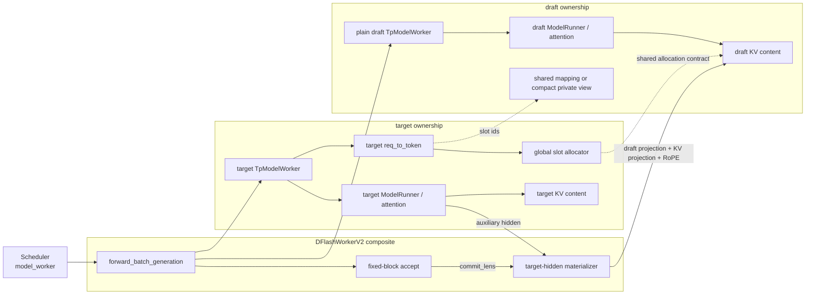
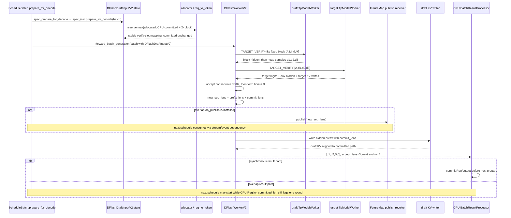
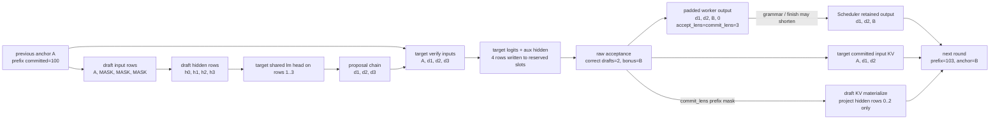

## 直接结论

DFlash 当前实现是一条固定宽度线性 block 路径，不是 EAGLE tree，也没有 `draft→verify→draft_extend` 的 recurrent hidden闭环。它先在 target 的 `req_to_token` 中为将来的 block 预留地址，用上轮 bonus作为 block 第0列、mask/noise token填其余输入，通过一个 plain draft `TpModelWorker` 一次 forward得到各位置 hidden，再用 target共享的 lm head对第1～末行产生候选；随后 target以整个候选链做 `TARGET_VERIFY`。接受后，target verify产生的 auxiliary hidden会被投影并只按 `commit_lens`写进 draft KV，使下一轮 draft注意力拥有与 target committed prefix一致的上下文。

这页最关键的三组“不等号”是：`block_size` 不等于本轮用户输出数；`kv_allocated_len` 不等于 `kv_committed_len`；target hidden物化到 draft KV 不等于把 target KV字节直接复制给 draft。DFlash draft与target可以共享全局slot地址和 allocator语义，但 draft层对 hidden做自己的 projection、K/V计算和RoPE，再写入自己的KV内容。开启 compact draft cache后，draft甚至使用私有的 `req_to_token` 窗口视图；这仍不改变 target committed frontier是事实来源。

## 当前路径假设

主线假设 CUDA设备、普通文本生成、`DFLASH` 参数已通过启动校验、`pp_size=1`、未启用 DP attention、固定 `block_size=4`、greedy sampling、无 grammar、无 Mamba，draft window默认关闭。target和draft均使用当前通用 worker/model runner；decode是否走 CUDA Graph只改变执行器和folded sampler，不改变结果合同。DFlash启动也允许NPU，但本页涉及的Triton/fused materialize fast path不能据此推为NPU行为。

源码明确拒绝 `return_logprob`，也会关闭 mixed chunked prefill；非贪心 verify 取决于当前build/device是否提供sampling verifier，否则记录warning并回退greedy。下文对 sampling只描述分支存在，不宣称回退后的统计分布仍等价。CP、PD和其他组合没有在这条主线被运行验证，不因target worker本身支持某能力就自动继承给DFlash。

## 输入、本页职责与输出

prefill输入是 R0 的 target prompt forward结果：next token `A`、每个实际extend token的auxiliary hidden、`out_cache_loc`、prefix/extend lengths。decode输入是 `DFlashDraftInputV2`，主要有效状态是 `bonus_tokens=A`、上一轮发布的 `new_seq_lens`、预留长度上界与采样top-k摘要。本页职责是追踪这些对象如何生成固定block、怎样复用地址做draft和target forward、如何接受连续前缀并只物化committed hidden。输出是 padded `out_tokens`、`accept_lens=commit_lens`、next bonus与new seq lens。

| 状态 | R0 示例 | 所有者/写入者 | 含义 |
|---|---:|---|---|
| `block_size` | 4 | ServerArgs/worker | target verify每请求固定行宽，含anchor行 |
| `bonus_tokens` | `A` | 上轮target结果 | 本轮draft block第0列/rolling anchor |
| reserved len | 108 | prepare阶段allocator | 地址表可安全读取/写入的上界 |
| `accept_len` | 2 | DFlash accept | 连续匹配的draft后继数，不含bonus |
| `commit_lens` | 3 | `accept_len+1` | 用户输出与committed frontier推进数 |
| compact draft len | 例如32 | draft私有窗口映射 | draft attention可见最近suffix，不改target全前缀 |

## 为什么存在

固定block让draft模型一次处理 `[anchor, mask, mask, ...]`，适合其训练出的denoising/block结构；target verify只需普通因果线性mask，不需要EAGLE的父子custom mask和retrieve links。少了tree构造与多步draft loop，控制流更简单，但候选只能沿一条链，不能用分支节点预算覆盖多个未来。这里是算法结构差异，不是“哪个一定更快”的源码证据。

aux hidden物化是DFlash能持续使用target上下文的桥梁。draft模型不是target模型，其KV张量布局和投影权重不同，直接引用target KV通常没有语义；DFlash让target公开所需层的aux hidden，再由draft模型 `project_target_hidden()` 与每层 `kv_proj_only()`生成draft侧K/V。prefill必须在返回并允许radix更新前完成这一步，否则prompt一旦进入prefix cache，后续R0命中缓存时draft KV可能缺失对应上下文。decode则只能写接受前缀，否则拒绝候选会污染下轮draft注意力。

双block reserve服务overlap时序。CPU `Req.kv_committed_len`可能落后device发布长度，而下一轮需要从 `req_to_token`直接gather整个block地址；`prepare_for_decode()`以 `max(cur_alloc_len, committed_len+2*block_size)`保留headroom。这个2倍是缓冲，不是一次verify两倍计算。没有预留会在forward热路径重新分配或读到未映射槽；把预留全计commit则会破坏prefix正确性。

## 对象与状态

`DFlashDraftInputV2`沿用了若干EAGLE形状字段以适配共同relay，但 `topk_p/topk_index/hidden_states`注释明确为legacy；DFlash真正跨轮依赖bonus、新seq lens、future indices、reserved CPU lengths和sampling top-k摘要。reserve的直接receiver不是 `DFlashWorkerV2`：`ScheduleBatch.prepare_for_decode()`转入 `spec_prepare_for_decode(batch)`，后者对 `batch.spec_info` 做动态分派，实际调用 `DFlashDraftInputV2.prepare_for_decode(batch)`。这个state object按请求读取 `req.kv_committed_len` 与 `req.kv.kv_allocated_len`，在可选plan stream中调用 `alloc_for_spec_decode()`扩映射，最后把 `batch.seq_lens_cpu`播种为CPU committed值，并单独保存reserved上界；overlap的后续resolve可再用已发布值覆盖执行视图。两者分离正是为了不让attention planner误把allocator水位当逻辑序列长度。

`DFlashWorkerV2`持有target worker和plain draft worker。不开window时draft复用target的request-to-token mapping和global allocator；开window时draft worker拿私有compact req-to-token表，但其中slot id仍来自target全局KV索引空间。`_rebuild_compact_draft_cache()`每轮把target committed suffix映射到draft局部 `[0,draft_prefix_len)`，再把本轮verify slots接在后面。paged attention还会向左保留至page边界，实际可见长度可能比window多至一页尾部。

`_append_target_hidden_to_draft_kv_by_loc()`是write边界：检查hidden、cache loc、positions一一对齐；prefill无 `commit_lens` 时写全部真实extend rows；decode给 `[B,block]` loc和每请求 `commit_lens`，使用prefix-valid写入。支持的CUDA/ROCm池可走fused helper，失败则逐层投影K/V；这两个实现目标相同，但源码路径不等于kernel完成时刻，后续stream依赖仍决定可见性。

下图将“共享 slot 地址”和“共享 KV 内容”彻底分开。target allocator 是全局 slot 编号的事实来源；draft KV pool 使用这些 slot id 定位，但写入的是 target auxiliary hidden 经 draft 模型自己投影后的 K/V。compact 模式只额外改变 draft 看到的 req-to-token 视图。

## 当前源码调用链

prefill时 `forward_batch_generation()`调用target并指定 `CaptureHiddenMode.FULL`，publish target结束位置，然后用 `extend_lens/prefix_lens`计算每个hidden对应position，把target hidden与已有 `out_cache_loc`交给 `_append_target_hidden_to_draft_kv_by_loc()`；写完后清空 `logits_output.hidden_states`，避免overlap把大tensor拷到CPU，最后构造bonus/new seq lens。

decode准备由 `DFlashDraftInputV2.prepare_for_decode()`扩地址。worker从target `req_to_token`按 `prefix_lens:prefix_lens+block_size`取verify slots，生成 `[A,M,M,M]`及positions。可选compact路径先重建draft局部suffix表。draft runner以 `ForwardMode.TARGET_VERIFY`一次forward；graph中可折叠greedy head，否则从hidden第1～末行用target lm head选出后继，形成候选 `[A,d1,d2,d3]`。target再用相同logical positions和slots做verify，取得logits/hidden。greedy或sampling accept返回`accept_len`与bonus，`commit_lens=accept_len+1`；worker先计算 `new_seq_lens=prefix_lens+commit_lens`，有overlap callback时立即publish这个设备前沿，然后才调用 `_append_target_hidden_to_draft_kv_by_loc(..., commit_lens=...)`物化接受前缀。publish不声称hidden已经写完；真正的下一轮draft consumer仍须服从stream/event顺序。Scheduler result processor稍后才推进CPU Req committed/output前沿。

固定 block 的一轮数据流中，最容易混淆的是“输入 target 的 token”与“target 返回给用户的 token”错一位。下图以 block size=4、correct drafts=2 为例，target 提交的输入 KV 是 `[A,d1,d2]`，而用户候选输出是 `[d1,d2,B]`；`B` 要到下轮才作为 target input。

## 连续例子

t0，R0 committed=100、allocated=104，block size=4。prepare计算 `max(104,100+8)=108`，扩映射到108；`batch.seq_lens`仍表示100。prefill上一轮bonus为`A`。t1，draft输入 `[A,M,M,M]`，得到hidden四行；head在后3行给出 `[d1,d2,d3]`，组成target候选 `[A,d1,d2,d3]`。此时proposal后继数3，verify行数4，allocated水位108，没有任何Req字段提交。

t2，target在`A`后预测`d1`、在`d1`后预测`d2`、在`d2`后预测与`d3`不同的`B`。accept_len=2，commit_lens=3，输出buffer写 `[d1,d2,B,0]`，new seq len=103。target verify已经在位置100～103写过候选输入KV，但逻辑有效的是滚动输入链 `[A,d1,d2]`；`B`作为target预测被发给用户并成为下一轮anchor。

t3，worker先形成device `new_seq_lens=103`并在overlap下publish，随后hidden writer按commit_lens=3只把前三个target hidden rows投影进draft KV；第4行对应未接受 `d3`，即使slot已分配、target曾计算，也不会成为draft committed上下文。publish先发生是控制流事实，却不能推出另一stream已经看见draft KV；下轮draft的实际读依赖仍必须覆盖materialize。

t4-sync，关闭overlap时，result processor先将R0 CPU committed从100推进到103并追加 `[d1,d2,B]`，下一轮prepare再看到allocated=108、committed=103，目标reserve为111，可能补3个slot。t4-overlap，下一轮schedule可先通过FutureMap取得device frontier=103，而CPU `Req.kv_committed_len`仍可能是100；state receiver此时按CPU值计算仍可保持allocated=108，上一轮预留的双block headroom足以覆盖本轮 `[103,107)`。等第N轮copy/result被消费后CPU frontier才到103，后续prepare再滚动到111。两条时间线都说明reserve提前、CPU commit可滞后；不能把同步时间线套到overlap。

若配置draft window=32且prefix=100，draft局部表只重建最近suffix（paged backend还会对齐左边界），但target verify仍以完整target前缀语义运行。compact只减draft可见历史，不能被解释成target prefix被截断。

## 为什么必须在这里

prefill hidden必须在worker返回前物化，因为radix cache的插入/复用发生在外层调度生命周期；晚到下一decode轮才写会让命中prefix的请求缺少draft侧上下文。decode hidden又必须在accept后按prefix写，因为accept前不知道哪一行可信。两处使用同一writer却有不同commit参数，正好表达“prompt全部真实、draft block只有accepted prefix真实”。

compact映射必须每轮从target committed state重建，而不能把上一轮draft局部表盲目向后滑。请求可能filter/merge、prefix长度可能由overlap发布、page对齐也可能改变窗口左边界；target `req_to_token`才是地址真相。相反，Req committed推进不能放进worker，因为grammar/finish/retract仍由result processor裁决。

## 边界矩阵

| 边界 | DFlash当前行为 | 变化/限制 | 证据边界 |
|---|---|---|---|
| proposal几何 | fixed linear block，首列anchor | 无EAGLE parent/retrieve tree | 不推断tree接受率 |
| hidden | target aux hidden投影成draft KV | public结果中hidden被清空 | 内部需要hidden不等于API返回hidden |
| KV mapping | 默认共享target req-to-token/global slots | window模式draft有私有compact表 | 地址共享不等于KV内容相同 |
| sampling | 有non-greedy verify分支 | kernel不可用时warning并greedy fallback | 不能声称所有build采样精确等价 |
| logprob | worker入口直接拒绝 | 无当前公开return_logprob | 算法理论可算不代表实现支持 |
| graph | draft sampler可折叠，target也可graph | eager fallback保持对象合同 | graph命中不证明同步完成 |
| DP/PP/mixed | DP attention拒绝，PP需1，mixed chunk关闭 | NPU是另一backend入口 | target能力不可直接继承 |
| release | reserve尾部保留至后续/finish | finish按committed frontier回收 | rejected行曾计算不等于立即free |

## source action / changed state / why

| source action | changed state | why |
|---|---|---|
| `spec_info.prepare_for_decode(batch)` | `kv_allocated_len`扩至双block headroom | state object在worker前为overlap提供稳定slot映射 |
| prefill target forward | prompt aux hidden + next anchor | 给draft建立完整prompt上下文 |
| draft fixed-block forward | `[A,M...]` → 后继候选 | 一次产生线性block提案 |
| target verify + accept | 候选行写target KV并产生target logits/hidden；形成commit/new lens | target裁决连续正确前缀 |
| `on_publish(new_seq_lens)` | device前沿进入FutureMap及其依赖事件 | 让下一轮规划无需等待CPU Req提交 |
| prefix-valid hidden materialize | 仅accepted rows写draft KV | 避免拒绝候选污染下轮draft |
| result processing | committed/output推进，finish回收尾部 | 结合Scheduler持久Req状态提交 |

## 自测

1. block size=8 时，DFlash一轮最多提出多少个anchor后的draft后继？为什么verify仍是8行？
2. `allocated=120, committed=109` 能否说明位置109～119都有可信draft KV？真正执行reserve的receiver是谁？
3. prefill与decode都调用hidden writer，为什么一个不传commit_lens而另一个必须传？
4. compact draft cache截短的是哪一侧的attention历史？target committed prefix是否被改短？
5. 为什么源码中的 `new_seq_lens → publish → hidden materialize` 不允许下轮draft忽略stream/event依赖？同步与overlap的CPU committed时点有何不同？
