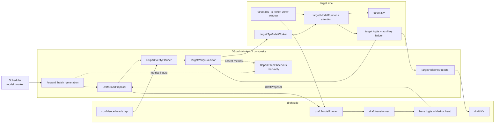
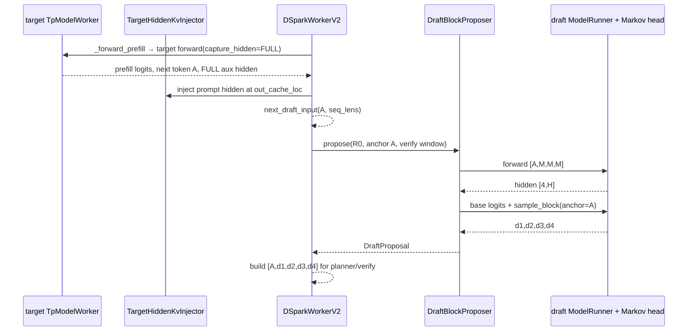
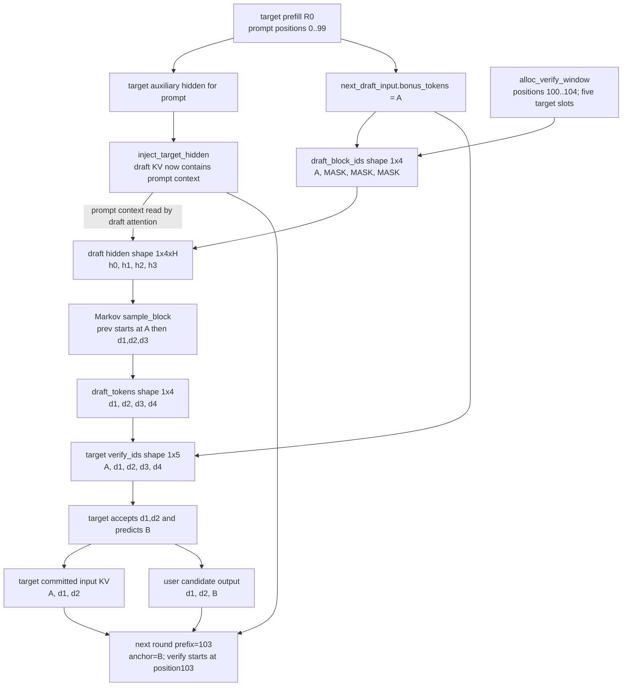

## 直接结论

DSpark 的第一轮不是凭空得到 `gamma` 个draft token。target prefill先生成一个next token，这个token成为rolling anchor；同时target auxiliary hidden经过 `TargetHiddenKvInjector`写成draft模型可读的KV。decode时 `DraftBlockProposer`构造长度为 `gamma` 的draft输入 `[anchor, MASK, ..., MASK]`，draft forward为这`gamma`行产生hidden；随后base logits与Markov head以“前一个真实/已采样token”为条件，顺序采出 `d1…d_gamma`。target最终验证的却是宽度 `gamma+1` 的 `[anchor,d1,…,d_gamma]`。

rolling anchor解决了自回归边界的一个偏移：本轮用户输出是若干accepted draft加新bonus，但target KV实际提交的输入链是旧anchor加accepted drafts；新bonus尚未作为input经过target，留给下一轮做anchor。于是“输出长度”和“提交KV长度”相同，内容却错开一位。`new_seq_lens=prefix_lens+commit_lens`只表示前沿位置推进，绝不能解释成新bonus已经拥有target KV。本页先建立这个proposal坐标，confidence和ragged layout留到下一页，accept/KV回收留到再下一页。

## 当前路径假设

主线是CUDA、`DSPARK`、`pp_size=1`、`gamma=4`、verify width=5、普通文本R0、greedy、无grammar、无logit adjustment、static或尚未改变proposal的ragged配置。target与dense draft模型在同一worker进程，draft checkpoint提供合法 `mask_token_id` 与Markov head；target暴露lm head，worker把target embedding/lm head附给draft所需模块。是否走draft CUDA Graph不改变proposal对象，只会决定greedy sampler/head/confidence是否折叠到graph尾部。

DSpark允许一组受限DP attention组合：dense draft可切换draft TP context；DeepSeek-V4 MoE draft有额外attn_tp和collective守卫、idle rank参与逻辑。CP在DP模式被启动校验拒绝，PP不支持，mixed chunked prefill关闭。这里使用单rank示例，不把single-rank的调用完成视为多rank collective/device completion证据。当前worker也直接拒绝 `return_logprob`。

## 输入、本页职责与输出

prefill输入是target生成结果、FULL auxiliary hidden、extend/prefix lengths和out-cache locations；输出是已写好的draft KV以及 `DFlashDraftInputV2(bonus_tokens,new_seq_lens)`，DSpark复用该跨轮容器但不复用DFlash block算法。decode proposal输入是anchor、prefix lengths、为宽度5预先准备的verify slots、sampling info、target embedding以及draft模型。输出 `DraftProposal` 包含输入block ids、真正draft tokens、draft hidden、可选confidence/tap和 `folded`标记。

| 名称 | gamma=4 的形状/值 | 是否是用户token | 下一消费者 |
|---|---|---|---|
| `draft_block_ids` | `[B,4]=[A,M,M,M]` | 只有A是真实旧anchor | draft model forward |
| `draft_hidden_3d` | `[B,4,Hd]` | 不是token | base logits、confidence |
| `draft_tokens` | `[B,4]=[d1,d2,d3,d4]` | 只是proposal | planner与target verify |
| `verify_ids_2d` | `[B,5]=[A,d1,d2,d3,d4]` | target验证输入 | target executor |
| `bonus` | 例如B | target给的新输出 | 本轮emit、下一轮anchor |
| `new_seq_lens` | `prefix+commit_lens` | 长度状态 | FutureMap/下一轮prepare |

## 为什么存在

mask block让draft模型一次计算多个位置hidden，而Markov head在其上补回token间依赖。若直接对每个位置base logits独立argmax，`d2`不知道已经选了`d1`，proposal不再对应一条条件链；`markov_head.sample_block()`接收anchor、draft hidden和step sampler，逐步以先前token embedding修正logits。对non-greedy请求，step sampler还按每请求temperature与greedy mask选择multinomial或argmax；因此proposal对象保留corrected logits，供后续rejection sampling使用。

target embedding/lm head共享是当前模型接口的一部分，不表示draft和target整模共享权重。worker显式找到target `lm_head.weight`并调用draft `attach_shared_modules()`；draft transformer/Markov/confidence头仍来自draft checkpoint。缺少lm head、Markov head或mask token会在初始化/运行时报错，而不是自动退化成普通decode。

prefill hidden注入必须先于第一轮proposal。anchor只告诉draft“最后一个token是什么”，不足以重建长prompt的attention上下文；`TargetHiddenKvInjector`把target隐藏表示通过draft模型的写入接口变成draft KV。反过来，仅有KV没有anchor也不够，因为 `[A,M,M,M]` 的第一行必须用上一轮target预测token启动滚动链。

## 对象与状态

`DSparkWorkerV2`是组合根：`_target_worker`负责真实target；`_draft_worker/draft_model_runner/draft_model`负责mask-block forward；`_kv_injector`维护draft KV；`_proposer`生成候选；`_verify_planner`决定预算/布局；`_verify_executor`做target和accept；observer只记录，不控制写入。初始化还把 `gamma` 与 `verify_num_draft_tokens=gamma+1`分开保存，这比沿用一个模糊的 `num_draft_tokens`更能防止off-by-one。

`DraftForwardResult`保存`draft_block_ids`、raw hidden、三维hidden与graph命中；`DraftBlockResult`保存真正的draft tokens、sampling所需corrected logits、greedy mask和temperatures；`DraftProposal`把两者合并，并附带confidence或confidence tap及`folded`。`folded=True`只说明draft greedy proposal来自CUDA Graph尾部buffer，不说明target accept或KV commit也折叠，后者有独立守卫。

verify slots在proposal前由`alloc_verify_window()`从target `req_to_token`映射得到，包含position与 `[B,gamma+1]` cache loc。draft forward只使用前`gamma`列写自己的block状态；target verify使用完整`gamma+1`列。预留地址可先存在，但R0的`Req.kv_committed_len`仍由稍后的result processor推进。

组件图显示了 `DSparkWorkerV2` 为什么是“编排者”而不是又一个模型。proposal、confidence/layout、target verify/accept、hidden-to-draft-KV 分别有独立 receiver；observer 只旁路观测，不参与 token 或 KV 的正确性裁决。

## 当前源码调用链

`_forward_prefill()`调用target并要求FULL hidden，把`batch_output.new_seq_lens`设为当前seq lens并publish；随后验证hidden、extend/prefix/out loc存在，计算positions，调用injector写draft KV，清掉公开结果中的hidden，再以target `next_token_ids`构造首个anchor状态。

`_forward_decode()`确保`batch.spec_info`是 `DFlashDraftInputV2`，为R0分配verify window，然后进入draft context调用`DraftBlockProposer.propose()`。proposer的`_run_forward()`建立 `[A,M,M,M]`，positions与cache loc取verify window前gamma列，构造 `ForwardBatch(ForwardMode.TARGET_VERIFY,spec_algorithm=DSPARK)`并运行draft runner。得到hidden后，如果draft graph sampler可用、graph命中且全greedy，就直接读取其tail buffer；否则调用`compute_base_logits()`并以`sample_draft_block()`逐步采样。worker随后取得proposal，才进入confidence、budget、layout和target verify阶段。

下图只跟踪形状与 rolling anchor，不画 confidence 与 accept 细节。`gamma=4` 时 draft runner 输入是4行 mask block，Markov head 产生4个真实 draft token，target verify 则需要 `gamma+1=5` 行；这是两种宽度合同，不是某一处 off-by-one。

## 连续例子

t0，R0 prompt长度100。target prefill输入最后一个prompt token，在位置0～99写target KV，输出next token `A`和每个extend row的aux hidden。injector将这些hidden写成draft KV；此时用户还未收到后续block，但`A`作为prefill结果会进入普通结果流程并成为下一decode轮的anchor状态。

t1，decode前缀frontier记为100，anchor `A`代表将被放在位置100作为target输入。`alloc_verify_window()`准备positions `[100,101,102,103,104]`及对应5个slot。proposer只取前4个slot，构造 `[A,M,M,M]`并运行draft；得到hidden `[h0,h1,h2,h3]`。base head产生每位置初始logits，Markov head以`A`为第一个prev token采出`d1`，再以`d1`影响`d2`，依次得到`[d1,d2,d3,d4]`。

t2，worker构建target输入 `[A,d1,d2,d3,d4]`。假设target只认可`d1,d2`并产生新bonus `B`，则本轮输出 `[d1,d2,B]`，commit_lens=3，KV逻辑输入链是 `[A,d1,d2]`，new seq lens=103。位置103的`B`还没有作为target input写KV；它被放入下一轮 `next_draft_input.bonus_tokens`。

t3，第二轮的prefix=103、anchor=`B`。新的verify input从 `[B,e1,e2,e3,e4]`开始；如果错误地认为B在上轮已经有KV并从位置104开始，positions会整体错一位。连续两轮的rolling例子说明同一个`commit_lens`同时描述输出数和target输入KV数，但两组token内容是“右移一位”的关系。

## 为什么必须在这里

injector必须在prefill结束且target hidden可得时执行，因为更早没有target语义特征，更晚第一轮draft已经需要prompt上下文。`draft_block_ids[:,0]`必须在proposer内从最新 `bonus_tokens`拷入，不能仅使用`Req.output_ids[-1]`：overlap下上一轮结果可能尚未被CPU result processor写入Req，而FutureMap已经发布了device上的真实anchor。

Markov采样必须在draft hidden出来后，因为base logits/confidence tap依赖这些hidden；又必须在target verify之前，因为verify需要真实候选而不是MASK。confidence/layout必须放在proposal之后，是因为它们评估的是当前draft位置；但budget在overlap下可能来自历史relay，这一“历史决定多少、当前confidence决定给谁”的分工将在下一页展开。

## 边界矩阵

| 边界 | 当前DSpark proposal | 改变时的分支 | 不能外推 |
|---|---|---|---|
| gamma/width | gamma个draft，verify宽gamma+1 | 启动时强制二者关系 | DFlash block_size语义不可照搬 |
| anchor | 上轮target bonus | first prefill由target next token建立 | anchor不是MASK也不是最后draft |
| hidden | target aux hidden写draft KV；draft hidden供head/confidence | DSV4 draft有专用tap/forward_embed | EAGLE recurrent hidden合同不同 |
| sampling | greedy或逐request sampling | graph folded仅全greedy；sampling保留corrected logits | folded proposal不等于folded accept |
| DP | dense/MoE各有同步context和idle参与守卫 | CP不支持，PP必须1 | 单rankcall不能证明collective完成 |
| graph | draft sampler可作capture tail hook | eager仍显式算base logits/Markov | graph replay不改变rolling anchor |
| logprob | worker直接拒绝 | 无当前DSpark return_logprob路径 | 不从EAGLE/旧实现迁移结论 |
| mixed/PD | mixed chunked prefill关闭；本页同进程 | decoupled spec有独立token协议 | FutureMap不是跨进程同步 |

## source action / changed state / why

| source action | changed state | why |
|---|---|---|
| target prefill FULL capture | 产生anchor与aux hidden | 为第一轮draft提供token和长上下文 |
| `inject_target_hidden()` | target hidden → draft KV内容 | draft不能直接解释target KV |
| `alloc_verify_window()` | 为 `[anchor+gamma drafts]`取得positions/slots | proposal与verify共享稳定地址几何 |
| draft `_run_forward()` | `[A,M...]` → gamma行hidden | 一次构造多位置特征 |
| Markov `sample_block()` | hidden/base logits → 条件候选链 | 保留token间顺序依赖 |
| `make_next_draft_input()` | 新bonus/new seq → 下一轮anchor状态 | 维持rolling-anchor不变量 |

## 自测

1. gamma=4 时，`draft_block_ids`、`draft_tokens`、`verify_ids_2d`各有几列，首列分别是什么？
2. 为什么`[A,M,M,M]`一次forward后仍需Markov head逐步采样，而不能四行独立argmax？
3. 本轮输出 `[d1,d2,B]` 时，target committed KV的三项输入是什么？B何时作为target input？
4. `proposal.folded=True`能否推出target accept与KV commit已folded？请指出独立守卫。
5. prefill只有anchor而没有target-hidden注入，会让draft缺失哪类状态？
