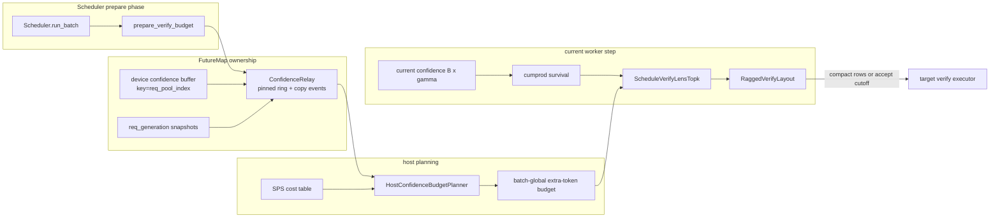
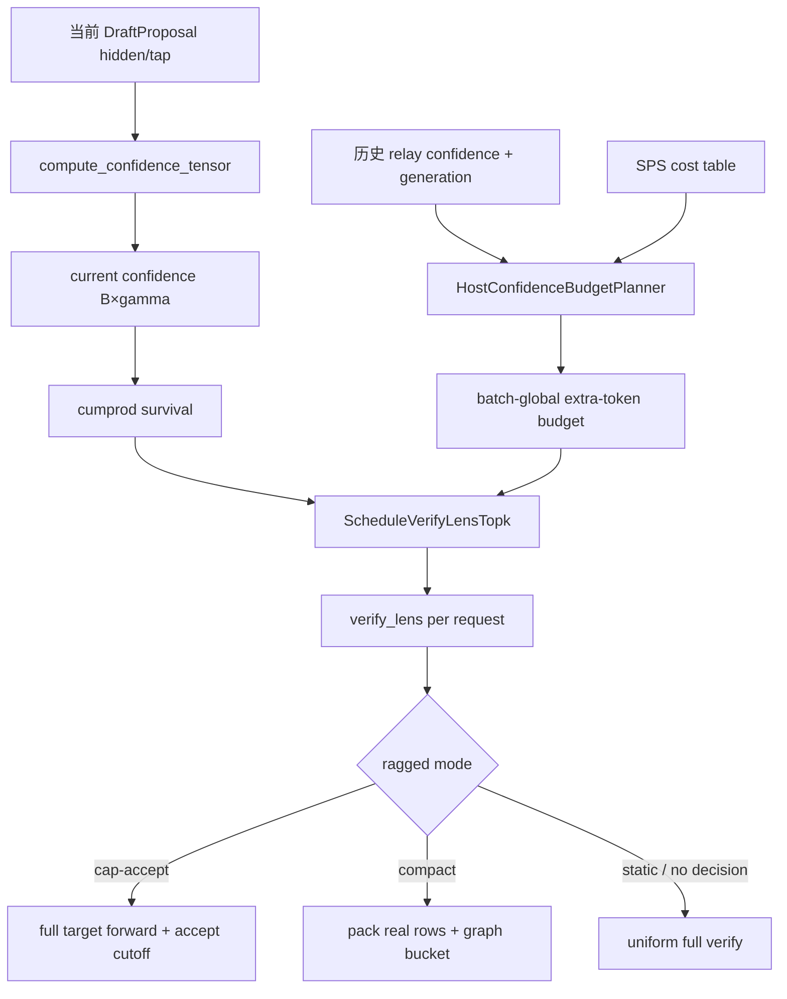
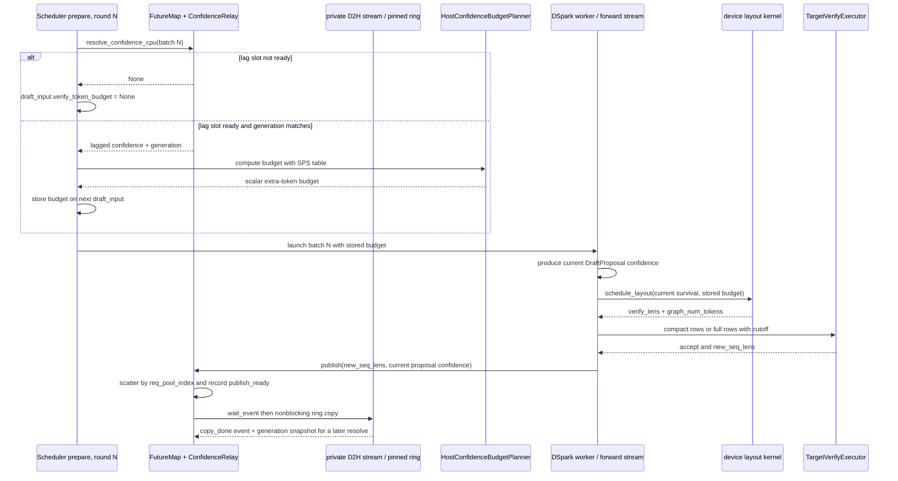

## 直接结论

DSpark confidence不是“这个请求应该验证几个token”的最终整数，也不是对词表的概率分布。它是 `[B,gamma]` 的逐位置分数，每项被约束在 `[0,1]`；按行累乘得到“接受链至少生存到该位置”的survival。planner把历史/lagged survival与SPS耗时表结合，先选一个batch-global `verify_token_budget`，其语义是“每请求最低anchor/floor之外，还允许验证多少个draft位置”；随后用当前轮confidence的survival做一次全batch top-k，把这些额外名额分配给具体请求，生成每请求 `verify_lens`。

因此“多少”和“给谁”是两次不同决策：历史confidence与cost table决定预算标量，当前confidence决定layout。`budget=0`仍保留每请求至少一个anchor verify；`budget=None`表示没有可用调度决策，代码会退回uniform/full或无ragged layout，而不是等价于0。`sum(verify_lens)`是真实计划的target行数，`graph_num_tokens`是CUDA Graph bucket上界，可能更大；二者都不是最终accept/emit数量。

## 当前路径假设

示例使用CUDA、dense DSpark、`B=2`、`gamma=4`、verify width=5、confidence checkpoint存在、STS可选、ragged mode=`compact`且有已profile SPS table、无DP attention。R0/R1都在decode且generation匹配，当前confidence只是用于layout；budget来自配置lag后的历史confidence。若未提供SPS table，当前compact路径会识别flat/uninitialized table并退化为verify-all的uniform layout，不能拿它当“动态调度已产生收益”。

`static`、`cap-accept`、`compact`必须分开：static不建动态layout；cap-accept仍让target执行full block，只在accept时截断；compact才把各请求有效rows压紧，并按graph token bucket replay。DP attention下还有rank间verify-lens广播、DP-global tier gather与idle参与；当前源码路径可证明协议存在，但本页未运行collective、CUDA Graph或SPS性能实验。

## 输入、本页职责与输出

输入是当前proposal的 `draft_hidden`、anchor、`draft_tokens`、可选DSV4 confidence tap，以及历史relay的confidence/generation、SPS cost table、ragged mode与capture grid。职责是先把模型分数变成有语义的survival，再区分host预算和device layout，并追踪输出到target executor。输出可为 `None`（static/缺决策）、或 `RaggedVerifyLayout(verify_lens, graph_num_tokens, indptr...)`。

| 量 | B=2,gamma=4 示例 | 单位 | 决定者 |
|---|---|---|---|
| confidence R0 | `[.90,.80,.50,.20]` | 每draft位置条件分数 | 当前draft confidence head + STS |
| survival R0 | `[.90,.72,.36,.072]` | 连续链生存估计 | 行内cumprod |
| budget | `3` | 全batch floor之外的额外token名额 | 历史survival + SPS |
| verify_lens | `[3,2]` | 每请求target输入行数，包含anchor | 当前survival global top-k |
| total verify | `5` | 实际有效target rows | `sum(verify_lens)` |
| graph tokens | 例如`8` | capture/replay bucket rows | grid round-up / DP tier |

## 为什么存在

固定verify width会在低接受概率位置浪费target计算，但只按每请求单一阈值截断又很难直接满足batch总成本。DSpark把问题拆成“总体成本预算”与“跨请求名额选择”：SPS table给不同batch token数对应的steps/sec或step time，`compute_verify_token_budget()`枚举额外名额，比较预测吞吐目标；`ScheduleVerifyLensTopk`再在所有请求/位置survival中挑最高项。这样一个高生存请求可以拿更多列，低生存请求仍至少验证anchor并得到新bonus。

survival使用cumprod是因为接受链必须连续：即使第4个位置局部confidence高，只要前面位置低，真正到达第4个位置的概率也低。直接对raw confidence排序会给不可达的深位置过高优先级。STS只对confidence head的raw输出施加逐位置temperature校准，不改变draft token、target logits或accept规则；校准文件存在也不等于在当前流量上已校准良好。

lag是为了把GPU confidence的D2H和host预算计算移出当前critical path。代价是预算依据旧信息，所以源码还携带`req_generation`：slot被新请求复用或generation不匹配时，planner用全1 survival作安全fallback，而不是把旧请求confidence错误套给R0。当前layout仍使用当前GPU confidence来分配预算，减轻旧预算对请求间分配的错位。

## 对象与状态

`DSparkVerifyPlanner`初始化时查找confidence head。非static mode若checkpoint没有该head会直接报错；有STS路径则校验temperature数等于gamma并写入head。planner还构建 `HostConfidenceBudgetPlanner`、决定graph tier是dynamic、DP gathered还是pinned，并记录是否因flat SPS退化为verify-all。`carries_confidence`只说明head存在，不说明动态mode一定开启。

confidence有两条当前路径。dense draft调用 `compute_confidence(draft_hidden, markov_embed_stack)`，其中prev序列是 `[anchor,d1,...,d_(gamma-1)]`；若head配置with_markov则拼入Markov embedding，最后 `apply_sts()`。DeepSeek-V4 draft可由模型的 `compute_confidence()`消费`confidence_tap`。二者输出同一 `[B,gamma]`合同，但内部特征不能互相外推。

overlap时 Scheduler在准备下一batch阶段调用 `prepare_verify_budget()`，它从 `FutureMap.resolve_confidence_cpu()`取两轮ring lag的host快照，把标量存进 `draft_input.verify_token_budget`，并可提前决定local/DP graph tier。non-overlap时 `resolve_verify_token_budget()`调用`compute_budget_sync()`把当前confidence搬到CPU，再由host planner的carry ring补足配置lag。两条路径都经过generation校验与同一budget函数。

`RaggedVerifyLayout`把`verify_lens`转换为`extend_start_loc/qo_indptr`；host可用时还保存CPU lens、真实总数和KV metadata。`graph_num_tokens`是`max(total_verify_tokens, graph_floor)`按capture grid向上取整，约束为不小于真实总数。DP tier gather在严格守卫下用各rank local tier的最大值达成共同graph key；Python collective调用返回仍不应被描述成所有device work完成。

下图是组件/管辖边界，它解释了为什么一个 planner 同时有 host 和 device 部分。`ConfidenceRelay` 只负责把已发布的 device confidence 变成带 generation 的可用 host 快照；host planner 决定“总共多少名额”，device schedule kernel 使用当前 proposal confidence 决定“名额给谁”。

## 当前源码调用链

worker在proposal之后先读取可能已folded的confidence；若为空才调用planner。`resolve_verify_token_budget()`在overlap直接取draft input中的预计算标量，在同步模式现场算。`schedule_layout()`若static返回None；若compact且flat SPS标记verify-all，从cache返回uniform layout；否则调用 `_schedule_verify_lens()`，其kernel先cumprod，再对所有request-position候选作稳定降序，选budget个有效候选并按request计数，最终`verify_lens=min_len+selected_extra`且至少1、最多gamma+1。

layout随后计算tier request数、可选DP max token tier和graph floor。若超过已capture grid，返回None并回到full path；否则用device-only或host-aware构造方法建立indptr。worker的`should_run_compact()`只在mode为compact且layout非None时为真；cap-accept即使有layout也走non-compact target forward，layout只送入accept做cutoff。

上面是量的转换；下面是 overlap 时序。要注意两个不同轮次同时出现：可用的 lagged confidence 产生 batch-global budget，本轮 draft 刚产生的 current confidence 只在 device 上分配这个 budget。

## 连续例子

t0，R0 current confidence `[.90,.80,.50,.20]`，survival `[.90,.72,.36,.072]`；R1 current confidence `[.70,.60,.40,.10]`，survival `[.70,.42,.168,.0168]`。假设history经过generation校验，SPS评估认为budget=3最优。每请求floor=1，所以无论预算如何，两请求先各保留anchor行，总floor tokens=2。

t1，global top-k从八个extra候选中选 `.90(R0-pos0)`、`.72(R0-pos1)`、`.70(R1-pos0)`。R0获得2个extra、R1获得1个，`verify_lens=[3,2]`，对应target输入R0 `[A0,d01,d02]`、R1 `[A1,d11]`。注意R0的第三个draft survival `.36` 没有入选；position索引是extra draft位置，layout长度还要加anchor floor。

t2，真实rows总数5，但capture grid可能为`[4,8,16,...]`，于是`graph_num_tokens=8`。compact builder把5个有效rows压紧，另外3行是bucket padding；不能用8计算“target验证了8个真实候选”，更不能用5计算最终接受数。target之后仍可能只接受R0一个draft、R1零个draft，各自再加bonus。

t3，下一轮budget使用lagged confidence。若R1离开、其req pool slot被R2复用，generation不匹配，host planner对该行回退全1 survival；这是保守地避免因旧低confidence把新请求预算压小，不是声称R2实际接受率为100%。等足够新轮次后，R2自己的history再进入预算。

## 为什么必须在这里

budget必须在layout之前，因为top-k需要知道全batch可选多少extra；layout又必须在target forward之前，因为compact attention的input rows、indptr和graph key都依赖verify lens。confidence必须在proposal后，因为它评估当前候选位置；把它提前到prefill或上一轮只能做历史预算，不能决定当前R0与R1谁获得具体列。

overlap预算准备放在Scheduler forward prepare阶段，是为了利用FutureMap已发布的host ring而不让当前forward同步等待；publish confidence必须发生在accept结果可发布的worker边界。DP tier agreement也必须在各rank进入token-keyed graph前完成，否则不同rank选择不同graph key/collective token形状会导致错误或挂起，而不仅是性能下降。

## 边界矩阵

| 边界 | 当前语义 | 常见误解 | 源码证据上限 |
|---|---|---|---|
| confidence | 每位置 `[0,1]` score | vocab概率、各列和为1 | 只校验范围，不证明校准质量 |
| survival | 行内confidence cumprod | 单位置独立概率排序 | 是planner排序量，不是accept结果 |
| budget | batch-global extra slots | 每请求长度或总target rows | floor另加B，cap再截断 |
| `None` vs `0` | None无调度决策；0只有floor | 两者都“不验证” | fallback路径不同 |
| static | full/uniform，无动态layout | confidence一定没计算 | head可存在但scheduler不用 |
| cap-accept | full forward，accept时cutoff | 已减少target计算 | 当前源码不compact rows |
| compact | 压紧真实rows并选graph bucket | graph tokens都是真实rows | padding与真实总数分开 |
| DP | lens广播/可选global tier/idle参与 | 各rank独立top-k即可 | 未做当前runtime collective验证 |

## source action / changed state / why

| source action | changed state | why |
|---|---|---|
| confidence head + STS | draft features → `[B,gamma]` calibrated score | 估计各连续位置价值 |
| `cumprod` | conditional-like score → prefix survival | 接受只能沿连续前缀发生 |
| host budget planner | lagged survival + cost → extra-token scalar | 在吞吐收益与target成本间选总量 |
| `ScheduleVerifyLensTopk` | current survival + budget → per-request lens | 把有限名额给当前最有价值位置 |
| layout assembly | lens → indptr、real total、graph bucket | 驱动ragged attention和graph dispatch |
| DP tier agreement | local tier → common max tier | 保证参与rank图key/collective形状一致 |

## 自测

1. B=3、min verify len=1、budget=4 时，local verify tier最多是多少；为什么不是4？
2. confidence `[.9,.5,.9]` 的survival是多少？为什么第三项不会因raw `.9`自动优先？
3. `verify_lens=[3,2]`、`graph_num_tokens=8`、最终accept lens=`[2,1]` 分别描述哪三层数量？
4. `budget=None` 与0为何会走不同fallback？
5. overlap中历史confidence决定什么，当前confidence又决定什么？generation mismatch为何要处理？
