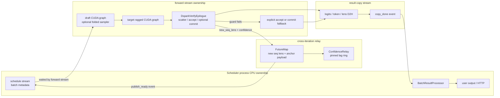
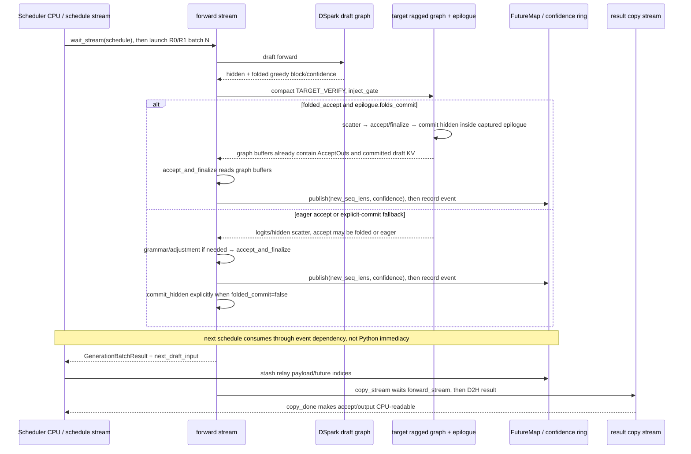
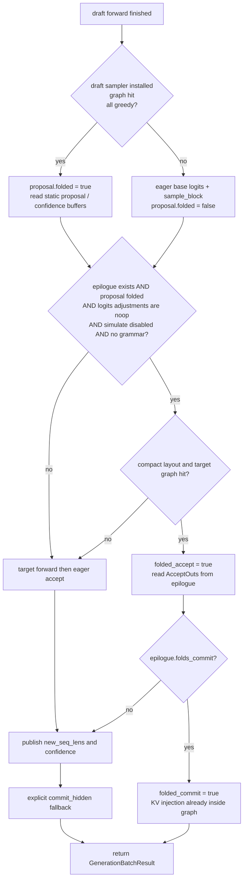

## 直接结论

DSpark里的“folded”和Scheduler里的“overlap”是两条正交轴。folded回答的是一张CUDA Graph内部到底吸收了多少本来会在graph外执行的工作；overlap回答的是第N轮设备forward、结果D2H与第N+1轮CPU调度能否通过不同stream和延迟对象并行推进。不能把“跑了CUDA Graph”简称为“整轮都折叠”，更不能把`FutureMap.publish()`的Python调用完成当作GPU工作完成。

一轮DSpark至少要分四个布尔阶段。第一，`proposal.folded`只说明greedy block token（以及可选confidence）由draft graph的捕获后sampler写入静态buffer。第二，`fold_eligible`还要求存在verify epilogue、logits adjustment为空、没有simulate accept、没有grammar。第三，`folded_accept`再要求本轮选择compact路径且target verify确实命中CUDA Graph。第四，`folded_commit`还要求epilogue持有支持融合写入的`commit_ctx`。四者是递进关系而不是同义词；任一步失败都走显式fallback，但仍必须形成相同的`AcceptOuts`、draft KV和`GenerationBatchResult`合同。

overlap可以在四种fold状态之外独立开关：可以“overlap开启但整轮eager”，也可以“overlap关闭但draft/target graph内部折叠”；可以“proposal已folded但accept因grammar退回eager”，也可以“accept已folded但draft KV commit仍显式执行”。这组组合是理解性能事件、状态可见性和fallback正确性的最低坐标系。

## 当前路径假设

主例为单Scheduler进程、CUDA、DSpark dense、batch中R0/R1均为greedy、gamma=4、ragged verify开启、compact layout有效、target decode CUDA Graph命中。R0/R1没有grammar、没有logit bias或temperature adjustment、`simulate_acc_len=0`；draft model有`compute_base_logits`与Markov head，因此可以安装`DsparkDraftSampler`。若当前KV pool暴露`set_swa_key_buffer_radix_fused_norm_rope`，示例进一步允许folded commit；否则只折叠accept。

调度侧假设`enable_overlap=True`，Scheduler有schedule stream、forward stream、result copy stream以及供seq-lens/confidence使用的prepare-D2H stream。Python进程相同并不表示所有操作同一stream；`Event.record()`只把事件排进当前stream，`wait_event()`建立后继依赖，只有`query()`、`synchronize()`或依赖链走到相应节点，host才能声称结果可读。

DP边界不从单卡例子外推。DSpark普通dense DP、DSV4 MoE同步、idle rank participation和compact graph组合各有启动/运行守卫；PP与CP也不能从“代码里出现collective”推断已兼容。本文只跟踪单rank主线与必要的DP提示，不把源码路径当作任何硬件上的实测重叠比例。

## 输入、本页职责与输出

输入是Scheduler交给`DSparkWorkerV2.forward_batch_generation()`的`ScheduleBatch`、上一轮`DFlashDraftInputV2`、每请求prefix lens、sampling info，以及overlap模式下的`on_publish=partial(FutureMap.publish, future_indices)`。本页职责是说明折叠资格如何逐层收窄、每层失败后谁补做工作，以及publish、stash、D2H copy如何把一轮结果交给下一轮。输出仍是普通spec-v2的`GenerationBatchResult`；fold状态不是另一套结果类型。

| 阶段状态 | 决定条件 | 写入或返回 | 下一个消费者 |
|---|---|---|---|
| `proposal.folded` | sampler存在、draft graph命中、全greedy | static draft token buffer，可选confidence buffer | verify layout与target输入构造 |
| `fold_eligible` | 上项成立，且epilogue存在、adjustment no-op、无grammar/simulation | `inject_gate=1`，允许graph epilogue接管 | target ragged graph capture hook |
| `folded_accept` | eligible且compact且target graph命中 | epilogue中的correct/bonus/commit/output buffers | `accept_and_finalize()`读取统一`AcceptOuts` |
| `folded_commit` | folded accept且pool支持融合commit | accepted target hidden写入draft KV | 下一轮draft forward |
| `publish_ready` | worker得到`new_seq_lens`后调用publish | pool-indexed lens/confidence与stream event | 下轮`resolve_seq_lens_cpu()`/budget prepare |
| `copy_done` |完整worker返回后Scheduler安排result D2H | CPU可读accept/output结果 | `BatchResultProcessor` |

## 为什么存在

CUDA Graph要求地址、形状和控制结构足够稳定，但DSpark的真实工作量由batch size、每请求confidence budget、ragged cutoff和sampling约束共同决定。proposal sampler折入draft graph，可以省掉graph返回后再计算base logits、采样整块token的launch；target epilogue把compact rows散回固定stride并直接计算greedy accept，可以省掉graph后的若干kernel；融合commit又能把accepted hidden按commit lens注入draft KV。它们被拆成独立能力，是因为模型是否支持Markov sampler、API是否要求logit调整、target graph是否命中、KV pool是否支持融合写，各自可能单独变化。

若只用一个`is_folded`总开关，最危险的不是少优化，而是漏做fallback。比如proposal token已经在graph里产生，并不能保证grammar mask已作用于target logits；若因此跳过eager accept，worker会按照未mask分布提交非法token。又如epilogue算出了commit lens，并不能证明draft KV内容已写；若pool没有融合注入能力却跳过`commit_hidden()`，下一轮draft会读取陈旧状态。当前代码显式计算`folded_accept`与`folded_commit`，正是把“结果已算出”和“状态已物化”分开。

overlap解决的是另一种空隙。accept后`new_seq_lens`已经足以让Scheduler准备下轮，即使hidden commit、observer、完整result D2H尚未全部结束。因此worker可在中途publish一个设备侧前沿；schedule stream的下轮准备通过event等待正确producer，而CPU不必等待所有结果字段。完整accept token仍需copy stream和`copy_done`后交给result processor。这样把“下轮forward输入所需的最小信息”和“HTTP输出所需的完整信息”分开，但没有放松任何依赖。

## 对象与状态

`DraftBlockProposer.propose()`先运行draft forward。若捕获时安装了`DsparkDraftSampler`、本轮`fwd.can_run_graph`且全greedy，它直接把sampler静态输出view成`[B,gamma]`，`corrected_logits=None`并设置`folded=True`；否则graph只产生hidden，随后Python路径调用`compute_base_logits()`和`sample_draft_block()`。因此`proposal.folded`描述token采样位置，不描述draft forward本身是否graph化，更不描述target。

target侧`DsparkVerifyEpilogue`持有固定大小的verify lens、draft tokens、correct len、bonus、commit lens、new seq lens、out tokens，以及scatter后的logits/hidden buffer。`capture_hook()`只在target runner、ragged verify、且output同时含logits与hidden时调用epilogue。`begin_step()`把本轮lens写入静态buffer，并以`inject_gate`控制融合commit是否真的写；捕获graph时可保留同一结构，运行时用gate关闭不合格分支。

`accept_and_finalize()`无论fold与否都返回`AcceptOuts`。folded时读取epilogue buffers；eager时对已scatter、已做logit adjustment或grammar mask的logits运行greedy/sampling accept与finalize。外层先用`on_publish`发布`accept.new_seq_lens`，再判断`epilogue.folds_commit`。这意味着“发布长度”的时间点位于显式hidden commit之前；正确性依赖forward stream内的顺序，以及下轮draft所在stream对publish/forward依赖的等待，不能靠Python源码行号推断设备立即可见。

`FutureMap`按`req_pool_idx`保存跨轮token、seq lens、hidden或算法payload。`publish()`先scatter lens/confidence，再在当前device stream记录`publish_ready`；`resolve_seq_lens_cpu()`在下轮从`future_indices` gather GPU lens，需要CPU镜像时由私有D2H stream等待event再copy并同步。`ConfidenceRelay`更保守：设备buffer发布后复制到深度3的pinned ring，`resolve()`只读取滞后2轮且`copy_done.query()`为真的slot，并用request generation防止pool row复用造成串请求。

下图只画进程内的所有权与 stream 边界。schedule stream 不直接读 target graph 的静态 buffer，copy stream 也不提供下轮 forward 的前沿；它们分别通过 `FutureMap.publish_ready` 与 `GenerationBatchResult.copy_done` 这两类不同 event 获得自己所需的可见性。

## 当前源码调用链

Scheduler进入`run_batch()`后先让`future_map.resolve_seq_lens_cpu(batch)`解析上一轮发布的长度，再由confidence budget prepare读取可用的relay样本；随后forward stream等待schedule stream，并解析其他future inputs。它调用composite DSpark worker并传入`on_publish`。worker proposal阶段决定`proposal.folded`，planner算layout并选择compact；根据五个守卫得到`fold_eligible`，把它作为`inject_gate`传给target executor。target返回后再以`fold_eligible && run_compact && can_run_cuda_graph`得到`folded_accept`。

如果folded accept为假，`accept_and_finalize()`显式消费最终logits；如果为真则读取graph epilogue静态buffer。真正的folded commit不是worker在publish后补做的动作：当 `folded_accept && epilogue.folds_commit` 时，`DsparkVerifyEpilogue`已经在target graph内部按 `scatter → accept → commit` 的顺序注入accepted hidden，worker读出AcceptOuts后直接publish。其余情况统一走fallback顺序：worker得到accept结果，先publish `new_seq_lens`，再显式调用`commit_hidden()`。之后才清空公开hidden引用、观察metrics、构造next draft input并返回。Scheduler stash下一轮payload，把`batch.spec_info`换成返回对象并绑定future indices；完整result由copy stream等forward stream后异步D2H。

非overlap时仍调用同一个DSpark V2 worker，只是不传`on_publish`、不使用future-map中继；worker返回后Scheduler同步安装`next_draft_input/new_seq_lens`并安排D2H。draft/target graph是否折叠由各自条件判断，不因调度不重叠而自动关闭。

最后用代码决策图把三个“folded”拆开。图中每个菱形都对应当前源码的独立 guard；任何一条失败都只会退回它所管辖的阶段，不会把整轮退回普通 decode。

## 连续例子

t0，R0/R1 prefix分别为100/60，gamma=4。上一轮已把anchor和seq lens放入future map。第N轮schedule stream完成batch元数据，forward stream等待后启动。draft graph命中，静态sampler得到R0 `[a,b,c,d]`、R1 `[x,y,z,w]`，两请求全greedy，所以`proposal.folded=True`；这只证明proposal token已在graph里产生。

t1，confidence planner给出`verify_lens=[3,2]`，compact有效rows为5，graph bucket为8。无grammar/adjustment/simulation，epilogue存在，所以`fold_eligible=True`；target graph命中，因此`folded_accept=True`。epilogue把5个有效row散回`[2,5]`逻辑stride，假设R0正确1个draft并得到bonus`B0`，R1正确0个并得到`B1`，于是commit lens为`[2,1]`、new seq lens为`[102,61]`。bucket的3个padding从不增加commit。

t2a，若pool支持融合SWA-key写入，`epilogue.folds_commit=True`且inject gate为1，target graph的epilogue在返回前已依次完成scatter、accept与accepted hidden注入；worker读取AcceptOuts后publish，外层不再commit。t2b，换成不支持该融合入口的pool，前述proposal/accept仍可folded，但`folded_commit=False`；worker读取AcceptOuts、先publish `[102,61]`，然后显式`commit_hidden(commit_lens=[2,1])`。如果grammar又使accept eager，顺序仍是eager accept→publish→explicit commit。两种路径返回完全相同的accepted tokens和下轮anchor；差别只在draft KV物化由graph epilogue还是fallback receiver完成。

t3，worker得到commit lens后publish `[102,61]`和confidence，forward stream记录event。schedule stream可准备第N+1轮，但读取发布值的stream必须等待event。confidence D2H进入ring，本轮值不会立刻供CPU预算使用：relay只取两轮前完成copy且generation仍匹配的slot。与此同时worker完成显式commit/observer并返回，copy stream再等待forward stream复制完整结果。HTTP/result processor读取accept token要等`copy_done`，不能因为publish已经调用就提前读。

t4，第N+1轮R0启用grammar。draft graph仍可能给出`proposal.folded=True`，但`not batch.has_grammar`失败，故`fold_eligible=False`，target可以仍走compact graph做forward/scatter，却必须在graph外先应用grammar mask，再eager accept，最后显式commit。这个反例证明“proposal folded”不能推出“accept folded”。若关闭Scheduler overlap，t0至t2的折叠仍可发生，只是没有中途publish与跨轮future relay。

## 为什么必须在这里

proposal采样必须在draft graph capture hook中完成，才能复用graph内hidden和静态输出buffer；若在target后才补算，候选已经来不及构造verify输入。grammar与logit adjustment必须在accept之前落到target logits，因此任何graph epilogue看不到这些变化时都必须关闭folded accept。simulate accept同样改变裁决，不能在epilogue之后覆写一个已经融合commit的结果。

hidden commit必须在accept后，因为commit lens此前未知；它又必须在下一轮draft读取KV之前完成。publish可以位于显式commit前，是因为它只发布下轮长度/预算所需的前沿，不宣称draft KV已在host可见；跨stream依赖必须覆盖真正消费者。若把publish event解释成“整轮完成”，会既高估重叠，又掩盖下一轮draft对commit完成的真实依赖。

confidence relay使用两轮滞后而非每轮强制D2H同步，是为了避免CPU budget决策把forward串行化。代价是预算依据是旧样本；generation校验与fallback策略必须处理新请求、pool row复用和copy尚未完成。这里的设计是“允许安全陈旧”，不是“当前confidence即时驱动当前accept”。

## 边界矩阵

| 组合 | proposal | accept | draft-KV commit | Scheduler overlap | 典型原因/结论 |
|---|---|---|---|---|---|
| 全折叠主线 | graph sampler | graph epilogue | graph epilogue | 可开或关 | greedy、compact、graph命中、pool支持融合 |
| accept折叠/commit显式 | graph sampler | graph epilogue | `commit_hidden()` | 可开或关 | pool无融合commit入口，结果语义不变 |
| proposal折叠/accept显式 | graph sampler | eager | eager | 可开或关 | grammar、logit adjustment或simulation |
| proposal eager/target graph | eager base logits+sample | 可能eager；fold资格已失败 | eager | 可开或关 | sampling或draft sampler不可用 |
| 全eager但重叠 | eager | eager | eager | 开 | stream/future relay仍可跨轮并行 |
| graph折叠但不重叠 | graph | graph或eager | graph或eager | 关 | 同步调度不禁止worker内部graph优化 |
| DP idle rank | 无真实请求，按守卫参与必要collective | 无业务accept | 无业务commit | 依DP实现 | 不能按单rank主线假装可直接跳过 |
| logprob请求 | 当前DSpark拒绝 | 不进入上述API主线 | 不适用 | 不适用 | EAGLE能力不可外推到DSpark |

## source action / changed state / why

| source action | changed state | why |
|---|---|---|
| draft sampler capture | graph hidden → static proposal/confidence | 把greedy proposal移入稳定graph边界 |
| compute `fold_eligible` | runtime约束 → epilogue gate | 保证mask/adjustment/simulation不会被绕过 |
| target epilogue | compact rows → strided accept buffers | 在graph内形成统一AcceptOuts布局 |
| commit fallback | accepted target hidden → draft KV | pool不能融合时补齐相同持久状态 |
| `FutureMap.publish()` | pool row的new lens/confidence + event | 让下轮只等待所需前沿，而非完整D2H |
| confidence ring resolve | 两轮前pinned sample → budget输入 | 避免每轮host同步并防row复用污染 |
| result copy | device accept/output → CPU tensors | result processor/HTTP读取完整结果前的真实边界 |

## 自测

1. `proposal.folded=True`而R0带grammar时，哪两个后续布尔量必须为false，accept由谁执行？
2. target compact graph命中但KV pool不支持融合注入时，哪些结果已产生、哪个状态仍必须由`commit_hidden()`补齐？
3. 为什么`FutureMap.publish()`调用返回不能证明CPU可读取`new_seq_lens`，更不能证明完整accept tokens已经D2H？
4. 请构造“overlap开启但完全eager”和“overlap关闭但folded accept”各一个合法组合。
5. confidence relay为什么读取两轮前slot？request generation在pool row复用时保护了什么？
