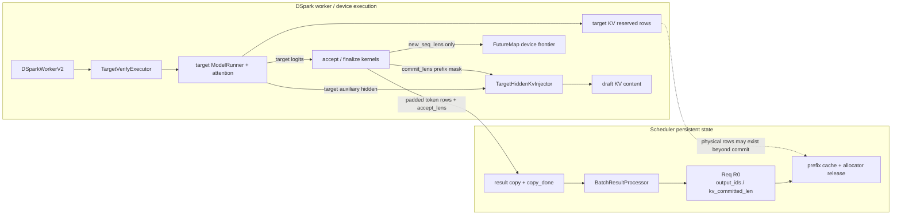
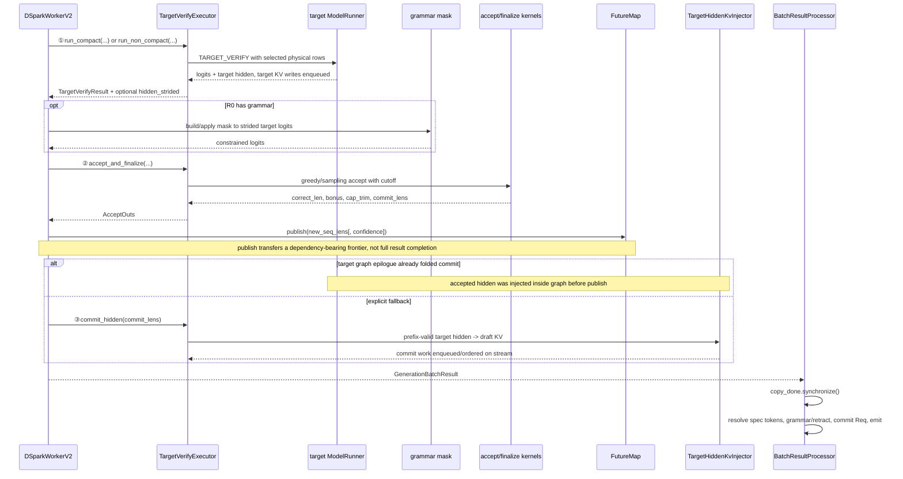
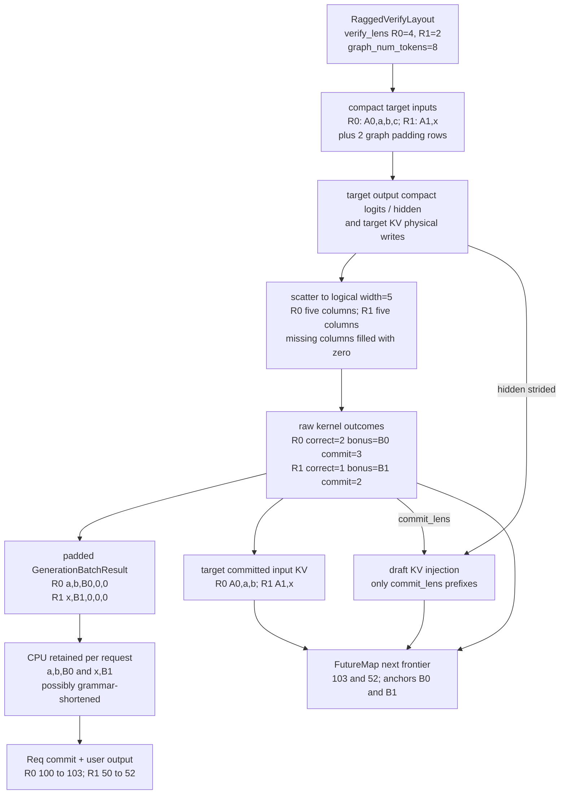

## 直接结论

DSpark verify的一次target forward会在候选窗口的slot中写target KV并返回每行logits/aux hidden，但“写过”不等于“提交”。accept只允许从anchor后的draft链连续向前：`correct_len=k`表示前k个draft被target接受；target在下一位置产生`bonus`；`commit_lens=k+1`同时是本轮输出数与KV逻辑推进数。用户输出是 `[d1…dk, bonus]`，target KV应保留的输入链是 `[old_anchor,d1…dk]`，两者长度相同、内容右移一位。

compact只计算每请求 `verify_lens` 指定的真实rows，随后把logits、hidden和候选散回固定 `[B,verify_width]` stride；缺失列明确填0，再由cutoff阻止这些padding进入提交。full-forward cap-accept则仍计算完整width，只在accept阶段把可提交深度截到 `verify_lens-1`。因此只有full-forward的trim可以表达“target确实算过、但因cap没有提交”的正确draft数；compact的0填充不能提供未计算列的反事实正确性。接受后`commit_hidden()`仅把accepted prefix的target hidden物化到draft KV。Scheduler稍后根据`accept_lens`、grammar、retract/finish状态推进 `Req.kv_committed_len` 和 `output_ids`；未提交候选slot可以被后续轮次覆盖，最终finish/retract由`release_kv_cache()`回收allocated尾部。

## 当前路径假设

主线为CUDA dense DSpark、R0/R1普通decode、gamma=4、verify width=5、greedy、无grammar、无simulate accept、非folded eager accept；先给compact `verify_lens=[4,2]`示例，再指出non-compact差异。target attention backend支持对应ragged metadata，worker已通过PP/DP/CP启动守卫。public `return_logprob`仍被拒绝，aux hidden只作内部KV注入。

sampling请求会构造draft probs并走`AcceptSampling`，混合batch按greedy mask选择两组结果；grammar会先对所有strided target logits应用mask且禁用folded accept。Mamba/ReplaySSM有额外state commit helper，DP idle rank有dummy target-verify参与。本页说明分支边界但不宣称这些后端在当前环境已运行，也不把Python kernel调用当设备同步完成。

## 输入、本页职责与输出

输入是proposal `[old_anchor,d1…d4]`、完整verify window、可选ragged layout、sampling info和prefix lengths。`DSparkWorkerV2._forward_decode()`是编排receiver；`TargetVerifyExecutor`不是一次完成全部工作的黑盒，而是由worker分三次调用：先 `run_compact()/run_non_compact()`，再 `accept_and_finalize()`，最后在未folded时 `commit_hidden()`。grammar mask和`FutureMap`发布都发生在这些调用之间。输出`AcceptOuts`包含correct drafts、bonus、cap trim、commit lengths、新序列长度与固定stride padded tokens；外层再打包为`GenerationBatchResult`。

| 字段 | R0 示例 | 是否控制写入 | 语义 |
|---|---:|---|---|
| `verify_lens` | 4 | 控制target物理/accept可见窗口 | anchor + 最多3个draft位置 |
| `correct_len` | 2 | 是，决定accepted drafts | target连续认可`d1,d2` |
| `bonus` | `B` | 是，作为输出和next anchor | 第一个未由draft正确覆盖的target token |
| `cap_trim_lens` | compact例为0 | 否，只进入block metrics | compact padding不代表未计算列；full-forward时才可解释为已计算后被cap截掉的正确draft数 |
| `commit_lens` | 3 | 是 | `correct_len+1`，含bonus计数 |
| `out_tokens` | `[d1,d2,B,0,0]` | 前3项有效 | 固定stride结果buffer |
| `kv_allocated_len` | 例如110 | 否 | 地址预留水位，不是逻辑prefix |

## 为什么存在

target必须并行计算候选后才能知道连续正确长度，因此verify slots要先分配，KV写入也会覆盖所有实际forward rows。若accept kernel直接删除rejected KV或修改allocator，它会与graph/eager、DP padding、overlap result延迟纠缠，并让下一轮地址不稳定。当前设计让地址和内容可超前写，逻辑提交由`commit_lens`及Req frontier限定；拒绝尾部不是可见prefix，之后相同逻辑位置可以被新proposal覆盖。

固定stride输出让Scheduler无需理解每请求ragged长度。`next_token_ids`仍按`verify_num_draft_tokens`分块，`accept_lens`告诉CPU每块取多少；如果用ragged总数作为stride，第二个请求的起点会随第一个请求accept数变化，overlap buffer与graph static storage都难以复用。padding 0不进入Req，因为processor只切有效前缀。

draft KV commit必须读取target hidden而非draft hidden。draft hidden描述proposal模型对mask block的表征，不能证明target接受后的上下文；target verify hidden对应target已计算的真实输入行，再经draft模型投影写入draft KV。只写`commit_lens`前缀保证下轮draft不会关注已拒绝的`d_(k+1)`。

## 对象与状态

`VerifyWindow`先为每请求建立`positions_2d=prefix+offsets`与完整 `[B,width]` target cache loc。compact时 `BuildRaggedVerifyWindow`按`verify_lens`压紧token、position、cache loc到`graph_num_tokens`；target结果仍是compact rows。executor随后通过`ScatterCompactToStrided`恢复 `[B*width,*]`，logits与hidden未验证列用 `0.0` 填充，graph epilogue也把候选缺列填0，使logit adjustment与accept共享一个逻辑几何。这里的0只是静态布局占位符：cutoff保证它不能增加commit，但若某个metric读取padding产生的`cap_trim_lens`，也不能把它解释为target在这些位置“本来会预测正确”。当前 `maybe_observe()`在compact模式直接warning并跳过debug confidence metrics，正是因为padding会污染per-position prefix label。

`accept_draft_tokens()`从`DraftBlockResult.greedy_mask`分派。全greedy直接调用`AcceptGreedy`；全sampling由corrected logits/temperature生成draft probs并调用`AcceptSampling`；混合batch两边都算后用`SelectMixedAccept`逐请求选。`FinalizeAcceptLens`计算`commit_lens=correct_len+1`与`new_seq_lens=prefix+commit`，`BuildOutTokens`把accepted drafts与bonus放在前部。

KV要区分target与draft。target verify按`batch.out_cache_loc`写target pool；非compact `commit_hidden()`从`logits_output.hidden_states.view(B,width,H)`取全部物理行，却把`cache_loc_2d`和`commit_lens`交给prefix-valid injector。compact先将hidden散回strided，再由`inject_ragged()`构造commit布局。这里完成draft KV内容对齐，但并不在CPU Req上推进committed字段。

等待D2H不是 `_resolve_spec_v2_tokens()` 的内部职责。真正receiver是外层 `BatchResultProcessor.process_batch_result_decode()`：它先对 `result.copy_done.synchronize()`，然后才进入spec-v2解析；此时 `_resolve_spec_v2_tokens()`只断言CPU tensor、读取accept lens、处理grammar retained prefix，并对仍有效R0增加实际保留token数。随后decode loop追加output并更新finish；finish时`release_kv_cache()`让prefix cache只处理`effective_kv_committed_len`，再释放到`kv_allocated_len`的尾段。这才是allocator意义的reclaim，不应在accept kernel旁虚构“立即free每个reject slot”。

先看组件所有权：target executor 同时调用 target model、accept kernels 与 hidden injector，但它不持久更新 `Req`；`FutureMap` 只保存下轮调度需要的 device frontier；唯一会将最终 retained tokens 写入 `Req.output_ids/kv_committed_len` 的是 CPU result processor。

## 当前源码调用链

worker先根据mode第一次调用executor的`run_compact()`或`run_non_compact()`。non-compact构造完整`DFlashVerifyInput`，调整host seq lens上界后调用target `forward_batch_generation(is_verify=True)`；compact先build ragged window、设置epilogue buffers，再执行ragged target，最后scatter回strided并应用logit adjustments。第一次调用返回后，若有grammar，worker在第二次executor调用之前构造linear tree mask并作用于每行logits。

worker第二次调用`accept_and_finalize()`；folded fast path只读取graph epilogue buffers，本页eager主线则调用`accept_draft_tokens()`、可选simulate override、finalize和out-token builder。worker随后调用 `on_publish`，其具体receiver是overlap Scheduler绑定的 `FutureMap.publish(future_indices, ...)`。只有当target graph epilogue已经融合commit时才跳过第三次调用；否则worker第三次调用`commit_hidden()`。返回结果时`accept_lens=commit_lens`，`block_accept_lens=commit_lens+cap_trim_lens`只供metrics，`cap_lens=verify_lens`记录窗口。CPU result processor以固定width stride切片，才持久提交；其中 `copy_done.synchronize()`在`process_batch_result_decode()`外层，不在`_resolve_spec_v2_tokens()`内。

下图用 `R0/R1, width=5, verify_lens=[4,2]` 把一个 compact batch 拆成六类结果。特别注意：`raw acceptance` 是 device kernel 输出，`padded result` 是跨 device/CPU 的固定 stride 合同，`user-visible output` 还要经过 grammar/finish/retract；三者不能用一个“accepted tokens”箱子取代。

## 连续例子

t0，R0 prefix=100，R1 prefix=50，width=5；完整地址窗口已映射。layout给`verify_lens=[4,2]`：R0 target真实输入 `[A0,a,b,c]`，R1 `[A1,x]`，compact总有效6行，graph bucket可能8。R0的`d`和R1的`y,z,w`本轮不进入target真实verify；bucket多出的2行只是padding。

t1，compact target对R0确认`a,b`，下一预测`B0`，所以correct_len=2、commit=3、输出`[a,b,B0]`、`cap_trim=0`。对R1仅真实计算 `[A1,x]` 两行，确认`x`后由已计算的第二行logit产生`B1`，所以correct_len=1、commit=2、输出`[x,B1]`、本例`cap_trim=0`。R1的`y,z,w`对应候选、logits和hidden列都只是0 padding；源码无法据此回答“若继续全宽，y是否正确”，因此课程也不做这种反事实推断。

t1b，另取full-forward cap-accept请求R2：width=5全部真实计算，`verify_lens=3`只允许anchor后最多2个draft。若target在完整结果上连续确认`u,v,w`，accept先得到raw correct=3，再由 `capped=min(3,3-1)=2` 得到correct_len=2、`cap_trim=1`、commit=3。这里trim有意义，因为`w`所在行确实由target计算过；这与compact缺失行填0是两种不同证据。

t2，target KV逻辑保留R0 `[A0,a,b]`三行、R1 `[A1,x]`两行；draft hidden injector也只写这些prefix。输出却分别以`B0/B1`结尾，它们进入下一轮anchor。结果buffer按width=5放 `R0:[a,b,B0,0,0]`、`R1:[x,B1,0,0,0]`；R1切片起点仍是5，不是R0 commit数3。

t3，CPU processor若无grammar/retract，将R0 committed `100→103`、R1 `50→52`，再扩output。若R1在延迟结果处理前已retract，则不推进其Req；其allocated尾部由retract/release路径回收。t4，下一轮R0以prefix103、anchorB0覆盖位置103之后的新verify窗口；旧rejected rows不是可访问committed prefix。

  

    <h3>过程实验：一轮 DSpark 中哪条前沿真正前进</h3>
    
固定 R0/R1 的 compact verify 样例，分开观察 target 行、accepted token、target KV、draft KV、FutureMap 与 CPU Req；它们不会在同一时刻完成。

  

  

    <button class="button" data-lab-step="layout">1 layout / reserve</button>
    <button class="button" data-lab-step="target">2 target verify</button>
    <button class="button" data-lab-step="accept">3 accept / finalize</button>
    <button class="button" data-lab-step="publish">4 publish relay</button>
    <button class="button" data-lab-step="hidden">5 draft hidden commit</button>
    <button class="button" data-lab-step="cpu">6 CPU commit / reclaim</button>
  

  

    <section class="step-lab__panel" data-lab-panel="layout">
      

<b>R0</b> prefix=100 width=5

<b>R1</b> prefix=50 width=5

verify_lens=[4,2]

compact rows=6 graph bucket可为8

      
allocator/mapping 已给固定宽度窗口留地址，但 target 本轮只接收 6 个真实 ragged 行；bucket 的 2 个 padding 行和 R1 的 y/z/w 都不是“被验证但拒绝”。

    </section>
    <section class="step-lab__panel" data-lab-panel="target">
      

<b>R0 rows</b> [A0,a,b,c]

<b>R1 rows</b> [A1,x]

<b>target device work</b> logits + hidden + 对应行 KV

      
compact target 只对真实行排队计算，再 scatter 回固定 width 结果布局。此刻 CPU Req 的 committed 仍是 100/50；“KV writer 已排队”也不是 host 已经同步完成。

    </section>
    <section class="step-lab__panel" data-lab-panel="accept">
      

R0 correct=2 commit=3

R0 out=[a,b,B0]

R1 correct=1 commit=2

R1 out=[x,B1]

      
<code>accept_and_finalize()</code> 在 grammar/logit adjustment 之后形成 <code>commit_lens=[3,2]</code>。bonus B0/B1 是输出尾 token；本轮 target KV 对应的是输入行 A0/a/b 与 A1/x，不能把 bonus token 误读成已经拥有自己的 KV。

    </section>
    <section class="step-lab__panel" data-lab-panel="publish">
      

<b>AcceptOuts</b> padded output + commit_lens

on_publish →

<b>FutureMap</b> future_indices 对应的 relay 已发布

      
publish 让 overlap 下一轮能解析 future 输入；它不是 target/draft 所有 device 写都完成的总 completion event，也没有在这里修改 <code>Req.output_ids</code>。

    </section>
    <section class="step-lab__panel" data-lab-panel="hidden">
      

target prefix KV R0: A0/a/b R1: A1/x

commit_hidden(commit_lens) 按 stream 次序注入

draft KV frontier 只追到 accepted prefix

      
只有 fused graph epilogue 已完成等价提交时才跳过显式第三次调用；否则 hidden injector 修补 draft KV。被拒绝尾列不会进入 draft 的可读前沿。

    </section>
    <section class="step-lab__panel" data-lab-panel="cpu">
      

<b>GenerationBatchResult</b> copy_done + width-strided rows

synchronize / resolve / current Req guard →

<b>Scheduler Req</b> R0 100→103；R1 50→52 output_ids 追加 accepted rows

      
<code>process_batch_result_decode()</code> 外层先同步必要 copy，再按固定 width 切片并检查 grammar、finish、retract。rejected/overallocated tail 由 release/retract 的所有权路径回收，不在 accept 瞬间逐 slot free。

    </section>
  

  

<button class="button button--quiet" data-lab-action="prev">上一步</button><button class="button" data-lab-action="next">下一步</button><button class="button button--quiet" data-lab-action="reset">复位</button>

## 为什么必须在这里

ragged pack必须在target forward前，scatter必须在统一accept前。若直接在compact buffer上用固定stride accept，R1行起点会按R0 lens变化；若不scatter又复用现有sampling/logit adjustment kernel，索引会错误。accept必须在grammar/logit adjustment之后，否则target裁决的分布与API约束不一致。

hidden commit必须在accept之后才能得到commit_lens，但要在下一轮draft读取这些slot之前完成。Req committed推进更晚，在CPU result processor，因为只有它能处理grammar retained run、finish与retract。finish释放又必须使用committed frontier，而不是本轮verify width，才能既保留可缓存prefix又释放over-allocation。

## 边界矩阵

| 边界 | 当前行为 | 状态影响 | 不能误读 |
|---|---|---|---|
| full verify | 每请求width行 | target写完整候选slot | 写入不等于commit |
| compact | 只pack `verify_lens`有效rows，缺列填0 | scatter回固定stride，cutoff限制commit | graph bucket不等于真实rows；padding不提供反事实正确性 |
| full-forward cap-accept | target仍full width，所有候选行真实计算 | `capped=min(raw, verify_lens-1)`，trim=`raw-capped` | trim只在已计算行上有“cap截掉”含义；不节省forward rows |
| greedy/sampling | 不同accept kernel，混合逐req选择 | 都输出同一AcceptOuts | greedy规则不可套sampling |
| grammar | mask logits并禁folded accept | 可进一步截断CPU retained run | worker原始accept不一定最终emit |
| target KV | verify forward写候选内容 | committed prefix由Req长度界定 | reject未必立即free |
| draft KV | 只注入committed target hidden | 下轮proposal上下文修复 | 不是target KV字节复制 |
| logprob/hidden API | logprob拒绝；hidden内部后清空 | 不进入公开返回 | 内部aux不能当用户hidden |

## source action / changed state / why

| source action | changed state | why |
|---|---|---|
| allocate verify window | committed prefix后映射完整candidate slots | target forward前获得稳定写地址 |
| target verify | slots写target KV，返回logits/hidden | 计算候选的真实target分布 |
| compact scatter | packed rows → fixed request stride | 复用统一adjustment/accept/result合同 |
| accept/finalize | logits+draft → correct/bonus/commit/out tokens | 只提交连续前缀并保证至少bonus |
| hidden commit | accepted target hidden → draft KV | 让下一轮draft上下文对齐 |
| result/release | Req frontier/output推进；尾部最终回收 | 持久状态结合grammar/finish裁决 |

## 自测

1. correct_len=2时commit_lens为何是3？输出token与target KV输入token分别是哪三项？
2. compact `verify_lens=[4,2]`、graph bucket=8时target有几个真实rows？padding为何既不能进入commit，也不能证明未计算候选“本来正确”？
3. full-forward width=5、`verify_lens=3`、raw correct=3时，correct、trim、commit各是多少？为何这个trim和compact padding不同？
4. target已经对reject候选写KV，为何它们不会进入下一轮有效prefix？
5. 请按receiver说明 `run target → grammar → accept → FutureMap publish → hidden commit → copy_done wait → Req提交`，并区分“draft KV内容commit”“Req.kv_committed_len推进”“allocator尾部free”。
