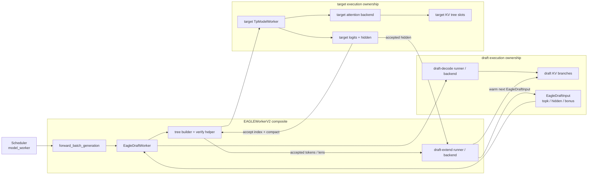
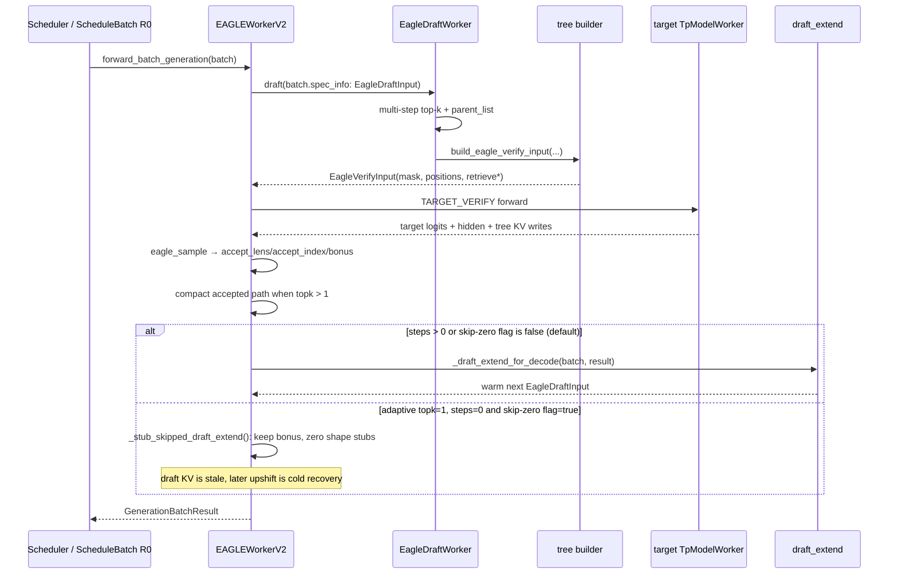
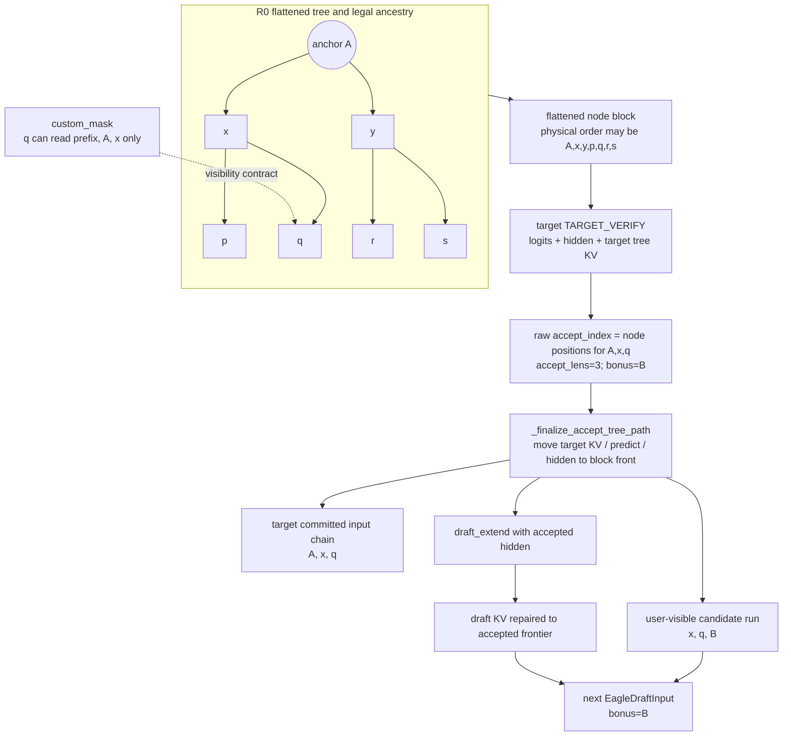

## 直接结论

EAGLE/EAGLE3 的核心不是“同时猜 top-k 个 token”，而是把多步 top-k 选择组织成一棵有父子关系的候选树，然后让 target 在一次 `TARGET_VERIFY` 中利用 `custom_mask` 只看各节点自己的祖先路径。`retrieve_index` 不是候选排序表，而是把每条根到叶的验证路径映射回扁平 tree node；`retrieve_next_token` 与 `retrieve_next_sibling` 又把树变成 grammar/accept 可遍历的链接。target accept 的是一条连续路径，不会把不同兄弟分支拼成输出。

EAGLE 还多出一个常被忽略的闭环：prefill 或 verify 得到 target hidden 后，`draft_extend` 必须用已接受 token 与这些 hidden 重放/修复 draft 模型状态，产出下一轮 `EagleDraftInput(topk_p, topk_index, hidden_states, bonus_tokens)`。因此默认worker一轮不是 `draft→verify` 就结束，而是 `draft→verify→draft_extend`；这也解释了为什么 EAGLE 的 overlap 写后读屏障由 draft runner 的最后共享缓冲读取阶段承担，而不是 target verify 一返回就认为所有设备工作结束。唯一需要单列的当前边界是adaptive把steps降到0时，可通过非默认环境开关 `SGLANG_SPEC_SKIP_ZERO_STEP_DRAFT_EXTEND=true`跳过repair；默认值是false，跳过后只保留shape-valid stub，draft KV会变冷/陈旧，不能把这个实验分支写成一般合同。

## 当前路径假设

本页主线为当前 CUDA/ROCm 通用 `TpModelWorker` 上的单层 `EAGLEWorkerV2`，文本生成 R0，`topk=2`、`speculative_num_steps=2`，开启 greedy tree verify，不含 rejection sampling、multi-layer EAGLE、DSA index-share、Mamba或 grammar。连续例子的steps=0段是另起的合法adaptive边界R0a，并把topk切为1；它不与前面的topk=2 tree示例混为同一个runtime。R0a假设环境开关默认 `SGLANG_SPEC_SKIP_ZERO_STEP_DRAFT_EXTEND=false`，只有专门设置true才走跳过分支。EAGLE3 在worker骨架与tree contract上共享此主线，但draft模型结构、hidden来源和DP attention配置可不同；这里不把EAGLE的模型数学外推成所有EAGLE3 checkpoint的内部层实现。

需要保留的 backend 边界包括 CPU/NPU/XPU 的 verify kernel/graph实现、page size大于1时的分支页预留、DP attention下 EAGLE3 的 draft TP context、decode/prefill CUDA Graph 与 eager fallback。源码证明这些 dispatch 与状态转换存在，未证明当前机器已跑通某个 checkpoint，也未测量 tree width 带来的接受率或加速比。

## 输入、本页职责与输出

R0 在 prefill 后的输入是 target 采样得到的 bonus token `A`、draft_extend 产生的一组初始 `topk_p/topk_index`、每请求一个 recurrent hidden，以及 committed prefix长度。`EagleDraftWorker.draft()`消费这些 seed，执行若干 draft step，输出 parent列表、选中节点索引和 tree tokens；`build_eagle_verify_input()`把它们变成 target attention和accept所需几何。本页输出是 `GenerationBatchResult` 及下一轮 `EagleDraftInput`，并明确 target KV 与 draft KV 在 accepted path 上如何恢复一致。

| 对象/字段 | 形状直觉 | 写入者 | 读取者 |
|---|---|---|---|
| `EagleDraftInput.topk_p/topk_index` | `[B,topk]` 的下一层 seed | draft_extend | 下一轮 draft step 0 |
| `hidden_states` | 每请求或每分支的 draft recurrent input | target hidden 经 draft_extend | draft model forward |
| `parent_list/top_scores_index` | 候选父子与保留节点 | 多步 draft组织逻辑 | tree builder |
| `custom_mask/positions` | tree target attention几何 | `build_tree_kernel_efficient` | target attention backend |
| `retrieve_index` | 每请求每条接受路径对应的全局节点索引 | tree builder | `eagle_sample`、KV/path compact |
| `accept_lens` | accepted drafts + bonus | `eagle_sample` | draft_extend、result processor |
| steps=0 `next_draft_input` | 默认由draft_extend产生；实验跳过时为zero stubs + bonus | worker branch | 后续trivial verify；升回steps>0时的冷恢复 |

## 为什么存在

普通 causal batch默认每一行能看到前面所有行；tree中兄弟节点不是同一生成历史，若没有 `custom_mask`，分支 `b1` 会错误读取兄弟 `a1` 的 KV，target logit不再对应任何合法序列。仅保存扁平 token也无法在拒绝时选择“沿哪个父节点继续”。parent、mask、retrieve三类数据分别解决生成拓扑、attention可见性和接受路径回收，少任意一个都无法正确把 tree并行验证还原成单条自回归序列。

draft_extend 的存在解决另一种错位。target verify 写的是 target KV，draft下一轮需要自己的模型状态；只把 bonus token喂给 draft而不修复 accepted prefix，draft KV会保留未接受分支或缺少刚提交路径。EAGLE选择以 target hidden和 accepted token做一个 extend阶段，使 draft的最后状态重新落在 target已确认前沿。代价是多一个阶段和复杂的缓存生命周期，但它允许下一轮继续从热的 draft KV出发，而不是每轮从完整 committed prefix重新 prefill。

## 对象与状态

`EagleDraftInput` 是跨轮种子。`bonus_tokens` 是上轮 target 给出的链尾 token；`topk_p/topk_index` 是 draft_extend 对下一步的 proposal seed；`hidden_states` 对 STANDALONE 可以为 `None`，但在普通 EAGLE中是 draft读取的 recurrent hidden。filter/merge会按 surviving request同步切片或拼接这些字段，overlap时也可先只保存 `future_indices`，由 `FutureMap`在 forward入口解析真实值。

`EagleVerifyInput` 是本轮一次性 target布局：`draft_token` 扁平保存整棵树节点，`custom_mask`限制祖先可见性，`positions`给每个节点其逻辑位置，三个 retrieve字段描述可接受路径的索引和链接，`draft_token_num`是每请求 tree node预算，而 `max_tree_depth=spec_steps+1` 才约束 `accept_index` 每行宽度。这两个宽度在 `topk>1` 时不同，是不能把 tree当线性 block的直接证据。

KV 有三层状态。decode准备先按 committed 长度与 reserve公式扩 `req_to_token`，得到可写节点槽；draft steps写 draft模型自己的分支状态；target verify写 target tree节点 KV。accept后，`topk>1` 路径可能不在每请求 block前部，`_finalize_accept_tree_path()`调用 KV move把 accepted path复制到连续前部，并同步 compact predict/hidden。尾部未接受槽仍只是 over-allocation，最终由请求缓存/释放生命周期处理；随后 `_draft_extend_for_decode()`只选择接受链所需输入与 hidden，让 draft KV前沿跟上。

先用组件图固定所有权。`EAGLEWorkerV2` 是 Scheduler 看到的 composite receiver；`EagleDraftWorker` 内部有 draft-decode 与 draft-extend 两类 runner/backend，target `TpModelWorker` 则拥有 target attention 与 target KV。target hidden 是从 target 结果流向 draft-extend 的语义桥梁，不是两个 KV pool 共享内容。

## 当前源码调用链

prefill路径先由 target以 `CaptureHiddenMode.FULL`运行。worker先 publish `new_seq_lens`，再进入 `_draft_extend_for_prefill()`：它将每个 extend片段的 token左移并以 target采样尾 token补末位，用 target hidden作为 `EagleDraftExtendInput`，运行 draft extend，最后从 logits构造 `topk_p/topk_index`，从 draft输出取最后 hidden，并把 target next token保存为 bonus。

decode时 `EagleDraftWorker.draft()`先经 `prepare_for_draft()`为每步分支确定 draft写槽和 `ForwardBatch`，然后在 `draft_forward()`中重复 top-k选择；除最后一步外，每一步更新 input、out cache loc、hidden并调用 draft runner。它把各步 score/token/parent组织成固定 node预算，再由 `build_eagle_verify_input()`构建 mask、position和retrieve links。`run_eagle_verify()`在 plan stream准备 target verify metadata，等待依赖后调用 target worker，应用 grammar mask（若有），执行 `eagle_sample()`得到 `predict/accept_lens/accept_index`，必要时 compact accepted tree path，返回带 hidden的结果。外层 worker在 verify-end publish后再运行 `_draft_extend_for_decode()`，把 `accept_lens-1`和`accept_lens`分别标作 correct drafts 与 accept tokens，选择每请求最后 accepted行，更新 draft KV并组装下一轮 seed。

对 topk=2 的 R0，结构图还不足以说明 token 如何搬运。下图把“树上的 target 输入”、“raw accept 索引”、“用户输出”、“已提交 target KV”和“下轮 anchor”分开。这五者之所以数量可以相近但内容不同，根源是 target logit 预测的 bonus `B` 在本轮尚未作为 target input。

## 连续例子

t0，R0 committed prefix结束于位置99，prefill target给 bonus `A`。draft_extend输出 step0 seed候选 `x(0.6)`、`y(0.4)`以及 hidden `hA`。t1，draft step0保留 `x/y`两个分支；step1从它们扩展出 `x→p`、`x→q`、`y→r`、`y→s`，再按累积score截成 node预算。扁平 `draft_token` 的物理顺序不保证接受路径连续，因此同时生成 parent和retrieve索引。

t2，tree builder为 `A`、`x/y`和第二层节点生成positions。mask允许 `p`看 prefix、`A`、`x`，却不允许它看 `y`；`r`只沿 `A→y`。target一次 verify产生每个节点的下一token分布。假设 target在根预测 `x`，在 `x`后预测 `q`，在 `q`后预测 bonus `B`，那么接受路径是 `A→x→q`对应的输出 `[x,q,B]`，`accept_lens=3`，而不是所有 target算过节点。

t3，若这些节点在扁平tree block中位于索引 `[0,1,4]`，`accept_index`保存这条链。`_finalize_accept_tree_path()`把其 target KV、predict与hidden挪到 R0 block的连续前部，未接受的 `y/p/r/s`不进入 committed path。t4，draft_extend读取接受数、连续化后的 token与 target hidden，完成 accepted chain的 draft forward；它产生下一轮 bonus `B`配套的top-k seed和last hidden。只有这一步结束后，下一轮 draft才既知道从哪个 token开始，又有与 committed prefix一致的 draft KV。

另起R0a边界例：配置受支持的adaptive `topk=1`，第二轮把steps降为0。worker仍构造一个只含旧bonus的trivial verify，target接受根并产生新bonus。默认环境值为false，所以仍跑draft_extend以保持将来升档时的draft KV热状态；“没有新draft step”默认不等于绕开repair。只有显式设置 `SGLANG_SPEC_SKIP_ZERO_STEP_DRAFT_EXTEND=true` 时，verify后才调用 `_stub_skipped_draft_extend()`：bonus继续可供下一次steps=0 trivial verify，`topk_p/topk_index/hidden_states`只是shape-valid零值，期间不被steps=0消费；若随后升回steps>0，draft从陈旧状态冷恢复，源码不保证与默认热路径等价的首轮接受表现。原R0的topk=2 tree例不满足adaptive守卫，不能借用这条切换时间线。

## 为什么必须在这里

tree mask必须在 draft结果已知之后、target verify之前构建：更早时 parent和被保留节点尚未确定，更晚时 attention已经错误读取兄弟。plan stream可以提前准备不依赖 draft输出的部分，但源码在主流等待后仍调用 backend更新 verify buffers，修正依赖真实 mask/position的内容。

accepted path compact必须在 target verify和accept之后，因为只有 `accept_index`能指出真实路径；又必须在默认draft_extend与持久缓存消费者之前，否则它们会把“每请求 block前部”误当成接受链。draft_extend置于publish之后并不表示一般情况下可省略：publish只让Scheduler规划下一轮长度，默认EAGLE worker的最后共享buffer reader仍是draft runner。若Scheduler过早覆写这些buffer，会产生write-after-read竞态；源码用 `war_fastpath_runner`明确指向draft runner正是这个边界。steps=0实验开关是有意识接受stale draft state的例外，必须同时说明它的守卫和冷恢复代价，不能据此删掉默认依赖。

## 边界矩阵

| 边界 | 本页主线 | 变化后的真实分支 | 不能沿用的假设 |
|---|---|---|---|
| EAGLE vs EAGLE3 | 共享 V2 tree/verify骨架 | draft模型hidden语义、DP context、部分attention实现不同 | 不能据树合同断言模型层相同 |
| topk=1 | tree退化为链，accepted path已在前部 | 可走预分配chain fast path | 不需要tree compact不等于没有 retrieve/accept |
| topk>1 | node数大于depth，需 mask/retrieve/compact | page>1需分支页对齐和前缀尾复制 | `draft_token_num == accept_index width` 为假 |
| rejection sampling | 仅topk=1，保存每步 draft_probs | `eagle_sample`使用 proposal q | greedy argmax接受规则不能外推 |
| logprob | verify后可调用 `compute_spec_v2_logprobs` | draft_extend内部显式关掉 logprob | 内部 draft logits不是公开target logprob |
| DP/PP | draft worker `pp_rank=0`，spec worker不支持一般PP | EAGLE3/DP attention有专门context与同步 | 不可把 target TP/PP拓扑原样套到 draft |
| graph/eager | 二者返回相同对象合同 | metadata init、静态buffer、可捕获batch不同 | Python call返回不证明 device work已完成 |
| adaptive steps=0 | trivial verify + 默认draft_extend | 仅当 `SGLANG_SPEC_SKIP_ZERO_STEP_DRAFT_EXTEND=true` 才用zero stubs跳过 | 开关默认false；跳过会使draft KV陈旧，升档为冷恢复 |
| PD/disagg | `carries_draft_hidden_states()`标记EAGLE family | 跨进程需专用 draft input/hidden传输 | FutureMap同进程relay不是RDMA/PD证据 |

## source action / changed state / why

| source action | changed state | why |
|---|---|---|
| target prefill capture FULL | target hidden与bonus可供 draft extend | 给第一轮 draft建立正确 seed/KV |
| `draft_forward()`多步top-k | seed → tree nodes、parents、scores | 用有限node预算覆盖多条候选链 |
| `build_eagle_verify_input()` | tree拓扑 → mask/position/retrieve | 让 target并行计算仍符合各自因果路径 |
| `run_eagle_verify()` | target logits → accept path/lens/bonus | target而非 draft拥有提交裁决权 |
| accepted path compact | 分散tree节点 → 每请求连续前部 | 后续KV与hidden消费者按chain读取 |
| `_draft_extend_for_decode()` | accepted target hidden/token → 下一轮 `EagleDraftInput` | 修复draft KV并形成热启动闭环 |
| `_stub_skipped_draft_extend()` | steps=0 next input保留bonus并填zero stubs | 实验性省掉repair，同时接受draft状态陈旧 |

## 自测

1. `topk=2, spec_steps=3` 时，为什么 `draft_token_num` 可以大于 `accept_index` 的行宽？两者分别限制什么？
2. R0 的节点 `p` 与 `r` 是兄弟分支后代；若 custom mask允许 `p`读取 `r` 的 KV，哪一层正确性被破坏？
3. `accept_lens=3` 为何要同时传 `num_correct_drafts=2` 和 `num_accept_tokens=3` 给 draft_extend？
4. target verify已经写了 accepted KV，为什么仍需 draft_extend？它修的是哪一侧的状态？
5. steps=0时默认是否跳过draft_extend？哪个环境变量改变它，返回stub中什么仍有效，升回steps>0的代价是什么？
