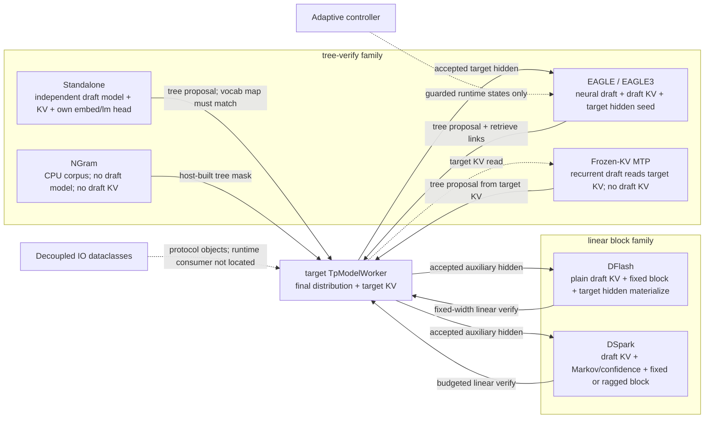
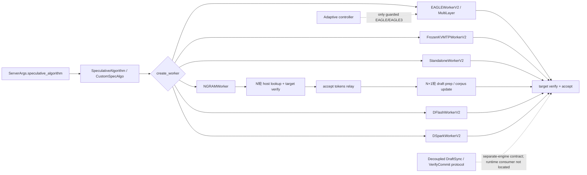
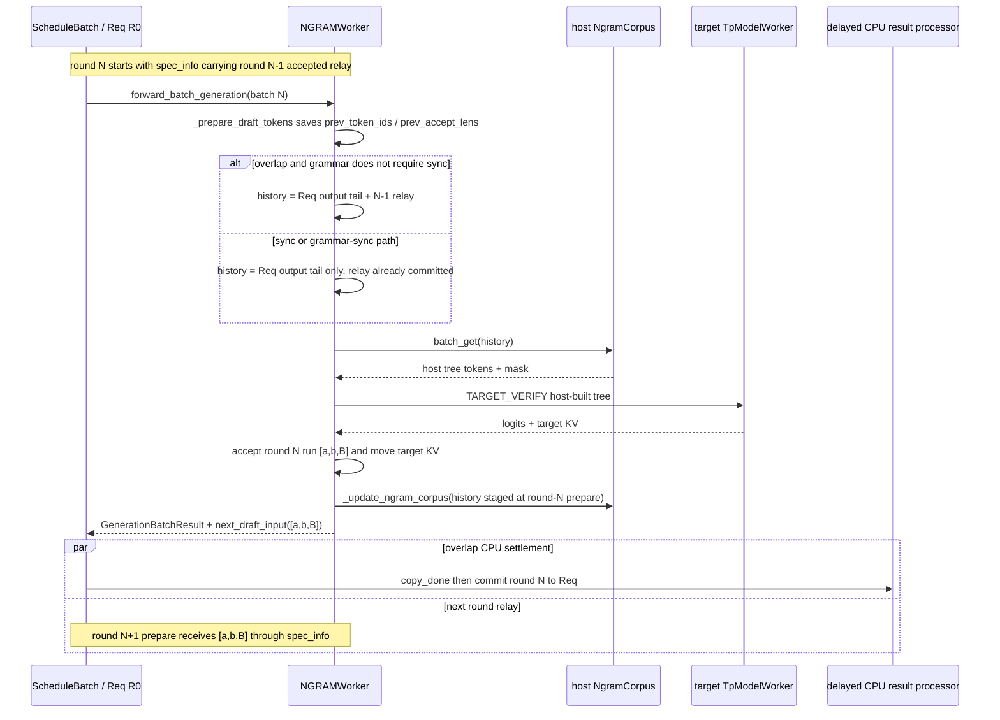

## 直接结论

“speculative decoding”不是一种可以共享全部性质的执行模式。当前工作树至少有三类proposal来源：EAGLE/EAGLE3/Frozen-KV MTP利用target相关hidden或target KV形成神经draft；Standalone用一个真正独立、词表严格对齐的draft模型；NGram没有draft模型，直接从CPU corpus构树。DFlash和DSpark又是固定block方案：前者按统一宽度verify，后者增加confidence、ragged预算与target-hidden到draft-KV注入。它们最后都交付`accept_lens + token buffer + next_draft_input`，但worker、hidden合同、KV所有权、verify几何和API支持不能互相外推。

Adaptive不是第八种算法，而是受限EAGLE/EAGLE3 worker上的运行时步数/graph状态控制器；Decoupled Spec也不是同机composite worker的别名，而是把verifier与drafter拆成不同进程/engine后所需的token同步协议。当前checkout能确认Decoupled的CLI/PortArgs配置与IO dataclass合同；对`DraftSync`、`VerifyCommit`等符号做当前`python/sglang/srt`定向引用搜索，仅命中协议模块本身，未找到Scheduler/worker消费链，因此不能把这些类型的存在写成“已接通可运行E2E”的证据。

## 当前路径假设

比较基线是当前SRT文本生成decode路径，target由通用`TpModelWorker`执行；每行只陈述当前源码显式分派和守卫。EAGLE主线假设CUDA、topk/tree verify；Frozen-KV MTP说明其专属V2 worker；Standalone说明独立draft模型；NGram说明host corpus。DFlash/DSpark详细机制已在各自核心章展开，本页只保留能改变选型与源码阅读结论的边界。

“支持graph、DP、PP、grammar、logprob”不是单个布尔标签。比如grammar overlap表示worker能把CPU FSM推进藏在GPU draft/verify之下，不等于算法完全不需要grammar mask；CUDA Graph存在也不保证本轮形状命中；代码出现collective不证明device工作已完成，更不证明该并行组合被启动参数允许。下面的矩阵把未知或需专章核验的组合标成“守卫限定”，不会用普通decode或另一个算法补空白。

## 输入、本页职责与输出

输入是`ServerArgs.speculative_algorithm`、相关draft模型/步数/topk配置、并行与overlap配置，以及进入decode的R0。`SpeculativeAlgorithm.from_string()`先得到内建enum或custom对象，`handle_server_args()`做算法专属参数处理，`create_worker()`把已有target worker包进具体composite worker。本页输出是一套读源码用的边界索引：看到算法名后，应立刻定位实际receiver、proposal载体、hidden/KV合同、verify/accept路径和无法继承的能力。

| 名称 | proposal来源 | 关键持久状态 | target verify后输出 |
|---|---|---|---|
| EAGLE/EAGLE3 | target hidden seed + Eagle draft tree | draft KV、tree topk/score/index、跨轮hidden | accepted tree path、bonus、next draft state |
| Frozen-KV MTP | 读取target KV的frozen recurrent MTP draft | target KV + recurrent seed；无独立draft KV | 复用EAGLE verify/move合同，生成frozen seed input |
| Standalone | 独立draft模型自己的embedding/lm head | 独立draft KV；不依赖target hidden seed | 复用EAGLE tree verify合同 |
| NGram | CPU request/external corpus lookup | host corpus、match state与上一轮accepted relay；无draft model/KV | 本轮target tree accept/KV move；accepted tokens作为下一轮输入状态返回 |
| DFlash | draft hidden产生固定block | vanilla draft KV、固定宽度block | fixed-stride accept与bonus |
| DSpark | mask-block hidden + Markov proposal | draft KV、confidence/budget/ragged layout | ragged/fixed accept、target-hidden注入 |

## 为什么存在

统一工厂使Scheduler无需为每个算法复制主循环，但统一接口不可能抹平物理状态。EAGLE的draft attention要读自己的draft KV并借target hidden扩展树；Frozen draft直接读target KV，因此刻意不调用会创建Eagle draft KV pool的父类初始化；Standalone虽然继承EAGLE V2编排，却必须装载独立embedding/lm head并验证token到id映射完全一致；NGram把“draft”变成host lookup，因此`draft_worker`明确返回`None`。如果只看继承关系或`is_eagle()`，会得到错误的内存图。

能力查询有时服务Scheduler兼容而非精确物理描述。当前`is_eagle()`临时把Frozen-KV MTP纳入，用于复用scheduler路径；`carries_draft_hidden_states()`也随之返回true。另一方面`has_draft_kv()`只把NGram排除，所以对Frozen也返回true，但Frozen worker注释和初始化明确说明draft自身不拥有KV。前者是通用容量/路径分类，后者才是具体worker的资源所有权证据。读者必须先问“这个方法在为谁做粗分类”，再问“具体实例实际分配了什么”。

Adaptive与Decoupled单列，是为了防止两个常见概念坍缩。Adaptive改变同一个EAGLE composite worker在不同batch规模下激活的spec steps、token数和预建graph/runtime state，target仍是同一轮最终裁决者。Decoupled则引入跨engine陈旧性：drafter可能基于旧committed prefix继续流式发tail，verifier必须用base length判断可用性，并把新确认的连续segment回传让drafter截断或reprefill。二者改变的轴完全不同。

## 对象与状态

`SpeculativeAlgorithm`不只枚举七个内建值，还实现`is_*`、grammar/ragged/hidden/KV能力查询和worker工厂。`SpecInputType`进一步区分EAGLE draft/draft-extend/verify、Frozen draft/verify、DFlash draft/verify与NGram verify，让attention backend按phase判断而不是假设dataclass相同。DSpark沿DFlash family接口但只有它声明ragged verify能力。

`FrozenKVMTPWorkerV2`继承EAGLE V2是为了复用verify、accepted-token move和forward skeleton，却故意不调用父类初始化；它取得target的req/token pool，构造`FrozenKVMTPDraftWorker`，并暴露target与draft两个attention backend而没有draft-extend backend。`StandaloneWorkerV2`也继承EAGLE骨架，但构造`StandaloneDraftWorker`，不共享embedding/lm head，并在启动时同时比较vocab size和实际token-to-id字典；只比较词表大小不足以保证候选id和target语义一致。

`NGRAMWorker`共享target model runner和target pool，持有`NgramCorpus`及上一批request id集合；其`draft_worker`为`None`。它还有一个容易被单轮叙述抹掉的 N/N+1 relay：第N轮 verify得到的 `accept_tokens/accept_lens`只被装进返回的 `next_draft_input`；第N+1轮 `_prepare_draft_tokens()`才把它们保存为 `prev_token_ids/prev_accept_lens`，在overlap且grammar无需同步时拼到尚未更新的 `Req.output_ids` 后做lookup，并在本次forward末尾由 `_update_ngram_corpus()`把同一历史写入corpus。也就是说，“accept后更新corpus”消费的是输入spec_info携带的上一轮结果，不是刚刚在本轮target verify中产生的token。grammar tree同样来自host，所以其grammar barrier为`None`，保持同步；这与“整个NGram worker绝不使用overlap scheduler”不是同一句话，不能混写。

Adaptive controller挂在EAGLE worker的`on_verify_complete_cpu()`和`activate_step_by_batch()`边界：前者用CPU可见correct-draft统计更新控制器，后者按batch size选择已建runtime state。启动函数明确拒绝非EAGLE/EAGLE3、topk不等于1、DP attention、multi-layer EAGLE、TBO和PDMux。Standalone把controller置None，Frozen显式assert不支持，NGram也为None。

Decoupled IO中`DraftSync`携带prompt与已committed outputs，明确verifier是source of truth；`VerifyCommit`携带从`pre_verify_committed_len`开始的非空连续token segment；`DraftTailStreamOutput`携带`base_committed_len`、output位置与token；`VerifierCommitSegment`在drafter侧合并连续commit。它们定义了协议状态，但当前定向搜索没有给出Scheduler实际发收这些消息的next consumer，所以本课程把它标作“接口/配置已存在，运行闭环待源码接线证据”。

下图是物理资源图，专门纠正“共享 verify 骨架就共享 draft 资源”的误解。所有内建算法最终都使用 target worker 裁决，但 proposal 的执行位置、draft KV 是否存在、是否需要 target hidden，每一行都不同。

## 当前源码调用链

共同启动链为字符串解析、算法专属ServerArgs处理、target worker建立、factory创建具体spec worker、Scheduler把`model_worker`指向composite receiver。运行时R0只进入该receiver一次；receiver内部产生proposal、调用target verify、accept并返回统一结果。这个共同外框不能证明内部路径相同：EAGLE/Frozen/Standalone调用树形verify骨架，NGram在host准备树后直接target verify，DFlash/DSpark组织block verify。

EAGLE adaptive开启时，worker需预构建不同step配置的runtime state/graphs；result processor得到CPU correct counts后调用verify-complete hook，后续batch按batch size激活状态。Decoupled当前只能追到ServerArgs形成IPC config和`decoupled_spec_io.py`中的消息/队列结构；没有可核验的Scheduler发消息→transport→drafter apply→tail回传→verifier消费完整调用链。本页因此不画实线运行边，而用虚线“协议边界”表示证据等级。

因为 NGram 没有 draft model，它最值得单独画的不是模型时序，而是 N/N+1 轮的 host 状态流。下图中“第N轮更新 corpus”使用的是进入第N轮时 `spec_info` 已携带的第N-1轮 accepted tokens；第N轮新产生的 `[a,b,B]` 只能进入返回的 `next_draft_input`，不能跨过返回合同当场变成 corpus 输入。

## 连续例子

t0，R0 prefix=100。若算法为EAGLE3，target上一轮hidden成为draft seed，draft worker在自己的KV上构造tree；target verify后接受2个draft加bonus，accepted target KV被移动到连续位置，next input继续携带tree/hidden状态。若换成Standalone，外部仍见相似tree与accept结果，但draft token来自独立模型自身embedding/lm head，R0不能把target hidden当它的输入；两边tokenizer映射必须完全一致。

t1，换成Frozen-KV MTP。factory选择`FrozenKVMTPWorkerV2`；它复用EAGLE verify/move，却不分配Eagle draft KV，draft attention读取target KV并维护recurrent seed。此时通用`has_draft_kv()==True`不能推翻具体worker所有权。若读者按“继承EAGLE所以有三套target/draft/draft-extend backend”画图，就会多画一个不存在的draft-extend backend。

t2，换成NGram并把时间标成两轮。第N轮开始，`batch.spec_info`带的是第N-1轮accepted relay；host以 `Req`已有历史加这段relay做corpus lookup，构造tree，target verify后接受 `[a,b,B]`并移动accepted target KV。本轮 `_update_ngram_corpus()`仍使用prepare阶段保存的第N-1轮tokens，绝不会直接把刚产生的 `[a,b,B]`越过返回合同塞进corpus；`[a,b,B]`只被写入第N轮返回的 `next_draft_input.accept_tokens/accept_lens`。

t2+1，第N+1轮 `_prepare_draft_tokens()`收到上述 `[a,b,B]`。在overlap且grammar不要求同步时，CPU `Req.output_ids`可能仍滞后一轮，所以它把这段tokens显式拼入lookup历史；同步路径中Req已含这些tokens，因而不再拼接，避免重复。该轮target完成后，`_update_ngram_corpus()`才把含 `[a,b,B]` 的历史写入corpus。这条N/N+1流水不含神经draft forward或draft KV。R0请求logprob时当前NGram路径调用`compute_spec_v2_logprobs()`；同样请求换成DFlash或DSpark会在worker入口被拒绝，不能因为共同`GenerationBatchResult.logits_output`字段存在就宣称支持。

t3，保持EAGLE但开启adaptive。只有topk=1且不触发DP-attention/multi-layer/TBO/PDMux守卫时，controller才可能根据前几轮correct counts选择另一套steps/runtime state；算法仍是EAGLE，R0的verifier权威性不变。把算法换成Frozen或Standalone时，controller没有接线，不应把`EAGLEWorkerV2`继承误认为adaptive自动可用。

t4，设想Decoupled verifier把R0已提交到103，并准备发送`VerifyCommit(pre=100,tokens=[a,b,B])`。协议要求drafter从100对齐连续段，必要时截断/reprefill；drafter后续tail还要带`base_committed_len=103`。这些是dataclass注释直接规定的语义，但当前源码搜索没有找到实际Scheduler消费，因此这个时间线只是协议对象的解释例，不是当前checkout已跑通的runtime事实。

## 为什么必须在这里

worker分派必须在target worker创建后，因为所有方案都需要target model runner、allocator或tokenizer；但具体draft资源必须由各worker初始化，过早按算法族统一分配会让Frozen多建KV、NGram多建模型、Standalone错误共享权重。vocab校验必须在Standalone worker构造时完成，不能等accept后才发现相同id代表不同token。

Adaptive选择必须发生在batch规格确定、forward graph启动之前；verify完成后的CPU统计只能更新未来状态，不能回头改变已经执行的本轮树。Decoupled commit必须由verifier发送，因为只有verifier知道target接受后的连续权威prefix；若让drafter自行视proposal为committed，拒绝token会污染后续tail。与此同时，缺少runtime consumer证据时必须停在协议层，不能用架构意图替代当前调用链。

## 边界矩阵

| 算法/机制 | concrete receiver | draft model / KV / hidden | verify几何与accept | grammar / logprob | graph、并行、分离边界 |
|---|---|---|---|---|---|
| EAGLE/EAGLE3 | `EAGLEWorkerV2`或multi-layer变体 | 神经draft；draft KV；target hidden seed | topk tree，target verify + tree accept | grammar overlap有专门barrier；logprob有当前路径 | DP/PP/graph需EAGLE专属守卫；adaptive仅受限配置 |
| Frozen-KV MTP | `FrozenKVMTPWorkerV2` | frozen draft读target KV；无独立draft KV；recurrent seed | 复用EAGLE verify/move，专属seed draft | 被临时归入EAGLE scheduler能力；勿据此推全部特性 | 无draft-extend backend；adaptive明确拒绝 |
| Standalone | `StandaloneWorkerV2` | 独立draft模型/KV；不共享embedding/lm head；不靠target hidden | 复用EAGLE tree骨架 | grammar overlap能力查询为true；logprob沿继承路径需按配置核验 | vocab size和token-id mapping都必须一致；adaptive未接线 |
| NGram | `NGRAMWorker` | 无draft model/KV；CPU corpus + 上轮accepted relay | host tree，target verify，tree accept；第N轮结果在N+1轮进入lookup/corpus | grammar host同步；当前logprob路径存在 | overlap下Req可滞后一轮，必须拼relay；不能把本轮accept写成本轮corpus输入 |
| DFlash | `DFlashWorkerV2` | vanilla draft KV与fixed block | 固定宽度target verify/accept | grammar路径存在；return_logprob当前拒绝 | 当前拒绝的DP/PP等以专章源码为准 |
| DSpark | `DSparkWorkerV2` | draft KV、mask-block hidden、confidence | fixed/ragged linear block；target hidden commit | grammar会禁folded accept；return_logprob拒绝 | 受限DP/graph/compact组合；不能从DFlash外推 |
| Adaptive | EAGLE worker内controller，不是新worker | 切换预建runtime state | 改steps/token预算，不改target权威accept | 仅EAGLE/EAGLE3 topk=1 | 拒绝DP attention、multi-layer、TBO、PDMux |
| Decoupled | 当前仅配置/IO合同可证 | verifier与drafter跨engine同步token前沿 | `DraftSync`/`VerifyCommit`/tail base length | 未找到当前runtime消费闭环 | 不等于同机FutureMap或PD hidden transfer |
| Custom | plugin factory返回V2 worker | 默认能力保守，资源由插件定义 | 必须自行实现共同结果合同 | 默认grammar/ragged等均false | `supports_overlap=false`时只能V2 schema同步执行 |

## source action / changed state / why

| source action | changed state | why |
|---|---|---|
| `from_string()/create_worker()` | algorithm name → concrete composite receiver | Scheduler保持统一，内部状态不混型 |
| Frozen专属初始化 | target pool → frozen draft reader，无draft KV pool | 复用verify而不伪造EAGLE资源 |
| Standalone vocab validation | 两模型token映射 → 启动通过或失败 | accept按token id比较，语义必须一致 |
| NGram第N+1轮 prepare/put | `Req`历史 + 第N轮accepted relay → lookup历史/corpus | overlap下补齐尚未进入Req的上一轮tokens，且不把本轮accept越级消费 |
| adaptive verify hook | CPU correct counts → controller未来选择 | 只影响后续batch的runtime state |
| `DraftSync/VerifyCommit` | verifier committed prefix → drafter对齐合同 | 跨engine时保持target为唯一真相 |
| custom capability defaults | 未声明能力 → conservative false/同步 | 防止插件被误送进内建专属分支 |

## 自测

1. 为什么`FrozenKVMTPWorkerV2`继承EAGLE且`has_draft_kv()`为true，仍不能画出一个独立Frozen draft KV pool？
2. Standalone只比较vocab size为什么不够？哪个启动检查补上了token语义约束？
3. NGram没有draft model时，proposal、target verify、target KV commit分别由谁完成？第N轮accepted tokens最早在哪一轮进入corpus，为什么？
4. Adaptive改变的是算法身份、target裁决权，还是未来batch使用的runtime steps/state？列出三个明确不支持的组合。
5. 对Decoupled Spec，当前checkout能确认哪两层事实，为什么不能宣称完整E2E已经接线？
