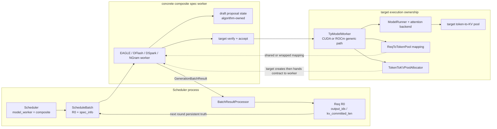
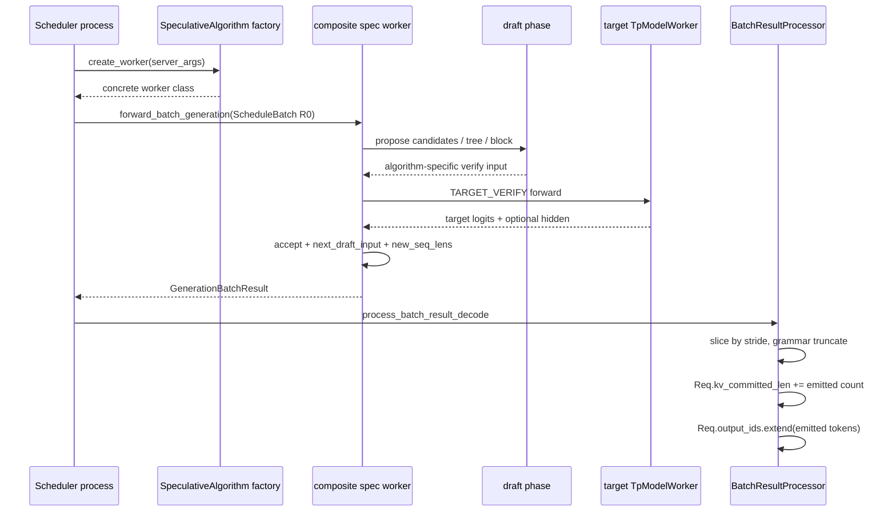
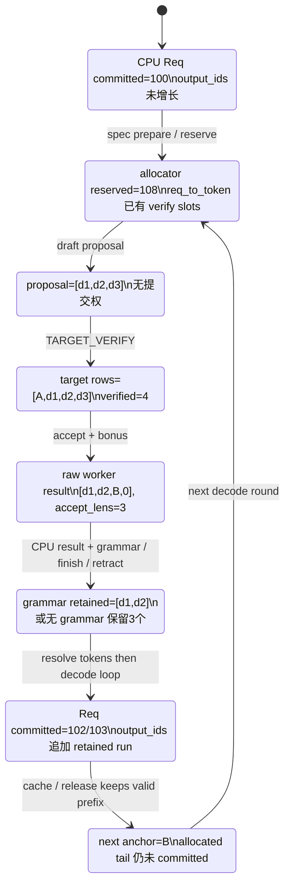

## 直接结论

Speculative decoding 的共同合同不是“先由小模型生成几个 token，再由大模型看一遍”这么松散，而是 Scheduler 把一次生成 forward 的完整所有权交给一个 composite `model_worker`：它内部组织 draft、target verify、accept、下一轮状态修复，最后仍返回普通调度器认识的 `GenerationBatchResult`。draft 只拥有候选提案权；target 的分布与 accept 规则决定哪些候选可提交。R0 的用户输出、`Req.output_ids`、`Req.kv_committed_len` 都不会在 draft 时推进，而是在 result processor 看到 `accept_lens` 后才落到 Scheduler 的持久请求状态。

学习这套合同最重要的是同时保留五条前沿：proposal frontier 表示已经提出多少候选；verify frontier 表示 target 实际计算了多少行；accept frontier 表示其中连续可接收多少 draft；emit frontier 表示经过 grammar/stop 处理后真正写入 `output_ids` 的 token；KV frontier 又分 allocator 已预留上界与 `kv_committed_len` 已确认前缀。它们经常数值相近，但绝不是同一字段。把 `speculative_num_draft_tokens` 直接当作“本轮输出数”，或把 reserve 当成 commit，都会把拒绝分支、bonus token 和 over-allocation 解释错。

## 当前路径假设

本页以当前工作树的 SRT 文本生成路径为准：Scheduler 已创建通用 `TpModelWorker` target，speculative algorithm 不是 `NONE`，运行设备与参数已经通过对应 `_handle_*` 启动校验。重点是 spec-v2 共同调度合同；overlap 开启时会通过 `FutureMap` 中继下一轮输入，关闭时 Scheduler 同步安装 `next_draft_input`，但 worker 内部的 draft/verify/accept 语义不因此改变。

R0 是一个已完成 prefill、进入 decode 的请求。示例采用线性候选便于统一计数；EAGLE `topk>1` 实际是树，DFlash 是固定 block，DSpark 的 verify width 是 `gamma+1` 且可 ragged，NGram 在 CPU corpus 构树。硬件后端也不是一条万能路径：DFlash、DSpark、EAGLE、NPU/ROCm/CPU 的启动守卫和 kernel 分支不同。下文只声称当前源码中的状态合同，不把静态可达路径当成已完成 GPU E2E、性能收益或所有后端等价证据。

## 输入、本页职责与输出

输入是 Scheduler 选出的 decode `ScheduleBatch`，其中 R0 已有 committed prefix、`req_pool_indices`、`seq_lens`、采样状态和上一轮算法专属 `spec_info`。本页职责是解释 Scheduler 如何选择 composite worker、谁预留 KV、draft/verify/accept 分别改变什么、以及统一结果怎样回到 Req。输出不是某一种算法的内部树或 confidence，而是跨算法都必须对齐的结果字段：扁平且按固定 stride 排列的 `next_token_ids`、每请求 `accept_lens`、下一轮 `next_draft_input`、可选 `new_seq_lens`，以及 logits/metrics 辅助数据。

| 名称 | R0 的含义 | 典型载体 | 下一消费者 |
|---|---|---|---|
| proposed | draft 提出的节点或线性候选数量 | Eagle tree、DFlash block、DSpark `draft_tokens` | target verify 构造器 |
| verified | target 实际执行的输入行数 | fixed width 或 `RaggedVerifyLayout` | accept kernel |
| accepted | 连续正确 drafts 加一个 target bonus | `accept_lens`；DSpark 内部 `commit_lens` | result processor |
| emitted | grammar/finish 截断后写入用户输出的连续 token | 每请求 `accept_tokens`、`Req.output_ids` | detokenizer/output streamer |
| allocated KV | 当前请求地址表已经保留的上界 | `req.kv.kv_allocated_len`、`req_to_token` | 下一 forward 或最终释放 |
| committed KV | target 已确认、允许进入 prefix cache 的前缀长度 | `req.kv_committed_len` | 下轮 reserve、finish release/cache insert |

## 为什么存在

如果 composite worker 不隐藏算法差异，Scheduler 主循环就必须理解 EAGLE tree 的 retrieve links、DFlash 的 fixed block、DSpark 的 confidence/ragged layout、NGram 的 host tree，任何新算法都会复制 batch/filter/overlap/result 代码。当前设计把差异放在 `SpeculativeAlgorithm.create_worker()` 和算法 worker 中，而 Scheduler 只关心 `model_worker.forward_batch_generation()` 及共同结果。这不是说所有算法共享同一个 draft input；恰恰相反，`SpecInputType` 和各 dataclass 明确阻止 attention backend 把不同布局误认成同一种。

KV 也必须拆成 reserve 与 commit。target verify 需要在不知道 accept 长度前为候选行准备地址；overlap 还允许 CPU 请求状态比设备上的新长度落后一轮，因此 EAGLE/DFlash family 会保留额外 headroom。若只在 accept 后才分配，target verify 没有写入位置；若预留后立即把全部候选计为 committed，拒绝 token 会进入 radix prefix 或用户后续上下文，造成正确性错误。当前源码选择“先扩地址映射，后由 result processor推进 committed frontier，finish/retract 再释放 over-allocation”。

## 对象与状态

`SpeculativeAlgorithm` 是能力和工厂入口，不只是字符串枚举。它回答是否为 DFlash family、是否支持 ragged verify、是否有 draft KV、是否需要跨 PD 传 draft hidden，并创建具体 worker。`BaseSpecWorker` 给 target/draft worker、memory pool、attention backend、verify 完成回调等建立最低接口；具体 worker可以是 EAGLE 的 `EAGLEWorkerV2`、DFlash/DSpark 自己的 orchestrator，也可以是没有 draft model 的 `NGRAMWorker`。

Scheduler 先持有 `self.tp_worker` 作为 target。`maybe_init_draft_worker()` 把它传给工厂得到 `self.draft_worker`，内存池初始化时 target 是 allocator 的所有者，spec worker获得 pool/allocator 或按算法创建私有 draft 映射；随后 `init_model_worker()` 令 `self.model_worker=self.draft_worker`。因此 runtime receiver 是 composite worker，不是“Scheduler 先调小模型再调大模型”的两个独立调用。

R0 的 `ScheduleBatch.spec_info` 是跨轮的算法状态；worker在一轮内可暂时替换为 verify input，再返回新的 draft input。`GenerationBatchResult.accept_lens` 的共同语义是每请求本轮可提交 token 数，包含 bonus；`num_correct_drafts=accept_lens-1`。result processor按 `speculative_num_draft_tokens` 作为扁平 stride 切片，而不是按本轮 accept 数改变行起点。最后它先解析、按 grammar保留合法前缀，再增加 `req.kv_committed_len`，之后 decode loop 才扩展 `Req.output_ids` 并判断 finish。

下图只画所有权，不画一轮的时间顺序。关键是 `Scheduler.model_worker` 只有一个运行时 receiver；target worker 仍然是 target model、target KV pool 与 allocator 的所有者，composite worker 把 draft 状态与 target verify 组合起来，但不取代 Scheduler 对持久 `Req` 的最终提交权。

## 当前源码调用链

启动阶段先执行 `Scheduler.init_tp_model_worker()`，CUDA/ROCm 等通用路径构造 `TpModelWorker`，MLX 则有明确 override；随后 `maybe_init_draft_worker()` 在 spec 非 `NONE` 时调用 `create_worker()`。`init_memory_pools()` 先让 target 建 pool，再把 target 的 pool/allocator 交给 composite worker；`init_model_worker()` 最终把执行接收者换成 spec worker。

decode 准备阶段，`ScheduleBatch.prepare_for_decode()` 看到 spec 后调用 `spec_prepare_for_decode()` 并立刻 return，所以普通 `alloc_for_decode(token_per_req=1)` 与 `req.kv_committed_len += 1` 不会先执行。EAGLE 走 `eagle_prepare_for_decode()`；DFlash family 由 `DFlashDraftInputV2.prepare_for_decode()` 预留。forward结束后 Scheduler取得 `GenerationBatchResult`。外层 `BatchResultProcessor.process_batch_result_decode()`先等待必要的 `copy_done` device-to-host事件；随后 `_resolve_spec_v2_tokens()`读取已在CPU的 `accept_lens`，以结果记录的 stride切出每个 R0 的 accepted run，执行 grammar保留，并只为仍有效的请求推进 committed 长度。decode处理的后续部分再把同一列表写入 `output_ids`、更新 stop 状态并在 finish 时调用 `release_kv_cache()`处理未提交尾部。

下图把 R0 一轮的五条前沿画成状态迁移。它不是五个不同请求，而是同一 R0 从 CPU committed 事实、到预留地址、再到 target 裁决和 Scheduler 提交的五个不同证据层。

## 连续例子

t0，R0 的 committed prefix 长度为 100，allocator 为 overlap 预留到 108；`kv_allocated_len=108` 不表示 101～107 已有可信上下文。上一轮留下 anchor `A`。t1，draft提出 `[d1,d2,d3]`；若算法以 anchor 为 verify 输入，target看到 `[A,d1,d2,d3]` 四行。proposal=3，verified=4，此时 `Req.output_ids` 与 `kv_committed_len` 仍不变。

t2，target预测说明 `d1,d2` 连续匹配，第三个位置不匹配并给出 bonus `B`。worker构造 padded row `[d1,d2,B,0]`，`accept_lens[R0]=3`，`num_correct_drafts=2`，`new_seq_lens=103`，下一轮 anchor 是 `B`。注意输出内容与有效 KV 输入存在滚动关系：target forward 已为 `[A,d1,d2]` 产生可提交 KV，`B` 是该链尾的预测并作为本轮输出与下轮 anchor；不同算法用 draft_extend 或 target-hidden injection 保持 draft 侧状态一致。

t3，result processor按 stride=4 取前三个 token。若无 grammar/stop 截断，`kv_committed_len:100→103`，随后 `output_ids` 追加 `[d1,d2,B]`。预留仍可能是 108，差值 5 是 headroom，不是 rejected tokens 已被提交。t4，下一轮以前缀 103 和 anchor `B` 继续；若 R0 此时结束，`release_kv_cache()`只把有效 committed 前缀交给 cache，并回收 committed 到 allocated 之间的 over-allocation。连续两轮才能看清 reserve 可以提前、commit 必须等待结果、anchor 又同时跨轮。

若 grammar 在 `d2` 后完成，result processor可能只保留 `[d1,d2]`，committed 与 emitted 都推进 2，而 worker原始 `accept_lens=3` 不能直接当最终用户长度。若请求在 overlap 延迟结果到达前已 retract/finish，processor不会再次推进它；这解释了为何提交动作必须由 Scheduler 的当前 Req 状态裁决。

  

    <h3>状态实验：proposal、verified、accepted、committed 不是一个长度</h3>
    
用 R0 的 committed=100、allocated=108 和三个 draft token 推进一轮；每一步只点亮当前真正成立的前沿。

  

  

    <button class="button" data-lab-step="prefix">1 prefix</button>
    <button class="button" data-lab-step="reserve">2 reserve</button>
    <button class="button" data-lab-step="proposal">3 proposal</button>
    <button class="button" data-lab-step="verify">4 verify</button>
    <button class="button" data-lab-step="commit">5 Scheduler commit</button>
    <button class="button" data-lab-step="release">6 release/cache</button>
  

  

    <section class="step-lab__panel" data-lab-panel="prefix">
      

emitted=len(output_ids)=0

committed absolute prefix=100

proposed=0

allocated=108

      
emitted 是用户输出 token 数；committed 是包含 prompt/prefix 的绝对 KV 前沿。108 是 allocator headroom，三种坐标不能混成一个长度。

    </section>
    <section class="step-lab__panel" data-lab-panel="reserve">
      

<b>ordinary decode</b> 通常 token_per_req=1

spec prepare 截断 →

<b>verify block reserve</b> mapping/slot 为候选布局预留，committed 不动

      
如果先走 ordinary alloc 再走 spec alloc，会让长度和地址表双推进。

    </section>
    <section class="step-lab__panel" data-lab-panel="proposal">
      

draft=[d1,d2,d3]

proposed=3

accepted unknown

committed=100

      
draft 只提案；即使 draft 侧已写专用 KV，也不能自行修改 target/用户语义。

    </section>
    <section class="step-lab__panel" data-lab-panel="verify">
      

target rows=[A,d1,d2,d3]

verified=4

raw accept=[d1,d2,B]

accept_lens=3

      
verified 行数、正确 draft 数和含 bonus 的 accept length 是三种计数。

    </section>
    <section class="step-lab__panel" data-lab-panel="commit">
      

<b>worker result</b> padded accepted row + accept_lens

grammar/stop/retract 裁决 →

<b>Scheduler Req</b> output_ids []→[d1,d2,B], emitted 0→3 committed 100→103

      
两种计数本轮都增加3，但一个是用户输出数、一个是绝对KV前沿；若 grammar 在 d2 完成，最终增量才都为2，raw <code>accept_lens</code> 仍不能直接当用户可见长度。

    </section>
    <section class="step-lab__panel" data-lab-panel="release">
      

prefix cache 只接管有效 0..102

allocated tail 103..107

finish/retract 按 allocator/page 规则回收

      
rejected/unused tail 不必每轮逐 slot free；真正释放要服从 generic/paged/算法专用所有权合同。

    </section>
  

  

<button class="button button--quiet" data-lab-action="prev">上一步</button><button class="button" data-lab-action="next">下一步</button><button class="button button--quiet" data-lab-action="reset">复位</button>

## 为什么必须在这里

worker 工厂必须在 Scheduler 完成 target 创建之后运行，因为 composite worker 需要现成 target worker、model config、设备和并行状态；memory pool也必须由 target 先建立，才能让 draft选择共享 allocator、共享地址空间或私有映射。spec decode 准备必须截断普通 decode 分支，否则同一 R0 会先分配一个普通 token、再分配 verify block，长度与地址表都会双推进。

accept 后的持久 commit 必须留在 result processor。worker位于设备执行边界，看到的是 launch 时的 batch；Scheduler 才知道 result回来时请求是否已 retract、grammar 是否截断、finish 是否发生。反过来，target verify 前的地址预留必须在 schedule/prepare 阶段完成，因为 forward 内不能等 CPU finish 逻辑后再获得写槽。这个时间上的分工同时服务同步与 overlap，但不意味着 `publish()` 的 Python 返回就是 GPU 工作完成；真实可见性由 stream/event依赖约束。

## 边界矩阵

| 边界 | 共同合同 | 算法差异 | 不能外推的结论 |
|---|---|---|---|
| worker | Scheduler 执行 composite `model_worker` | EAGLE、DFlash、DSpark、NGram concrete class 不同 | 不等于都含独立 draft model |
| draft input | `ScheduleBatch.spec_info` 跨轮 | tree state、block anchor、confidence budget、host corpus tree | 不能互换 dataclass 或 attention metadata |
| hidden | target 可为内部 draft 状态提供 hidden | EAGLE 经 draft_extend；DFlash/DSpark物化 draft KV；Standalone/NGram 不同 | 不等于公开 `return_hidden_states` 能力 |
| verify | target 是最终分布裁决者 | tree/fixed/ragged/host tree 布局不同 | 普通 decode 一行不能代表 spec verify |
| logprob | 结果合同可以带 logits | EAGLE/NGram有路径，DFlash/DSpark当前直接拒绝 | 不能从算法原理推断 API 已支持 |
| DP/PP/CP | 均需启动守卫和参与一致性 | DSpark有受限 DP，DFlash拒绝 DP/PP，EAGLE族另有边界 | 不能把某算法后端覆盖复制给其他算法 |
| PD/disagg | committed prefix仍是 verifier真相 | 当前 draft hidden transfer 主要标记 EAGLE family；decoupled有独立协议 | 同机 FutureMap 不等于跨进程 token sync |

## source action / changed state / why

| source action | changed state | why |
|---|---|---|
| `create_worker()` | algorithm → concrete composite class | 隔离算法专属对象与流程 |
| `init_model_worker()` | `Scheduler.model_worker` 指向 spec worker | 保持 Scheduler 主循环结果合同不变 |
| `spec_prepare_for_decode()` | 扩大 `req_to_token` / allocated frontier | verify 前必须已有候选写槽 |
| draft + target verify | 生成候选、logits、accept indices/lens | draft 不能自行提交 target 语义 |
| `_resolve_spec_v2_tokens()` | accepted padded rows → per-Req retained run；推进 committed | 结合当前 Req、grammar、retract 状态裁决 |
| `release_kv_cache()` | 缓存 committed prefix、释放 over-allocation | 防止拒绝/预留尾部进入持久前缀 |

## 自测

1. R0 的 proposed=6、target verified=7 是否推出 `output_ids` 一定增加 7？请指出至少两个阻止该推论的字段或阶段。
2. 为什么 spec 开启后不能再执行普通 `alloc_for_decode(token_per_req=1)` 的长度推进？
3. `accept_lens=4` 时，`num_correct_drafts` 是多少，bonus 是否包含在 committed 数中？
4. overlap 下 `kv_allocated_len=120`、`kv_committed_len=113` 各自说明什么？finish 时哪一段可以进入 prefix cache、哪一段需回收？
5. 请按 receiver/return/next consumer 复述：Scheduler把 R0 发给谁，worker返回什么，谁最终写 `Req.output_ids`。
