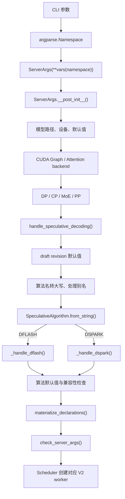
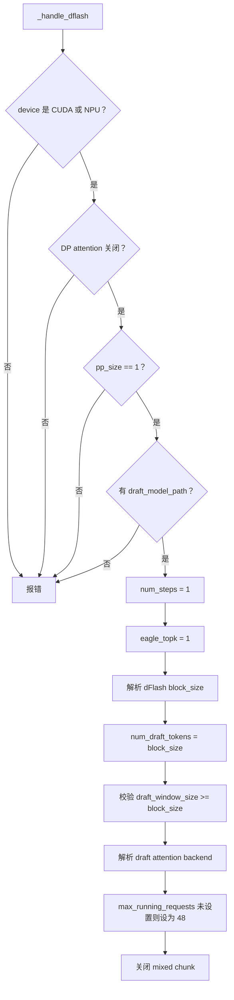
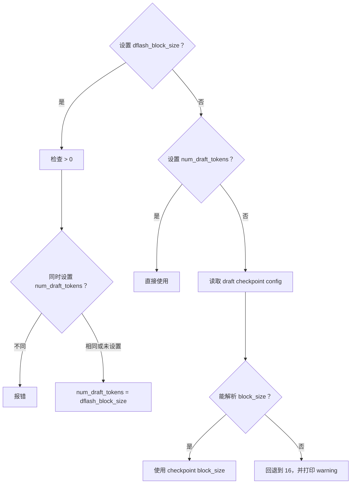
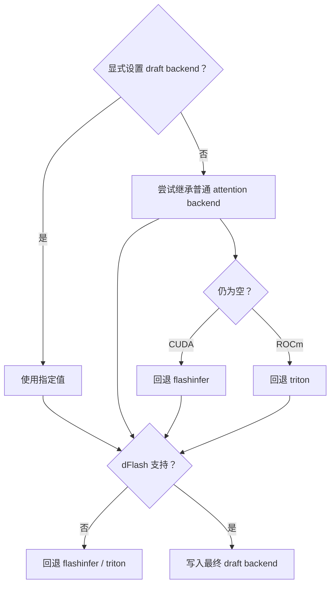
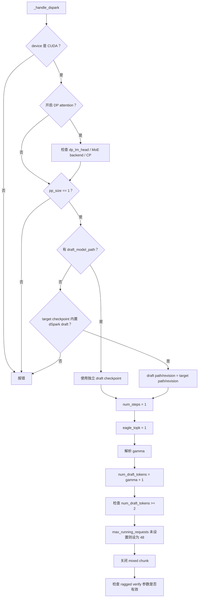
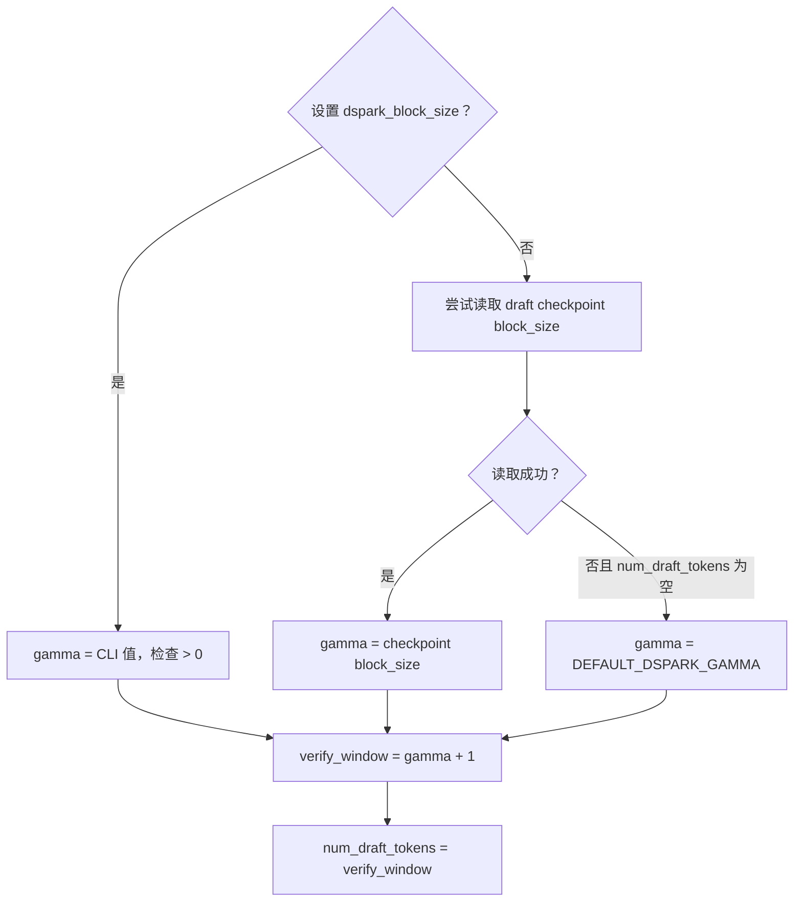
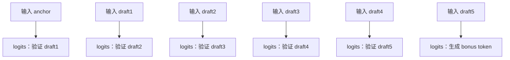
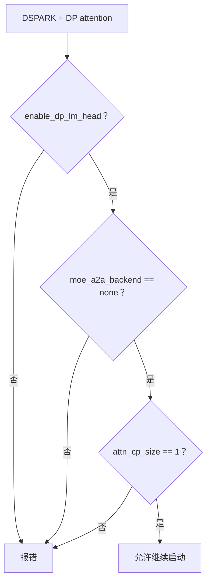
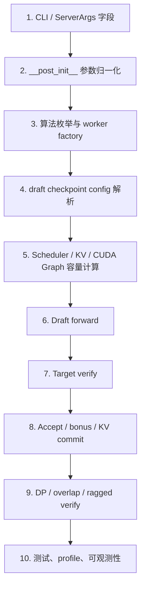

# SGLang dFlash / dSpark 启动参数与迁移参考

> 用途：记录当前 SGLang 工作区中 dFlash、dSpark 的启动参数解析、默认值归一化、
> 兼容性检查和运行时消费关系，供后续功能迁移及 Codex 回顾代码时使用。
>
> 参数主体代码快照：2026-07-29。dSpark sampling 提示与运行时文档导航于 2026-08-09
> 更新；相关实现仍在快速演进，迁移前应按本文末尾的“回顾检查清单”重新核对当前源码。

## 1. 先记住的核心结论

dFlash 和 dSpark 都属于 speculative decoding（投机解码），共用
`ServerArgs` 中的通用 `speculative_*` 参数，但在
`handle_speculative_decoding()` 中进入不同的算法处理器：

```text
DFLASH -> _handle_dflash()
DSPARK -> _handle_dspark()
```

最重要的参数关系：

```text
DFLASH:
    speculative_num_draft_tokens = dflash block_size

DSPARK:
    gamma = 实际提出的 draft token 数
    speculative_num_draft_tokens = verify window = gamma + 1
```

对 dSpark 来说，`gamma + 1` 不是多验证一个 anchor 候选，而是 Target forward
需要输入：

```text
[anchor] + [gamma 个 draft token]
```

其中 anchor 的 logits 用来验证第一个 draft token，最后一个 draft token 的 logits
用来生成 bonus token。

## 2. 关键源码地图

| 内容 | 文件 / 符号 |
|---|---|
| 参数 dataclass 定义 | `python/sglang/srt/server_args.py::ServerArgs` |
| `__post_init__` 总调度 | `python/sglang/srt/server_args.py::ServerArgs.__post_init__` |
| speculative 参数入口 | `python/sglang/srt/arg_groups/speculative_hook.py::handle_speculative_decoding` |
| dFlash 参数处理 | `python/sglang/srt/arg_groups/speculative_hook.py::_handle_dflash` |
| dSpark 参数处理 | `python/sglang/srt/arg_groups/speculative_hook.py::_handle_dspark` |
| dFlash draft attention backend | `python/sglang/srt/arg_groups/speculative_hook.py::_resolve_dflash_draft_attention_backend` |
| 算法枚举及 worker 分发 | `python/sglang/srt/speculative/spec_info.py::SpeculativeAlgorithm` |
| dFlash worker | `python/sglang/srt/speculative/dflash_worker_v2.py::DFlashWorkerV2` |
| dSpark worker | `python/sglang/srt/speculative/dspark_components/dspark_worker_v2.py::DSparkWorkerV2` |
| dSpark checkpoint 配置 | `python/sglang/srt/speculative/dspark_components/dspark_config.py` |
| dSpark verify 执行 | `python/sglang/srt/speculative/dspark_components/dspark_verify.py` |
| dSpark verify 窗口 kernel | `python/sglang/kernels/ops/speculative/dspark/dspark_verify_window.py` |
| ragged verify 模式 | `python/sglang/srt/speculative/ragged_verify.py` |

## 3. 参数在启动流程中的位置



### 3.1 为什么 speculative 处理放得比较靠后

算法处理器会读取已经处理过的配置：

- `device`
- `attention_backend`
- `enable_dp_attention`
- `enable_dp_lm_head`
- `moe_a2a_backend`
- `attn_cp_size`
- `pp_size`

因此迁移时不能只移动 `_handle_dflash()` / `_handle_dspark()` 的函数体，还必须保持
它们与前置 handler 的顺序关系。

### 3.2 resolve-at-end 注意事项

`ServerArgs.__post_init__()` 中一部分 model override 不会立即写回字段，而是先放入
declaration stash，最后由 `materialize_declarations()` 统一落盘。

dFlash 检查 DP attention 时使用：

```python
resolved_view(server_args).enable_dp_attention
```

这是为了读取当前解析阶段的“有效值”，而不仅是 dataclass 字段的原始值。

迁移参数处理逻辑时需要区分：

```text
CLI 原始值
    ↓
解析过程中的 resolved view
    ↓
materialize_declarations()
    ↓
最终 ServerArgs 字段
```

## 4. 通用 speculative 参数

### 4.1 核心启动参数

| CLI 参数 | 字段 | dFlash | dSpark | 说明 |
|---|---|---:|---:|---|
| `--speculative-algorithm` | `speculative_algorithm` | 必需 | 必需 | 分别设为 `DFLASH` / `DSPARK` |
| `--speculative-draft-model-path` | `speculative_draft_model_path` | 必需 | 通常必需 | dSpark checkpoint 内置 draft 权重时可自动使用 target path |
| `--speculative-draft-model-revision` | `speculative_draft_model_revision` | 可选 | 可选 | 有独立 draft path 且未设置时通常补为 `main` |
| `--speculative-num-draft-tokens` | `speculative_num_draft_tokens` | 核心 | 核心 | 两种算法的含义不同，见后文 |
| `--speculative-num-steps` | `speculative_num_steps` | 强制为 1 | 强制为 1 | 只为通用 Scheduler/KV 计算保留安全值 |
| `--speculative-eagle-topk` | `speculative_eagle_topk` | 强制为 1 | 强制为 1 | 两者不使用 EAGLE 树状 top-k |

### 4.2 draft 模型加载参数

| CLI 参数 | 字段 | 作用 |
|---|---|---|
| `--speculative-draft-load-format` | `speculative_draft_load_format` | 单独指定 draft 权重加载格式 |
| `--speculative-draft-model-quantization` | `speculative_draft_model_quantization` | 单独指定 draft 量化方式 |
| `--trust-remote-code` | `trust_remote_code` | 加载 draft HF config/model 时是否允许远程代码 |
| `--json-model-override-args` | `json_model_override_args` | 覆盖 target/draft 的 HF config |
| `--model-config-parser` | `model_config_parser` | 影响部分 draft config 的读取方式 |

如果没有单独设置 draft quantization：

```python
speculative_draft_model_quantization = quantization
```

即 draft 默认继承 target 模型的量化方式。显式传入 `unquant` 会归一化为 `None`，
表示不要量化 draft。

### 4.3 attention 与采样相关参数

| CLI 参数 | 作用 | 迁移提示 |
|---|---|---|
| `--speculative-attention-mode` | speculative target verify / draft extend 选择 `prefill` 或 `decode` 路径 | 属于通用 speculative attention 行为 |
| `--speculative-draft-attention-backend` | 单独覆盖 draft attention backend | dFlash 启动处理器会进一步检查和回退 |
| `--speculative-accept-threshold-single` | 单 token 接受阈值 | dFlash 验证 logits 调整会读取 |
| `--speculative-accept-threshold-acc` | 累积接受阈值 | dFlash 验证 logits 调整会读取 |
| `--speculative-use-rejection-sampling` | 通用/EAGLE rejection-sampling 开关 | 不是 dSpark sampling 的启停开关；dSpark 按请求 `greedy_mask`，使用保存的实际 proposal 分布进入自己的 accept/reject 路径 |

## 5. dFlash 参数处理

### 5.1 dFlash 专属参数

| CLI 参数 | 字段 | 含义 |
|---|---|---|
| `--speculative-dflash-block-size` | `speculative_dflash_block_size` | dFlash block/verify window 长度；是 `speculative_num_draft_tokens` 的语义化别名 |
| `--speculative-draft-window-size` | `speculative_draft_window_size` | draft KV cache 保留的最近上下文窗口 |
| `--speculative-draft-attention-backend` | `speculative_draft_attention_backend` | draft worker 使用的 attention backend |

旧参数 `--speculative-dflash-draft-window-size` 是
`--speculative-draft-window-size` 的 deprecated alias。

### 5.2 `_handle_dflash()` 完整主流程



### 5.3 block size 的解析优先级



最终不应同时维护两套运行时长度。worker 主要读取：

```python
server_args.speculative_num_draft_tokens
```

### 5.4 draft window

如果设置：

```bash
--speculative-dflash-block-size 16
--speculative-draft-window-size 128
```

则表示：

- 一次 dFlash block 长度为 16；
- draft 本地 KV cache 只保留最近约 128 个 target token；
- 必须满足 `draft_window_size >= block_size`。

该参数目前明确对 dFlash 有效，对 dSpark 无效。

### 5.5 draft attention backend

dFlash 启动处理支持：

```text
flashinfer
fa3
fa4
triton
trtllm_mha
ascend
```

选择顺序：



`trtllm_mha` 还有 checkpoint 结构检查：draft 必须是全 sliding attention，或明确
标记为 causal，否则回退到默认 backend。

## 6. dSpark 参数处理

### 6.1 dSpark 专属参数

| CLI 参数 | 字段 | 含义 |
|---|---|---|
| `--speculative-dspark-block-size` | `speculative_dspark_block_size` | `gamma`，实际提出的 draft token 数 |
| `--speculative-dspark-sps-table-path` | `speculative_dspark_sps_table_path` | 离线 profile 的 SPS 成本表 |
| `--speculative-dspark-confidence-sts-path` | `speculative_dspark_confidence_sts_path` | 置信度 STS 校准表 |
| `--speculative-dspark-align-verify-tokens-to-graph-tier` | `speculative_dspark_align_verify_tokens_to_graph_tier` | compact ragged verify 利用 CUDA Graph padding tier |

### 6.2 `_handle_dspark()` 完整主流程



### 6.3 draft path 的自动补全

dSpark 如果没有显式设置 draft path，会检查 target HF config 是否带有任一字段：

```text
dspark_block_size
dspark_markov_rank
dspark_noise_token_id
dspark_target_layer_ids
```

存在时认为 target checkpoint 内置 dSpark draft 权重，并执行：

```python
speculative_draft_model_path = model_path
speculative_draft_model_revision = revision
```

否则启动失败，要求显式传入 `--speculative-draft-model-path`。

### 6.4 gamma 的解析优先级

当前默认值：

```python
DEFAULT_DSPARK_GAMMA = 7
```

解析流程：



若同时显式设置：

```text
speculative_dspark_block_size = 5
speculative_num_draft_tokens = 5
```

会报错。正确关系是：

```text
gamma = 5
speculative_num_draft_tokens = 6
```

## 7. dSpark 为什么是 gamma + 1

完整的单轮运行时 Tensor、Target logits 对齐、输出/KV 错位与 rolling anchor 生命周期见
[`scheduler/speculative/sglang-dspark-single-round-decode.md`](sglang-dspark-single-round-decode.md)。本节保留迁移时需要快速核对的参数量纲与最小运行时语义。

### 7.1 anchor 不是被比较的候选 token

假设当前已确认的最后一个 token 是 `anchor`，dSpark 提出：

```text
draft1 draft2 draft3 draft4 draft5
```

其中：

```text
gamma = 5
```

Target forward 的输入是：

```text
[anchor] [draft1] [draft2] [draft3] [draft4] [draft5]
```

共 6 个位置，因此：

```text
verify_num_draft_tokens = gamma + 1 = 6
```

真正的 logits 对齐关系：



所以更准确的说法是：

> anchor 不是“被验证者”，而是产生第一个验证分布所必需的 Target 输入。

代码证据：

```python
# dspark_verify_window.py::compact_verify_ids
anchors = draft_block_ids[:, 0]
drafts = draft_tokens[..., (within - 1).clamp_min(0)]
verify_ids = torch.where(within == 0, anchors, drafts)
```

### 7.2 为什么最后还能得到 bonus token

如果 `draft1 ... draft5` 全部通过，Target 在输入 `draft5` 时已经计算出：

```text
P(next | history, anchor, draft1, ..., draft5)
```

因此可以直接从该分布得到一个 bonus token，不需要再跑一次 Target forward。

最大输出为：

```text
gamma 个被接受 draft token + 1 个 bonus token
```

代码中的输出布局：

```python
# dspark_verify_window.py::build_out_tokens
out_tokens[:, :gamma].copy_(draft_tokens)
out_tokens[:, gamma].fill_(0)
out_tokens.scatter_(..., bonus)
```

### 7.3 “验证 anchor”这句代码注释怎么理解

ragged verify 代码要求：

```text
verify_len >= 1
```

并写着 “every request must verify the anchor”。这里的“verify anchor”是实现层简称，
表示 Target verify forward 至少要执行 anchor 这个输入位置，以产生一个合法的
next-token 分布；不是把 anchor 与某个 draft 候选进行相等性比较。

## 8. 并行、设备与功能兼容性

| 条件 | dFlash | dSpark |
|---|---|---|
| CUDA | 支持 | 支持 |
| NPU | 支持 | 不支持 |
| `pp_size > 1` | 不支持 | 不支持 |
| DP attention | 不支持 | 有条件支持 |
| mixed chunked prefill | 自动关闭 | 自动关闭 |
| overlap schedule | V2 worker 支持 | V2 worker 支持 |
| `--disable-overlap-schedule` | V2 worker 同步运行 | V2 worker 同步运行 |

### 8.1 dSpark + DP attention 条件

必须满足：

```text
enable_dp_lm_head = True
moe_a2a_backend = "none"
attn_cp_size = 1
```

此外，如果显式设置 `speculative_moe_a2a_backend`，它不能与 target 的
`moe_a2a_backend` 不一致。



### 8.2 一个迁移陷阱：`speculative_skip_dp_mlp_sync`

dSpark planner 会读取：

```python
server_args.speculative_skip_dp_mlp_sync
```

但当前 `handle_speculative_decoding()` 的通用校验又规定，该参数为 `True` 时算法
必须是 `EAGLE`。因此当前它不能作为可用的 dSpark CLI 开关打开，只能保持默认
`False`。

迁移这段逻辑时不要只看到 planner 的读取就认为 dSpark 支持该开关；需要同时核对
启动校验是否已经调整。

## 9. 启动时的共同副作用和全局限制

### 9.1 `max_running_requests`

如果用户没有显式设置，两种算法都会执行：

```python
max_running_requests = 48
```

用户显式设置的值不会被覆盖。

### 9.2 mixed chunk

两种算法都会把：

```python
enable_mixed_chunk = False
```

并输出 warning。后面的 `check_server_args()` 还会再次检查 speculative decoding
不能保留 mixed chunk。

### 9.3 `num_steps` / `eagle_topk`

两种算法都强制：

```python
speculative_num_steps = 1
speculative_eagle_topk = 1
```

原因不是算法需要 EAGLE 参数，而是通用 Scheduler、KV cache 回收、buffer sizing
和 RoPE 预留仍然会读取这些字段。迁移时不能简单删除归一化。

### 9.4 weight cache

当前只要同时满足：

```text
weight_cache_mode != "off"
speculative_algorithm is not None
```

启动就会报错，因为 weight cache daemon 尚不能导出 draft 模型权重。

## 10. dSpark ragged verify 与高级调优

STATIC、CAP_ACCEPT、COMPACT 在 Target 实算行数和接受裁剪上的运行时差异，见
[`scheduler/speculative/sglang-dspark-single-round-decode.md`](sglang-dspark-single-round-decode.md)。本节聚焦配置和调优入口。

### 10.1 `SGLANG_RAGGED_VERIFY_MODE`

这是环境变量，不是 CLI 参数。当前模式：

| 值 | 含义 |
|---|---|
| `static` | 固定验证窗口，默认模式 |
| `cap-accept` | 根据置信度控制每个请求的验证长度 |
| `compact` | 压紧不同请求的 ragged verify token |

非法值会在启动 speculative handler 时直接报错。

非 `static` 模式还要求：

- draft checkpoint 带 confidence head；
- `SGLANG_PREP_IN_CUDA_GRAPH=1`；
- 相应 CUDA Graph prepare 路径可用。

### 10.2 SPS table

`--speculative-dspark-sps-table-path` 指向离线 profile 的成本表，用来估算：

```text
验证多少 token -> 大约花费多少执行时间
```

未提供时使用平坦的未初始化表，预算调度会退化成接近 verify-all，正确性不受影响，
但不会获得预期调度收益。

如果 ragged mode 是 `static`，该参数不生效，并在启动时打印 warning。

### 10.3 STS confidence calibration

`--speculative-dspark-confidence-sts-path` 校准 confidence head 对不同位置的接受概率
估计。

```text
不提供：identity，不做校准
提供：调度器的 survival probability 估计可能更准确
```

它影响调度性能，不改变 lossless correctness。

### 10.4 对齐 CUDA Graph tier

`--speculative-dspark-align-verify-tokens-to-graph-tier` 只在：

```text
SGLANG_RAGGED_VERIFY_MODE=compact
```

时生效。

例子：

```text
原计划真实验证：40 tokens
CUDA Graph 已选择：64-token bucket

关闭：
    40 个真实 token + 24 个 padding

开启：
    尝试用置信度较高的真实 draft token 填充部分空位
```

在其他 ragged mode 下传入该参数只会产生 no-op warning。

## 11. 最小启动示例

### 11.1 dFlash

```bash
python -m sglang.launch_server \
  --model-path TARGET_MODEL \
  --speculative-algorithm DFLASH \
  --speculative-draft-model-path DRAFT_MODEL \
  --speculative-dflash-block-size 16
```

归一化后的关键字段：

```text
speculative_algorithm = "DFLASH"
speculative_num_steps = 1
speculative_eagle_topk = 1
speculative_num_draft_tokens = 16
speculative_dflash_block_size = 16
```

### 11.2 dSpark

```bash
python -m sglang.launch_server \
  --model-path TARGET_MODEL \
  --speculative-algorithm DSPARK \
  --speculative-draft-model-path DRAFT_MODEL \
  --speculative-dspark-block-size 5
```

归一化后的关键字段：

```text
speculative_algorithm = "DSPARK"
speculative_num_steps = 1
speculative_eagle_topk = 1
speculative_dspark_block_size = 5
speculative_num_draft_tokens = 6
```

## 12. 迁移时应按模块拆分

不要把“dFlash/dSpark 迁移”理解为只复制 worker。至少分成以下层次：



### 第一阶段：先跑通

优先迁移：

- `speculative_algorithm`
- draft path / revision / load format / quantization
- dFlash block size 或 dSpark gamma
- `speculative_num_draft_tokens` 最终值
- `num_steps = 1`、`topk = 1`
- device、PP、DP compatibility
- worker factory
- 固定长度 verify
- accept / bonus / KV commit

### 第二阶段：恢复性能

再迁移：

- overlap schedule
- CUDA Graph capture
- dFlash draft window
- draft attention backend 选择
- dSpark DP attention
- ragged verify
- SPS table
- STS calibration
- graph tier alignment
- observability / profiling

## 13. 迁移检查清单

以下 checkbox 是一次具体迁移任务的重新核对清单，不代表投机解码专题的学习完成度。

### 参数层

- [ ] CLI 字段名称和默认值一致
- [ ] deprecated alias 是否需要保留
- [ ] `draft_model_revision` 的默认行为一致
- [ ] draft quantization 继承 target 的行为一致
- [ ] dFlash block size 与 `num_draft_tokens` 冲突时会报错
- [ ] dSpark 保持 `num_draft_tokens = gamma + 1`
- [ ] `num_steps`、`eagle_topk` 最终为 1

### 启动兼容性

- [ ] dFlash 设备、DP attention、PP 限制一致
- [ ] dSpark CUDA、PP 限制一致
- [ ] dSpark DP attention 的 LM head / MoE / CP 限制一致
- [ ] mixed chunk 被关闭
- [ ] weight cache 冲突被提前拒绝
- [ ] overlap 与 `disable_overlap_schedule` 行为一致

### verify 语义

- [ ] dSpark verify 输入第 0 个位置是 anchor
- [ ] anchor logits 对齐 draft1
- [ ] draft[i] logits 对齐 draft[i+1]
- [ ] 最后一个 draft logits 产生 bonus
- [ ] rejection 时正确提交 accepted prefix 和 replacement/bonus
- [ ] KV cache 只提交最终接受的长度
- [ ] hidden-state/KV injection 长度与 commit length 一致

### 高级路径

- [ ] ragged verify 三种模式行为一致
- [ ] 非 static 模式要求 confidence head
- [ ] CUDA Graph prepare 前置条件一致
- [ ] DP rank 的 graph tier 和 verify token 数同步
- [ ] SPS/STS 文件缺失时的降级行为一致
- [ ] graph tier alignment 只在 compact 模式生效

## 14. 后续让 Codex 回顾时的建议提示词

可以直接让 Codex 先阅读本文，再核对当前源码：

```text
请先阅读 notes/speculative/sglang-dflash-dspark-startup-args-and-migration.md，
然后基于当前代码重新核对：
1. ServerArgs 中 dFlash/dSpark 参数是否变化；
2. handle_speculative_decoding、_handle_dflash、_handle_dspark 的顺序和默认值；
3. gamma、speculative_num_draft_tokens、verify window 的关系；
4. DP attention、PP、overlap、ragged verify 的限制；
5. 列出本文已经过期的地方，但先不要修改代码。
```

如果开始实际迁移，可以使用：

```text
请以 notes/speculative/sglang-dflash-dspark-startup-args-and-migration.md 为背景，
对比源实现与目标实现，按“参数层、worker factory、draft、verify、accept/KV、
并行与 CUDA Graph、测试”生成迁移差异表。所有结论都要给出当前源码符号位置。
```
