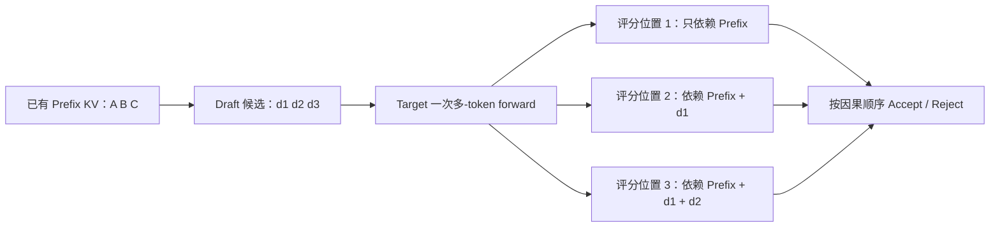
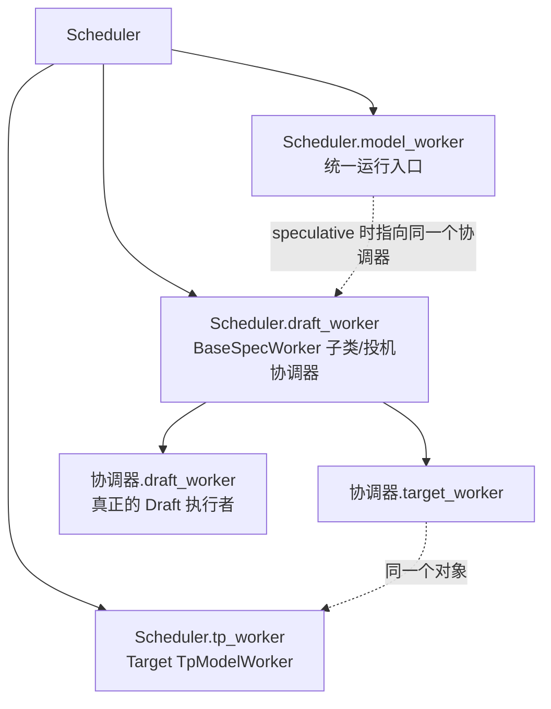
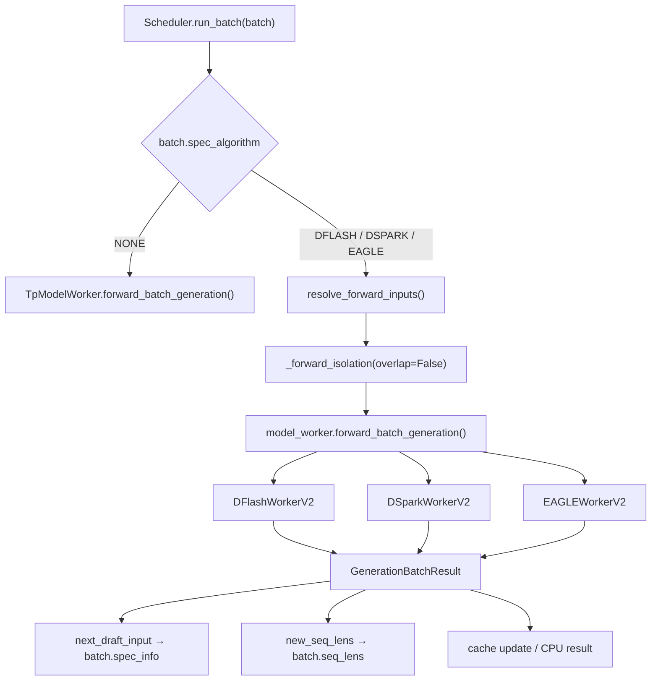
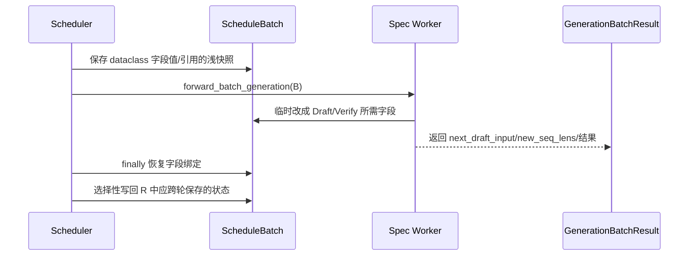

# SGLang Draft → Target Verify 生命周期

> 目标：从 `Scheduler.run_batch()` 的投机分发开始，最终追到 Draft、Target Verify、
> Accept/Reject、KV 状态提交和下一轮输入。
>
> 范围：投机验证直觉、worker 对象装配、non-overlap 动态分发与 `_forward_isolation()`。
> 各算法只在外层分派处对照；dSpark 内层流程见
> [单轮 Decode](sglang-dspark-single-round-decode.md)。
>
> 当前源码核对日期：2026-08-09。结论基于本地 checkout 静态源码；未做 GPU 运行时验证。


前置：run_batch 的 worker 分派。普通请求执行的前置概念从 [SGLang 全景图](../index.html)定位。

本文负责：投机共同直觉、worker 装配、一级分支与字段隔离；具体 dSpark Tensor 状态由 [单轮 Decode 主文](sglang-dspark-single-round-decode.md) 接续。

## 1. 先给出当前已经确定的结论

`TARGET_VERIFY` 可以同时有三种描述，它们并不矛盾：

| 观察层次 | 结论 | 原因 |
|---|---|---|
| 整个生成生命周期 | 属于投机 Decode | draft 和 target 正在共同决定后续生成 token |
| `ForwardMode` 业务语义 | 是独立的 `TARGET_VERIFY`，不等于普通 `EXTEND` | 它要验证暂定候选并计算接受长度 |
| 单次 forward 的数据形态 | 属于 Extend 类多-token forward | 每个请求一次可能验证多个已知候选，而不是只输入一个 token |

因此正确说法是：

> Target Verify 进入 `_execute_extend()`，不是因为 draft 模型“占用了 Decode 阶段”，而是
> 因为 target 一次要处理每个请求的多个已知候选 token；它在 EagerRunner 中呈现为
> Extend 形态。

`ForwardMode` 当前定义位于
`python/sglang/srt/model_executor/forward_batch_info.py:98-181`：

```python
class ForwardMode(IntEnum):
    EXTEND = auto()         # 已有 prefix KV，本轮扩展多个 token
    DECODE = auto()         # 每请求 Decode 一个 token
    MIXED = auto()
    IDLE = auto()
    TARGET_VERIFY = auto()  # 投机解码的 target verification
    DRAFT_EXTEND_V2 = auto()

    def is_extend(self, include_draft_extend_v2: bool = False):
        return (
            self == ForwardMode.EXTEND
            or self == ForwardMode.MIXED
            or (include_draft_extend_v2 and self == ForwardMode.DRAFT_EXTEND_V2)
            or self == ForwardMode.TARGET_VERIFY
            or self == ForwardMode.SPLIT_PREFILL
            or self == ForwardMode.DLLM_EXTEND
        )
```

EagerRunner 在
`python/sglang/srt/model_executor/runner/eager_runner.py:194-204` 根据这个分类分发：

```python
def execute(self, forward_batch, pp_proxy_tensors=None, **kwargs):
    mode = forward_batch.forward_mode
    if mode.is_decode():
        return self._execute_decode(forward_batch, pp_proxy_tensors)
    if mode.is_idle():
        return self._execute_idle(forward_batch, pp_proxy_tensors)
    if mode.is_extend(include_draft_extend_v2=True):
        return self._execute_extend(forward_batch, pp_proxy_tensors)
```

所以在已经确定选择 Eager 的前提下：

```text
DECODE
  → _execute_decode()

EXTEND / MIXED / TARGET_VERIFY / DRAFT_EXTEND_V2
  → _execute_extend()
```

但 `TARGET_VERIFY.is_cuda_graph()` 当前也为 `True`
（`forward_batch_info.py:175-181`）。因此“Extend 形态”和“这轮是否实际走 Eager”是两个
维度；只有 ModelRunner 没有选择可用 Graph 时，才会落到这里的 EagerRunner 分支。

## 2. 为什么已知 draft token 后可以像 Prefill 一样并行评分

假设 target 已经缓存前缀：

```text
Prefix：A B C
KV Cache：已经有 A、B、C 的 K/V
```

没有 draft 时，未来 token 尚未知道，target 只能逐步生成：

```text
先得到 d1
  → 才能把 d1 作为输入计算 d2
  → 再把 d2 作为输入计算 d3
```

draft 模型先给出候选 `d1, d2, d3` 后，这段假设续写已经成为已知输入。target 可以在一次
forward 中同时计算多个 query 位置，并由 causal mask 保持依赖关系：



这里的“并行”表示 GPU 在同一次 forward 中批量计算多个 token 位置，不表示这些位置相互
独立，也不表示后面的 token 可以绕过因果 mask 偷看未来。

它像普通 Prefill，是因为两者都拥有一段已经知道的 token；但它不等于普通 Prompt
Prefill：

| 普通 Prompt Prefill | Target Verify |
|---|---|
| prompt token 已确定有效 | draft token 只是暂定候选 |
| 主要目标是建立 prompt KV | 主要目标是给候选评分并求接受长度 |
| 不需要接受/拒绝 prompt | 只允许提交连续接受的因果前缀 |
| 普通生成常只消费每请求最后位置 logits | verify 需要多个验证位置的 logits |

anchor 是否显式包含在验证输入、候选和 logits 如何错位对齐，由 dFlash、dSpark、EAGLE 的
具体布局决定，不能从上述通用图直接写死。dSpark 的线性布局已经核对为
`[anchor,d1,...,d_gamma]`，详见
[`sglang-dspark-single-round-decode.md`](sglang-dspark-single-round-decode.md)；dFlash/EAGLE 仍须
进入各自实现，不能从 dSpark 外推。

## 3. 先认清 Scheduler 中三个名字相似的 worker

### 3.1 变量定义

| Scheduler 字段 | 严格含义 | 大白话 |
|---|---|---|
| `self.tp_worker` | 正式 target 模型的 `TpModelWorker` | 大模型执行者 |
| `self.draft_worker` | dFlash/dSpark/EAGLE 等 `BaseSpecWorker` 子类实例 | 投机解码总指挥，不只是裸 draft 模型 |
| `self.model_worker` | `run_batch()` 使用的统一执行入口别名 | 这轮 batch 应该交给谁 |

开启投机解码后，对象关系是：



例如 dSpark 下：

```text
Scheduler.tp_worker                  = Target TpModelWorker
Scheduler.draft_worker               = DSparkWorkerV2
Scheduler.model_worker               = DSparkWorkerV2
Scheduler.draft_worker.target_worker = Scheduler.tp_worker
Scheduler.draft_worker.draft_worker  = 真正执行 dSpark draft 模型的 worker
```

### 3.2 为什么 `Scheduler.draft_worker` 这个名字容易误导

`BaseSpecWorker` 在
`python/sglang/srt/speculative/base_spec_worker.py:45-68` 同时暴露两个内部角色：

```python
class BaseSpecWorker(ABC):
    @property
    def target_worker(self):
        return self._target_worker

    @property
    def draft_worker(self):
        return self._draft_worker
```

因此 Scheduler 层的 `draft_worker` 实际是一个高层算法 worker。它的一次
`forward_batch_generation()` 可以连续组织：

```text
Draft
  → 构造 VerifyInput
  → Target Verify
  → Accept/Reject/Bonus
  → 返回下一轮状态
```

真正只运行 draft model 的对象位于这个协调器内部。

## 4. 初始化时如何装配 target、协调器和真正的 draft worker

### 4.1 先创建 target worker

调用点：`Scheduler.init_model_worker()`
（`python/sglang/srt/managers/scheduler.py:901-910`）。

被调方法：`Scheduler.init_tp_model_worker()`
（`scheduler.py:806-822`）。

```python
def init_tp_model_worker(self):
    ...
    if use_mlx():
        self.tp_worker = MlxTpModelWorker(**worker_kwargs)
    else:
        self.tp_worker = TpModelWorker(**worker_kwargs)
```

本文后续主线假设通用 CUDA/ROCm，因此 `self.tp_worker` 是通用 `TpModelWorker`。MLX 会换成
`MlxTpModelWorker`，不能因为 IDE 静态跳转到 MLX override 就把它当成 CUDA 运行路径。

### 4.2 根据算法选择协调器类

`Scheduler.maybe_init_draft_worker()` 位于 `scheduler.py:824-866`：

```python
draft_worker_kwargs = dict(
    server_args=self.server_args,
    gpu_id=self.ps.gpu_id,
    ps=self.ps,
    nccl_port=self.nccl_port,
    target_worker=self.tp_worker,  # [讲解] 复用已经加载好的正式 target
)

DraftWorkerClass = self.spec_algorithm.create_worker(self.server_args)
self.draft_worker = DraftWorkerClass(**draft_worker_kwargs)
```

`SpeculativeAlgorithm.create_worker()` 的当前映射位于
`python/sglang/srt/speculative/spec_info.py:248-300`：

```text
DFLASH       → DFlashWorkerV2
DSPARK       → DSparkWorkerV2
EAGLE/EAGLE3 → EAGLEWorkerV2（multi-layer 开关另有实现）
```

为什么把既有 target worker 传进去，而不是重新创建第二个 target？因为它已经持有正式模型
权重、ModelRunner、target KV pool、attention backend、分布式通信和 Graph 等资源；投机协调器
需要驱动它，而不是复制它。

### 4.3 协调器内部再创建 draft 执行者

dSpark 构造函数位于
`python/sglang/srt/speculative/dspark_components/dspark_worker_v2.py:66-123`：

```python
self._target_worker = target_worker
self.model_runner = target_worker.model_runner

bundle = build_draft_tp_worker(...)
self._draft_worker = bundle.draft_worker
self.draft_model_runner = bundle.draft_model_runner
self.draft_model = bundle.draft_model
```

dFlash 在 `python/sglang/srt/speculative/dflash_worker_v2.py:154-218` 使用相同的两角色结构。

EAGLE 在 `python/sglang/srt/speculative/eagle_worker_v2.py:1021-1056` 中，将 draft 侧进一步
包装成 `EagleDraftWorker`：

```python
self._target_worker = target_worker
self._draft_worker = EagleDraftWorker(..., target_worker)
```

这形成第一个算法边界：

```text
dFlash / dSpark
  → 外层协调器 + plain draft TpModelWorker/ModelRunner

EAGLE
  → 外层 EAGLEWorkerV2 + 内层 EagleDraftWorker
  → 内层还区分 draft() 与 draft_extend()
```

当前只确认对象结构，不在这里展开 EAGLE 的 tree draft。

### 4.4 最后绑定统一入口 `model_worker`

`Scheduler.init_model_worker()` 在 `scheduler.py:922-926` 执行：

```python
if self.spec_algorithm.is_none():
    self.model_worker = self.tp_worker
else:
    self.model_worker = self.draft_worker
```

所以 `run_batch()` 后面可以始终写同一句：

```python
self.model_worker.forward_batch_generation(batch)
```

但它的动态接收者不同：

```text
ordinary → TpModelWorker.forward_batch_generation()
dFlash   → DFlashWorkerV2.forward_batch_generation()
dSpark   → DSparkWorkerV2.forward_batch_generation()
EAGLE    → EAGLEWorkerV2.forward_batch_generation()
```

## 5. non-overlap `run_batch()` 的实际投机调用

本文当前固定：generation、speculative、non-overlap、非 PDMux split-prefill。

调用点位于 `python/sglang/srt/managers/scheduler.py:3500-3521`：

```python
elif not batch.spec_algorithm.is_none():
    resolve_forward_inputs(batch, self.future_map)

    with self._forward_isolation(batch, overlap=False):
        batch_result = self.model_worker.forward_batch_generation(batch)

    # [讲解] 临时字段 rebind 已恢复；这里只提交真正需要跨轮保存的状态
    batch.spec_info = batch_result.next_draft_input
    if batch_result.new_seq_lens is not None:
        batch.seq_lens = batch_result.new_seq_lens
        ...

    batch.input_ids = None  # rebuilt next iter from draft_token
    self.update_cache_from_scheduler(batch, batch_result)
    batch_result.copy_to_cpu(...)
```



此处的“同步驱动 V2 worker”是 Python 控制流意义上的 non-overlap 调用方式，不自动等价于每个
CUDA kernel 都已经同步到 CPU；具体 D2H 和 event 语义仍由 `GenerationBatchResult` 后续处理。

## 6. `_forward_isolation()` 为什么必须存在

投机 worker 为了本轮 Draft/Verify，可以临时重新绑定传入的同一个 `ScheduleBatch` 字段，
例如：

```text
forward_mode
input_ids
spec_info
out_cache_loc
seq_lens_cpu / seq_lens_sum
sampling_info
```

但 `ScheduleBatch` 还是 Scheduler 跨轮管理请求的持久对象，不能把“为了本次 target verify
临时拼出的字段绑定”全部泄漏为下一轮调度状态。

`Scheduler._forward_isolation()` 的关键代码在 `scheduler.py:3343-3367`：

```python
snapshot_v2_full = not batch.spec_algorithm.is_none()
sched_snapshot = (
    {f.name: getattr(batch, f.name) for f in dataclasses.fields(batch)}
    if snapshot_v2_full
    else None
)

try:
    yield
finally:
    if snapshot_v2_full:
        for name, value in sched_snapshot.items():
            setattr(batch, name, value)
```

这里的 `sched_snapshot` 是**字段值/对象引用的浅快照**，不是 Tensor 数据和嵌套对象的深拷贝。
因此它可以撤销：

```python
batch.forward_mode = ForwardMode.TARGET_VERIFY
batch.input_ids = verify_input_ids
batch.spec_info = verify_input
```

这类“字段重新指向另一个值/对象”的 rebind；但如果 worker 对快照和 batch 共同指向的同一个
Tensor 或可变对象做原地修改，`setattr(batch, name, old_reference)` 不能回滚对象内部的数据。
是否允许这种原地副作用，仍要在具体 worker 和下一位消费者处核对。

完整的字段绑定交接是：



因此需要区分：

| 状态类型 | 例子 | 返回后处理 |
|---|---|---|
| 本轮临时字段绑定 | 临时 `TARGET_VERIFY`、verify `input_ids`、临时 host length bound | 恢复原字段引用，不直接遗留 |
| 已确认的跨轮状态 | `next_draft_input`、接受后的 `new_seq_lens`、cache 更新 | 由 `batch_result` 明确返回并写回 |

注意：上表描述字段 rebind；同一 Tensor/嵌套对象的原地写入不由浅快照自动撤销。

`batch.input_ids = None` 也不是丢失了输入；它表示下一轮不得误用本轮临时 verify Tensor，而要
根据新的 draft/spec 状态重新构造实际输入。

## 7. 进入协调器后，三种算法的一级分支

### 7.1 dSpark

`DSparkWorkerV2.forward_batch_generation()` 位于
`python/sglang/srt/speculative/dspark_components/dspark_worker_v2.py:361-377`：

```python
if batch.forward_mode.is_extend() or batch.is_extend_in_batch:
    return self._forward_prefill(batch, on_publish)

return self._forward_decode(batch, on_publish, grammar_barrier)
```

这里的 `_forward_prefill()` 是 target prompt prefill，并为后续 draft 状态准备 target hidden；
真正的投机 Decode 主线从 `_forward_decode()` 开始。

### 7.2 dFlash

`DFlashWorkerV2.forward_batch_generation()` 从
`python/sglang/srt/speculative/dflash_worker_v2.py:1387` 开始；Prompt 分支位于
`1387-1456`，Decode/Draft/Target Verify 主体从 `1458` 继续到该方法返回：

```text
Extend / is_extend_in_batch
  → Target prompt prefill
  → 捕获 target hidden
  → 准备下一轮 DFlashDraftInputV2

否则
  → Draft block
  → Target verify
  → Accept/bonus
```

### 7.3 EAGLE

`EAGLEWorkerV2.forward_batch_generation()` 位于
`python/sglang/srt/speculative/eagle_worker_v2.py:1122-1217`：

```text
Extend / is_extend_in_batch
  → Target prefill
  → _draft_extend_for_prefill()

否则
  → draft_worker.draft()
  → verify()
  → _draft_extend_for_decode()
```

因此三者有共同的外层骨架，但不能把内部布局视为相同：

```text
Prompt 阶段：target prefill + 准备 draft 状态
Decode 阶段：draft proposal + target verify + 下一轮状态
```

dFlash/dSpark 更接近线性 block；EAGLE 还可能是 top-k tree，并具有独立 `draft_extend()`。

## 8. 一个重要边界：`TARGET_VERIFY` 不是模型所有权标签

从枚举注释看，`TARGET_VERIFY` 用于 target model verification；但当前 dFlash/dSpark 实现还会
在 draft 侧复用这种块状 ForwardMode：

- dSpark：`python/sglang/srt/speculative/dspark_components/dspark_draft.py:398-415`
  构造 `ForwardBatch(forward_mode=TARGET_VERIFY)`，随后调用
  `draft_model_runner.forward(draft_forward_batch)`；
- dFlash：`python/sglang/srt/speculative/dflash_worker_v2.py:1618-1635` 同样构造该 mode，随后
  调用 `draft_model_runner.forward(forward_batch)`；真正的 target verify 在后面的
  `verify_input.prepare_for_verify(..., self.target_worker)` 和
  `self.target_worker.forward_batch_generation(...)`。

所以判断“这一次 forward 是 draft 模型还是 target 模型”时，必须同时看：

```text
ForwardMode：描述本轮执行语义/数据形态
实际 receiver：draft_model_runner 还是 target_worker
spec_info/mask：描述具体 block/tree 验证布局
```

不能只看到 `TARGET_VERIFY` 四个字就停止追调用者。

## 9. 当前单请求的已知时间线

假设请求 `R0` 已完成 Prompt Prefill，正在进入 dSpark 投机 Decode：

```ini
batch.forward_mode = DECODE
batch.spec_algorithm = DSPARK
batch.seq_lens = [22]
batch.spec_info = 上一轮留下的 DraftInput，其中 bonus/anchor 为 Y
```

当前已经确认的外层时间线：

```text
时刻 0：Scheduler 持有普通 Decode 形态的 ScheduleBatch

时刻 1：run_batch() 发现 batch.spec_algorithm != NONE
        self.model_worker 实际是 DSparkWorkerV2

时刻 2：进入 _forward_isolation()
        DSparkWorkerV2 可临时改造同一个 ScheduleBatch

时刻 3：DSparkWorkerV2.forward_batch_generation()
        因不是 Prompt Extend，进入 _forward_decode()

时刻 4：内部完成 Draft → Target Verify → Accept/Reject
        返回 GenerationBatchResult

时刻 5：_forward_isolation() 恢复 Scheduler 的原始字段绑定
        注意：这不是嵌套对象/Tensor 数据的深回滚

时刻 6：Scheduler 选择性提交
        batch.spec_info = batch_result.next_draft_input
        batch.seq_lens  = batch_result.new_seq_lens
        batch.input_ids = None
```

时刻 4 的 dSpark 单请求主链现已完成逐 Tensor 核对，详细记录见
[`sglang-dspark-single-round-decode.md`](sglang-dspark-single-round-decode.md)。固定
`prefix_len=22、anchor=Y、drafts=[a,b,c,d]`，若只接受 `a` 并得到 bonus `Z`，关键状态是：

```text
Target verify 输入： [Y,a,b,c,d]
用户有效输出：      [a,Z]
Draft KV 新提交：    [Y@22,a@23]
new_seq_len：        24
下一轮 anchor：      Z@24
```

这证明 `commit_lens=correct_len+1` 在输出和 KV 两个消费者处数值相同、token 内容却错开一位。
候选物理 KV slot 的具体释放/回收策略仍保留为后续独立内存管理主题，不能由逻辑
`new_seq_lens` 直接反推。

## 10. 当前主题的边界

- **硬件后端**：主线按通用 CUDA/ROCm `TpModelWorker`；MLX/NPU/XPU 只有在改变调用链时再
  单独核对。
- **runner**：Scheduler 到 speculative worker 的装配与分发发生在 Eager/Graph 选择之前；
  `TARGET_VERIFY → EagerRunner._execute_extend()` 只描述已经选择 Eager 的分支。
- **调度模式**：当前详细调用点是 non-overlap；overlap 会增加 FutureMap、`on_publish`、
  stream/event 和两轮 Tensor 生命周期。
- **算法**：dFlash、dSpark、EAGLE 只共享外层骨架；anchor、verify window、mask、accept 和 KV
  处理必须分别核对。
- **验证级别**：当前是 source-verified、runtime-unvalidated，不能据此声称 GPU 实际性能或
  kernel 完成时序已经测量。

## 11. `源码动作 / 改变状态 / 为什么` 小结

| 源码动作 | 改变的状态 | 为什么 |
|---|---|---|
| `init_tp_model_worker()` | 创建 `Scheduler.tp_worker` | 先建立唯一正式 target 执行者 |
| `spec_algorithm.create_worker()` | 选择 dFlash/dSpark/EAGLE 协调器类型 | 把算法差异交给动态分发 |
| 协调器构造函数接收 `target_worker` | 保存 `_target_worker` 并创建 `_draft_worker` | 一个对象内组织 Draft 和 Target Verify |
| `self.model_worker = self.draft_worker` | 改变 `run_batch()` 的统一接收者 | Scheduler 不需要写算法 if/elif 主流程 |
| `_forward_isolation()` | 保存并恢复 `ScheduleBatch` 字段绑定的浅快照 | 隔离 verify 临时 rebind；不承诺回滚对象内部原地写入 |
| dSpark `_forward_decode()` | 返回 output、`next_draft_input/new_seq_lens`，并按接受前缀注入 Draft KV | 把单轮验证结果拆成用户输出、KV commit 和下一轮 anchor 三条状态 |
| 写回 `next_draft_input/new_seq_lens` | 更新跨轮投机状态 | 只提交已经确认应保留的结果 |

## 12. 复习问题

1. 开启 dSpark 后，`Scheduler.model_worker` 指向 `TpModelWorker` 还是
   `DSparkWorkerV2`？
2. `DSparkWorkerV2.target_worker` 与 `Scheduler.tp_worker` 是两份模型还是同一个对象？
3. 为什么 `TARGET_VERIFY.is_extend() == True` 不能推出“它就是普通 Prompt Prefill”？
4. 为什么只看 `forward_mode == TARGET_VERIFY` 仍不足以判断本轮由 draft model 还是 target
   model 执行？
5. `_forward_isolation()` 恢复字段绑定后，下一轮真正需要的状态通过什么对象重新写回？它能否
   自动回滚同一个 Tensor 的原地修改？

答案分别是：投机协调器；同一个 target worker；业务语义和多-token 数据形态不同；当前
dFlash/dSpark draft 侧也复用该 mode，必须看实际 runner；通过 `GenerationBatchResult` 中的
`next_draft_input / new_seq_lens` 等字段重新写回，并且浅快照不能自动回滚同一对象的原地
修改。

专题阅读路线见 [投机索引](README.md)；跨模块位置见 [SGLang 全景图](../index.html)。
