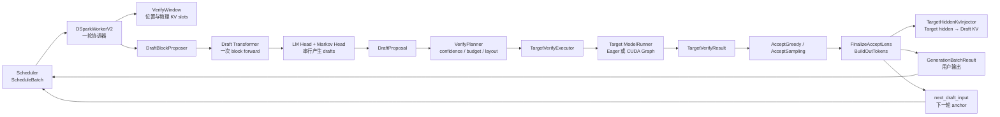
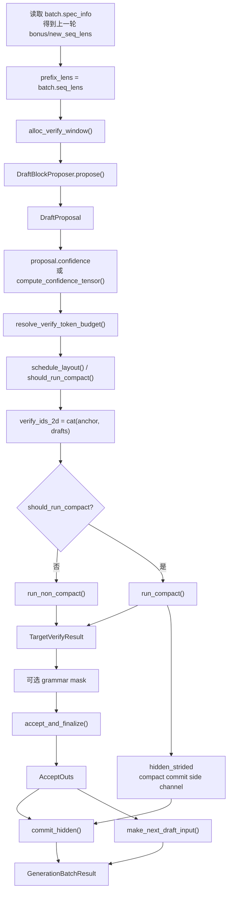
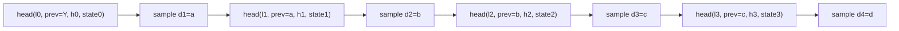
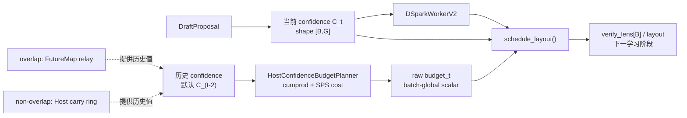
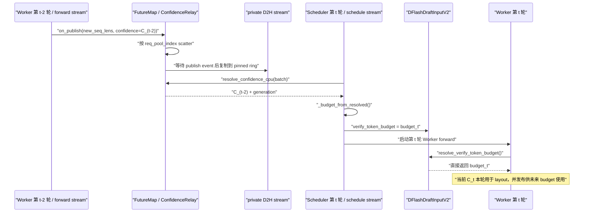
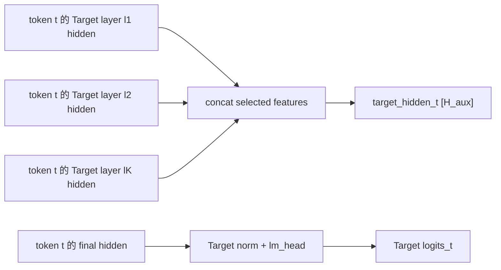
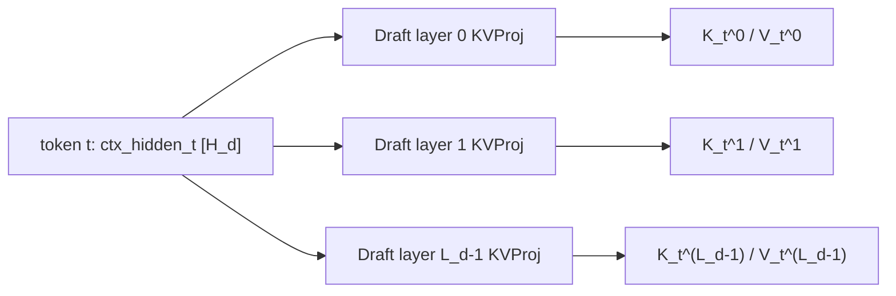
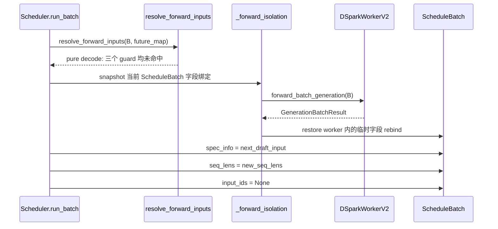

# SGLang dSpark 单轮 Decode：Draft → Target Verify → Accept → Rolling Anchor

> 用途：逐对象、逐 Tensor 记录当前 SGLang dSpark V2 一轮 Decode 的完整生命周期，重点解释
> `DraftProposal`、`TargetVerifyResult`、`AcceptOuts`、用户输出、Draft KV 提交和下一轮 anchor
> 之间的关系。
>
> 当前源码基线：本地 checkout `f01a0c7f97ec`，核对日期 2026-08-13。
>
> 验证级别：source-verified、runtime-unvalidated。本文没有在 GPU 上做断点、Tensor dump 或
> 性能测量；CUDA Graph、Stream 和 kernel 的描述来自当前静态源码。
>
> 主线假设：CUDA dSpark V2、单请求、dense draft、普通 non-overlap、greedy、无 grammar、
> non-compact。Sampling、COMPACT、CAP_ACCEPT、folded CUDA Graph、DeepSeek-V4 和 DP
> Attention 在改变结论的位置单独标边界。第 7 节为了说明 batch-global confidence budget，
> 单独切换到 `B=2、gamma=4`，并分别展开 overlap/non-overlap；第 8 节继续沿用这组多请求
> COMPACT 例子解释 Target Verify，第 9 节起再回到单请求主例。
>
> 阅读顺序：先读通用外层的
> [`sglang-draft-target-verify-lifecycle.md`](sglang-draft-target-verify-lifecycle.md)；专题阅读路线见本目录 [`README.md`](README.md)；启动参数、环境变量与迁移约束见
> [`sglang-dflash-dspark-startup-args-and-migration.md`](sglang-dflash-dspark-startup-args-and-migration.md)。
> 若希望先看图再回到源码证明，可配合
> [`sglang-dspark-verify-visual-guide.md`](sglang-dspark-verify-visual-guide.md) 阅读；也可以直接打开
> [`dSpark Verify 源码逐步执行讲解器`](visualizations/dspark-verify-step-through.html)，沿真实函数调用链逐步切换候选矩形、
> compact rails、Target forward、scatter、accept、KV commit 和下一轮 anchor。


前置：[投机外层生命周期](sglang-draft-target-verify-lifecycle.md)。

本文是 dSpark 的源码主文：保留 proposal、budget/layout、verify/accept、KV 与两轮 anchor 的完整因果；[Verify 坐标练习](sglang-dspark-verify-visual-guide.md) 和交互 HTML 使用这里的状态定义。

## 1. 读完本文应先掌握的结论

一轮 dSpark Decode 不是“Draft 生成多个 token，Target 选几个，然后把选中的 token 全写入
KV”这么简单。当前实现的核心是一个滚动 anchor：

```text
本轮 Target verify 输入： [old_anchor, d1, d2, ..., d_gamma]
本轮用户输出：            [accepted drafts, new_bonus]
本轮 Draft KV 提交：       [old_anchor, accepted drafts]
下一轮 anchor：            new_bonus
```

若连续接受 `k` 个 draft，则：

```text
correct_len  = k
commit_lens  = k + 1
new_seq_lens = prefix_lens + k + 1
```

但 `commit_lens=k+1` 在两个消费者处代表的 token 内容不同：

```text
用户有效输出长度 k+1： [d1, ..., dk, bonus]
Draft KV 提交长度 k+1： [anchor, d1, ..., dk]
```

两者长度相同、内容错开一位。bonus 本轮只是 Target 预测结果，没有作为 Transformer 输入，
因此本轮没有自己的 hidden/KV；它到下一轮才作为新 anchor 被处理。

## 2. 先固定符号、量纲和坐标

| 符号/字段 | 严格含义 | 本文例子 |
|---|---|---:|
| `B` | batch size | `1` |
| `gamma` / `G` | 每请求 proposal 的 draft token 数 | `4` |
| `W` | Target verify 每请求完整宽度 | `gamma + 1 = 5` |
| `H_d` | dense Draft Transformer hidden size | `H_d` |
| `H_aux` | Target `FULL` 捕获的辅助特征宽度，可能拼接多个 target layer | `H_aux` |
| `V` | target 原始 vocab size | `V` |
| `prefix_lens` | 本轮开始前已经具有有效 KV 的逻辑前缀长度 | `[22]` |
| `anchor` | 上一轮输出、但尚未作为输入写入 KV 的 bonus | `Y` |
| `draft_tokens` | 本轮 Draft 提议的 `gamma` 个 token | `[a,b,c,d]` |
| `correct_len` | 连续接受的 draft 数，不包含 anchor/bonus | `1` |
| `commit_lens` | `correct_len + 1` | `2` |
| `bonus` | 接受前缀后由 Target 分布得到的下一个 token | `Z` |
| `new_seq_lens` | 下一轮开始前的有效 KV 逻辑长度 | `[24]` |

必须始终保持以下量纲关系：

```text
gamma = 4
W = verify_num_draft_tokens = gamma + 1 = 5

Draft Transformer block： [anchor, MASK, MASK, MASK]      宽度 4
Target verify candidates： [anchor, d1, d2, d3, d4]      宽度 5
```

如果启用 confidence scheduling，还要注意坐标偏移：

```text
confidence position p  ↔  draft d_(p+1)  ↔  verify column p+1
verify column 0        ↔  anchor
```

因此 `min_verify_len=1` 只保底 anchor，不代表保底验证一个 draft。

## 3. 组件架构关系



这里有三类不同所有权：

| 对象 | 所有者/创建者 | 生命周期 |
|---|---|---|
| `ScheduleBatch` | Scheduler | 跨多轮存在；worker 可临时 rebind 字段 |
| `DraftProposal`、`TargetVerifyResult`、`AcceptOuts` | `DSparkWorkerV2` 内部组件 | 单轮临时对象 |
| `next_draft_input`、`new_seq_lens` | Worker 返回，Scheduler 写回 | 必须跨轮保存 |

## 4. `_forward_decode()` 的主调用链

主方法位于
`python/sglang/srt/speculative/dspark_components/dspark_worker_v2.py:482-700`。



主线源码动作顺序：

```text
alloc_verify_window                 worker_v2.py:514-521
proposer.propose                    worker_v2.py:523-536
confidence                         worker_v2.py:538-545
resolve verify-token budget        worker_v2.py:547-552
schedule layout / compact decision worker_v2.py:554-570
verify_ids_2d                      worker_v2.py:572-574
run_compact / run_non_compact      worker_v2.py:590-610
TargetVerifyResult 消费            worker_v2.py:611-640
commit_hidden                      worker_v2.py:647-659
next_draft_input / result          worker_v2.py:684-700
```

## 5. 本轮入口状态和 VerifyWindow

### 5.1 `prefix_lens=[22]` 不包含 anchor `Y`

本轮开始前：

```text
有效 KV positions： 0 ... 21
prefix_lens：        22
待处理 anchor：      Y @ position 22
```

`Y` 在上一轮已经作为 bonus 输出给用户，但上一轮没有把 `Y` 当作 Transformer 输入，因此
它还没有自己的 hidden/KV。本轮必须先以 `Y` 为 anchor。

### 5.2 `alloc_verify_window()` 先为完整宽度预留位置

实现位于
`python/sglang/srt/speculative/dspark_components/dspark_planner.py:844-870`：

```python
positions_2d = prefix_lens.unsqueeze(1) + block_pos_offsets
verify_cache_loc = assign_extend_cache_locs_func(...)
verify_cache_loc_2d = verify_cache_loc.view(bs, verify_w)
```

本文例子：

```text
W = 5

positions_2d = [[22,23,24,25,26]]           shape [1,5]
cache_loc_2d = [[L22,L23,L24,L25,L26]]      shape [1,5]
```

`position` 是逻辑位置；`L22...L26` 是 token-to-KV pool 中的物理写地址，二者不能混为一谈。

## 6. DraftBlockProposer：一次并行 Transformer + 串行 Markov 采样

### 6.1 Draft Transformer 的输入不是 `[Y,a,b,c,d]`

`DraftBlockProposer._run_forward()` 位于
`python/sglang/srt/speculative/dspark_components/dspark_draft.py:361-426`。

它构造：

```text
draft_block_ids = [Y,MASK,MASK,MASK]        shape [1,4]
draft_positions = [22,23,24,25]             shape [4]
draft_cache_loc = [L22,L23,L24,L25]         shape [4]
```

Draft 只取完整 VerifyWindow 每行的前 `gamma=4` 个槽。Target verify 才使用宽度
`W=5` 的 `[Y,a,b,c,d]`。

### 6.2 实际构造的 `draft_forward_batch`

本文例子中的字段是：

| `ForwardBatch` 字段 | 实际值 | 语义 |
|---|---|---|
| `forward_mode` | `TARGET_VERIFY` | 块状多 token forward 形态，不表示 receiver 是 Target |
| `batch_size` | `1` | 一个请求 |
| `input_ids` | `[Y,M,M,M]`，shape `[4]` | anchor + `G-1` 个 mask |
| `req_pool_indices` | `[R0_POOL_ROW]` | 历史 KV 映射所在请求行 |
| `seq_lens` | `[22]` | 进入本轮前的 committed prefix，不含当前 block |
| `seq_lens_cpu` | `[26]` | host planner 使用的 `prefix + G` 长度 |
| `seq_lens_sum` | `26` | 此手工 batch 的 host planning sum |
| `positions` | `[22,23,24,25]` | 当前四个输入位置 |
| `out_cache_loc` | `[L22,L23,L24,L25]` | 当前四行 Draft KV 物理地址 |
| `input_embeds` | 当前主路径为 `None` | embedding 在 draft model 的 `forward_embed` 中完成 |
| `spec_algorithm` | `DSPARK` | 投机算法标识 |
| `spec_info.draft_token_num` | `4` | Draft block 的宽度是 `G` |
| `capture_hidden_mode` | `NULL` | 不要求额外 target-style 捕获；draft model 仍返回自身 hidden |

这里最容易误读的是：

```text
seq_lens      = [22]
seq_lens_cpu  = [26]
```

在这个手工构造的 speculative `ForwardBatch` 中，两者不是逐值镜像：GPU rail 保存进入 block 前的
prefix；CPU rail已经加上本次规划的 `G` 行。`batch.seq_lens_cpu + gamma` 创建新 Tensor，不会把
Scheduler 持久的 CPU length 原地改成 26。

### 6.3 为什么四个输入位置能产生四个 draft

Draft Transformer 一次并行 forward：

```text
[Y,M1,M2,M3]
   │
   ▼
draft_hidden = [h0,h1,h2,h3]                shape [1,4,H_d]
   │
   ▼ shared Target LM Head
base_logits = [l0,l1,l2,l3]                 shape [1,4,V]
```

然后 Markov head 串行注入真实的前一 token：



上图使用统一通式；具体 Markov head 有边界差异：vanilla 主要加入 previous-token bias，gated
还读取当前 `draft_hidden_i`，RNN 还携带跨位置 recurrent state。它们共同保持“Transformer
一次、Markov logits 修正/采样串行”的主结论。

因此：

- Draft Transformer 只跑一次；
- 后置 Transformer hidden 看到的是 causal prefix 加 MASK 占位符，不是刚采样出的 `a/b/c`；
- 串行的是 Markov logits 修正与采样，不是四次 Transformer forward；
- Markov 不会回头改写已经算完的后置 hidden/KV。

### 6.4 `DraftProposal` 包含什么

定义位于 `dspark_draft.py:51-71`：

```text
DraftProposal
├── draft_block_ids      [Y,M,M,M]
├── draft_block
│   ├── draft_tokens     [a,b,c,d]
│   ├── corrected_logits [1,4,V]，folded greedy 时可为 None
│   ├── greedy_mask      [1]
│   └── temperatures     [1]
├── draft_hidden         [1,4,H_d]
├── confidence           可选
├── confidence_tap       可选
└── folded               sampler tail 是否折入 Draft CUDA Graph
```

`corrected_logits` 是实际 proposal 分布 `q` 的未除温 logits。Sampling verify 后续用它重建
`q`；greedy 不需要概率修正，folded greedy 因而可以不返回这块大 Tensor。

### 6.5 greedy 与 sampling 的 Draft 边界

`resolve_greedy_mask()` 以 `top_k <= 1` 判断每个请求是否 greedy，见
`dspark_draft.py:166-238`：

```text
greedy：   每步 argmax，不随机抽样
sampling：softmax(corrected_logits / temperature) 后随机抽样
mixed：    同一 batch 内按请求 greedy_mask 选择
```

Draft proposal 侧 sampling 不应用 Target 的 top-k/top-p 截断；这是允许的，因为 Target 接受阶段
会使用实际 `q` 做拒绝采样修正。Target 的 temperature/top-k/top-p 决定目标分布 `p`。

<a id="verify-layout"></a>

## 7. 从 DraftProposal 到 Target candidates

### 7.1 先建立 Planner 的组件边界

Worker 在 `worker_v2.py:538-570` 依次处理：

```text
confidence
→ resolve_verify_token_budget()
→ schedule_layout()
→ should_run_compact()
```

这条链涉及 Draft graph、Worker、Host planner、Scheduler/FutureMap 和下一步 layout 分配，不能把
它们压成一个“按 confidence 裁剪”的动作：



这几个量必须始终分开：

```text
当前 confidence C_t：       本轮各 draft 位置的条件置信分数
历史 survival S_(t-2)：     历史 confidence 沿 draft 前缀的累计乘积
budget_t：                  整个 batch 在 mandatory floor 外可分配多少个额外槽
verify_lens_t[B]：          当前 confidence 将 budget 分配给各请求后的长度，包含 anchor
```

因此默认稳态职责是：

```text
历史 C_(t-2) 决定“选多少”
当前 C_t     决定“分给谁”
```

confidence/budget/layout 都不改变 Draft proposal 分布 `q`，也不替代后续 greedy matching 或
rejection sampling；在后续确实产生 non-`None` layout 时，它们决定 Target 本轮值得验证到多深，
以及 COMPACT 是否有机会减少有效候选行。STATIC、预算/relay 尚未就绪或 captured-grid fallback
都可能不产生 layout。

### 7.2 `compute_confidence_tensor()`：得到当前 `C_t[B,G]`

Worker 先复用 proposal 中可能已经存在的结果，见 `dspark_worker_v2.py:538-545`：

```python
confidence = proposal.confidence
if confidence is None:
    confidence = self._verify_planner.compute_confidence_tensor(
        draft_hidden=proposal.draft_hidden,
        anchor_tokens=draft_block_ids[:, 0],
        draft_tokens=draft_tokens,
        confidence_tap=proposal.confidence_tap,
    )
```

`proposal.confidence` 非空表示 folded greedy Draft CUDA Graph 已在 sampler tail 中算完 confidence；
Worker 直接复用，避免重复计算。普通 eager/sampling 路径通常为 `None`，再进入
`DSparkVerifyPlanner.compute_confidence_tensor()`，见 `dspark_planner.py:264-293`：

```text
confidence_head 不存在： 返回 None（正常 STATIC 路径）
模型有 compute_confidence hook：使用 confidence_tap（DeepSeek-V4）
否则：使用 dense 通用 compute_confidence()
```

下面固定一个 multi-request 教学例：

```text
B = 2
G = 4

anchor_tokens = [Y0,Y1]                              shape [2]
draft_tokens  = [[a,b,c,d], [e,f,g,h]]               shape [2,4]
draft_hidden                                              [2,4,H_d]
```

dense 通用 helper 位于 `dspark_planner.py:888-923`。它先构造每个 draft 位置的真实前驱 token：

```python
prev_seq = torch.cat(
    [anchor_tokens.view(-1, 1), draft_tokens[:, : gamma - 1]],
    dim=1,
)
markov_embed_stack = markov_head.get_prev_embeddings(prev_seq)
```

代入数据：

```text
prev_seq = [[Y0,a,b,c],
            [Y1,e,f,g]]                              shape [2,4]

markov_embed_stack                                  shape [2,4,R]
```

坐标含义是：

```text
confidence[:,0] 评估 d1，前驱是 anchor
confidence[:,1] 评估 d2，前驱是 d1
confidence[:,2] 评估 d3，前驱是 d2
confidence[:,3] 评估 d4，前驱是 d3
```

默认 `with_markov=True` 时，`DSparkConfidenceHead.forward()` 在 `models/dspark.py:289-330`
执行：

```text
draft_hidden                                  [2,4,H_d]
markov_embed_stack                            [2,4,R]
cat(..., dim=-1)                              [2,4,H_d+R]
Linear(H_d+R → 1)                             [2,4,1]
squeeze(-1) = confidence_raw                  [2,4]
```

随后 STS calibration：

```python
confidence = torch.sigmoid(
    confidence_raw.float() / sts_temperatures
)
```

`sts_temperatures` 是 confidence 的标量或逐位置 `[G]` 校准温度，不是生成 sampling
temperature。最终 `confidence[B,G]` 每项在 `[0,1]`，但四列不需要和为 1；它不是 vocab
分布、不是 proposal `P_D`，也还不是累计 survival。

本节后续使用一组教学输出：

```text
C_t = current confidence =
req0 [0.95, 0.90, 0.70, 0.20]
req1 [0.99, 0.95, 0.92, 0.85]                 shape [2,4]
```

三条模式边界：

- `STATIC` 在模型构造阶段就不创建 confidence head，全链返回 `None`；正确性不受影响，只是不做
  自适应验证深度调度。
- folded greedy graph 在 `dspark_draft.py:79-118,290-315` 内计算并写入
  `confidence_out[max_bs,G]`，Worker 只取 live batch slice；`proposal.folded=True` 不代表 Target
  accept/commit 也 folded。
- DeepSeek-V4 在 `deepseek_v4_dspark.py:714-758` 使用 collapse 后的 `confidence_tap`，不能把
  dense `[B,G,H_d]` 形状直接套过去；最终输出仍为 `[B,G]`。

### 7.3 `resolve_verify_token_budget()`：只决定 batch-global 数量

Worker 立即调用 `dspark_worker_v2.py:547-552`：

```python
verify_token_budget = self._verify_planner.resolve_verify_token_budget(
    draft_input=draft_input,
    confidence=confidence,
    prefix_lens=prefix_lens,
    req_pool_indices=batch.req_pool_indices,
)
```

方法定义见 `dspark_planner.py:373-391`：

```python
if not self.schedules_verify_budget or confidence is None:
    return None
if not self.server_args.disable_overlap_schedule:
    return draft_input.verify_token_budget
return self.compute_budget_sync(
    confidence=confidence,
    prefix_lens=prefix_lens,
    req_pool_indices=req_pool_indices,
)
```

它返回 `Optional[int]`，不是每请求 Tensor。继续固定：

```text
B = 2
G = 4
W = G + 1 = 5
min_verify_len = 1
```

量纲如下：

| 数量 | 本例 | 是否属于 budget |
|---|---:|---|
| mandatory anchor floor | `B×1=2` | 否，另算 |
| 可选 draft positions | `B×G=8` | 是，构成候选池 |
| 完整 Target verify 上限 | `B×W=10` | floor 与全部 extra 之和 |

因此 `budget=5` 的严格含义是：

```text
两个 anchor 之外，整个 batch 最多再分配 5 个 draft verify 槽
逻辑 allowance 上限 = floor 2 + budget 5 = 7 行
```

它不表示“每请求 5 行”，也不能直接推出 `verify_lens=[3,4]`；下一步还必须使用当前 `C_t`
分配这 5 个名额。

### 7.4 non-overlap：当前 `C_t` 入参，历史 `C_(t-2)` 参与 optimizer

non-overlap 时 `resolve_verify_token_budget()` 进入 `compute_budget_sync()`，见
`dspark_planner.py:351-371`：

```text
当前 C_t [B,G] GPU
→ C_t.to("cpu")
→ 读取 req_pool_indices 对应的 generation
→ ResolvedConfidence(C_t, generation)
→ HostConfidenceBudgetPlanner.compute_budget()
```

因此只看外层会误以为当前 `C_t` 立即参与 budget；真正的轮次选择在
`HostConfidenceBudgetPlanner._shift_to_lag()`。初始化代码是：

```python
relay_lag_steps = 0 if disable_overlap_schedule else CONFIDENCE_RELAY_RING_LAG

self.lag_steps = max(
    SGLANG_DSPARK_CONFIDENCE_RELAY_LAG_STEPS,
    1,
)
self.carry_steps = max(self.lag_steps - relay_lag_steps, 0)
```

当前默认：

```text
lag_steps       = 2
relay_lag_steps = 0       # non-overlap 没有 FutureMap confidence relay
carry_steps     = 2
```

`_shift_to_lag()` 在 `dspark_planner.py:1087-1104` 的关键顺序是“先读旧值，再写当前值”：

```python
lagged_confidence = self._carry_confidence[slot, rows].clone()
lagged_generation = self._carry_generation[slot, rows].clone()
self._carry_confidence[slot, rows] = confidence
self._carry_generation[slot, rows] = generation
return lagged_confidence, lagged_generation
```

同一请求连续出现时：

| 当前调用 | 当前传入 | optimizer 实际读取 | 写回 carry |
|---:|---|---|---|
| `t=0` | `C0` | 初始空槽 → freshness fallback | `C0` |
| `t=1` | `C1` | 初始空槽 → freshness fallback | `C1` |
| `t=2` | `C2` | `C0` | `C2` |
| `t=3` | `C3` | `C1` | `C3` |
| `t=4` | `C4` | `C2` | `C4` |

所以默认稳态：

```text
budget_t = optimizer(cumprod(C_(t-2)), SPS cost)
```

当前 `C_t` 一方面写入 carry 供未来 budget 使用，另一方面在本轮后续直接交给
`schedule_layout()`，用于决定“名额分给谁”。

`req_pool_indices` 还会配合 `req_generation` 防止 request-pool row 复用：旧历史 generation 与
当前请求不匹配时，`_two_steps_prior_survival()` 使用全 1 survival，而不是把旧请求的低
confidence 应用给新请求。`prefix_lens` 当前在 `compute_budget_sync()` 中被明确 `del`，所以这个
optimizer 并不直接按上下文长度决定 budget。

### 7.5 overlap：两轮延迟由 `FutureMap/ConfidenceRelay` 实现

overlap 下 Worker 不现场调用 `compute_budget_sync()`，只读取
`draft_input.verify_token_budget`。这个字段定义于 `dflash_info_v2.py:35-57`，由 Scheduler 在
Worker forward 之前调用 `prepare_verify_budget()` 写入：



Scheduler 调用点在 `scheduler.py:3398-3425`；本轮 Worker 在接受后通过
`dspark_worker_v2.py:641-645` 发布 `C_t`，`FutureMap.publish()` 再写 confidence relay。

默认 overlap 参数：

```text
lag_steps       = 2
relay_lag_steps = CONFIDENCE_RELAY_RING_LAG = 2
carry_steps     = max(2 - 2, 0) = 0
```

因此默认稳态下，两种执行模式使用同样历史年龄：

| 模式 | 两轮延迟在哪里实现 | Host 额外 carry | budget 使用 |
|---|---|---:|---|
| overlap | `FutureMap/ConfidenceRelay` D2H ring | `0` | `C_(t-2)` |
| non-overlap | `HostConfidenceBudgetPlanner` carry ring | `2` | `C_(t-2)` |

两者的区别不是“一个用当前、一个用历史”，而是两轮延迟由哪个组件承担。warm-up 行为则不同：

- overlap ring 尚未积累两轮或 copy event 未完成时，resolved confidence 可能为 `None`，budget
  也为 `None`；
- non-overlap 初始 carry generation 不匹配，survival 回退为全 1，再结合 SPS table 计算
  budget。

上述 `C_(t-2)` 是同一请求连续 decode、generation 匹配时的稳态说法；batch 交错、非 decode
step、request-pool row 复用或 relay 未就绪时，要按上述 fallback 理解，不能机械地把每个请求
都标成严格的物理“前两轮”。

### 7.6 `compute_verify_token_budget()`：历史收益与 SPS 成本的折中

Host planner 先计算：

```python
history_survival = torch.cumprod(lagged_confidence, dim=1)
```

使用另一组明确标为历史的教学数据，避免和当前 `C_t` 混淆：

```text
C_(t-2) =
req0 [0.90, 0.80, 0.50, 0.20]
req1 [0.70, 0.60, 0.50, 0.40]

S_(t-2) = cumprod(C_(t-2)) =
req0 [0.900, 0.720, 0.360, 0.072]
req1 [0.700, 0.420, 0.210, 0.084]
```

`compute_verify_token_budget()` 位于 `dspark_planner.py:954-991`，依次执行：

```text
flatten 全 batch survival
→ 删除低于 survival_eps 的候选
→ survival 降序排序
→ prefix_sum
→ 对每个 k=0..N 估算收益与成本
→ 取 objective 最大的 k 作为 budget
```

排序结果：

```text
[0.900, 0.720, 0.700, 0.420, 0.360, 0.210, 0.084, 0.072]
```

对于 budget 候选 `k`，预期每 step 进度是：

```text
tau_star(k) = B + sum(top-k historical survival)
```

其中基础项 `B=2` 表示每个请求即使一个 draft 都不接受，也至少由 anchor 的 Target logits
产生一个 bonus 输出。假设教学用 `SpsCostTable` 是：

```python
SpsCostTable(
    sample_batch_tokens=[1, 5],
    sample_steps_per_sec=[1.0, 0.5],
    max_batch_tokens=10,
)
```

该表按 floor probe 查询：`B+k<5` 时 SPS 为 `1.0`，从 5 tokens 起为 `0.5`。于是：

| `k` | `B+k` | `tau_star(k)` | SPS | `theta=tau_star×SPS` |
|---:|---:|---:|---:|---:|
| 0 | 2 | 2.000 | 1.0 | 2.000 |
| 1 | 3 | 2.900 | 1.0 | 2.900 |
| 2 | 4 | 3.620 | 1.0 | **3.620** |
| 3 | 5 | 4.320 | 0.5 | 2.160 |
| 4 | 6 | 4.740 | 0.5 | 2.370 |
| 5 | 7 | 5.100 | 0.5 | 2.550 |
| 6 | 8 | 5.310 | 0.5 | 2.655 |
| 7 | 9 | 5.394 | 0.5 | 2.697 |
| 8 | 10 | 5.466 | 0.5 | 2.733 |

最大值位于 `k=2`，所以：

```text
VerifyBudgetDecision.budget = 2
resolve_verify_token_budget() = 2
```

这仍只表示“两个 anchor 之外，整个 batch 额外开放两个 draft 槽”。下一节才会使用当前
`C_t` 决定这两个槽给 req0、req1 的哪些位置。

普通 `SpsCostTable` 的目标是 `tau_star × steps_per_sec`；`SpsAdditiveCostTable` 则使用
`tau_star / step_time(B,k)`，但最终都返回 batch-global scalar `budget=argmax_k objective(k)`。
完整 `VerifyBudgetDecision` 还保存预测 step time 和 objective，`resolve_verify_token_budget()`
只返回其中的 Python `int`。

没有 profile SPS 文件时，源码构造 constant-SPS flat table。因为 survival 非负，prefix sum 和
`tau_star` 单调不减，optimizer 通常选择全部高于 `survival_eps` 的候选，退化为 verify-all；
不是 `budget=None`。`min_verify_len` 的 floor 也不在这个 optimizer 中扣除，而由后续
verify-lens scheduler 保证。

### 7.7 raw budget 尚不是 layout

到这里的状态是：

```text
current confidence C_t [2,4]
raw verify_token_budget = 2
verify_lens              尚未产生
RaggedVerifyLayout       尚未产生
Target forward           尚未执行
```

原始 budget 的直接消费者是 `schedule_layout()`。它内部还可能在显式开启
`--speculative-dspark-align-verify-tokens-to-graph-tier` 时扩大给 top-k allocator 的局部 allowance；
该开关默认关闭，不能把 graph-tier 对齐后的数值写成 `resolve_verify_token_budget()` 的原始返回。
DP compact 也只协调 graph tier，总体 budget 数学仍相同。下面继续沿真实调用顺序，把当前
`C_t + raw budget` 变成 `verify_lens` 与 `RaggedVerifyLayout`。

| 源码动作 | 改变的状态 | 为什么在这里做 |
|---|---|---|
| `compute_confidence_tensor()` | 产生当前 `C_t[B,G]` | Draft tokens/hidden 已存在，Target 尚未启动 |
| `_shift_to_lag()` | 读取历史 confidence，并保存当前值 | 将 budget 数量与当前 forward 解耦 |
| `cumprod()` | 历史 confidence → survival | 更深位置依赖前缀持续存活 |
| SPS optimizer | 产生 batch-global raw budget | 平衡预期 token 进度与 step cost |
| `schedule_layout()` | 当前 `C_t + budget_t → verify_lens` | 数量确定后再决定每请求分配 |

检查点：

1. `B=2、G=4、budget=5` 时，budget 是否包含两个 anchor？逻辑 allowance 上限是多少？
2. 默认稳态下 overlap 与 non-overlap 分别由谁实现两轮 confidence lag？
3. 为什么可以同时说“non-overlap 把当前 `C_t` 传进 `compute_budget_sync()`”和“本轮 optimizer
   使用 `C_(t-2)`”？
4. 没有 SPS profile 时为什么通常 verify-all，而不是 `budget=None`？
5. 得到 raw budget 后，为什么还不能断言具体的 `verify_lens`？

### 7.8 `schedule_layout()`：当前 survival 把 raw budget 分给请求

调用点在 `dspark_worker_v2.py:561-569`，实现位于
`dspark_planner.py:419-522`：

```python
layout = self._verify_planner.schedule_layout(
    req_pool_indices=batch.req_pool_indices,
    prefix_lens=prefix_lens,
    device=device,
    confidence=confidence,
    budget=verify_token_budget,
    ...
)
```

默认 `--speculative-dspark-align-verify-tokens-to-graph-tier` 关闭，所以
`_budget_aligned_to_graph_tier()` 原样返回前面求出的 `budget=2`。随后
`_schedule_verify_lens()` 调用 `ScheduleVerifyLensTopk.execute()`；Torch 参考实现位于
`dspark_schedule.py:49-115`，CUDA 路径在同文件 `134-261` 用 Triton 完成相同工作：

```text
当前 confidence C_t
→ 每请求沿 draft 深度做 cumprod
→ 得到当前 survival
→ 把所有请求/位置展平并全局降序
→ 选择前 budget 个有效位置
→ 按 request 统计 selected_extra
→ verify_lens = mandatory floor + selected_extra
```

继续使用 7.2 节当前 confidence：

```text
C_t =
req0 [0.95, 0.90, 0.70, 0.20]
req1 [0.99, 0.95, 0.92, 0.85]

current survival = cumprod(C_t) =
req0 [0.95000, 0.85500, 0.59850, 0.11970]
req1 [0.99000, 0.94050, 0.86526, 0.73547]
```

注意，这次 `cumprod` 使用的是**当前** `C_t`，用途是分配本轮名额；7.6 节 Host budget
optimizer 对历史 `C_(t-2)` 的 `cumprod` 则用于决定名额总数。两次计算公式相同，时间和职责
不同。

全局 top-2 是：

```text
1. req1 position 0：0.99000
2. req0 position 0：0.95000
```

所以：

```text
selected_extra = [1,1]
mandatory floor = [1,1]       # 每请求至少验证 anchor
verify_lens     = [2,2]
```

每个 `verify_len=2` 的含义都是“anchor + 第一个 draft”，不是两个 draft：

```text
req0 逻辑验证前缀 = [Y0,a]
req1 逻辑验证前缀 = [Y1,e]
```

`survival_eps` 还会过滤低于阈值的候选，因此一般只保证：

```text
sum(verify_lens - floor) <= budget
```

不保证每次都花完 budget。TP 大于 1 时，`verify_lens` 还会从 TP group-local rank 0 broadcast；
TP=1 时跳过。这里产生的是 CUDA `int32 [B]` Tensor，尚未构造 compact token buffer。

显式打开 graph-tier alignment 会改变分配结果。本例 raw budget 为 2、下一 graph tier 为 5，
allocator allowance 会扩大到：

```text
aligned budget = graph_num_tokens - B = 5 - 2 = 3
```

第三个候选是 `req1 position 1 = 0.94050`，因此变成：

```text
verify_lens = [2,3]
```

即把原本会成为 padding 的一个物理槽换成真实验证；默认关闭时仍是本文主线 `[2,2]`。

### 7.9 `RaggedVerifyLayout`：逻辑 4 行与 graph tier 5

non-DP、dynamic graph tier 下，planner 用**原始** raw budget 估算本轮 token tier：

```text
tier token floor
  = B × max(min_verify_len,1) + raw budget
  = 2 × 1 + 2
  = 4
```

完整上限是 `B×W=10`。假设 capture token grid 从 `[5,10,15,...]` 开始，
`round_up_grid(4)` 选择 5，于是 `RaggedVerifyLayout.from_verify_lens_device()` 得到：

```text
verify_lens        = [2,2]       CUDA int32 [2]
qo_indptr_device   = [0,2,4]     CUDA int32 [3]
extend_start_loc   = [0,2]       CUDA int32 [2]
graph_num_tokens   = 5           Python int

verify_lens_cpu    = None
total_verify_tokens= None
```

构造逻辑位于 `ragged_verify.py:84-134`；`BuildQoIndptr` 根据 `[2,2]` 生成 exclusive start 与
prefix-sum indptr。三个关键量分别表示：

```text
qo_indptr=[0,2,4]： req0 占 compact rows [0,2)，req1 占 [2,4)
extend_start=[0,2]：每请求在 compact flat rail 中的起点
graph_num_tokens=5：物理执行/graph bucket 容量，不属于某个真实请求的额外一行
```

所以此刻必须区分：

```text
真实请求数                  = 2
逻辑 verify query rows       = qo_indptr[-1] = 4
物理 graph-tier token rows   = graph_num_tokens = 5
完整矩形 rows                = B × W = 10
```

device-fast 构造没有把 layout 搬回 CPU；但后面的 `_run_ragged()` 若仍需要维护
`ScheduleBatch.seq_lens_cpu`，会单独执行 `layout.verify_lens.cpu().tolist()`。不能把“layout
构造阶段 device-only”扩大成“整个 verify 生命周期没有 D2H”。

如果请求槽数或 tier hint 超过 captured grid，`schedule_layout()` 在构造 layout 前返回 `None`。
COMPACT 随后令 `run_compact=False`，退回 full-width non-compact；`None` 不是“不运行 Target
Verify”。

### 7.10 Target candidates 明确包含 anchor

`worker_v2.py:572-574`：

```python
verify_ids_2d = torch.cat(
    [draft_block_ids[:, :1], draft_tokens], dim=1
).contiguous()
```

回到本文单请求主例：

```text
draft_block_ids[:, :1] = [Y]
draft_tokens            = [a,b,c,d]
verify_ids_2d           = [Y,a,b,c,d]       shape [1,5]
```

anchor 不是被验证的 draft；它是 Target 产生 `d1` 验证分布所必需的输入。

### 7.11 STATIC、CAP_ACCEPT、COMPACT 必须分开

| 模式 | layout/`verify_lens` | Target forward | 接受阶段 |
|---|---|---|---|
| `STATIC` | 始终 `layout=None` | 完整 `B×W` | 按真实匹配/拒绝采样 |
| `CAP_ACCEPT` | 有 confidence/budget 时可有；否则可为 `None` | 始终完整 `B×W` | 有 layout 时将 `correct_len` 截到 `verify_len-1` |
| `COMPACT` | 通常有；超出 captured grid 等情况可返回 `None` | 有 layout 时构造 compact buffer；无 layout 时 fallback 到 full-width non-compact | 再按相同 accept/cutoff 规则处理 |

只有 `COMPACT` 有能力在 Target Transformer 前裁掉未选择的候选；`CAP_ACCEPT` 即使有
`verify_lens`，也不节省本轮 Target forward 计算。但 COMPACT 的物理输入长度是
`layout.graph_num_tokens`，可能大于 `sum(verify_lens)`，其中包含 CUDA Graph tier padding；若
verify-all、padding 填满完整 tier，或 layout fallback 为 `None`，本轮也可能没有实际计算节省。

决定分支的精确条件是：

```text
run_compact = (mode == COMPACT) and (layout is not None)
```

COMPACT 配置下若 `schedule_layout()` 返回 `None`，Worker 改走完整宽度 non-compact；当前
compact-configured graph runner 对 `TARGET_VERIFY + 无 ragged layout` 也不会强行 replay ragged
graph，而是落到 full-width eager fallback。

<a id="target-verify"></a>

## 8. Target Verify：两条入口，一个统一结果

### 8.1 `run_non_compact()`

定义位于
`python/sglang/srt/speculative/dspark_components/dspark_verify.py:215-260`。

它构造完整线性验证输入：

```text
Target input_ids = [Y,a,b,c,d]              shape [5]
positions        = [22,23,24,25,26]         shape [5]
out_cache_loc    = [L22,L23,L24,L25,L26]   shape [5]
capture_hidden_mode = FULL
```

对应源码对象是：

```python
verify_input = DFlashVerifyInput(
    draft_token=verify_ids_2d.reshape(-1),
    positions=positions_2d.reshape(-1),
    draft_token_num=W,
    custom_mask=None,
    capture_hidden_mode=CaptureHiddenMode.FULL,
)
```

随后 `verify_input.prepare_for_verify(batch, self.target_worker)` 才把这组线性 candidates 准备成
真正交给 Target worker 的 `ForwardBatch`。因此 `DFlashVerifyInput` 是 verify 输入描述对象，
`TargetVerifyResult` 是 Target forward 之后的结果对象，两者不能混为一个阶段。

### 8.2 `run_compact()`

定义位于 `dspark_verify.py:357-425`。它先按 `verify_lens` gather 每请求前缀，再运行 Target。

下面不再切回单请求，直接沿用第 7 节已经得到的多请求 layout：

```text
B = 2, W = 5
prefix_lens = [22,10]
verify_lens = [2,2]
graph_num_tokens = 5

完整 candidates [B,W]：
req0 [Y0,a,b,c,d]
req1 [Y1,e,f,g,h]

逻辑有效前缀：
req0 [Y0,a]
req1 [Y1,e]
```

#### 8.2.1 `BuildRaggedVerifyWindow`：三条 compact flat rail

`BuildRaggedVerifyWindow.execute()` 位于
`dspark_verify_window.py:20-216`；CUDA 输入走 Triton，其他情况走 Torch 参考实现。它没有创建一个
名字就叫 `compact_flat_buffer` 的大对象，而是创建三条逐行严格对齐的 Tensor rail：

```text
token rail：       verify_ids       = [Y0,a,Y1,e,0]
position rail：    positions        = [22,23,10,11,0]
KV-location rail： verify_cache_loc = [L0_22,L0_23,L1_10,L1_11,0]
                                      └── 4 个逻辑行 ──┘ padding
```

`extend_start_loc=[0,2]` 和 `qo_indptr=[0,2,4]` 正是这三条 flat rail 的请求分段信息：req0
从 row 0 开始，占两行；req1 从 row 2 开始，占两行。最后一行是 graph tier padding，不属于
任何真实请求的**原始逻辑 layout**。

进入 CUDA Graph replay metadata 时，backend 还要为静态 capture slots 构造临时 padded layout。
通常 capture slots 为 5 时：

```text
原始 logical verify_lens = [2,2]
临时 physical verify_lens = [2,2,1,0,0]
临时 physical qo_indptr   = [0,2,4,5,5,5]
```

因此 padding row 会在物理 attention geometry 中归入 synthetic padding slot，以满足固定 5-row
shape，但不会改写原始 `layout=[2,2]`，也没有真实请求语义。

#### 8.2.2 `_run_ragged()`：从 rail 到 `DFlashVerifyInput`

`_run_ragged()` 位于 `dspark_verify.py:320-355`：

```python
verify_input = DFlashVerifyInput(
    draft_token=ragged_window.verify_ids,
    positions=ragged_window.positions,
    draft_token_num=W,
    capture_hidden_mode=CaptureHiddenMode.FULL,
    ragged_verify_layout=layout,
)
batch.out_cache_loc = ragged_window.verify_cache_loc
```

这里 `draft_token_num=W=5` 与 `num_tokens_per_req=5` 表示 dSpark 的名义最大 verify 宽度，不表示
本轮每请求真的验证 5 行；实际长度仍由 `[2,2]` 控制。

若进入本方法时：

```text
batch.seq_lens     = [22,10]       # GPU committed prefix
batch.seq_lens_cpu = [22,10]
batch.seq_lens_sum = 32
```

则 `_run_ragged()` 为 host planner 临时计算：

```text
verify_lens.cpu().tolist() = [2,2]
batch.seq_lens_cpu          = [24,12]
batch.seq_lens_sum          = 36
```

`prepare_for_verify()` 构造 `ForwardBatch` 后，`_forward_prepared_verify()` 立即把
`ScheduleBatch.seq_lens_cpu/sum` 恢复成 `[22,10]/32`。但已经构造出的 `ForwardBatch` 保留
`[24,12]/36` 这一 planner 视图；GPU `seq_lens` 始终是 `[22,10]`，支持 ragged 的 attention
backend 自己通过 layout 加上 verify lengths。

以 FlashAttention 风格的逻辑 ragged geometry 表达，本例对应：

```text
cache_seqlens = prefix_lens + verify_lens = [24,12]
cu_seqlens_q  = [0,2,4]
cu_seqlens_k  = [0,24,36]
```

这是 4 个真实 query rows 的逻辑 geometry；Decode CUDA Graph replay 为 5 个物理 rows 构造的
padded metadata 是另一层对象，不能拿 `[0,2,4]` 直接解释 padding row。

#### 8.2.3 实际 `ForwardBatch`：请求数不等于 token 行数

`DFlashVerifyInput.prepare_for_verify()` 位于 `dflash_info.py:53-94`。它先写：

```text
batch.input_ids   = [Y0,a,Y1,e,0]
batch.spec_info   = DFlashVerifyInput(..., ragged_verify_layout=layout)
batch.forward_mode= TARGET_VERIFY
```

随后 `ForwardBatch.init_new()`（`forward_batch_info.py:684-942`）得到：

| 字段 | 本例值 | 严格含义 |
|---|---|---|
| `batch_size` | `2` | `len(batch.seq_lens)`，真实请求数 |
| `input_ids` | `[Y0,a,Y1,e,0]`，shape `[5]` | 物理 Target token rail |
| `positions` | `[22,23,10,11,0]`，shape `[5]` | 直接来自 `spec_info.positions` |
| `out_cache_loc` | `[L0_22,L0_23,L1_10,L1_11,0]`，shape `[5]` | 物理 KV 写地址 rail |
| `req_pool_indices` | shape `[2]` | 两个真实请求 |
| `seq_lens` | `[22,10]` | 未加 verify block 的 GPU committed prefix |
| `seq_lens_cpu` | `[24,12]` | host planner 的临时扩展视图 |
| `seq_lens_sum` | `36` | `24+12` |
| `capture_hidden_mode` | `FULL` | 后续 Draft KV 注入需要 Target hidden |

`ForwardBatch.num_token_non_padded_cpu` 在这里机械等于 `len(input_ids)=5`，也不能拿它表示逻辑
有效行数 4。

Target 返回后，compact 路径把真实结果 scatter 回统一的 `[B×W,...]` strided 布局，供公共
accept 接口使用；同时单独返回 `hidden_strided`，供后面的 compact KV commit 分支消费：

```text
run_compact() -> (TargetVerifyResult, hidden_strided)
```

### 8.3 真正的 Target forward 与 runner 边界

两条入口最终都调用：

```python
self.target_worker.forward_batch_generation(
    batch=None,
    forward_batch=verify_forward_batch,
    is_verify=True,
    skip_attn_backend_init=True,
)
```

调用点在 `dspark_verify.py:262-285`。

`TARGET_VERIFY` 不等于必然 Eager。`prepare_for_verify()` 先做 execution pre-plan：decode CUDA
Graph 可运行时调用 graph runner 的第一次 `load_batch()`；否则调用 Target attention backend
的 `init_forward_metadata()` 规划 eager metadata。第一次 graph `load_batch()` 在本例记录：

```text
raw_bs          = 2
raw_num_token   = graph_num_tokens = 5
graph key       = 5              # ragged graph 按 token tier key
capture slots   = 5              # 通常 min(graph_num_tokens,max_bs)
```

随后 `target_worker.forward_batch_generation(..., is_verify=True,
skip_attn_backend_init=True)` 把 `ForwardBatch` 标为 metadata-ready。进入
`ModelRunner._forward_raw()` 后，若 graph 仍可用，`execute()` 内会第二次调用 `load_batch()`；这次
只刷新静态 `input_ids[:5]`、`positions[:5]` 与 graph key，复用第一次计划的 metadata，再 replay。

所以两次 `load_batch()` 不是重复工作：

```text
第一次：完整 pre-plan + static rail copy + attention metadata + graph key
第二次：replay 前轻量刷新 ids/positions + 复用既有 plan
```

graph 不可用时，`ModelRunner` 准备 eager batch，最终进入 `EagerRunner._execute_extend()`；虽然
通用 extend 分支还会检查 prefill graph，但 `PrefillCudaGraphRunner.can_run_graph()` 对
`TARGET_VERIFY` 明确返回 `False`，所以当前不会进入 piecewise Prefill CUDA Graph。更重要的是：

```text
COMPACT + decode graph 失败 = eager compact，仍 forward 5 个物理 rows
```

它不会在这里重新变成完整矩形 10 行；只有更早的 `layout=None → run_compact=False` 才走
full-width non-compact。

这里的 `skip_attn_backend_init=True` 也不表示 metadata 从未初始化；它表示 pre-plan 已完成，
正式 forward 不应再次规划并覆盖它。

不同 backend 对请求分段的消费字段不同：FlashAttention/TRT-LLM MHA 主要把
`qo_indptr_device` 用作 `cu_seqlens_q`；DeepSeek-V4 会直接消费 `extend_start_loc` 展开其
prefill/causal metadata。普通 FlashInfer 当前没有 opt-in ragged graph，device-only layout 的 eager
helper 也需要非空 host total；这是静态源码暴露出的兼容性边界，本文未做对应 GPU 配置验证。

### 8.4 `TargetVerifyResult` 还没有接受结果

定义位于 `dspark_verify.py:64-66`：

```python
class TargetVerifyResult(msgspec.Struct, frozen=True):
    logits_output: object
    can_run_cuda_graph: bool
```

non-compact 单请求例子可以理解为：

```text
next_token_logits： [5,V]，对应输入 [Y,a,b,c,d]
hidden_states：     [5,H_aux]，对应 [hY,ha,hb,hc,hd]
can_run_cuda_graph：本次 Target verify 的 graph 状态
```

这里不能把 `H_aux` 与 Draft hidden 的 `H_d` 机械视为同一维度。Target `FULL` capture 可以把
多个被选 target layer 的 feature 拼接起来；后续 `project_target_hidden()` 再把 `H_aux` 投影到
Draft 模型需要的表示空间。

`TargetVerifyResult` 中没有 `correct_len`、`bonus` 或 `commit_lens`。这些字段必须等 Target
forward 返回后，由接受阶段产生。

compact 路径还要区分三个观察点：

```text
1. _run_ragged() 刚返回：
   compact/padded logits [5,V]
   compact/padded hidden [5,H_aux]

2. run_compact() 返回 Worker 前：
   strided logits [B×W,V] = [10,V]
   strided hidden [B×W,H_aux] = [10,H_aux]

3. accept_and_finalize() 后：
   才产生 correct_len / bonus / commit_lens / new_seq_lens
```

第 2 步的普通路径由 `ScatterCompactToStrided` 完成：

```text
compact rows 0,1 → strided req0 columns 0,1
compact rows 2,3 → strided req1 columns 0,1
compact padding row 4 → sink，不进入真实请求

strided req0 = [row(Y0), row(a), 0, 0, 0]
strided req1 = [row(Y1), row(e),  0, 0, 0]
```

这里的 `0` 表示 logits/hidden 的 fill value，不是一个被 Target 计算并接受的 token id。`5→10`
只是恢复公共 accept 接口所需的请求主序布局，不是 Target 又 forward 了 10 行。若 graph epilogue
已捕获这段 scatter，则 `run_compact()` 直接读取预写的 strided buffers，数据语义相同、执行位置
不同。

`TargetVerifyResult` 外壳是 frozen，但其 `logits_output` 内部对象可变；`run_compact()` 会将
`logits_output.next_token_logits/hidden_states` 替换成 strided Tensor。因此“TargetVerifyResult
是 compact 还是 strided”必须附带上述观察时刻。

若有 grammar，Worker 会在 `worker_v2.py:614-625` 对 Target logits 应用 grammar mask，然后
才进入接受阶段。Sampling 的温度、top-k、top-p 需要再拆成两层：verify 路径会先对 strided
logits 应用可直接表达为 logits adjustment 的部分；真正进入 `AcceptSampling` 后，再由
`build_dflash_verify_target_probs()` 按 temperature → top-k → top-p 构造每个验证位置的目标分布
`P_T`，供拒绝采样使用。不能把这两层都概括成“普通 sampler 已经采完”；`is_verify=True` 正是
跳过普通生成 sampler，最终 token 由后续 speculative accept 产生。

### 8.5 `2 / 4 / 5 / 10` 四种数量不可混用

| 数量 | 本例值 | 由谁表达 | 是否代表真实请求 |
|---|---:|---|---|
| 请求数 | `2` | `ForwardBatch.batch_size` | 是 |
| 逻辑 compact rows | `4` | `sum(verify_lens)` / `qo_indptr[-1]` | 是，属于两条真实请求 |
| 物理 Target rows | `5` | `graph_num_tokens` / `input_ids.numel()` | 前 4 行是，最后 1 行是 padding |
| 公共 strided rows | `10` | `B×W` | 是固定接口容量，不等于实算行数 |

这四个量也是 compact verify 最重要的审计不变量：`2` 个请求可以对应 `5` 行 Target 输入；
`TargetVerifyResult` 可以暂时有 `5` 行；公共 accept 最终看到 `10` 行固定布局，但 Target 从未因此
计算 10 行。

<a id="accept"></a>

## 9. Accept：从 Target logits 得到 `correct_len` 与 bonus

### 9.1 对齐关系

假设 Target 各输入行的 next-token 预测是：

```text
Target 输入：       Y   a   b   c   d
Target next 预测：  a   Z   ?   ?   ?
```

真正比较的是：

```text
draft candidates：      a   b   c   d
Target 对齐预测：       a   Z   ?   ?
                        ✓   ✗
```

因此：

```text
correct_len = 1
bonus       = Z
```

`Z` 来自输入 `a` 那一行的 Target 分布；它不是输入 `b` 后得到的结果。

### 9.2 greedy

`accept_and_finalize()` 位于 `dspark_verify.py:91-149`，它先调用
`accept_draft_tokens()`；全 greedy 分支进入 `AcceptGreedy`，见
`dspark_verify.py:658-678`。

greedy 的含义是：

```text
连续从 d1 开始与 Target argmax 比较
遇到第一个不匹配立即停止
bonus = 停止位置对应的 Target argmax
```

本例接受 `a`，拒绝 `b`。即使后面某个 `c/d` 恰好等于某行 Target argmax，也不能继续提交，
因为那些 Target 行的 causal context 已经包含未接受的 `b`，不再对应真实生成历史。

greedy 不需要概率修正：Target 分布和 Draft proposal 都退化成单点选择；相等就接受，不相等就
使用 Target token。

### 9.3 sampling

非 greedy 路径在 `dspark_verify.py:679-722` 使用 `corrected_logits/temperature` 重建实际
proposal 分布 `q`，再由 `AcceptSampling` 使用 Target 分布 `p` 做链式拒绝采样：

```text
接受 draft d 的概率 = min(1, p(d) / q(d))
第一次拒绝后的 bonus ~ normalize(max(p - q, 0))
若全部 draft 接受，最终 bonus ~ p
```

如果残差分布中多个 token 概率为正，kernel 会按 CDF 随机采出一个 bonus，不会取 argmax，
也不会把多个候选一起返回。因此 sampling 模式的 bonus 不一定等于 Target argmax。

### 9.4 `AcceptOuts`

普通非 folded 路径依次执行：

```text
accept_draft_tokens()
→ correct_len / bonus / cap_trim_lens
→ FinalizeAcceptLens
→ BuildOutTokens
→ AcceptOuts
```

`AcceptOuts` 定义在 `dspark_verify.py:444-450`：

```text
correct_len
bonus
cap_trim_lens
commit_lens
new_seq_lens
out_tokens
```

本例：

```text
correct_len   = [1]
bonus         = [Z]
cap_trim_lens = [0]
```

`cap_trim_lens` 记录任意 cutoff layout 将原始接受长度额外裁掉多少，不只属于 CAP_ACCEPT：
CAP_ACCEPT 和 COMPACT 都可能传入 `verify_lens`；STATIC/no-layout 为 0。裁剪公式是：

```text
capped_correct_len = min(raw_correct_len, verify_len - 1)
cap_trim_lens      = raw_correct_len - capped_correct_len
```

裁剪后还必须按新的 `correct_len` 重新选择 bonus，不能沿用原始更深位置的 bonus。例如
`raw_correct_len=3、verify_len=2` 时，最终 `correct_len=1、cap_trim_lens=2`，bonus 必须来自
截断边界 index 1 对应的 Target/residual 结果。

## 10. Finalize 与输出：固定缓冲不等于有效 token

### 10.1 长度收尾

`finalize_accept_lens()` 位于
`python/sglang/kernels/ops/speculative/dspark/dspark_accept.py:718-730`：

```python
commit_lens = correct_len.to(torch.int32) + 1
new_seq_lens = prefix_lens + commit_lens.to(prefix_lens.dtype)
```

本文例子：

```text
correct_len  = 1
commit_lens  = 2
new_seq_lens = 22 + 2 = 24
```

这里必须等接受结果出来后才能执行；提前无法知道本轮逻辑前缀能推进多少。

### 10.2 `BuildOutTokens`

实现位于
`python/sglang/kernels/ops/speculative/dspark/dspark_verify_window.py:766-875`。

它先创建固定宽度 `W=5` 的工作缓冲：

```text
[a,b,c,d,0]
```

然后在 `column=correct_len=1` 写入 bonus，覆盖 `b`：

```text
out_tokens = [a,Z,c,d,0]                    shape [1,5]
```

Worker 返回时同时设置：

```text
accept_lens = commit_lens = [2]
```

所以结果处理只消费前两项：

```text
用户有效输出 = [a,Z]
无效工作缓冲尾部 = [c,d,0]
```

固定 shape 是为了批处理/kernel 接口；不能把整块 `out_tokens` 当成全部有效输出。

<a id="kv-commit"></a>

## 11. KV 提交：写入的是 `[Y,a]`，不是 `[a,Z]`

### 11.1 Target hidden 与输入行对齐

Target forward 的 hidden 是：

```text
Target inputs： [Y, a, b, c, d]
Target hidden： [hY,ha,hb,hc,hd]
```

non-compact 的 `commit_hidden()` 位于 `dspark_verify.py:287-318`。它将 hidden reshape 为
`[B,W,H_aux]`，再把完整位置/物理 slot 和 `commit_lens` 交给
`TargetHiddenKvInjector.inject_target_hidden()`。

本例：

```text
commit_lens = 2
有效 target hidden prefix = [hY,ha]
```

### 11.2 compact 与 non-compact 的注入路径不同

两条路径提交的逻辑 token 都是 `[anchor, accepted drafts]`，但位置/cache layout 的来源不同：

```text
non-compact:
  logits_output.hidden_states + VerifyWindow
  → inject_target_hidden(..., commit_lens)

compact:
  run_compact() 返回的 hidden_strided
  → inject_ragged(..., commit_lens)
  → 重建 compact commit 所需的 positions/cache layout
```

compact 不能只靠 `TargetVerifyResult` 描述完整后处理；`hidden_strided` 是 Worker 单独保存并交给
`commit_hidden(run_compact=True)` 的 side channel。若 `folded_commit=True`，graph epilogue/pool
已经完成融合写入，Python 两条 `commit_hidden` 分支都跳过。

### 11.3 为什么要把 Target hidden 注入 Draft KV

Draft 模型拥有自己的 KV cache。下一轮 Draft 不能只知道 token id，还要拥有已确认历史在 Draft
层中的 K/V 表示。当前 dense dSpark 通过：

```text
Target hidden
→ draft_model.project_target_hidden()
→ draft 各层 K/V projection + RoPE
→ Draft token_to_kv_pool
```

入口在
`python/sglang/srt/speculative/dspark_components/dspark_kv_inject.py:31-78`；dense 写入实现位于
`python/sglang/srt/models/dspark.py:505-550`。

#### 11.3.1 “一个 token 一个 hidden”要加上层坐标

对 Target 的某一层而言，一个 token 确实只有一个 hidden vector：

```text
h_t^(layer_i) ∈ R^H_target
```

Target 正常生成 logits 通常消费最后一层 hidden：

```text
h_t^(final) → norm → target lm_head → logits_t
```

dSpark 另开一条 auxiliary capture 路径。Target runner 根据 Draft 配置选择一个或多个 Target
layer；如果选择 `K` 层，同一 token 会得到 `K` 个带层坐标的 feature：

```text
h_t^(l1), h_t^(l2), ..., h_t^(lK)
              ↓ 按 feature 维拼接
target_hidden_t = [h_t^(l1) | h_t^(l2) | ... | h_t^(lK)]
```

因此对 `N` 个 Target 输入行，capture 输出概念形状是：

```text
target_hidden [N, H_aux]
H_aux = K × H_target
```

若配置只选择一层，`K=1`，这里就退化为每 token 一个 vector。选择规则在
`python/sglang/srt/model_executor/model_runner_components/spec_aux_hidden_state.py:97-165`；
`CaptureHiddenMode.FULL` 的含义是捕获本轮所有输入 token 的这些 feature，而不是“捕获所有
Target 层”。



两条箭头不能混为一谈：logits 分支决定 Target 分布；aux hidden 分支负责构造 Draft 历史 KV。

#### 11.3.2 多个 Target feature 先融合成一个 Draft context vector

`DFlashDraftModel.project_target_hidden()` 位于
`python/sglang/srt/models/dflash.py:388-400`。它不是直接生成 KV，而是先做一次融合：

```text
u_t = RMSNorm(FC(target_hidden_t))

target_hidden_t [H_aux]
        ↓
u_t             [H_d]
```

对完整 batch：

```text
target_hidden [N,H_aux]
→ project_target_hidden()
→ ctx_hidden  [N,H_d]
```

所以“捕获了多个 Target 层”不表示 Target layer 与 Draft layer 一一对应。多个 Target feature
先融合为每 token **一个** `ctx_hidden`，再进入下一阶段。

#### 11.3.3 一个 `ctx_hidden_t` 如何展开成 Draft 各层 K/V

这里确实是一对多关系。Draft 有 `L_d` 层，每层拥有不同的 KV projection 权重：

```text
Draft layer 0: (K_t^0, V_t^0)         = KVProj_0(ctx_hidden_t)
Draft layer 1: (K_t^1, V_t^1)         = KVProj_1(ctx_hidden_t)
...
Draft layer L_d-1: (K_t^(L_d-1), V_t^(L_d-1)) = KVProj_(L_d-1)(ctx_hidden_t)
```

概念 shape 是：

```text
ctx_hidden [N,H_d]
    ↓ 每个 Draft layer 各自投影
K/V [L_d,N,num_kv_heads,head_dim]
```

这不是把同一份 K/V 复制 `L_d` 次：每层的 projection 权重不同，所以每层产生不同的
`K_t^j/V_t^j`。dense 实现见 `python/sglang/srt/models/dspark.py:505-550`；其中 stacked
优化把各层 projection weight 拼成一次大矩阵乘法，但数学结果仍等价于逐 Draft layer 投影。



随后 K 还会经过该 Draft 层的 K-Norm 和对应 `position` 的 RoPE，再写入 Draft 自己的 KV
pool。Target/Draft 可以使用对齐的物理 slot index，但写入内容不是复制 Target K/V，而是由
Target hidden 经 Draft projection 新计算出的 Draft-side K/V。

#### 11.3.4 是否每个 token 都写到 Draft 对应位置

结论是：**每个需要 commit 的 Target 输入 token，都会在每个 Draft layer 的对应 slot 写入一份
layer-specific K/V；Target 虽已计算但未提交的候选不会成为 Draft 有效历史。**

对 token `t`：

```text
logical position = positions[t]      # 用于 RoPE
physical slot    = cache_loc[t]      # Draft KV pool 写地址

Draft layer j, slot cache_loc[t] ← (K_t^j, V_t^j)
```

两种阶段的范围不同：

| 阶段 | Target hidden 覆盖 | 写入 Draft KV 的 token |
|---|---|---|
| Prefill/Extend | 本次新增 prompt token | 本次新增且有效的所有 token |
| Decode Target Verify | `[anchor,d1,...,dG]` 中本轮实际 forward 的候选行 | 仅 `[anchor, accepted drafts]`，由 `commit_lens` 限制 |

仍用本节示例：

```text
Target 输入：       [Y, a, b, c, d]
Target hidden：     [hY,ha,hb,hc,hd]
correct_len：       1
commit_lens：       2

Draft 每一层写入： position 22 / slot L22 ← Y 对应的 K/V
                  position 23 / slot L23 ← a 对应的 K/V
Draft 每一层不写： b、c、d 对应的未提交候选位置
```

`set_kv_buffer_prefix_valid(..., commit_lens, ...)` 在每个请求的 verify row 中只开放前
`commit_lens` 列。compact 路径虽然先把 hidden scatter 成 strided layout，再由 `inject_ragged()`
重建写入几何，但遵守同一个 commit mask。

#### 11.3.5 Prefill 与 Decode 的完整调用入口

```text
Prefill:
DSparkWorkerV2._forward_prefill()
→ target forward(capture_hidden_mode=FULL)
→ logits_output.hidden_states
→ TargetHiddenKvInjector.inject_target_hidden()
→ Draft KV pool

Decode Verify:
TargetVerifyExecutor.run_non_compact()/run_compact()
→ target forward(capture_hidden_mode=FULL)
→ accept 得到 commit_lens
→ commit_hidden()
→ inject_target_hidden()/inject_ragged()
→ Draft KV pool
```

项目内交互图解见
[`dSpark Target Hidden → Draft KV 逐步讲解器`](visualizations/dspark-target-hidden-kv-explainer.html)。

`set_kv_buffer_prefix_valid(..., commit_lens, ...)` 只提交每请求前 `commit_lens` 行：

```text
Draft KV 新增：
position 22 → Y
position 23 → a
```

`b/c/d` 即使在完整 Target verify 中被计算过，也不属于下一轮逻辑有效前缀。Target 侧同样只把
逻辑 `new_seq_lens` 推进到 24；超出接受前缀的候选物理写入不能被当成 committed history。

### 11.4 为什么 `Z` 本轮没有 KV

自回归对齐是：

```text
输入 a
→ 得到 ha
→ lm_head(ha)
→ 采样/argmax 得到 Z
```

`Z` 是输出，不是本轮输入，因此当前没有 `hZ/KZ/VZ`。如果直接把 `Z` 当成已写入 KV，下一轮
会错误地跳过对 `Z` 的 Transformer 计算。

## 12. 下一轮状态和 Scheduler 交接

### 12.1 `next_draft_input`

Worker 在 `worker_v2.py:684-687` 构造：

```text
next_draft_input = {
    bonus_tokens: [Z],
    new_seq_lens: [24]
}
```

构造函数位于
`python/sglang/srt/speculative/draft_worker_common.py:122-135`。下一轮 proposer 把 `Z` 放到
`draft_block_ids[:,0]`，因此：

```text
下一轮 anchor = Z @ position 24
```

### 12.2 `GenerationBatchResult`

Worker 在 `worker_v2.py:688-700` 返回：

```text
next_token_ids   = flatten([a,Z,c,d,0])
accept_lens      = [2]
block_accept_lens = commit_lens + cap_trim_lens = [2]
cap_lens         = layout.verify_lens；无 layout 时为 None
new_seq_lens     = [24]
next_draft_input = {bonus_tokens:[Z], new_seq_lens:[24]}
```

结果处理依据 `accept_lens` 只消费 `[a,Z]`。

### 12.3 non-overlap Scheduler 交接

#### 12.3.1 `resolve_forward_inputs()` 没有被跳过

non-overlap speculative 分支在
`python/sglang/srt/managers/scheduler.py:3500-3521` 中仍然真实调用：

```python
resolve_forward_inputs(batch, self.future_map)
with self._forward_isolation(batch, overlap=False):
    batch_result = self.model_worker.forward_batch_generation(batch)
```

因此，准确结论不是“non-overlap dSpark 跳过了 `resolve_forward_inputs()`”，而是：

> 普通 non-overlap dSpark **pure decode** 会进入该函数；只是三个可能修改状态的 guard
> 都没有命中，所以函数作为一次 **guard-only no-op** 返回。

函数位于 `python/sglang/srt/managers/overlap_utils.py:84-115`。固定 pure decode 状态逐项代入：

| `resolve_forward_inputs()` 内的修改路径 | 本例关键条件 | 是否执行 |
|---|---|---|
| Prefill CPU staging → GPU | `batch.prefill_input_ids_cpu is not None` 为 `False` | 否，不做 H2D，也不拼 mixed decode token |
| ordinary non-spec Decode gather | `batch.input_ids is None` 为 `True`，但 `future_map.spec_algo.is_none()` 为 `False` | 否，不从 `output_tokens_buf` gather |
| overlap speculative extras | `batch.enable_overlap` 为 `False` | 否，不调用 `_resolve_spec_extras()` |

第二个 guard 检查的是 **`future_map.spec_algo`**，不是
`batch.spec_algorithm`。dSpark FutureMap 的算法不是 `NONE`，所以即使
`batch.input_ids is None`，整个 `elif` 条件仍为假。

这个 no-op 结论有严格边界：它只描述本文固定的 pure decode 状态。若
`prefill_input_ids_cpu` 非空，即使仍处于 non-overlap speculative 路径，第一个分支也会把 CPU
staging 输入搬到设备；Mixed batch 还会从 FutureMap 取 running decode token，再和 prefill
token 拼接。换句话说，**non-overlap 决定不了该函数是否改状态，三个运行时 guard 才决定。**

#### 12.3.2 resolver、isolation 与显式提交的先后顺序

`resolve_forward_inputs()` 在 `_forward_isolation()` **外部且之前**执行；resolver 返回后，
context manager 才对 `ScheduleBatch` 字段做浅快照。Worker 返回时，isolation 恢复进入 context
时的字段绑定，Scheduler 再从 `GenerationBatchResult` 显式提交真正需要跨轮保存的结果：



`_forward_isolation()` 的当前实现位于
`python/sglang/srt/managers/scheduler.py:3325-3367`。对 spec V2，它先保存 dataclass 的字段引用，
再让 Worker 临时改写 `forward_mode/input_ids/seq_lens/spec_info/...`，最后逐字段恢复。它隔离的是
Worker forward 期间的临时 rebind；不能把它解释成“回滚 resolver”：

- pure dSpark Decode 中 resolver 本来就是 no-op；
- speculative Prefill 中，resolver 若先物化了 `input_ids`，这个结果会成为随后 snapshot 的基线；
- Worker 内部的临时 rebind 被 restore 后，真正跨轮状态必须由返回值再次提交。

因此 non-overlap Scheduler 在 isolation 退出后明确执行：

```text
batch.spec_info = batch_result.next_draft_input
batch.seq_lens  = batch_result.new_seq_lens
batch.input_ids = None
```

这不是重复工作，而是一次“选择性 commit”：保留下一轮需要的 bonus/new length，丢弃本轮只为
Draft/Target Verify 临时构造的 `ScheduleBatch` 字段绑定。

#### 12.3.3 `ScheduleBatch.input_ids=None` 为什么仍有 Draft 输入

这里必须区分三个对象，不能只看同名的 `input_ids`：

| 对象/字段 | 第 N 轮结束后的值 | 作用 |
|---|---|---|
| `ScheduleBatch.input_ids` | `None` | Scheduler 通用入口字段；清空以免复用本轮临时 Tensor |
| `DFlashDraftInputV2.bonus_tokens` | `[Z,Q]` | non-overlap 下一轮 anchor 的直接 carrier，保存在 `batch.spec_info` |
| 下一轮 Draft `ForwardBatch.input_ids` | `[Z,M,M,M,Q,M,M,M]` | proposer 根据 bonus 重新构造的真实模型输入 |

沿用 `B=2、gamma=4` 的具体数据，第 N 轮 Worker 返回：

```text
next_draft_input.bonus_tokens = [Z,Q]
new_seq_lens                  = [24,11]
```

Scheduler 直接把两者写回 `batch.spec_info/seq_lens`，同时令
`ScheduleBatch.input_ids=None`。第 N+1 轮开始时：

```text
resolve_forward_inputs(...)                       # pure decode：no-op
draft_input = batch.spec_info                     # 取回 [Z,Q]
draft_block_ids = full([B,G], MASK)
draft_block_ids[:,0] = draft_input.bonus_tokens   # 两条请求的新 anchor

Draft ForwardBatch.input_ids = flatten([
    [Z,M,M,M],
    [Q,M,M,M],
])
```

重建入口见
`python/sglang/srt/speculative/dspark_components/dspark_worker_v2.py:482-488` 和
`python/sglang/srt/speculative/dspark_components/dspark_draft.py:361-415`。完整 carrier 链是：

```text
accept.bonus
→ make_next_draft_input()
→ GenerationBatchResult.next_draft_input
→ Scheduler: batch.spec_info = next_draft_input
→ 下一轮 draft_input = batch.spec_info
→ draft_block_ids[:,0] = draft_input.bonus_tokens
→ Draft ForwardBatch.input_ids
```

所以：

```text
ScheduleBatch.input_ids = None
≠ Draft model 没有 input_ids
```

它只说明通用 Scheduler 输入 rail 没有被拿来跨轮携带 dSpark anchor；non-overlap dSpark 使用
`next_draft_input → batch.spec_info` 这条直接 carrier。

#### 12.3.4 本段的 `源码动作 / 改变状态 / 为什么`

| 源码动作 | 改变的状态 | 为什么在这里做 |
|---|---|---|
| `resolve_forward_inputs()` | pure decode 中无变化 | 统一入口仍检查 Prefill staging、ordinary gather 和 overlap spec extras |
| `_forward_isolation()` 进入 | 保存 resolver 之后的字段绑定 | 允许 Worker 临时把同一 `ScheduleBatch` 改造成多个 ForwardBatch 输入 |
| `_forward_isolation()` 退出 | 恢复 Worker 之前的字段绑定 | 防止 Draft/Target Verify 临时状态泄漏回 Scheduler |
| Scheduler 显式写回 | `spec_info/seq_lens/input_ids` | 从 `GenerationBatchResult` 只提交下一轮真正需要的状态 |
| 下一轮 proposer 重建 | Draft `ForwardBatch.input_ids` | bonus 此时才成为 `[anchor,MASK,...]` 的第 0 列 |

#### 12.3.5 与 budget 路径不要混淆

`resolve_forward_inputs()` 在 pure decode 中 no-op，不代表 non-overlap dSpark 不计算 verify
budget，也不代表 budget 必须来自 FutureMap。第 7.4 节已经证明：non-overlap Worker 在
`resolve_verify_token_budget()` 中进入同步 `compute_budget_sync()`；默认稳态仍由 Host carry 提供
`C_(t-2)`。这是 Worker 内的 confidence/budget 规划链，和 Scheduler 入口的 input resolver 是两条
不同路径。

### 12.4 overlap 的 FutureMap relay 边界

两种模式最终都要让 bonus 成为下一轮 anchor，但 transport owner 不同：

| 模式 | 下一轮 dSpark 状态的 carrier | Scheduler 侧交接 |
|---|---|---|
| non-overlap | `GenerationBatchResult.next_draft_input` | 同步返回后直接写 `batch.spec_info`；无需 `future_indices` |
| overlap | `FutureMap` relay + `next_draft_input.future_indices` | `on_publish` 提前发布，Scheduler 收到结果后再附加 indices，下一轮 resolver 解析 |

overlap 中 `new_seq_lens` 通过 `on_publish/FutureMap` 提前发布。Worker 构造的
`next_draft_input` 起初只有 bonus/new length 等状态；Scheduler 收到结果后才把
`future_indices` 附加到 `batch.spec_info`，下一轮再 resolve。不要用 non-overlap 的同步赋值时序
解释 overlap 的设备 Stream 完成时刻；也不要反向说“non-overlap 没有 FutureMap 对象”——对象
仍存在，当前 pure decode 只是没有通过它 relay dSpark extras。

<a id="two-rounds"></a>

## 13. 两轮连续时间线：rolling anchor 如何滚动

单轮快照不足以证明 bonus 如何成为下一轮输入。下面连续走两轮。

### 13.1 第 N 轮

```text
轮前有效 KV： positions 0..21
prefix_lens： 22
anchor：      Y @ 22
drafts：      [a,b,c,d]
Target 输入： [Y,a,b,c,d]
接受：        [a]
bonus：       Z

用户输出：    [a,Z]
Draft KV 提交：[Y@22,a@23]
new_seq_len： 24
下一 anchor： Z@24
```

### 13.2 第 N+1 轮

假设 Draft 再提出 `[e,f,g,h]`，Target 接受 `e,f`，产生 bonus `Q`：

```text
轮前有效 KV： positions 0..23
prefix_lens： 24
anchor：      Z @ 24
drafts：      [e,f,g,h]
Target 输入： [Z,e,f,g,h]
correct_len： 2
commit_lens： 3

用户输出：    [e,f,Q]
Draft KV 提交：[Z@24,e@25,f@26]
new_seq_len： 27
下一 anchor： Q@27
```

两轮连起来：

```text
第 N 轮输出尾部 Z
        │
        ▼
第 N+1 轮 Target/Draft 输入头部 Z
        │
        ▼
第 N+1 轮提交 Z 的 hidden/KV
```

所以 bonus 的生命周期是：

```text
本轮被预测并输出
→ 跨轮保存在 next_draft_input
→ 下一轮成为 anchor/input
→ 下一轮才产生并提交自己的 hidden/KV
```

<a id="mode-boundaries"></a>

## 14. 模式与高级边界

### 14.1 folded proposal 不等于 folded accept

`proposal.folded=True` 只表示 Draft CUDA Graph 已经包含 `LM Head + Markov greedy sampler`
等 tail；并不表示 Target accept 或 KV commit 也已折叠。

Worker 在 `worker_v2.py:581-640` 还要求：

```text
verify epilogue 存在
+ proposal.folded
+ Target logits 调整为 no-op
+ 未启用模拟接受长度
+ 无 grammar
+ COMPACT
+ 本轮 Target 成功走 CUDA Graph
```

才令 `folded_accept=True`。此时 graph epilogue 已完成 greedy accept/finalize/build-output，Python
侧 `accept_and_finalize()` 只读取缓冲。

`folded_accept` 仍不必然等于 `folded_commit`。只有 epilogue/pool 支持融合 KV 写入时才跳过
`commit_hidden()`；普通 dense 路径仍需注入 Target hidden。

### 14.2 COMPACT 与 CUDA Graph 也是两个维度

```text
COMPACT：决定是否在 Target 前裁掉未选 candidates，并选择 graph_num_tokens 容量
CUDA Graph：决定这组 shape/key 是否可 replay
```

COMPACT 可以走 eager；CUDA Graph 下还可能包含 tier padding；layout fallback 时也会回到
full-width non-compact。有 CUDA Graph 不自动意味着 accept/commit 都 folded。

### 14.3 DeepSeek-V4

本文的 `[B,G,H_d]` 是 dense 主线教学形状。DeepSeek-V4 draft hidden 带 `hc_mult` 维度，需要
collapse 后再进共享 LM Head，并使用专用 attention backend；MLA pool 还可能支持 folded
commit。不要把 dense hidden shape 和 KV 注入路径硬套到 V4。

### 14.4 硬件与并行限制

当前 dSpark 参数处理要求 CUDA 设备字符串并限制 `PP=1`；DP Attention 还有 LM Head、MoE、
CP 等额外准入条件。本文没有把 generic CUDA/ROCm worker 外层能力错误外推为 dSpark 的
ROCm 支持。相关入口见
`python/sglang/srt/arg_groups/speculative_hook.py:278-308`。

## 15. 常见误解检查表

| 误解 | 当前源码结论 |
|---|---|
| `gamma=4` 时 Target verify 宽度也是 4 | 错；`W=gamma+1=5` |
| Draft Transformer 输入 `[Y,a,b,c,d]` | 错；它输入 `[Y,M,M,M]`，Target 才输入五行 candidates |
| Markov head 串行重跑四次 Transformer | 错；Transformer 一次，串行的是 logits 修正/采样 |
| confidence 四列是一个和为 1 的概率分布 | 错；它是逐 draft 位置的条件置信分数，STS 后各自在 `[0,1]` |
| scalar budget 已经包含每请求 mandatory anchor | 错；budget 只计 floor 之外的 extra draft slots |
| non-overlap 直接用当前 confidence 计算本轮 budget | 默认稳态下错；当前值先写 Host carry，本轮 optimizer 使用 `C_(t-2)` |
| overlap 与 non-overlap 使用不同历史年龄 | 默认稳态下错；两者都用 `C_(t-2)`，只是 relay ring 与 Host carry 分别承担延迟 |
| non-overlap dSpark 会跳过 `resolve_forward_inputs()` | 错；调用真实发生，只是 ordinary pure decode 中三个 mutation guard 均不命中；Prefill/Mixed 边界仍可能物化输入 |
| `ScheduleBatch.input_ids=None` 表示下一轮 Draft 没有输入 | 错；bonus 由 `next_draft_input → batch.spec_info` 跨轮携带，proposer 再构造 Draft `ForwardBatch.input_ids` |
| raw budget 已经决定每请求 `verify_lens` | 错；历史 confidence 决定数量，当前 confidence 的后续 top-k 才决定分配 |
| `layout=None` 表示不运行 Target Verify | 错；它表示本轮没有 ragged/cutoff layout，Worker 仍走完整 `B×W` non-compact Target Verify |
| `ForwardBatch.batch_size=2` 表示 Target 只输入 2 行 | 错；它是请求数；本例 compact token rail 有 5 个物理 rows，其中 4 个属于真实请求 |
| compact 输出从 5 行 scatter 到 10 行表示 Target 又 forward 一次 | 错；这是公共 accept 接口的布局恢复，没有第二次 Transformer forward |
| 一个 token 只有一个 Target hidden，所以只能写一个 Draft layer | 错；每个被选 Target layer 各有一个 feature，先融合成一个 `ctx_hidden_t`，再经各 Draft layer 不同的 KV projection 一对多展开 |
| Target Verify 计算过的每个候选 hidden 都会写入 Draft KV | 错；只有 `[anchor, accepted drafts]` 受 `commit_lens` 保护后成为 Draft 有效历史 |
| `TARGET_VERIFY` 一定由 Target 模型执行 | 错；Draft block 也复用该 ForwardMode，要看 receiver |
| `TargetVerifyResult` 已经含 `correct_len` | 错；它只有 logits/hidden 容器和 graph flag |
| sampling 拒绝后 bonus 取 Target argmax | 错；按残差分布随机采样 |
| `CAP_ACCEPT` 会缩短 Target forward | 错；只有 `COMPACT` 能在 forward 前裁候选，但 graph padding/fallback 可能抵消实际节省 |
| `commit_lens=2` 表示 `[a,Z]` 被写进 KV | 错；输出是 `[a,Z]`，Draft KV 是 `[Y,a]` |
| bonus 本轮已经有 KV | 错；下一轮作为 anchor 输入后才有 |
| `proposal.folded=True` 表示整轮都 folded | 错；accept 和 commit 还有额外条件 |

## 16. `源码动作 / 改变状态 / 为什么` 总结

| 源码动作 | 改变的状态 | 为什么必须在这里做 |
|---|---|---|
| `alloc_verify_window()` | 为 `B×W` 建 positions/physical slots | Draft/Target 共用同一轮位置规划 |
| `DraftBlockProposer._run_forward()` | 产生 block hidden | 一次并行 Transformer 建 base features |
| Markov `sample_block()` | 产生 drafts 和实际 proposal logits | 注入真实前 token 的串行依赖 |
| `compute_confidence_tensor()` | 产生当前逐位置 `C_t[B,G]` | Draft hidden/token 已存在，layout 尚未开始 |
| `resolve_verify_token_budget()` | 产生 batch-global raw budget | 用历史 survival 与 SPS cost 决定 extra-slot 数量 |
| `schedule_layout()` | 产生可选 verify_lens/layout | 决定验证深度与 compact 输入 |
| `run_non_compact/run_compact()` | 产生 Target logits/hidden；compact 额外返回 `hidden_strided` | Target 对候选链评分，并保留对应 KV commit 布局 |
| `accept_draft_tokens()` | 产生 `correct_len/bonus` | 只有 Target 分布和 proposal 分布都可用后才能验收 |
| `FinalizeAcceptLens` | 产生 `commit_lens/new_seq_lens` | 接受长度确定后才能推进逻辑前缀 |
| `BuildOutTokens` | 构造固定宽度输出缓冲 | kernel/batch 需要固定 shape，另用 accept_lens 标有效前缀 |
| `commit_hidden()` | non-compact/compact 分别经普通或 ragged injector 写入 `[anchor,accepted drafts]` | 下一轮 Draft 需要正确历史表示 |
| `make_next_draft_input()` | 保存 bonus/new length | bonus 下一轮才作为 input/anchor |
| `resolve_forward_inputs()` | pure non-overlap dSpark Decode 中通常无变化 | 统一检查 staging、ordinary gather 与 overlap extras，本路径只经过 guards |
| `_forward_isolation()` restore | 撤销 Worker 内 `ScheduleBatch` 临时 rebind | Scheduler 不应继承 Draft/Target Verify 的临时输入布局 |
| Scheduler 显式写回 | 更新 `batch.spec_info/seq_lens`，清空 `input_ids` | 从返回值选择性提交下一轮状态，再由 proposer 从 bonus 重建模型输入 |

## 17. 自测

仍使用：

```text
prefix_len = 22
anchor = Y
drafts = [a,b,c,d]
```

1. 若 `correct_len=2`、`bonus=Q`，`commit_lens/new_seq_lens` 分别是多少？
2. 此时用户有效输出、Draft KV 新提交、下一轮 anchor 分别是什么？
3. 若四个 draft 全部接受，最大有效输出长度是多少，最后一个 bonus 来自哪一行 Target logits？
4. 为什么本轮不能直接把 `Q` 写入 Draft KV？
5. 若 `CAP_ACCEPT` 给出 `verify_len=2`，它最多允许接受几个 draft？Target 是否只 forward 两行？
6. ordinary non-overlap dSpark pure decode 会不会调用 `resolve_forward_inputs()`？为什么通常没有状态变化？
7. Scheduler 把 `batch.input_ids` 清成 `None` 后，下一轮 Draft `ForwardBatch.input_ids` 从哪里来？
8. 一个 token 的多个 Target layer feature，怎样变成多个 Draft layer 的 K/V？这些 K/V 是否相同？

<details>
<summary>参考答案</summary>

1. `commit_lens=3`，`new_seq_lens=25`。
2. 输出 `[a,b,Q]`；Draft KV 新提交 `[Y@22,a@23,b@24]`；下一轮 anchor 是 `Q@25`。
3. 最大长度 `gamma+1=5`，输出 `[a,b,c,d,bonus]`；bonus 来自输入 `d` 那一行的 Target
   next-token 分布。
4. `Q` 只是由输入 `b` 的 logits 得到的输出，本轮没有作为 Transformer 输入，尚无自己的
   hidden/KV。
5. 最多接受 `verify_len-1=1` 个 draft；CAP_ACCEPT 仍 forward 完整五行。COMPACT 的逻辑有效
   candidates 才是 `[Y,a]`，物理 forward 长度仍是 `graph_num_tokens`，可能带 tier padding。
6. 会真实调用；只是 prefill staging、ordinary non-spec gather、overlap spec-extras 三条修改路径的
   guard 在该状态下都不满足，所以是 guard-only no-op。Prefill/Mixed 边界不能套用此结论。
7. `GenerationBatchResult.next_draft_input` 被同步写入 `batch.spec_info`；下一轮 proposer 取出
   `bonus_tokens`，写入 `draft_block_ids[:,0]`，再 flatten 成 Draft `ForwardBatch.input_ids`。
8. 多个 Target feature 先拼接并经 `project_target_hidden()` 融合成一个 `ctx_hidden_t`；同一个
   `ctx_hidden_t` 再进入各 Draft layer 不同的 KV projection，得到每层不同的 K/V。只有
   `commit_lens` 覆盖的 token/位置会写入 Draft KV。

</details>

## 18. 当前源码索引

| 主题 | 当前源码位置 |
|---|---|
| dSpark Decode 总协调 | `python/sglang/srt/speculative/dspark_components/dspark_worker_v2.py:482-700` |
| VerifyWindow 分配 | `python/sglang/srt/speculative/dspark_components/dspark_planner.py:844-870` |
| mode/layout/fallback | `python/sglang/srt/speculative/dspark_components/dspark_planner.py:259-262,419-522` |
| Draft ForwardBatch | `python/sglang/srt/speculative/dspark_components/dspark_draft.py:361-426` |
| Draft sampling / proposal | `python/sglang/srt/speculative/dspark_components/dspark_draft.py:166-334` |
| Markov head | `python/sglang/srt/models/dspark.py:34-263` |
| confidence 入口与 dense helper | `python/sglang/srt/speculative/dspark_components/dspark_planner.py:264-293,888-923` |
| confidence head / STS | `python/sglang/srt/models/dspark.py:289-353` |
| budget 入口、overlap prepare 与同步路径 | `python/sglang/srt/speculative/dspark_components/dspark_planner.py:295-417` |
| budget optimizer / Host carry | `python/sglang/srt/speculative/dspark_components/dspark_planner.py:926-1130` |
| SPS cost table | `python/sglang/srt/speculative/dspark_components/dspark_sps.py:14-164` |
| overlap confidence relay | `python/sglang/srt/managers/overlap_utils.py:118-229,352-361,470-499` |
| 当前 survival / Top-k verify-lens | `python/sglang/kernels/ops/speculative/dspark/dspark_schedule.py:49-261` |
| `RaggedVerifyLayout` / attention geometry | `python/sglang/srt/speculative/ragged_verify.py:34-231` |
| Target verify 两条入口 | `python/sglang/srt/speculative/dspark_components/dspark_verify.py:215-425` |
| Compact window/padding/scatter | `python/sglang/kernels/ops/speculative/dspark/dspark_verify_window.py:20-216,455-599` |
| Target verify metadata 准备 | `python/sglang/srt/speculative/dflash_info.py:53-94` |
| `ForwardBatch.init_new()` | `python/sglang/srt/model_executor/forward_batch_info.py:684-942` |
| Ragged graph admission / pre-plan / replay | `python/sglang/srt/model_executor/runner/decode_cuda_graph_runner.py:502-631,1058-1288` |
| Target runner 选择 | `python/sglang/srt/model_executor/model_runner.py:1479-1580` |
| TARGET_VERIFY 排除 Prefill Graph | `python/sglang/srt/model_executor/runner/prefill_cuda_graph_runner.py:1021-1024` |
| `TargetVerifyResult` / `AcceptOuts` | `python/sglang/srt/speculative/dspark_components/dspark_verify.py:64-66,444-450` |
| Accept 分派 | `python/sglang/srt/speculative/dspark_components/dspark_verify.py:658-722` |
| Greedy helper | `python/sglang/srt/speculative/dflash_utils.py:547-585` |
| Sampling accept | `python/sglang/kernels/ops/speculative/dspark/dspark_accept.py:80-174` |
| Finalize lengths | `python/sglang/kernels/ops/speculative/dspark/dspark_accept.py:718-730` |
| cutoff trim 与 bonus 重选 | `python/sglang/kernels/ops/speculative/dspark/dspark_accept.py:600-622,816-824` |
| Build output | `python/sglang/kernels/ops/speculative/dspark/dspark_verify_window.py:766-875` |
| Target hidden → Draft KV | `python/sglang/srt/speculative/dspark_components/dspark_kv_inject.py:13-157` |
| dSpark Target auxiliary hidden 选层 | `python/sglang/srt/model_executor/model_runner_components/spec_aux_hidden_state.py:97-165` |
| Target features → Draft context hidden | `python/sglang/srt/models/dflash.py:358-400` |
| dense Draft KV 写入 | `python/sglang/srt/models/dspark.py:505-550` |
| forward 入口输入解析 | `python/sglang/srt/managers/overlap_utils.py:84-115` |
| `ScheduleBatch` forward isolation | `python/sglang/srt/managers/scheduler.py:3325-3367` |
| non-overlap speculative 调用与直接写回 | `python/sglang/srt/managers/scheduler.py:3500-3521` |
| 下一轮 anchor 输入重建 | `python/sglang/srt/speculative/dspark_components/dspark_draft.py:361-415` |

返回专题阅读顺序：[`README.md`](README.md)。
