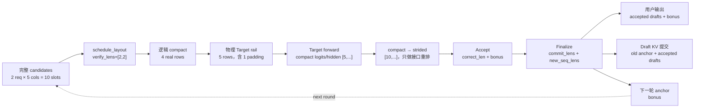
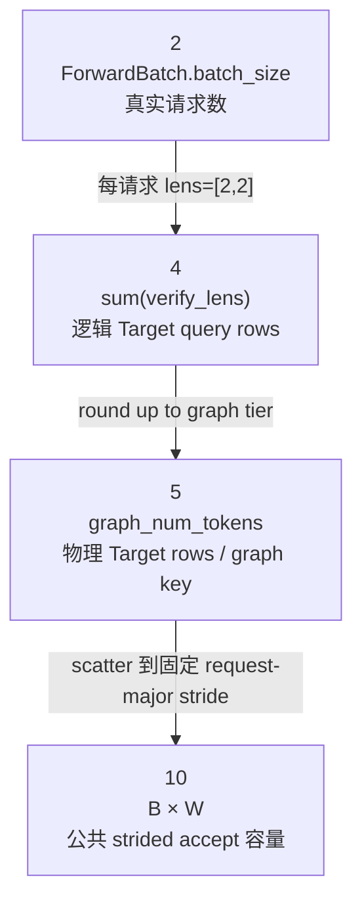
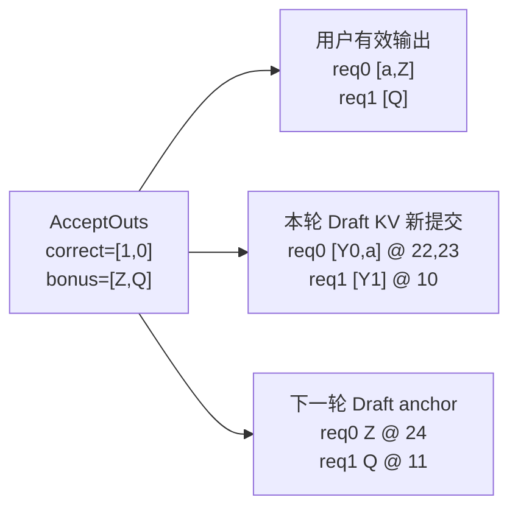

# SGLang dSpark Verify 可视化拆解

> 用途：配合
> [`sglang-dspark-single-round-decode.md`](sglang-dspark-single-round-decode.md) 第 7～12 节阅读，
> 用同一组多请求数据观察 `layout → compact Target forward → strided accept → KV commit →
> rolling anchor`。本页只负责建立视觉坐标；源码证明和 feature boundary 以主文档为准。
>
> 当前源码基线：本地 checkout `f01a0c7f97ec`，核对日期 2026-08-13。
>
> 验证级别：source-verified、runtime-unvalidated。本文没有运行 CUDA/Triton。
>
> 交互版本：[`dSpark Verify 源码逐步执行讲解器`](visualizations/dspark-verify-step-through.html)。
> 这是可本地离线打开的项目内 HTML 页面，共用课程的目录、搜索和明暗主题。分享时保留整个 `notes/` 的相对目录关系，包含实验 `assets/` 与课程公共资源；无需 iframe、CDN 或对话临时路径。
> 它按真实调用链拆为 12 步，每步同时展示 caller/callee、当前源码、输入、状态写入、返回值、
> 下一消费者以及同一 token 的跨阶段坐标；本页下面的静态图作为快速复习保留。
>
> Target hidden 如何变成 Draft 多层 K/V，可单独打开
> [`dSpark Target Hidden → Draft KV 逐步讲解器`](visualizations/dspark-target-hidden-kv-explainer.html)。


前置：[单轮 Decode 主文 §7–12](sglang-dspark-single-round-decode.md#verify-layout)。

本文负责：固定双请求的坐标练习和交互入口；完成后回到 [两轮时间线](sglang-dspark-single-round-decode.md#two-rounds) 验证状态能继续消费。

## 1. 固定一组贯穿全页的数据

```text
B = 2                         真实请求数
G = gamma = 4                 每请求 draft 数
W = G + 1 = 5                 anchor + 4 drafts
prefix_lens = [22,10]
raw budget = 2                mandatory anchor floor 之外的 batch-global extra slots

req0 candidates = [Y0,a,b,c,d]
req1 candidates = [Y1,e,f,g,h]

current survival top-2 = req1-pos0、req0-pos0
verify_lens             = [2,2]
qo_indptr               = [0,2,4]
extend_start_loc        = [0,2]
logical total           = 4
graph_num_tokens        = 5
```

`verify_lens` 包含 anchor。因此 `[2,2]` 表示每请求验证 `anchor + 第一个 draft`，每请求最多接受
的 draft 数是 `verify_len-1=1`。

## 2. 一张图先看完整闭环



## 3. 视图一：矩形 candidates 如何变成 compact flat rails

### 3.1 完整候选矩形

```text
logical candidate column   0       1       2       3       4
                           anchor  draft1  draft2  draft3  draft4

req0                       Y0      a       b       c       d
req1                       Y1      e       f       g       h
```

这只是完整 `[B,W]` 候选空间，不代表 COMPACT 本轮一定 forward 10 行。

### 3.2 `verify_lens=[2,2]` 选择每请求的连续前缀

```text
req0  [Y0, a | b, c, d]
       └ valid ┘  本轮不验证

req1  [Y1, e | f, g, h]
       └ valid ┘  本轮不验证
```

只能选择前缀，不能选择不连续位置。`d2` 的 Target 上下文依赖 `d1`；跳过 `d1` 而单独验证
`d2` 没有正确的 causal history。

### 3.3 gather 为三条对齐的 flat rail

```text
compact row                0       1       2       3       4
request/within             r0/0    r0/1    r1/0    r1/1    padding

verify_ids                 Y0      a       Y1      e       0
positions                  22      23      10      11      0
verify_cache_loc           L0_22   L0_23   L1_10   L1_11   0
```

这里：

```text
qo_indptr=[0,2,4]       → req0 compact rows [0,2)，req1 rows [2,4)
extend_start_loc=[0,2]  → 两个真实请求在上述 flat rails 中的起点
graph_num_tokens=5      → 物理 rail 容量；row 4 是 graph-tier padding
```

padding 的 `verify_cache_loc=0` 只是物理占位值，没有真实请求/KV 语义；它和后面 scatter 实现用于
吸收无效写入的 `sink` row 不是同一个对象。

## 4. 视图二：`2 / 4 / 5 / 10` 是四个不同维度



| 数量 | 是什么 | 不是什么 |
|---:|---|---|
| `2` | 真实请求数 | 不是 Target token 行数 |
| `4` | 原始 layout 中属于真实请求的 query 行数 | 不是 graph 静态 shape |
| `5` | Target 本轮处理的物理 compact/padding 行数 | 不是 5 个请求 |
| `10` | accept 公共接口的固定 `[B,W]` 容量 | 不是第二次 Target forward 10 行 |

## 5. 视图三：从 Worker 到 Target 的时序

在 [Verify 逐步讲解器](visualizations/dspark-verify-step-through.html) 中沿以下三个交接检查坐标。
完整动态分发、两次 graph `load_batch()` 与 metadata pre-plan 的源码证明，统一见
[主文 §8](sglang-dspark-single-round-decode.md#target-verify)。

| 交接 | 本例应观察到的状态 | 练习 |
|---|---|---|
| `VerifyPlanner → TargetVerifyExecutor.run_compact()` | `verify_lens=[2,2]`，3 条 rails 各长 5 | 指出第 5 行为什么不增加请求数 |
| `DFlashVerifyInput → Target TpModelWorker` | `batch_size=2`，`TARGET_VERIFY`，输入 5 行 | 区分请求轴、物理 token 轴和 runner 选择 |
| Target worker → verify executor | `is_verify=True` 返回 logits/hidden `[5,...]` | 找到尚未产生 `correct_len/bonus` 的返回边界 |

Graph 不可用时仍可走 eager compact；`layout=None` 才更早退回 full-width non-compact。
把“是否 compact”和“是否回放 graph”作为两个独立开关观察。

## 6. 视图四：Target 每行 logits 在预测什么

```text
physical row  input token   context                 next-token logits 用途
0             Y0            ... Y0                  验证 draft a
1             a             ... Y0 a                req0 边界/bonus 分布
2             Y1            ... Y1                  验证 draft e
3             e             ... Y1 e                req1 边界/bonus 分布
4             padding       synthetic physical row  无真实请求语义
```

Target 某一行 logits 预测的是“该输入 token 之后”的 token，不是在判断同一行 token。刚从
`_run_ragged()` 返回时：

```text
next_token_logits = [5,V]
hidden_states     = [5,H_aux]
```

此时 `TargetVerifyResult` 还没有 `correct_len`、`bonus` 或 `commit_lens`。

## 7. 视图五：compact `[5,...]` 为什么又变成 strided `[10,...]`

公共 greedy/sampling accept 逻辑按每请求固定宽度 `W=5` 消费数据，因此 `run_compact()` 需要把
有效 compact rows 放回请求主序矩形：

```text
compact row → strided row
0 (Y0)      → 0  = req0 col0
1 (a)       → 1  = req0 col1
2 (Y1)      → 5  = req1 col0
3 (e)       → 6  = req1 col1
4 (padding) → sink，不进入返回的 10 rows
```

结果：

```text
req0 strided logits/hidden = [row(Y0), row(a),  Ø, Ø, Ø]
req1 strided logits/hidden = [row(Y1), row(e),   Ø, Ø, Ø]
```

`Ø` 是 `fill_value=0` 的无效 logits/hidden lane，不是 token id 0，也不是“Target 预测概率为 0”。
`5→10` 只做数据布局恢复，不会再次执行 Target Transformer。普通路径调用
`ScatterCompactToStrided`；graph epilogue 可把相同 scatter 折进 captured graph tail。

## 8. 视图六：Accept、输出、KV、下一 anchor 必须拆成三条线

为了让两个请求都覆盖一种结果，假设 greedy Target 对齐预测为：

```text
req0 Target predictions: [a,Z]   → a 匹配
req1 Target predictions: [Q,R]   → e 在第一步就不匹配
```

因此：

```text
correct_len   = [1,0]
bonus         = [Z,Q]
commit_lens   = correct_len + 1 = [2,1]
new_seq_lens  = prefix_lens + commit_lens = [24,11]
```

三条结果线如下：



固定 `out_tokens[B,W]` 工作缓冲可能仍包含未消费尾部；真正有效输出由 `accept_lens=commit_lens`
限定。用户输出与 KV 提交即使长度相同，token 内容仍错开一位：

```text
用户输出：       [accepted drafts, bonus]
本轮 KV 提交：   [old anchor, accepted drafts]
下一轮 anchor：  bonus
```

bonus 本轮只是 Target 输出，没有作为 Transformer 输入，因而尚无自己的 hidden/KV；它在下一轮
才成为 anchor。

Sampling 边界：若不是 greedy，第一次拒绝后的 bonus 从修正后的 residual distribution 随机采样，
不保证等于 Target argmax；三条 rolling-anchor 状态关系不变。

## 9. 视图七：一个 token 的 Target hidden 如何变成 Draft 多层 K/V

本节继续跟踪固定例子中被接受的 `a`。在
[Target Hidden → Draft KV 讲解器](visualizations/dspark-target-hidden-kv-explainer.html) 中，
分别指出 token 坐标、Target 层坐标、Draft 层坐标与 KV slot，避免把它们合成一个轴。

```text
a @ position 23，物理 slot L0_23
  → 选定 Target layers 的 hidden features
  → concat + project_target_hidden → 一个 Draft context vector u_a
  → 各 Draft layer 用自己的 KV projection
  → 每层各写 K_a / V_a 到该层的 slot L0_23
```

各 Draft 层拥有不同权重，写入的 K/V 不是同一份值的多份复制。完整选层、feature 融合、RoPE、
projection 和写入调用链集中在 [主文 §11](sglang-dspark-single-round-decode.md#kv-commit)。

回到本页的 COMPACT + greedy 数据，核对哪些 Target hidden 会被提交：

| 请求 | Target 本轮真实输入 | 本轮提交到 Draft KV | 下一 anchor，尚无自己的 hidden/KV |
|---|---|---|---|
| req0 | `[Y0,a]` | `[Y0@22,a@23]` | `Z@24` |
| req1 | `[Y1,e]` | `[Y1@10]`；`e` 已计算但未接受 | `Q@11` |

自检：同样被 Target forward 过，为什么 `a` 写入 Draft KV 而 `e` 不写？答案必须同时引用
第 8 节的 `correct_len` 和本节的输入行坐标。

## 10. 模式矩阵：什么会改变，什么不会

| 模式/执行 | Target 实算布局 | layout 的作用 | Accept |
|---|---|---|---|
| STATIC | 完整 `B×W` | `None`；不是跳过 verify | greedy/sampling 正常执行 |
| CAP_ACCEPT + layout | 完整 `B×W` | 只提供接受深度 cutoff | 截到 `verify_len-1` |
| COMPACT + layout | `graph_num_tokens`，可能含 padding | 同时控制 gather 与 cutoff | scatter 后复用公共 accept |
| COMPACT + `layout=None` | 完整 `B×W` non-compact fallback | 无 cutoff | 正常执行 |
| Decode Graph | 固定 token tier replay | backend 构造 padded physical metadata | 可选 folded epilogue |
| Eager compact | 仍是 compact physical rail | 使用原始 logical geometry | graph 外 scatter/accept |

`proposal.folded=True` 只代表 Draft sampler tail 折进 Draft graph；Target 的 folded accept 还要求
COMPACT、Target graph replay、greedy、无 grammar/额外 logits adjustment/模拟 accept 等条件。
folded commit 又要求 KV pool 有融合写接口。优化可以改变执行位置，不能改变输出、commit 和 next
anchor 的语义。

## 11. 源码动作 / 改变状态 / 为什么

| 源码动作 | 改变状态 | 为什么 |
|---|---|---|
| `ScheduleVerifyLensTopk` | `C_t + budget → verify_lens` | 历史决定多少，当前决定分给谁 |
| `RaggedVerifyLayout` | `[2,2] → offsets + graph tier` | 同时描述逻辑请求边界与物理容量 |
| `BuildRaggedVerifyWindow` | 矩形 candidates → 三条 compact rails | Target 只处理选中的连续前缀及 tier padding |
| `prepare_for_verify` | `ScheduleBatch → TARGET_VERIFY ForwardBatch` | 在 forward 前完成 graph/eager metadata pre-plan |
| Target forward | 产生 compact logits/hidden | 为每个候选位置提供 Target 分布和 commit hidden |
| compact-to-strided | `[5,...] → [10,...]` | 复用固定宽度公共 accept 接口 |
| accept/finalize | 产生正确长度、bonus 和新长度 | 把候选评分变成正式生成状态 |
| hidden inject | 提交 `[anchor, accepted drafts]` | 下一轮 Draft 必须拥有已确认历史的 KV |
| `make_next_draft_input` | bonus 成为新 anchor | 补上本轮尚未拥有的 bonus hidden/KV |

## 12. 对照主文完成练习

源码索引只在 [单轮 Decode 主文](sglang-dspark-single-round-decode.md) 维护；本页按问题跳到对应
推导，交互页面承担逐步观察。

| 本页练习 | 主文中的证明 | 交互入口 |
|---|---|---|
| `budget → verify_lens` | [§7 layout 与预算](sglang-dspark-single-round-decode.md#verify-layout) | [Verify 逐步讲解器](visualizations/dspark-verify-step-through.html) |
| `2/4/5/10` 与 scatter | [§8 Target Verify](sglang-dspark-single-round-decode.md#target-verify) | [Verify 逐步讲解器](visualizations/dspark-verify-step-through.html) |
| `correct_len/bonus` | [§9 Accept](sglang-dspark-single-round-decode.md#accept) | [Verify 逐步讲解器](visualizations/dspark-verify-step-through.html) |
| 输出与 KV 错开一位 | [§11 KV 提交](sglang-dspark-single-round-decode.md#kv-commit) | [Target Hidden → Draft KV](visualizations/dspark-target-hidden-kv-explainer.html) |
| 下一轮如何延续 | [§13 两轮时间线](sglang-dspark-single-round-decode.md#two-rounds) | [Verify 逐步讲解器](visualizations/dspark-verify-step-through.html) |

完成前回答：

1. 为什么 Target 输入容量是 5，`ForwardBatch.batch_size` 仍是 2？
2. compact row 2 在 strided 接口对应哪一行，它的 logits 验证哪个 token？
3. req1 的 `e` 有 Target hidden，为什么不提交到 Draft KV？
4. 本轮结束时，`Z/Q` 分别会以什么 position 成为下一轮输入？

